## Problem and requirements

A backup and disaster recovery platform protects databases, virtual machines, filesystems, object stores, and application configuration from accidental deletion, corruption, infrastructure failure, and ransomware.

Copying bytes is only the beginning. A useful backup must be internally consistent, complete, encrypted, retained under policy, isolated from compromised administrators, and restorable within a defined time. Recovery—not backup completion—is the final correctness test.

### Functional requirements

- Discover resources and assign backup policies
- Create crash-consistent and application-consistent recovery points
- Capture full, incremental, and continuous changes
- Deduplicate, compress, encrypt, and replicate backup data
- Apply retention, legal hold, and immutable lock policies
- Search recovery points and inspect coverage
- Restore whole resources, selected files, or point-in-time database state
- Orchestrate multi-service disaster recovery
- Verify backup integrity and run recovery drills
- Export audit evidence and recovery reports

### Non-functional requirements

- Protect 100 petabytes across ten million resources
- Never report a recovery point successful if required data is missing
- Preserve backup data through zone and regional failures
- Isolate the backup plane from production credentials and deletion paths
- Meet workload-specific recovery point and recovery time objectives
- Avoid materially degrading protected workloads
- Make capture and restore resumable and idempotent
- Detect latent corruption before an emergency

The system cannot guarantee business continuity without application ownership. Dependencies, credentials, DNS, network policy, and external services must be included in recovery plans.

## Recovery objectives

Two objectives drive design:

- **Recovery point objective (RPO):** maximum acceptable data loss measured in time
- **Recovery time objective (RTO):** maximum acceptable time to restore service

```mermaid
timeline
  title Recovery objectives after a failure
  10:00 : Last protected recovery point
  10:05 : Failure occurs
  10:05 : RPO equals five minutes of potential change loss
  10:05 : Recovery begins
  10:35 : Service restored — RTO equals thirty minutes
```

Daily snapshots cannot meet a five-minute RPO. Cold archive cannot meet a ten-minute RTO. Policy must align capture frequency, storage tier, replicas, and restore compute with actual objectives.

## Capacity estimates

Assume 100 petabytes of logical protected data, ten million resources, a 5% daily change rate, and multiple retained versions.

| Resource | Estimate |
| --- | ---: |
| Protected logical data | 100 PB |
| Daily changed data | 5 PB before deduplication |
| Protected resources | 10M |
| Recovery points | Billions |
| Metadata and chunk records | Trillions |
| Restore bandwidth | Sized for regional emergencies |

Deduplication reduces physical storage, but retention and immutability can keep old unique chunks for years. Restore bandwidth, not capacity, often determines disaster RTO.

## Backup policy model

A policy defines:

- Resource selector and owner
- Capture method and frequency
- RPO and RTO class
- Retention schedule
- Storage tiers and replica regions
- Encryption and key ownership
- Immutability and legal-hold rules
- Verification frequency
- Allowed restore destinations

Policies are versioned. Every recovery point records the exact policy applied.

Resource discovery continuously checks for uncovered assets. Newly created production data should not wait for a manual registration step.

## High-level architecture

The control plane schedules protection and tracks metadata. Agents and provider integrations capture data into an isolated immutable storage plane.

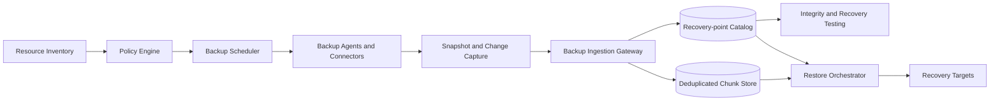

The backup plane uses separate identities, accounts, keys, networks, and administrative roles from production. A compromised production account should not be able to erase its own backups.

## Resource discovery and coverage

Connectors inventory databases, volumes, file shares, buckets, clusters, and application manifests through read-only control-plane APIs.

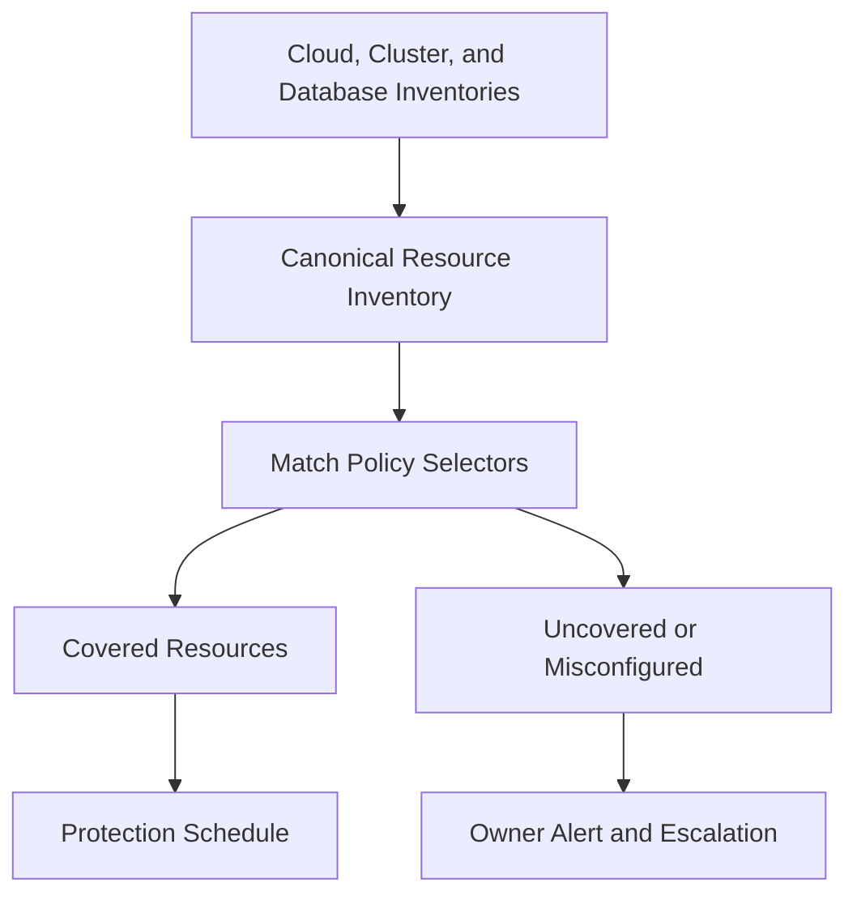

Tags help assign policy but are not sufficient alone; a user can remove them accidentally. Enforce organizational defaults for critical scopes.

Coverage dashboards show resource, data size, last successful recovery point, achieved RPO, verification status, and owner.

Deletion of a source resource never automatically deletes its recovery points.

## Consistency levels

### Crash-consistent

Capture storage as if power were lost at one instant. Filesystems and databases replay journals during restore, but in-flight application transactions may be incomplete.

### Filesystem-consistent

Freeze writes briefly, flush buffers, and capture a coordinated filesystem snapshot.

### Application-consistent

Ask the application to quiesce, flush transactional state, and provide a checkpoint or log position. This produces the strongest recovery point but requires application integration.

The recovery-point metadata states the achieved level. If a quiesce hook fails, policy decides whether to fail or explicitly record a downgraded snapshot.

## Coordinated snapshots

Applications may span several volumes and databases. A consistency group creates one logical recovery point.

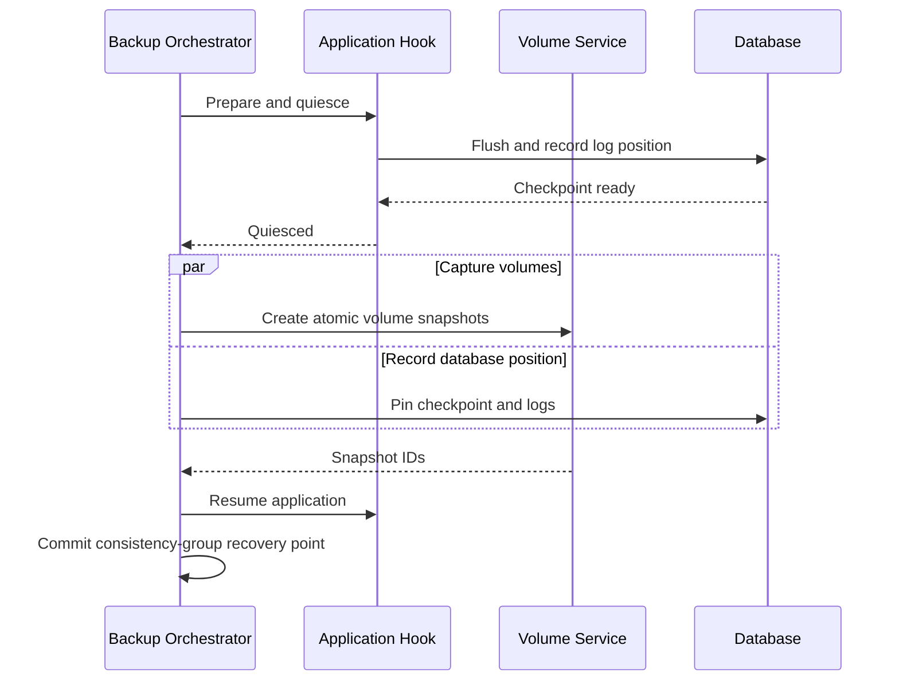

Bound the freeze window. If every member does not succeed before the deadline, abort the group or mark it incomplete—never present a mixed-time set as consistent.

## Full and incremental capture

A full backup copies every logical block or file. Incrementals capture only changes since a prior recovery point.

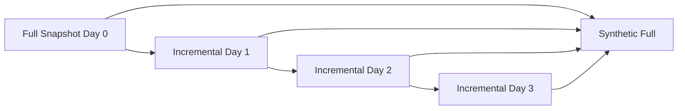

Incremental-forever systems use changed-block tracking, filesystem journals, database logs, or object manifests. They reduce source reads and network traffic.

A synthetic full creates a new logical manifest from prior chunks without rereading production. This shortens restore dependency chains while reusing physical data.

If change tracking is lost or inconsistent, perform a verified full scan rather than assuming no change.

## Continuous data protection

For low RPO, capture transaction logs or change streams continuously between snapshots.


Checkpoints link a base snapshot to the exact first log position. Gaps make later point-in-time recovery invalid.

Retain logs long enough for snapshot verification, replication, and the maximum recovery window. Monitor time remaining before a missing log segment breaks the chain.

Restore can stop before an accidental deletion or corruption event.

## Chunking and deduplication

Split data into chunks and address each by cryptographic digest.

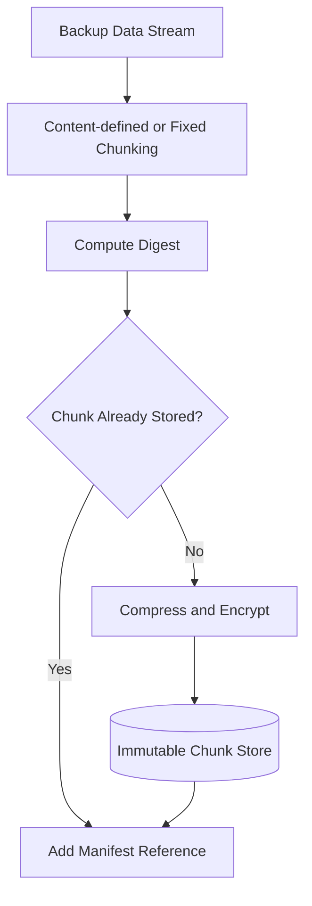

Content-defined chunking preserves deduplication when bytes are inserted near the beginning of a file. Fixed chunks are simpler and faster for block storage.

Deduplicate within a security domain. Cross-tenant deduplication can leak whether confidential data exists through timing or quota side channels.

Digest verification occurs before reuse and after every read.

## Encryption

Encrypt chunks with unique data keys and wrap them under vault- or tenant-scoped keys.

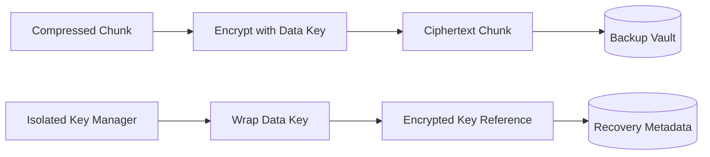

Backup keys are isolated from production key administration. Deleting or disabling a production encryption key should not accidentally destroy authorized recovery unless policy explicitly requires that dependency.

Customer-managed keys need documented key-loss consequences and protected backup or escrow procedures where appropriate.

Key rotation usually rewraps data keys rather than rewriting all backup bytes.

## Ingestion and recovery-point commit

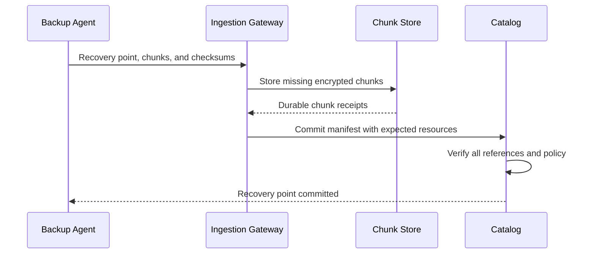

A recovery point becomes successful only after every required chunk, log position, schema record, and application manifest is durable.

Stable job and chunk IDs make retries idempotent. Partial uploads remain invisible and expire after a grace period.

The catalog stores checksums and counts that later verification can compare.

## Recovery-point manifest

The immutable manifest records:

- Resource identity and source version
- Start, checkpoint, and completion time
- Consistency level
- Parent recovery point and log boundaries
- File, block, object, or database manifests
- Chunk digests and encryption references
- Application and infrastructure configuration
- Policy, agent, schema, and format versions
- Validation results and warnings

Sign the manifest so unauthorized metadata modification is detectable.

Human-readable status is derived from the manifest, not stored as an unsupported claim.

## Retention policy

Retention commonly combines hourly, daily, weekly, monthly, and yearly recovery points.

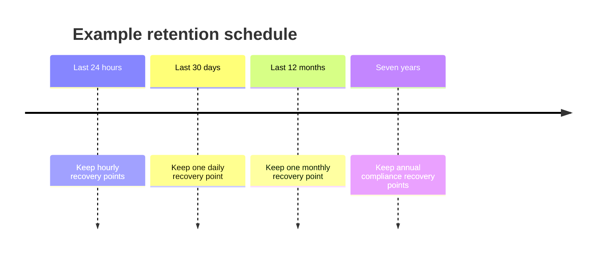

Selecting which manifests to retain is easy; deleting physical chunks requires reference accounting across every retained point.

Policy changes apply prospectively unless an authorized action explicitly changes existing locks. Shortening retention is high risk and may require multi-party approval.

Legal holds pin selected resources and recovery points independently from normal lifecycle rules.

## Immutable vaults

An immutable vault enforces write-once retention at the storage and metadata layers.

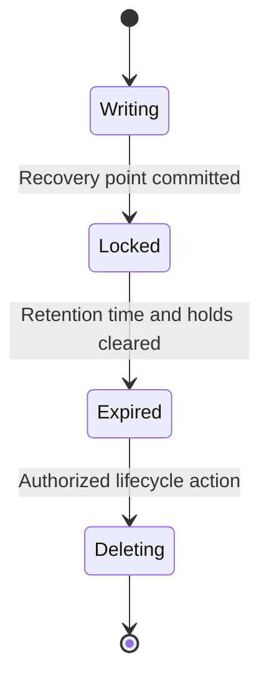

Ordinary administrators, compromised production roles, and automation cannot shorten the lock or overwrite stored bytes.

Use separate credentials and multi-party control for vault policy. Clock integrity is security critical because retention depends on time.

Replicate immutability state with data; a writable replica is not an immutable backup.

## Catalog and metadata design

The catalog maps tenants, resources, policies, jobs, recovery points, chunk manifests, legal holds, restores, and verification evidence.

Partition by tenant and stable resource ID. Use consensus for recovery-point state and retention changes.

Large file and block manifests live as immutable objects; the transactional catalog stores their roots and searchable summaries.

Maintain secondary indexes by resource, time, application, region, and verification status so operators can find recovery points without scanning storage.

Back up the backup catalog independently. Chunks without manifests are not practically restorable.

## Integrity verification

Verification has several layers:

- Check metadata signatures and manifest completeness
- Verify chunk checksums and encryption authentication tags
- Sample or fully scrub stored bytes
- Reconstruct filesystems and database pages
- Boot or mount recovered systems in isolation
- Run application-level health and data checks


A checksum proves bytes match the backup, not that the source was logically healthy. Application validation detects backed-up corruption and incomplete dependencies.

Prioritize verification by criticality, age, storage tier, and time since last test.

## Restore planning

A restore request specifies source recovery point, target, scope, networking, identity, and desired point in time.

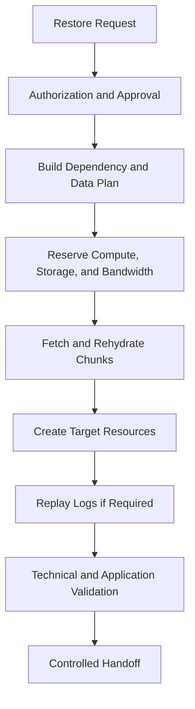

The planner verifies every required chunk and log before destructive cutover begins. It estimates time from tier retrieval, bytes, bandwidth, and replay volume.

Restore into a new target by default. In-place overwrite requires explicit high-risk approval.

## File and object restore

File restore walks a pinned manifest, fetches only required chunks, verifies them, and recreates metadata according to target capabilities.

Object restore can copy selected object versions into a new bucket or prefix. Preserve source version and checksum in restore metadata.

Handle permissions, ownership, links, sparse files, alternate streams, and case sensitivity explicitly. Cross-platform restore may not preserve every attribute.

Path inputs are untrusted. Prevent traversal and never let a malicious backup write outside the target root.

## Database restore

Restore a base snapshot into an isolated database, replay ordered logs through the target timestamp, recover transactions, and validate consistency.

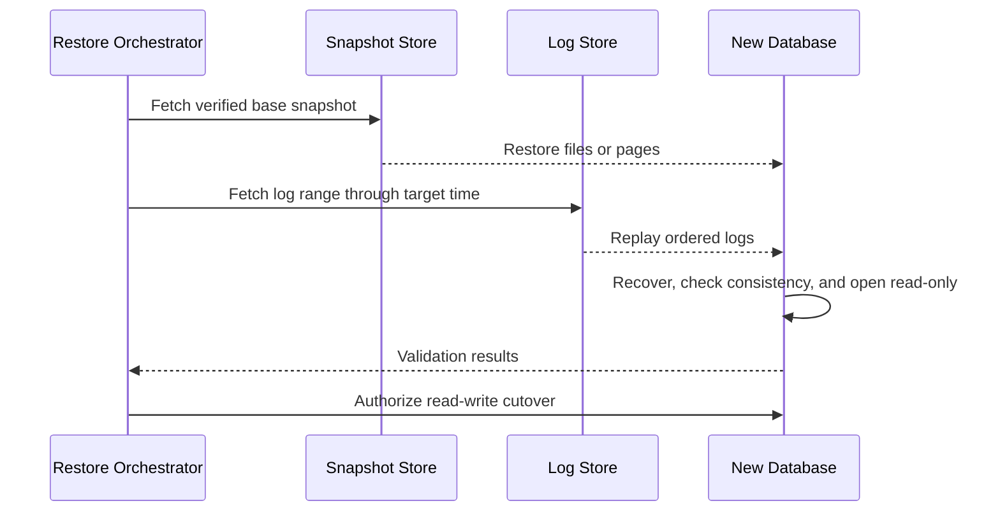

Database version, extensions, collation, encryption, and topology must be compatible. Store these dependencies with the recovery point.

Never expose the restored database to applications before replay and validation complete.

## Disaster recovery plans

A recovery plan models service dependencies and ordered stages.

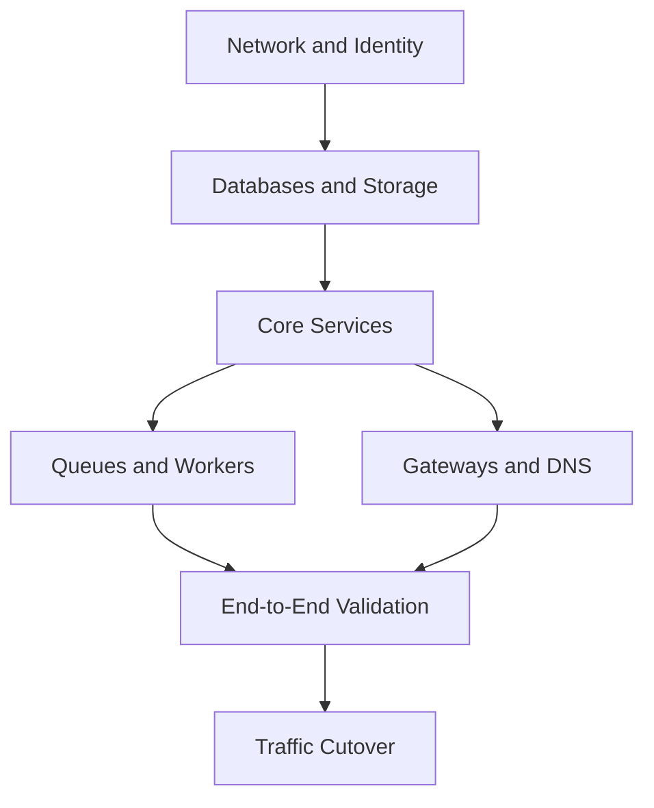

Stages run in parallel where safe. Each has readiness checks, timeout, retry, and manual gate.

The plan pins recovery points that are mutually consistent enough for the application. Restoring each database to an unrelated “latest” point can violate cross-service invariants.

DNS, certificates, secrets, configuration, and external integrations belong in the plan, not only data volumes.

## Clean-room recovery

Ransomware recovery needs an isolated environment that compromised identities and networks cannot reach.

Build new accounts, identity roots, networks, keys, and administrative workstations from protected templates. Restore and scan data before connecting to production or the internet.

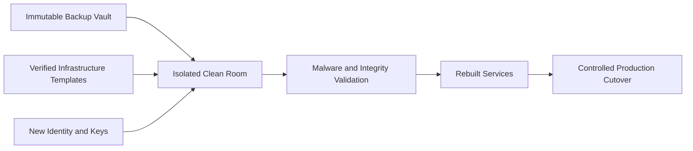

Do not reuse potentially stolen production credentials. Preserve forensic evidence separately from the clean recovery path.

Practice clean-room creation before an incident; manual account and network setup can dominate RTO.

## Regional replication

Replicate manifests and encrypted chunks to independent regions according to policy.

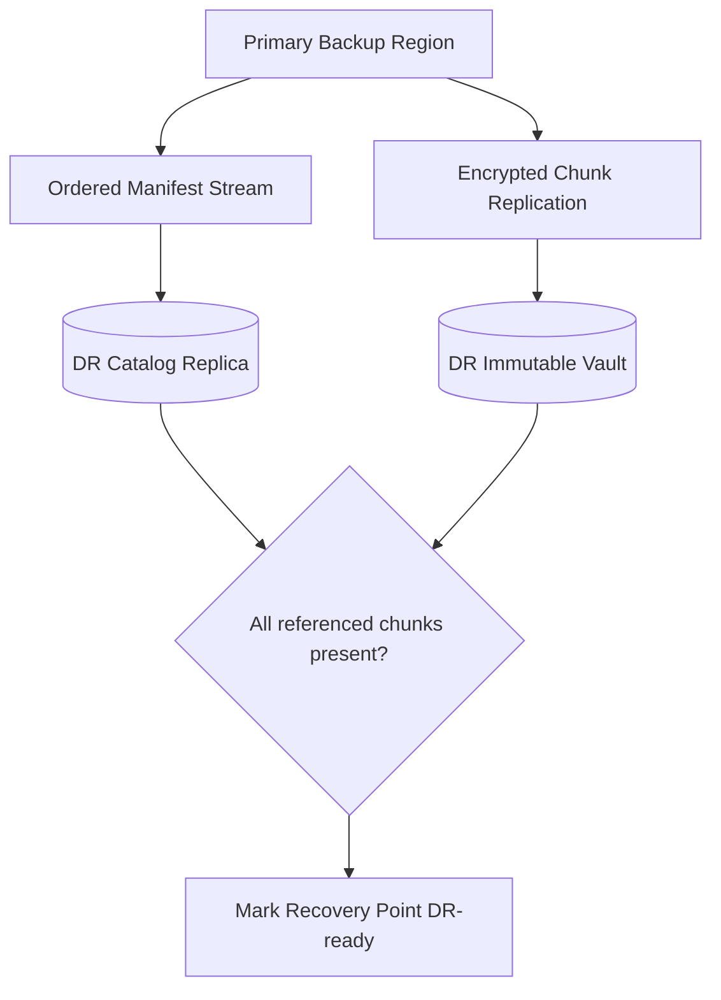

Never advertise a recovery point as regionally protected until its manifest, chunks, keys, and logs are complete and verified.

Replication lag is an additional disaster RPO. Expose it separately from source capture RPO.

Use independent failure domains and credentials; two buckets in the same administrative account may share the same compromise risk.

## Bandwidth and restore capacity

Backups can run slowly for hours, but disaster restores face strict deadlines. Reserve network and compute capacity for recovery.

Throttle capture to protect production latency. Use changed-block tracking, local compression, and regional gateways to reduce traffic.

During disaster, prioritize critical services and recovery-plan stages. Bulk low-priority restores must not consume all vault egress or decryption capacity.

Periodically measure achieved restore throughput with realistic datasets. Theoretical link speed ignores object request rate, decrypt, decompression, and target write limits.

## Multi-tenancy and authorization

Separate permissions for policy management, backup execution, restore browsing, data restore, retention change, legal hold, key administration, and vault deletion.

Restoring data is equivalent to reading it. A user allowed to operate backups should not automatically be allowed to restore sensitive records elsewhere.

Apply tenant quotas to protected bytes, snapshot rate, agents, bandwidth, retention, verification, and concurrent restores.

Large or regulated tenants can receive dedicated vaults, keys, networks, and regional placement.

Every high-risk action includes actor, reason, approval, ticket, target, and immutable audit record.

## Deletion and source lifecycle

Source deletion and backup deletion are separate operations. A deleted production resource may retain backups under policy or legal hold.

When retention expires:

1. Mark the recovery point expired
2. Verify no hold, active restore, or dependent synthetic full needs it
3. Remove its manifest roots
4. Recompute or decrement chunk reachability
5. Delay and recheck
6. Delete unreferenced replicas and wrapped keys
7. Record deletion evidence

Never delete chunks directly from a source-resource event. Shared deduplicated data may support other recovery points.

## Failure handling

### Backup agent crashes

Resume from durable snapshot or chunk progress. Uncommitted recovery points remain unavailable and later expire.

### Source snapshot fails

Abort the consistency group or record an explicit degraded result according to policy. Do not claim success from partial members.

### Chunk store unavailable

Pause manifest commit and buffer only within safe local limits. Source snapshots may remain pinned temporarily but must not exhaust production storage.

### Catalog unavailable

Stored chunks remain safe. New recovery-point commits and restore planning pause until authoritative metadata recovers.

### Replication behind

Continue local protection, expose reduced disaster coverage, and prioritize critical recovery points.

### Corrupt chunk

Read another replica, verify reconstruction, repair the bad copy, and mark every dependent recovery point at risk until redundancy returns.

### Key manager unavailable

Do not bypass encryption. Existing encrypted backups remain durable; capture or restore waits or uses a bounded protected key cache.

### Restore worker fails

Resume by deterministic task ID and completed chunk ranges. Never restart destructive cutover steps without checking target state.

## Observability

Track:

- Coverage and policy assignment
- Achieved RPO by resource
- Backup duration, throughput, changed bytes, and source impact
- Successful, partial, downgraded, and failed recovery points
- Deduplication and compression ratios
- Chunk durability, checksum failures, and repair age
- Catalog and manifest integrity
- Retention, legal hold, and deletion backlog
- Regional replication lag and DR-ready percentage
- Verification age and restore-test success
- Restore throughput, estimated completion, and validation failures
- Vault access and high-risk administrative actions

The top-level dashboard should answer: which critical resources cannot currently meet their RPO or RTO, and when was each last successfully restored?

Synthetic protected resources continuously test snapshot, incremental capture, deletion, replication, restore, and point-in-time replay.

## Key tradeoffs

### Frequent recovery points vs source cost

Short RPO requires continuous logs or frequent snapshots, increasing I/O and retained metadata. Capture methods must match workload tolerance.

### Global deduplication vs isolation

Broad deduplication saves capacity but creates confidentiality and deletion complexity. Deduplicate within explicit security domains.

### Long retention vs privacy and cost

History protects against slow corruption and ransomware but preserves sensitive data. Tiering, legal policy, and verified expiration set the balance.

### Immutable backups vs operational recovery

Immutability protects against attackers and mistakes but prevents quick cleanup. Separate immutable retention from ordinary administrative convenience.

### Backup success vs restore confidence

Checking that bytes arrived is cheap and insufficient. Test restores consume substantial resources but are the only evidence that data, metadata, keys, and procedures work together.

The central principle is that a backup is not successful when bytes are copied; it is successful when a verified, isolated recovery can restore the required application state within its promised objectives.
