## Problem and requirements

A public key infrastructure binds identities to public keys through signed certificates. Browsers use certificates to authenticate websites, services use them for mutual TLS, and devices use them to prove hardware or workload identity.

The system's core product is trust. A leaked signing key or incorrectly issued certificate can impersonate every identity in the affected scope. Availability still matters because expired certificates can take production offline, but safety takes priority over continuing issuance when trust cannot be established.

This design supports both a public web certificate authority and private organizational trust domains. Their validation policies differ, while the signing, lifecycle, audit, and revocation architecture share common foundations.

### Functional requirements

- Create and operate root and intermediate certificate authorities
- Register accounts and authorize certificate requests
- Validate control of domains, workloads, users, or devices
- Issue, renew, and revoke certificates
- Support automated enrollment and renewal
- Publish revocation and certificate-status information
- Append public certificates to transparency logs where required
- Rotate signing keys and trust chains safely
- Audit every privileged and issuance action
- Recover from regional failure and key compromise

### Non-functional requirements

- Manage one billion active certificates
- Issue up to 100,000 certificates per second
- Keep ordinary automated issuance available across zone failures
- Protect signing keys from extraction
- Prevent issuance when validation evidence is missing or stale
- Make every certificate traceable to policy and authorization evidence
- Keep revocation information highly available
- Support cryptographic agility and rolling trust transitions

Issuance should fail closed. Serving previously published certificates and status information can remain available during a control-plane outage.

## Capacity estimates

Assume one billion active certificates, 90-day default lifetimes, and a much shorter lifetime for workload identities.

| Resource | Estimate |
| --- | ---: |
| Active certificates | 1B |
| Peak issuance | 100K/second |
| Validation checks | Hundreds of thousands/second |
| Status queries | Millions/second |
| Audit retention | Multi-year, immutable |
| Transparency entries | Billions |

Short-lived workload certificates increase issuance volume but reduce dependence on revocation and limit exposure after key theft.

## Certificate and trust model

A certificate contains a subject identity, public key, issuer, serial number, validity interval, allowed uses, constraints, and issuer signature.

```text
root CA → intermediate CA → leaf certificate
```

Clients trust a root through an operating-system, browser, application, or organizational trust store. They validate every certificate in the chain, its name or identity, time window, constraints, permitted key use, and revocation policy.

The leaf private key should be generated and retained by the applicant whenever possible. The CA signs a request containing the public key; it does not need to receive the private key.

## PKI hierarchy

Use a deeply protected offline root to sign narrower online intermediates.

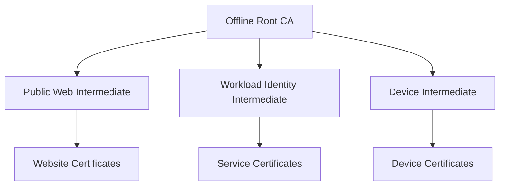

Separate intermediates by environment, identity type, region, algorithm, or risk boundary. A compromise then affects a narrower population.

Name constraints and policy constraints limit what each intermediate may issue. Operational policy reinforces cryptographic constraints rather than relying on database convention alone.

The root remains powered off or otherwise unavailable for routine issuance. Its ceremonies require multiple trusted participants.

## High-level architecture

The enrollment path validates requests and writes durable issuance intent. A dedicated signing tier performs narrowly authorized cryptographic operations.

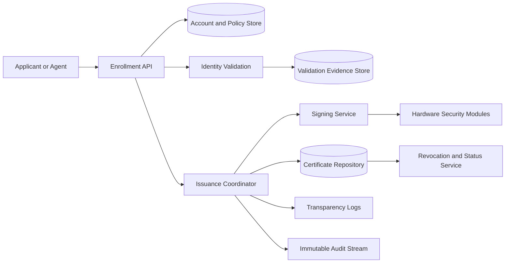

The signer accepts a canonical certificate template plus a policy authorization token. It cannot arbitrarily choose names, validity, or extensions.

## Root key ceremony

Root key generation and use occur in a controlled environment with documented hardware, software, participants, and evidence.


Use multi-party control so no single operator can activate, use, back up, or destroy the root key.

Record hashes, serials, timestamps, commands, and public outputs. Independent witnesses verify the ceremony without exposing key material.

Backups remain encrypted under separate custodial controls and are tested through scheduled recovery ceremonies.

## Hardware-protected signing

Intermediate private keys live in hardware security modules. Key material is generated inside the device and cannot be exported in plaintext.

The signing service authenticates every caller, verifies a short-lived authorization token, checks certificate policy again, applies rate limits, and records the resulting signature.

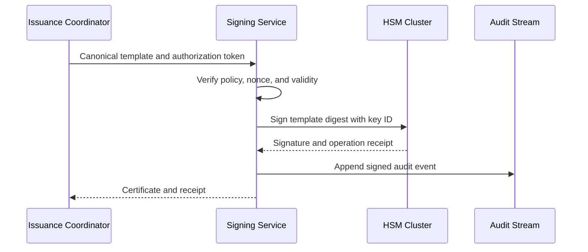

HSM capacity is limited. Batch only independent signing requests without obscuring per-certificate authorization and audit.

If audit durability required by policy is unavailable, issuance stops rather than producing untraceable certificates.

## Enrollment API

An applicant submits a certificate signing request and requested identifiers.

```http
POST /v1/certificates:issue
Authorization: Bearer <account-token>
Idempotency-Key: workload_checkout_20261020
Content-Type: application/json

{
  "profile": "workload-mtls",
  "csr": "<base64-encoded-csr>",
  "identifiers": ["spiffe://production/checkout/api"],
  "requestedLifetime": "24h"
}
```

The service verifies the request signature, public-key parameters, identifier syntax, profile, account authority, and proof of identity.

Idempotency is critical. Retrying after an ambiguous response should return the original certificate rather than consuming serials and audit space with duplicates.

## Automated web enrollment

An automated certificate protocol models account, order, authorization, challenge, and certificate resources.

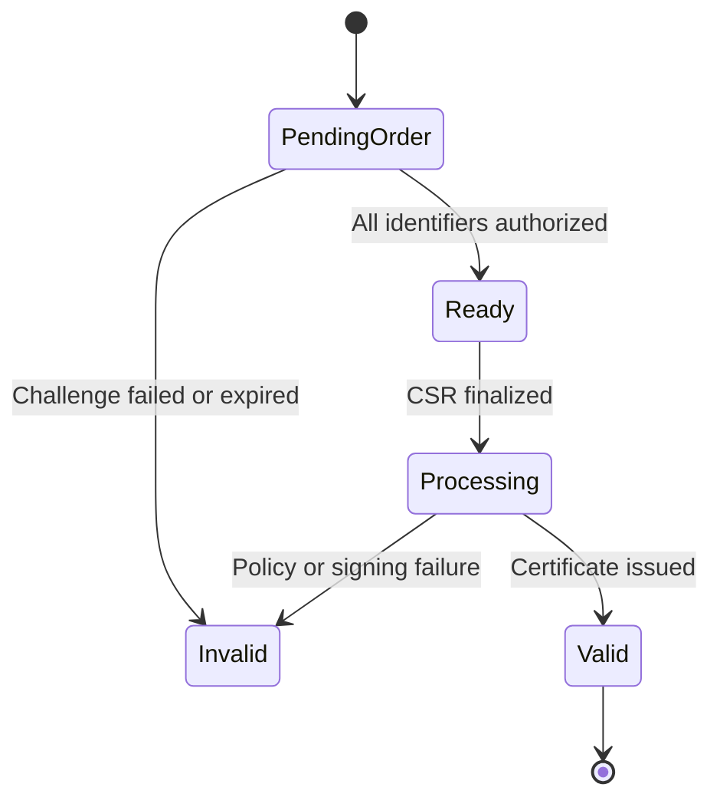

Accounts sign protocol requests with their own key, providing replay protection through server nonces and request URLs.

An order pins identifiers and authorization evidence. Finalization cannot add a new name absent from the original validated order.

## Domain-control validation

Common challenge types prove control through DNS, HTTP, or a protected TLS endpoint.

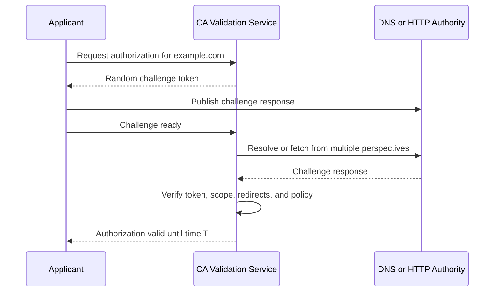

Challenge tokens are random, short-lived, single-purpose, and bound to the account and identifier.

Validate from independent networks to reduce routing or local-view attacks. Apply strict redirect, port, IP, and response-size rules to prevent server-side request forgery.

DNS validation observes authoritative answers and DNS security state where available. It must account for caching and delegation changes.

## Workload identity issuance

Workloads prove identity through signed platform attestations, mutually authenticated bootstrap credentials, or hardware evidence.

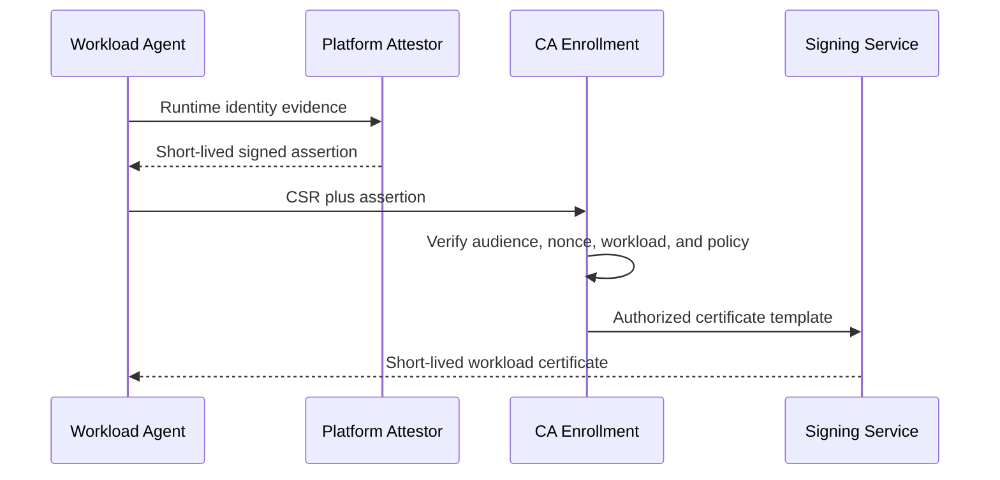

The requested identity must be derived from trusted evidence, not freely chosen by the workload.

Use short lifetimes, often hours or less, and automatic renewal. This limits the usefulness of stolen keys and reduces the need for massive revocation lists.

Production and development trust domains use separate intermediates and policies.

## Issuance pipeline

Issuance is a durable state machine.


Every transition is idempotent. A crash after signing but before response resumes from the stored signed certificate.

Serial numbers are unpredictable and globally unique within the issuer. Allocate them without a central hot counter.

The final certificate exactly matches the authorized template. Any change in names, key, lifetime, or extensions requires reauthorization.

## Certificate transparency

Public certificate transparency logs are append-only Merkle trees. They make issued certificates publicly auditable.

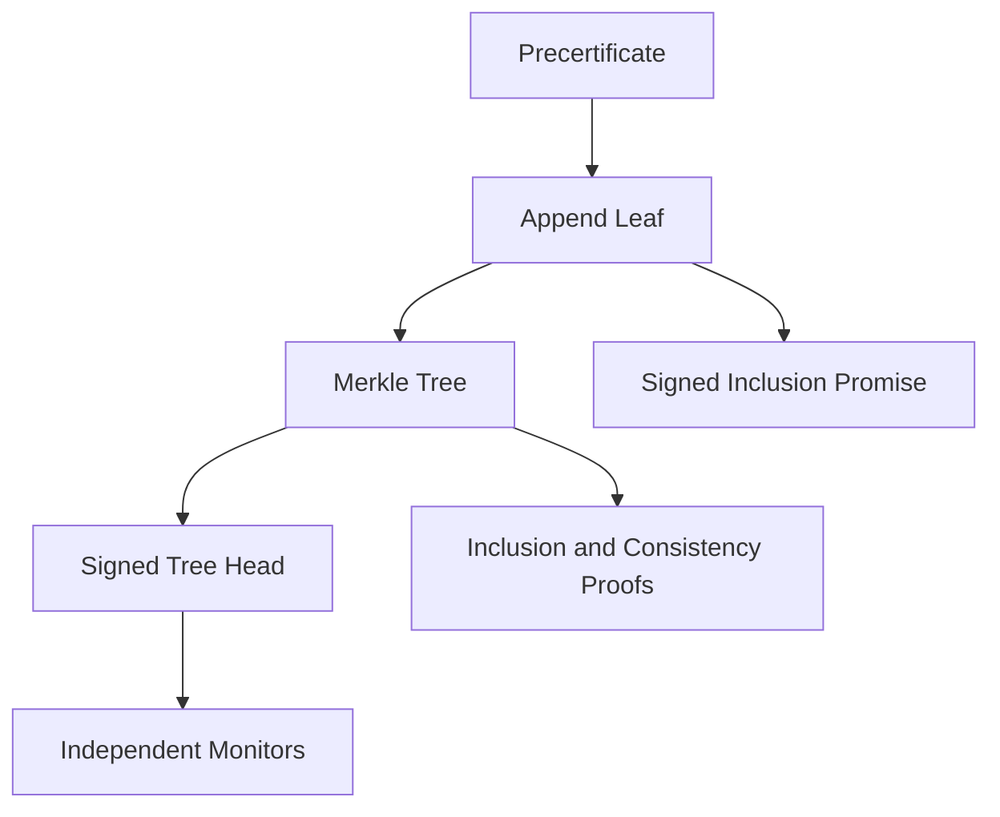

Logs return signed promises that clients can require with a certificate. Monitors watch for unauthorized names and inconsistent log views.

Submit to multiple independent logs according to browser policy. A log outage should not allow bypass; use other qualified logs or pause issuance when requirements cannot be met.

Private PKI may use an internal transparency log to detect unauthorized issuance without publishing sensitive names publicly.

## Revocation model

A certificate may be revoked after key compromise, authorization loss, mis-issuance, or supersession.

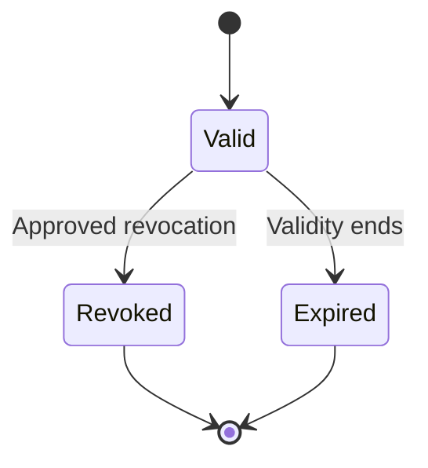

Revocation is irreversible for one certificate version. Reinstatement requires a new certificate.

Authenticate revocation through account keys, certificate private-key proof, authorized administrators, or verified incident workflows. High-impact CA revocation requires multi-party control.

Record reason, actor, evidence, approval, and effective time. Do not delay publication while waiting for nonessential downstream systems.

## Status protocols and revocation lists

Certificate revocation lists are signed snapshots of revoked serial numbers. Partition them by issuer or serial range to bound size.

Online status responders return signed status for one certificate. Precompute and cache responses so HSM operations are not required for every query.

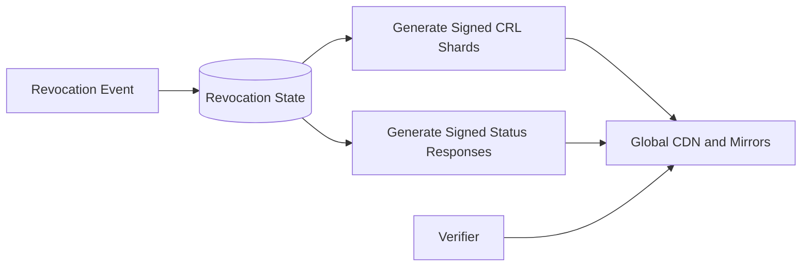

Status infrastructure must remain available during CA outages. Publish through independent global caches and mirrors.

Clients vary in revocation behavior. Short-lived certificates provide a stronger bounded exposure when online checking is unreliable.

## Renewal and rotation

Agents renew well before expiry with randomized scheduling. Renewal is new issuance using current policy and proof.

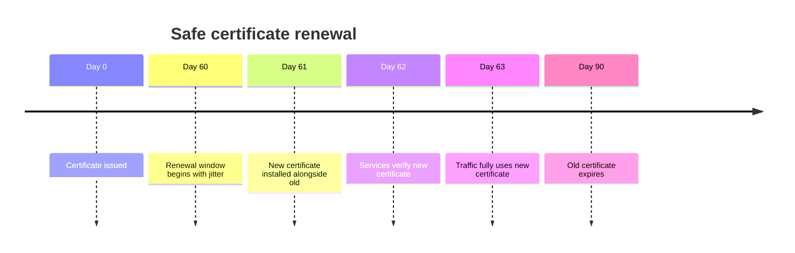

Overlap lets distributed services update without downtime. Servers can present the new certificate while clients still trust both chains.

Monitor fleet expiration distribution. A synchronized renewal wave can overload validation and signing just when service availability is at risk.

Agents retain the old credential only through a bounded rollback window and erase superseded private keys.

## Intermediate rotation

Introduce a new intermediate certificate before the old one expires. Distribute its chain, update issuance routing, and retain the old intermediate for validating existing leaf certificates.


Cross-signing can bridge trust-store transitions, but it creates multiple path-building choices and lengthens retirement. Use it deliberately and test major client populations.

The old signing key can be disabled after issuance stops while status services remain available from separate keys.

## Root transition

Root rotation is a multi-year ecosystem migration. New roots must enter trust stores long before relying exclusively on them.

Offer alternative chains for clients with different trust stores. Measure validation success through privacy-safe telemetry and external probes.

Do not assume every client performs path construction the same way. Embedded devices may have frozen trust stores and clocks.

Retiring a root requires accounting for every active intermediate, leaf lifetime, archival signature, device population, and legal retention obligation.

## Policy engine

Profiles define allowed identities, key algorithms, sizes, validity, extensions, usages, validation methods, and approval requirements.

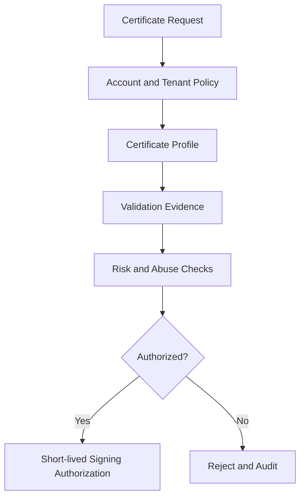

Policy versions are immutable and attached to certificates. A verifier can reconstruct why a certificate was eligible.

Emergency policy changes, such as blocking a vulnerable key type, propagate immediately to enrollment and signing. Cached authorizations expire quickly.

The signer independently enforces a smaller hard policy set even if the control-plane policy service is compromised.

## Abuse and mis-issuance prevention

Defenses include:

- Domain and identity rate limits
- High-risk name and account review
- Restricted labels and reserved namespaces
- Duplicate-certificate and validation-failure limits
- Independent validation perspectives
- Certificate transparency monitoring
- Separation between validation and signing roles
- Pre-issuance linting
- Real-time anomaly detection

For public certificates, check relevant authorization restriction records from DNS according to policy. Recheck near issuance rather than relying indefinitely on old evidence.

Automatic defenses must avoid making renewal failure an easy denial-of-service vector. Use graduated limits and preserve capacity for known existing customers.

## Private key generation options

Preferred: the applicant generates its key locally or inside secure hardware and sends only a signed request.

Managed key generation may be necessary for legacy users. Generate inside a protected module, encrypt immediately to the intended recipient, and make retrieval single-use with short expiry.

The CA must never retain recoverable leaf private keys unless escrow is an explicit, separately governed product requirement.

Key type and size policy considers security, performance, client compatibility, and cryptographic agility.

## Multi-tenancy

Tenant namespaces isolate accounts, profiles, validation records, certificate inventory, and private trust domains.

Public web issuance shares publicly trusted intermediates but applies tenant-scoped authorization and quotas. Private PKI can use dedicated intermediates or key hierarchies for stronger isolation.

Apply quotas to orders, validations, issuance, revocation, status traffic, certificate count, and audit exports.

A tenant administrator may delegate issuance for a namespace but cannot widen the intermediate's cryptographic constraints.

## Multi-region architecture

Run enrollment and validation regionally. Keep authoritative order state strongly consistent in a home partition, and use several independent signing sites with the same controlled intermediate role only when policy permits.

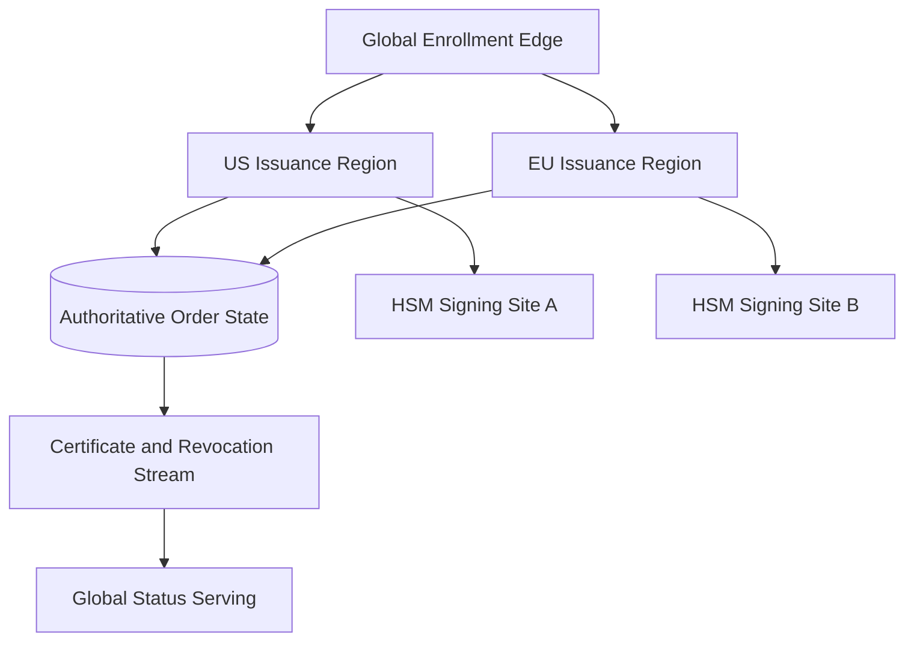

Signing sites use separately protected key replicas or distinct regional intermediates. Replication of private keys is a security decision, not merely an availability optimization.

During control-plane partition, existing status data remains available. New issuance pauses if the system cannot prove uniqueness, authorization, audit durability, or policy freshness.

## Disaster recovery

Back up certificate records, order state, policy versions, validation evidence, revocation state, audit checkpoints, and public key metadata.

Private CA key backup uses hardware-wrapped material and multi-party custody in a separate location. Recovery requires a documented ceremony and independent verification.

Regularly test recovery into isolated HSMs and environments. Verify that restored systems can sign a test certificate, publish status, continue serial uniqueness, and preserve audit continuity.

Maintain an emergency replacement intermediate ready for activation, but keep its key protected and unused during normal operation.

## Key compromise response

Response depends on which key is compromised.

### Leaf key

Revoke the certificate, issue a replacement with a new key, investigate use, and rotate dependent credentials.

### Intermediate key

Stop signing immediately, revoke the intermediate through its parent, publish status, activate a clean intermediate, and reissue affected leaf certificates.

### Root key

This is ecosystem-level recovery. Remove trust, distribute a new root, replace every descendant chain, and communicate broadly. Offline roots and multi-party controls exist to make this extraordinarily unlikely.

Preserve evidence before destroying affected systems. Emergency actions remain authenticated, approved, and audited.

## Failure handling

### Validation dependency unavailable

Retry within the challenge lifetime. Do not mark control proven without fresh evidence.

### HSM cluster unavailable

Queue bounded authorized requests while enough validity remains. Never fall back to software copies of protected keys.

### Transparency log unavailable

Use other qualified logs if policy allows. Otherwise pause affected public issuance.

### Status region unavailable

Serve precomputed signed responses and revocation lists from independent caches and regions.

### Database commit ambiguous after signing

Look up by stable order and serial identifiers. Recover the already signed certificate rather than sign a different one.

### Clock uncertainty exceeds limits

Pause issuance and time-sensitive signing. Incorrect validity periods and signature times can invalidate the trust contract.

### Bad policy release

Stop new authorization, restore the prior signed policy version, and review certificates issued under the suspect version.

## Observability

Track:

- Orders, validations, issuance, renewals, and failures
- Time from order to issued certificate
- HSM latency, errors, capacity, and authorization rejections
- Certificate expiration distribution and renewal success
- Validation results by method and network perspective
- Transparency submission and inclusion latency
- Revocation publication and status freshness
- DNS and HTTP challenge anomalies
- Policy version and rejected request reasons
- Audit-stream lag and integrity checkpoints
- Key rotation phase and certificate-chain adoption
- Unusual issuance by name, account, or intermediary

Synthetic identities continuously exercise enrollment, validation, issuance, renewal, revocation, status, and chain validation from diverse clients and networks.

Never put private keys, challenge secrets, account credentials, or full authorization tokens in logs or metrics.

## Key tradeoffs

### Long-lived vs short-lived certificates

Long lifetimes reduce renewal load but extend exposure and make revocation more important. Short lifetimes constrain compromise but require reliable automated renewal.

### Centralized vs regional signing

One signing site minimizes key copies and governance surface but limits availability and adds latency. Regional intermediates contain compromise and improve resilience while complicating chain and policy management.

### Online root vs offline root

An online root simplifies intermediate issuance but exposes the highest-value key continuously. An offline root makes ceremonies slower and intentionally rare, which is the safer tradeoff.

### Revocation checks vs availability

Strict online status checking catches revoked certificates but can make status outages break valid traffic. Short-lived certificates, stapled status, and cached signed responses reduce that tension.

### Automation vs approval

Automation is essential at billion-certificate scale. High-risk names, profiles, and key operations still need multi-party review, while routine renewals follow preapproved policy.

The central principle is to keep trust roots rarely used and physically protected, then make routine issuance automated, policy-bound, transparent, and fully auditable.
