## Problem and requirements

A change data capture platform turns database inserts, updates, and deletes into an ordered event stream. Downstream systems use it to update search indexes, caches, warehouses, analytical tables, audit stores, and regional replicas without polling every source table.

The core difficulty is preserving database transaction semantics while moving changes into systems with different consistency models. Connectors must survive restarts, schema changes, resharding, long snapshots, and sink outages without losing or silently duplicating data.

### Functional requirements

- Register database sources and selected tables
- Take an initial consistent snapshot
- Stream ongoing inserts, updates, and deletes from database logs
- Preserve transaction and per-key ordering where promised
- Publish before and after values according to policy
- Track schema changes and version each event
- Deliver changes to event streams and managed sinks
- Pause, resume, rewind, and resnapshot connectors
- Expose lag, errors, checkpoints, and data quality
- Redact or tokenize sensitive columns

### Non-functional requirements

- Support 100,000 source databases and ten million row changes per second
- Never silently lose an acknowledged source change
- Resume from durable checkpoints after failure
- Avoid materially affecting source database performance
- Bound duplicate delivery through idempotent protocols
- Continue source capture during downstream outages within retention limits
- Isolate tenants and noisy connectors
- Keep credentials and captured data protected

The platform generally provides at-least-once delivery. Exactly-once business effects require cooperation from the destination or an idempotent sink protocol.

## Capacity estimates

Assume 100,000 source databases, ten million peak row changes per second, and an average encoded change event of one kilobyte.

| Resource | Estimate |
| --- | ---: |
| Peak change rate | 10M/second |
| Peak stream bandwidth | 10 GB/second |
| Source connectors | 100K |
| Initial snapshot volume | Petabytes |
| Retained change log | Hours to days |
| Sink connectors | Hundreds of thousands |

Steady-state log reading is relatively cheap. Initial snapshots, mass reconnects, and downstream outages create the largest load spikes.

## Change event model

Every event has a common envelope plus source-specific position metadata.

```json
{
  "eventId": "src_82:binlog.004218:91842:2",
  "source": "orders-primary",
  "table": "orders",
  "operation": "update",
  "transactionId": "tx_91842",
  "transactionOrder": 2,
  "sourceTime": "2026-10-14T14:21:08.142Z",
  "schemaVersion": 17,
  "key": { "order_id": "order_981" },
  "before": { "status": "pending" },
  "after": { "status": "paid" },
  "position": { "logFile": "binlog.004218", "offset": 91842 }
}
```

The event ID derives from stable source position and row order. Retransmitting the same source record produces the same ID.

Large unchanged columns need not appear in every update. The event contract clearly distinguishes absent, unchanged, and null values.

## Capture approaches

### Query polling

Periodically query rows updated after a timestamp or sequence. This is easy to start but misses hard deletes, stresses indexes, and behaves poorly with clock skew or non-monotonic updates.

### Trigger-based capture

Database triggers write changes into an outbox table. This captures application-visible mutations but adds latency and load to transactions and requires schema installation.

### Transaction-log capture

Read the database's replication or write-ahead log. It captures committed changes with low source overhead and preserves transaction ordering, but every database engine has different formats, retention rules, and failover semantics.

The platform uses log-based capture as the default, with a transactional outbox for application events whose business meaning cannot be reconstructed from row changes alone.

## High-level architecture

Source agents read database logs and publish normalized records into a durable regional stream. Independent delivery workers apply those records to sinks.

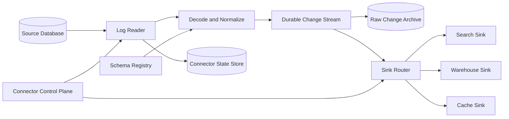

The durable stream decouples source log retention from sink health. Once a record is safely stored, the source connector can advance its acknowledged position.

## Source connector lifecycle

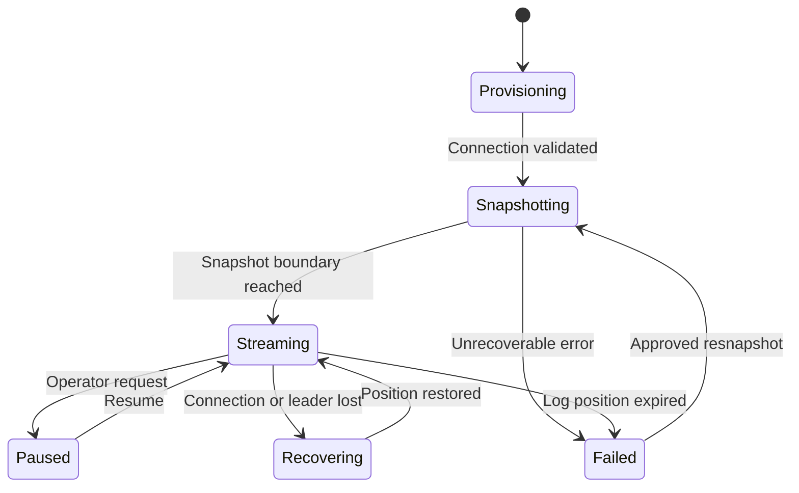

Connector state includes source identity, selected objects, snapshot progress, last durable log position, schema history, epoch, and lease owner.

Only one active reader owns a source partition. A fenced lease prevents an old process from continuing after failover and publishing a competing sequence.

## Reading transaction logs

The connector authenticates with a least-privilege replication identity and starts at a durable source position.

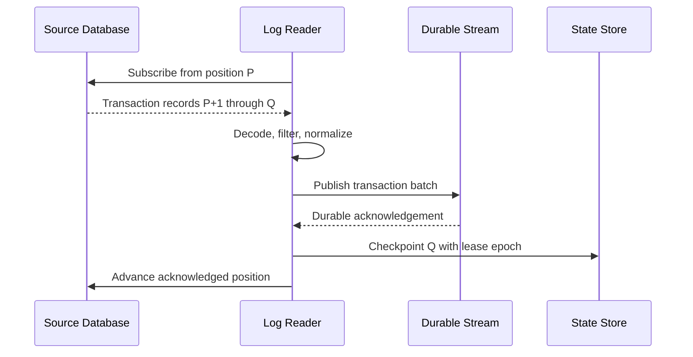

Checkpoint only after the durable stream acknowledges the corresponding records. If the connector crashes before checkpointing, it replays events with identical IDs.

Database failover may change log file names or timeline identifiers. The connector maps positions through engine-specific replication metadata and rejects divergent histories rather than guessing.

## Consistent initial snapshot

New connectors need existing rows plus all future changes without gaps.

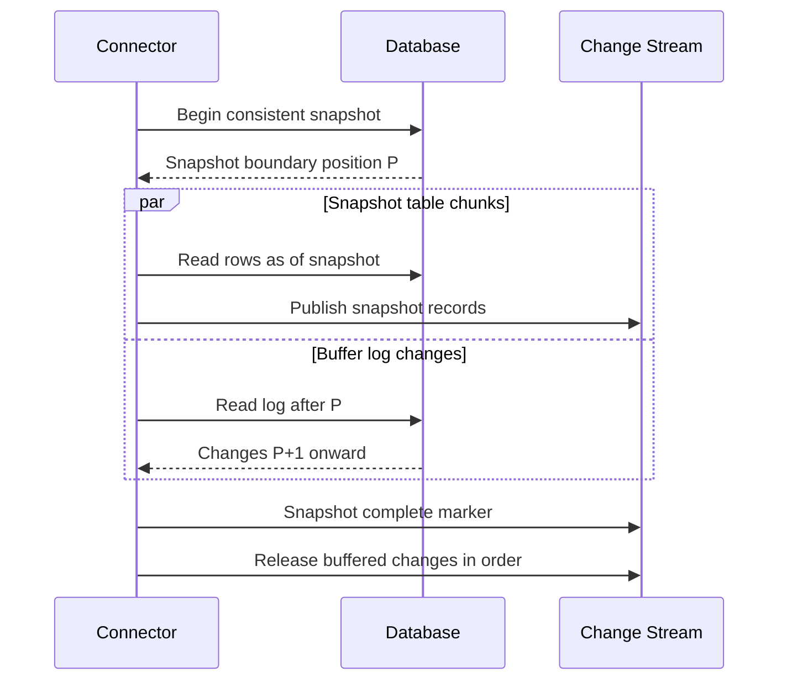

Use database snapshot or replication semantics to obtain a transactionally consistent view. An ordinary table scan while writes continue can miss or duplicate state.

Large snapshots are split into primary-key ranges and processed in parallel under source rate limits. Progress records each completed range so restarts do not begin from zero.

Snapshot events include the boundary position. Consumers can distinguish initial state from ongoing mutations.

## Snapshot and streaming handoff

There are two common strategies:

- Buffer post-boundary log changes until the relevant snapshot finishes, then release them
- Publish snapshot and log streams separately with positions, letting a merge stage order and reconcile them

Buffering is simpler for consumers but requires storage proportional to snapshot duration and write rate. Merge stages scale better for huge sources but add complexity.

For table-level incremental snapshots, emit low and high watermark markers around each key range. The connector resolves rows changed during the chunk so an older snapshot value never overwrites a newer log event.

Do not stop log reading during a multi-hour snapshot; the source may recycle required log segments.

## Transaction boundaries and ordering

A source transaction can modify many rows and tables. Capture its begin, ordered changes, and commit marker.

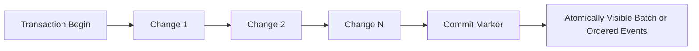

Small transactions can publish as one batch. Large transactions may span many stream messages and require a transaction ID plus sequence numbers.

Global source order is expensive to preserve after partitioning. Offer clear contracts:

- Total order per source database
- Order per table partition
- Order per primary key
- Transaction grouping without global sink order

Most scalable consumers require per-key ordering, not a global sequence. Cross-row invariants may need transaction-aware processing.

## Partitioning the change stream

Partition normalized events by tenant, source, table, and primary-key hash. This keeps updates for one row ordered while spreading high-volume tables.

Transaction markers that span partitions require a separate coordination stream or downstream awareness. If atomic visibility is mandatory, route the whole transaction together at the cost of hot large transactions.

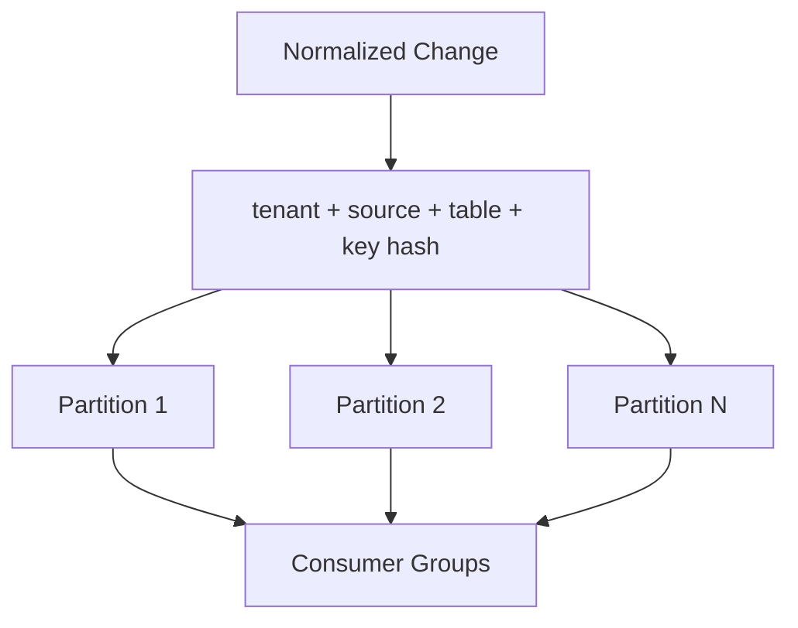

Stable partitioning is important. When partition count changes, preserve key order through a cutover offset and versioned routing plan.

## Schema capture and evolution

The connector records schema changes in the same ordered history as data changes.

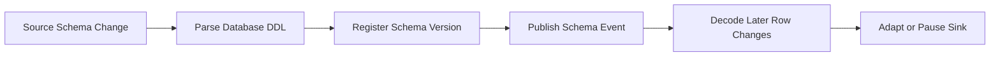

Each row event references the schema used to decode it. The registry stores column identity, type, nullability, defaults, key definition, and source-specific metadata.

Adding a nullable column is usually compatible. Type changes, key changes, renames, and dropped columns may require a new sink mapping or backfill.

Do not infer renames from similar names; a drop plus add may represent different meaning. Require explicit mapping where identity matters.

If an unsupported schema change occurs, pause the affected table at the boundary and continue unrelated tables where isolation permits.

## Event normalization

Database engines encode numeric, temporal, binary, and special types differently. Normalize them into a documented portable type system without losing precision.

Store timestamps with timezone semantics, fixed-precision decimals as decimals, and binary values as bytes. Never convert financial decimals to floating point.

Large objects can exceed broker limits. Store them in an encrypted object store and place a content-addressed reference in the event, or exclude them by policy.

Before and after images depend on source log configuration. If only changed columns are available, the envelope must say so. Reconstructing full rows requires a stateful materializer and increases storage.

## Delivery semantics

Source connectors, streams, and sinks fail independently. End-to-end exactly-once delivery is not a property one component can declare alone.

The platform provides:

- Stable event IDs from source position
- At-least-once publication
- Ordered partitions
- Durable source and sink checkpoints
- Idempotent sink operations where supported
- Reconciliation to detect divergence

If a sink supports atomic writes with offset storage, apply changes and commit the consumed offset in one destination transaction. Otherwise use primary-key upserts and source-version conditions.

Append-only destinations can retain duplicates and deduplicate later by event ID.

## Sink connector architecture

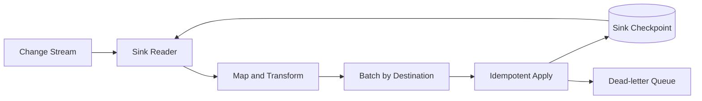

Sink tasks own stream partitions through leases. They batch within size and latency limits and preserve key order.

Checkpoint only after the destination confirms durable application. On ambiguous timeout, query destination state or repeat the idempotent batch.

Separate transient failures from deterministic record failures. A poison event enters a dead-letter flow after bounded retries rather than blocking an entire partition forever.

## Search index sink

Map each row key to a document ID and use source version or log position for external versioning.

An upsert from position 105 must not overwrite a newer document from position 110 after retry or reordering. Deletes become versioned document removals.

Bulk APIs improve throughput. Split batches when one invalid document causes a partial failure, and retain per-record outcomes.

Schema changes may require building a new index. Dual-write changes to old and new indexes during backfill, validate counts and queries, then atomically switch the read alias.

## Cache sink

CDC can update or invalidate cached rows after database commit.

Updating the cache from the change event reduces misses but must apply versions conditionally. Invalidation is simpler and lets the next application read repopulate authoritative state.

There is always a short interval between database commit and cache event application. Applications needing read-your-write should update or bypass cache in their transaction path, not assume asynchronous CDC is immediate.

Deletes and expiration changes must propagate. A missing delete is more dangerous than a delayed update because stale data can survive indefinitely.

## Warehouse and lakehouse sink

Append raw changes into immutable time-partitioned files. A merge process builds current-state and history tables.

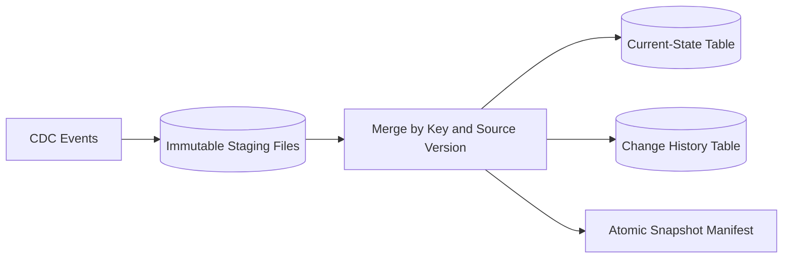

Use primary key plus source version to make merge idempotent. Preserve tombstones long enough that compaction cannot resurrect deleted rows from older files.

Current-state tables support ordinary analytics. History tables support temporal queries and audit, subject to retention and privacy policy.

Publish a new table snapshot only after all output files and metadata are durable.

## Transactional outbox

Row-level changes often lack business meaning. Updating `orders.status` does not explain whether an order was paid, canceled, or corrected.

The application can write a business event into an outbox table in the same transaction as domain state. CDC then publishes the outbox row.

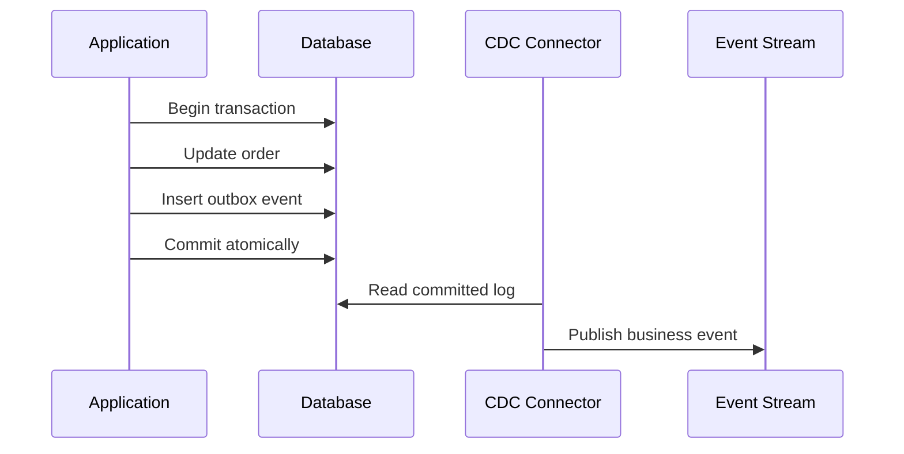

Consumers still deduplicate event IDs. The outbox solves the application's database-and-message dual write; it does not make every downstream effect exactly once.

Archive or delete published outbox rows through a safe retention process so the table does not grow forever.

## Backpressure and log retention

If the durable stream is slow, the source connector cannot advance indefinitely. Database logs have finite retention, and retaining them too long can fill source disks.

Track both connector lag and source retention headroom. Alert on time remaining before the checkpoint falls out of the log, not only bytes or offsets behind.

Mitigations include:

- Scale decoders and publishers
- Pause low-priority tables
- Increase source log retention temporarily
- Spill encoded changes to durable object storage
- Apply tenant quotas
- Resnapshot only as a last resort

Never advance the source checkpoint without durable capture merely to relieve disk pressure.

## Checkpointing and recovery

Connector checkpoints include source position, source timeline or epoch, schema-history position, snapshot progress, and ownership lease epoch.

Persist state using compare-and-swap. A stale connector cannot overwrite a newer owner's checkpoint.

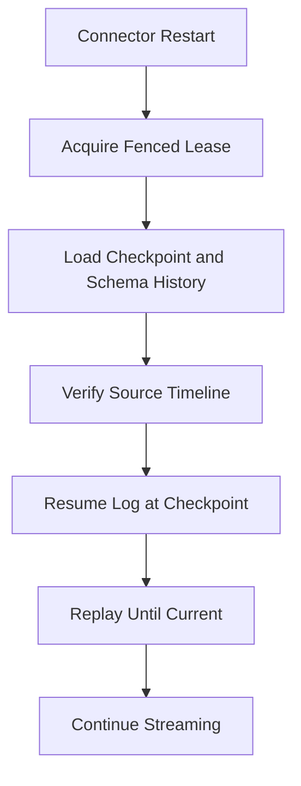

Recovery replays from the last committed position, producing stable duplicate event IDs where necessary.

If the required source position has expired, stop with a clear unrecoverable state. An operator chooses resnapshot or restore from an archived log; silently starting from “now” creates data loss.

## Reconciliation

CDC correctness needs periodic comparison between source and destination.

Use several levels:

- Row counts by key range
- Checksums over canonical row representations
- Sampled key and value comparisons
- Source position versus sink checkpoint
- Insert, update, and delete control totals

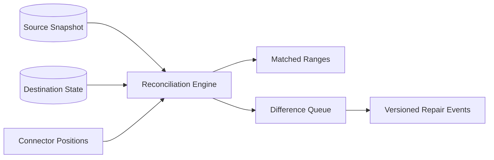

Repair through the normal versioned sink path. Directly patching the destination can be overwritten by delayed CDC events and leaves no audit trail.

Large tables reconcile by ranges and Merkle-style hashes, drilling into only mismatched partitions.

## Control plane

The control plane manages connectors, credentials references, table selection, schemas, transforms, quotas, and placement.

Configuration is versioned and immutable after activation. A connector atomically moves from one config version to another at a recorded source position.

Validate that source permissions, log settings, primary keys, retention, and destination compatibility are safe before starting.

Secrets live in a dedicated secrets manager. Connector workers receive short-lived credentials or protected references, never plaintext stored in configuration records.

## Multi-tenancy and isolation

Apply quotas to sources, snapshot bandwidth, log throughput, retained bytes, partitions, sink calls, and dead-letter volume.

Large tenants receive dedicated connector and stream partitions. Smaller tenants share workers with fair scheduling and per-tenant memory limits.

Snapshot throttles protect source databases. A user cannot configure enough parallel chunk readers to overwhelm production transactions.

Tenant identity is derived from authenticated control-plane and worker credentials and included in every stream key, checkpoint, cache entry, and object path.

## Security and privacy

CDC copies sensitive data into new systems, expanding its exposure surface.

Controls include:

- Least-privilege source replication accounts
- Private network connectivity
- Encryption in transit and at rest
- Column allowlists and deny-by-default capture
- Redaction, tokenization, or field-level encryption
- Tenant-scoped authorization and keys
- Audited connector, schema, rewind, and export operations
- Regional routing and retention policy

Filter sensitive columns before they enter shared streams when possible. Downstream redaction is too late if unauthorized systems already received the event.

Deletion requests must reach current-state sinks, historical files, indexes, caches, and backups according to policy. CDC tombstones are part of this process but not the entire deletion guarantee.

## Multi-region design

Run source connectors near their databases to minimize latency and avoid cross-region replication traffic.

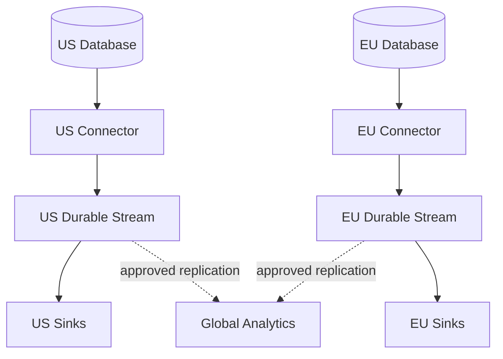

Connector ownership follows the source's database leadership. After database failover, verify the new source timeline and fence the former reader.

Replicate normalized events across regions only when residency policy permits. Preserve original event ID, source position, and schema version.

Global consumers merge independent source orders; they cannot assume one total order across databases.

## Failure handling

### Source database unavailable

Retain the last checkpoint and reconnect with backoff. Do not switch to an arbitrary replica unless it can prove compatible log history and position.

### Connector crashes

A new owner acquires the fenced lease, restores schema and position, and replays. Stable IDs make duplicate publication safe.

### Durable stream unavailable

Pause checkpoint advancement, buffer within a strict local limit, and monitor source-log headroom. Never acknowledge uncaptured changes.

### Sink unavailable

Source capture continues while durable stream retention absorbs backlog. Sink workers retry with backoff and destination-aware idempotency.

### Poison record

Quarantine after deterministic failure, include schema and source position, and continue only if sink policy allows gaps with explicit accounting.

### Unsupported schema change

Stop at the schema boundary for affected objects, preserve later log records, and require mapping or connector upgrade.

### Source log position expires

Mark the connector as needing resnapshot. Never resume from the current head and imply completeness.

### Large transaction

Spill buffered changes to disk or object storage, enforce limits, and stream chunks with transaction metadata instead of exhausting memory.

## Observability

Track:

- Source position and time lag
- Source-log retention headroom
- Records and bytes captured by table
- Snapshot rows, ranges, throughput, and estimated completion
- Publish latency, retries, and duplicate events
- Schema changes and incompatible transitions
- Stream backlog and sink checkpoint lag
- Sink batch success and record-level failures
- Dead-letter volume and oldest unresolved error
- Reconciliation differences and repair status
- Connector ownership changes and recovery duration

Synthetic tables in every supported database exercise insert, update, delete, transaction, schema change, failover, snapshot, and sink delivery paths.

Dashboards distinguish capture lag from delivery lag. A healthy source connector does not mean the search or warehouse sink is current.

## Key tradeoffs

### Log capture vs polling

Log capture is efficient and complete for committed row changes but engine specific and operationally sensitive. Polling is portable but misses deletes and adds source load.

### Full row images vs changed columns

Full rows simplify consumers but increase bandwidth and sensitive-data exposure. Deltas are compact but require stateful reconstruction and careful absent-value semantics.

### Transaction order vs partition scalability

Preserving whole-source order simplifies reasoning but creates a throughput bottleneck. Per-key partitions scale well, while transaction metadata preserves enough context for consumers that need coordination.

### Fast snapshots vs source safety

Parallel scans shorten setup time but compete with production traffic and retain more log data. Adaptive throttling prioritizes the source workload.

### Generic events vs business events

Row changes are automatic and complete but expose storage details. Transactional outbox events express domain meaning but require application participation. Mature platforms support both.

The central principle is to treat source position, schema version, and event identity as inseparable, then make every checkpoint advance only after the corresponding change is durably recoverable.
