## Problem and requirements

A continuous integration and delivery platform reacts to source changes, runs builds and tests, produces trusted artifacts, and deploys them through protected environments. It must coordinate untrusted code, scarce compute, credentials, approvals, and production changes without coupling every repository to custom automation.

The hard part is preserving trust across the chain. A successful deployment should identify the exact source, workflow, runner, artifact, approvals, and policy that produced it. Retries must not create duplicate releases, and pull requests from untrusted contributors must never gain production secrets.

### Functional requirements

- Trigger pipelines from source events, schedules, APIs, and manual actions
- Parse pipeline definitions into jobs and dependencies
- Run jobs on isolated hosted or customer-managed runners
- Stream logs, test results, and status
- Cache dependencies and publish immutable artifacts
- Manage environments, approvals, and deployment concurrency
- Support matrices, reusable workflows, and conditional jobs
- Cancel, retry, resume, and rerun pipelines
- Roll out releases progressively and roll them back
- Emit webhooks, notifications, provenance, and audit records

### Non-functional requirements

- Schedule ten million jobs per hour
- Support 100,000 concurrent runners
- Start ordinary jobs within seconds
- Continue running jobs during control-plane failover
- Isolate tenants and untrusted code
- Prevent secrets from leaking into logs, caches, and artifacts
- Make workflow evaluation deterministic and replayable
- Preserve every deployment decision and result

The platform coordinates delivery. It does not make tests deterministic, deployments backward compatible, or unsafe scripts secure.

## Capacity estimates

Assume one million repositories, ten million jobs per hour at peak, and 100,000 concurrent runners.

| Resource | Estimate |
| --- | ---: |
| Pipeline triggers | Hundreds of thousands/minute |
| Jobs scheduled | 10M/hour |
| Concurrent runners | 100K |
| Log and test events | Millions/second |
| Artifacts and caches | Petabyte scale |
| Deployment records | Billions retained |

Pull-request storms and organization-wide scheduled workflows create sharper bursts than normal commit traffic. Admission control must protect interactive and production work.

## Pipeline model

A pipeline is an immutable execution created from a versioned workflow definition and trigger context.

```yaml
name: checkout
on: [push]
jobs:
  test:
    runs-on: linux-medium
    steps:
      - checkout
      - run: npm test
  deploy-staging:
    needs: [test]
    environment: staging
    steps:
      - deploy: artifact-from-test
```

Core objects include workflow, run, job, step, attempt, artifact, environment, deployment, approval, and runner lease.

The pipeline snapshot pins the source commit, workflow file, reusable dependencies, policy version, inputs, and identity of the trigger.

## High-level architecture

The control plane creates durable runs and schedules jobs. Runners execute untrusted steps through outbound connections.

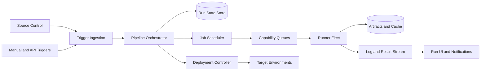

Runners never receive broad database credentials. They poll for leased jobs and receive short-lived access scoped to one execution.

## Trigger ingestion

Source-control webhooks, schedules, and APIs are at-least-once. Deduplicate triggers by provider event ID plus repository.

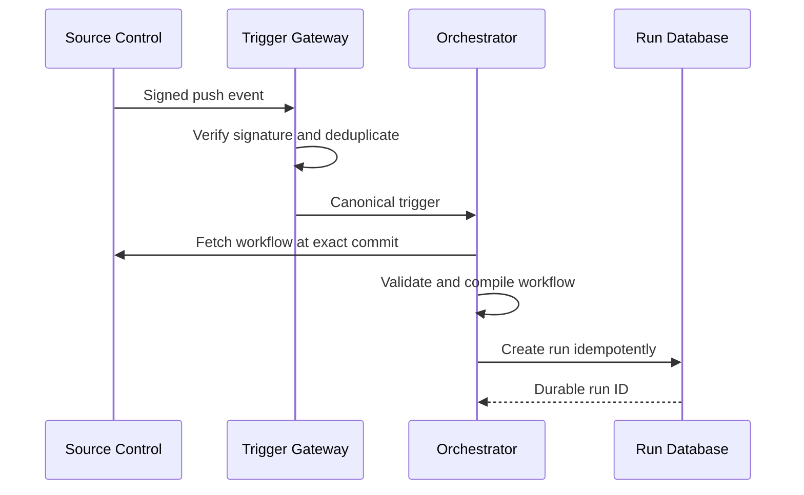

Evaluate the workflow from the trusted event ref. For pull requests, distinguish code from the contributor branch and policy from the protected base repository.

Scheduled triggers use stable occurrence IDs so leader failover cannot create two independent runs accidentally.

## Workflow compilation

The compiler parses workflow syntax, expands reusable workflows, validates permissions, evaluates static expressions, and produces a job DAG.

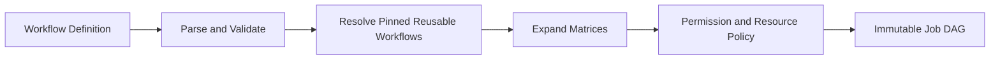

Pin reusable workflows and actions by immutable commit or digest. Mutable tags are convenient but weaken reproducibility and supply-chain security.

Bound matrix expansion, nesting, expression complexity, and total jobs before creating work. One configuration mistake must not generate millions of jobs.

The compiled DAG and evaluator version are retained for replay and audit.

## Pipeline state machine

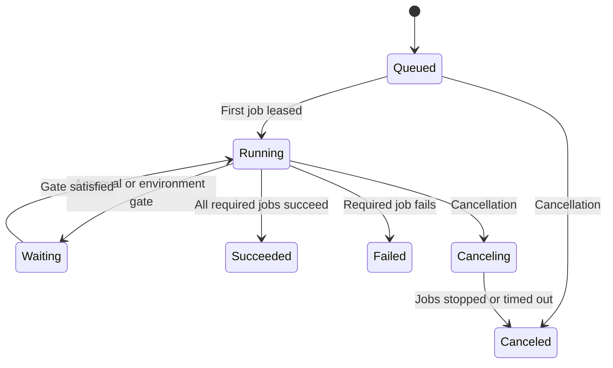

Transitions use optimistic concurrency and stable command IDs. Duplicate runner updates or user retries do not move a completed run backward.

The orchestrator derives ready jobs from completed dependencies and conditions. A periodic reconciler repairs missed queue notifications.

## Job scheduling

Jobs declare operating system, architecture, CPU, memory, accelerators, network policy, trust tier, and runner labels.

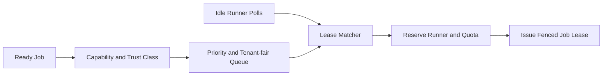

Prioritize production rollback, protected releases, interactive pull requests, and ordinary batch work through explicit classes.

Apply tenant concurrency and spending limits. Untrusted jobs cannot land on runner pools with production network access.

Queue estimates consider capability scarcity. A GPU job and a small lint job should not share one misleading wait-time estimate.

## Runner lifecycle

Ephemeral hosted runners start from a verified image, execute one job, upload results, and are destroyed.

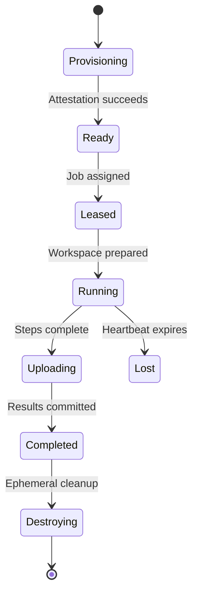

Ephemeral runners reduce cross-job persistence and make cleanup easier. Warm pools hold prebooted generic instances without tenant data.

Self-hosted runners register with scoped credentials and expose explicit trust labels. The platform cannot guarantee host isolation or network cleanliness for customer-managed machines.

## Job execution

The runner downloads a signed job manifest, checks its lease epoch, creates an isolated workspace, and executes steps sequentially unless the job format says otherwise.

Each step has a timeout, cancellation channel, output limit, and exit status. The runner masks registered secrets before streaming logs, but prevention is stronger than redaction.

Containers or micro-virtual machines isolate processes, filesystems, networks, and resource use. Untrusted pull requests receive no production credentials and restricted outbound access.

The runner kills descendant processes and erases writable storage before reuse or termination.

## Secrets and identity

Prefer short-lived workload identity to stored cloud credentials. The runner exchanges a signed job assertion for a narrowly scoped token.

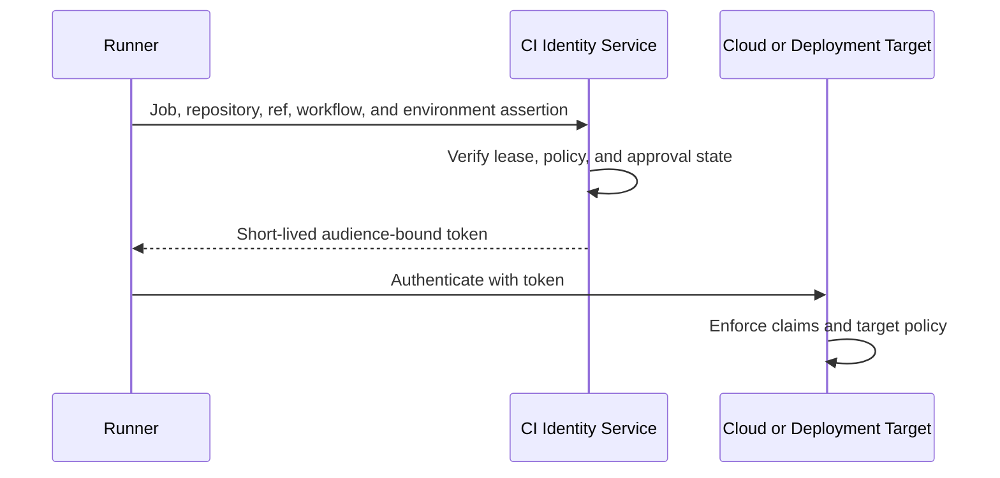

Long-lived repository secrets are encrypted and released only after trust and environment gates pass. Secrets are never provided to forked untrusted code by default.

Logs, command lines, process listings, caches, and artifacts are common leak paths. Restrict delivery to environment variables or protected files only when unavoidable.

## Logs and live progress

Runners send ordered chunks with job, step, attempt, sequence, and checksum to a durable log gateway.

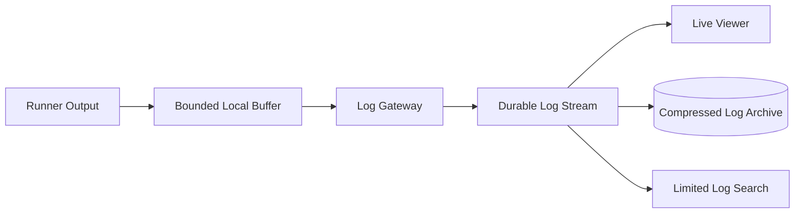

Acknowledged chunks survive runner loss. Duplicate chunks deduplicate by sequence. Large or runaway logs are truncated under a documented limit while the job continues or fails according to policy.

Redaction runs before shared storage, but users must not treat it as perfect. Audit log access and apply retention.

## Caches and artifacts

Caches accelerate future jobs and may be evicted. Artifacts are explicit outputs retained according to policy.

Cache keys include dependency lockfile, platform, toolchain, and user-defined dimensions. Restore keys may allow partial fallback, but clients verify contents.

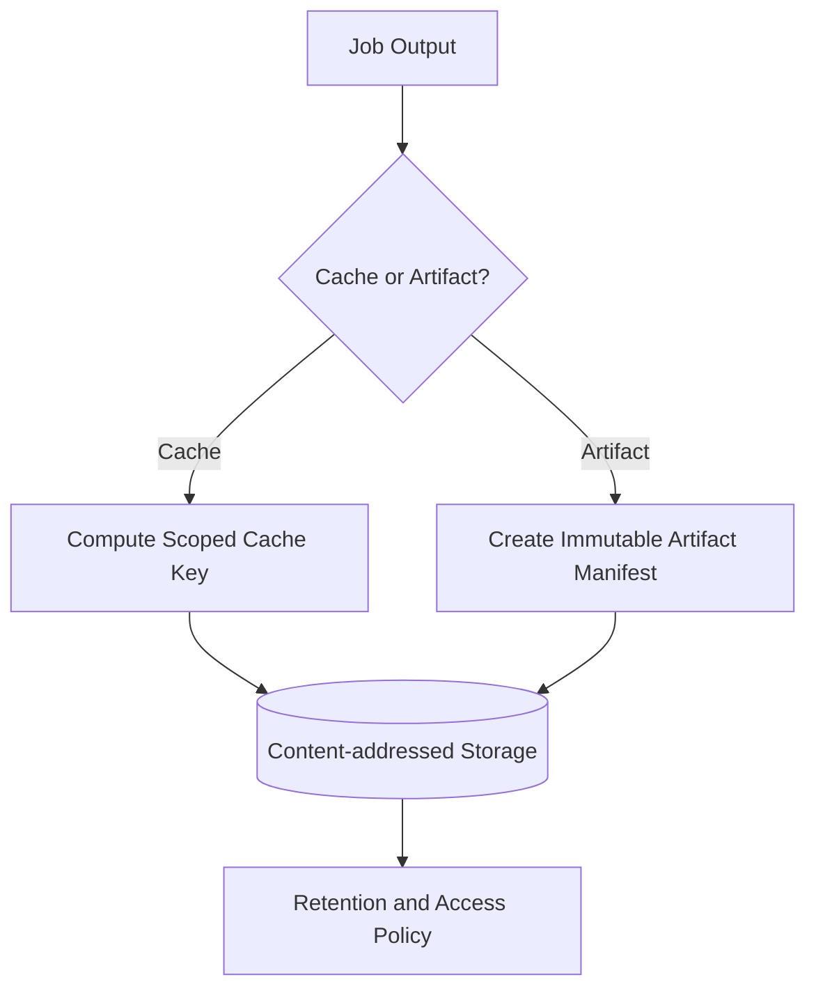

Untrusted jobs cannot poison caches consumed by protected workflows. Trust tier and repository scope participate in write and read authorization.

Artifacts include digest, producing job, source commit, workflow, runner image, and provenance. Deployment consumes artifacts by digest, never “latest successful file.”

## Test results

Standardized test events capture suite, case, status, duration, location, attempt, and attachments.

The platform aggregates summaries and annotates changes without parsing arbitrary console text. Historical duration helps shard future suites.

Retries expose flaky outcomes instead of replacing failure with success. Branch policy can distinguish stable failure, flaky pass, and infrastructure error.

Test artifacts may contain customer or production data. Apply the same authorization and retention controls as build logs.

## Required checks

Source-control branch protection references stable check identifiers owned by authorized integrations.

A check result is bound to repository, exact commit, workflow version, job definition, and attempt. A success on one commit cannot approve another.

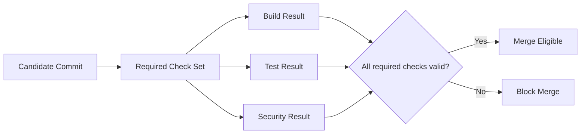

Changing required checks or workflow definitions invalidates the appropriate approval state according to policy.

## Environment model

An environment represents a deployment boundary such as development, staging, or production. It defines:

- Authorized workflows and branches
- Required reviewers and waiting periods
- Secret and workload-identity policy
- Deployment concurrency
- Regional and maintenance constraints
- Rollback permissions

Only one deployment may modify an exclusive environment at a time. Others queue, cancel, or supersede according to policy.

Environment approval is bound to an exact artifact digest and deployment plan, not merely a branch name.

## Deployment flow

Build once, then promote the same immutable artifact through environments.

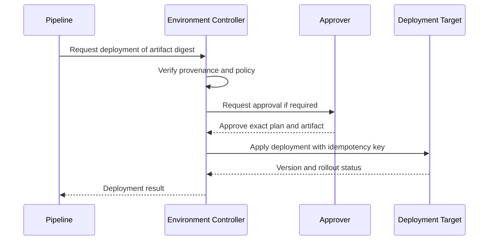

The controller persists each transition and reconciles target state after timeouts. It does not assume a lost response means failure.

Deployment credentials are minted only after gates pass and expire shortly after the operation.

## Progressive delivery

Rollouts shift traffic gradually while measuring health.

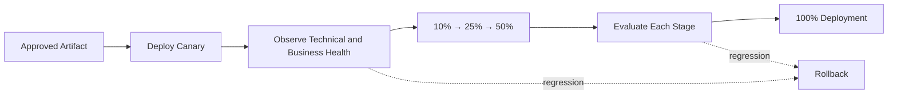

Health gates use latency, errors, saturation, dependency health, and product metrics. Define minimum sample size and observation duration to avoid approving an idle canary.

Automated rollback restores the prior known artifact or traffic weights. Database changes and irreversible side effects require a forward-recovery plan.

Keep deployment orchestration separate from traffic-control implementation so it can work with load balancers, service meshes, and cluster rollout APIs.

## Concurrency and supersession

New commits often arrive while an older pipeline is running. Concurrency groups define whether to queue, run in parallel, or cancel superseded runs.

Canceling build jobs saves capacity. Canceling an active deployment requires a safe checkpoint and may transition to rollback rather than abrupt process termination.

Use generation numbers. A stale run cannot publish status, update an environment, or mark a newer deployment successful after supersession.

Deployment locks are leased and fenced. A controller that loses its lease cannot continue mutating the environment.

## Retry semantics

Differentiate job failure, user-code failure, runner loss, platform error, and cancellation.

Platform failures can retry automatically on another runner. User-code failures rerun only by configured policy or user action.

Steps with external side effects need idempotency keys. Retrying `deploy` or `publish` without stable identity can create duplicates even when the runner platform is correct.

A rerun creates a new attempt retaining the same source and compiled pipeline unless the user explicitly requests the latest workflow definition.

## Reusable workflows and actions

Reusable components reduce duplication but create supply-chain dependencies.

Pin external actions and workflows by immutable revision. Verify publisher, source, digest, and allowed permissions.

The caller grants only the permissions and secrets the reusable component needs. A called workflow cannot silently elevate beyond its caller.

Build an internal catalog of approved components with ownership, provenance, security review, and deprecation state.

Record the resolved dependency graph with each run.

## Supply-chain security

Trust connects source to deployed artifact:

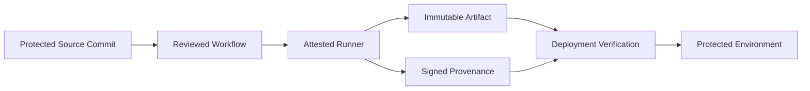

Release runners use hardened images, restricted networks, ephemeral storage, and short-lived identities. Artifact signing happens through a protected service after verifying runner attestation and workflow claims.

Deployment targets verify digest and provenance independently rather than trusting a CI status alone.

## Multi-tenancy and untrusted contributions

Forked pull requests are hostile by default. They run in isolated pools without repository secrets, internal network routes, privileged caches, or production identity.

Privileged follow-up workflows consume reviewed artifacts or metadata, never execute arbitrary fork code with secrets.

Tenant quotas cover runners, CPU time, accelerators, logs, artifacts, caches, network, and deployment concurrency.

Large or regulated tenants may use dedicated runners, encryption keys, regional storage, and control-plane partitions.

## Multi-region architecture

Runs have a home partition for ordered orchestration, while jobs execute in eligible regional worker pools.

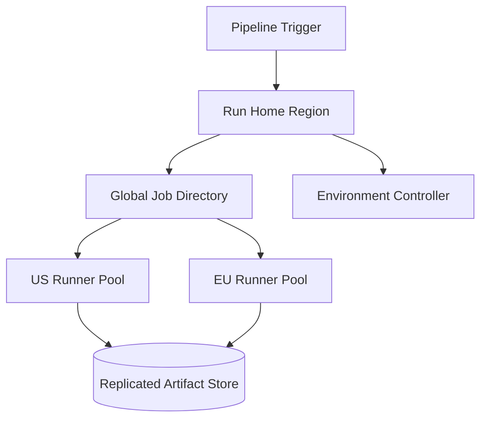

Schedule near source mirrors, caches, deployment targets, and required hardware while respecting residency.

If the home region fails, promote a replica at a known event-log position and fence the old owner. Running jobs reconnect and report their lease epochs.

Environment ownership remains single-writer even when build execution is global.

## Event sourcing and recovery

Persist important run transitions as an ordered event history: run created, job ready, lease granted, step completed, approval recorded, artifact published, and deployment changed.

Current state is a projection. Reconciliation rebuilds it after orchestrator failure.

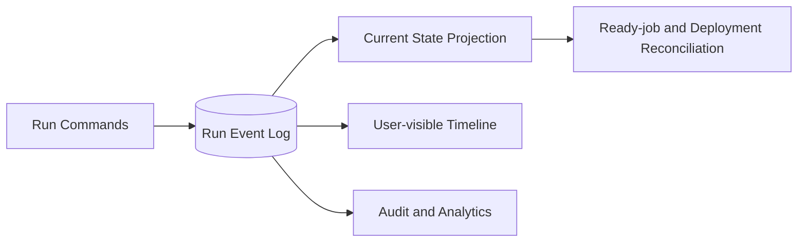

High-volume log chunks remain outside the orchestration event log and are referenced by digest or sequence.

Stable command IDs make user retries and failover idempotent.

## Failure handling

### Trigger delivered twice

Deduplicate by source event or scheduled occurrence ID and return the existing run.

### Orchestrator crashes

Another instance rebuilds state from durable events and reconciles ready jobs and active leases.

### Runner disappears

Expire its fenced lease and retry eligible jobs. Preserve already uploaded logs and artifacts.

### Log service unavailable

Buffer within strict local limits. Truncate optional output before blocking indefinitely, but preserve job state and required audit events.

### Artifact store unavailable

Jobs may continue locally, but dependent jobs and deployments wait until outputs are durably published.

### Deployment response is ambiguous

Query target state using deployment ID and artifact digest before retrying.

### Bad workflow release

Pin runs to their compiled definition, stop new triggers, and restore the prior workflow or reusable component version.

### Regional failure

Move pending work to healthy allowed pools. Fence environment controllers before resuming deployments elsewhere.

## Observability

Track:

- Trigger-to-run and queue-to-start latency
- Pipeline, job, and step success by failure class
- Runner utilization, startup time, loss, and image version
- Queue depth by tenant, trust tier, and capability
- Cache hit rate and artifact upload latency
- Log ingestion lag, truncation, and redaction alerts
- Secret and identity-token issuance
- Approval wait and environment lock time
- Deployment progress, rollback, and health-gate decisions
- Superseded and canceled work
- Regional orchestration and artifact replication lag
- Provenance coverage and verification failures

Synthetic repositories continuously exercise trusted and untrusted runs, caching, artifacts, approvals, deployment, cancellation, runner loss, and rollback.

The run timeline should explain why every job ran, skipped, waited, retried, or failed.

## Key tradeoffs

### Hosted vs self-hosted runners

Hosted ephemeral runners provide stronger isolation and simpler lifecycle management. Self-hosted runners reach private infrastructure and custom hardware but inherit customer security and reliability risks.

### Fast feedback vs complete validation

Small parallel checks return quickly, while exhaustive suites cost time and capacity. Stage fast required checks before broader validation without letting incomplete evidence approve a release.

### Cache reuse vs trust isolation

Shared caches save substantial build time, but untrusted writers can poison protected jobs. Trust-scoped reads and writes are mandatory.

### Automatic rollback vs forward recovery

Rollback works for immutable application artifacts and traffic. Schema changes and external side effects may be irreversible, requiring compatible rollout design and explicit compensation.

### Global execution vs single deployment ownership

Build jobs can run anywhere suitable. Production environment mutations need one fenced coordinator to prevent conflicting releases.

The central principle is to make the artifact—not the runner workspace or branch name—the unit promoted through environments, with identity, provenance, policy, and deployment state attached end to end.
