## Problem and requirements

A cloud cost management platform gives engineering, finance, and business teams a consistent view of infrastructure spend. It ingests billing and usage data from many providers, normalizes incompatible pricing models, attributes costs to owners and products, detects unexpected changes, forecasts future spend, and recommends optimizations.

The difficult part is not summing invoices. Provider data arrives late and can be restated, discounts apply at several scopes, shared infrastructure has no obvious owner, and business mappings change over time. A trustworthy platform must make every number reproducible from source records and explicit allocation rules.

### Functional requirements

- Connect cloud, SaaS, data-center, and contract billing sources
- Ingest detailed cost and usage records incrementally
- Normalize providers into one versioned cost model
- Attribute direct and shared costs to teams, products, and tenants
- Reconcile detailed records with provider invoices
- Track budgets and notify owners before overspend
- Detect cost and usage anomalies quickly
- Forecast spend with uncertainty ranges
- Model reserved-capacity and commitment coverage
- Recommend rightsizing, scheduling, and waste removal
- Preserve adjustments, rule changes, and approvals for audit

### Non-functional requirements

- Process ten billion line items per month
- Support 100,000 linked billing accounts
- Show fresh estimated spend within one hour
- Reproduce any historical report using its original rules
- Prevent one customer from seeing another customer's billing data
- Keep ingestion idempotent across retries and provider restatements
- Separate estimated, invoiced, amortized, and cash views clearly
- Never perform destructive optimization without explicit approval

## Capacity estimates

Assume ten billion monthly line items, 100 bytes of compressed normalized data per record, and several materialized dimensions per record.

| Resource | Estimate |
| --- | ---: |
| Billing line items | 10B/month, 3,900/second average |
| Compressed raw and normalized data | Multiple TB/month |
| Linked accounts | 100K |
| Allocation rules | Millions of versioned rules |
| Interactive queries | 10K/second at peak |
| Anomaly series | Tens of millions/hour |

Provider exports are bursty, especially around month boundaries. Size ingestion for backfills and restatements rather than average throughput.

## Cost model

Preserve raw source fields and map them into a canonical model.

```text
CostRecord {
  tenantId, provider, billingAccountId, sourceRecordId,
  usageStart, usageEnd, invoiceMonth, service, sku,
  resourceId, region, usageQuantity, usageUnit,
  listCost, effectiveCost, currency,
  chargeType, commitmentId, tags,
  sourceVersion, ingestedAt
}

Allocation {
  sourceRecordId, targetId, ruleVersion,
  allocationMethod, weight, allocatedCost
}
```

Keep several cost concepts distinct:

- List cost: public price before negotiated discounts
- Net cost: invoice amount after credits and discounts
- Amortized cost: commitments distributed over their benefit window
- Effective cost: the organization's selected economic view
- Allocated cost: effective cost assigned to an owner or product

Never overwrite an earlier source version. A provider correction creates a new version and a compensating delta.

## High-level architecture

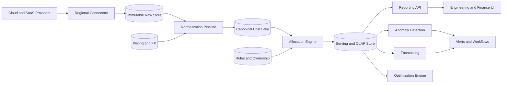

Raw exports are the replay boundary. If normalization or allocation logic changes, rebuild downstream tables without asking providers for old data again.

## Ingestion

Providers expose billing data through object exports, APIs, event streams, and invoices. Each connector tracks a cursor per account and billing period.

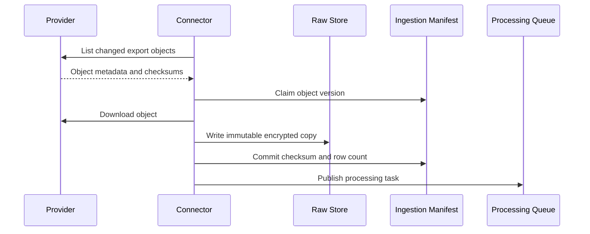

The idempotency key combines provider, billing account, source object, generation, and checksum. A duplicate delivery returns the existing manifest. A changed checksum for the same logical period is a restatement and creates a new generation.

Quarantine malformed files instead of silently dropping rows. Track expected delivery cadence and alert when exports are late or incomplete.

## Normalization

Normalization converts provider-specific fields into the canonical schema, applies currency conversion, and enriches records with account, resource, and contract metadata.

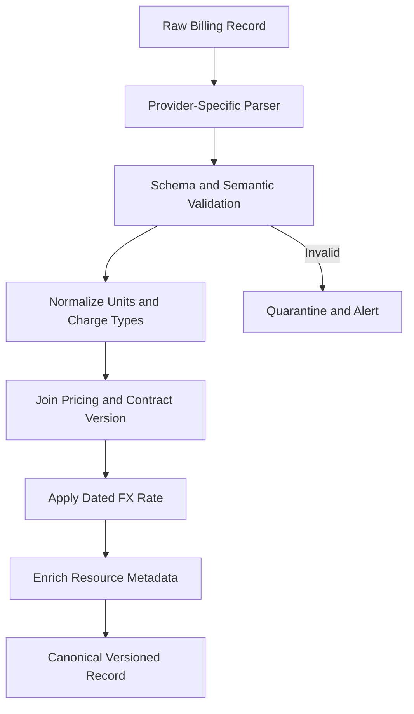

Use the exchange rate effective on the organization's accounting date and store both original and converted values. Pricing catalogs and contract terms are slowly changing dimensions with valid-from and valid-to timestamps.

Late tags must not rewrite history accidentally. The report declares whether it uses usage-time metadata or the latest known resource metadata.

## Cost allocation

Directly owned resources map to their team or product. Shared platforms require explicit allocation policies.

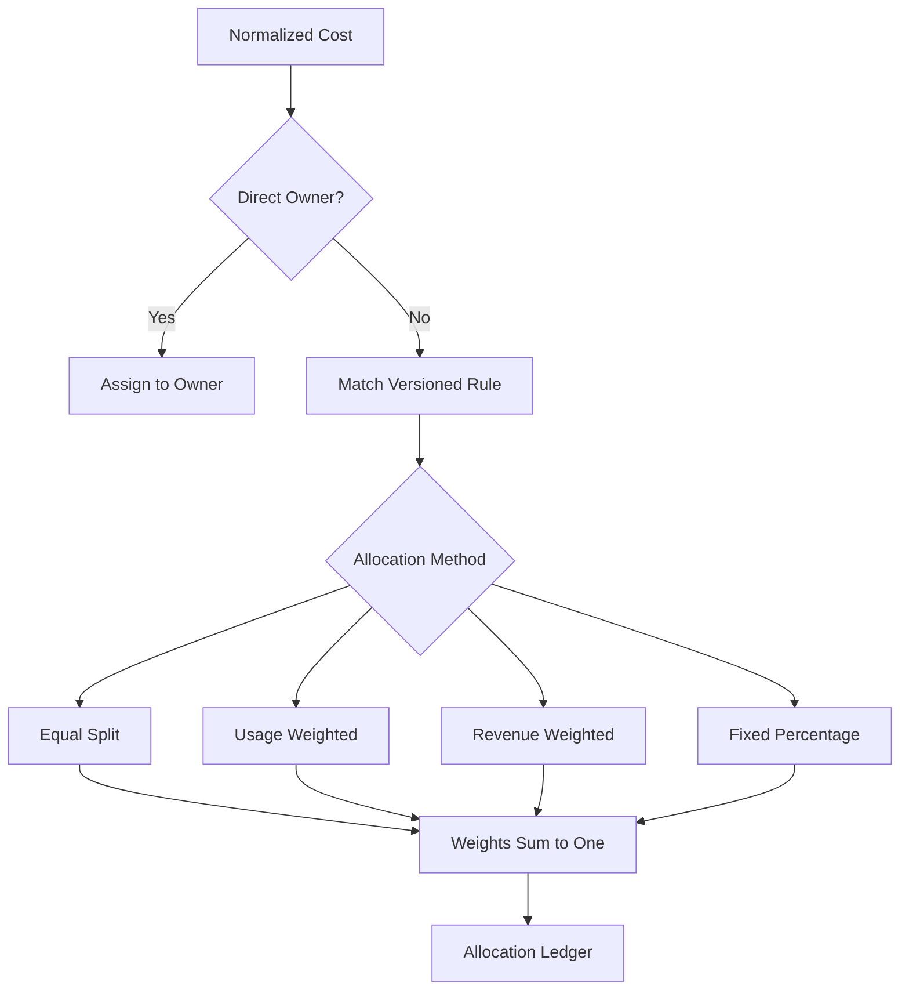

Rules have an effective window, priority, matcher, targets, method, and owner. Store allocations as a ledger rather than mutating source records.

Common shared-cost strategies include:

- Network cost allocated by transferred bytes
- Kubernetes clusters allocated by requested CPU and memory
- Database clusters allocated by storage and query usage
- Observability systems allocated by ingested and retained volume
- Central platform cost allocated by active users or direct spend

Unallocated cost remains visible in a named bucket. Hiding it through a default split makes ownership metrics look better while reducing trust.

## Temporal ownership

Resources change hands. The ownership graph therefore needs effective time.

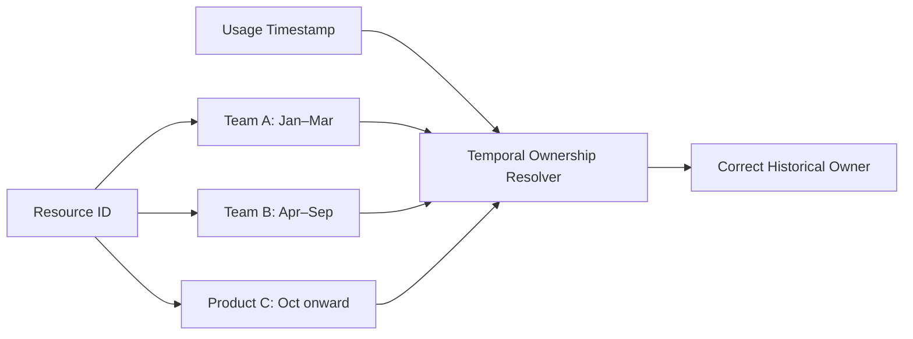

Resolve ownership at usage time by default. Allow finance to publish a separate managerial restatement without changing the immutable operational view.

## Reconciliation

Detailed usage can differ from invoices because of taxes, credits, support fees, minimum commitments, and rounding.

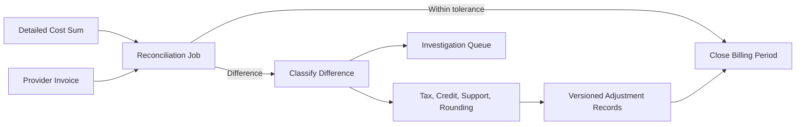

Do not mark a period final until completeness and reconciliation gates pass. Dashboards label open periods as estimated and disclose the latest source update.

## Serving and query design

Store canonical records in columnar object storage partitioned by tenant and billing period. Build an OLAP serving layer for interactive reports.

Useful materializations include hourly cost by account and service, daily cost by owner and product, commitment coverage, unit economics, and month-to-date budget status.

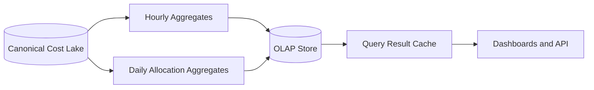

Include data version, allocation version, currency view, and cost basis in every query cache key. Otherwise a corrected report may return stale results.

## Budgets

A budget defines scope, amount, time window, cost basis, thresholds, and owners. Evaluate both actual spend and forecasted end-of-period spend.

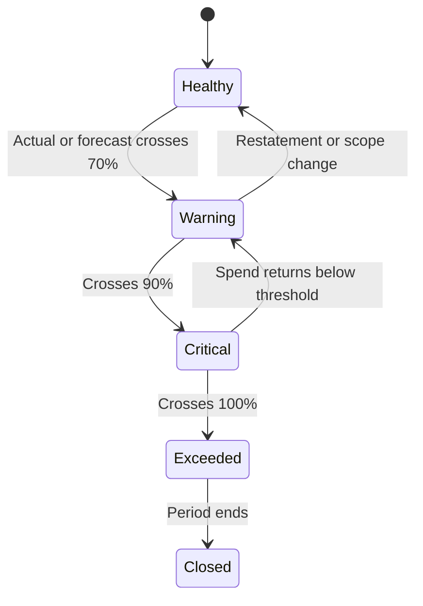

Deduplicate notifications by budget, threshold, period, and budget version. A restatement should not repeatedly page the same owner unless severity increases.

Budget actions can create tickets, require approval for new resources, or lower non-production quotas. Avoid automatic production shutdown based only on delayed billing data.

## Anomaly detection

Detect anomalies on both cost and usage because price changes and volume changes require different responses.

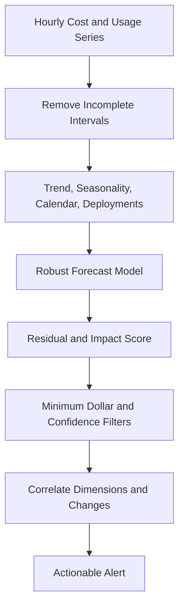

Rank anomalies by expected financial impact, not percentage alone. A 500% increase from one dollar is less urgent than a 20% increase on a million-dollar service.

Use hierarchical detection: organization, account, service, region, resource type, and owner. When several dimensions describe the same incident, group them under one root alert and show the largest contributors.

## Forecasting

Forecast at stable granularities, then reconcile forecasts so team totals equal the organization total.

Model trend, weekly and monthly seasonality, known contract changes, product growth, planned migrations, and one-time events. Produce prediction intervals rather than a single precise number.

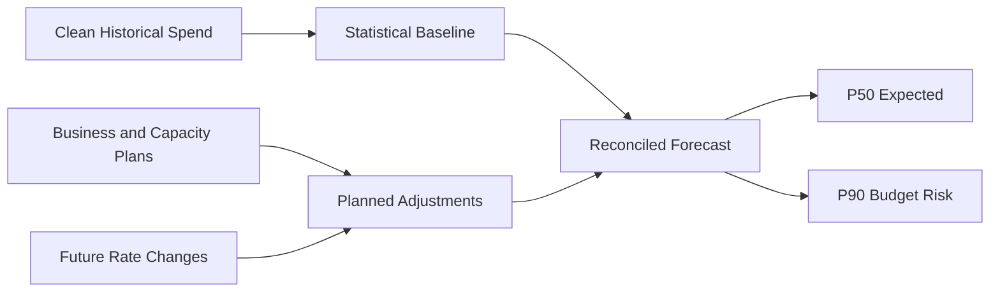

Backtest models using only information available at the historical forecast date. Track bias and interval coverage by segment, and fall back to simpler models when data is sparse.

## Commitments and discounts

Reserved instances, savings plans, committed-use discounts, and private pricing create portfolio optimization problems.

For each hour, attribute commitment benefits to eligible usage, then calculate:

- Coverage: eligible usage paid through commitments
- Utilization: purchased commitment actually consumed
- Effective savings: on-demand cost minus amortized effective cost
- Break-even risk: utilization required to outperform on-demand pricing

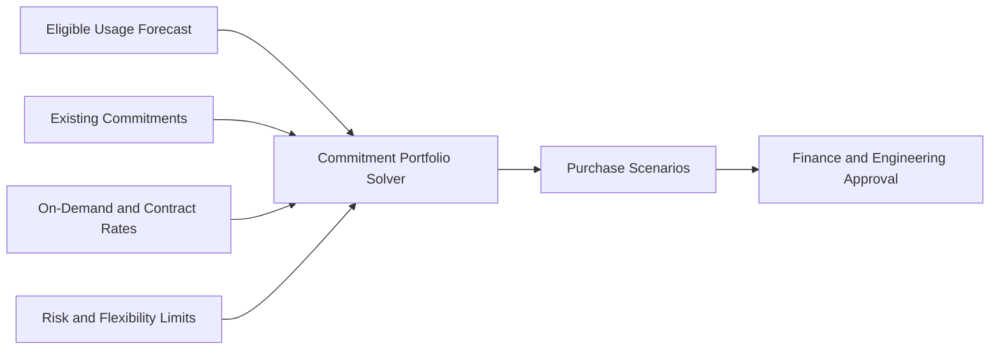

Recommendations should include term, payment option, expected utilization, savings range, break-even point, and sensitivity to demand decline. Do not optimize only for the most likely forecast.

## Optimization recommendations

Generate recommendations from utilization, configuration, pricing, and ownership data.

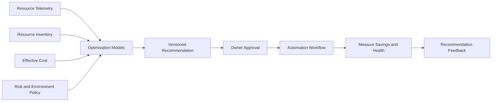

Examples include idle-resource cleanup, compute rightsizing, storage tiering, non-production scheduling, database capacity changes, and commitment purchases.

Every recommendation includes evidence, estimated savings, confidence, risk, dependencies, and a rollback plan. Revalidate immediately before execution because the resource may have changed since analysis.

Start with read-only recommendations. Automated actions should be limited to approved resource classes, maintenance windows, and reversible changes.

## Multi-tenant isolation and security

Partition all raw objects, tables, caches, and queues by platform tenant. Derive tenant context from authenticated credentials rather than request parameters.

- Use least-privilege read-only roles for billing connectors
- Separate customer data encryption keys where required
- Redact credentials and sensitive resource tags from logs
- Require just-in-time access for support investigations
- Audit exports, rule changes, overrides, and automation approvals
- Sign connector agents and validate provider account ownership
- Apply row-level tenant checks in serving and metadata stores

Billing data exposes architecture, customers, and business volume. Treat it as confidential operational data even when it contains no direct personal identifiers.

## Reliability and failure handling

| Failure | Safe behavior |
| --- | --- |
| Provider export is late | Mark freshness clearly; keep period estimated |
| Connector retries an object | Idempotency manifest prevents duplicate records |
| Provider restates a month | Create a new source generation and recompute affected views |
| Pricing catalog is unavailable | Quarantine dependent rows; never assume zero cost |
| Allocation rule is invalid | Preserve prior published version and expose unallocated cost |
| Forecast job fails | Serve last successful forecast with age and status |
| Notification delivery fails | Retry through durable outbox with deduplication |
| Optimization execution fails | Stop workflow, preserve evidence, and invoke rollback |

Run each processing stage from durable input to durable output. Store checkpoints only after output commits, and make rebuilds deterministic by pinning code, data, and rule versions.

## Observability and data quality

Track operational and financial correctness:

- Export arrival lag and account coverage
- Source row counts, checksums, and schema drift
- Quarantine volume and normalization errors
- Invoice reconciliation difference by period
- Unallocated and untagged cost percentage
- Allocation rule coverage and rule-version freshness
- Dashboard data age and query latency
- Anomaly precision, recall proxies, and acknowledgement time
- Forecast bias and prediction-interval coverage
- Recommendation acceptance, realized savings, and rollback rate

Define data quality SLOs such as 99% of enabled accounts refreshed within two hours and closed invoice periods reconciled within a documented tolerance.

## Key trade-offs

| Decision | Benefit | Cost |
| --- | --- | --- |
| Preserve raw provider exports | Replayability and auditability | Additional storage and governance |
| Immutable cost versions | Reproducible reports | More complex queries and compaction |
| Central canonical schema | Cross-provider comparison | Continuous mapping maintenance |
| Explicit shared-cost rules | Transparent ownership | Governance effort and disagreements |
| Hourly freshness | Faster anomaly detection | Higher compute and incomplete data risk |
| Materialized aggregates | Fast dashboards | Rebuild and invalidation complexity |
| Approval-based optimization | Safer infrastructure changes | Savings arrive more slowly |

## Evolution path

1. Ingest one provider, preserve raw exports, and reconcile monthly totals.
2. Add canonical dimensions, ownership mappings, and daily dashboards.
3. Introduce versioned shared-cost allocation and budget notifications.
4. Add hourly ingestion, anomaly detection, and forecasting.
5. Model commitments and generate explainable optimization recommendations.
6. Automate low-risk actions with approval, verification, and rollback.
7. Expand to SaaS, data-center, and unit-economic cost sources.

Trust is the first feature. A slower report that reconciles with the invoice is more valuable than a real-time dashboard whose numbers cannot be explained.

## Final design

Use provider-specific, idempotent connectors to write immutable raw exports, then normalize them into a versioned canonical cost lake. Allocate direct and shared costs through temporal ownership and explicit rule versions, reconcile detailed records against invoices, and serve interactive reports from precomputed OLAP aggregates. Evaluate budgets against actual and forecast spend, rank anomalies by financial impact, and model commitments under multiple demand scenarios. Keep optimization read-only by default and execute only approved, reversible actions with post-change verification.

The central principle is explainability. Every dollar in a dashboard should trace back through an allocation, normalization, source record, and provider invoice—and every correction should produce a new auditable version rather than silently rewriting history.
