## Problem and requirements

A cloud development environment platform gives developers on-demand workspaces containing source code, tools, dependencies, terminals, editors, debuggers, and private network access. A developer can open a repository and begin working without configuring a local machine.

The difficult part is combining fast startup with strong isolation. Workspaces execute arbitrary repository code, need access to sensitive source and services, accumulate persistent state, and can consume unbounded compute. The platform must make environments reproducible without making every resume rebuild from scratch.

### Functional requirements

- Create workspaces from repositories, branches, commits, or templates
- Build reproducible images and dependency environments
- Precompute dependencies and repository state before a developer connects
- Attach persistent home directories and project volumes
- Run browser, desktop, and command-line editor clients
- Expose terminals, debuggers, language servers, and task processes
- Provide scoped secrets and private network access
- Open authenticated preview URLs for workspace ports
- Resize CPU, memory, storage, and optional accelerators
- Suspend idle workspaces and resume them quickly
- Share terminals or editor sessions for collaboration
- Snapshot, clone, rebuild, transfer, and delete workspaces

### Non-functional requirements

- Support ten million developers and one million concurrent workspaces
- Start a prebuilt workspace in under ten seconds at p99
- Keep one tenant's code and workloads isolated from every other tenant
- Prevent workspace code from reaching the control plane or cloud metadata
- Survive compute-node failure without losing durable workspace data
- Enforce resource, network, secret, and retention policy centrally
- Keep regional developer traffic near users and private dependencies
- Make all provisioning and cleanup workflows idempotent

## Capacity estimates

Assume one million concurrent workspaces, eight virtual CPUs and 32 GB memory on average, 100 GB persistent storage per active developer, and large shared build caches.

| Resource | Estimate |
| --- | ---: |
| Concurrent workspaces | 1M |
| Compute | 8M vCPUs, 32 PB memory aggregate |
| Persistent developer storage | Exabyte scale |
| Workspace starts and resumes | Hundreds of thousands/minute at peak |
| Prebuild jobs | Millions/day |
| Preview connections | Tens of millions concurrent |

Not every registered user is active simultaneously. Aggressive but safe suspension and layered storage make the economics viable.

## Workspace model

```text
Workspace {
  workspaceId, tenantId, ownerId,
  repositoryRef, commitSha, definitionVersion,
  region, computeClass, state, placementEpoch
}

WorkspaceDefinition {
  image, features, setupTasks,
  storagePolicy, networkPolicy, secretBindings
}

Volume {
  volumeId, workspaceId, type,
  generation, region, encryptionKeyRef
}
```

The immutable definition describes the reproducible environment. Mutable workspace state—uncommitted files, shell history, tool caches, and editor settings—lives in durable volumes and snapshots.

## Workspace lifecycle

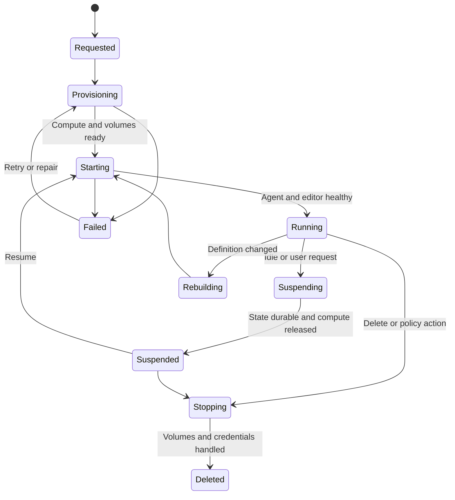

Every transition records desired state, observed state, workflow, actor, reason, and placement epoch.

## High-level architecture

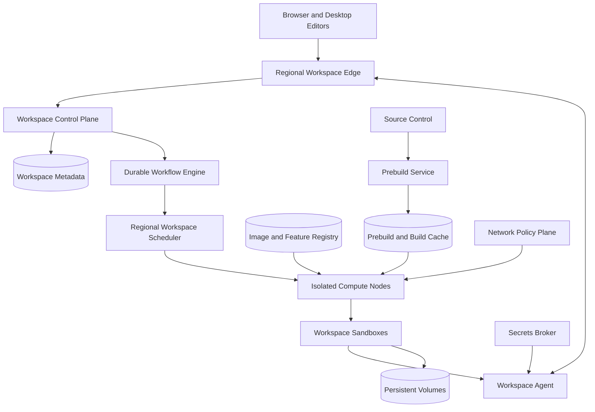

The global control plane stores intent and policy. Regional data planes schedule compute, mount storage, and terminate interactive connections.

## Workspace definitions

A repository stores a declarative definition:

```yaml
image: registry.example.com/dev/node:22
features:
  - docker-tools@3
  - database-client@2
resources:
  cpu: 8
  memory: 32Gi
setup:
  - npm ci
  - npm run generate
ports:
  - port: 3000
    visibility: private
```

Resolve every mutable reference into an immutable image, feature, package-lock, and definition digest before build. Tags such as `latest` make the same commit produce different environments and should be rejected or pinned.

Policy can restrict base images, features, privileged capabilities, package sources, regions, and network destinations.

## Workspace creation

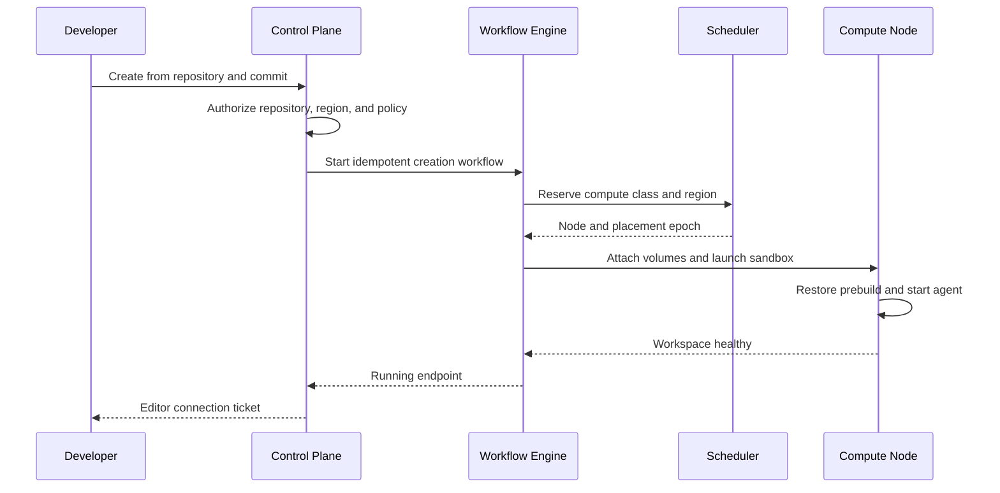

Each step accepts the workspace ID and operation ID. A retry discovers existing reservations, volumes, and sandboxes instead of duplicating them.

## Scheduling and placement

The scheduler considers region, tenant residency, compute class, accelerator type, image availability, storage locality, private network attachment, node health, and capacity headroom.

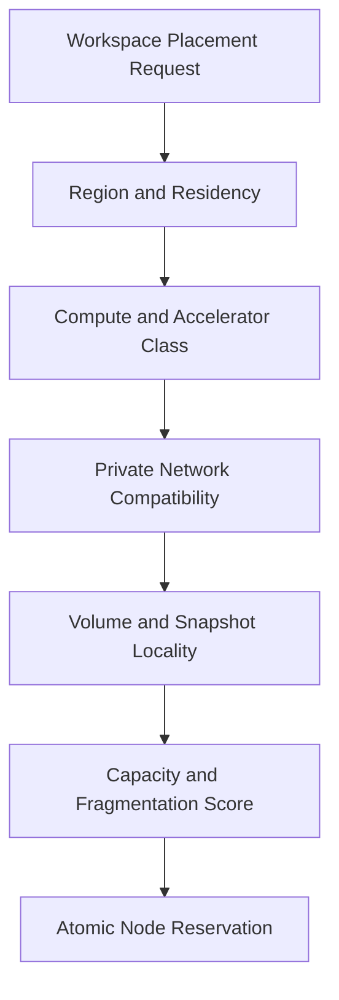

Use bin packing for efficiency while enforcing tenant anti-affinity for high-isolation tiers. Reserve node capacity before provisioning and expire abandoned reservations.

Large tenants can receive dedicated node pools or clusters. Shared pools require strict kernel, runtime, network, and resource isolation.

## Isolation model

Workspaces execute untrusted code. Isolation layers include:

- Hardware virtual machines or microVMs for strong tenant boundaries
- Per-workspace kernels where the threat model requires them
- Non-root runtime and restricted capabilities
- Read-only immutable base images
- Namespaced processes, mounts, devices, and networks
- CPU, memory, process, disk, and I/O quotas
- Seccomp or equivalent syscall policy
- No host socket, container runtime socket, or cloud metadata access
- Egress policy enforced outside the guest

Containers alone may be sufficient for trusted internal workloads but are a weaker boundary for public or mutually untrusted tenants. Offer isolation tiers explicitly.

## Images and features

Build workspace images in an isolated supply-chain pipeline.

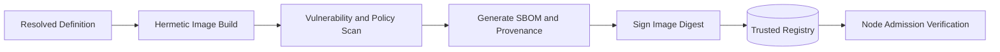

Only signed approved image digests run on workspace nodes. Feature packages are independently versioned and signed.

Rebuild images when base layers or security policy changes. Do not mutate running workspace files silently; prompt or schedule an explicit rebuild.

## Prebuilds

Prebuilds run repository setup before a developer opens the workspace.

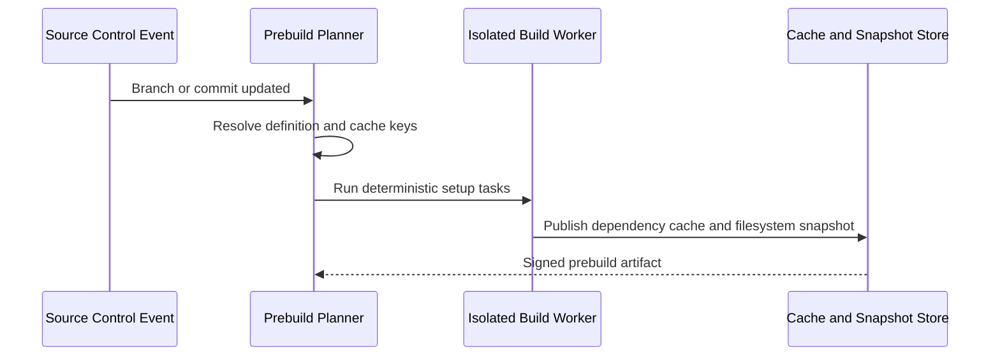

Cache keys include repository, commit or dependency files, definition digest, base image, architecture, and setup-task version.

Prebuilds must not receive a developer's personal secrets. Use narrowly scoped build credentials and sanitize output before sharing snapshots across users.

## Layered filesystem

Compose the workspace filesystem from:

1. Read-only signed base image
2. Read-only prebuild snapshot
3. Mutable project volume
4. Mutable home volume
5. Ephemeral scratch and memory filesystems

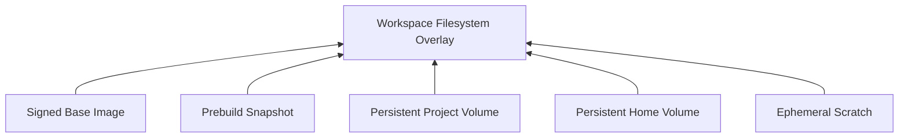

The mutable layer stores only differences. Copy-on-write snapshots make creation and cloning fast.

Separate source state from disposable dependency caches so users can clear caches without risking uncommitted work.

## Persistent storage

Volumes are encrypted, region bound, replicated within a failure domain, and checkpointed to object storage.

The workspace agent flushes filesystem buffers and application state before suspension snapshots. Crash-consistent snapshots are acceptable for ordinary files, while embedded databases may need hooks or explicit warnings.

Use generation numbers and fencing tokens so a volume cannot mount read-write to two workspace instances after failover.

Background backups are encrypted with tenant-scoped keys and follow retention policy. A restore creates a new volume generation rather than overwriting the current one.

## Suspension and resume

Idle detection considers terminal activity, editor sessions, running tasks, preview traffic, explicit keepalive policy, and background-job classification.

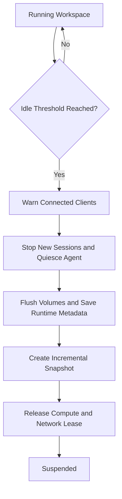

Resume allocates compatible compute, mounts fenced volumes, restores cached image layers, starts the agent, and reconnects clients.

Long-running approved tasks can detach from interactive workspaces into job infrastructure rather than blocking suspension indefinitely.

## Workspace agent

A small in-workspace agent manages terminals, file operations, editor protocol, process supervision, port discovery, task metadata, and health.

The agent authenticates to the edge using a short-lived workspace identity bound to workspace ID, tenant, node, placement epoch, and boot nonce.

It cannot change control-plane state directly. Privileged requests—open a port, fetch a secret, resize, or attach a network—go through authorized control APIs.

## Interactive connectivity

Clients connect to a regional edge using a short-lived ticket. The edge verifies user, workspace, role, session, and current placement, then proxies multiplexed streams to the agent.

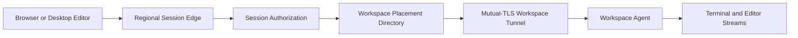

The node creates an outbound tunnel to the edge where inbound networking is restricted. Every stream is independently authorized and rate limited.

Terminal replay buffers are bounded and encrypted. Reconnecting clients can recover recent output without retaining indefinite sensitive history.

## Port previews

When a process listens on a port, the agent reports it. The developer chooses private, organization, authenticated guest, or public visibility under policy.

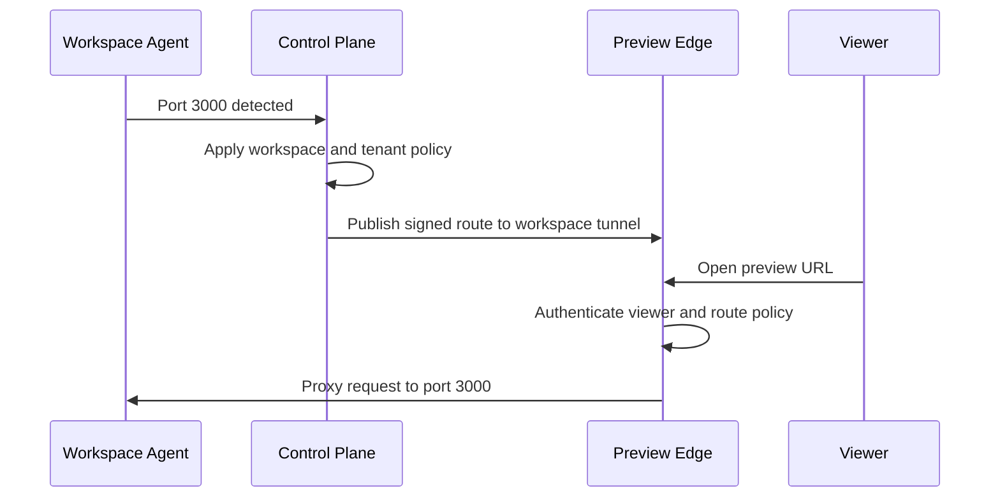

Preview URLs use unguessable hostnames and short-lived authorization. Public previews are disabled by default and protected with abuse controls.

Strip internal headers, block access to agent management ports, limit request size and duration, and protect against DNS rebinding and host-header attacks.

## Secrets

Secrets remain in a central secrets manager and are brokered into workspaces only when requested by an authorized process or task.

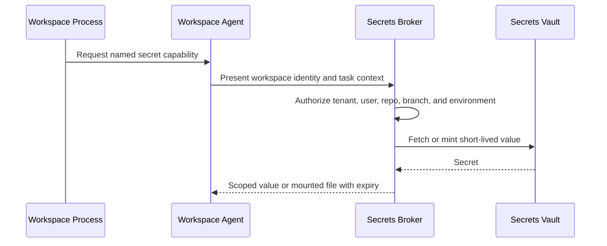

Prefer short-lived cloud credentials over static keys. Do not bake secrets into images, prebuilds, snapshots, shell history, or environment dumps.

Redact known secret values from terminal capture, logs, and support bundles where feasible, while treating prevention at source as primary.

## Source control access

Use delegated short-lived tokens restricted to repositories and operations. Cloning, fetching, and pushing use the developer identity or approved application identity.

The platform stores repository references and public metadata, not permanent personal tokens. Credential helpers request a token on demand from the source-control broker.

Untrusted repository setup scripts run only after workspace isolation and network policy are active. Prebuilds from external contributions receive reduced permissions and no trusted secrets.

## Network policy

Default-deny access to control-plane networks, node management interfaces, cloud metadata, other workspaces, and tenant-private networks.

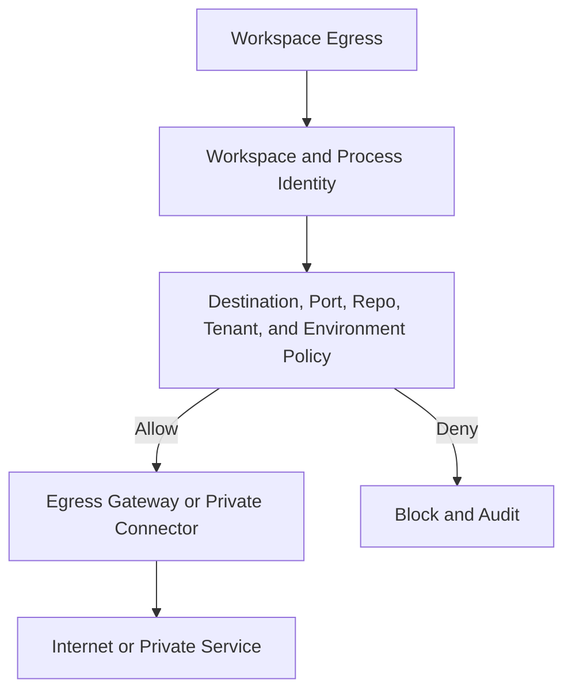

Private environment access uses tenant-specific connectors and routes. A workspace receives only declared destinations, not a flat corporate network.

Record destination metadata and policy decisions without collecting sensitive payloads by default.

## Resource management

Enforce CPU, memory, disk, process, network, and accelerator quotas at workspace, user, team, and tenant levels.

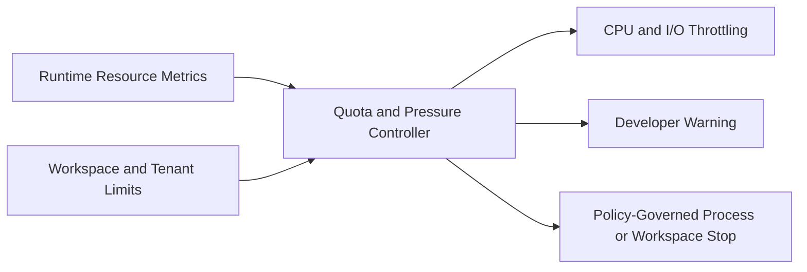

Memory pressure first evicts caches and warns the user. Out-of-memory behavior is explicit; silently killing arbitrary processes creates data loss and confusion.

Resize can be live where the runtime supports it. Changes that require a new machine follow a suspend-and-resume migration with a higher placement epoch.

## Build caches

Dependency and compiler caches improve performance but can leak proprietary artifacts across tenants.

Scope caches by tenant, repository trust domain, toolchain, architecture, dependency lock hash, and build policy. Global sharing is limited to verified public immutable dependencies.

Content-address cache entries include provenance and integrity hash. Writers publish immutable objects; readers never trust a mutable shared directory.

Apply quotas and least-recently-used eviction independently from persistent source volumes.

## Collaboration

Developers can invite authorized collaborators to observe or control an editor or terminal session.

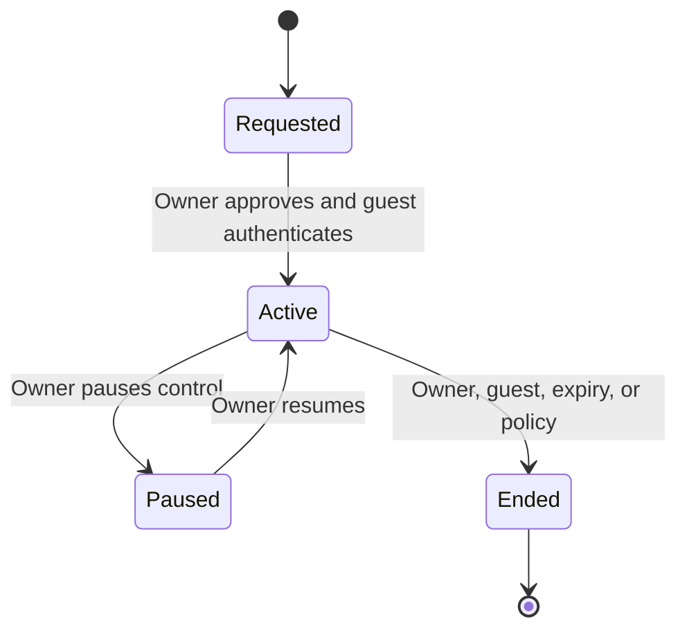

Roles include observer, editor, and terminal controller. Terminal control requires explicit consent and visible indication to all participants.

Collaboration grants are short lived, workspace scoped, and audited. They do not automatically grant repository, secret, or private network permissions beyond the session's policy.

## Snapshots and cloning

Manual snapshots capture volume generations, definition digest, repository state, tool metadata, and ownership policy.

Cloning creates copy-on-write volumes and a new workspace identity. Secrets, active sessions, host keys, and short-lived credentials are never cloned.

Before sharing a snapshot, scan for secrets, private keys, large files, and restricted data. Tenant policy can forbid cross-user or cross-organization sharing.

## Rebuilds

A rebuild replaces the immutable image and prebuild layers while preserving selected mutable volumes.

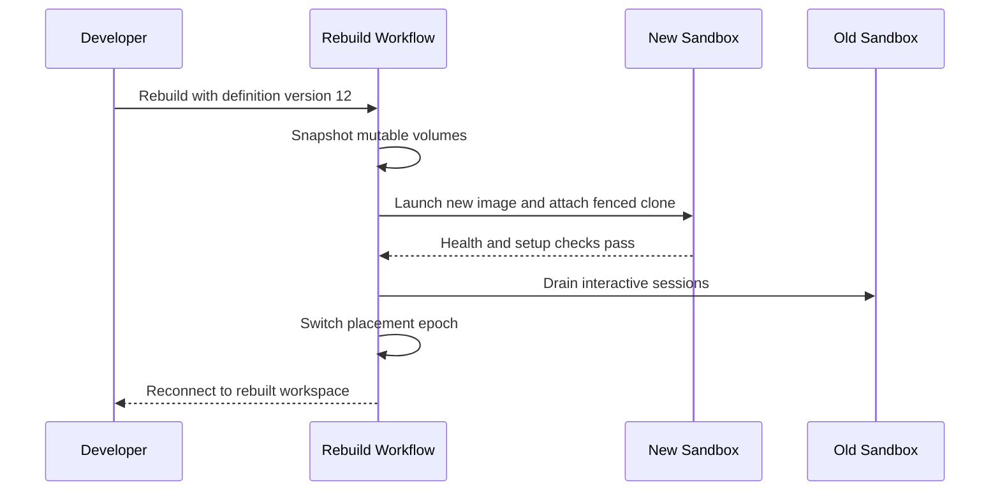

Keep the old volume generation for a bounded rollback window. A failed rebuild leaves the original workspace available.

## Policy and compliance

Policy controls:

- Approved images and features
- Regions and data residency
- Maximum resources and idle lifetime
- Repository and branch trust
- Secret availability
- Private network destinations
- Public preview permissions
- Snapshot sharing and retention
- Required security agents

Compile policy into signed regional admission bundles. Existing workspaces re-evaluate when critical policy changes and can be quarantined, drained, or rebuilt according to severity.

## Multi-region design

The global plane stores non-sensitive workspace metadata and desired state. Regional cells contain compute, volumes, caches, edges, secrets brokers, and private connectors.

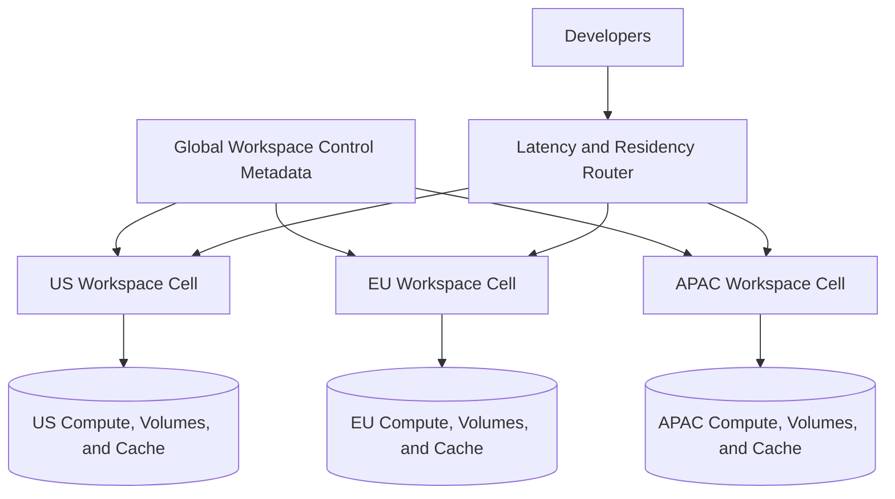

Workspaces stay in their selected region unless an explicit migration copies encrypted snapshots and validates policy. Private network connectivity often makes automatic cross-region failover inappropriate.

During regional control-plane isolation, running workspaces continue from cached authorization and policy. New privileged operations pause.

## Node failure and recovery

Workspace compute is disposable; volumes are durable.

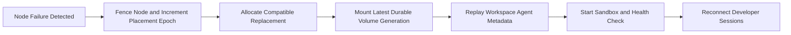

The storage service permits read-write mount only for the highest fencing token. A recovered old node cannot corrupt the active volume.

Unflushed ephemeral process state is lost. Make durability boundaries clear to developers.

## Security monitoring

Detect cryptomining, scanning, credential theft, unusual egress, kernel exploitation, persistence attempts, and abusive public previews.

Signals include resource shape, process ancestry, destination reputation, failed policy decisions, unexpected binaries, and tenant history. Avoid inspecting source content unless policy and incident scope require it.

Responses can throttle, isolate networking, revoke sessions, snapshot evidence, or stop a workspace. High-impact actions produce an audit trail and appeal path.

## Supply-chain security

- Verify repository origin and commit signatures where required
- Pin and sign base images and features
- Generate SBOMs and provenance for platform artifacts
- Scan images before admission and continuously after publication
- Restrict untrusted contribution prebuilds
- Isolate build caches by trust domain
- Rotate builder, registry, and source-control credentials
- Prevent image and cache poisoning through content addressing

Developer workspaces should not automatically inherit production deployment authority. Separate build, test, and deployment credentials by purpose.

## Retention and deletion

Idle workspaces move from suspended to archived and eventually deleted according to policy. Notify owners and offer export before destructive transitions where appropriate.

Deletion revokes sessions and credentials, fences compute, deletes volumes and snapshots, removes preview routes, expires caches, and emits disposition evidence.

Source repositories remain authoritative for committed code; uncommitted workspace data requires explicit retention and backup expectations.

## Reliability and failure handling

| Failure | Safe behavior |
| --- | --- |
| Creation request repeats | Operation ID returns the existing workspace workflow |
| Scheduler crashes | Reservation lease expires or recovers from durable state |
| Node fails | Fence placement and restore durable volumes on a replacement |
| Image pull fails | Retry another node or retain suspended state |
| Prebuild fails | Start from source with clear degraded startup status |
| Secrets broker fails | Existing short-lived values expire; no plaintext fallback |
| Session edge disconnects | Client reconnects with current workspace placement ticket |
| Snapshot fails | Keep compute running or abort suspension safely |
| Control plane fails | Running workspaces continue with cached policy; mutations pause |

Every workflow exposes honest intermediate states rather than reporting “running” before the agent and storage are healthy.

## Observability and SLOs

Track:

- Create, start, suspend, resume, rebuild, and delete duration
- Scheduler queue time, placement failures, and regional capacity
- Prebuild hit rate, age, failure, and time saved
- Image-pull and layer-cache performance
- Volume latency, snapshot age, fencing conflicts, and restore success
- Realtime session latency, reconnects, and stream errors
- Preview routes, authentication failures, and abuse blocks
- Secret requests, denial reasons, and credential age
- Resource throttling, OOM events, and idle-suspension accuracy
- Network-policy denials and unusual egress

Useful SLOs include 99.9% of valid prebuilt workspaces interactive within ten seconds, 99.99% durable-volume availability, and zero cross-tenant data exposure after a single node or service failure.

## Key trade-offs

| Decision | Benefit | Cost |
| --- | --- | --- |
| MicroVM isolation | Strong tenant boundary | Startup and density overhead |
| Prebuild snapshots | Fast developer startup | Compute, cache, and trust complexity |
| Layered filesystem | Efficient cloning and rebuild | Overlay and compaction complexity |
| Automatic suspension | Lower cost | Resume latency and background-task policy |
| Central secret brokering | Short-lived scoped access | Runtime dependency on broker availability |
| Egress default deny | Smaller attack surface | More policy configuration |
| Regional workspace cells | Low latency and residency | Capacity fragmentation and migration work |

## Evolution path

1. Build one-region isolated workspaces with repository clone and persistent volumes.
2. Add browser editor connectivity, port previews, suspension, and resume.
3. Introduce declarative definitions, signed images, prebuilds, and layered caches.
4. Add secrets brokering, private networks, policy admission, and collaboration.
5. Deploy regional cells, dedicated isolation tiers, and workspace migration.
6. Continuously test escapes, cache poisoning, node failure, and deletion completeness.

Start with isolation and durable storage boundaries. Fast startup is valuable only when a workspace cannot read another developer's code or lose uncommitted work during routine failure.

## Final design

Represent every workspace as versioned desired state: repository commit, immutable definition digest, compute class, region, network policy, secrets bindings, and durable volume generations. Schedule it into a regional isolated sandbox, compose signed base images with sanitized prebuild snapshots and fenced mutable volumes, then connect editors through authenticated multiplexed edge tunnels. Broker secrets and private network access through short-lived identity-aware services outside the guest, and expose workspace ports only through policy-enforced preview edges.

The central principle is to separate disposable compute from durable developer state. Nodes, sandboxes, sessions, and caches can fail or be replaced; source changes, workspace volumes, access policy, and identity must remain recoverable, isolated, and explicit.
