## Problem and requirements

A customer support platform converts requests from many channels into durable conversations that agents can triage, answer, escalate, and resolve. It keeps customer context, ownership, response deadlines, internal collaboration, automation, and reporting consistent across email, chat, web forms, messaging, and voice.

The difficult part is not storing messages. The same customer can contact several channels at once, inbound providers retry deliveries, multiple agents can edit the same ticket, SLA clocks depend on business calendars, and automated actions must not send duplicate or contradictory replies.

### Functional requirements

- Accept requests from email, chat, web, messaging, social, and voice
- Normalize channel events into one conversation model
- Identify customers and link related requests safely
- Assign tickets by queue, skill, language, priority, and capacity
- Support public replies, internal notes, attachments, and mentions
- Track first-response and resolution SLAs
- Run versioned triggers, macros, and workflow automations
- Search conversations, customers, messages, and metadata
- Support merges, splits, escalations, and parent-child incidents
- Provide agent presence and collision awareness
- Expose customer history and approved business context
- Preserve audit history, retention, and export controls

### Non-functional requirements

- Store one billion conversations and process 100 million messages daily
- Support one million concurrently active agents
- Deliver live chat messages within one second at p99
- Prevent duplicate tickets and outbound replies during retries
- Enforce strong tenant isolation at every storage boundary
- Keep existing channel ingestion running during search outages
- Make automation actions deterministic and auditable
- Respect regional data residency and deletion policies

## Capacity estimates

Assume 100 million messages per day, five attachments for every hundred messages, and an average normalized message size of four kilobytes.

| Resource | Estimate |
| --- | ---: |
| Conversations | 1B retained |
| Messages | 100M/day, 1,160/second average |
| Peak inbound events | 100K/second during incidents |
| Concurrent agents | 1M |
| Attachments | Millions/day |
| Search index | Petabyte scale |
| SLA timers | Hundreds of millions active |

Inbound volume is highly bursty. A product outage can create a correlated spike across every channel while agent capacity remains fixed.

## Core data model

```text
Conversation {
  tenantId, conversationId, customerId,
  state, priority, queueId, assigneeId,
  version, createdAt, updatedAt
}

Message {
  messageId, conversationId, channel,
  direction, visibility, sender, bodyRef,
  sourceEventId, createdAt
}

Assignment { conversationId, owner, reason, version, assignedAt }
SLA         { conversationId, policyVersion, target, dueAt, state }
AuditEvent  { actor, action, resource, before, after, occurredAt }
```

Conversation IDs and message IDs are opaque and immutable. Provider IDs are external references, not primary keys.

Messages are append-only. Editing or redacting content creates a new version and an audit event rather than silently changing history.

## High-level architecture

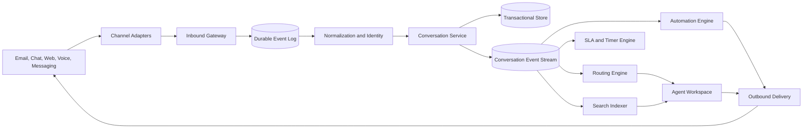

Channel ingestion is independent from search, analytics, and automation. If derived systems fail, accepted customer messages remain durable and are processed later.

## Omnichannel ingestion

Each provider adapter verifies signatures, normalizes metadata, and publishes an immutable source event.

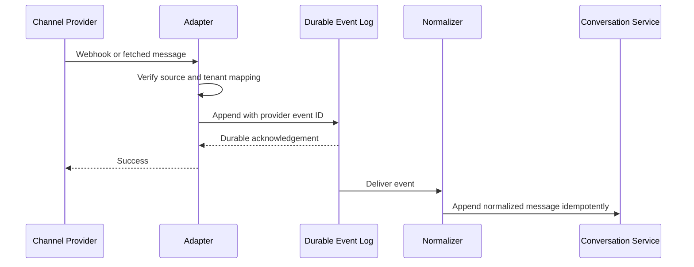

Deduplicate by tenant, channel, account, and provider event ID. Some providers reuse message IDs across accounts, so the full source scope belongs in the key.

For polling channels, store a cursor only after all preceding events are durable. Backfill windows overlap intentionally, relying on deduplication to handle repeats.

## Conversation threading

Channel-specific threading rules produce candidate conversations:

- Email reply headers, mailbox, participants, and signed reply token
- Chat session and authenticated customer identity
- Messaging provider conversation identifier
- Web form submission or authenticated account
- Voice call and follow-up linkage

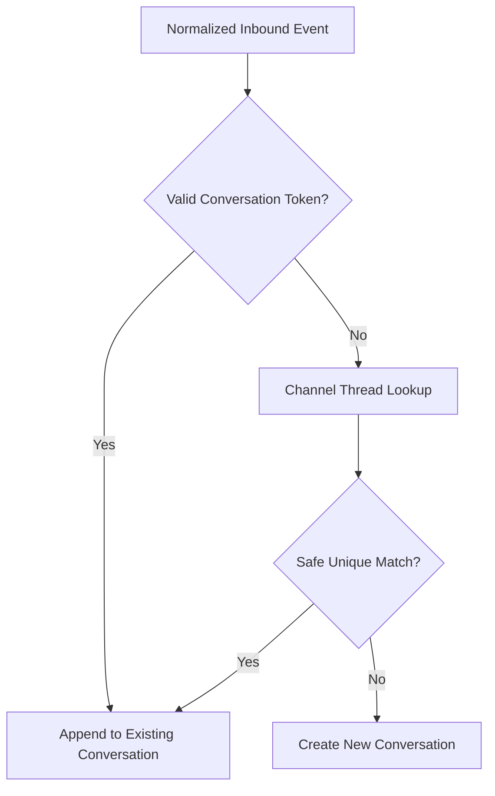

Prefer false separation over unsafe merging. Combining two customers' requests can disclose private information. Ambiguous matches create a new ticket and can be merged later by an authorized agent.

## Customer identity resolution

Maintain a tenant-scoped identity graph linking verified email addresses, phone numbers, application accounts, and channel identities.

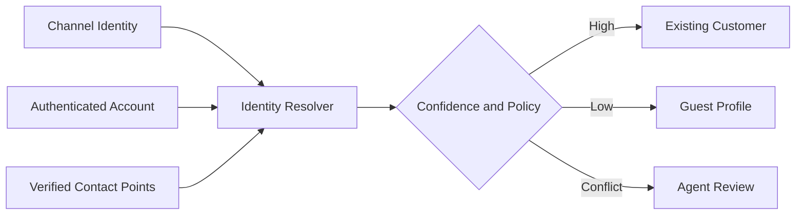

Never merge identities using display name alone. A verified login or ownership challenge carries more weight than an unverified sender address.

Identity merges are reversible, audited, and protected by authorization. They do not automatically expose every historical conversation to every agent.

## Conversation state machine

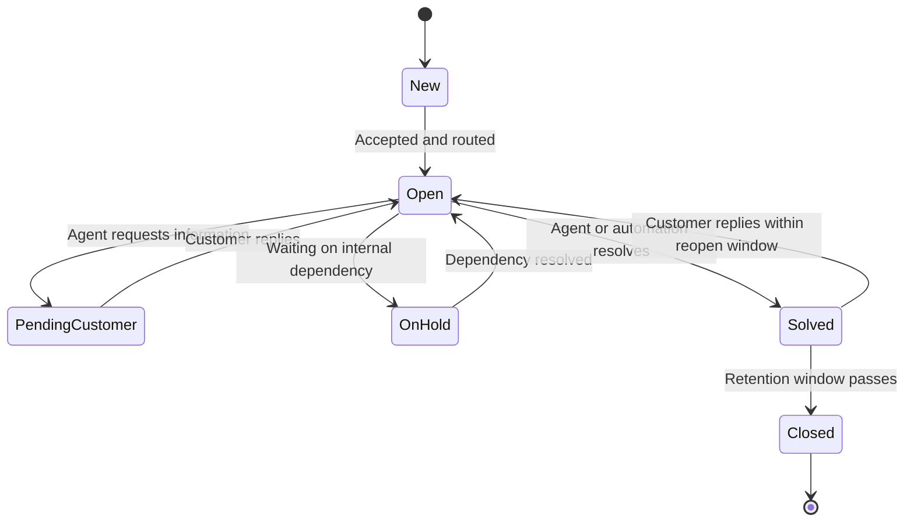

State transitions use optimistic concurrency against the current conversation version. Every transition records actor, reason, source, and automation version.

Closing a ticket does not delete it. Retention and privacy workflows manage physical deletion separately.

## Agent workspace and real-time updates

Agents need a consistent view of messages, assignment, SLA, customer context, and other active editors.

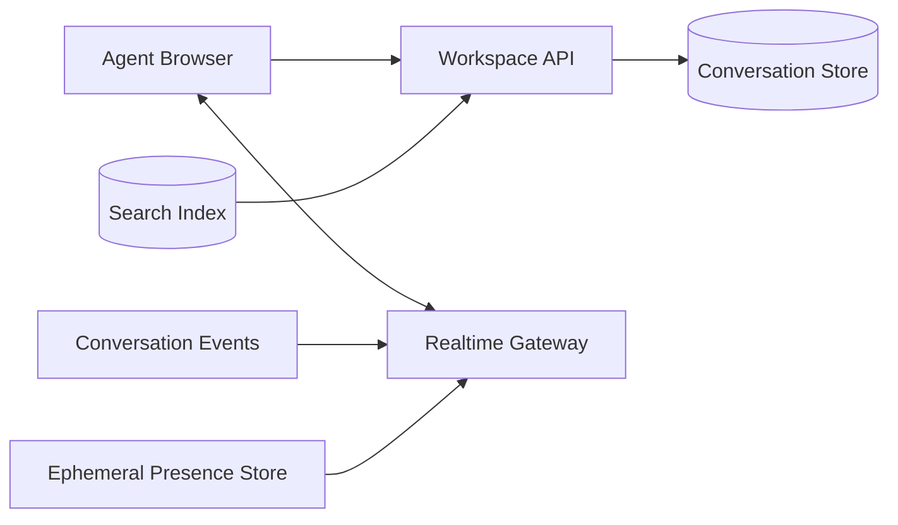

The browser loads an authoritative snapshot through the API, then applies versioned events over a persistent connection. If it detects a version gap, it refetches rather than guessing.

Presence and typing indicators are ephemeral and may be lost. Messages, notes, assignments, and state changes are durable.

## Concurrent agent actions

Two agents may open and reply to the same ticket. Show who is viewing, editing, or composing, but do not rely on presence for correctness.

Mutation requests include the conversation version:

```http
POST /v1/conversations/cv_82/replies
If-Match: "47"
Idempotency-Key: 01K9F31A
```

If assignment or state changed after version 47, return a conflict with the current snapshot. The agent can review before resubmitting.

Outbound messages use a durable draft-to-send transition and an idempotency key. A browser retry must never send the customer the same reply twice.

## Routing

Routing combines hard eligibility constraints with a scored assignment policy.

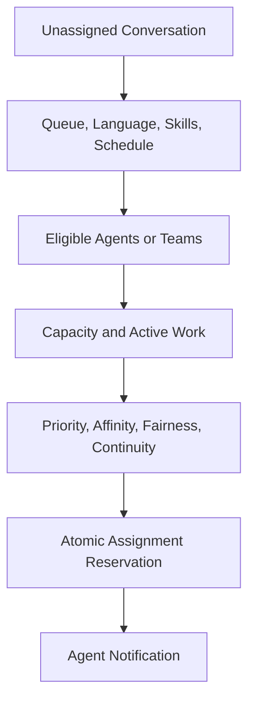

Hard constraints include tenant, queue, required skill, language, region, and security clearance. Scores can consider workload, recent customer relationship, ticket age, skill confidence, and fairness.

Assignment uses a lease or atomic compare-and-swap so two routing workers cannot assign the same ticket. An accepted assignment becomes durable; a timed-out offer returns to the queue.

## Capacity and work models

An agent may handle one voice call, several chats, and many asynchronous email tickets. Model capacity by channel and workload units rather than a single ticket count.

```text
voice call       = 100 capacity units
active live chat = 40 capacity units
email in focus   = 20 capacity units
assigned backlog = 2 capacity units
```

Capacity policy is tenant-configurable and versioned. Reserve headroom for escalations and priority customers.

During large incidents, route duplicates to an incident queue, surface status messaging, and offer bulk resolution rather than overwhelming individual agents.

## SLA engine

SLAs can measure first response, next response, resolution, or custom milestones. Targets depend on priority, customer plan, channel, and business calendar.

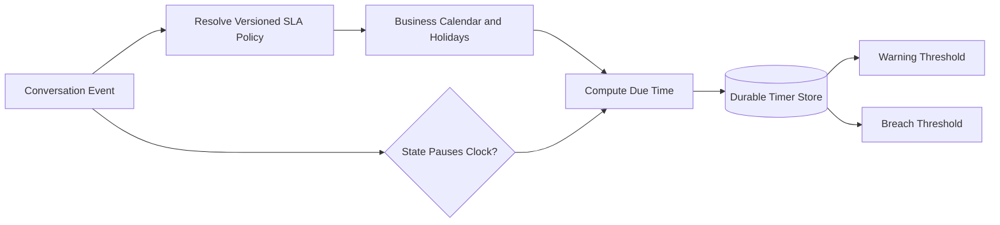

Store the policy version, calendar version, start time, accumulated active duration, pause intervals, and due time. Historical SLA results must not change when next year's holiday calendar is edited.

Timers are partitioned into time buckets. Workers lease due timers and emit idempotent warning or breach events.

## Business calendars

Calendars define time zone, weekly working intervals, holidays, and exceptional closures. Compute duration in the calendar's local time while handling daylight-saving transitions explicitly.

A target of eight business hours is not the same as adding eight wall-clock hours. Precompute calendar intervals for common future windows and retain exact calendar versions for reproducibility.

When policy changes mid-ticket, declare whether the old target remains, the new target applies prospectively, or a migration recalculates it. Never silently rewrite SLA history.

## Automation engine

Triggers react to conversation events and run versioned conditions and actions.

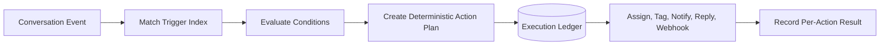

An execution key combines event ID, trigger version, and action index. Retries return the existing outcome instead of repeating side effects.

Limit recursion: an automation-generated event can trigger other rules, but each chain carries a depth, ancestry, and action budget. Detect cycles before publication where possible.

High-impact actions such as bulk deletion, external messaging, or account changes require stronger approval and bounded target previews.

## Macros and templates

Macros are agent-invoked action bundles that can update fields, add notes, change assignment, and prepare a response.

Render templates with an allowlisted variable set. Escape output for the destination channel, prevent arbitrary code execution, and show the final customer-visible text before send unless policy explicitly allows trusted automation.

Template versions are retained with sent messages so audits can reproduce what the agent saw and what the customer received.

## Outbound delivery

Sending a reply is a durable workflow, not a synchronous provider call from the browser.

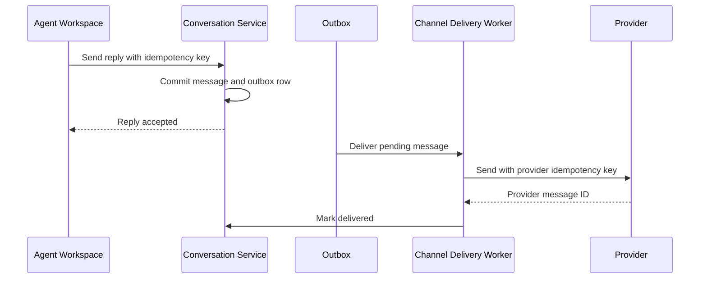

Provider timeouts create ambiguous outcomes. Query provider status when supported or retry using the same provider idempotency key. If neither is possible, mark delivery unknown and avoid blind repetition for sensitive channels.

Channel policies control formatting, attachment size, rate limits, quiet hours, reply windows, and consent.

## Live chat

Live chat uses persistent client connections and low-latency regional gateways. Messages still enter the same durable conversation log.

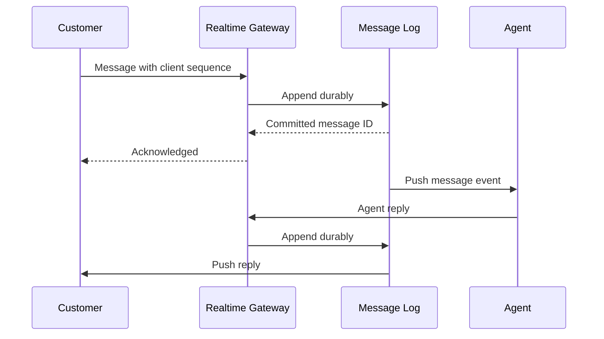

Typing indicators and presence are best effort. Chat messages use stable client IDs and server sequence numbers for deduplication and gap repair.

If no agent is available, the chat can transition to asynchronous messaging without losing history or forcing the customer to remain connected.

## Attachments

Clients upload directly to object storage using short-lived, tenant-scoped URLs. The attachment remains quarantined until scanning completes.

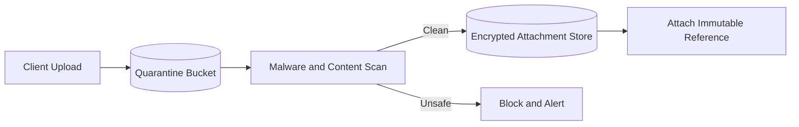

Validate content using detected type, not only filename. Strip active content where appropriate, set safe download headers, and never render untrusted HTML inline.

Attachment access requires authorization to the conversation and uses short-lived download links. Retention follows the strictest applicable conversation and attachment policy.

## Search

Search indexes conversations, messages, customer identifiers, tags, assignments, status, dates, and selected custom fields.

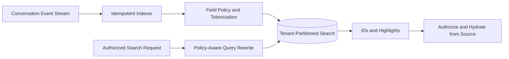

The transactional store remains authoritative. Search results are reauthorized and hydrated before display, preventing stale indexes from exposing deleted or restricted content.

Use per-tenant partitions or mandatory tenant filters enforced below the application layer. Never rely on the browser to supply a correct tenant filter.

## Merge and split operations

Merging links source conversations to a canonical destination while preserving their original IDs, messages, channel metadata, and audit history.

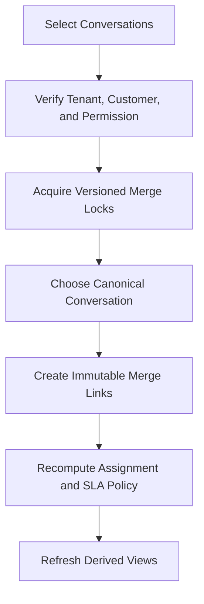

Do not physically copy and delete messages during merge. A logical timeline can combine linked histories while maintaining provenance.

Splitting creates a new conversation referencing selected messages. The operation records who chose the boundary and prevents private notes from becoming customer-visible.

## Incident linking and duplicate handling

During a product outage, thousands of tickets may describe the same issue. Similarity models and deterministic signals propose links to a parent incident.

Agents approve uncertain matches. Linked tickets inherit incident status updates and can receive one controlled bulk response, but retain individual customer context and SLA policy.

Bulk actions use a frozen target snapshot, dry-run counts, rate limits, approval, per-ticket idempotency keys, and an execution ledger.

## Analytics

Conversation events flow into an analytical pipeline for queue volume, response time, resolution time, backlog, reopen rate, transfer rate, SLA performance, and customer feedback.

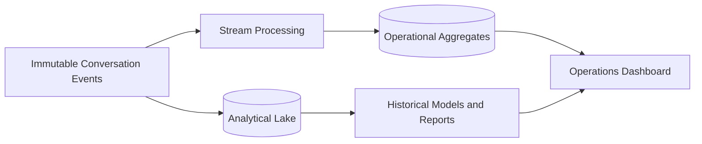

Compute durations from event history rather than mutable current-state rows. Separate agent workload metrics from simplistic productivity rankings that can incentivize harmful behavior.

Late events and policy corrections produce versioned restatements rather than silent changes.

## Multi-region design

Assign each tenant a home region for conversations, messages, search, attachments, and encryption keys. Regional cells run channel ingestion and agent APIs.

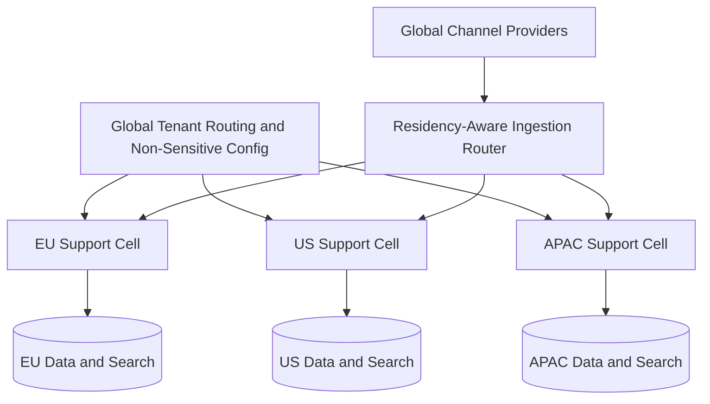

Provider webhooks route through a global edge using an opaque account mapping, then forward only to the tenant's approved region.

Cross-region agent access requires explicit policy. Failover promotes a prepared secondary using a higher tenant-routing epoch; the old region is fenced from accepting mutations.

## Privacy and security

- Authenticate agents with short-lived sessions and strong MFA policy
- Authorize by tenant, role, queue, field sensitivity, and purpose
- Separate public replies from internal notes at the data-model level
- Encrypt messages, attachments, indexes, and exports
- Tokenize customer identifiers used for exact matching
- Redact secrets and payment data during ingestion where possible
- Audit views, searches, exports, merges, impersonation, and automation
- Require just-in-time approval for privileged support access
- Apply retention and deletion to source and derived stores
- Defend channel adapters against spoofing, phishing, and malicious attachments

Internal notes can be as sensitive as customer messages. They require the same access control, retention, and export review.

## Reliability and failure handling

| Failure | Safe behavior |
| --- | --- |
| Provider repeats a webhook | Source event key deduplicates it |
| Normalizer crashes | Resume from durable log checkpoint |
| Two agents update one ticket | Version check returns a conflict |
| Routing worker crashes | Assignment reservation expires or recovers from ledger |
| SLA worker retries | Timer event ID prevents duplicate breach actions |
| Automation fails mid-plan | Resume per-action ledger without repeating completed effects |
| Outbound provider times out | Reconcile status or retry with the same idempotency key |
| Search is unavailable | Ingestion and direct ticket access continue |
| Realtime connection drops | Client refetches snapshot and resumes after last version |
| Region fails | Promote an approved replica and fence the old routing epoch |

Every asynchronous stage consumes a durable source and advances its checkpoint only after durable output.

## Observability and SLOs

Track:

- Inbound delivery, deduplication, normalization, and threading lag
- New conversations and messages by channel
- Queue backlog, oldest unassigned ticket, and routing latency
- Agent capacity, assignment acceptance, and transfer rate
- SLA timers, warnings, breaches, and scheduler lag
- Automation executions, recursion stops, and action failures
- Outbound send, delivery, unknown outcome, and bounce rate
- Search indexing freshness and authorization rejections
- Live chat latency, reconnects, and message gaps
- Attachment scan time and blocked content
- Regional replication and tenant-routing epoch

Useful SLOs include 99.99% durable inbound acceptance, 99.9% of live chat messages delivered to the regional conversation log within one second, and zero duplicate customer replies from platform retries.

## Key trade-offs

| Decision | Benefit | Cost |
| --- | --- | --- |
| Append-only messages | Strong history and replayability | Redaction and correction complexity |
| Async channel delivery | Reliable retries and fast agent UI | Eventual delivery status |
| Optimistic concurrency | Prevents silent overwrites | Agents must resolve conflicts |
| Derived search index | Fast flexible search | Eventual consistency and rebuilds |
| Dynamic routing | Better utilization and skill match | More policy and explainability work |
| Versioned SLA clocks | Reproducible compliance | Calendar and state complexity |
| Tenant home regions | Residency and bounded blast radius | Cross-region operations are harder |

## Evolution path

1. Build email and web intake with durable conversations and agent replies.
2. Add routing, assignments, SLAs, templates, and search.
3. Introduce live chat, persistent connections, and agent collision awareness.
4. Add versioned automation, omnichannel adapters, and attachment scanning.
5. Deploy regional cells, incident linking, and analytical event history.
6. Add assisted classification and response suggestions with human review.

Start with durable message provenance and idempotent outbound delivery. A polished agent interface cannot recover trust after the platform loses a customer request or sends the same reply repeatedly.

## Final design

Use channel adapters to authenticate and durably ingest provider events, then normalize them into append-only tenant-scoped conversations with conservative identity and threading rules. Drive routing, SLA timers, automation, search, analytics, and realtime updates from an immutable conversation event stream. Protect agent mutations with optimistic concurrency, execute outbound replies through a transactional outbox, and assign stable idempotency keys to every external effect. Keep search and analytics derived from an authoritative transactional store, and isolate each tenant's messages, attachments, indexes, and keys in an approved home region.

The central principle is to treat every customer interaction as durable workflow state. Channels, agents, timers, and automations can all retry or fail independently, but the conversation history and side-effect ledger must make the next safe action unambiguous.
