## Problem and requirements

A data lakehouse stores structured and semi-structured data in object storage while providing table semantics normally associated with a warehouse: atomic commits, schema enforcement, snapshots, updates, deletes, and efficient SQL queries.

Plain data lakes are inexpensive but become difficult to trust when files are partially written, schemas drift, and concurrent jobs overwrite each other. Warehouses provide strong management but can couple data to one execution engine. A lakehouse separates durable table storage from compute while retaining a transactional metadata layer.

### Functional requirements

- Create and evolve versioned analytical tables
- Ingest batch files and streaming records
- Append, update, merge, and delete rows atomically
- Query consistent table snapshots
- Support time travel and rollback
- Compact small files and reorganize data
- Maintain statistics and indexes for pruning
- Enforce catalog, lineage, retention, and access policies
- Run multiple query and processing engines safely
- Back up metadata and recover tables

### Non-functional requirements

- Manage 100 petabytes across one million tables
- Scale reads and writes independently
- Keep committed snapshots durable and reproducible
- Prevent partial files from becoming visible
- Support thousands of concurrent writers and queries
- Avoid dependence on one compute engine
- Isolate tenants and expensive workloads
- Make deletion and retention verifiable

The lakehouse optimizes analytical workloads. It is not a replacement for a low-latency transactional database.

## Capacity estimates

Assume 100 petabytes of compressed data, one million tables, billions of object files, and hundreds of thousands of commits per hour.

| Resource | Estimate |
| --- | ---: |
| Managed data | 100 PB |
| Tables | 1M |
| Data files | Billions |
| Catalog operations | Millions/minute |
| Concurrent queries | Tens of thousands |
| Streaming ingest | Millions of rows/second |

Object storage scales well for bytes but poorly for millions of tiny files and repeated directory listings. Metadata architecture and file sizing are first-class design concerns.

## Table model

A table consists of:

- Stable identifier and human-readable name
- Schema with stable column IDs
- Partition specification
- Ordered immutable snapshots
- Data files and delete files
- Statistics and optional indexes
- Properties for retention, encryption, and optimization

Each snapshot references a complete logical table state through manifests rather than copying every file list.

```text
table → current snapshot → manifest list → manifests → data and delete files
```

Data files are immutable. Inserts create files; updates and deletes add replacement or delete files; compaction later rewrites them.

## High-level architecture

The catalog coordinates table metadata while engines read and write immutable files in object storage.

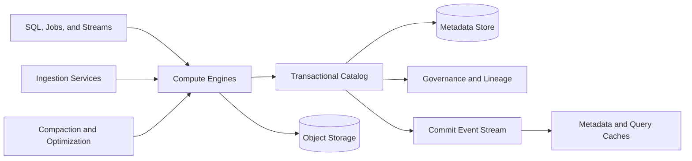

The catalog authorizes operations, resolves names, tracks the current snapshot, and commits metadata changes. It does not proxy bulk data bytes.

Compute engines are disposable and can scale independently for streaming, transformation, interactive SQL, and maintenance.

## File format

Use a columnar file format that stores values by column with compression, encodings, row groups, and statistics.

Columnar layout lets a query read only requested columns. Min/max statistics, null counts, and dictionaries allow row-group pruning.

Choose file sizes large enough for efficient object reads and distributed scan tasks—often hundreds of megabytes—while avoiding files so large that parallelism and rewrite cost suffer.

Store schema identifiers and table metadata in file footers. Readers map stable column IDs rather than physical positions or names.

## Metadata hierarchy

Listing billions of objects for every query is impossible. Snapshot metadata provides a hierarchy that narrows planning.

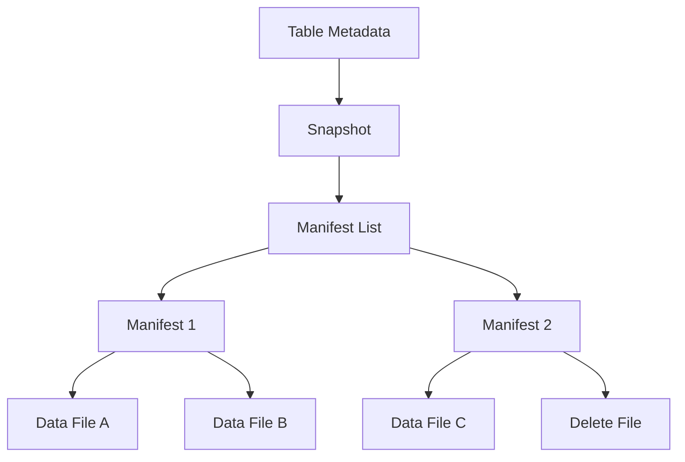

Manifest lists summarize partitions and statistics. Manifests contain file paths, sizes, record counts, column metrics, sequence numbers, and partition values.

Writers reuse unchanged manifests between snapshots. This makes commits proportional to changed data rather than total table size.

## Atomic commits

A writer first creates immutable data and metadata files, then atomically changes the catalog's current snapshot pointer.

```mermaid
sequenceDiagram
  participant W as Writer
  participant O as Object Storage
  participant C as Catalog
  W->>C: Read current snapshot 184
  W->>O: Write data files
  W->>O: Write manifests and snapshot 185
  W->>C: Compare-and-swap 184 → 185
  alt No concurrent conflict
    C-->>W: Commit successful
  else Snapshot changed
    C-->>W: Conflict; rebase and retry
  end
```

Readers see either snapshot 184 or 185, never half of a commit. Object writes alone do not make files visible.

On conflict, the writer checks whether concurrent changes overlap. Two independent append operations can often rebase safely. Conflicting updates to the same rows require retry or rejection.

Abandoned files from failed commits remain unreachable and are removed by a delayed orphan-file cleaner.

## Isolation and concurrency

Snapshot isolation gives each query a consistent table version even while writers commit newer versions.

Operations declare their conflict scope:

- Append validates that the base table remains compatible
- Partition overwrite checks affected partitions
- Row-level update validates relevant files or predicates
- Schema change checks the current schema version

Serializable validation detects new files that would match an update predicate and create a write skew.

Use stable commit IDs so clients can safely retry after an ambiguous catalog response. The catalog returns the original result for repeated IDs.

## Batch ingestion

Batch ingestion validates incoming files, transforms them into the table schema, and writes optimized columnar files.

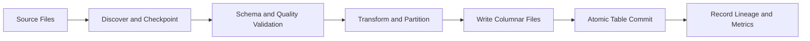

Track source object identity, checksum, and ingestion run to avoid importing a file twice. A batch becomes visible only after every expected output is durable.

Quarantine malformed rows or reject the batch according to the table contract. Silent coercion creates hard-to-debug analytical errors.

## Streaming ingestion

Streaming writers buffer records into micro-batches, produce data files, and commit source offsets with the snapshot.

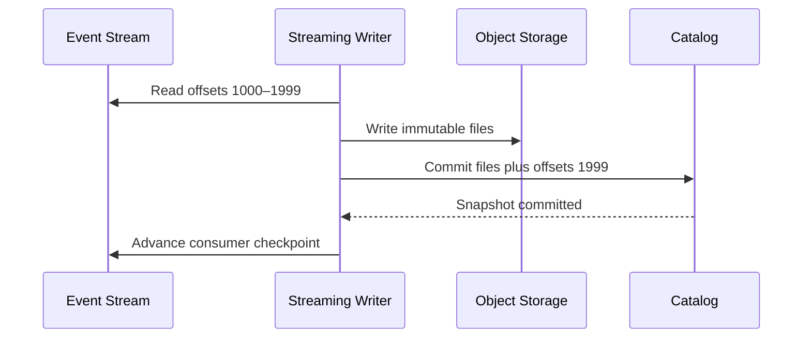

After a crash, the writer resumes from the offsets in the committed snapshot. Recreated files use a stable batch ID, or uncommitted duplicates remain unreachable.

Frequent commits improve freshness but create small files and metadata load. Choose a commit interval that balances query latency with file efficiency, then compact asynchronously.

## Partitioning

Partitioning groups files by transformed values such as day, region, or bucket of customer ID.

Avoid exposing physical partition layout as a permanent user contract. Hidden transforms let the system evolve from daily to hourly partitions without changing query syntax.

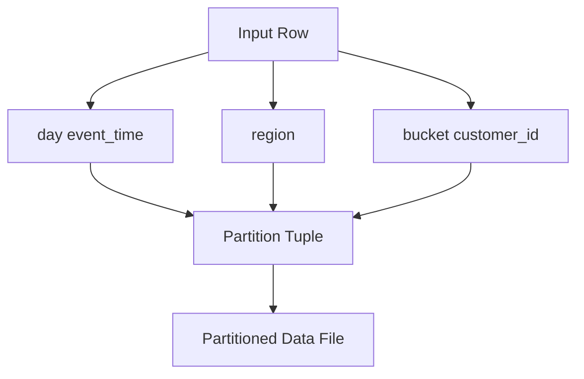

Good partitions prune large amounts of data and remain reasonably sized. High-cardinality values such as user ID should use bucketing rather than one directory per value.

Partition evolution applies a new specification to future files. Readers evaluate predicates across both old and new layouts.

## Schema evolution

Assign every column a stable numeric ID. Renaming a column changes its display name, not its identity.

Safe operations include adding an optional column, renaming, reordering, and widening compatible numeric types. Dropping a column removes it from the logical schema but may leave bytes in older files until rewrite and retention expiration.

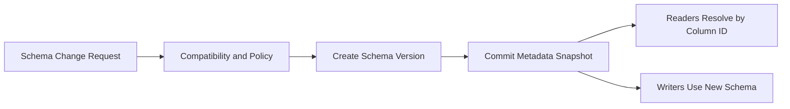

Incompatible changes use a new column or table version. Never reinterpret existing bytes under a new meaning without an explicit migration.

Schema enforcement occurs at write time, while schema evolution remains a controlled metadata operation.

## Row-level updates and deletes

Analytical files are immutable, so row changes use one of two strategies.

### Copy on write

Rewrite affected data files with updated rows. Reads stay simple and fast, but small updates can cause large write amplification.

### Merge on read

Write position or equality delete files plus new row versions. Writes are fast, while readers merge deletes and data until compaction.

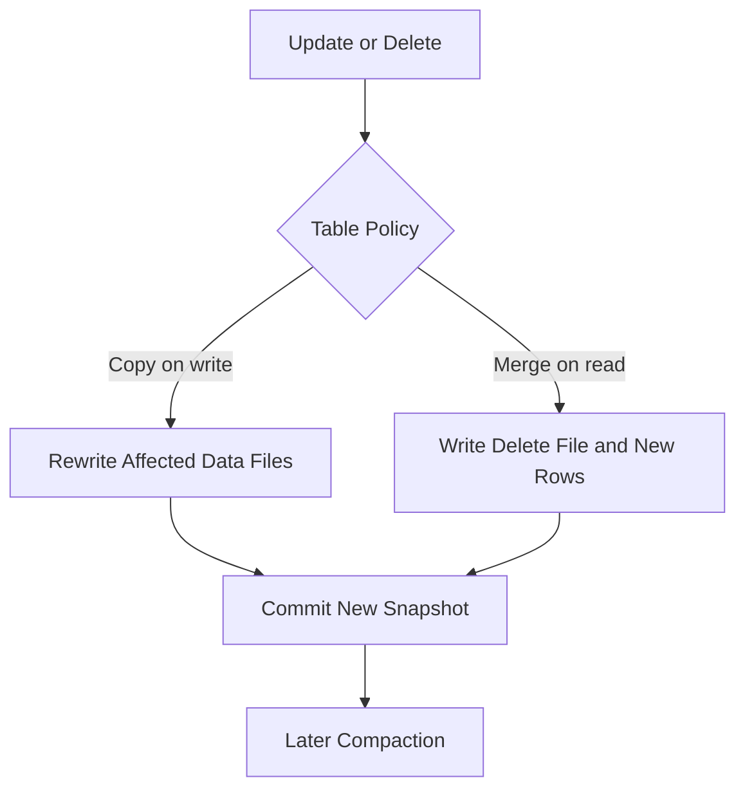

Sequence numbers ensure a delete applies to the intended data-file versions and does not remove a later reinserted row.

## Merge and upsert

Merge operations match source rows to target keys and perform insert, update, or delete actions.

The planner prunes target files using partition and column statistics. It then rewrites matched files or creates equality deletes according to table policy.

Use source version or event sequence to prevent an older change from overwriting a newer row. This is essential when merging CDC events.

Duplicate source keys require a deterministic policy or rejection. Arbitrarily selecting one makes reruns non-reproducible.

## Compaction

Small files increase object requests, planning time, and task overhead. Compaction rewrites them into larger files.

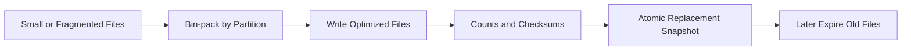

Compaction is optimistic: if concurrent writes touch the same files, replan or retry. New appends to the partition need not always conflict.

Prioritize partitions by file count, delete ratio, query frequency, and rewrite benefit. Maintenance should not consume all compute or object-store bandwidth.

## Clustering and data skipping

Within files, sort or cluster by commonly filtered columns. Closely located values produce tighter min/max statistics and better pruning.

Multi-dimensional clustering interleaves values from several columns to support varied filters. It costs more to maintain and should follow observed query patterns.

Optional bloom filters help exact-match predicates on high-cardinality columns. They can rule out files but cannot prove a row exists.

Statistics may expose sensitive distributions. Authorize metadata access and avoid storing raw values in broadly accessible catalogs.

## Query planning

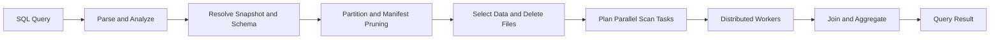

The planner pins a snapshot at query start. It pushes predicates and column projection into file readers, groups small files into scan tasks, and balances bytes across workers.

Cost-based optimization uses table, file, and column statistics. Stale statistics reduce efficiency but must not change correctness.

Cache metadata and file footers by table snapshot. A new snapshot invalidates only affected paths rather than every cached table plan.

## Time travel and rollback

Queries can select a snapshot ID or timestamp. This supports reproducibility, auditing, and comparison before and after a pipeline change.

Rollback creates a new snapshot whose state points to an older valid set of files. It does not erase intervening history.

Time travel lasts only while referenced metadata and files remain under retention. The API should report retention guarantees rather than imply permanent history.

Model training and regulatory reports pin exact snapshot IDs so later table changes do not alter their inputs.

## Snapshot expiration and garbage collection

Old snapshots retain files even after updates or compaction. Expiration removes snapshot references once retention, legal holds, and active query leases permit it.

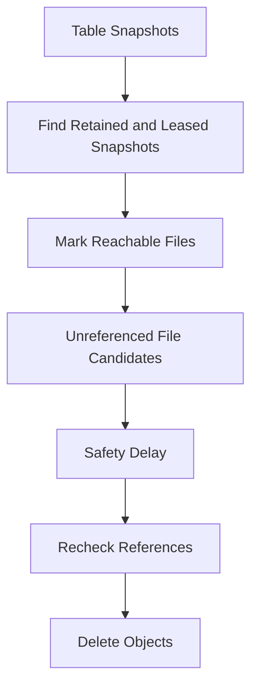

Never delete files based only on age or directory listing. Concurrent writers may have created files not yet committed, and delayed catalog events may exist.

Use a safety window and recheck reachability. Garbage collection emits an auditable deletion manifest.

## Catalog design

The catalog stores namespaces, tables, schemas, snapshot pointers, policies, and commit history. It is small compared with table data but critical for correctness.

Partition metadata by tenant and table ID. Cache reads regionally while routing compare-and-swap commits to the authoritative partition.

Catalog events notify caches, lineage processors, and optimization schedulers after a commit. The commit remains valid even if downstream notification is delayed; an outbox guarantees eventual publication.

Use immutable table IDs beneath names so renames do not break references. Name operations are atomic within a namespace.

## Multiple engines

Different engines may run streaming, SQL, machine learning, and maintenance jobs against the same tables.

Compatibility requires a shared table specification and conformance tests for:

- Type and timestamp semantics
- Schema and partition evolution
- Delete-file application
- Snapshot isolation
- Statistics interpretation
- Commit conflict handling

An engine declares supported table features. The catalog rejects writes that older required readers cannot understand or marks the table as requiring a newer capability level.

No engine may modify data files in place.

## Workload isolation

Separate interactive SQL, scheduled transformations, ingestion, compaction, and backfills into resource pools.

Apply tenant quotas to catalog calls, concurrent commits, scanned bytes, compute time, shuffle, output files, and maintenance bandwidth.

Object storage is shared, so compute isolation alone is insufficient. Rate-limit requests and bandwidth to prevent a large backfill from throttling every query.

Priority and admission control preserve critical dashboards and ingestion. Queue excessive work instead of allowing universal slowdown.

## Data quality and lineage

Each commit records writer, job, source snapshots, code version, row counts, column metrics, and quality results.

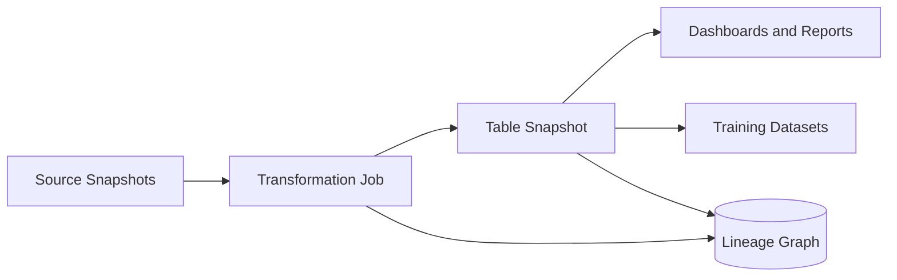

Quality checks validate schema, nulls, ranges, uniqueness, referential assumptions, and expected volume before promotion.

Lineage supports impact analysis: a broken source column can identify affected tables, reports, and models. Generate it from executed plans rather than relying only on manual documentation.

## Governance and security

Controls include:

- Workload identity for engines and jobs
- Namespace, table, row, and column authorization
- Tenant- and domain-scoped encryption keys
- Private object-store access through short-lived credentials
- Audited reads, writes, exports, and policy changes
- Data classification inherited through lineage
- Retention, legal hold, and deletion workflows
- Masked or tokenized views for sensitive columns

Clients do not receive broad object-store credentials. The catalog or access broker issues narrowly scoped, short-lived access to files authorized for one query or job.

Policy must apply consistently across engines. A secure SQL gateway is insufficient if a batch engine can read the underlying objects directly.

## Privacy deletion

Deleting one subject from immutable analytical files requires a tracked workflow:

1. Record the deletion request and identity mapping
2. Locate affected tables and partitions through lineage and indexes
3. Commit row-level deletes or rewritten files
4. Invalidate caches and derived tables
5. Expire old snapshots after policy allows
6. Remove unreferenced files and eligible backups
7. Produce completion evidence

Logical deletion hides rows quickly. Physical removal follows compaction and snapshot expiration. The system must communicate this distinction clearly.

## Multi-region architecture

Keep an authoritative catalog home for each table while replicating metadata and objects to approved regions.

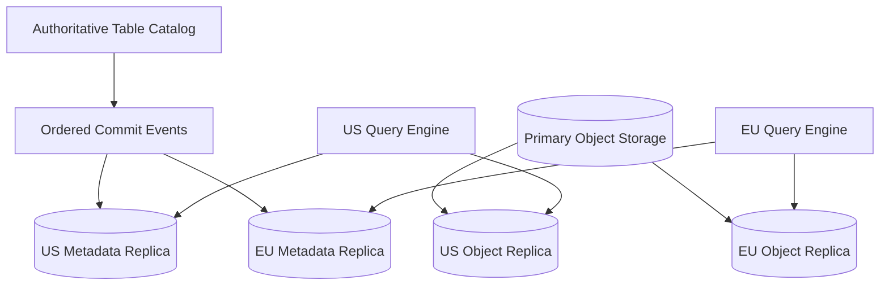

A regional snapshot becomes readable only after all referenced objects are replicated and verified. Metadata must not point to missing files.

Writes route to the table's authoritative region. During failover, fence the previous writer and promote at a known catalog and object replication point.

Region-local tables remain local when residency policy prohibits replication. Global datasets can merge approved regional aggregates instead of raw rows.

## Backup and disaster recovery

Object storage durability does not replace catalog backup. Losing snapshot metadata can make healthy data files unreachable.

Back up catalog state, commit log, schemas, policies, encryption-key references, and object versioning metadata. Replicate critical table metadata to another failure domain.

Restore into an isolated catalog, verify manifest chains and object checksums, then expose tables through a new namespace or atomic catalog switch.

Regularly rehearse recovery at petabyte-scale metadata counts. Recovery time is often dominated by listing or validating billions of objects unless manifests are intact.

## Failure handling

### Writer crashes before commit

Its files remain invisible. A delayed orphan cleaner removes them after proving no snapshot references them.

### Catalog unavailable

Running queries pinned to known snapshots may continue from cached metadata. New commits and snapshot resolution pause.

### Object storage throttles

Reduce scan concurrency, retry with jitter, use regional caches, and protect ingestion bandwidth. Never interpret a transient missing read as a deleted file.

### Conflicting writers

Catalog compare-and-swap rejects one commit. The writer reevaluates conflicts against the new snapshot and safely rebases or aborts.

### Corrupt data file

Checksum validation fails the affected scan. Restore a replica or rebuild from lineage; do not return silently incomplete results.

### Bad transformation commit

Move the table pointer forward to a rollback snapshot or publish a corrected snapshot. Preserve bad history for audit until retention permits deletion.

### Compaction failure

Uncommitted output is invisible. Retry from the original input snapshot without affecting readers.

## Observability

Track:

- Catalog latency, conflicts, and commit rate
- Streaming ingestion lag and commit freshness
- File count, size distribution, and small-file ratio
- Manifest depth and metadata planning time
- Scan bytes, pruned files, cache hit rate, and query latency
- Delete-file ratio and merge-on-read overhead
- Compaction backlog, rewrite amplification, and benefit
- Snapshot count, retention age, and garbage-collection progress
- Schema changes and engine compatibility failures
- Object-store request rate, errors, and throttling
- Replication lag and unreadable regional snapshots
- Data quality and lineage completeness

Synthetic tables continuously exercise append, merge, schema evolution, partition evolution, time travel, compaction, deletion, and restore.

## Key tradeoffs

### Object storage vs tightly coupled warehouse storage

Object storage is inexpensive, durable, and engine neutral but has higher latency and no native transactions. Transactional metadata and immutable files supply table semantics.

### Copy on write vs merge on read

Copy on write makes reads fast but amplifies small updates. Merge on read makes writes cheap but shifts work to queries and compaction.

### Fresh commits vs healthy files

Very frequent streaming commits improve freshness but create tiny files and metadata pressure. Micro-batching plus continuous compaction balances both.

### Rich time travel vs storage cost

Long snapshot retention improves reproducibility and recovery but prevents file reclamation and privacy deletion. Retention should match explicit business value.

### Central catalog vs decentralized metadata

A central transactional catalog simplifies naming, commits, and governance but becomes critical infrastructure. Partitioning, caching, and regional read replicas provide scale without giving up one authority per table.

The central principle is to keep data files immutable and let a small atomic metadata change define each table version, making every read reproducible and every failed write invisible.
