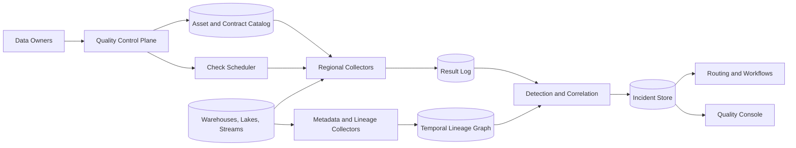
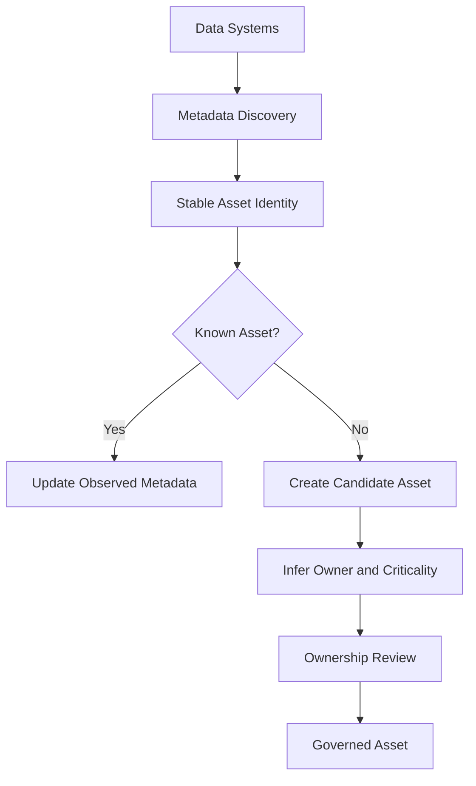
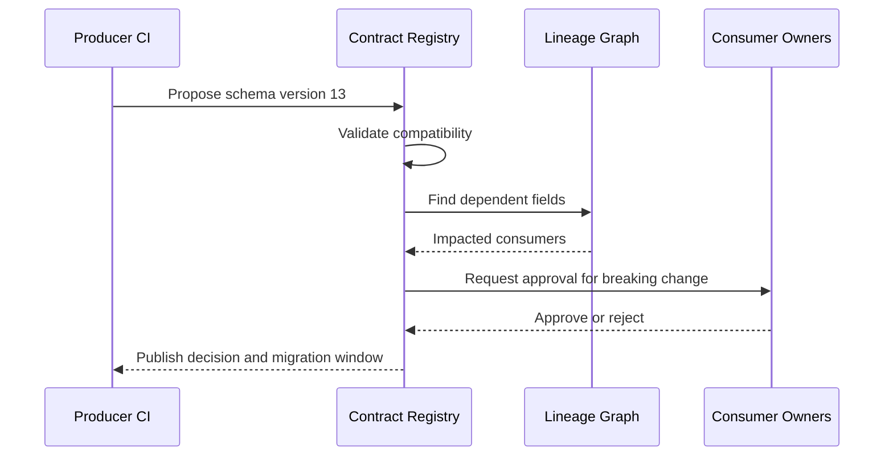
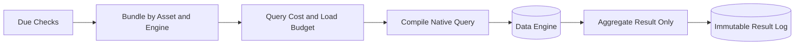
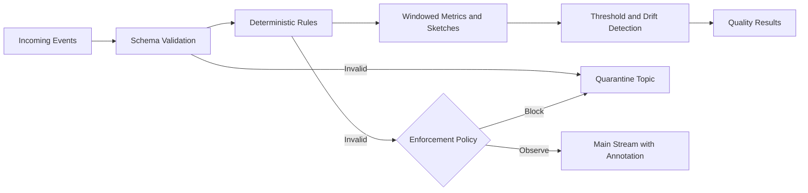
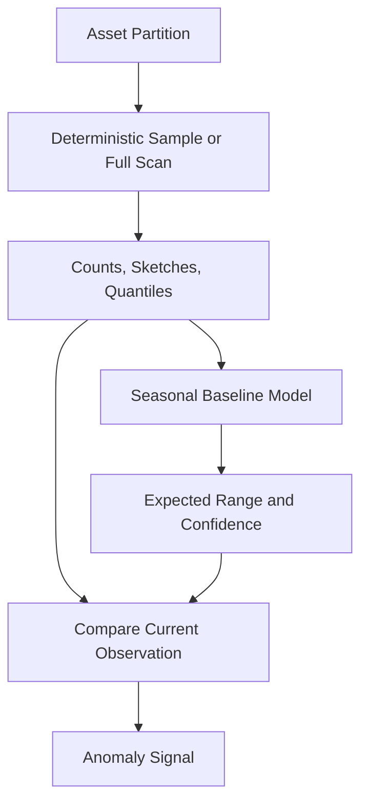
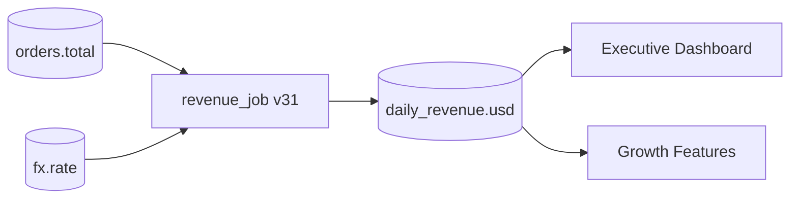
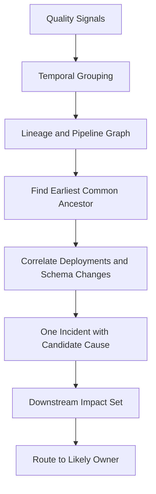
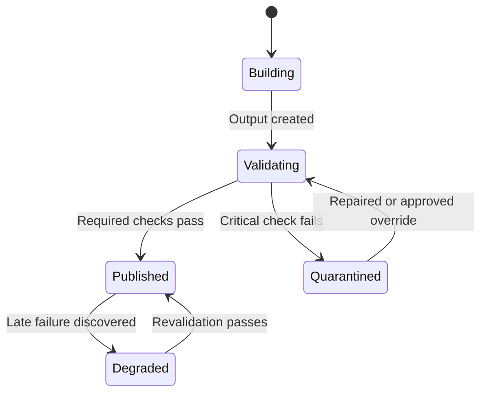
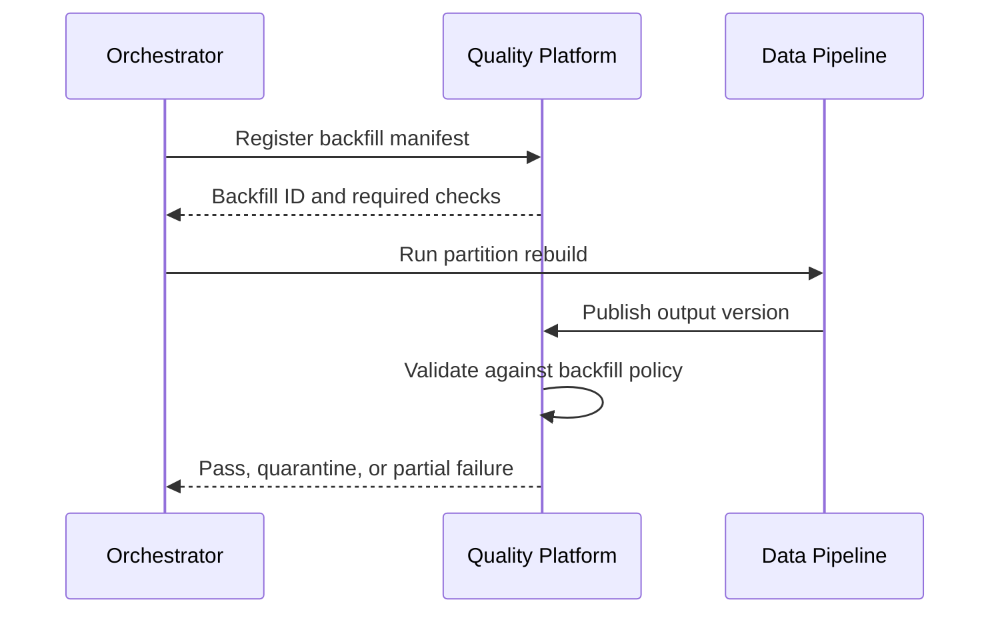

## Problem and requirements

A data quality and observability platform helps teams trust the datasets, streams, dashboards, features, and models they operate. It continuously measures schema, freshness, volume, distribution, uniqueness, referential integrity, and business rules, then connects failures to upstream changes and downstream impact.

The difficult part is distinguishing real incidents from normal variation. Data is seasonal, pipelines arrive at different cadences, schemas evolve, and one upstream defect can trigger thousands of redundant alerts. The platform must detect problems early without becoming a noisy collection of disconnected tests.

### Functional requirements

- Register datasets, streams, owners, tiers, and service-level objectives
- Define versioned data contracts and validation rules
- Discover schemas and profile data automatically
- Run checks on batch tables and streaming records
- Learn freshness, volume, and distribution baselines
- Collect field-level lineage and pipeline run metadata
- Group related failures into one incident
- Identify likely root causes and affected consumers
- Quarantine, block, or annotate unsafe data releases
- Support backfills, revalidation, and incident resolution
- Preserve evidence for audits and post-incident analysis

### Non-functional requirements

- Monitor one million data assets and execute 100 billion checks per day
- Detect critical streaming violations within seconds
- Detect missed batch deliveries within the asset's SLO
- Keep monitoring overhead within configured source budgets
- Isolate tenants, teams, and sensitive datasets
- Make check results reproducible from rule and data versions
- Continue collecting evidence during control-plane outages
- Bound alert volume during large upstream failures

## Capacity estimates

Assume one million assets, one hundred checks per asset, and a mix of hourly batch evaluation and per-record streaming validation.

| Resource | Estimate |
| --- | ---: |
| Registered assets | 1M |
| Check definitions | 100M versioned checks |
| Evaluations | 100B/day |
| Pipeline runs | Hundreds of millions/day |
| Lineage edges | Billions |
| Profile metrics | Trillions of time-series points |
| Active incidents | Tens of thousands |

Per-record streaming checks dominate evaluation count, while distribution profiling and lineage traversal dominate compute and storage. Use different execution paths for each.

## Core model

```text
Asset      { id, type, owner, tier, region, schemaVersion, lifecycleState }
Contract   { id, assetId, version, compatibility, fields, expectations }
Check      { id, assetId, ruleVersion, schedule, severity, action }
Result     { checkId, dataVersion, status, observed, expected, evaluatedAt }
Run        { pipelineId, runId, codeVersion, inputs, outputs, state }
Lineage    { sourceField, destinationField, transform, validWindow }
Incident   { id, rootSignal, affectedAssets, severity, state, owner }
```

Contracts and checks are immutable after publication. A correction creates a new version so an old result can always be interpreted using the rule that produced it.

## High-level architecture



The control plane distributes signed check bundles. Regional agents continue executing cached checks and buffering results when the global plane is unavailable.

## Asset discovery and ownership

Connectors inspect catalogs, schema registries, orchestration tools, query history, and stream metadata. Discovery creates candidate assets; an owner must claim important ones.



Use stable IDs independent of table names so renames do not erase history. Ownership can be inferred from deployment metadata, recent writers, code ownership, and organizational mappings, but inferred ownership is labeled until confirmed.

Tier assets by business impact. A payment ledger and an experimental notebook should not receive the same default checks or paging policy.

## Data contracts

A contract defines what producers promise and what consumers may rely on.

```yaml
asset: commerce.orders
version: 12
compatibility: backward
owner: team-checkout
freshness: 15m
fields:
  order_id:
    type: string
    required: true
    unique: true
  total_amount:
    type: decimal(18,2)
    minimum: 0
  currency:
    type: string
    allowed: [USD, EUR, GBP]
```

Contracts cover schema, nullability, semantic constraints, identifiers, classification, freshness, retention, and compatibility policy. They do not need to encode every analytical expectation.



Enforce contracts before deployment when possible and again at runtime. CI prevents known incompatibilities; runtime checks catch unannounced producers and malformed records.

## Check types

### Deterministic checks

- Schema and type compatibility
- Required, unique, and primary-key constraints
- Allowed values and numeric ranges
- Referential integrity
- Custom SQL or expression-based business rules

### Statistical checks

- Row count and byte-volume deviation
- Null, distinct, and duplicate rates
- Quantiles, mean, variance, and category distribution
- Freshness and update cadence
- Distribution drift between partitions or environments

### Operational checks

- Pipeline completion and duration
- Source-to-target reconciliation
- CDC lag and missing offsets
- Partition completeness
- Dashboard or feature-store materialization status

Each check declares its scope, sampling policy, severity, cost budget, owner, and action on failure.

## Batch execution

Push computation into the warehouse or lake engine when safe; avoid extracting raw data into the observability platform.



Bundle compatible checks into one scan. For example, compute null counts, distinct sketches, bounds, and quantiles in a single query.

Tag monitoring queries, cap their runtime, use read replicas or separate warehouses, and defer noncritical profiling when production load is high.

## Streaming validation

Streaming checks run at ingestion, inside a stream processor, or asynchronously from a mirrored topic.



Hard blocking is appropriate for malformed or dangerous records when producers can retry. For analytics telemetry, dropping a large volume may be worse than tagging it as degraded. Enforcement is a per-contract policy.

Use mergeable sketches for cardinality, quantiles, and distribution summaries. They bound memory and can be combined across partitions.

## Freshness and completeness

Freshness is the delay between when data should exist and when it becomes usable. Measure both event time and processing time.

```text
source lag      = now - maximum event time observed
processing lag  = maximum source event time - maximum target event time
delivery delay  = successful publication time - expected publication time
```

Learn normal arrival windows by day of week, hour, business calendar, and upstream completion. A fixed 24-hour threshold misses a dataset normally delivered every five minutes and falsely alerts on a weekly table.

Completeness compares expected partitions, source counts, or control totals against observed output. Late data can move a partition from failed to healthy, but the original SLO breach remains in history.

## Profiling and adaptive baselines

Profiles contain privacy-preserving aggregates rather than raw values.



Train baselines on clean historical periods and exclude known incidents, backfills, holidays, and incomplete partitions. Require minimum history before enabling automatic alerts.

Use robust statistics so one extreme incident does not expand future thresholds. Retraining is versioned, and a model change never rewrites earlier outcomes.

## Lineage collection

Collect lineage from query plans, orchestration runs, transformation manifests, schema registries, and explicit application instrumentation.



Store a temporal graph: edges include job version, field mapping, transform, and valid window. Lineage queries use the graph state at incident time, not only the latest topology.

Coverage is never assumed complete. Display which edges are observed, declared, inferred, or stale.

## Incident correlation

Without correlation, one upstream failure can page every downstream owner.



Group signals using time proximity, lineage paths, shared pipeline runs, error fingerprints, and deployment metadata. The earliest anomalous common ancestor is a candidate root cause, not a guaranteed diagnosis.

Notify the root owner once and send downstream consumers impact updates rather than independent pages. Escalate based on the highest affected asset tier.

## Change intelligence

Correlate incidents with code deployments, contract publications, orchestration changes, access-policy updates, infrastructure incidents, and source schema changes.

For every suspected change, record timing, affected fields, owner, rollout scope, and rollback capability. Rank candidates by graph proximity and temporal fit.

Do not automatically blame the most recent deployment. A delayed upstream source or changing business behavior may be the real cause.

## Quality gates

Checks can observe, warn, quarantine, or block publication.



Publish datasets through an atomic pointer or catalog version. Consumers see either the last good version or the newly validated version, never a partially written table.

Overrides require an owner, reason, expiry, and incident link. An override does not convert a failed result into a pass; it records an accepted risk.

## Backfills and revalidation

Backfills intentionally change old partitions and can resemble anomalies. Register their scope, expected volume, code version, and time window before execution.



Revalidation pins the data version and rule version. If rules changed since the original run, show results for both versions rather than silently replacing history.

## Remediation

The platform can recommend or automate bounded actions:

- Retry a failed pipeline task
- Reprocess a known-bad partition
- Roll back a catalog pointer to the last good version
- Pause downstream materialization
- Quarantine invalid streaming records
- Disable a newly published contract version

Automations require idempotency keys, concurrency limits, approval policy, and rollback. Do not delete or rewrite source data automatically based on an anomaly score.

## Multi-tenant security and privacy

- Authenticate collectors with short-lived workload identities
- Scope metadata, results, and lineage by tenant and region
- Execute source queries with least-privilege read roles
- Keep raw samples inside the source boundary where possible
- Hash or tokenize example values before display
- Block secrets and direct identifiers from profile dimensions
- Encrypt contracts, results, and incident evidence
- Audit rule changes, overrides, exports, and remediation

Query text and lineage can reveal sensitive business logic. Apply the same access controls to metadata as to the underlying dataset.

## Reliability and failure handling

| Failure | Safe behavior |
| --- | --- |
| Control plane unavailable | Agents run unexpired signed bundles and buffer results |
| Check query times out | Record unknown, retry within budget, never report pass |
| Source is overloaded | Defer noncritical profiling and preserve critical checks |
| Result arrives twice | Idempotency key collapses duplicate evaluation |
| Lineage collector lags | Mark impact analysis incomplete and show freshness |
| Baseline model fails | Use last valid model or static thresholds with clear status |
| Incident correlator fails | Preserve individual signals and retry grouping |
| Notification fails | Retry through a durable outbox with deduplication |
| Remediation fails | Stop workflow, preserve quarantine, and escalate |

Check execution, result ingestion, incident correlation, and notification use separate durable queues so a failure in one stage cannot erase evidence from another.

## Observability and SLOs

Track the observer itself:

- Asset discovery and ownership coverage
- Contract adoption and compatibility failures
- Check scheduling lag and execution duration
- Result freshness and unknown-result rate
- Source query cost and monitoring overhead
- Detection delay by asset tier
- Alert volume, grouping ratio, and acknowledgement time
- Incident precision proxies and false-positive feedback
- Lineage coverage and collection age
- Quarantine age and remediation success

Useful SLOs include 99.9% of tier-one checks evaluated within their window, critical streaming violations surfaced within 60 seconds, and no tier-one publication promoted with an unresolved blocking check.

## Key trade-offs

| Decision | Benefit | Cost |
| --- | --- | --- |
| Pushdown checks | Data stays in place and scales with source | Source load and engine-specific SQL |
| Central result log | Unified history and incident correlation | Metadata volume and regional governance |
| Adaptive thresholds | Fewer seasonal false positives | Model lifecycle and explainability |
| Field-level lineage | Precise impact analysis | Collection complexity and graph scale |
| Blocking quality gates | Stops bad data propagation | Availability and pipeline delay risk |
| Deterministic sampling | Lower cost and reproducibility | Rare defects may be missed |
| Last-good publication | Stable consumers during failure | Stale data may remain visible |

## Evolution path

1. Register critical assets, owners, freshness SLOs, and basic deterministic checks.
2. Add warehouse-native profiling and immutable result history.
3. Enforce versioned contracts in producer CI and runtime ingestion.
4. Collect pipeline and field lineage, then correlate downstream incidents.
5. Introduce adaptive baselines, quality gates, and backfill awareness.
6. Add approved remediation workflows and regional streaming validation.

Start with a few high-value checks tied to named owners. Thousands of unowned alerts create the appearance of coverage without improving reliability.

## Final design

Use a centralized control plane for versioned assets, contracts, checks, and policy, paired with regional collectors that execute checks near the data. Push bounded aggregate queries into batch engines, validate streaming records inline or from mirrored topics, and store immutable results keyed by rule and data version. Build a temporal field-level lineage graph from pipeline metadata, then correlate simultaneous failures into one incident with downstream impact and likely change candidates. Publish important datasets through quality gates and atomic last-good pointers, while keeping overrides and remediation explicit, time-bound, and auditable.

The central principle is that data quality is an operational property, not a dashboard score. A useful platform connects a broken expectation to the responsible change, the affected consumers, and a safe action before unreliable data becomes a business decision.
