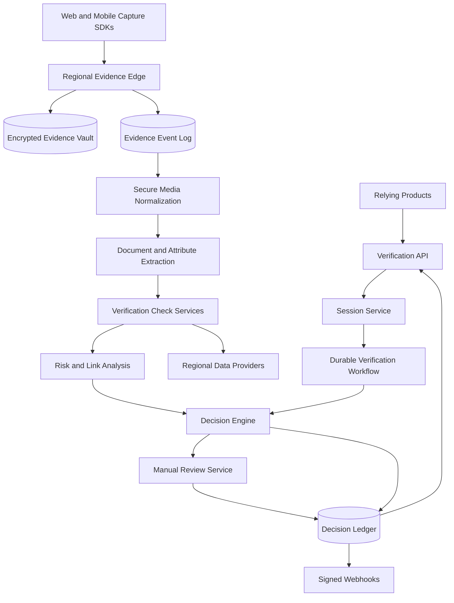
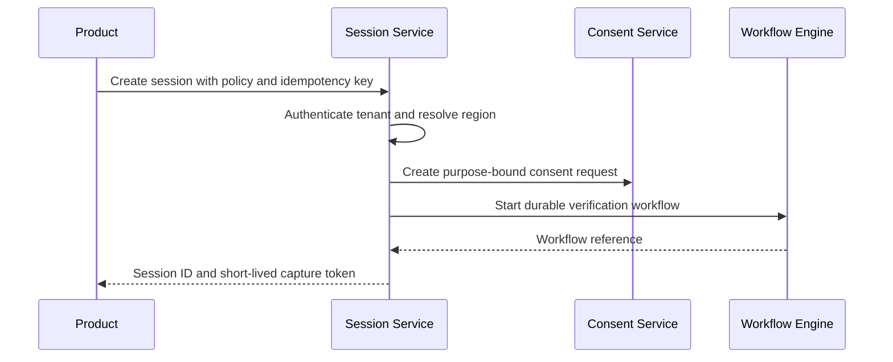
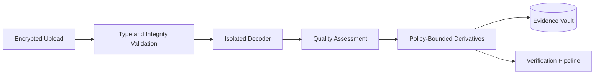
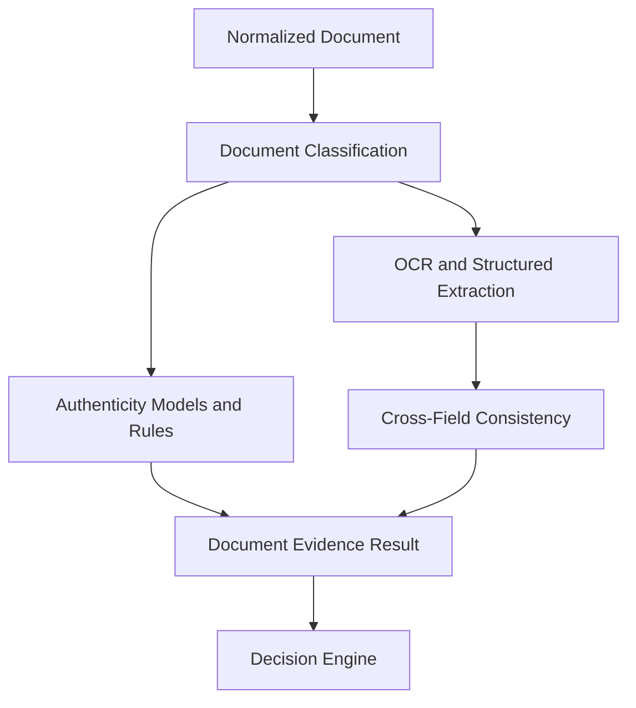
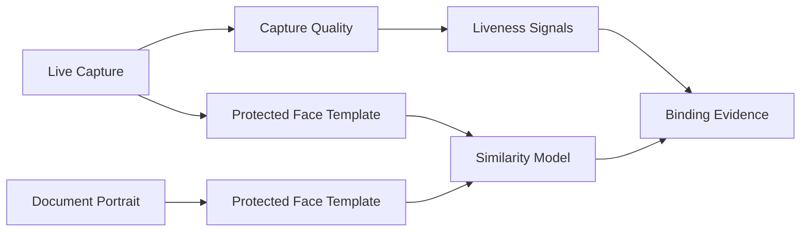
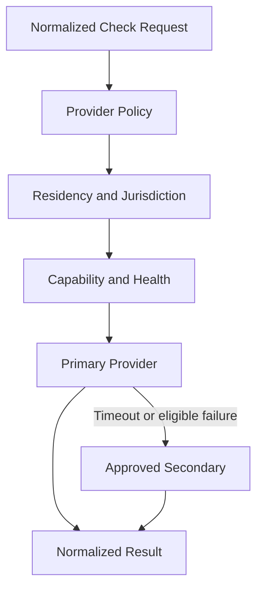
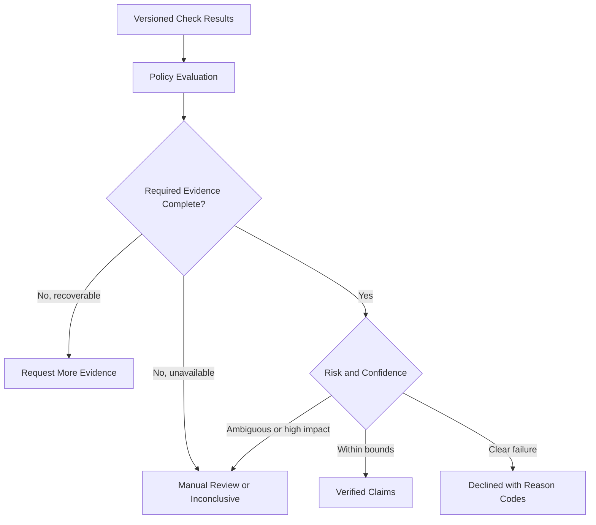
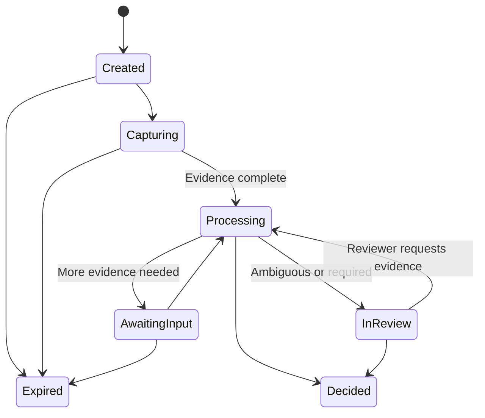
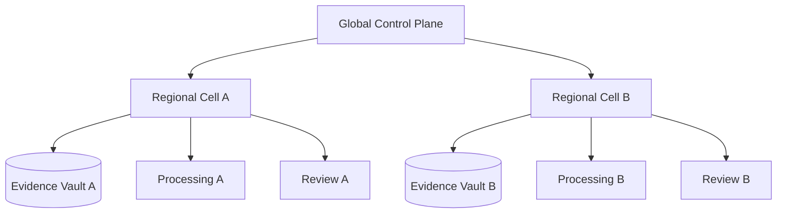

## Problem and requirements

A digital identity verification platform helps a relying product determine whether a person or business is real, whether supplied evidence is authentic, and whether the applicant satisfies a defined policy. It may be used during account opening, age assurance, marketplace onboarding, account recovery, regulated transactions, or periodic reverification.

The system does not prove identity with absolute certainty. It gathers evidence, measures risk, and produces a time-bounded decision under a particular policy. The difficult part is combining documents, biometrics, external data, device signals, and human judgment without turning a highly sensitive dataset into a permanent centralized liability.

### Functional requirements

- Create verification sessions from a tenant-defined policy
- Capture identity documents, selfies, video, and business records
- Validate document structure and authenticity signals
- Extract normalized identity attributes with confidence scores
- Perform consented face matching and liveness checks where permitted
- Query authoritative or trusted data sources through regional providers
- Detect duplicate, synthetic, stolen, and coordinated identities
- Route uncertain cases to trained manual reviewers
- Return signed decisions and privacy-minimized verified attributes
- Support appeals, corrections, reverification, deletion, and audit exports

### Non-functional requirements

- Support one billion verification sessions per year with large event-driven spikes
- Return automated decisions within 30 seconds at p95 when dependencies are healthy
- Keep session creation and upload authorization above 99.99% availability
- Prevent cross-tenant access to evidence, decisions, and policy
- Keep biometric and document data inside allowed jurisdictions
- Make every decision reproducible from versioned evidence and policy
- Degrade safely when a provider, model, or review queue is unavailable
- Minimize retention, human exposure, and downstream sharing of raw evidence

## Capacity estimates

One billion annual sessions average about 32 sessions per second, but onboarding campaigns, deadlines, and regional launches can produce peaks thousands of times higher. Individual sessions create many operations: uploads, extraction, model inference, provider checks, and review events.

| Resource | Estimate |
| --- | ---: |
| Peak active sessions | 1M concurrent |
| Evidence uploads | 100K objects/second |
| Automated checks | 100K evaluations/second |
| Raw evidence | Tens of PB/year before deletion |
| Manual review cases | 10–50M/year |
| Decision and audit events | Hundreds of billions/year |

Raw media dominates storage. Derived attributes and audit records are much smaller but often require different retention schedules.

## Trust model

Verification answers a scoped question, not “Is this person trustworthy?” A decision should state:

- Which subject and evidence versions were evaluated
- Which policy and assurance level applied
- Which attributes were verified
- What risks or limitations remain
- When the result expires or must be refreshed

Separate four concepts:

| Concept | Meaning |
| --- | --- |
| Identity evidence | A document, credential, account, or authoritative record |
| Evidence binding | Confidence that evidence belongs to the applicant |
| Attribute verification | Confidence in a fact such as age or legal name |
| Eligibility decision | Whether the relying product's policy is satisfied |

An authentic document can belong to another person, and a correctly identified person may still be ineligible for a product. Keeping these layers separate makes decisions explainable and reusable.

## Core data model

```text
VerificationSession {
  sessionId, tenantId, subjectRef, policyVersion,
  region, purpose, state, expiresAt
}

Evidence {
  evidenceId, sessionId, type, objectVersion,
  encryptionKeyRef, consentRef, retentionClass
}

CheckResult {
  checkId, evidenceRefs, checkType, providerVersion,
  outcome, confidence, reasonCodes, completedAt
}

Decision {
  decisionId, sessionId, policyDigest,
  outcome, verifiedClaims, limitations, expiresAt
}
```

Immutable evidence versions and append-only check results preserve lineage. Mutable session state is only a projection over durable events.

## High-level architecture



The control plane manages tenants, policies, keys, provider routing, and audit configuration. Regional data planes capture and process evidence within residency boundaries.

## Session creation

The relying product creates a session with an idempotency key, subject reference, purpose, requested assurance level, and return channel. The platform resolves these inputs into an immutable policy snapshot.



The capture token is bound to one session, allowed evidence types, region, expiration, and upload limits. It cannot read previously uploaded evidence or invoke unrelated APIs.

Sessions expire automatically. Restarting after expiry creates a new session and policy snapshot rather than silently extending old consent.

## Capture experience

Client SDKs guide applicants through document selection, image quality, glare, framing, NFC reading when supported, selfie capture, and recovery from interrupted uploads. The client may run non-authoritative quality checks for immediate feedback, but server-side verification remains the source of truth.

Upload directly to a regional evidence edge through short-lived signed URLs. Use multipart uploads for video, content hashes for integrity, strict size limits, and resumable transfer. Do not place raw images in API logs or general message queues.

Accessibility and fallback paths are essential. A user who cannot complete a motion-based liveness flow, use a particular camera, or present a standard document needs an alternative appropriate to the policy—not an unexplained rejection.

## Evidence ingestion and normalization

Uploaded files are untrusted. Decoding, metadata extraction, format conversion, and malware scanning run inside isolated sandboxes with no control-plane credentials.



Preserve the original object for the minimum required period and create normalized derivatives for models and reviewers. Every derivative records its parent, transform version, and digest.

Reject malformed or dangerous content without exposing parser details that would make probing easier. Quality failures return actionable capture guidance rather than fraud labels.

## Document verification

Document processing is a staged pipeline:

1. Classify country, document family, side, and version.
2. Locate fields, portrait, machine-readable zones, and security regions.
3. Extract text and structured fields with per-field confidence.
4. Validate checksums, date relationships, layout, fonts, and expected features.
5. Compare visible data with machine-readable or chip data.
6. Evaluate tampering, screen recapture, photocopy, and template anomalies.



A document catalog stores versioned templates, field geometry, checksum rules, known issuance periods, and supported security signals. Catalog changes go through replay testing and staged rollout because an incorrect template can reject an entire country's valid documents.

NFC-capable identity documents may provide cryptographically signed chip data. Validate certificate chains, document signatures, and chip-to-print consistency. A successful chip check strengthens authenticity but does not by itself bind the document to the applicant.

## Attribute normalization

Extraction produces candidates, not unquestioned facts. Normalize names, dates, addresses, and identifiers according to the issuing jurisdiction while retaining original script and source text.

Each normalized attribute includes its evidence source, confidence, transform version, and verification status. Downstream consumers should request claims such as `age_over_18: true` whenever the exact birth date is unnecessary.

Conflicting attributes create an explicit consistency result. Do not silently choose the value from the highest-confidence OCR field when two authoritative sources disagree.

## Biometric binding and liveness

Where lawful, necessary, and consented, compare the document portrait with a live capture. The workflow separates capture quality, presentation-attack detection, face similarity, and final policy.



No single gesture or model should be the only defense. Combine passive and active signals appropriate to the risk, device capabilities, accessibility needs, and local policy. Scores remain internal; users receive safe retry guidance or an alternate path.

Biometric templates are encrypted, purpose-bound, inaccessible to general analytics, and deleted according to the shortest applicable schedule. They must not become a general person-search database.

## Trusted data and provider orchestration

Some policies require address, tax identifier, business registry, mobile account, or government-record checks. A provider abstraction normalizes requests and responses while preserving the original provider evidence for audit.

Route based on jurisdiction, data residency, check capability, latency, contractual purpose, provider health, and cost. Never send the entire evidence bundle when a provider needs only a small attribute set.



Fallback is not always safe. Two providers may have different legal bases, coverage, or semantics. The policy snapshot lists approved substitutions and whether a missing result should trigger review, retry, or a limited decision.

## Risk and duplicate detection

Identity attacks often span sessions. A privacy-controlled risk service evaluates velocity and relationships across devices, documents, contact points, payment instruments, network signals, and prior confirmed abuse.

Use keyed tokens or protected embeddings for link analysis instead of copying raw identifiers into a general graph. Tenant-specific namespaces prevent one customer's applicant list from becoming discoverable to another.

Potential duplicate matches are risk signals, not automatic fraud findings. Households, shared devices, recycled phone numbers, transliteration, and common names create legitimate overlap. High-impact matches require stronger corroboration or review.

## Policy and decision engine

Policies define required evidence, check dependencies, acceptable confidence ranges, regional restrictions, fallback paths, manual-review conditions, and result validity.



Recommended outcomes are `verified`, `not_verified`, `more_information_required`, `manual_review`, and `inconclusive`. An infrastructure timeout should never be represented as proof of fraud.

Policy changes are immutable versions. Replay new versions against representative historical cases, run in shadow mode, then gradually activate by tenant and jurisdiction. Decisions store the policy digest and all check versions.

## Durable workflow orchestration

Verification is a long-running workflow with parallel checks, user pauses, provider callbacks, manual review, and expiration timers. A durable workflow engine persists progress and makes every activity idempotent.



Activities use the session ID, evidence version, check type, and policy version as an idempotency boundary. Late callbacks are recorded but cannot overwrite a newer decision without an explicit reevaluation workflow.

## Manual review

The review service creates a minimum-necessary case package. Queue routing considers language, jurisdiction, document expertise, policy certification, conflict of interest, case age, and expected harm.


Reviewer tools disable bulk export, watermark sensitive views, log reveals, and mask fields irrelevant to the task. Reviewers choose structured evidence findings and reason codes rather than entering unrestricted conclusions.

High-impact or low-consensus cases require a second independent review. Seeded quality cases measure consistency, while access patterns are monitored for misuse. Reviewer decisions never rewrite automated results; they add a new evidence-backed layer.

## Decision delivery

The platform returns a signed decision object containing outcome, verified claims, policy reference, expiry, and safe reason codes. Raw documents, model scores, provider responses, and biometric templates are not returned by default.

```text
{
  "decision_id": "dec_...",
  "outcome": "verified",
  "claims": {"age_over_18": true, "document_country": "..."},
  "assurance_level": "substantial",
  "policy_version": "...",
  "expires_at": "..."
}
```

Webhooks are signed, timestamped, retried with backoff, and delivered at least once. Consumers fetch the current decision by ID and deduplicate events. A later appeal or reverification produces a superseding decision, never an in-place mutation.

## Reusable verification

Repeatedly collecting documents increases friction and exposure. The platform may issue a short-lived, audience-bound credential containing only verified claims when the user consents.

The relying party validates issuer, signature, audience, purpose, freshness, assurance level, and revocation status. Pairwise subject identifiers prevent unrelated products from correlating the same person.

Reuse does not mean universal portability. A result valid for age assurance may not satisfy financial onboarding, and an expired or materially changed claim must be refreshed.

## Appeals and corrections

Users need a path to correct extraction errors, provide alternate evidence, and challenge decisions. An appeal links to the original evidence and decision but receives a new policy-controlled workflow, preferably with an independent reviewer.

Reversal publishes a superseding decision and notifies relying products that subscribed to status changes. It also corrects derived risk features and quality datasets. The original audit record remains immutable.

Appeal outcomes are valuable for evaluation, but should enter training sets only after quality review. Otherwise, inconsistent reviewer behavior becomes model ground truth.

## Privacy and retention

Privacy is part of the architecture:

- Collect only evidence required by the session policy
- Bind consent to purpose, tenant, evidence types, and retention
- Store raw evidence in a dedicated encrypted vault
- Use separate keys by tenant, region, and sensitivity class
- Return derived claims instead of raw attributes where possible
- Keep sensitive payloads out of logs, traces, and analytics
- Delete evidence and derived templates on independent schedules
- Support legal holds without silently extending unrelated data

Deletion is a durable workflow spanning the evidence vault, caches, model features, provider copies where contractually supported, review artifacts, and backup expiration. A minimal decision receipt may remain only when permitted and required.

## Security and adversarial resilience

Attackers may use stolen documents, generated media, emulators, compromised reviewer accounts, provider callbacks, or repeated probing. Apply defense in depth:

- Device and session rate limits
- Nonce-bound capture challenges
- Short-lived, scope-limited upload credentials
- Signed provider callbacks with replay protection
- Model and rule ensembles with staged updates
- Reviewer least privilege and strong authentication
- Tamper-evident administrative and decision logs
- Rapid revocation of credentials, model versions, and providers

Do not reveal internal thresholds or detailed detection signals. User-facing explanations should be useful without providing an evasion guide.

All model, policy, provider, document-catalog, and reviewer-permission changes require authenticated ownership and audit records. High-risk production changes use dual approval and automatic expiry.

## Multi-region and residency

The global control plane distributes signed policy metadata, public configuration, and model manifests. Raw evidence and sensitive processing remain in the selected regional cell.



A session has one home cell and ownership epoch. Failover to another cell occurs only when residency policy allows and fenced ownership transfers successfully. Otherwise, the system preserves the session and reports a temporary delay rather than moving sensitive data unlawfully.

## Reliability and degradation

| Failure | Safe behavior |
| --- | --- |
| Upload edge unavailable | Issue a token for another allowed cell or preserve resumable state |
| Document model unavailable | Retry, use an approved fallback, or route to review |
| Provider timeout | Follow policy-specific fallback; never invent a match |
| Risk graph delayed | Hold high-risk decisions or mark the result inconclusive |
| Review queue overloaded | Prioritize expiring and high-impact cases; extend sessions safely |
| Decision webhook fails | Retry independently; keep the result queryable |
| Key service unavailable | Pause sensitive processing rather than bypass encryption |
| Region unavailable | Fail over only when residency and consent permit |

Reserve capacity for appeals, account recovery, and expiring sessions. Bulk reverification must not starve interactive onboarding.

## Observability and quality

Track service health and decision quality separately:

- Session creation, upload, processing, and decision latency
- Completion, abandonment, retry, and fallback rates
- Automated pass, decline, review, and inconclusive rates
- Extraction accuracy and model calibration by document and region
- Manual-review agreement and queue age
- Appeal and reversal rates by reason code
- Provider latency, coverage, disagreement, and outage impact
- Deletion completion and unauthorized-access attempts

Measure false acceptance and false rejection using carefully governed, representative evaluation sets. Aggregate metrics can hide severe failures for a particular document, device, skin tone, disability, language, or region, so slice quality reports across relevant populations while protecting privacy.

Suggested objectives include 99.99% session-creation availability, p99 upload authorization below 200 milliseconds, 95% of fully automated sessions decided within 30 seconds, and 99.9% of deletion workflows completed within policy deadlines.

## Key tradeoffs

### Accuracy versus completion

Stricter thresholds may reduce false acceptance while rejecting legitimate users and increasing manual review. Set thresholds by consequence and provide alternative evidence paths.

### Centralization versus privacy

A global evidence lake simplifies analysis but creates residency and breach risk. Regional vaults with privacy-preserving link signals are operationally harder and safer.

### Vendor breadth versus consistency

Multiple providers improve coverage and resilience but return different semantics and quality. Normalize evidence without hiding provider provenance.

### Reuse versus unlinkability

Reusable credentials reduce repeated collection, but stable identifiers enable tracking. Use audience-bound claims, pairwise identifiers, and explicit consent.

### Automation versus human review

Automation gives speed and consistency; reviewers resolve edge cases. Human access increases privacy and insider risk, so route only cases where judgment materially helps.

## Evolution path

1. Start with session orchestration, secure uploads, one document family, manual review, and signed decisions.
2. Add document extraction, authenticity checks, provider abstraction, and immutable policy versions.
3. Introduce consented biometric binding, risk signals, appeals, and automated retention workflows.
4. Expand into regional cells, business verification, reusable claims, and privacy-preserving duplicate detection.
5. Mature with continuous evaluation, policy replay, adaptive provider routing, accessibility fallbacks, and automated quality safeguards.

## Final design

The platform treats verification as a durable, policy-versioned evidence workflow. Regional capture edges place documents and biometrics into encrypted vaults, isolated pipelines derive narrowly scoped signals, and a decision engine combines those results under an immutable assurance policy. Ambiguous cases receive minimum-necessary human review rather than opaque automated rejection.

Signed decisions expose verified claims instead of raw evidence, while lineage connects every result to the exact evidence, models, providers, reviewers, and policy that produced it. Purpose-bound consent, regional processing, independent deletion schedules, and audience-bound reusable credentials reduce unnecessary collection. The result is a system that can verify identity globally without confusing probabilistic evidence with certainty or sacrificing privacy for convenience.
