## Problem and requirements

A distributed build system turns source code into tested artifacts by executing a dependency graph across a large worker fleet. It reuses previous results when inputs are identical and runs independent actions in parallel.

The hard part is not distributing shell commands. A cached output is trustworthy only when an action declares every input that can affect it. The platform must make execution hermetic, isolate untrusted builds, schedule heterogeneous resources, and preserve reproducibility without making ordinary developer workflows painful.

### Functional requirements

- Parse build targets into an action dependency graph
- Execute independent actions in parallel
- Cache outputs locally and remotely
- Upload and download inputs through content-addressed storage
- Run actions in isolated, reproducible environments
- Support tests, packaging, code generation, and platform-specific builds
- Stream progress, logs, and diagnostics
- Cancel builds and deduplicate equivalent work
- Enforce tenant quotas and worker capabilities
- Retain signed build provenance and artifacts

### Non-functional requirements

- Schedule one million actions per second
- Support 100,000 concurrent workers
- Return cache hits within tens of milliseconds
- Avoid executing the same action unnecessarily
- Prevent one tenant from accessing another tenant's source or outputs
- Survive scheduler, worker, zone, and storage failures
- Produce bit-for-bit reproducible outputs where tools permit it
- Keep interactive builds responsive during large continuous-integration bursts

The build system can guarantee that an action ran with declared inputs. It cannot make a compiler deterministic or a test non-flaky unless those tools follow the contract.

## Capacity estimates

Assume 500,000 builds per day, 10,000 actions per large build, and one million peak action scheduling decisions per second.

| Resource | Estimate |
| --- | ---: |
| Peak actions | 1M/second |
| Concurrent workers | 100K |
| Content-addressed blobs | Billions |
| Daily uploaded data | Petabytes before deduplication |
| Remote-cache lookups | Millions/second |
| Active build graphs | Hundreds of thousands |

Most action-cache lookups should hit. Content deduplication and incremental execution make storage and network demands much lower than naively copying every workspace.

## Build graph

The frontend expands requested targets into a directed acyclic graph of actions.

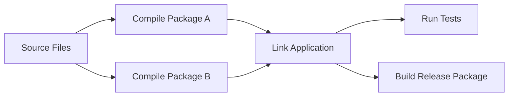

An action contains:

- Executable and arguments
- Declared input files and directory tree
- Expected output paths
- Environment variables
- Platform and resource requirements
- Timeout and retry policy
- Network policy

Edges represent required outputs. The scheduler releases an action only after all predecessors complete successfully or return a reusable cache result.

## Action identity

Compute an action digest from its canonical specification and input-root digest.

```text
action digest = hash(
  command digest,
  input tree digest,
  environment,
  platform properties,
  toolchain identity,
  execution policy version
)
```

Canonical encoding is essential. Equivalent actions must hash identically, while any meaningful input change must produce a different digest.

Do not include irrelevant workspace paths, timestamps, or random ordering. Do include hidden influences such as compiler version, locale, timezone policy, and response files.

The digest is both a cache key and a deduplication identity, not an authorization credential.

## High-level architecture

Clients upload missing content, query the action cache, and submit cache misses to distributed schedulers.

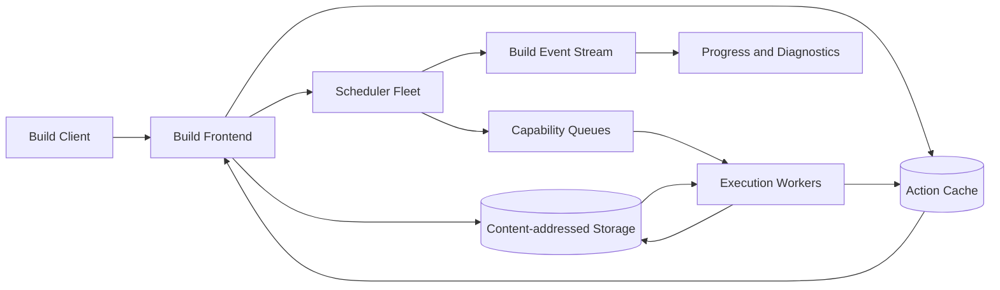

The content store contains immutable bytes. The action cache maps action digests to verified result manifests. Scheduler state is durable enough to recover running builds but is not the source of artifact truth.

## Content-addressed storage

Files and directory nodes are stored by cryptographic digest.

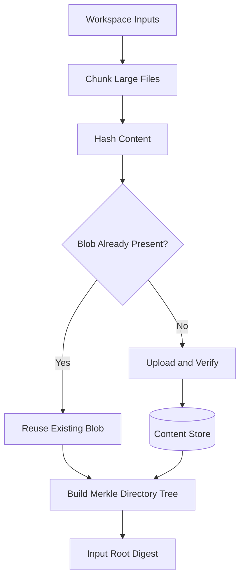

Directory trees are Merkle structures whose digest changes when any descendant changes. Clients ask which digests are missing before upload.

Large files use chunking for resumable transfer and deduplication. Small blobs may be packed into immutable containers to avoid excessive object overhead.

Every reader verifies the digest. A location is merely a transport hint; content identity comes from its hash.

## Action cache

The action cache maps an action digest to:

- Exit code
- Output-file and output-directory digests
- Standard output and error digests
- Execution metadata
- Provenance and policy version

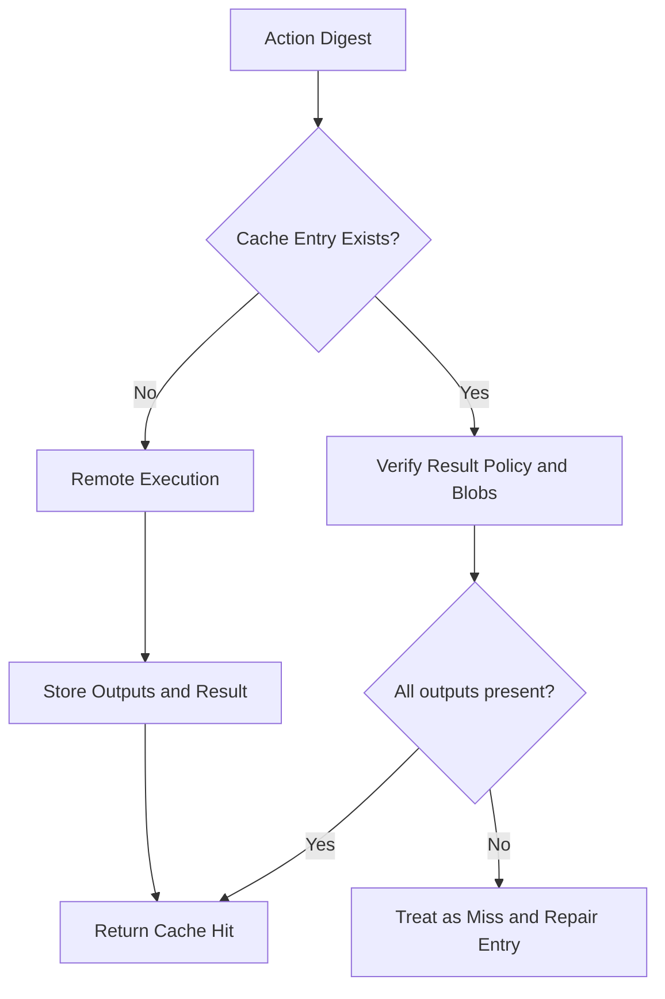

Cache entries are immutable or compare-and-set by digest. A conflicting result for the same action digest signals non-determinism, corruption, or a missing input.

Negative results such as compiler errors may be cached briefly when deterministic. Infrastructure failures are never cached as build results.

## Local and remote caching

Clients first check a local disk cache for low latency, then the shared remote cache.

Local caches store recent outputs and downloaded blobs with size-aware eviction. Remote caches improve reuse across developers and continuous-integration jobs.

Use repository, trust-domain, and policy scope in authorization—not necessarily in the content digest. Identical public toolchains may share physical blobs while access checks prevent cross-tenant discovery or result reuse.

Cache writes can be asynchronous for interactive builds only when losing the upload does not affect correctness. Continuous-integration release builds may require durable cache and artifact publication before success.

## Remote execution protocol

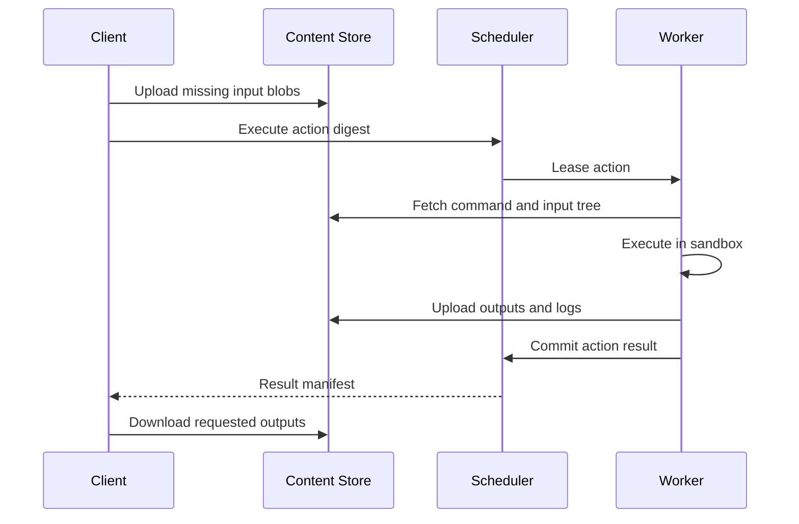

The client can wait, stream status, or reconnect using an operation ID. Repeating the execute request for the same digest attaches to existing work where policy permits.

Workers receive short-lived credentials scoped to required input digests and output uploads.

## Hermetic execution

A hermetic action can observe only declared inputs and controlled platform state.

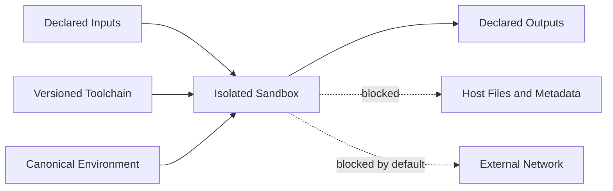

The sandbox provides an isolated filesystem, process tree, user namespace, network policy, clock policy, resource limits, and clean temporary directory.

Undeclared file reads fail or are traced in a diagnostic mode. Network access is disabled by default; dependency downloads happen through declared, verified inputs.

Normalize locale, timezone, working directory, file permissions, and environment variables. Hide hostnames and machine-specific paths.

## Time and randomness

Build outputs often embed timestamps, random values, or absolute paths. These make otherwise equivalent actions produce different bytes.

Provide a declared build epoch, deterministic random seed, stable workspace path, and path-remapping compiler flags.

Tests that intentionally need real time or randomness can opt out of remote caching or include the relevant seed and time input in the action key.

Never cache an action that reads uncontrolled system state while claiming hermeticity.

## Worker lifecycle

Workers advertise CPU, memory, disk, architecture, operating system, accelerator, toolchain, and isolation capabilities.

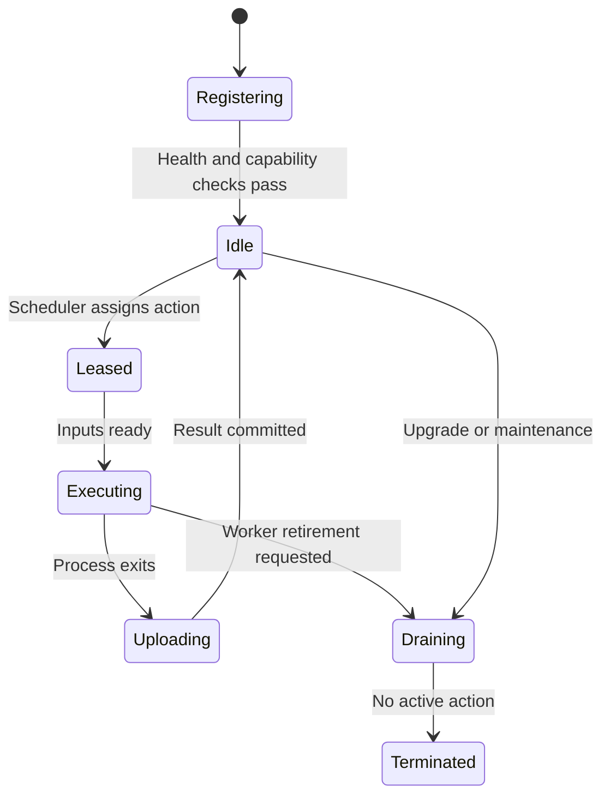

A worker heartbeat carries lease state and resource pressure. If it disappears, its lease expires and the action can be retried elsewhere.

Recycle sandboxes and local caches safely without allowing one tenant's files, processes, or credentials to reach another.

Workers are replaceable. Durable results exist only after verified upload and result commit.

## Scheduling

Filter workers by hard capabilities, then score by locality, queue fairness, resource fit, and expected completion.

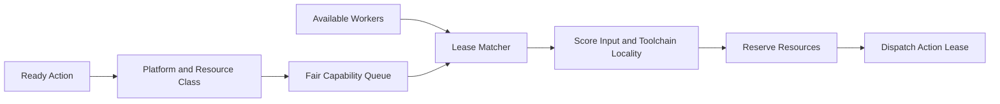

Small actions need low scheduling overhead. Large link, test, and accelerator actions need explicit resource reservations.

Use dominant-resource fairness among tenants and priority classes. Interactive developer builds receive latency priority without permanently starving continuous integration.

Avoid strict global scheduling. Regional schedulers own worker pools, while a lightweight directory routes actions to compatible regions.

## Data locality

Input transfer can exceed execution time. Prefer workers that already cache the input root, toolchain, or large dependencies.

Maintain approximate cache summaries rather than a central exact map of every blob on every worker. False positives cost a download; globally synchronized exactness costs more.

For large actions, estimate missing input bytes and network path before placement. Replicate popular toolchains to every pool proactively.

Do not over-prioritize locality until one worker becomes a queue hot spot. Expected finish time combines queue delay, download, and compute.

## Action deduplication

When many builds request the same action digest, execute it once and attach multiple waiters.

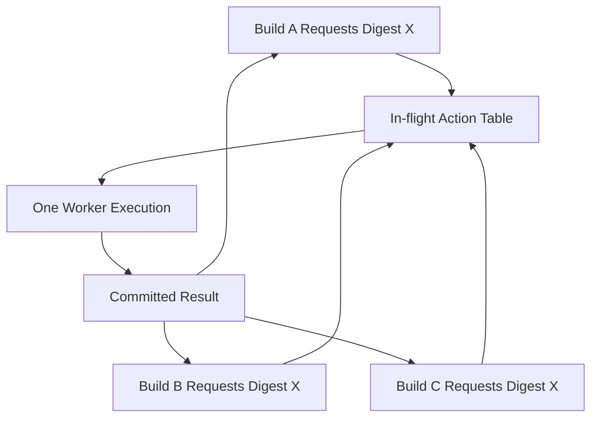

Cancellation removes one waiter but stops execution only when no interested build remains and policy allows it.

Deduplicate only across compatible security and execution-policy domains. Two tenants must not gain timing or result access through unauthorized shared work.

## Dynamic dependencies

Some tools discover dependencies while running. This weakens hermetic caching if not captured.

Prefer an analysis phase that declares the complete action before execution. Compiler dependency files can feed future graph construction, but the first run should execute in a sandbox that detects undeclared reads.

For controlled dynamic discovery, run a non-cacheable discovery action whose output is a deterministic dependency manifest. The actual compile action uses that manifest as a declared input.

Never retroactively bless arbitrary host reads as valid dependencies without policy review.

## Incremental builds

When source changes, recompute action digests from the changed Merkle tree. Unaffected actions retain identical keys and become cache hits.

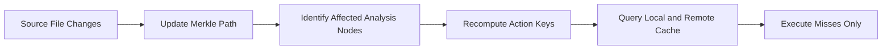

Graph analysis itself must be incremental. Memoize package metadata and invalidate it by declared configuration and source dependencies.

Fine-grained actions improve reuse but increase scheduling and storage overhead. Action boundaries should match meaningful compilation and testing units.

## Test execution

Tests are actions with additional semantics: sharding, retries, flake detection, coverage, and result history.

Split large test suites by historical duration to balance workers. Stable shard definitions improve cache reuse.

A failed test can retry under a flake policy, but the build result must report both attempts. Repeated retry-until-pass hides quality problems.

Cache test results only when test inputs, runtime dependencies, environment, and policy are hermetic. Integration tests against shared external systems are usually non-cacheable.

Quarantine policies isolate known flaky tests without silently treating them as healthy.

## Speculative execution

Long-tail actions can dominate build latency. If an action exceeds its expected duration, run a duplicate on another worker.

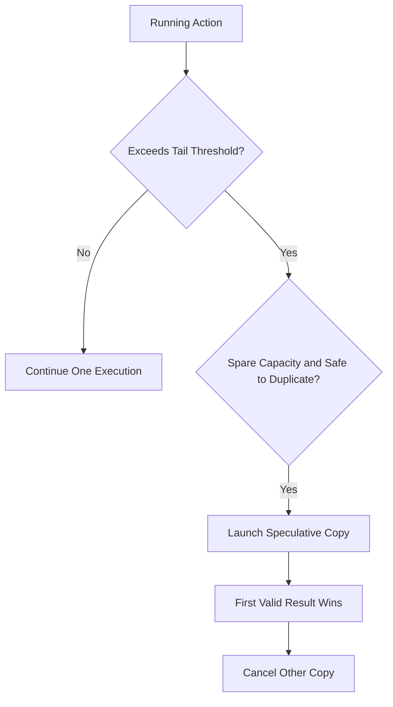

Use speculation only for hermetic side-effect-free actions. Limit duplicate resource cost and learn thresholds by action family.

Different outputs from two successful copies reveal non-determinism and should quarantine the cache entry.

## Output upload and commit

The worker validates declared outputs, rejects unexpected types or size limits, and uploads blobs by digest.

The action result becomes visible only after every referenced blob is durable. Commit the result manifest with compare-and-set on the action digest.

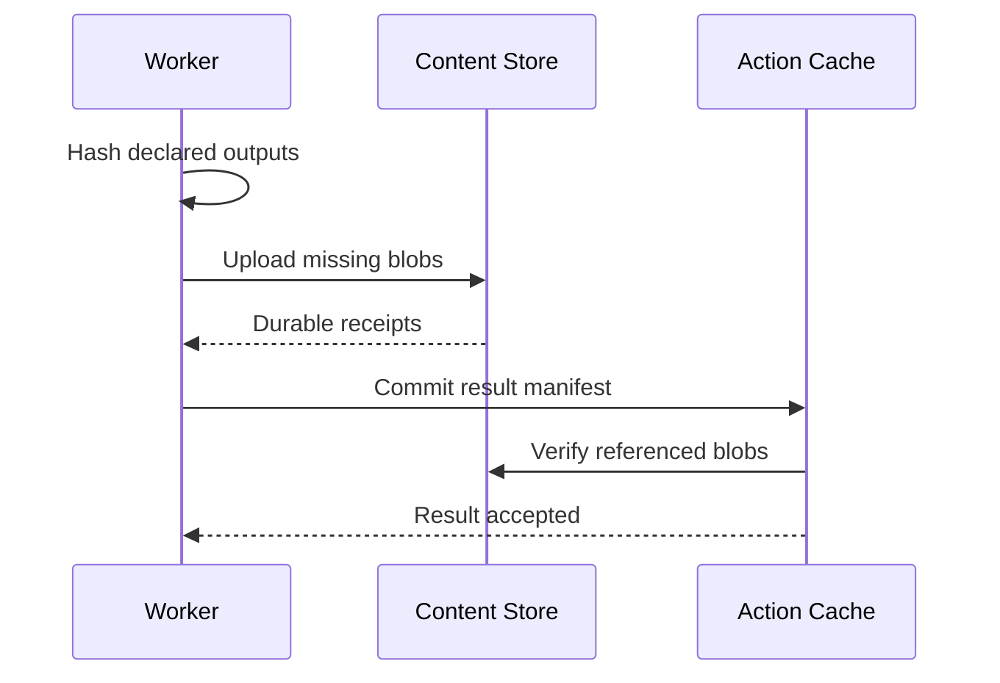

If another worker already committed an identical result, reuse it. If the manifest differs, record a reproducibility violation rather than choosing arbitrarily.

## Build provenance

Release artifacts include signed provenance describing:

- Source revision and repository identity
- Build definition and action graph root
- Toolchain and worker image digests
- Input and output digests
- Builder identity and policy
- Time, tenant, and build invocation
- Tests and approvals

Sign provenance through a dedicated service after verifying the build ran in an approved trusted pool.

Consumers verify artifact digest and provenance policy before deployment. A cache hit remains valid provenance only if its original execution met the current required policy.

## Trust levels and cache poisoning

Not every producer may write globally trusted cache entries.

Separate cache namespaces or attach trust metadata for:

- Developer local builds
- Untrusted pull requests
- Protected continuous integration
- Release builds

Untrusted builds may read approved public toolchain blobs but cannot publish results used by protected release jobs.

All CAS uploads are hash-verified. Action-cache writes require authenticated builder identity and policy authorization.

Reproducible double builds can increase confidence for critical artifacts.

## Multi-tenancy and isolation

Each action executes under a tenant identity with quotas for CPU, memory, disk, network, workers, cache bytes, and concurrent actions.

Isolation layers include sandboxed processes or virtual machines, clean workspaces, network denial, short-lived credentials, encrypted temporary disks, and post-action scrubbing.

Shared physical content is safe only when lookup authorization prevents digest probing from revealing confidential files. Sensitive tenants may require dedicated encryption domains or worker pools.

Build logs can contain source lines or secrets from faulty tools. Apply access control, redaction, retention, and output-size limits.

## Backpressure and admission control

When queues grow, admit work by tenant quota and priority rather than accepting unlimited graph expansion.

Limit outstanding actions per build and stream ready work incrementally. A single million-node graph should not consume all scheduler memory.

Reserve worker capacity for interactive builds, critical release branches, and infrastructure actions. Batch builds use remaining capacity fairly.

Return estimated queue position and saturation signals so clients can avoid aggressive resubmission.

## Multi-region design

Clients connect to a nearby regional frontend and worker pool. Metadata and popular content replicate globally, while large unique inputs remain regional unless another region needs them.

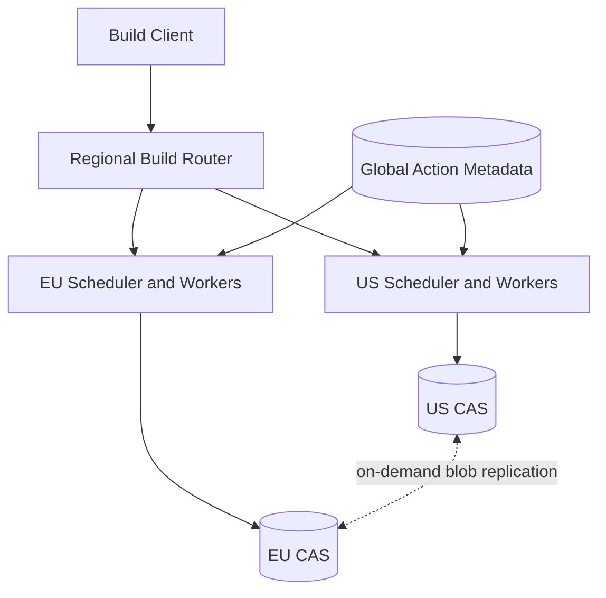

Route by data locality, platform capability, capacity, and residency. Moving a large repository input across an ocean may cost more than waiting for a local worker.

Action results can replicate lazily by demand. Global metadata must not advertise a usable cache hit until referenced blobs are available or fetchable within policy.

During regional failure, clients retry another permitted region with the same action digests and operation IDs.

## Garbage collection

CAS blobs are immutable and shared by many results. Deleting by upload age can remove live content.

Use reachability and leases:

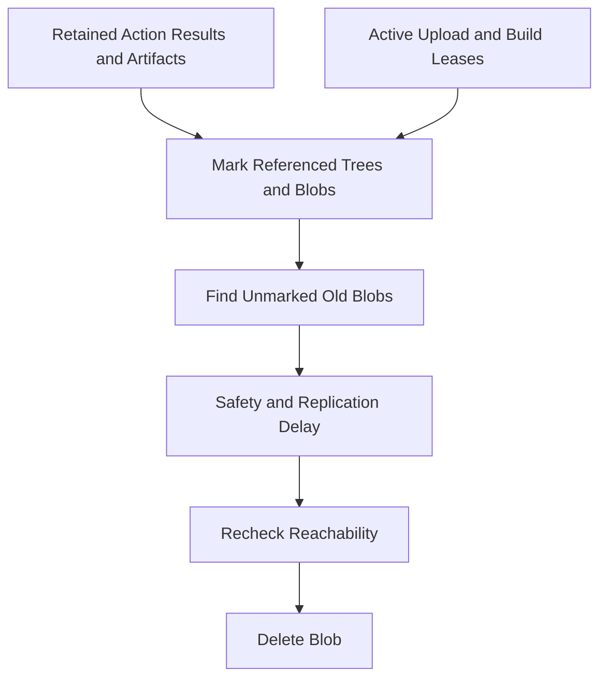

Recent unreferenced blobs receive a grace period for in-flight result commits. Release artifacts and provenance have explicit retention independent of cache eviction.

Evict action-cache entries by recency, cost saved, size, and trust tier. Preserve small frequently reused results over huge one-off outputs.

## Failure handling

### Scheduler failure

Another scheduler restores durable build and lease state. Workers reconnect and report active leases before actions are reassigned.

### Worker failure

The lease expires and the action retries elsewhere. Uncommitted output blobs remain harmless and later garbage collect.

### Content store unavailable

Workers with cached inputs may finish, but results cannot commit until outputs are durable. Clients may use valid local cache entries.

### Action-cache corruption

Verify manifest and blob digests, quarantine the entry, and execute the action. Rebuild cache state from immutable content where possible.

### Poison action

Enforce timeout, resource, process, output, and log limits. Repeated deterministic infrastructure crashes quarantine the toolchain or worker class.

### Region outage

Retry in another allowed region. Content-addressed inputs avoid renaming and stable operation IDs prevent duplicate reporting.

### Non-deterministic output

Do not overwrite an existing conflicting result. Record both manifests, disable shared caching for the action family, and surface a reproducibility error.

## Observability

Track:

- Build and action latency, queue time, and critical path
- Local and remote cache hit rates
- Bytes uploaded, downloaded, deduplicated, and served locally
- Scheduler throughput, queue depth, and fairness
- Worker utilization, capability shortages, and churn
- Sandbox violations and undeclared input reads
- Action failures, retries, speculation, and cancellation
- Output upload and result-commit latency
- Non-deterministic action detections
- CAS size, garbage-collection progress, and missing blobs
- Regional transfer and execution locality

The build UI should show the critical path and explain every cache miss: changed input, command change, platform mismatch, policy mismatch, eviction, or disabled caching.

Synthetic builds continuously test execution, isolation, caching, cancellation, worker failure, and cross-region recovery.

## Key tradeoffs

### Fine-grained vs coarse actions

Small actions improve parallelism and cache reuse but increase graph, scheduling, and storage overhead. Large actions reduce orchestration cost but rebuild more work after small changes.

### Hermeticity vs developer convenience

Strict sandboxes make builds reproducible but expose undeclared dependencies that local scripts previously accessed implicitly. Diagnostic tooling and clear fixes make the transition practical.

### Locality vs fairness

Scheduling on cached inputs saves network and time, but always choosing the same worker creates hot spots. Expected completion time balances locality with queue delay.

### Shared cache vs trust isolation

Cross-team reuse saves enormous compute, but an untrusted writer can poison results. Content verification, provenance, and trust-scoped cache writes are mandatory.

### Speculation vs resource efficiency

Duplicate tail actions shorten builds but spend extra compute. Use historical thresholds and only spare capacity.

The central principle is that an action is safely reusable only when all of its inputs, environment, policy, and outputs are explicit and content-addressed.
