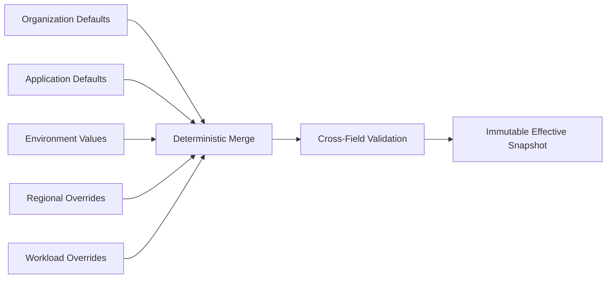
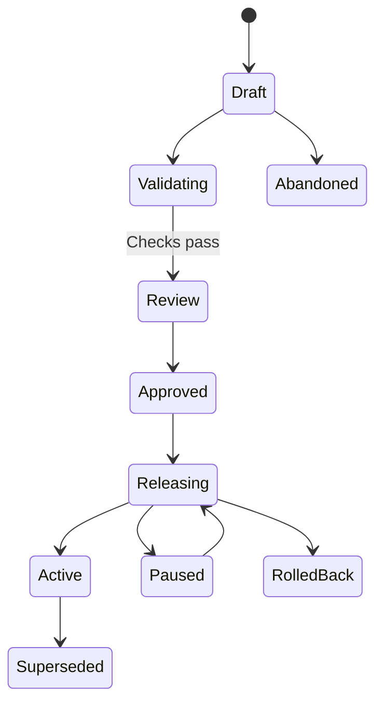
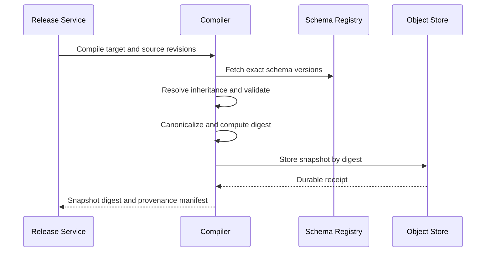
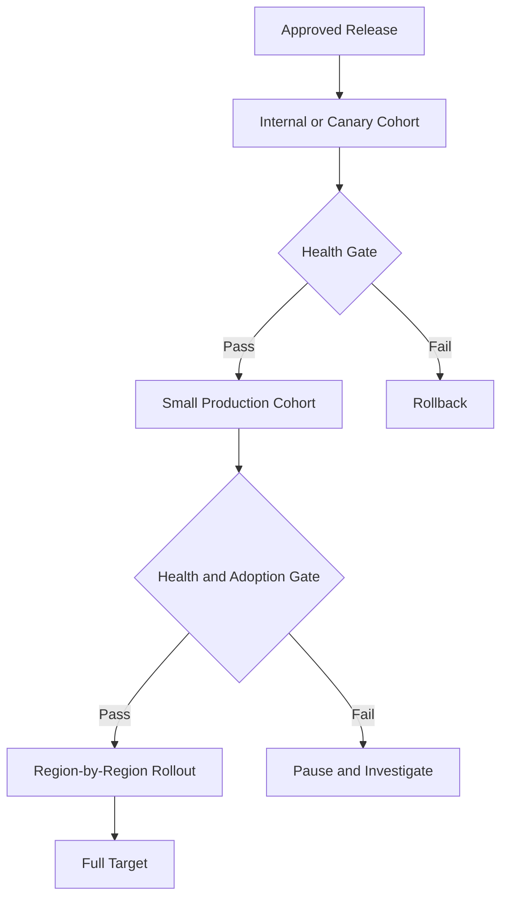
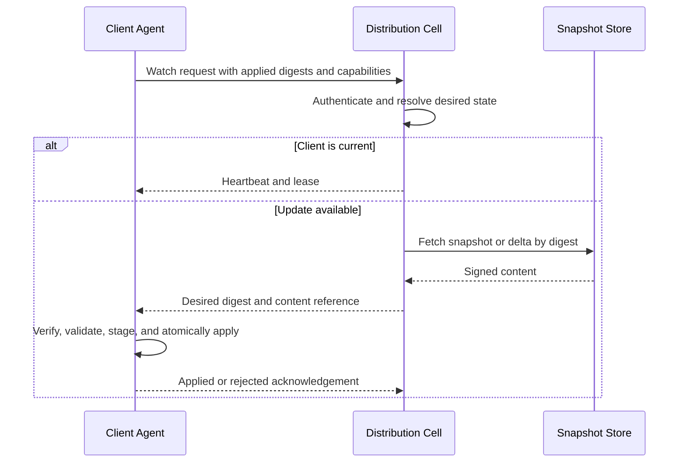
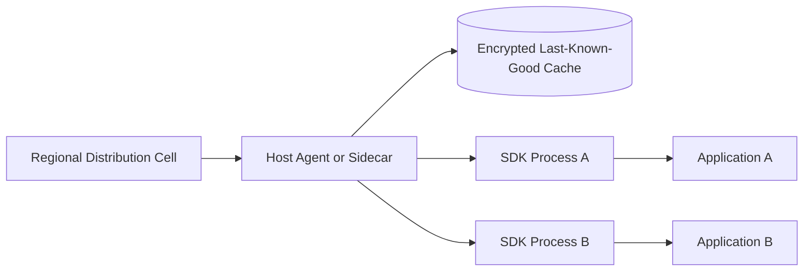
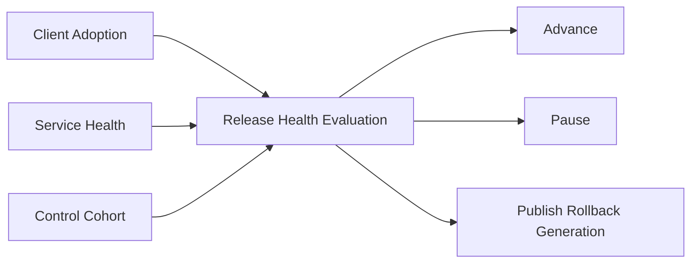
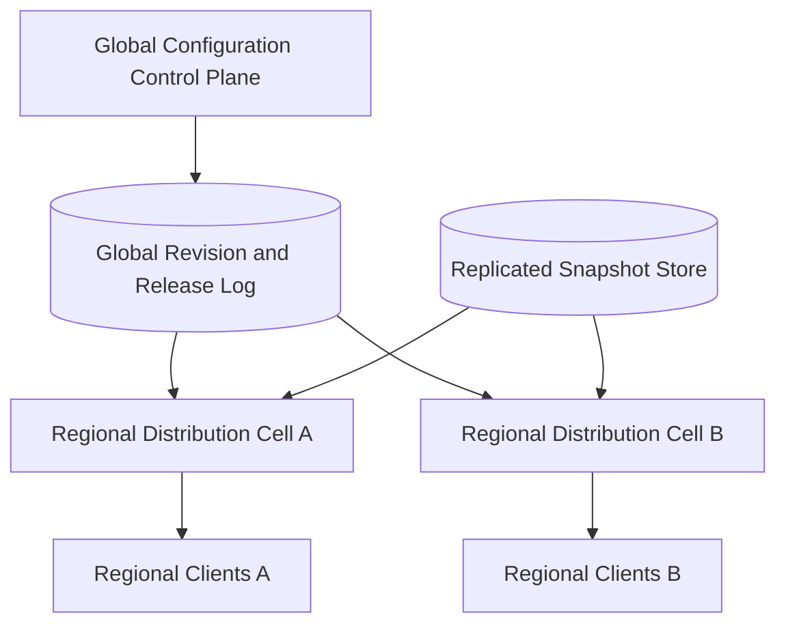

## Problem and requirements

A distributed configuration management platform stores operational settings outside application binaries and delivers them to services, jobs, edge nodes, mobile clients, and infrastructure agents. Examples include timeouts, endpoint lists, concurrency limits, retry budgets, logging levels, regional parameters, and policy references.

The difficult part is not key-value storage. A malformed or overly broad configuration update can fail an entire fleet faster than a code deployment. The system must validate changes, control blast radius, preserve atomicity across related values, provide deterministic inheritance, and keep applications running when the control plane is unavailable.

### Functional requirements

- Define typed configuration schemas with validation and ownership
- Organize configuration by tenant, application, environment, region, and workload
- Support inheritance and explicit overrides
- Create immutable versions and atomic multi-key revisions
- Preview effective configuration before publication
- Roll out changes through stages, cohorts, and regions
- Deliver updates through polling, streaming watches, and snapshots
- Observe client adoption, validation failures, and health signals
- Pause, roll back, expire, and audit changes
- Reference secrets without storing secret values in ordinary configuration

### Non-functional requirements

- Serve one billion local configuration reads per second across clients
- Distribute urgent updates to connected workloads within seconds
- Keep the write control plane above 99.99% availability
- Continue serving last-known-good configuration during regional outages
- Prevent cross-tenant reads, writes, and cache leakage
- Make every effective value explainable from source layers and versions
- Bound the blast radius of bad changes
- Support disconnected and intermittently connected workloads

## Capacity estimates

Assume ten million active workloads, one million published changes per day, and an average effective snapshot of 100 KB per workload class.

Applications should read configuration from an in-process snapshot, not call a remote service for every request. Remote traffic consists primarily of watch heartbeats, update deltas, snapshot refreshes, and acknowledgements.

| Resource | Estimate |
| --- | ---: |
| Active client streams | 10M |
| Local reads | 1B+/second |
| Published revisions | 1M/day |
| Peak update fan-out | Millions of clients/minute |
| Snapshot storage | Petabyte scale with versions and replication |
| Acknowledgement events | Billions/day |

Content-addressed snapshots and shared cohort delivery prevent identical configuration from being stored and transmitted separately for every workload.

## Configuration model

```text
Schema {
  schemaId, version, owner, fields,
  constraints, compatibilityPolicy
}

ConfigLayer {
  layerId, scope, schemaVersion,
  values, parentRefs, revision
}

Release {
  releaseId, snapshotDigest, targetSelector,
  rolloutPlan, state, createdBy
}

ClientState {
  clientId, identity, desiredDigest,
  appliedDigest, status, lastSeenAt
}
```

Values are grouped into immutable revisions. Clients apply a complete snapshot or transaction, never a partially updated set of related keys.

## Configuration versus flags and secrets

Configuration, feature flags, and secrets overlap but have different safety properties.

| System | Primary purpose | Typical behavior |
| --- | --- | --- |
| Configuration | Set operational parameters | Typed values, atomic snapshots, controlled rollout |
| Feature flags | Choose behavior per evaluation context | High-cardinality targeting and experimentation |
| Secrets manager | Deliver confidential credentials | Encrypted values, short leases, strict read auditing |

Configuration may contain a secret reference such as `secret://payments/api-key`, but never the decrypted secret. The client resolves it through an independently authorized secrets channel.

## High-level architecture

```mermaid
flowchart TB
  Authors[Engineers and Automation] --> API[Configuration Control API]
  API --> Auth[Authorization and Ownership]
  Auth --> Validate[Schema and Policy Validation]
  Validate --> Revisions[(Immutable Revision Store)]
  Revisions --> Compiler[Effective Configuration Compiler]
  Compiler --> Snapshots[(Content-Addressed Snapshot Store)]
  Snapshots --> Release[Release Orchestrator]
  Release --> Regions[Regional Distribution Cells]
  Regions --> Agents[Node Agents and Sidecars]
  Agents --> SDKs[In-Process SDKs]
  SDKs --> Apps[Applications]
  Agents --> Ack[(Acknowledgement Stream)]
  Ack --> Health[Adoption and Health Monitor]
  Health --> Release
  Audit[(Audit Log)] <-- API
```

The control plane creates and releases immutable snapshots. Regional data planes distribute those snapshots. Applications read from local memory so a control-plane outage does not enter the request path.

## Schema and type system

Every configuration namespace has a versioned schema. Supported types include booleans, integers, bounded numbers, strings, enums, durations, byte sizes, structured objects, lists, maps, URLs, and references.

```yaml
namespace: checkout.runtime
version: 7
fields:
  request_timeout:
    type: duration
    minimum: 100ms
    maximum: 30s
    required: true
  retry_limit:
    type: integer
    minimum: 0
    maximum: 5
  payment_endpoint:
    type: service_reference
```

Validation occurs when a draft is saved, when layers are composed, when a release is created, and again in the client runtime. Server validation prevents known-invalid snapshots; client validation protects against incompatibility and corruption.

Schema evolution declares whether fields are optional, required, deprecated, renamed, or removed. A release cannot require a schema version unsupported by its target clients unless the rollout explicitly coordinates a client upgrade first.

## Scope and inheritance

Configuration commonly follows a hierarchy:

```text
organization
  └── application
       └── environment
            └── region
                 └── cluster
                      └── workload
```

More specific layers override less specific layers. The compiler resolves the hierarchy into a flat effective snapshot and records provenance for every value.



Inheritance rules must remain simple. Scalars replace, objects merge by declared field policy, and lists either replace or use a schema-defined keyed merge. Never infer list behavior from data shape.

An effective-value API explains the winning value, every shadowed layer, schema default, revision, author, and release that delivered it.

## Authoring and change workflow



A change contains a base revision, patch, reason, owner, risk classification, rollout plan, and expiry when temporary. Optimistic concurrency rejects an update if its base revision is stale.

Before approval, show:

- The raw and effective diff
- Affected applications, regions, and workload count
- Schema and semantic validation results
- Policy violations and required approvers
- Estimated snapshot and delivery impact
- Conflicts with active or scheduled releases
- The exact rollback target

High-risk namespaces require separation of duties. Emergency changes may use an accelerated path but still need explicit ownership, automatic expiry, and post-change review.

## Semantic validation

Type checks cannot catch every dangerous value. Semantic validators may verify that:

- A referenced service or resource exists
- A timeout is longer than downstream retry intervals
- A connection pool does not exceed database capacity policy
- A regional endpoint stays within residency boundaries
- Mutually exclusive options are not enabled together
- A percentage or resource budget remains within aggregate limits

Validators run in isolated, deterministic environments with bounded dependencies. Results record validator version and input digest. External lookups use versioned snapshots where possible so approval is reproducible.

Tenant-provided validators cannot make arbitrary network calls or read unrelated configuration.

## Snapshot compilation

The compiler turns schemas and layers into immutable, client-ready snapshots.



Canonical encoding guarantees that logically identical snapshots produce the same digest. The snapshot is signed and includes namespace versions, generation, compatibility range, creation time, and provenance-manifest digest.

Clients never consume mutable draft state. Publication points only to a compiled digest that has passed validation.

## Rollout orchestration

A rollout maps one immutable snapshot to target cohorts over time. Cohorts may be based on region, cluster, workload identity, or a stable hash—not arbitrary request-level users, which belong in a feature-flag system.



Each stage declares minimum duration, target size, required acknowledgement rate, health queries, and failure thresholds. The orchestrator advances only after both adoption and service health meet policy.

The system can pause further distribution, but it cannot assume already delivered values can be recalled. Rollback is a new, higher-generation desired snapshot pointing to a known-good digest.

## Distribution protocol

Clients connect to a regional distribution cell using workload identity. The server maps identity to authorized namespaces and desired releases.



The watch stream is an optimization, not the source of truth. Clients reconnect with their applied digest and generation, so missed events do not matter. Periodic reconciliation repairs dropped streams or stale routing.

Large snapshots are fetched from content-addressed storage through signed URLs. Small deltas reduce bandwidth, but clients verify the reconstructed full digest before applying.

## Client architecture

A host agent or sidecar maintains authenticated streams, verifies signatures, persists snapshots, and exposes configuration to local processes. In-process SDKs provide typed, lock-free reads from an immutable memory snapshot.



The apply sequence is:

1. Download to a staging area.
2. Verify digest, signature, tenant, and namespace.
3. Validate schema compatibility and local constraints.
4. Persist the new snapshot durably.
5. Atomically swap the active pointer.
6. Notify subscribers after the full transaction is visible.
7. Acknowledge success or structured rejection.

Callbacks must not block the agent. Applications can choose dynamic reload, graceful component restart, or process restart per field.

## Consistency semantics

The write path provides linearizable revision creation within a namespace and atomic release-pointer updates. Distribution is eventually consistent because millions of clients cannot change simultaneously.

Every client observes monotonically increasing release generations for a target. A delayed message cannot replace a newer generation. Rollback therefore receives a new generation even though its snapshot digest may reference older content.

Cross-namespace atomicity is expensive and usually avoided. When required, create a transaction manifest that lists all namespace digests; clients stage every component and move one local transaction pointer only after all validate.

## Bootstrap and circular dependencies

Configuration infrastructure itself needs endpoints, certificates, trust roots, and initial policy. Keep a minimal bootstrap bundle in the deployment image or machine identity system.

The bootstrap bundle contains only:

- Trusted signing roots
- Regional discovery endpoints
- Workload identity configuration
- A small last-resort operational policy
- Maximum accepted staleness

It does not contain ordinary application settings. Bootstrap changes require a slower release path because an invalid trust root or endpoint can disconnect the entire fleet.

Discovery returns multiple regional endpoints. Clients cache the last successful set and use exponential backoff with jitter to avoid a reconnection storm.

## Offline and last-known-good behavior

Clients persist several verified snapshots and their metadata. At startup, a client selects the newest compatible last-known-good snapshot whose policy permits offline use.

Each namespace declares staleness behavior:

| Class | Offline behavior |
| --- | --- |
| Stable operational settings | Continue with last-known-good and report staleness |
| Emergency safety policy | Require a recent lease or enter restricted mode |
| Short-lived routing data | Use bounded stale data, then fall back to static discovery |
| Secret references | Keep the reference; secret lease policy remains independent |

Do not erase a working local snapshot merely because a new one fails validation. Preserve the rejected version for diagnostics without making it active.

## Health-aware rollback

The release orchestrator consumes configuration acknowledgements and service health metrics. It compares the changed cohort with a stable control cohort while accounting for deployment and traffic changes.

Automatic rollback requires conservative, predeclared signals such as crash rate, request errors, saturation, or failed readiness. It should not react to every noisy metric correlation.



Rollback stops additional exposure quickly, but recovery time depends on watch connectivity, application reload behavior, and whether the change caused clients to crash. This is why small canaries and local last-known-good recovery matter.

## Configuration expiry

Temporary overrides accumulate and become invisible technical debt. A field or layer can include an expiry time, owner, and expiration action.

Before expiry, notify owners and show the resulting effective diff. At expiry, the system publishes a revision that removes the override; it never mutates historical data in place.

Expiry can also require manual confirmation for high-risk changes. Policies flag long-lived emergency overrides and ownerless namespaces.

## Multi-region design

The global control plane owns schemas, revisions, release definitions, and audit history. Regional cells serve snapshots and watch streams from replicated state.



Writes for a namespace use one leader or consensus group to establish revision order. Regional cells consume the ordered release log and independently serve authorized clients.

If global coordination is unavailable, regions continue serving current desired state. Emergency regional overrides may be allowed through a pre-authorized local path, receive a fenced regional generation, expire automatically, and reconcile explicitly after recovery.

## Authorization and tenancy

Authorization separates schema ownership, value editing, release approval, environment promotion, emergency override, and read access. Workload identity determines exactly which namespaces and scopes a client may receive.

Namespace every revision, snapshot reference, cache entry, stream, and audit event by tenant. Content-addressed storage may deduplicate physical bytes only when encryption and access controls prevent cross-tenant existence leaks.

Sensitive configuration metadata—such as private endpoint names or policy structure—may itself require encryption and restricted observability.

## Security

Protect the platform with:

- Short-lived workload and human credentials
- Signed schemas, snapshots, releases, and bootstrap bundles
- Tenant- and region-scoped encryption keys
- Mutual authentication between clients and distribution cells
- No secret values in configuration payloads or logs
- Tamper-evident authoring, approval, release, and override events
- Dual approval for trust-root and production-wide changes
- Continuous authorization and ownership reconciliation

Clients verify content independently instead of trusting the transport alone. A compromised cache or distribution node cannot forge a valid snapshot.

## Reliability and degradation

| Failure | Safe behavior |
| --- | --- |
| Control plane unavailable | Clients and cells continue with current desired state |
| Regional cell unavailable | Reconnect to another authorized cell; keep local snapshot |
| Watch stream drops | Reconcile by generation and digest after reconnect |
| Snapshot store unavailable | Serve cached content by digest and avoid new rollout stages |
| Client rejects an update | Retain last-known-good, report reason, pause if threshold exceeded |
| Health backend delayed | Hold rollout rather than assume success |
| Schema registry unavailable | Use signed cached schemas; block new compilation |
| Signing service unavailable | Preserve drafts but do not publish unsigned releases |

Separate write, compilation, distribution, and read failure domains. An authoring outage should not prevent applications from reading already applied configuration.

## Observability and service objectives

Track:

- Draft, validation, approval, and compilation latency
- Release stage duration and target population
- Desired, downloaded, applied, rejected, and stale client counts
- Watch connections, reconnect rate, and fan-out lag
- Snapshot cache hit rate, bytes transferred, and delta efficiency
- Effective-value queries and inheritance depth
- Client schema incompatibility and callback failures
- Health-gate decisions, pauses, and rollbacks
- Temporary overrides approaching expiry
- Unauthorized access and signature-verification failures

Suggested objectives include 99.99% control-plane availability, 99.999% local read availability, p99 regional desired-state lookup below 50 milliseconds, 99% of healthy connected clients receiving urgent releases within 30 seconds, and zero partial multi-key application.

Adoption is measured against healthy, eligible clients. Counting terminated or disconnected workloads as pending forever makes rollout state meaningless.

## Key tradeoffs

### Push versus pull

Push provides fast updates but requires millions of long-lived connections. Pull is simpler and resilient but increases propagation delay and synchronized polling risk. Use streaming notification with periodic pull reconciliation.

### Server-side versus client-side composition

Server-side compilation gives deterministic effective snapshots and lighter clients. Client-side composition reduces snapshot variants but distributes complex merge logic and increases inconsistency. Prefer server compilation.

### Strong consistency versus global availability

Strongly ordering every client application would make global updates slow and fragile. Strongly order revisions and releases; distribute immutable desired state eventually with monotonic generations.

### Dynamic reload versus restart

Dynamic reload reduces disruption but requires thread-safe application code and clear field semantics. Restart is simpler but can amplify a global change into a fleet-wide availability event. Declare behavior per field and stage carefully.

### Flexible hierarchy versus explainability

Deep, arbitrary inheritance can model any organization and makes effective values hard to understand. Keep a bounded hierarchy and expose provenance for every field.

## Evolution path

1. Begin with typed namespaces, immutable revisions, polling clients, and last-known-good caches.
2. Add effective snapshot compilation, streaming watches, acknowledgements, and audit history.
3. Introduce staged rollout, health gates, automatic rollback, and schema compatibility checks.
4. Expand into regional distribution cells, atomic multi-namespace transactions, and emergency overrides.
5. Mature with semantic validation, fleet simulation, configuration expiry, and automated ownership governance.

## Final design

The platform separates a strongly controlled authoring plane from a highly available distribution plane. Schemas and deterministic inheritance compile into signed, content-addressed snapshots. Release orchestration exposes those immutable snapshots to progressively larger workload cohorts while monitoring adoption and service health.

Regional cells stream desired generations, host agents verify and persist them, and applications read atomic in-memory snapshots without a network dependency. Last-known-good recovery, monotonic generations, explicit failure semantics, and new-generation rollback contain failures when a change is wrong or infrastructure is unavailable. The result is a configuration system that can change a global fleet quickly without allowing one malformed value to become an instantaneous global outage.
