## Problem and requirements

A distributed graph database stores entities as vertices and relationships as edges. It supports workloads such as fraud networks, identity graphs, recommendations, access control, knowledge graphs, network topology, and supply-chain analysis.

The difficult part is locality. A relational lookup can target a known partition, but a graph traversal discovers its next partitions while it runs. High-degree vertices create hotspots, relationships cross shard boundaries, and multi-hop queries can expand from one vertex to millions of candidates.

### Functional requirements

- Create, update, and delete vertices and directed or undirected edges
- Store labels and typed properties on vertices and edges
- Find vertices through unique and secondary indexes
- Traverse relationships with direction, type, and property filters
- Run shortest-path, neighborhood, and pattern-matching queries
- Support conditional and multi-record transactions
- Provide bulk import and change-stream export
- Apply retention and deletion to selected subgraphs
- Run large offline graph algorithms
- Explain query plans and traversal costs

### Non-functional requirements

- Store ten billion vertices and one hundred trillion edges
- Sustain ten million point and traversal queries per second
- Return bounded one-hop queries within 20 milliseconds at p99
- Preserve strong consistency for transactional reads and writes
- Survive node and availability-zone failure without acknowledged data loss
- Isolate tenants and protect the cluster from unbounded traversals
- Scale storage and query execution independently where practical
- Keep graph repartitioning online

## Capacity estimates

Assume ten billion vertices, one hundred trillion edges, 100 bytes per vertex, and 40 bytes per compressed edge before replication and indexes.

| Resource | Estimate |
| --- | ---: |
| Vertex data | About 1 TB logical |
| Edge data | About 4 PB logical |
| Replicated storage | More than 12 PB plus indexes |
| Graph mutations | Millions/second at peak |
| Online queries | 10M/second |
| Offline scans | Petabytes per algorithm run |

Edges dominate storage. Adjacency encoding, partition placement, and query pruning matter more than optimizing small vertex records.

## Property graph model

```text
Vertex {
  tenantId, vertexId, labels[], properties, version
}

Edge {
  tenantId, edgeId, type,
  sourceVertexId, destinationVertexId,
  properties, version
}
```

An edge has an independent ID so parallel relationships between the same vertices remain distinguishable.

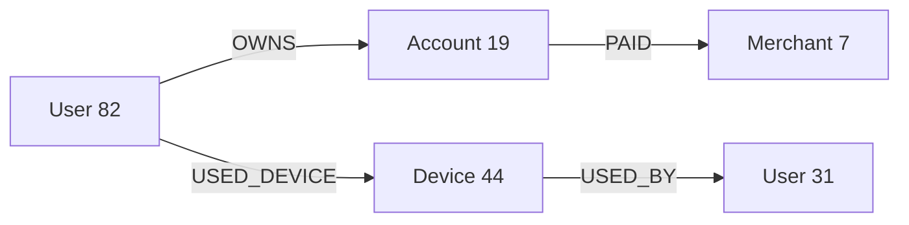

Use opaque immutable IDs. Human-readable names and external identifiers live in properties and unique indexes because they can change.

## API examples

```http
POST /v1/transactions
Content-Type: application/json

{
  "operations": [
    { "createVertex": { "id": "usr_82", "labels": ["User"] } },
    {
      "createEdge": {
        "id": "edge_119",
        "type": "OWNS",
        "source": "usr_82",
        "destination": "acct_19"
      }
    }
  ]
}
```

A declarative query language supports pattern matching:

```text
MATCH (u:User {id: $userId})-[:OWNS]->(a:Account)-[:PAID]->(m:Merchant)
WHERE a.status = "active"
RETURN m.id, count(*)
ORDER BY count(*) DESC
LIMIT 20
```

Parameterized queries are required for plan caching and injection safety.

## High-level architecture

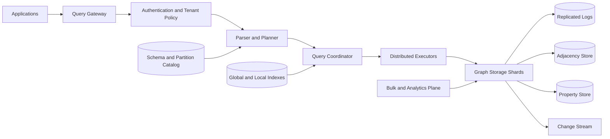

Storage shards own transactional records and adjacency lists. Coordinators build distributed plans but do not become the source of truth for graph data.

## Physical storage layout

Separate frequently traversed adjacency from larger property documents.

```text
vertex/<tenant>/<vertexId>              -> labels, property pointer, version
out/<tenant>/<vertexId>/<edgeType>      -> sorted destination and edge IDs
in/<tenant>/<vertexId>/<edgeType>       -> sorted source and edge IDs
edge/<tenant>/<edgeId>                  -> endpoints, type, properties, version
property/<tenant>/<recordId>            -> encoded property map
```

Maintain both outgoing and incoming adjacency when reverse traversal is common. This doubles some storage but avoids cluster-wide scans.

Encode adjacency in immutable sorted blocks with delta-compressed neighbor IDs. A small mutable delta layer absorbs recent changes; background compaction merges it into new blocks.

## Partitioning

The simplest strategy partitions by a hash of tenant and vertex ID.

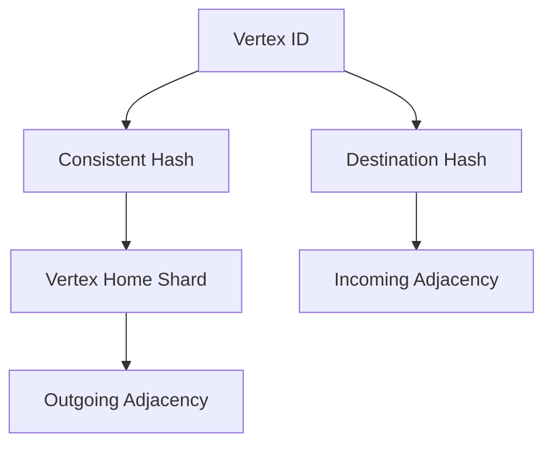

Store outgoing edges with the source vertex and incoming edges with the destination vertex. Edge properties can live with the source copy or in a separately keyed edge record.

Hash partitioning balances random IDs and supports online growth, but traversals cross the network frequently. Range or community-aware partitioning improves locality for known graph structure but risks skew and expensive movement.

Use a hybrid policy:

- Hash partition by default
- Co-locate small tenant graphs on one shard group
- Place declared subgraphs or communities together when evidence supports it
- Split very high-degree adjacency independently

## Vertex and edge writes

Creating an edge updates several records that may live on different shards.

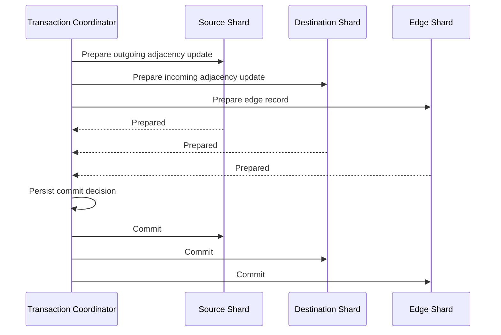

Use a replicated transaction record and two-phase commit for strong atomicity. Participants acquire short-lived intent locks or validate optimistic versions at prepare time.

For workloads that can tolerate asynchronous reverse adjacency, commit the source edge and publish a durable index-maintenance event. This reduces write latency but exposes temporary inconsistency; it must be a different, explicit consistency mode.

## Replication and consensus

Each shard is a consensus group with one leader and replicas across availability zones.

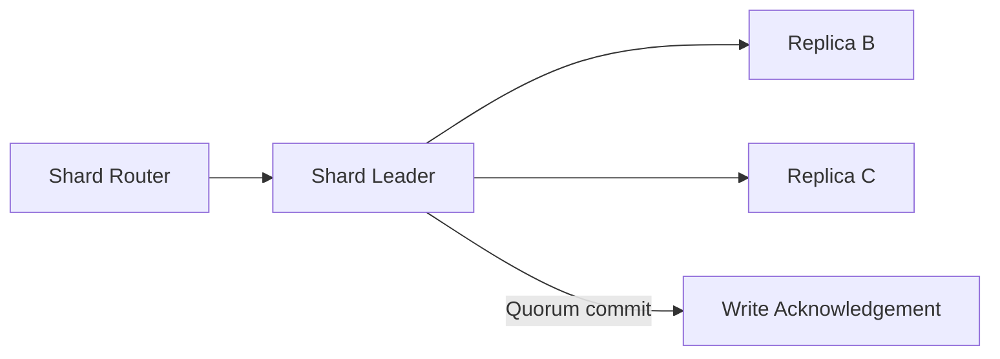

Leaders serialize mutations, append them to replicated logs, and apply committed entries to the local storage engine. Followers can serve bounded-stale reads; linearizable reads go through the leader or use a verified read index.

The catalog maps partition ranges to consensus groups using versioned routing epochs. Stale clients receive a redirect rather than writing to a former owner.

## Indexes

Primary vertex and edge IDs route directly to storage. Secondary indexes map label-property values to vertex IDs.

```text
(tenant, label=User, email_hash=abc) -> [usr_82]
(tenant, label=Merchant, country=US) -> [m_7, m_12, ...]
```

Unique indexes participate in the write transaction so concurrent inserts cannot claim the same value. Non-unique indexes can be synchronously transactional or asynchronously maintained, depending on the declared consistency requirement.

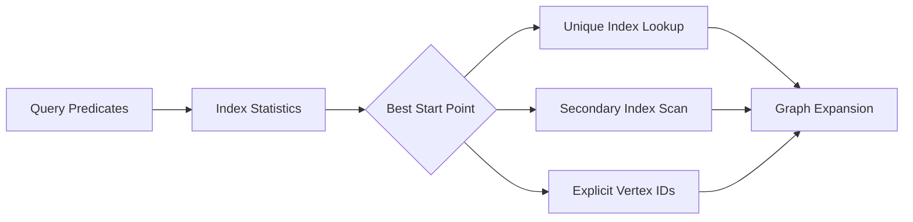

The planner should begin with the most selective indexed predicate. Starting from an unconstrained node pattern can turn a small result into a full graph scan.

## Traversal execution

Online traversals use a frontier of vertex IDs. Executors group frontier requests by shard to reduce network round trips.

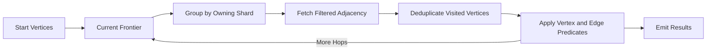

Push edge type, direction, time, and property filters to storage. Return compact IDs before fetching full properties.

Maintain a visited set for cycle control. Small traversals keep it in memory; larger distributed traversals partition it by vertex ID and enforce memory and spill limits.

## Query planning

The planner uses label cardinality, property histograms, average degree, degree percentiles, edge-type selectivity, partition locality, and cached subplan costs.

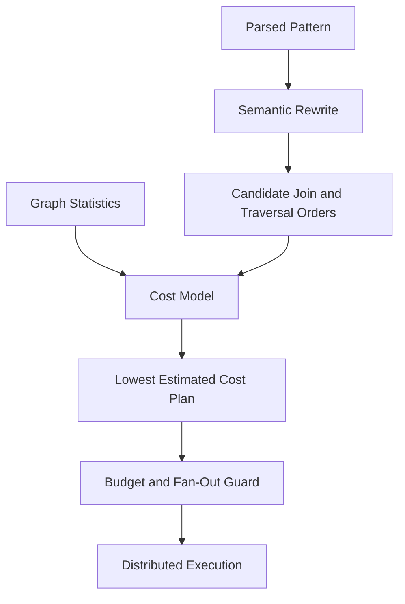

Graph statistics are highly skewed. Average degree is misleading when a few vertices have millions of neighbors, so retain quantiles and heavy-hitter sketches.

Adaptive execution can stop an underestimated expansion and re-plan from observed cardinality, but it must preserve transaction snapshot semantics.

## Hot and supernode handling

Celebrity accounts, popular products, and shared devices can have millions of edges.

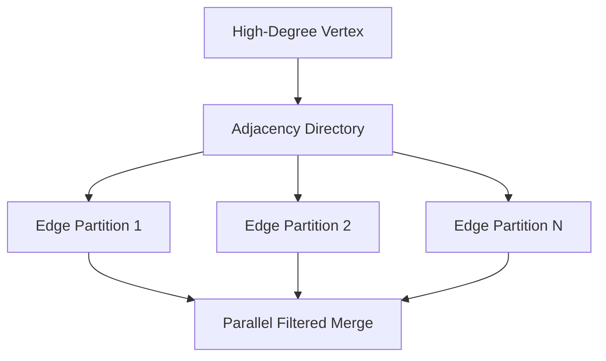

Split adjacency by edge type, time bucket, neighbor hash, or property range. The vertex home stores a versioned directory pointing to its partitions.

Cache immutable adjacency blocks for read-heavy supernodes, apply per-vertex mutation limits, and require selective predicates or pagination for large expansions.

## Bounded queries and safety

Every query receives budgets for elapsed time, vertices visited, edges examined, intermediate rows, memory, network bytes, and shard fan-out.

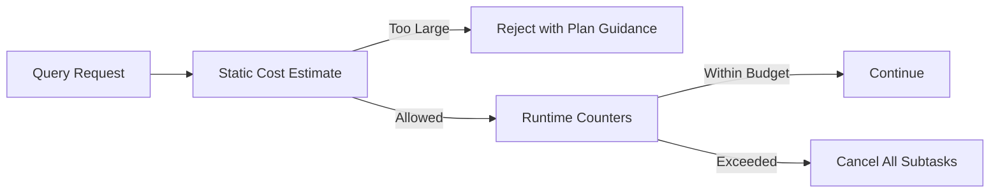

Require explicit limits for variable-length paths in interactive APIs. Unbounded recursive patterns belong in the analytical plane.

Schedule short interactive queries separately from long investigations and offline jobs. Use tenant-level concurrency and work-unit quotas to prevent noisy neighbors.

## Transactions and isolation

Offer snapshot isolation for most application transactions and serializable isolation for workflows that require invariant protection.

A transaction receives a read timestamp from a timestamp service or hybrid logical clock. Shards retain multiversion records, and writes validate against versions observed at the snapshot.

Snapshot isolation does not prevent every write-skew anomaly. Unique indexes, explicit predicates, or serializable validation protect constraints such as “only one active owner edge.”

Long transactions retain old versions and block compaction. Enforce duration and mutation limits.

## Deletion semantics

Deleting a vertex requires handling incident edges.

Policy choices include:

- Reject deletion while edges exist
- Delete the vertex and all incident edges atomically for small neighborhoods
- Tombstone the vertex and remove large adjacency asynchronously

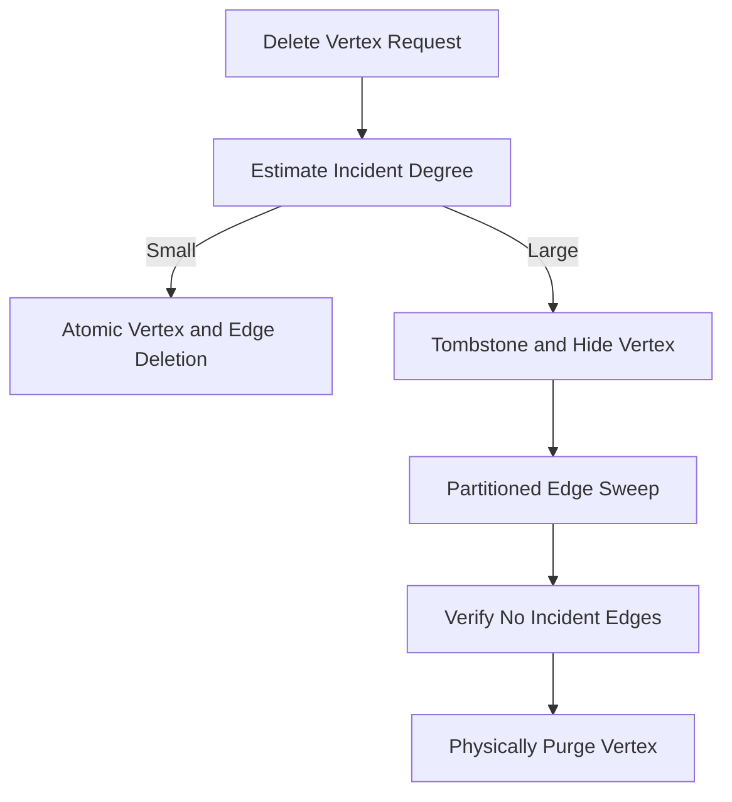

Readers treat a tombstoned vertex as absent immediately. A deletion epoch prevents delayed edge writes from resurrecting relationships during the sweep.

## Bulk ingestion

Large initial loads should bypass per-edge distributed transactions while preserving the same final format.

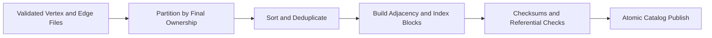

Create outgoing and incoming adjacency blocks in parallel, validate referential integrity, then publish a new graph generation atomically. Concurrent online mutations write to a delta log and merge after the baseline generation is visible.

## Analytical graph processing

PageRank, connected components, community detection, and full-graph embeddings operate in a separate bulk plane.

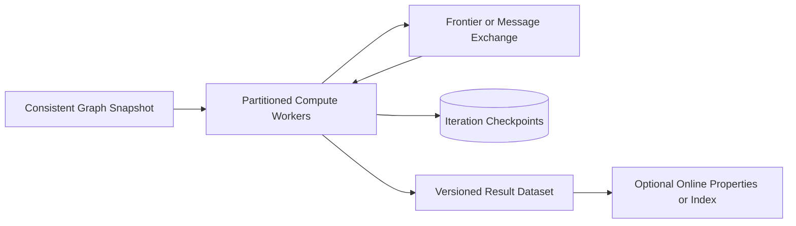

Pin a consistent snapshot so online mutations do not change the graph halfway through an algorithm. Checkpoint long jobs by superstep or partition, and publish results only after validation.

Do not run full scans on online shard leaders. Export immutable blocks or use follower capacity dedicated to analytics.

## Caching

Cache vertex properties, adjacency block headers, popular immutable blocks, index lookups, and prepared query plans.

Include tenant, schema version, read timestamp class, authorization scope, and partition epoch in cache keys. A cache entry without authorization context can leak graph structure across principals.

Invalidate mutable vertex and edge caches from committed change streams. Immutable block caching uses content hashes and needs no invalidation.

## Change streams

Emit committed vertex, edge, property, and schema changes in transaction order.

Consumers use streams to update search indexes, feature pipelines, caches, and downstream warehouses. Events contain transaction ID, commit timestamp, record version, and before/after values according to policy.

Retain change streams long enough for recovery and publish checkpoints. Consumers must be idempotent because replay is at least once.

## Multi-region architecture

For strict graph transactions, assign each tenant or subgraph a primary region and replicate asynchronously to approved secondary regions.

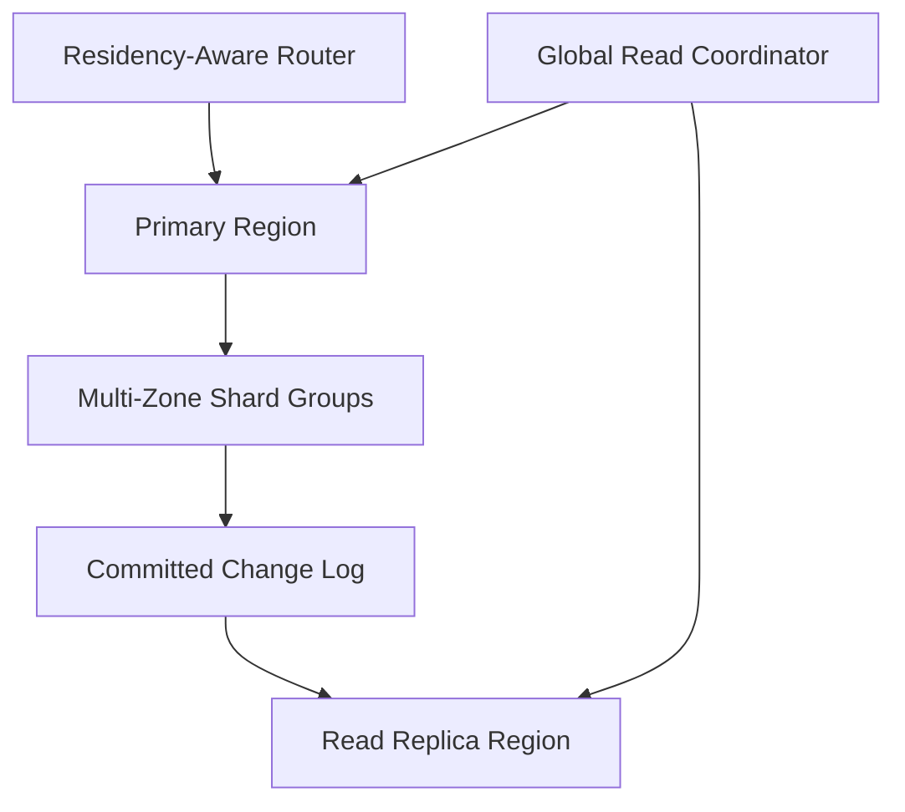

Local reads can use a secondary with an explicit staleness bound. Writes route to the primary region. Global multi-writer graphs require conflict semantics for vertices, edges, unique indexes, and deletions and should be offered only when the application can tolerate them.

Failover promotes a secondary under a higher region epoch after verifying its committed position. Stale primaries are fenced from accepting writes.

## Reliability and failure handling

| Failure | Safe behavior |
| --- | --- |
| Query coordinator crashes | Cancel or expire leased subtasks; client retries read query |
| Shard leader fails | Consensus elects a replica; clients refresh routing |
| Edge transaction coordinator fails | Participants recover decision from replicated transaction record |
| Index maintenance fails | Transactional indexes block commit; async indexes expose lag |
| Bulk import worker fails | Rebuild its immutable partition from source files |
| Compactor crashes | Unpublished blocks are ignored and garbage-collected |
| Repartitioning pauses | Old owner remains authoritative until atomic epoch switch |
| Analytics job fails | Resume from iteration and partition checkpoints |
| Region is isolated | Primary continues locally if quorum exists; secondary remains read-only |

Continuously verify adjacency symmetry where both directions are promised, index-to-record consistency, block checksums, replica convergence, and catalog ownership.

## Online repartitioning

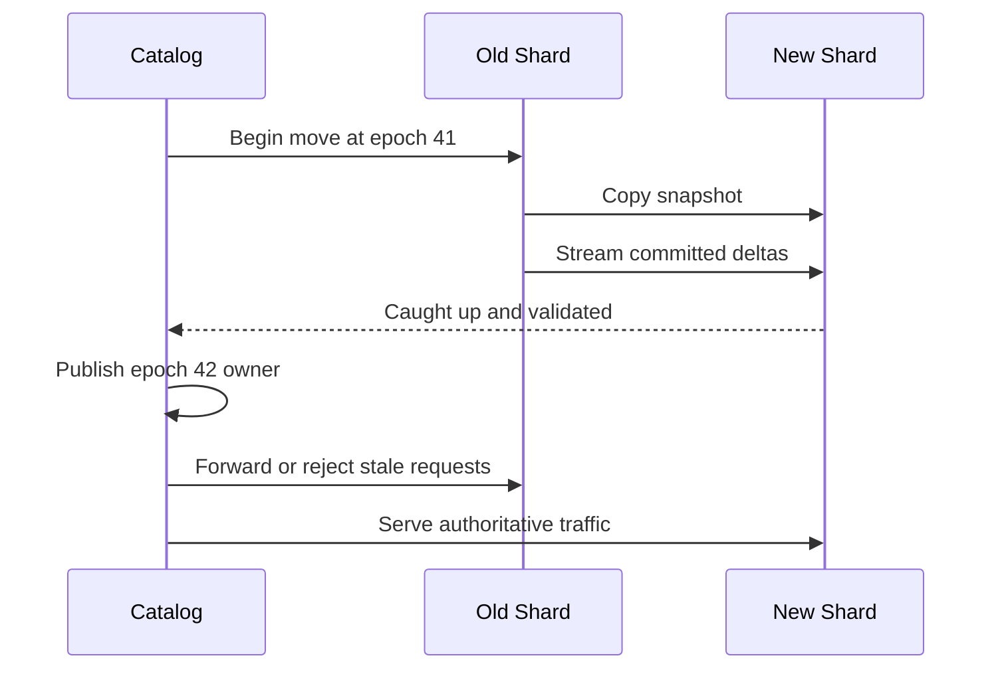

The old owner remains authoritative during copy. After the catalog publishes the new epoch, clients refresh routes and the old owner forwards bounded stale traffic. Delete the old copy only after a rollback window.

## Security and tenant isolation

- Derive tenant context from authenticated credentials
- Apply label- and property-level access controls where required
- Prevent traversals from crossing tenant boundaries by construction
- Encrypt replicated logs, local blocks, backups, and change streams
- Use tenant- or region-scoped keys for sensitive graphs
- Redact properties from query plans, logs, and error messages
- Audit schema, index, export, deletion, and privileged queries
- Rate-limit graph discovery to prevent relationship enumeration

Authorization must apply during traversal, not only to the starting vertex. Hidden edges and vertices must not leak through counts, timing, or error differences where the threat model includes inference.

## Observability and SLOs

Track:

- Vertex, edge, and property mutation throughput
- Transaction conflicts, aborts, and commit latency
- Degree distribution and supernode growth
- Query queue time, expansions, shard fan-out, and budget cancellation
- Index cardinality, selectivity, and maintenance lag
- Consensus replication and leader changes
- Adjacency asymmetry and referential-integrity failures
- Compaction, tombstone, and deletion-sweep backlog
- Repartition copy progress and forwarding rate
- Cross-region replication lag

Useful SLOs include 99.99% point-write availability, 99.9% of bounded one-hop queries under 20 milliseconds, and zero acknowledged transactions lost after a single-zone failure.

## Key trade-offs

| Decision | Benefit | Cost |
| --- | --- | --- |
| Hash partitioning | Even distribution and simple growth | Frequent cross-shard traversals |
| Store both edge directions | Fast incoming and outgoing traversal | More storage and write coordination |
| Strong edge transactions | Consistent graph structure | Cross-shard latency |
| Split supernodes | Removes hotspots | Directory and merge complexity |
| MVCC snapshots | Stable transactional reads | Version storage and compaction pressure |
| Separate analytics plane | Protects online latency | Snapshot and result import overhead |
| Primary-region writes | Clear consistency semantics | Cross-region write latency |

## Evolution path

1. Build a single-shard property graph with primary and secondary indexes.
2. Add replicated shards, hash partitioning, and bounded distributed traversals.
3. Introduce cross-shard transactions and transactional unique indexes.
4. Split supernodes and add cost-based planning with graph statistics.
5. Add bulk import, change streams, and a separate analytics plane.
6. Support online repartitioning, regional replicas, and tiered storage.

Start with explicit traversal limits and a narrow transaction model. Unlimited graph expressiveness is easy to expose and difficult to operate predictably.

## Final design

Partition vertices by tenant and stable ID across replicated consensus shards, storing outgoing adjacency with source vertices and incoming adjacency with destinations. Keep adjacency in compressed immutable blocks plus small mutable deltas, while properties and secondary indexes use transactional versioned records. Plan queries from selective indexed anchors, group frontier expansion by shard, push filters to storage, and enforce hard budgets on edges, memory, time, and fan-out. Coordinate multi-shard edge mutations through durable transactions, split supernodes behind versioned adjacency directories, and isolate full-graph algorithms in a snapshot-based analytical plane.

The central principle is controlled expansion. A distributed graph database succeeds when it preserves local adjacency where possible and makes every cross-partition traversal, high-degree vertex, and recursive query visible to the planner, scheduler, and operator before it becomes unbounded work.
