## Problem and requirements

A distributed object storage system stores opaque byte sequences under keys inside buckets. It backs media, backups, data lakes, machine learning artifacts, software packages, and application uploads.

Unlike a filesystem, object storage does not provide arbitrary in-place writes or general directory semantics. Objects are written as complete immutable versions, allowing the system to optimize for extreme durability, scale, and cost across commodity disks and many regions.

### Functional requirements

- Create and manage buckets
- Put, get, head, list, copy, and delete objects
- Support multipart upload for very large objects
- Store metadata, checksums, tags, and content type
- Version objects and retain delete markers
- Generate scoped pre-signed upload and download requests
- Apply lifecycle transitions and expiration
- Replicate selected objects across regions
- Enforce retention locks and legal holds
- Emit object-change notifications

### Non-functional requirements

- Store 100 exabytes and one trillion objects
- Serve 100 million requests per second globally
- Provide read-after-write consistency for object and listing operations
- Target eleven or more nines of annual durability
- Remain available through disk, node, rack, and zone failures
- Scale metadata and data independently
- Isolate tenants and abusive workloads
- Detect and repair latent corruption continuously
- Keep storage cost proportional to durability and access tier

Durability and availability are different. A request may temporarily fail while every committed byte remains recoverable.

## Capacity estimates

Assume one trillion objects with an average size of 100 megabytes, though the real distribution includes billions of tiny objects and multi-terabyte objects.

| Resource | Estimate |
| --- | ---: |
| Logical data | 100 EB |
| Object count | 1T |
| Peak requests | 100M/second |
| Metadata footprint | Hundreds of TB to PB |
| Daily new data | Petabytes |
| Background repair traffic | Significant fraction of cluster bandwidth |

The average hides two separate scaling problems: tiny objects stress metadata and request handling, while huge objects stress bandwidth, repair time, and placement.

## API design

```http
PUT /v1/buckets/media/objects/videos/launch.mp4
Authorization: Bearer <token>
Content-Length: 184200000
Content-Type: video/mp4
X-Content-Checksum: sha256:<digest>
If-None-Match: *

<object bytes>
```

```http
GET /v1/buckets/media/objects/videos/launch.mp4
Range: bytes=1048576-2097151
If-Match: "version-etag"
```

Responses include object version, ETag, checksum, length, modification time, encryption metadata, and storage class.

Conditional requests are essential for safe concurrency. `If-None-Match` supports create-only writes; `If-Match` protects read-modify-write workflows from overwriting a newer version.

## Data model

The namespace hierarchy is account, bucket, object key, and immutable object version.

An object version contains:

- Bucket and object key
- Version ID and commit sequence
- Size, content type, and user metadata
- Whole-object and per-chunk checksums
- Encryption-key reference
- Placement manifest
- Creation time and lifecycle state
- Retention and legal-hold policy
- Tombstone or delete-marker status

Object keys are opaque byte strings with naming constraints. Slash characters can power user-interface grouping but do not create real directories.

## High-level architecture

Metadata services coordinate namespace operations. Data nodes store encoded chunks. Gateways stream bytes directly to storage nodes where possible.

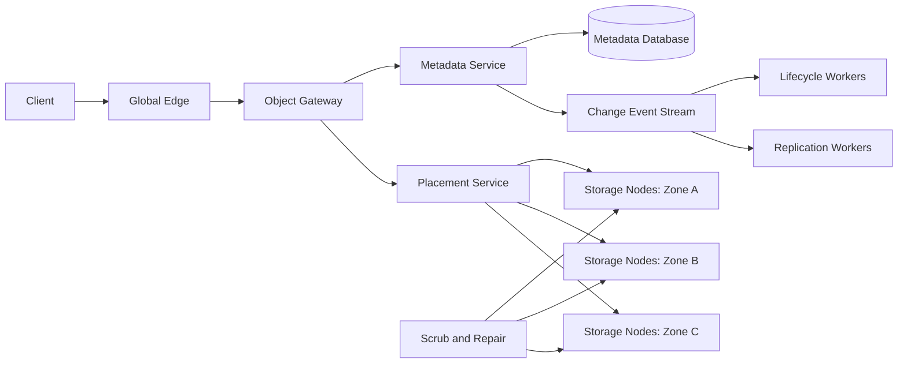

The metadata commit defines object visibility. Data chunks are written first, then an atomic metadata record makes the complete version readable.

## Metadata partitioning

Partition metadata by bucket ID and a hash or range of object key. Buckets with few objects can share partitions; very large buckets span many.

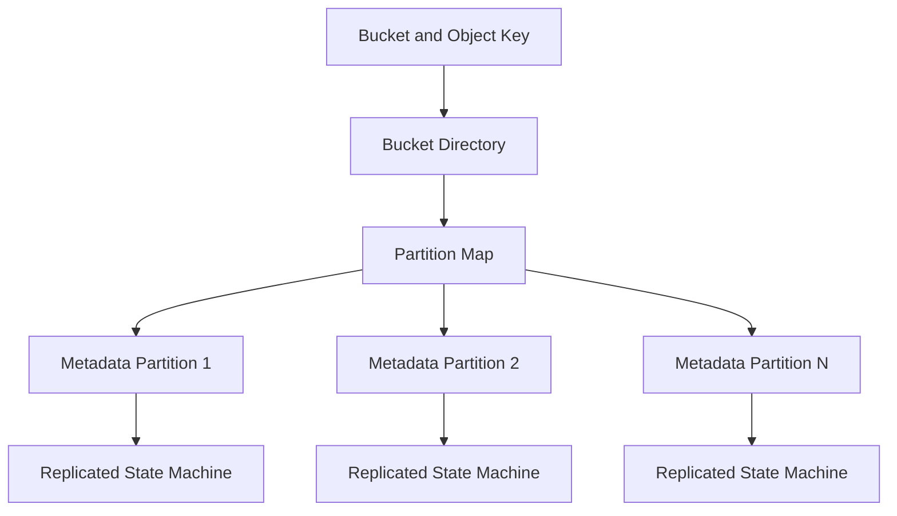

Each partition uses consensus for strongly consistent object-version and listing metadata. The bucket directory maps keys to current partition epochs.

Hash partitioning distributes hot prefixes but makes lexicographic listing expensive. Range partitioning makes listing natural but can create hot sequential prefixes. A hybrid hashes bucket and coarse key prefix, then maintains ordered indexes inside partitions.

Split hot or large metadata partitions online. Route stale requests using epoch-aware redirects.

## Data chunking

Split large objects into fixed or bounded chunks, such as 8–64 megabytes. Each chunk has a content checksum and internal ID.

Chunking enables parallel upload, range reads, repair, and erasure coding without processing an entire terabyte object.

Small objects can be packed into immutable container files to reduce filesystem and disk overhead. The metadata record points to the container and byte range.

Never expose physical chunk locations in public object identity. Placement changes continuously through repair and tiering while the object version remains stable.

## Write path

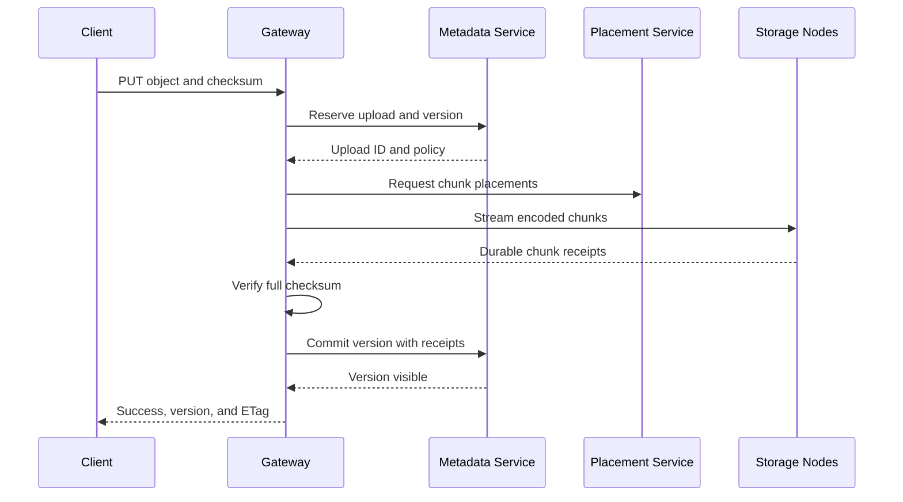

The gateway does not acknowledge success until the configured durability threshold and metadata commit complete.

If upload succeeds but the response is lost, an idempotency key or conditional write returns the committed version instead of creating another unintended version.

Uncommitted chunks are garbage collected after a safety delay.

## Replication and erasure coding

Replication stores complete copies. A three-way replica can tolerate two appropriately separated failures but uses 3× raw capacity.

Erasure coding splits data into `k` data fragments and computes `m` parity fragments. Any `k` of the `k + m` fragments can reconstruct the chunk.

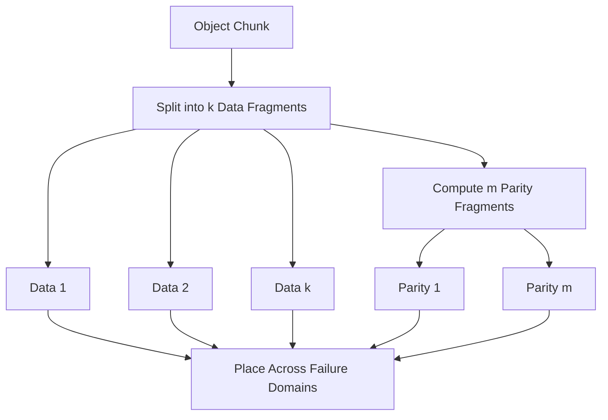

For example, 10 data plus 4 parity fragments uses 1.4× raw capacity and tolerates four fragment losses, subject to placement.

Erasure coding saves cost for large cold objects but increases CPU, network fan-out, and small-read complexity. New and small objects may begin replicated, then transition to erasure coding asynchronously.

## Placement

The placement service chooses nodes using storage class, capacity, health, rack, zone, device type, and tenant policy.

Fragments from one stripe must span independent failure domains. No two fragments that are required for a durability target should share the same host or rack.

Use weighted randomized selection among eligible nodes rather than a globally expensive optimal solver. Background balancing corrects gradual skew.

Placement decisions carry an epoch and are persisted in the object manifest. Storage nodes accept writes only for valid signed assignments, preventing arbitrary clients from consuming disk.

## Read path

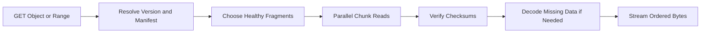

For replicated data, read the nearest healthy copy. For erasure-coded data, fetch the minimum fragments needed, with hedged reads when a fragment is slow.

Range requests identify overlapping chunks and decode only necessary stripes where the code supports partial reconstruction.

Verify checksums at fragment and object boundaries. A corrupt fragment is excluded and scheduled for repair; the request can continue from other fragments.

Gateways apply backpressure so a slow client cannot consume unbounded server memory.

## Multipart upload

Multipart upload lets clients send parts independently and retry only failed parts.

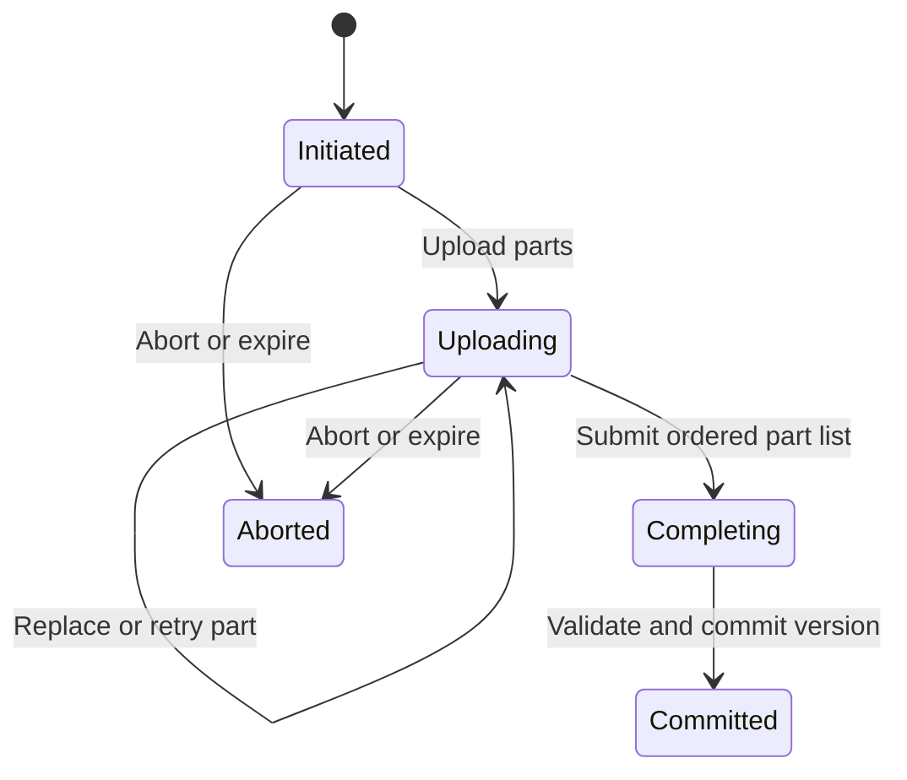

Each part receives a checksum and receipt. Completion supplies the ordered part numbers and expected receipts. The metadata transaction creates one immutable object manifest.

Uploading parts does not make an object visible. Existing versions remain readable until completion commits the new one.

Expire abandoned uploads and reclaim their chunks. Lifecycle policy should expose incomplete-upload age separately from object age.

## Consistency model

After a successful put, get, head, and list reflect the new object version. After delete, reads and listings reflect the delete marker or absence according to versioning policy.

Metadata consensus orders mutations within a partition. Listing across several partitions uses a consistent bucket sequence or a snapshot token that pins partition versions.

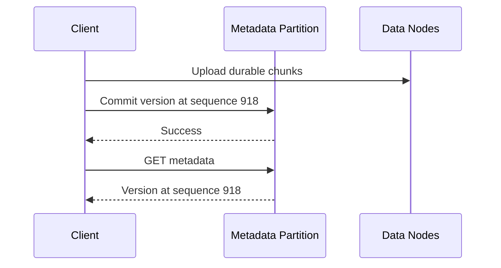

Data bytes are immutable and already durable before metadata visibility, so a committed record never points to a partially uploaded object.

Cross-bucket operations are not atomic unless a separate transaction service explicitly provides it.

## Listing

List accepts prefix, delimiter, limit, and continuation token. Results are lexicographically ordered by object key.

The continuation token encodes bucket, prefix, last returned key, snapshot or partition epochs, and policy version. It is opaque and authenticated.

For a strongly consistent multi-partition listing, establish a metadata snapshot boundary and merge sorted partition iterators.

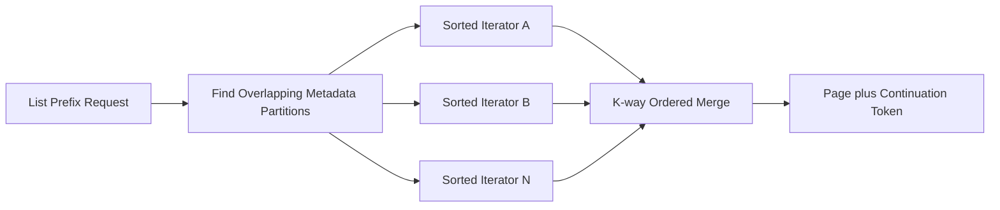

Listing millions of keys is expensive. Enforce page limits and prefer inventory exports for full-bucket analysis.

## Versioning and delete markers

With versioning enabled, each put creates an immutable version. A normal delete writes a delete marker that becomes the current version while older versions remain addressable by version ID.

Without versioning, deletes still use internal tombstones long enough to prevent stale replicas or delayed repair from resurrecting data.

Lifecycle rules can expire noncurrent versions after a configured period. Legal holds and retention locks override expiration.

Restoring an older version creates or promotes a new current version rather than mutating historical bytes.

## Conditional writes and concurrency

Two clients can upload the same key concurrently. Metadata commit order determines the current version.

Use preconditions:

- Create only if no current object exists
- Replace only if current ETag or version matches
- Delete only a specified version

The metadata service validates the precondition and commits in one consensus operation.

ETags are version identifiers or checksums according to an explicit contract. Multipart and encrypted objects may not have an ETag equal to a raw-content hash.

## Encryption

Encrypt every object with a unique data-encryption key. Wrap it under a tenant, bucket, or customer-managed key.

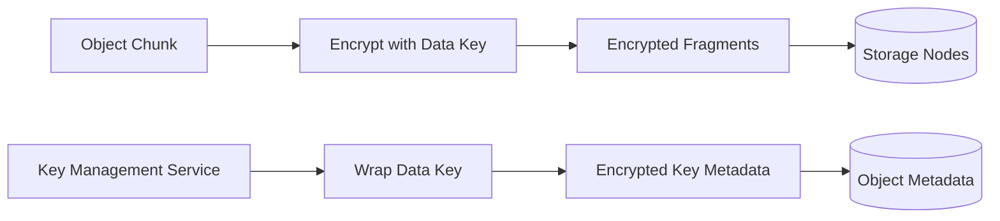

Data nodes store ciphertext and need not access root keys. Gateways or dedicated cryptographic services unwrap keys after authorization.

Rotating a wrapping key can rewrap data keys without rewriting petabytes of object data.

Customer-provided keys require careful availability semantics. If the key is disabled or deleted, data may be permanently unreadable even while fragments remain healthy.

## Checksums and end-to-end integrity

Verify data at multiple boundaries:

- Client-to-gateway transport checksum
- Whole-object checksum supplied or computed by the client
- Per-chunk checksum before encoding
- Per-fragment checksum after encoding
- Stored block checksum during disk reads
- Manifest checksum and signature

Do not rely solely on disk controllers. Silent bit flips, memory faults, software bugs, and misdirected writes can corrupt data.

Return the verified checksum and algorithm to clients. Downloads can request checksum metadata for independent end-to-end validation.

## Scrubbing and repair

Background scrubbers read fragments and verify checksums even when clients never access the object.

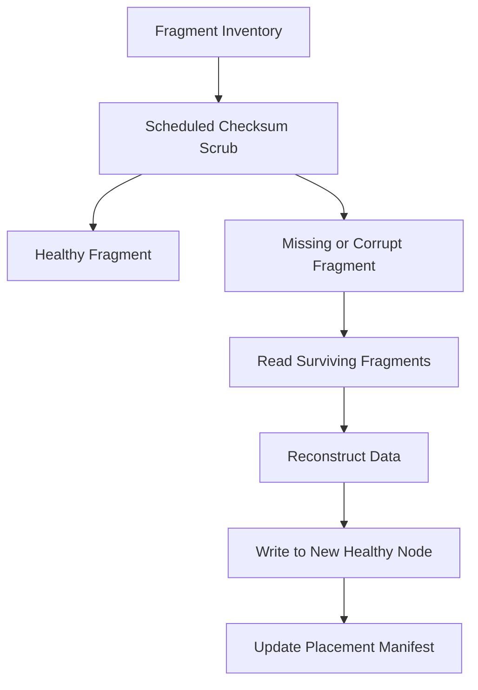

Prioritize repair by remaining redundancy, correlated failure risk, object importance, and age. A stripe one failure from loss repairs before a comfortably redundant one.

Repair bandwidth is capacity planned and reserved. Waiting for a disk failure before finding latent corruption reduces real durability dramatically.

Never repair from an unverified fragment. Validate reconstructed content against the original checksum before publishing the new placement.

## Rebalancing and node lifecycle

When adding capacity, move fragments gradually from full or overloaded nodes. Copy, verify, update the manifest, then remove the old copy.

Draining a node follows the same process but with a deadline. Unexpected loss triggers repair rather than graceful movement.

Balance bytes, request rate, and repair risk—not only disk fullness. A node holding popular small objects may be request-bound while nearly empty.

Limit concurrent movement by rack and zone so rebalancing does not saturate the same network needed for foreground reads.

## Storage tiers and lifecycle

Storage classes trade retrieval latency and availability for cost:

- Hot replicated or erasure-coded SSD/HDD
- Warm capacity-optimized disk
- Cold archive with slower reconstruction
- Deep archive with hours-long retrieval

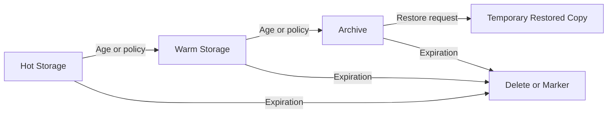

Lifecycle evaluation is based on committed object metadata and version state. Transitions create a new placement manifest only after destination durability is verified.

Archive restore is an asynchronous job with status and temporary expiry. The original archived object remains unchanged.

## Caching and edge delivery

Public or frequently accessed objects can be cached at regional edges. Cache keys include bucket, key, version, range, and response-affecting headers.

Immutable version URLs cache safely for long periods. Mutable key URLs need short TTLs, validation, or explicit invalidation after a new version.

Authorization is evaluated before serving private cached bytes. Signed URLs contain resource, permissions, expiry, and optional network or content constraints.

Edge caching improves availability and latency but is not the durability source. Cache eviction never deletes the underlying object.

## Notifications

After metadata commit, a transactional outbox emits object-created, deleted, restored, or tier-transition events.

Delivery is at least once. Events contain bucket, key, version, operation, sequence, time, and selected metadata—not object contents.

Consumers deduplicate by event ID. Notifications can arrive after a client already reads the committed object, so they are not a synchronization barrier.

Filters by prefix, suffix, tag, or event type are compiled at subscription time. Slow destinations use durable queues and dead-letter handling.

## Multi-tenancy and quotas

Apply quotas to buckets, objects, stored bytes, request rate, ingress, egress, listing, multipart parts, and background operations.

Rate limits are hierarchical across account, bucket, prefix, and IP or workload identity. One hot prefix should not overwhelm a metadata partition or gateway fleet.

Large tenants may receive dedicated metadata partitions, gateway pools, encryption keys, or storage nodes. Physical separation is stronger but reduces utilization.

Usage meters derive from authoritative metadata and request logs, then reconcile against physical inventory. Billing never trusts a single transient counter.

## Retention locks and legal holds

Governance retention prevents deletion before a time unless an authorized override exists. Compliance retention cannot be bypassed through ordinary administrative paths.

The metadata service checks retention in the same transaction as delete or lifecycle transition. Storage garbage collection independently verifies that no protected version references a fragment.

Legal holds are explicit version metadata without a predetermined expiration. Changes require privileged authorization and durable audit events.

Clock integrity matters for time-based retention. Use a trusted service and fail closed when the system cannot prove the retention period elapsed.

## Multi-region replication

Cross-region replication consumes committed object-change events and copies immutable versions plus metadata to destination buckets.

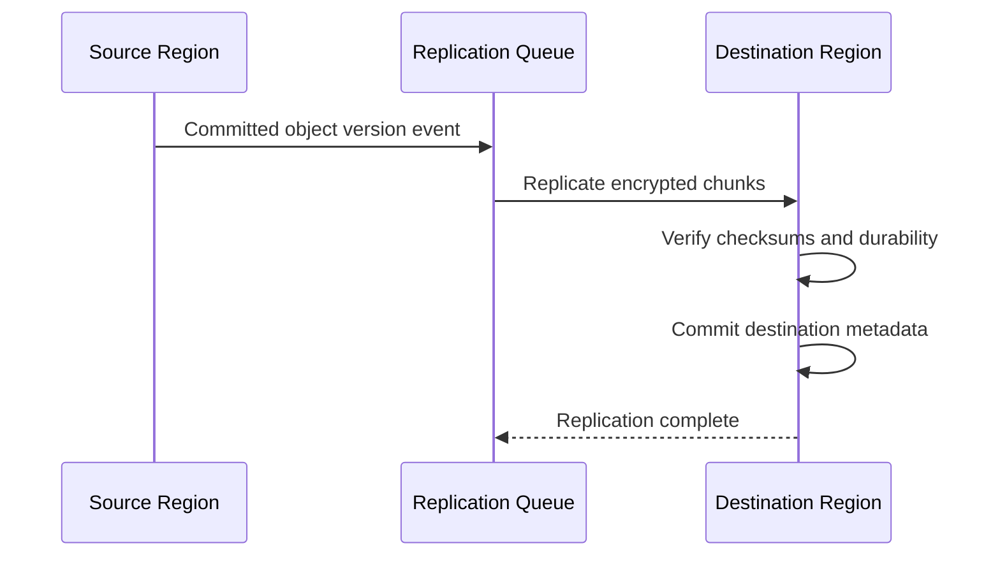

Replication is asynchronous unless the bucket explicitly pays the latency of synchronous multi-region durability.

Preserve source version identity, checksum, and retention policy. Destination encryption may rewrap the data key under a regional key.

Conflicting active-active writes to the same key need deterministic version histories rather than destructive last-write-wins. Applications can read the current policy winner while retaining both immutable versions.

## Disaster recovery

Replicate critical metadata logs and bucket configuration across failure domains. Data fragments alone are insufficient without manifests, encryption references, and version records.

For a regional disaster, route to a replica region only after verifying its metadata and object replication watermark. Expose the recovery point; asynchronous replication may omit the newest versions.

Back up metadata and placement manifests independently. Regular restore drills rebuild a bucket index from committed metadata and sample object checksums.

Avoid reconstructing namespace state by listing physical fragments. At trillion-object scale, that may take too long and cannot reliably infer version semantics.

## Failure handling

### Gateway failure during upload

Committed multipart parts remain available for retry. A single-put upload without a metadata commit leaves chunks for delayed garbage collection.

### Metadata leader failure

Consensus elects a new leader. Writes pause briefly; immutable data remains safe.

### Disk or node failure

Reads use other replicas or reconstruct from fragments. Repair restores redundancy on healthy nodes.

### Zone failure

Placement across zones preserves enough fragments for reads and repair. Rate-limit recovery to protect surviving networks.

### Corrupt fragment

Reject it by checksum, serve from verified alternatives, and enqueue priority repair.

### Object storage partition behind metadata

A version is never committed until enough data receipts exist. If data becomes temporarily unreachable later, return an availability error rather than incomplete bytes.

### Hot key or prefix

Cache immutable versions, replicate reads, split metadata partitions, and apply fair limits. A single current-key write remains serialized by semantics.

### Lifecycle worker failure

Resume from durable tasks. Conditional metadata transitions make repeated work idempotent.

## Observability

Track:

- Put, get, head, list, delete, and multipart latency
- Request errors, throttling, and bandwidth by tenant
- Metadata consensus latency, partition size, and hot keys
- Upload bytes, abandoned parts, and commit failures
- Fragment placement, disk health, and capacity skew
- Checksum failures and latent-corruption rate
- Under-redundant bytes and repair age
- Scrub coverage and time since verification
- Compaction and small-object packing efficiency
- Lifecycle backlog and tier-transition failures
- Cross-region replication lag and failed objects
- Garbage-collection candidates and reclaimed bytes

Synthetic objects in every region continuously test put, conditional overwrite, range read, list, delete, restore, replication, and checksum verification.

Durability risk is measured by bytes and objects at each remaining redundancy level, not merely by the count of failed disks.

## Key tradeoffs

### Replication vs erasure coding

Replication is simple and fast for small or hot objects but expensive. Erasure coding saves substantial capacity while increasing CPU, fan-out, and repair complexity.

### Strong listing consistency vs metadata scale

Strong listings require snapshot coordination across partitions. Eventual listing is cheaper, but applications often depend on seeing newly committed objects. Efficient partition snapshots preserve useful semantics at additional metadata cost.

### Small objects vs storage efficiency

Tiny independent files simplify access but waste disk and metadata. Packing saves space and I/O at the cost of an indirection and rewrite process.

### Synchronous vs asynchronous regional durability

Synchronous replication minimizes recovery-point loss but adds inter-region latency to writes. Asynchronous replication keeps local writes fast while exposing a non-zero recovery point.

### Long version retention vs cost and deletion

Versions protect against mistakes and ransomware but retain bytes and sensitive data. Explicit lifecycle and legal policies must decide the balance.

The central principle is to commit namespace metadata only after immutable data reaches its durability target, then continuously prove that the stored fragments remain recoverable.
