## Problem and requirements

A source control hosting service stores versioned code repositories and supports clone, fetch, push, branching, tags, code review, automation, and access control. Developers keep local history, while the hosted service provides a shared source of truth and collaboration layer.

The underlying version-control model is content-addressed and mostly immutable. The difficult state is small and mutable: branch and tag references. A correct design exploits this asymmetry—store immutable objects cheaply, coordinate reference updates strongly, and build search, review, and automation asynchronously.

### Functional requirements

- Create, fork, archive, transfer, and delete repositories
- Clone and fetch repository history efficiently
- Push objects and atomically update branches or tags
- Enforce branch protection and required checks
- Open, review, update, and merge change requests
- Store large binary assets separately
- Search code, commits, branches, and repositories
- Emit webhooks and automation events
- Generate source archives and raw-file downloads
- Support backups, mirrors, and disaster recovery

### Non-functional requirements

- Host 100 million repositories
- Serve ten million fetches per minute
- Preserve every acknowledged push durably
- Prevent unauthorized or conflicting reference updates
- Keep read traffic available during partial control-plane outages
- Scale large monorepositories and repositories with millions of refs
- Isolate private tenant data and prevent object probing
- Detect corruption through end-to-end hashes

The service preserves repository state. It does not make every build reproducible or every submitted change safe; policy and continuous integration provide those additional controls.

## Capacity estimates

Assume 100 million repositories, ten billion immutable objects, and ten million peak fetches per minute.

| Resource | Estimate |
| --- | ---: |
| Repositories | 100M |
| Immutable objects | Trillions at full scale |
| Peak fetches | 10M/minute |
| Push operations | Hundreds of thousands/second |
| Review and collaboration records | Billions |
| Raw repository storage | Exabytes before deduplication |

Read traffic and archive generation dominate bandwidth. A small set of popular public repositories and very large monorepositories dominate resource use.

## Repository object model

A repository stores four core immutable object types:

- **Blob:** file contents
- **Tree:** directory entries pointing to blobs or subtrees
- **Commit:** root tree, parents, author, time, and message
- **Annotated tag:** a signed or described reference to another object

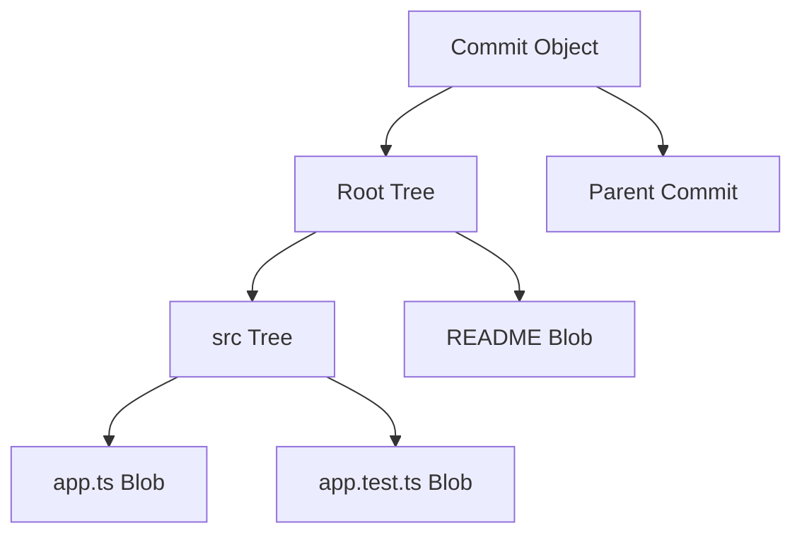

Each object ID is a cryptographic hash of its type and canonical bytes. Changing one file changes its blob, ancestor trees, and new commit while every unchanged object is reused.

Branches and lightweight tags are mutable references mapping names to object IDs.

## Repository identity and storage scope

Public names such as `organization/project` are mutable aliases. Each repository has a stable internal ID that survives renames and transfers.

Forks may share immutable object storage while maintaining separate references and authorization. Shared physical storage never implies shared logical access.

Object keys include a repository or approved deduplication domain. Knowledge of an object hash alone must not reveal a private object.

Archived repositories become read-only but retain their normal object and reference model.

## API surface

The service supports both the native version-control wire protocol and ordinary collaboration APIs.

```http
POST /v1/repos/acme/checkout/git/refs/heads/main
Authorization: Bearer <push-token>
Content-Type: application/json

{
  "oldObjectId": "a184...",
  "newObjectId": "b291...",
  "force": false,
  "pushOptions": { "reviewId": "review_82" }
}
```

The old object ID makes the reference update a compare-and-swap. A concurrent push receives a conflict rather than silently losing commits.

Native push combines object upload, reference commands, signatures, and status reporting in a streamed protocol.

## High-level architecture

Repository storage is separated from collaboration metadata and asynchronous derived systems.

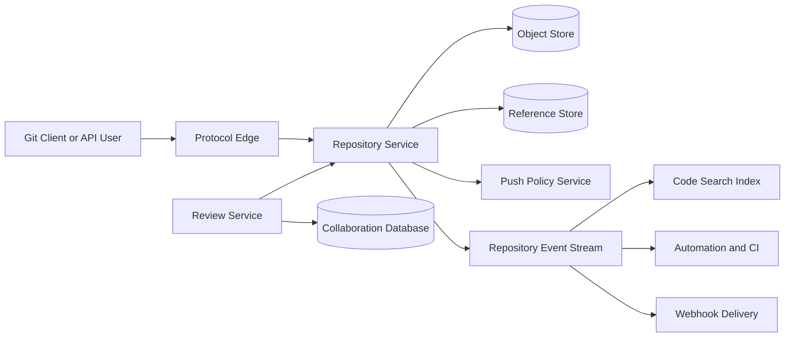

The repository service owns canonical objects and refs. Search and review projections can lag without changing repository correctness.

## Metadata and object partitioning

Partition repositories by stable repository ID. All refs for an ordinary repository share a strongly consistent metadata partition.

Large repositories can split immutable objects by hash while keeping ref transactions coordinated through one repository authority.

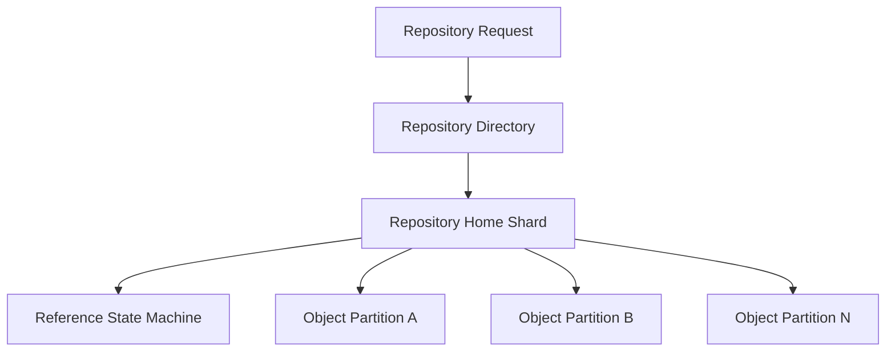

The directory stores home region, shard epoch, storage tier, visibility, and migration state. Clients never rely on physical locations.

Hot public repositories receive read replicas and edge caches without moving write authority.

## Clone and fetch negotiation

A client advertises objects it already has and requests branch or tag tips. The server finds common history and sends only missing reachable objects.

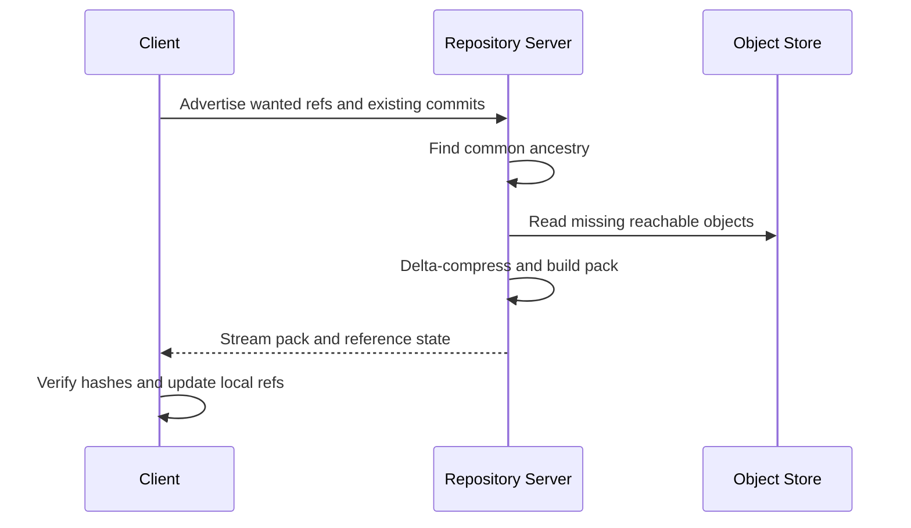

Negotiation must be bounded. A malicious client cannot force unlimited graph traversal or advertise millions of fake object IDs.

Cache generated packs for popular ref snapshots. Cache keys include repository, advertised baseline class, filter, protocol version, and ref object IDs.

## Packfiles and delta compression

Sending each object independently creates excessive overhead. Packfiles concatenate objects and encode similar objects as deltas from base objects.

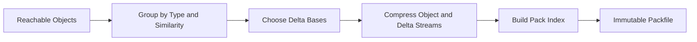

Delta chains are bounded so reconstruction does not require hundreds of dependent reads. Frequently accessed bases stay easy to locate.

Background repacking optimizes many loose objects into immutable packs. Publish the new pack index atomically, then retire redundant packs after readers release them.

Verify every reconstructed object against its hash.

## Partial and shallow clones

Large repositories may not fit on developer machines. A shallow clone requests only recent commit depth. A partial clone omits large blobs or subtrees until accessed.

The server marks missing objects as promised and supports later authenticated retrieval. It must not treat an intentionally omitted object as repository corruption.

Sparse checkout filters which working-tree paths the client materializes, while the repository may still contain complete commit and tree metadata.

Cache filtered packs separately. A response generated for one authorization scope cannot be reused for another if path policy differs.

## Push flow

Push is a staged transaction: upload objects, validate commands, then update refs atomically.

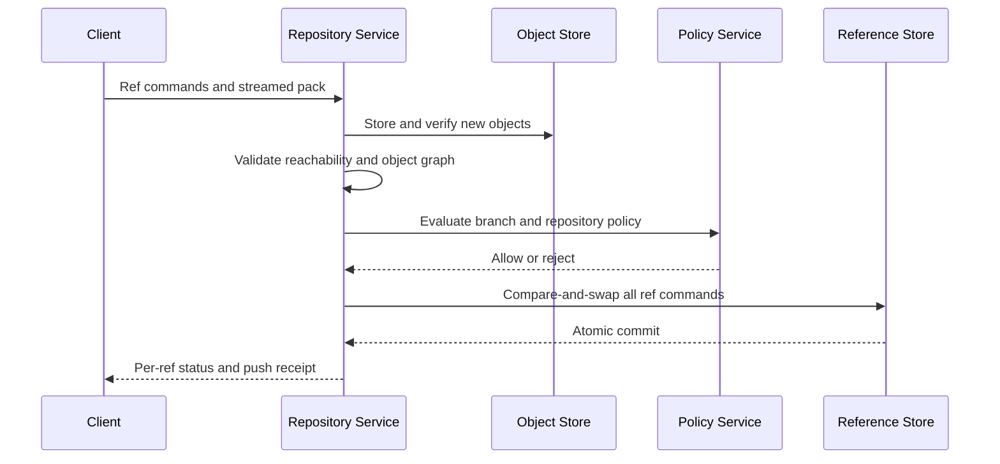

Uploaded objects are not visible through refs until the reference transaction commits. Failed-push objects become garbage-collection candidates after a grace period.

Multiple ref commands in one push either commit together or fail together when atomic mode is requested.

## Reference store

References are small, highly contended, and correctness critical. Store them in a replicated state machine per repository shard.

Each update contains ref name, expected old object ID, new object ID, actor, policy result, request ID, and repository epoch.

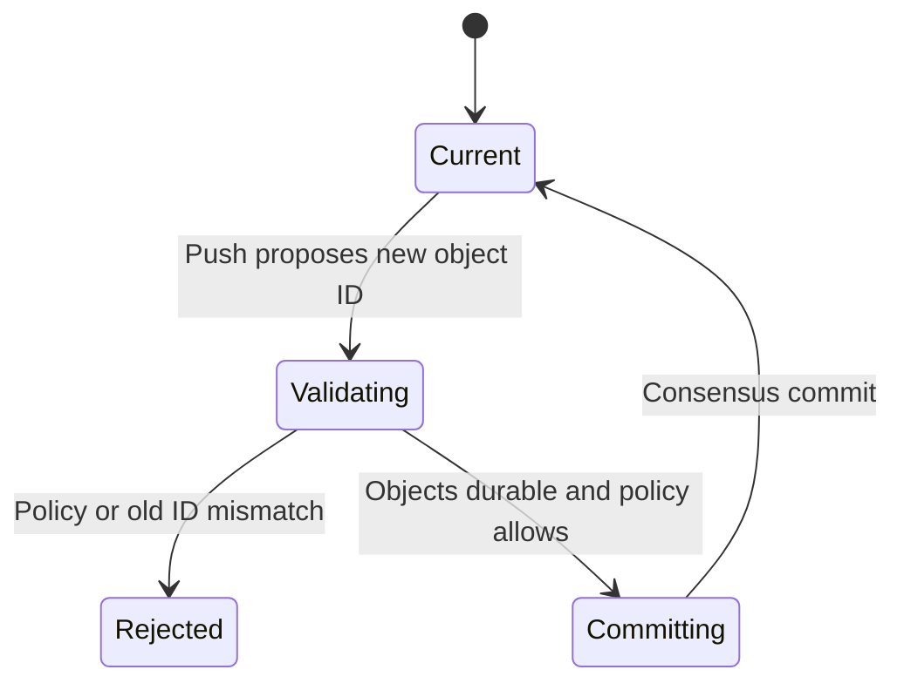

Reference history is append-only for audit and recovery, even when only the current value is exposed normally.

Symbolic references resolve through bounded chains. Reject cycles and unsafe names.

## Push validation

Before updating a ref, validate:

- Every required object exists and hashes correctly
- Commit, tree, and tag objects parse within limits
- The new tip is reachable from uploaded or existing authorized objects
- Fast-forward constraints hold unless force push is allowed
- Author and committer metadata follow policy
- Required signatures are valid
- Branch protection and review requirements are satisfied
- File size, path, secret, and malware policy passes

Run expensive optional scanning asynchronously only when policy permits publication before completion. Required checks block the ref transaction.

Never execute repository hooks directly inside the ref authority. Invoke isolated policy services with bounded deadlines.

## Branch protection

Protected branches can require:

- Changes through reviewed requests
- A minimum number or type of approvals
- Successful named status checks
- Up-to-date merge base
- Signed commits or tags
- Linear history
- Restricted force push and deletion
- Designated code-owner approval

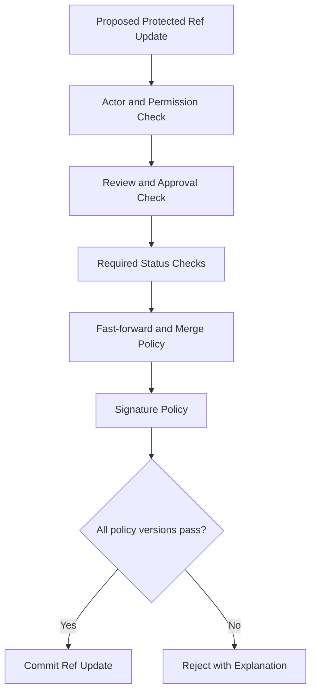

The evaluation pins a policy version and proposed commit. A later policy or tip change requires reevaluation.

Administrative bypasses are narrow, time-bound, reasoned, and prominently audited.

## Change requests and code review

A change request links a source ref, target ref, merge base, discussion, approvals, and checks.

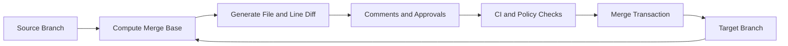

Review metadata lives outside the repository object graph, but comments anchor to immutable commit, file path, and line context so later pushes do not silently move them.

Recompute mergeability when source or target changes. Cache diffs by object IDs because commits are immutable.

Large diffs use incremental parsing, file limits, and asynchronous rendering.

## Merge strategies

Supported strategies include merge commit, squash, and rebase.

- A merge commit preserves both histories
- Squash creates one new commit with the final tree
- Rebase copies source commits onto the latest target

The merge service builds the candidate result in an isolated worker, checks conflicts and policy, writes new objects, then compare-and-swaps the target ref.

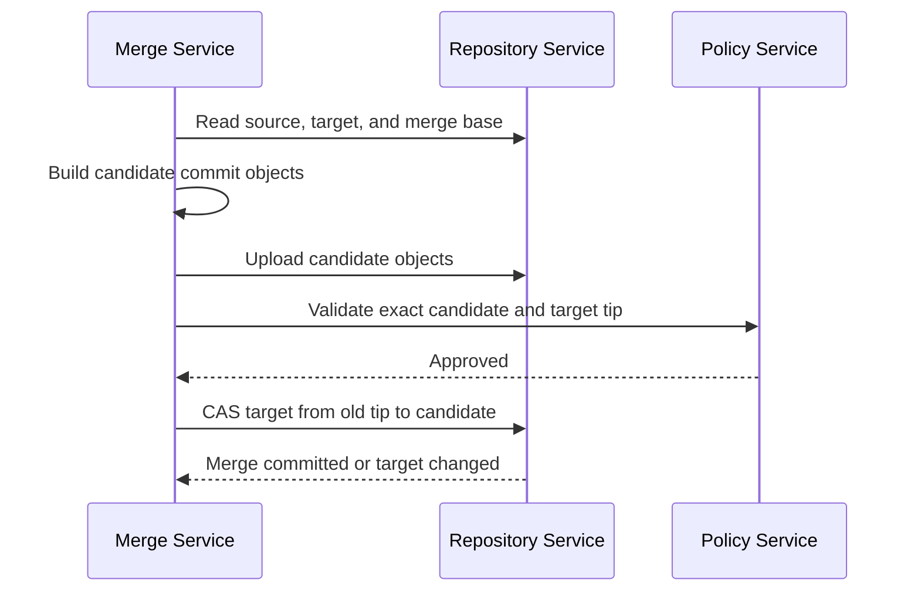

If the target moved, rebuild or require the author to update. Never merge a candidate validated against a different target tip.

## Forks and object sharing

A fork begins with refs pointing to objects reachable from the source repository. Physical objects may be shared in a fork network or deduplication domain.

Authorization checks occur before graph traversal or object retrieval. A private source becoming public or a fork changing visibility requires reevaluating object reachability and sharing policy.

Detaching a fork may copy metadata ownership while retaining safe physical deduplication.

Deleting the source repository cannot delete objects still referenced by a retained fork.

## Large-file storage

Large binaries are represented in the repository by small pointer blobs. The actual content lives in a content-addressed large-file store.

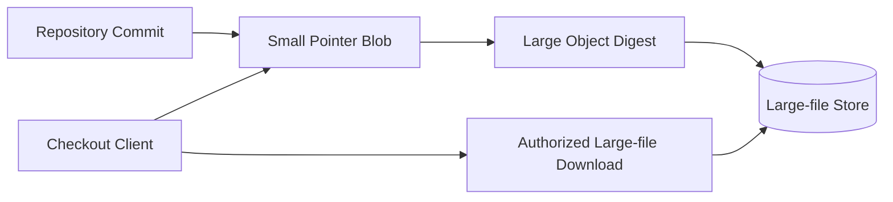

Upload large content before pushing the pointer ref, or make push validation confirm that every new pointer has a durable object.

Large-file authorization follows repository and commit reachability. Digest knowledge alone does not grant download access.

Apply storage and bandwidth quotas independently from ordinary repository objects.

## Archives and raw files

Archive generation walks a pinned commit tree and streams a deterministic archive without creating a full working checkout.

Cache archives by repository, commit object ID, subpath, format, and inclusion policy. Branch names are resolved to immutable commits before cache lookup.

Raw-file endpoints read the blob directly with content type, checksum, range support, and safe content-disposition headers.

Do not serve active web content from user-controlled files on the primary application origin. Use a separate untrusted-content domain and restrictive headers.

## Search indexing

Repository events schedule indexing of new reachable commits and removal of inaccessible refs.

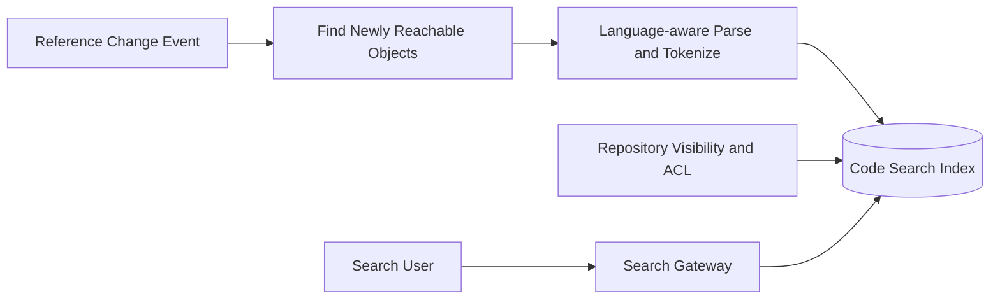

Index by repository, commit, path, language, symbol, and content terms. Search authorization filters results using current repository access, not stale index visibility alone.

Search is eventually consistent and never authoritative for object retrieval.

Large generated and binary files follow exclusion policy to control index size.

## Webhooks and automation

After a ref transaction commits, a transactional outbox emits push, tag, review, merge, and repository events.

Webhook delivery is at least once. Sign payloads, include an event ID and timestamp, retry with backoff, and provide delivery logs.

Continuous integration consumes the exact repository ID and commit object ID. It should never build a mutable branch name without recording the resolved commit.

Slow webhooks and automation do not block push acknowledgement. Branch policy checks required before a push are separate synchronous decisions.

## Authentication and authorization

Support short-lived browser sessions, scoped personal tokens, workload identity for automation, and SSH or certificate-based protocol authentication.

Permissions include repository read, triage, write, maintain, administer, and narrower actions such as force push, manage secrets, or bypass policy.

Resolve organization, team, repository, branch, and path policy through a versioned authorization service. Cache decisions briefly with membership and policy versions.

Clone and fetch reveal object graphs, names, authors, and messages. Treat read access as sensitive, not merely the ability to download final files.

## Commit and tag signatures

Cryptographic signatures bind a commit or tag object's canonical contents to a signing identity.

Verification resolves the key or identity certificate as of signing policy. Display verified, unknown, expired, and revoked states precisely rather than one vague badge.

Identity-based short-lived signing credentials can connect commits to authenticated developer or automation identities without permanent local signing keys.

Branch policy can require verified signatures from approved identity classes. A valid signature does not prove the code was reviewed or safe.

## Secret scanning and abuse controls

Scan newly introduced reachable blobs for credential patterns, malware, prohibited content, and policy violations.

Use incremental scans keyed by blob hash so identical content is analyzed once per policy version.

Push protection can block likely active secrets before ref commit. Results must avoid printing full secret values into logs or review comments.

Rate-limit repository creation, forks, pushes, archive generation, and graph traversal. Bound object counts, depth, path length, decompression, and delta chains to protect parsers.

Public repositories need spam, malware, and resource-abuse controls without weakening private tenant isolation.

## Object reachability and garbage collection

An object remains live if reachable from a ref, retained reflog, open review, fork, legal hold, or active push lease.

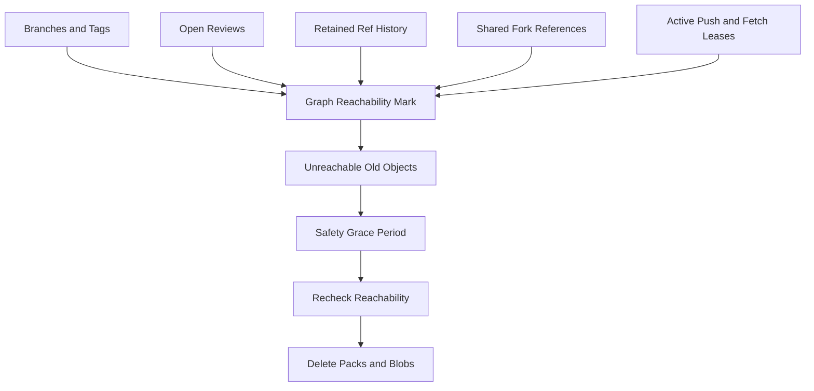

Newly uploaded objects receive a grace period because a ref commit may still be in progress. Distributed mark state uses snapshot epochs so concurrent pushes cannot lose objects.

Repacking may remove duplicate loose copies while retaining an object in another verified pack.

## Repository migration

Move a repository between shards or regions without accepting conflicting writes.

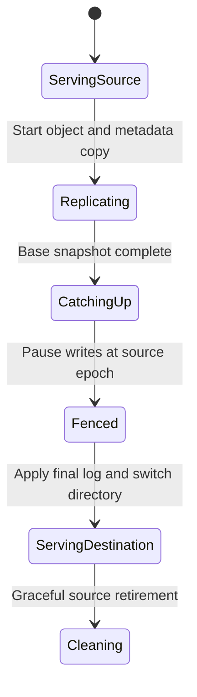

Reads may continue from source during most of migration. At cutover, fence the old writer, copy final ref log entries, atomically update the repository directory, and issue a new epoch.

Stale pushes receive a redirect and must retry against the new authority with the same request ID.

## Multi-region design

Assign every repository a write home. Replicate immutable objects and ordered ref logs to read regions.

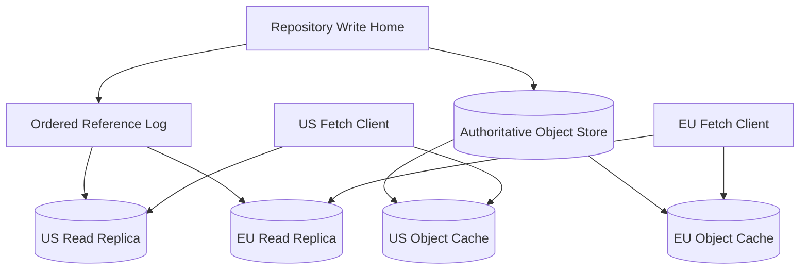

Fetches route to a region with a sufficiently current ref snapshot and all referenced objects available or fetchable.

Pushes route to the write home to serialize refs. Globally distributed teams pay write latency, but clone and fetch remain local.

During failover, fence the former home and promote a replica at a known ref-log position. Asynchronous replication exposes a clear recovery-point objective.

## Backup and disaster recovery

Back up reference logs, repository directory, authorization metadata, collaboration records, hook configuration, and object manifests.

Immutable objects may be recoverable from regional replicas, but without refs and repository identity they form an unorganized object pool.

Point-in-time restore replays ref history to a chosen sequence and reconstructs repository visibility. Restoring into a new repository first avoids overwriting current state.

Regular drills verify clone, object hashes, branch tips, reviews, large files, and signatures after restore.

## Failure handling

### Protocol edge failure

Clients reconnect to another stateless edge and resume supported uploads or fetches.

### Object upload succeeds but ref commit fails

Objects remain unreachable and are eventually collected. The client resolves the conflict and pushes again without reuploading existing digests.

### Ref leader fails

Consensus elects a new leader. Ref updates pause briefly; fetches use the latest committed state.

### Object replica missing

Fetch from another verified replica, repair the local copy, and continue. Never omit an object from a successful pack silently.

### Policy service unavailable

Protected writes fail closed or use a short-lived, explicitly safe cached policy. Ordinary reads continue.

### Search or review service unavailable

Canonical clone, fetch, and push continue. Derived collaboration features degrade independently.

### Hot public release

Serve cached packfiles and archives from edge delivery, coalesce origin generation, and isolate traffic from push and ref services.

### Corrupt packfile

Checksum validation rejects it. Reconstruct from other packs or replicas and repack; quarantine the affected storage device.

## Observability

Track:

- Clone, fetch, push, archive, and raw-file latency
- Bytes uploaded, downloaded, deduplicated, and edge-cached
- Pack generation time, reuse, delta depth, and corruption
- Ref update conflicts, policy rejections, and consensus latency
- Object-store availability and missing-object repairs
- Repository size, ref count, and graph-traversal cost
- Review mergeability and required-check latency
- Search indexing lag and authorization-filter failures
- Webhook backlog and delivery success
- Secret-scan and abuse-protection events
- Regional ref and object replication lag
- Garbage-collection candidates and reclaimed bytes

Synthetic repositories continuously test clone, shallow fetch, partial clone, push, protected branch rejection, merge, large-file download, and regional failover.

Provide push diagnostics that separate authentication, object validation, branch policy, conflict, and storage failures.

## Key tradeoffs

### Immutable objects vs mutable references

Content addressing makes storage, replication, and caching safe. Strong coordination is concentrated on small ref updates rather than every byte.

### Fresh pack generation vs cached packs

Generating an optimal delta pack saves bandwidth but costs CPU and latency. Cached packs and precomputed bitmaps make common fetches fast while on-demand generation handles the long tail.

### Global writes vs one repository home

Active-active ref updates would require conflict resolution for branch history. One write authority per repository preserves simple compare-and-swap semantics, while global replicas serve reads.

### Deep policy vs push latency

Synchronous scanning and checks prevent bad refs but lengthen pushes. Fast mandatory invariants run inline; slower advisory analysis runs from committed events unless policy requires blocking.

### Aggressive garbage collection vs recovery

Quick deletion saves storage but removes recovery from accidental force pushes and abandoned upload races. Reflogs, leases, and grace periods buy safety.

The central principle is to make source objects immutable and verifiable, then serialize only the small reference changes that define which history is visible.
