## Problem and requirements

A distributed SQL database preserves the relational model and transactional guarantees of a traditional database while spreading data and computation across many machines. Applications use tables, indexes, joins, and transactions without manually sharding by customer or region.

The central challenge is combining horizontal scale with strong consistency. Data placement changes, nodes fail, transactions touch several shards, clocks differ, and queries must plan across a constantly changing cluster.

### Functional requirements

- Create tables, constraints, and secondary indexes
- Execute SQL queries and mutations
- Support atomic multi-row and multi-table transactions
- Provide snapshot and serializable isolation
- Scale storage and query execution horizontally
- Add, remove, split, merge, and rebalance shards online
- Replicate data across zones and regions
- Back up, restore, and read historical snapshots
- Expose schema, query, transaction, and replication diagnostics

### Non-functional requirements

- Store ten petabytes and process ten million transactions per second
- Survive node and zone failures without committed data loss
- Keep single-region point operations within tens of milliseconds
- Preserve transactional correctness under retries and failover
- Avoid manual resharding for ordinary growth
- Isolate tenants and expensive queries
- Support rolling upgrades without downtime
- Make consistency and regional latency explicit

The database can hide physical sharding, but it cannot remove network latency or the cost of global coordination. Schema and access patterns still matter.

## Capacity estimates

Assume ten petabytes of logical data, three replicas, one trillion rows, and ten million peak transactions per second.

| Resource | Estimate |
| --- | ---: |
| Logical data | 10 PB |
| Replicated storage | 30+ PB |
| Rows | 1T |
| Peak transactions | 10M/second |
| Active key ranges | Millions |
| SQL connections | Millions through pools and gateways |

Point reads and writes dominate transactional volume, while a smaller number of joins, scans, schema changes, and backfills dominate resource variance.

## Relational model over ordered keys

Encode relational rows into an ordered key-value space.

```text
/table/<table-id>/primary/<encoded-primary-key> → encoded-row
/table/<table-id>/index/<index-id>/<index-key>/<primary-key> → stored-columns
```

Stable numeric table, column, and index IDs prevent renames from changing physical identity.

Primary-key order determines row locality. A monotonically increasing key can concentrate writes on the last range; a random key spreads load but weakens locality. The schema should support hash-sharded or composite keys where necessary.

Large values may be split into chunks or placed in an external blob store when transactional inline access is unnecessary.

## High-level architecture

SQL gateways are stateless. Storage nodes own replicated key ranges and participate in transactions.

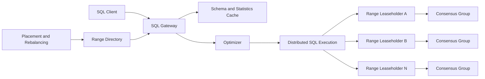

The database partitions the ordered keyspace into contiguous ranges. Each range is replicated by its own consensus group.

Gateways cache range locations and refresh on routing errors. Application traffic can use any healthy gateway.

## Range partitioning

A range covers a half-open key interval and has a target size, such as hundreds of megabytes.

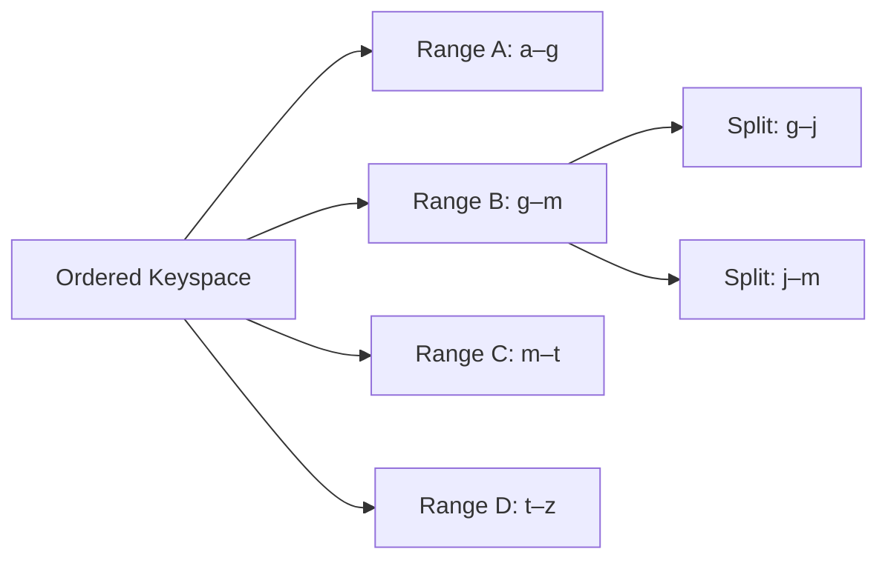

Split ranges when size, write rate, or query load exceeds policy. Merge adjacent cold ranges to reduce metadata and consensus overhead.

Choose split keys near balanced boundaries while avoiding cuts through indivisible logical values. Load-based splitting handles hot ranges before they become large.

The range directory maps key intervals to replica sets and current routing epochs. Stale clients receive a structured redirect and update their cache.

## Replication and consensus

Every range uses a replicated state machine. One leader orders commands; a majority commits each log entry.

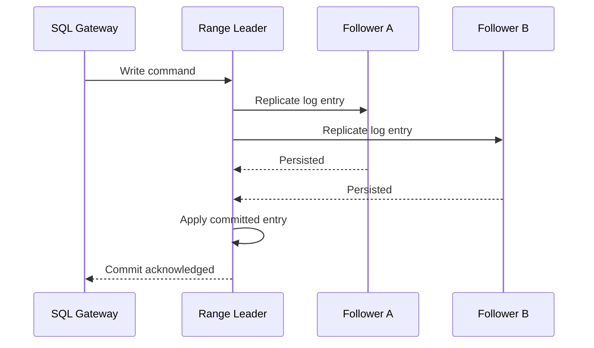

A write is acknowledged after durable majority replication. A follower can be temporarily unavailable without stopping the range.

Leadership and replica membership changes are themselves consensus operations. Joint configuration prevents two disjoint groups from both believing they own the range.

Use checksums, snapshots, and log replay to bring lagging replicas current. Corruption is detected before a bad replica serves data.

## Leaseholders and reads

A range leaseholder coordinates linearizable reads and writes. The consensus leader and leaseholder are usually co-located to avoid an extra network hop.

Strong reads route to the leaseholder or prove that a follower is safe at the requested timestamp. Stale reads can use followers at a bounded historical timestamp.

Lease transfer moves traffic without changing replica membership. This is useful for balancing load and placing computation near users.

Leases have epochs or time bounds backed by conservative clock rules. Two nodes must never serve conflicting current reads for one range.

## MVCC

Multi-version concurrency control stores several committed versions of a key, ordered by timestamp.

```text
key A @ timestamp 120 → value v3
key A @ timestamp 105 → value v2
key A @ timestamp 81  → value v1
```

Readers choose the newest version at or before their snapshot timestamp. They do not block ordinary committed writers.

```mermaid
timeline
  title MVCC snapshot visibility
  10:00 : A = v1 committed
  10:05 : Transaction T begins at snapshot S
  10:07 : A = v2 committed
  10:08 : T reads A and sees v1
  10:10 : New transaction sees v2
```

Uncommitted writes use intents associated with a transaction record. Conflicting readers or writers resolve the intent by waiting, pushing, or checking transaction status.

Garbage collection removes versions older than the protected history window once no active transaction, backup, or changefeed needs them.

## Timestamps and uncertainty

Transactions need a consistent ordering. Use hybrid logical timestamps combining physical time with a logical counter.

Physical clocks have bounded uncertainty. A transaction may need a short commit wait before acknowledging so no later transaction can appear to have committed earlier.

Within one region, a logical timestamp oracle or leaseholder-assigned times can reduce uncertainty cost. Across regions, clock-bound assumptions must be monitored continuously.

If clock skew exceeds the safe bound, affected nodes stop serving lease-sensitive operations rather than risking inconsistent reads.

## Transaction lifecycle

A transaction receives an ID, provisional timestamp, priority, and coordinator. Reads occur at a consistent timestamp; writes create intents.

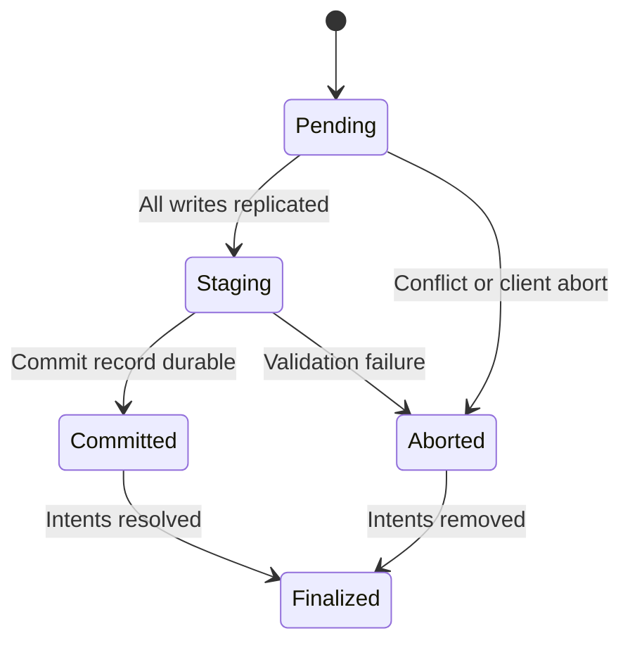

For a single range, commit through one consensus command. Multi-range transactions coordinate writes across participant ranges and persist authoritative status.

Clients retry transactions after serialization conflicts using the same logical operation identifiers where external effects are involved.

## Distributed commit

Classic two-phase commit prepares participants, then records a commit decision.

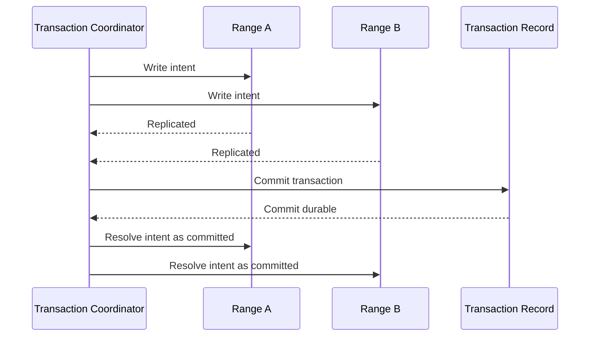

The commit decision must remain discoverable if the coordinator crashes. Participants consult the durable transaction record.

Intent cleanup can occur asynchronously after commit is known. Readers encountering a committed intent may resolve it on behalf of the original transaction.

Parallel commit optimizations can acknowledge once all intents prove they belong to a transaction that is durably staged for commit, reducing an extra round trip without weakening atomicity.

## Serializable isolation

Serializable execution behaves like some serial ordering of committed transactions.

Track read spans and write intents. At commit, validate that no conflicting write invalidated the transaction's snapshot.

Use timestamp ordering, optimistic validation, or lock tables to detect conflicts. Read-only snapshots can often avoid locks.

Write skew must be prevented even when transactions update different rows after reading the same predicate. Predicate or span conflict tracking covers these cases.

Aborted transactions are normal under contention. Expose retryable error codes and provide client helpers that rerun transaction closures safely.

## Deadlocks and contention

Pessimistic waits can form cycles. Maintain a distributed wait-for graph or use transaction priorities and wound-wait rules to break deadlocks.

Older or higher-priority transactions may push younger conflicting transactions to a later timestamp or abort them.

Hot rows, such as one global counter, serialize throughput regardless of cluster size. Use sharded counters, append-only events, or application-level partitioning rather than relying on the database to remove inherent contention.

Contention diagnostics should identify keys, indexes, queries, and wait relationships without exposing sensitive values.

## SQL gateway

The gateway parses SQL, resolves names and types, rewrites views, applies authorization, and builds a logical plan.

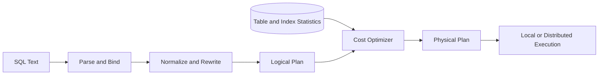

Prepared statements separate parsing from execution while still replanning when schema or statistics changes invalidate assumptions.

Gateways are stateless except for sessions and transaction coordinators. Session state can be pinned or externalized to support failover.

## Cost-based optimization

The optimizer estimates row counts, selectivity, network transfer, memory, and CPU for alternative plans.

Statistics include row counts, distinct counts, null fractions, histograms, and correlations for selected column groups.

Choose among index scans, full scans, lookup joins, hash joins, merge joins, and distributed aggregations.

Bad estimates can produce plans that are orders of magnitude slower. Collect statistics asynchronously, detect stale tables, and support bounded runtime adaptation when observed cardinality diverges sharply.

Optimizer versions and plan fingerprints aid regression diagnosis and safe rollout.

## Distributed query execution

The physical plan becomes a graph of processors placed near data.

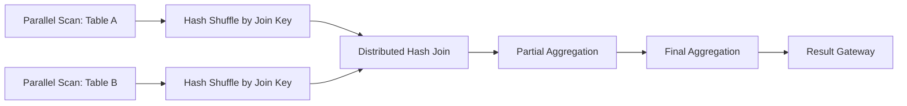

Push filters, projections, and partial aggregates into storage nodes. Move the smaller join input when possible.

Exchange operators stream batches with backpressure. Spill joins, sorts, and aggregations to temporary encrypted storage when memory limits are reached.

Cancel processors promptly when the client disconnects or a sibling stage fails.

## Secondary indexes

A secondary index maps indexed values to primary keys and optional stored columns.

Index entries are transactional rows. A table mutation updates the primary row and every affected index in the same transaction.

Covering indexes include columns needed by a query and avoid a second primary lookup. They improve reads but increase write amplification and storage.

Unique indexes enforce uniqueness through the index keyspace. Null semantics and collation must match SQL rules consistently across nodes.

Index partitioning follows encoded index keys, which may have different hot spots than the primary table.

## Online index creation

Building an index over a large live table requires a consistent backfill plus ongoing write capture.

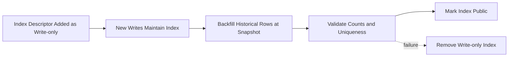

The schema descriptor makes new transactions write index entries before queries may read it. A backfill fills older rows at a protected snapshot.

Validation checks that every relevant primary row has the correct index entry and uniqueness holds. Publishing the index is an atomic schema-version change.

Rate-limit backfills and checkpoint ranges so they can resume without restarting.

## Schema changes

Schema changes run as versioned jobs rather than blocking table locks.

Adding a nullable column can be metadata-only. Adding a non-null constraint, changing stored representation, or dropping a column may require backfill and validation.

Gateways lease schema versions for short periods. The system waits until old leases expire before making an incompatible descriptor state visible.

Rollback logic is defined for every intermediate state. A failed migration must not leave some writers using a new encoding while readers assume the old one.

Large schema jobs expose progress, throttling, pause, and resume.

## Placement and replication policy

Placement rules specify replica count, zones, regions, voter roles, and lease preferences.

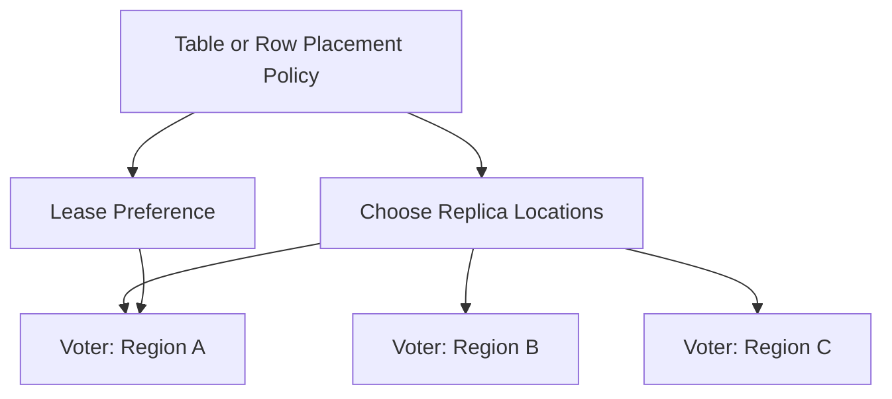

System ranges and critical metadata receive stronger placement than ordinary data.

Constraints prevent two replicas from sharing a host, rack, or zone. The allocator continually repairs under-replication and improves balance.

Row-level locality may derive placement from a region column, splitting tables into regional key prefixes.

## Rebalancing

The allocator observes bytes, queries, writes, CPU, disk, replica count, and locality.

To move a replica:

1. Add a learner replica at the destination
2. Stream a snapshot and catch up the consensus log
3. Promote it to voter when current
4. Transfer lease if desired
5. Remove the old replica


Throttle movement to protect foreground latency. A failed node triggers urgent repair; ordinary balance changes proceed conservatively.

## Hot ranges

A hot range may be limited by one leader even when storage is balanced.

Mitigations include:

- Split by key or load boundary
- Transfer the lease to a less busy node
- Add follower-read replicas
- Hash-shard a sequential index
- Redesign a globally contended key
- Cache read-only data outside the database

Automatic splitting cannot divide a single hot row. Surface hot keys and transaction shapes to application owners.

## Multi-region transactions

Replica placement determines latency. A consensus group with voters across three distant regions requires a wide-area round trip per write.

Offer locality modes:

- Global tables replicated broadly for low-latency reads
- Regional tables whose leaders remain in one region
- Regional-by-row tables placing each row near its owning region

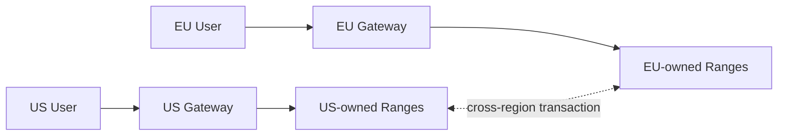

Transactions confined to one region remain fast. Cross-region transactions pay coordination latency and should be intentional.

Follower reads at a safe historical timestamp provide low-latency regional reads without moving leadership.

## Changefeeds

Expose committed row changes ordered by range or key with schema versions and MVCC timestamps.

Resolved timestamp markers indicate that no earlier changes will arrive for a partition. Consumers combine them to measure completeness.

Changefeed checkpoints protect required MVCC history. Slow consumers cannot retain versions forever; apply retention limits and spill changes to a durable stream.

Delivery is at least once. Stable row identity and commit timestamp allow idempotent downstream application.

## Backup and restore

Backups read a consistent cluster timestamp and export range files plus descriptors and encryption metadata.

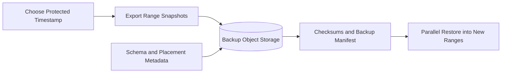

Incremental backups export versions changed since the prior protected timestamp. A backup chain remains valid only while every dependency is retained.

Restore into new table IDs or an isolated cluster, validate checksums and constraints, then switch application traffic.

Point-in-time recovery replays logs or incrementals through the requested timestamp.

## Security and multi-tenancy

Controls include:

- Mutual authentication between nodes and clients
- SQL roles, row policy, and column privileges
- Encryption in transit and at rest
- Tenant-scoped encryption keys where required
- Audited schema, privilege, backup, and administrative actions
- Resource groups for CPU, memory, I/O, connections, and admission
- Redacted query and contention diagnostics

Tenant SQL runs through constrained gateways and cannot address physical ranges directly.

Admission control reserves capacity for critical transactions and system repair. One analytical query must not starve consensus heartbeats or transaction cleanup.

Backups inherit table authorization and encryption policy; exporting data is a privileged audited operation.

## Failure handling

### Storage node failure

Consensus elects new range leaders where majorities survive. The allocator creates replacement replicas.

### Zone failure

Ranges with voters across zones remain available. Recovery is rate-limited to avoid saturating healthy zones.

### Gateway failure

Clients reconnect to another stateless gateway. Transaction retry behavior depends on whether commit outcome was acknowledged or ambiguous.

### Ambiguous commit response

The client checks transaction status using its stable transaction ID. It must not blindly repeat external side effects.

### Long transaction

Enforce duration and intent limits. Long snapshots retain MVCC garbage and increase conflict risk; use explicit historical reads for analytics.

### Disk full

Stop placing new replicas, rebalance early, reserve emergency space for consensus and cleanup, and reject nonessential writes before total exhaustion.

### Network partition

Only partitions with consensus majorities accept writes. Minority replicas remain read-only or unavailable and catch up after healing.

### Corrupt replica

Quarantine it, restore from a verified snapshot, and compare checksums. Never vote using unverified state.

## Observability

Track:

- SQL latency, throughput, errors, retries, and plan fingerprints
- Transaction conflicts, aborts, intent age, and deadlocks
- Range count, size, splits, merges, and hot ranges
- Consensus commit latency, leader changes, and follower lag
- Leaseholder distribution and follower-read staleness
- Node CPU, memory, disk, I/O, and admission queues
- Distributed query network, spill, and skew
- Schema job and index backfill progress
- Replica under-replication and rebalancing backlog
- MVCC garbage, protected timestamps, and backup health
- Clock offset and uncertainty violations

Synthetic transactions continuously verify reads, writes, uniqueness, multi-range atomicity, failover, and historical snapshots.

Per-query diagnostics show planning time, scanned rows, network bytes, contention, and spills without exposing literal sensitive values.

## Key tradeoffs

### Strong consistency vs latency

Consensus and serializable transactions preserve simple semantics but require coordination. Data locality and single-range transactions matter more than clever protocol tuning.

### Range sharding vs hash sharding

Ordered ranges support scans and locality but can create hot sequential keys. Hashing balances writes while weakening range access. Schema design can combine both.

### Optimistic vs pessimistic concurrency

Optimistic execution performs well with low contention but retries conflicting work. Pessimistic locking reduces wasted work under contention but risks waits and deadlocks.

### Global replicas vs regional ownership

Global voting replicas improve disaster tolerance but raise write latency. Regional-by-row placement keeps most transactions local while accepting expensive cross-region operations.

### Transparent distribution vs operational predictability

Automatic sharding removes manual placement work, but cross-range joins and transactions still cost more. Explain plans, locality controls, and hot-key diagnostics keep abstraction from becoming surprise.

The central principle is to make each key range a small strongly replicated database, then coordinate ranges only when relational semantics require it.
