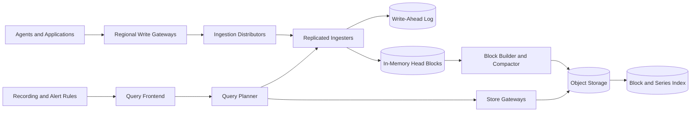
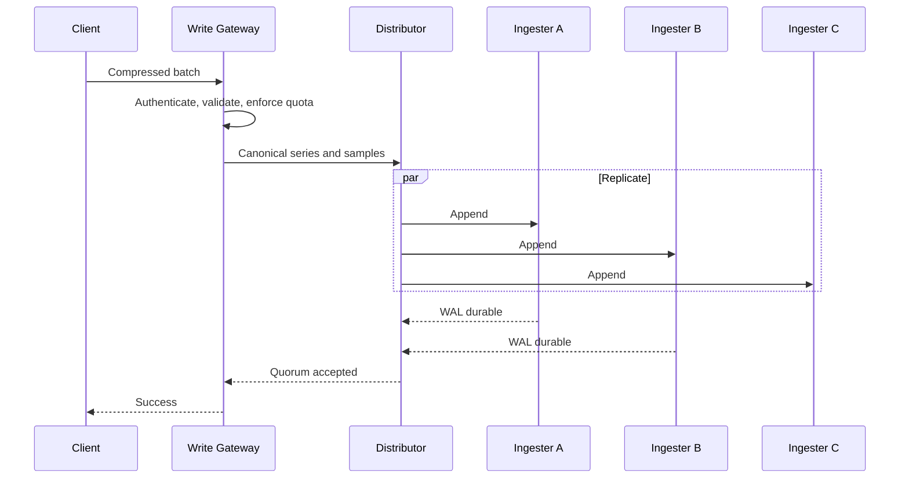
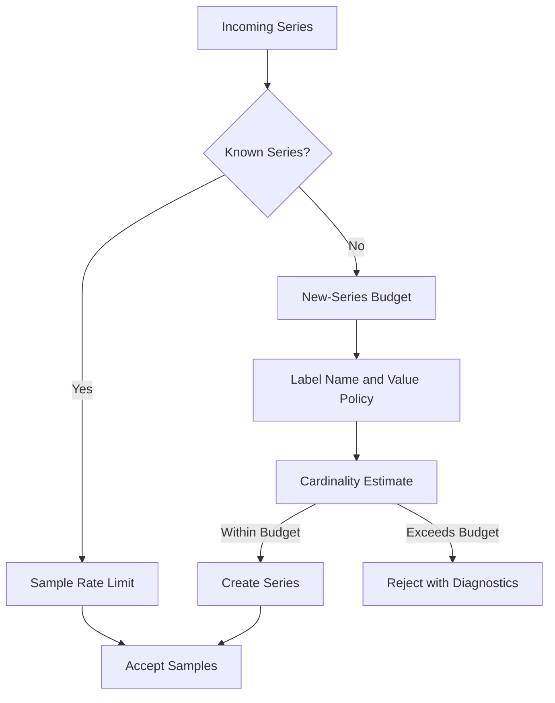
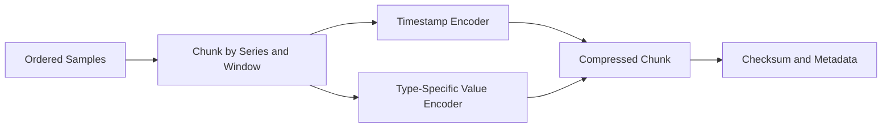
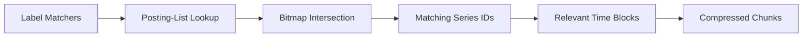
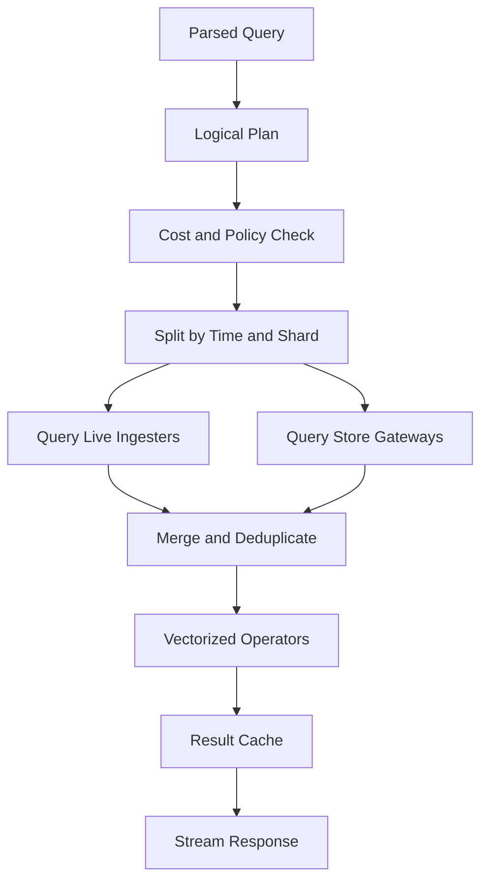
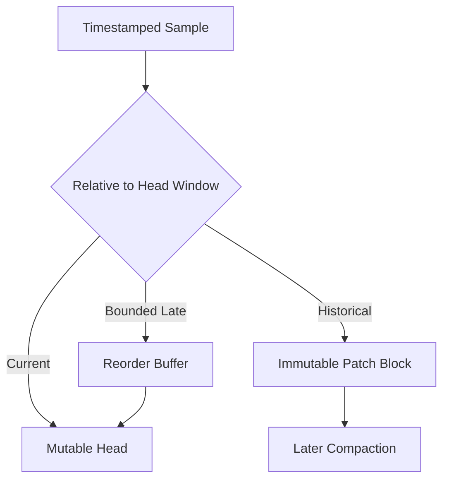
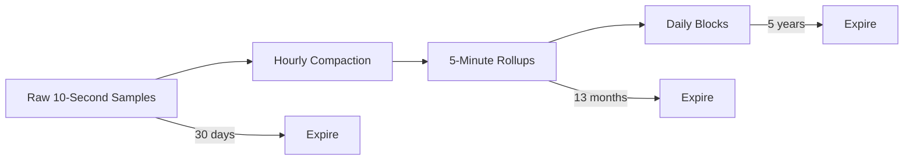
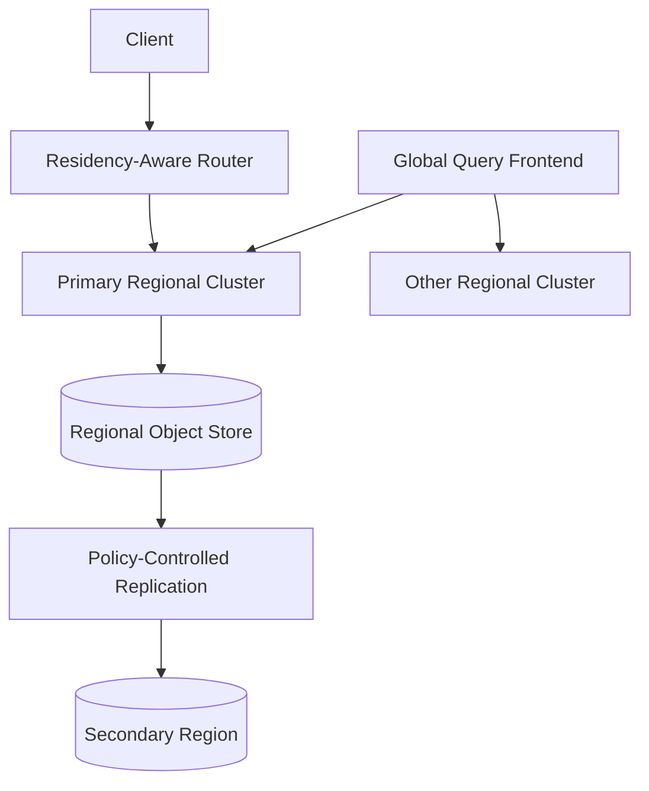

## Problem and requirements

A distributed time-series database stores timestamped values identified by a metric name and dimensions. It serves infrastructure metrics, product telemetry, industrial sensors, financial measurements, and other workloads dominated by append-heavy writes and time-bounded analytical reads.

The difficult part is not storing timestamp-value pairs. Billions of active series create index pressure, samples can arrive late or out of order, recent data is queried differently from historical data, and retention policies must remove enormous volumes without rewriting the database.

### Functional requirements

- Write individual samples and compressed batches
- Query by metric, labels, and time range
- Aggregate across series and aligned time windows
- Support counters, gauges, histograms, and structured samples
- Accept bounded late and out-of-order data
- Apply per-tenant retention and downsampling policies
- Record derived metrics and continuous aggregations
- Delete or redact selected tenant and series data
- Export and restore data by time range
- Expose ingestion, query, and storage health

### Non-functional requirements

- Ingest 100 million samples per second globally
- Maintain one billion active series
- Return common recent-range queries within one second at p99
- Isolate tenants by capacity, authorization, and encryption scope
- Survive node and availability-zone failures without acknowledged data loss
- Scale storage independently from query and ingestion compute
- Keep cardinality attacks from destabilizing shared clusters
- Make retention predictable and cost efficient

## Capacity estimates

Assume 100 million samples per second, 16 compressed bytes per sample including amortized index cost, and replication factor three in the hot tier.

| Resource | Estimate |
| --- | ---: |
| Samples | 8.64T/day |
| Compressed logical data | About 138 TB/day |
| Hot replicated data | About 414 TB/day |
| Active series | 1B |
| Series churn | Tens of millions/hour |
| Query fan-out | Thousands of shards for the largest tenants |

Object storage holds compacted historical blocks, while local SSD retains the most recent data and indexes. The exact split depends on query latency and retention objectives.

## Data model

A series is uniquely identified by tenant, metric, and a canonical label set.

```text
SeriesKey = tenant_id + metric_name + sorted(label_name, label_value)*
SeriesId  = stable_hash(SeriesKey)
Sample    = { seriesId, timestamp, value }
```

```text
http_requests_total{
  service="checkout",
  region="us-central",
  status="200"
} 184229 @ 2026-11-06T18:21:30Z
```

Labels are indexed dimensions. Arbitrary request IDs, timestamps, email addresses, or other unbounded values do not belong in labels because each unique label set creates a new series.

Canonical encoding specifies Unicode normalization, label ordering, numeric representation, and hash algorithm so every client and server computes identical identities.

## High-level architecture



The write path acknowledges after a quorum of ingesters durably appends to its WAL. Historical blocks move to object storage, allowing compute pools to scale and restart independently.

## Write API

Clients normally send compressed batches rather than one HTTP request per sample.

```http
POST /v1/write
Authorization: Bearer <tenant-token>
Content-Encoding: snappy
Idempotency-Key: batch_01K9A31F
```

The request contains multiple series, each with labels and ordered samples. The response distinguishes accepted, rejected, rate-limited, and partially invalid batches.

Use idempotency keys for bounded retry windows. Exact global deduplication is too expensive; agents should retry identical batches, and servers deduplicate per series and timestamp during head compaction.

## Ingestion path



Gateways validate timestamps, label limits, value encoding, and tenant policy before distribution. They reject samples too far in the future and route very old data through a backfill path.

Consistent hashing with virtual nodes assigns each series to a replication set. A versioned ring prevents stale distributors from writing to retired owners indefinitely.

## Cardinality control

High cardinality is both a cost problem and an availability risk.



Enforce limits for total active series, new series per minute, labels per series, label length, and samples per second. Maintain approximate cardinality sketches so the gateway does not need a global exact count on every write.

Expose top contributors and recently introduced labels to help owners fix runaway instrumentation. Silently dropping dimensions changes data meaning, so reject or quarantine instead.

## In-memory head and WAL

Each ingester stores recent samples in a mutable head block and appends every accepted batch to a segmented WAL.

Within a series, keep timestamps ordered when possible and use a bounded reorder buffer for late samples. Older out-of-order data enters a separate patch block so it does not force large rewrites.

WAL segments are checksummed and replicated. After restart, an ingester restores its last checkpoint and replays later segments. Periodic checkpoints capture series metadata and compacted head state, bounding recovery time.

Once a head time window closes, freeze it, encode immutable chunks, write a block to object storage, and publish its manifest atomically.

## Compression

Time-series values compress well because adjacent timestamps and values are often similar.

- Delta-of-delta encoding for timestamps
- XOR-based encoding for floating-point values
- Delta and run-length encoding for integer counters
- Dictionary encoding for repeated strings and metadata
- Sparse bucket encoding for histograms



Keep chunk windows small enough for selective reads but large enough for good compression. Store minimum and maximum time, sample count, encoding version, and checksum with each chunk.

## Immutable blocks

A historical block contains chunks, a series index, label indexes, metadata, and checksums for a fixed time range.

```text
block/
  manifest
  chunks/
  series-index
  label-index
  tombstones
```

Write all files under a temporary block identity, verify them, then publish one immutable manifest. Readers ignore blocks without a committed manifest.

Object names include tenant, time range, shard, generation, and block ID. The catalog tracks which generations are active; object listing is not the source of truth for every query.

## Index design

Map label pairs to compressed posting lists of series IDs.

```text
service="checkout" -> [12, 19, 44, ...]
region="us-central" -> [4, 12, 31, ...]
```

A query intersects or unions posting lists, then reads chunks only for matching series and time blocks.



Cache index headers and popular posting lists in memory. Use bloom filters or min/max metadata to skip blocks that cannot match.

Negative and regular-expression matchers are expensive because they can scan large label dictionaries. Enforce query budgets and encourage selective positive matchers.

## Query language and API

The query layer supports selectors, range functions, aggregation, arithmetic, joins on labels, and downsampling.

```http
GET /v1/query_range?query=sum(rate(http_requests_total{service="checkout"}[5m]))+by+(region)&start=...&end=...&step=60s
```

Every query includes tenant context derived from authentication. The planner estimates series count, samples scanned, block count, and intermediate-result size before execution.

## Query execution



Push label filtering, time pruning, partial aggregation, and downsampling close to storage. Merge partial results at query workers rather than transferring raw samples when possible.

Use a vectorized engine that processes timestamp-aligned batches. Spill large intermediate results to bounded local storage and cancel all subqueries when the client disconnects or a budget is exceeded.

## Query fairness

Separate interactive dashboards, alert evaluations, recording rules, and batch analytics into priority classes.

Apply limits for concurrent queries, series selected, samples scanned, execution time, memory, and result size. Schedule work fairly across tenants so one unbounded query cannot exhaust the cluster.

Split large time ranges into subqueries and queue them independently, but limit fan-out per parent query. Unlimited parallelism converts a slow query into a cluster-wide outage.

## Late and out-of-order data

Accept late samples inside a configurable window into the live head. Samples older than that window enter patch blocks or a backfill pipeline.



Queries merge base and patch blocks, preferring the highest generation for the same series and timestamp. Compaction eventually folds patches into a new canonical block generation.

Define duplicate behavior explicitly: last write wins, first write wins, or reject conflicting values. A monitoring database commonly uses last accepted value with a deterministic source precedence.

## Compaction

Compaction merges small blocks, applies tombstones, deduplicates samples, integrates patch blocks, and improves index locality.


Only one compaction lease operates on a tenant-shard-time range. Readers use catalog snapshots, so publishing a new generation is atomic from their perspective.

Delete retired blocks after a safety delay. This supports rollback and ensures queries holding old catalog snapshots can finish.

## Retention and downsampling

Retention works at block granularity wherever possible. Partition blocks along policy boundaries so expiration deletes objects instead of rewriting them.



Rollups store count, sum, minimum, maximum, last value, and histogram merge state so higher-level aggregates remain correct. An average alone cannot be safely aggregated again without count and sum.

The query planner selects the coarsest resolution that satisfies the requested step and function. Users can force raw data when retained and affordable.

## Recording rules

Recording rules evaluate queries periodically and write results back as new series. They precompute expensive common expressions and reduce dashboard latency.

Run rules from a durable scheduler with tenant-scoped leases. Evaluation timestamps align to fixed intervals, and retries write the same logical timestamp so they remain idempotent.

Track input freshness and rule version as metadata. A derived series should show when it was computed from stale or partial inputs.

## Consistency model

Writes acknowledged by quorum are durable, but queries may briefly miss them if they reach a different replica before convergence.

Offer two modes:

- Eventual reads for dashboards and broad analytics
- Read-after-write tokens carrying ring version and committed positions for verification workflows

During queries, merge overlapping ingester replicas and deduplicate by series and timestamp. Historical object blocks become visible only after their catalog manifest commits.

## Multi-region design

Most telemetry writes to the nearest approved region. Replicate asynchronously to a secondary region for disaster recovery, or synchronously across nearby zones for the local durability objective.



Global queries fan out to authorized regions and merge results. A regional outage should not redirect tenant data to a prohibited jurisdiction.

## Deletion and tombstones

Series deletion writes a versioned tombstone describing tenant, matcher, time range, and authorization. Query readers apply tombstones immediately; compactors physically remove matching samples later.

Broad deletion is expensive and potentially destructive. Estimate impact, require stronger approval, and provide a preview count before committing.

For urgent erasure, encrypt tenant or block data with scoped keys and destroy the appropriate key after verifying that it does not protect unrelated retained data.

## Reliability and failure handling

| Failure | Safe behavior |
| --- | --- |
| Write gateway fails | Client retries with the same idempotency key |
| Ingester fails before quorum | Distributor retries another replica; write remains unacknowledged |
| Ingester fails after quorum | Remaining replicas serve data; replacement replays WAL or repairs |
| Object upload is partial | No manifest is published, so readers ignore the block |
| Index is corrupted | Verify checksum and rebuild from immutable chunks |
| Compactor crashes | Lease expires; unpublished output is garbage-collected |
| Query worker crashes | Coordinator retries bounded subqueries |
| Catalog is unavailable | Serve a recent snapshot for reads; delay block publication |
| Region is isolated | Continue local ingestion and reconcile replication later |

Run anti-entropy jobs that compare block manifests and replica checkpoints. Repair missing objects from healthy copies before retention removes the last source.

## Security and tenant isolation

- Authenticate writers and readers with short-lived identities
- Derive tenant context from credentials, never a client label
- Enforce quotas at gateway, scheduler, cache, and storage boundaries
- Encrypt WAL, local blocks, and object storage
- Use tenant- or region-scoped encryption keys where required
- Restrict metric and label discovery by the same policy as data queries
- Audit configuration, deletion, export, and privileged access
- Redact sensitive label values from logs and diagnostics

Label values can contain secrets or personal data despite policy. Provide ingestion-time detectors and deny lists, but design access control as though metadata is sensitive.

## Observability and SLOs

Monitor the database with an independent minimal telemetry path to avoid total self-dependence.

- Accepted, rejected, and retried samples
- New and active series by tenant
- Distributor and ingester ring health
- WAL fsync latency and replay duration
- Head memory and out-of-order buffer size
- Block upload, compaction, and catalog lag
- Object checksum failures and repair backlog
- Query queue time, fan-out, samples scanned, and cache hit rate
- Retention and tombstone backlog
- Cross-region replication lag

Useful SLOs include 99.99% write availability, 99.9% of recent dashboard queries under one second, and no acknowledged sample loss after a single-zone failure.

## Key trade-offs

| Decision | Benefit | Cost |
| --- | --- | --- |
| Object storage for history | Cheap, durable, elastic capacity | Higher latency and eventual visibility |
| Replicated in-memory head | Fast recent writes and reads | Memory cost and recovery complexity |
| Inverted label index | Flexible dimensional queries | Cardinality-sensitive memory and storage |
| Immutable time blocks | Simple retention and repair | Late-data patch complexity |
| Approximate sketches | Bounded cost for profiles and limits | Small estimation error |
| Downsampling | Long retention at lower cost | Reduced resolution and function constraints |
| Eventual reads by default | High availability and scale | Briefly stale query results |

## Evolution path

1. Build a single-region write path with WAL, immutable blocks, and basic label queries.
2. Add replication, consistent hashing, quotas, and tenant isolation.
3. Move historical blocks to object storage and add query fan-out.
4. Introduce compaction, late-data patches, retention, and downsampling.
5. Add recording rules, global queries, and regional replication.
6. Optimize cardinality controls, vectorized execution, and cost-aware planning.

Start with strict label guidance and tenant budgets. Once uncontrolled cardinality is embedded in instrumentation, every storage and query subsystem becomes harder to operate.

## Final design

Use regional gateways to authenticate and validate compressed write batches, then distribute each canonical series to a replicated ingester set through consistent hashing. Acknowledge after WAL quorum, retain recent samples in mutable head blocks, and flush immutable compressed time blocks to object storage. Index label pairs with compressed posting lists, plan queries by tenant, shard, and time, and merge live and historical data through a fair, cost-bounded execution layer. Handle late samples with patch blocks, compact generations atomically, and align blocks with retention and downsampling boundaries.

The central principle is to optimize around time and cardinality together. Time partitioning makes retention and pruning cheap; disciplined series identity and label indexing keep ingestion and queries predictable as the database grows to billions of active series.
