## Problem and requirements

A geospatial indexing service answers questions such as “what is nearby?”, “which objects are inside this boundary?”, and “did this moving object enter a geofence?” It supports delivery, mobility, logistics, retail discovery, connected devices, risk systems, and mapping products.

The difficult part is mapping a curved world onto distributed storage. Dense cities create spatial hotspots, objects move between partitions, polygons cross thousands of cells, longitude wraps at the antimeridian, and approximate indexes must be followed by exact geometry checks.

### Functional requirements

- Create, update, and delete points, paths, and polygons
- Search objects within a radius of a coordinate
- Find nearest objects with filters and stable pagination
- Test point-in-polygon and polygon intersection
- Query objects inside arbitrary polygons or route corridors
- Track moving objects and their freshness
- Register geofences and emit enter, exit, and dwell events
- Support spatial and non-spatial attribute filters
- Import large static datasets and stream incremental changes
- Apply tenant-specific retention and location privacy policies

### Non-functional requirements

- Store ten billion objects
- Process ten million location updates per second
- Serve five million queries per second globally
- Return common nearby queries within 50 milliseconds at p99
- Preserve per-object update ordering
- Isolate tenants and prevent unbounded spatial scans
- Survive node and availability-zone failures
- Respect regional data residency and precision policies

## Capacity estimates

Assume one billion moving objects update every 100 seconds on average, with dense bursts from cities and events.

| Resource | Estimate |
| --- | ---: |
| Stored objects | 10B |
| Location updates | 10M/second average |
| Nearby queries | 5M/second peak |
| Geofences | 100M |
| Position history | Petabytes/day before compression |
| Index memberships | Several cells per complex object |

Moving-object state is write-heavy and short-lived. Static geometry is read-heavy and changes slowly. Separate their storage and indexing paths.

## Coordinate and geometry model

Use a canonical geographic coordinate reference system for the API, commonly latitude and longitude on a defined Earth model. Internally, exact calculations must specify whether they use spherical or ellipsoidal distance.

```text
GeoObject {
  tenantId, objectId, geometryType,
  geometry, attributes, version,
  observedAt, expiresAt
}
```

Validate latitude, normalize longitude, reject invalid rings, and define polygon winding and boundary semantics. A point exactly on a polygon edge must have a documented result.

Every moving update carries both an observation timestamp and a monotonic source sequence. Arrival time alone cannot resolve delayed mobile updates.

## API examples

```http
PUT /v1/objects/driver_82/location
If-Sequence-Greater-Than: 18429
Content-Type: application/json

{
  "latitude": 41.8819,
  "longitude": -87.6278,
  "observedAt": "2026-11-08T18:42:11Z",
  "sequence": 18430,
  "attributes": { "vehicleType": "bike", "available": true }
}
```

```http
GET /v1/nearby?lat=41.8819&lon=-87.6278&radius=3000&limit=20&vehicleType=bike
```

The response includes object ID, distance, freshness, relevant attributes, and a signed cursor. Results declare whether distance and containment are exact or approximate.

## High-level architecture

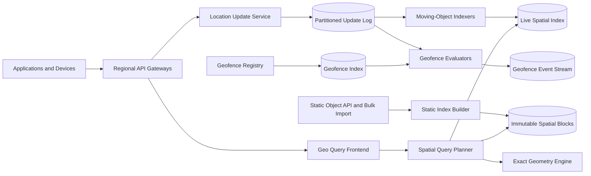

The spatial index produces candidates. The exact geometry engine removes false positives and computes authoritative distance or intersection.

## Hierarchical spatial cells

Map the Earth's surface into hierarchical cells. Each cell has a stable ID and children at finer resolutions.

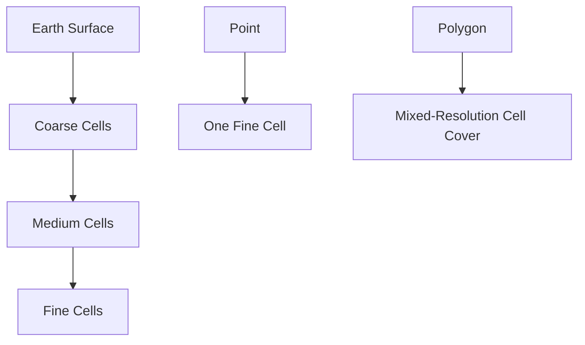

Nearby cells share useful prefixes or traversal relationships. A point maps to one cell at each level, while a polygon maps to a covering set of cells.

Use coarse cells for large sparse areas and finer cells near boundaries or dense regions. Limit covering size so a complex polygon cannot create millions of index entries.

A cell covering is approximate: some cells are fully contained and others intersect a boundary. Boundary cells require exact geometry checks.

## Why not simple latitude-longitude ranges?

Latitude and longitude rectangles distort with latitude, wrap at the antimeridian, and make circular-distance queries awkward. Hierarchical spherical cells provide bounded neighborhoods and natural partition keys.

Geohash-style grids are simple and prefix-friendly but can have boundary and neighbor irregularities. Spherical cell systems provide more uniform area and adjacency. The architecture works with either when its geometry semantics are explicit.

## Static object indexing

Static points, stores, roads, service areas, and administrative polygons change slowly. Build immutable index blocks.


Store object geometry separately from compact cell postings when shapes are large. Index records contain object ID, object type, bounding box, attribute summary, and geometry pointer.

Incremental changes write small delta blocks. Background compaction merges deltas with base blocks and publishes a new generation atomically.

## Moving-object index

Moving objects require frequent relocation between cells.

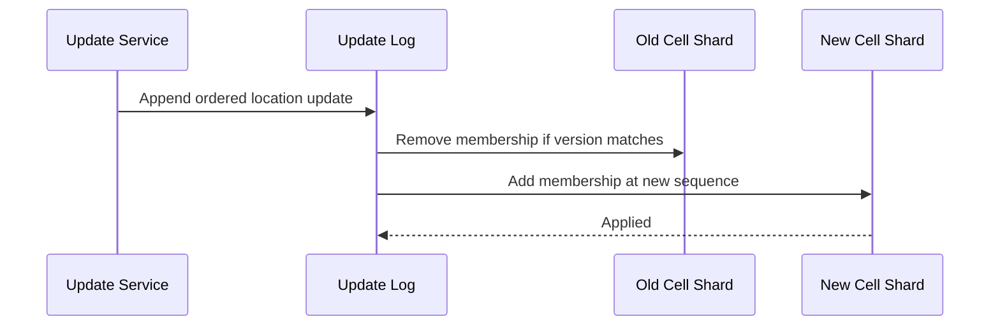

Maintain authoritative object state keyed by object ID and a derived membership keyed by cell. A cell entry contains object ID, latest sequence, position, freshness, and filterable attributes.

Moving between cells is not necessarily atomic across both indexes. Queries may briefly see duplicate or stale membership, so they deduplicate by object ID and keep the highest sequence. A periodic reconciler removes orphaned entries.

For stronger semantics, route both old and new cells through a transaction, at higher write cost.

## Update ordering and freshness

Accept an update only when its source epoch and sequence are newer than the stored version. A device restart creates a new server-authorized epoch instead of resetting sequence silently.

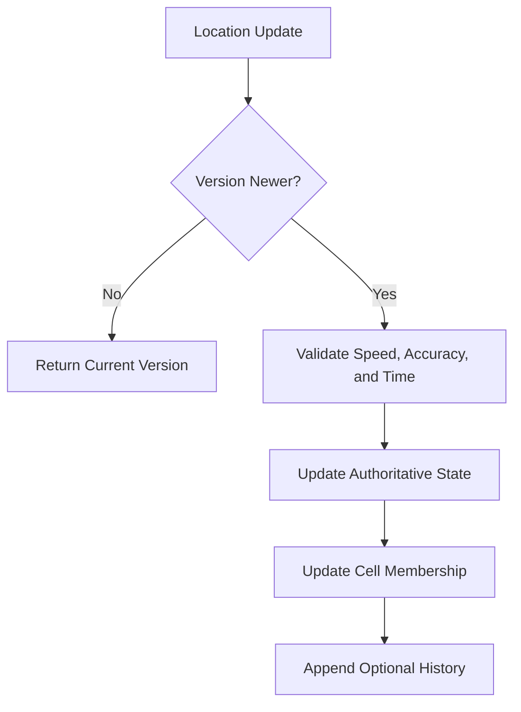

Queries require a maximum age. An available driver last observed 20 minutes ago should not appear merely because its index entry still exists.

Expire ephemeral memberships through time wheels or bucketed TTL indexes rather than scanning every object.

## Nearby search

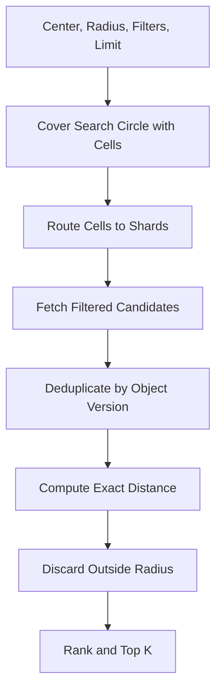

Push cheap attribute and bounding-box filters into cell shards. Only fetch full geometry or calculate expensive distance for surviving candidates.

For nearest-neighbor search without a radius, expand cell rings incrementally. Stop when the minimum possible distance to every unopened cell is greater than the current kth result.

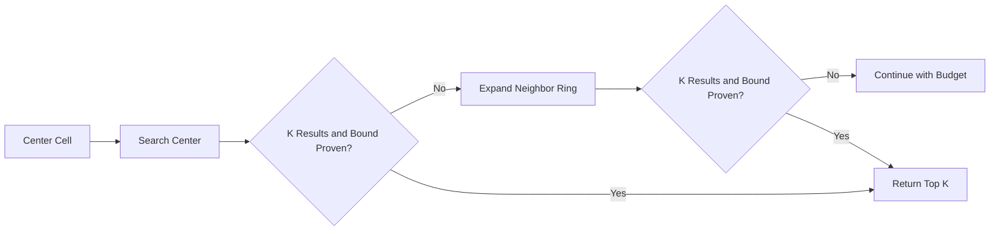

Enforce maximum radius, cell count, candidate count, and execution time.

## Polygon queries

To find objects inside a polygon, compute a mixed-resolution covering.

- Fully contained cells can return all eligible point objects without per-point geometry checks
- Boundary-intersecting cells return candidates for exact point-in-polygon testing
- Complex stored geometries use bounding-box rejection followed by exact intersection

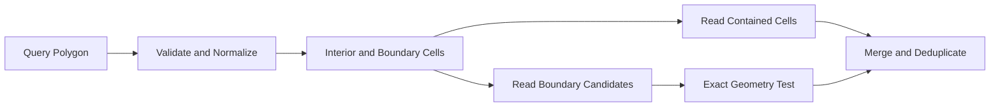

Simplify extremely detailed query polygons within a declared tolerance, while retaining the original shape for final exact checks.

## Route-corridor queries

A route corridor buffers a polyline by a distance to find facilities, hazards, or service coverage along a path.

Split long routes into segments, compute a cell cover for each buffered segment, union the covers, and query shards in parallel. Rank results by distance along the route and perpendicular deviation rather than straight-line distance from the origin.

Cap route length, vertices, and resulting cell count. Cache coverings for popular stable routes using the normalized polyline and buffer distance as a key.

## Geofencing

Geofencing inverts the nearby query: for each moving update, find fences covering the object's cell and test exact containment.

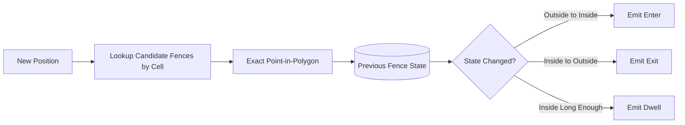

Store fence state by tenant, object, and fence with the latest position sequence. Event IDs derive from object, fence, transition, and sequence so retries are idempotent.

GPS jitter near a boundary causes rapid enter-exit flapping. Apply hysteresis, accuracy radius, or minimum-duration policies. These change product semantics and must be configured explicitly.

## Spatial sharding

Partition by tenant and a coarse cell prefix. Adjacent fine cells usually share a shard, reducing fan-out for local queries.

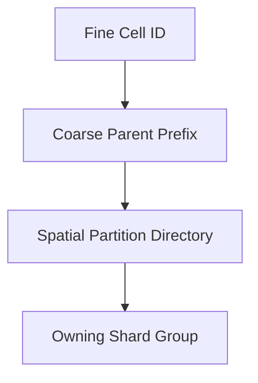

Pure spatial partitioning creates hotspots in dense cities. Allow a hot coarse cell to split by finer prefix or object-ID hash. The directory maps a spatial range to one or more shard subdivisions.

Replicate small boundary bands or cache popular immutable cells to reduce cross-shard reads, but retain one authoritative owner for writes.

## Hot-region handling

Airports, stadiums, and city centers can receive extreme update and query load.

- Split hot cells into finer children dynamically
- Hash-shard memberships within the finest practical cell
- Separate moving and static object workloads
- Cache popular static results at regional edges
- Coalesce rapid updates from the same object when intermediate positions are unnecessary
- Apply per-tenant and per-cell admission control
- Use approximate precomputed density summaries for broad map views

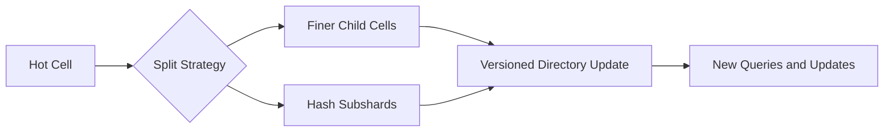

Online splitting copies a snapshot, streams deltas, validates counts, then changes the directory epoch. Stale writers are redirected.

## Query planning and pagination

The planner estimates covered cells, shard fan-out, stored object density, attribute selectivity, exact-check cost, and result size.

Stable pagination is challenging because moving objects change order. A cursor includes query hash, snapshot or freshness watermark, last sort key, object ID, and expiry. For live searches, clearly document that objects can appear or disappear between pages.

Large export-style spatial queries use asynchronous jobs against a fixed snapshot. Interactive APIs should not scan an entire country polygon with no filters.

## Exact geometry engine

The exact engine handles:

- Great-circle or ellipsoidal distance
- Point-in-polygon with holes
- Polyline distance
- Polygon intersection and containment
- Antimeridian crossing
- Polar regions and numerical precision

Use robust geometry predicates rather than naive floating-point equality. Normalize geometries at write time and retain the library and algorithm version with derived index metadata.

Property tests compare indexing results with brute-force exact calculations on generated shapes, including boundary and wraparound cases.

## Position history

Current state and historical tracks have different access patterns. Store current positions in the live index and append history to a time-partitioned columnar store.


Compress tracks using timestamp deltas and coordinate deltas. Apply tenant retention, precision reduction, and deletion policies. Historical trajectory queries are asynchronous when they span large areas or time windows.

## Caching

Cache static cell blocks, normalized geometry, popular query results, and partition-directory entries.

Keys include tenant, spatial cell or geometry hash, filter set, index generation, authorization scope, and precision policy. Never reuse a high-precision result for a principal authorized only for coarse locations.

Moving-object results have very short TTLs and include a freshness watermark. Prefer caching candidate cell reads over final ranked results when movement is rapid.

## Multi-region design

Route updates to an object's home or nearest approved region. Replicate current state and index changes to secondary regions according to latency and residency policy.

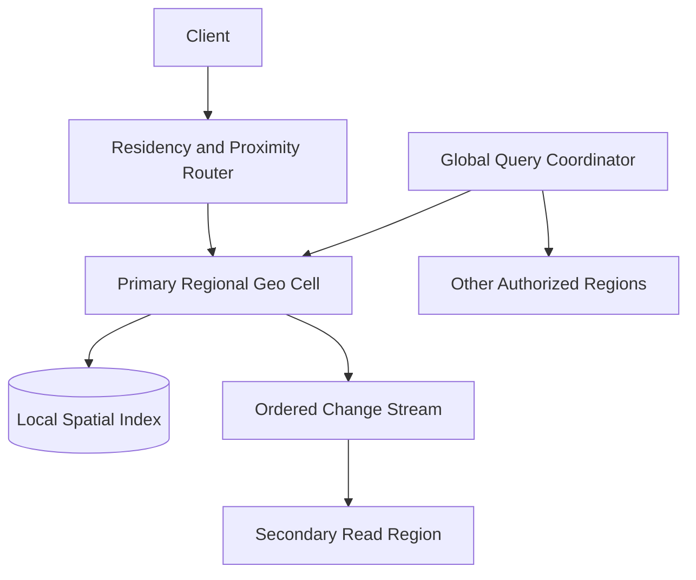

Per-object sequence resolves delayed replication. Cross-region nearby queries fan out only to regions whose spatial coverage intersects the query and whose data policy permits access.

During failover, a new region acquires a higher ownership epoch. The old primary is fenced to prevent concurrent update histories.

## Consistency model

Authoritative object lookup is strongly consistent within the primary region. Spatial membership is often eventually consistent for higher write throughput.

Queries deduplicate memberships and verify current authoritative state for the final top candidates when strict freshness is requested. This adds latency but prevents a recently moved or unavailable object from being returned.

Offer explicit modes:

- Fast: index-only results with freshness bounds
- Verified: recheck final candidates against authoritative state
- Snapshot: fixed generation for exports and reproducible analysis

## Privacy and security

Location data is highly sensitive.

- Authenticate devices and services with short-lived identities
- Derive tenant scope from credentials
- Authorize object classes, regions, attributes, and precision
- Reduce coordinate precision for roles that do not need exact location
- Encrypt current state, history, streams, and indexes
- Use tenant- or region-scoped keys where required
- Audit searches, exports, geofence changes, and privileged access
- Rate-limit object lookup and area scans to prevent tracking abuse
- Apply short retention by default to raw movement history

Avoid placing precise coordinates or personal object IDs in metrics, traces, queue names, and ordinary application logs.

## Reliability and failure handling

| Failure | Safe behavior |
| --- | --- |
| Client retries an update | Sequence check makes the retry idempotent |
| Index worker crashes | Resume from durable update-log checkpoint |
| Old-cell removal is delayed | Query deduplicates and keeps highest object sequence |
| Static block upload is partial | No catalog manifest is published |
| Spatial directory is stale | Shard redirects using a newer epoch |
| Exact geometry service fails | Return an error or marked approximate result; never claim exactness |
| Geofence evaluator retries | Deterministic transition ID suppresses duplicate events |
| Region becomes unavailable | Promote an approved secondary under a higher epoch |
| History pipeline lags | Current search continues; expose history freshness |

Run continuous reconciliation between authoritative object state and cell membership. Verify static block checksums, covering completeness, directory ownership, and geofence state checkpoints.

## Observability and SLOs

Track:

- Update acceptance, rejection, ordering conflict, and end-to-end index lag
- Active and newly created objects by tenant
- Cell density, query rate, and hot-cell splits
- Query cell count, shard fan-out, candidates, and exact checks
- Nearby-query latency and verified-result rejection rate
- Static index generation and compaction progress
- Stale or duplicate membership reconciliation
- Geofence evaluation lag and transition deduplication
- Position-history archival and retention backlog
- Cross-region replication and ownership epoch

Useful SLOs include 99.99% update availability, 99.9% of ordinary nearby queries under 50 milliseconds, and 99.9% of moving updates visible in regional search within two seconds.

## Key trade-offs

| Decision | Benefit | Cost |
| --- | --- | --- |
| Hierarchical cells | Efficient pruning and natural sharding | Approximate boundaries require exact checks |
| Dual authoritative and spatial indexes | Fast updates and queries | Temporary duplicate or stale memberships |
| Fine cells | Fewer candidates | More postings and query cells |
| Coarse cells | Smaller coverings | More false positives |
| Verified query mode | Stronger freshness | Extra point lookups and latency |
| Spatial sharding | Local nearby queries | Dense-region hotspots |
| Separate history store | Efficient current search | Two systems and consistency metadata |

## Evolution path

1. Build a single-region point index with radius queries and exact distance filtering.
2. Add moving-object sequences, TTLs, and streaming index maintenance.
3. Introduce polygon coverings, exact geometry, and geofences.
4. Add spatial partition splitting, query budgets, and tenant isolation.
5. Separate static blocks, live state, and historical trajectory storage.
6. Add regional replication, verified query mode, and online repartitioning.

Start with explicit coordinate, distance, boundary, and freshness semantics. Spatial bugs often look plausible on a map while returning the wrong object near a cell edge or date line.

## Final design

Represent points and shapes through hierarchical spherical cell coverings, using cell prefixes as the basis for partition routing and query pruning. Keep authoritative moving-object state keyed by object ID, derive cell membership asynchronously with sequence-based deduplication, and store static geometry in immutable indexed blocks. Nearby and polygon queries gather candidates from covered cells, push filters to shards, then apply robust exact geometry checks before ranking. Split dense cells dynamically, bound every query by cells and candidates, and separate current location state from compressed historical tracks.

The central principle is approximate first, exact last. A spatial index should cheaply exclude most of the world, while a well-tested geometry engine determines the final truth at boundaries, across partitions, and around the shape of the Earth.
