## Problem and requirements

A calendar and scheduling platform stores personal, team, and resource calendars. It lets organizers create meetings, invite participants, find available time, reserve rooms, apply recurring schedules, send reminders, and synchronize with external providers.

The difficult part is time. Recurring rules interact with daylight-saving changes, participants live in different zones, invitation responses arrive concurrently, and shared resources must not be double-booked. A calendar must preserve the organizer's intent even when time-zone rules change years later.

### Functional requirements

- Create, update, move, and delete calendar events
- Invite internal and external participants
- Track per-attendee response and notification state
- Support recurring events and per-occurrence exceptions
- Render events correctly in any time zone
- Query free/busy without exposing private details
- Suggest meeting times across participants and working hours
- Reserve rooms, equipment, and other shared resources
- Send configurable reminders through several channels
- Share calendars with role-based permissions
- Synchronize with external calendar providers
- Support offline edits and incremental client synchronization

### Non-functional requirements

- Support two billion users and 100 billion stored events
- Process ten million mutations per second globally
- Return ordinary day and week views within 200 milliseconds at p99
- Prevent confirmed double booking for exclusive resources
- Preserve event history and invitation causality
- Isolate tenants and private calendar data
- Remain available during regional and downstream notification failures
- Make recurrence and time-zone behavior reproducible

## Capacity estimates

Assume two billion users, five calendars per user, 50 retained events per calendar per year, and significant fan-out from group meetings.

| Resource | Estimate |
| --- | ---: |
| Calendar events | 100B retained |
| Event mutations | 10M/second peak |
| Invitation deliveries | Hundreds of millions/day |
| Free/busy lookups | Millions/second |
| Active reminder timers | Billions |
| External sync connections | Hundreds of millions |

Recurring events should not be expanded indefinitely. Store compact recurrence definitions and materialize bounded windows on demand or asynchronously.

## Core data model

```text
Calendar {
  calendarId, ownerId, tenantId, type,
  defaultTimeZone, permissionsVersion
}

EventSeries {
  seriesId, organizerCalendarId, title,
  startSpec, duration, recurrenceRule,
  timeZoneVersion, sequence, status
}

OccurrenceException {
  seriesId, recurrenceId, overrides, status, sequence
}

Attendee {
  seriesId, principalOrAddress, role,
  response, responseAt, notificationState
}
```

The organizer owns the canonical event series. Attendee calendars hold invitation projections that reference the organizer event and preserve attendee-specific response and reminder settings.

## Time representations

Different event types require different semantics:

- Instant event: a precise UTC instant, such as a system maintenance window
- Zoned event: local date and time plus a named time zone, such as 9:00 AM America/Chicago
- Floating event: local wall time independent of zone, such as a daily personal checklist
- All-day event: date range, not midnight instants

Never represent an all-day event as midnight UTC. It can appear on the wrong date in another zone.

For zoned events, store the local fields, zone identifier, resolved UTC instant, and time-zone database version. The local intent is needed if zone rules are later revised.

## High-level architecture

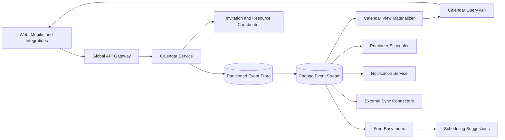

The transactional store is authoritative. Views, free/busy indexes, reminders, notifications, and external synchronization are derived asynchronously from committed changes.

## Partitioning

Partition calendars by tenant and stable calendar ID. Most day-view and edit operations then target one shard.

An event with 10,000 attendees cannot be one cross-shard transaction. Commit the organizer event first, append an invitation intent, and project it idempotently to attendee calendars.

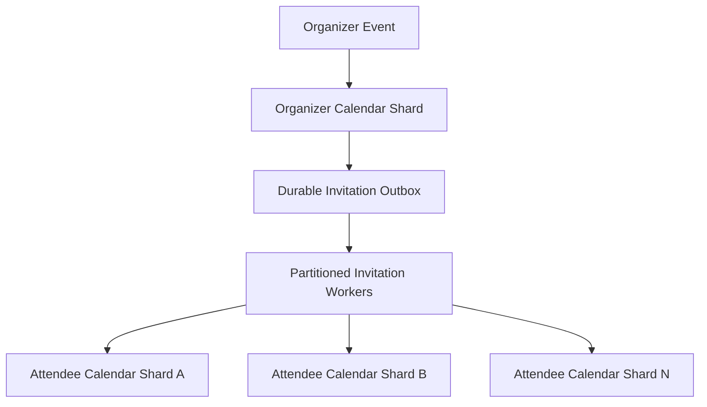

This creates brief eventual consistency for attendee views but keeps event creation available and bounded.

## Event creation

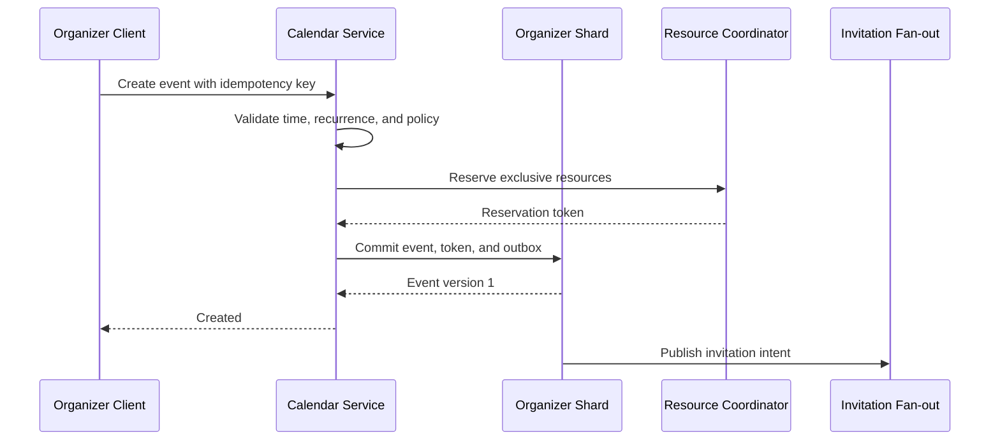

The idempotency key prevents a client retry from creating two meetings. If resource reservation succeeds but event commit fails, the reservation lease expires or is explicitly released.

## Invitations and responses

An invitation carries series ID, organizer, attendee, event sequence, and a stable invitation ID. Attendee projections apply only events with a newer sequence.

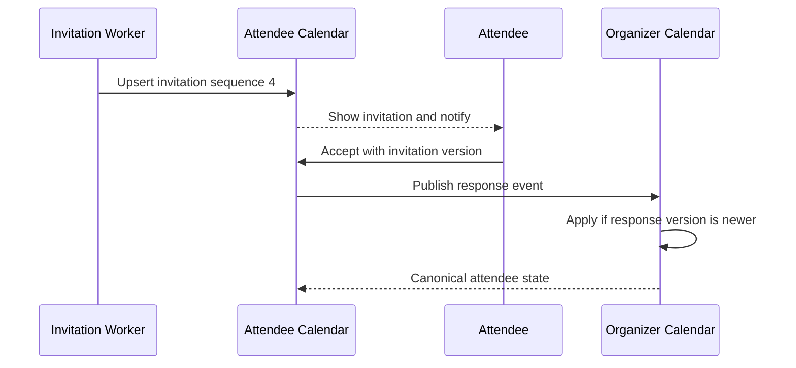

Responses are attendee-owned facts. The organizer may remove an attendee but should not rewrite a historical response as though the attendee never sent it.

External email attendees receive signed response tokens with narrow scope and expiry. Tokens must not expose the private event to arbitrary forwarding recipients.

## Recurrence model

Store a recurrence rule with a series start and bounded termination:

```text
FREQ=WEEKLY;INTERVAL=1;BYDAY=MO,WE;UNTIL=20271231T235959Z
```

An occurrence identity derives from the series and its original scheduled local start. This remains stable when an individual occurrence moves.

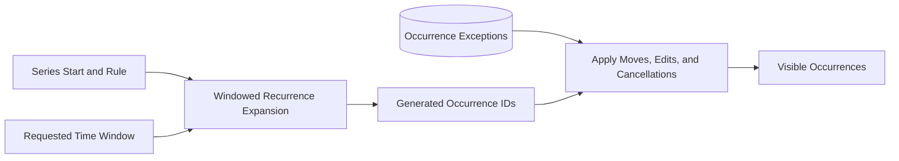

Do not create database rows for every future occurrence. Expand only the requested window plus bounded reminder and sync horizons.

## Editing recurring events

Users can change:

- This occurrence only: create or update an exception
- This and following: truncate the old series and create a new linked series
- Entire series: create a new series version

“This and following” is a split, not a mutation of history. Existing past occurrences retain the old rule and time-zone version.

Moved exceptions keep their original recurrence ID so later series edits can identify them without creating duplicates.

## Daylight-saving and time-zone changes

A weekly 9:00 AM meeting should usually remain at 9:00 AM local time when the UTC offset changes.

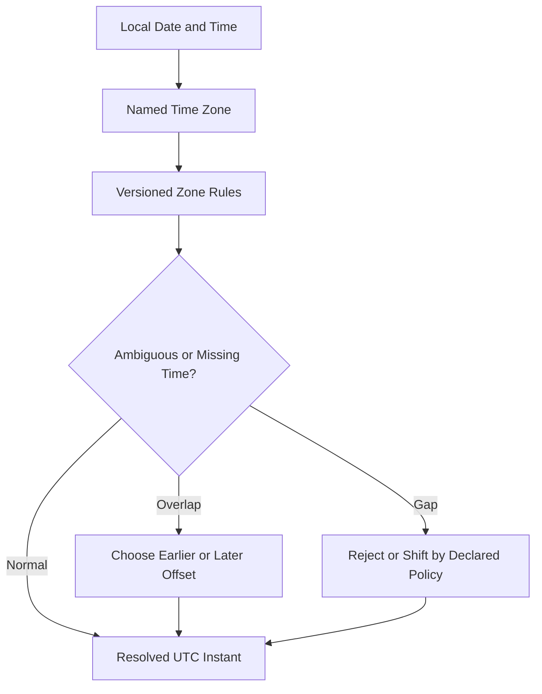

Store the resolution policy for ambiguous or nonexistent local times. Never let a library upgrade silently move a meeting.

When governments change future zone rules, recompute affected future instants from preserved local intent, publish event changes, and notify only when product policy requires it.

## Calendar views

The view API retrieves event series and exceptions overlapping a bounded time window, expands recurrence, merges invitation projections, and applies permissions.

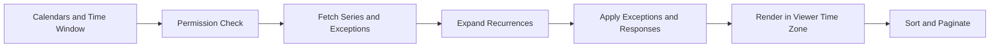

Maintain interval indexes on resolved start and end times for non-recurring events and materialized near-term occurrences. Long-range queries fall back to series expansion with strict limits.

Cache views by calendar, window, permission class, event watermark, and time-zone rule version.

## Free-busy service

Free/busy reveals occupied intervals without event details.

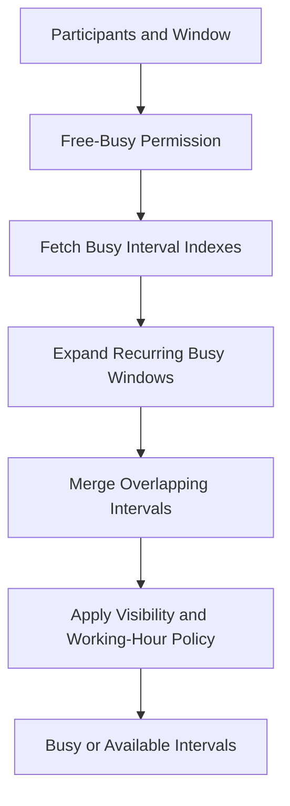

Maintain a near-term busy bitmap or compressed interval index per calendar. Update it from event changes, with the source store available for verification.

Limit participant count and time range. Broad probing of free/busy can reveal behavior even without titles, so rate-limit and audit sensitive searches.

## Scheduling suggestions

The suggestion engine intersects availability, working hours, minimum notice, travel buffers, organizer preferences, resource availability, and meeting duration.

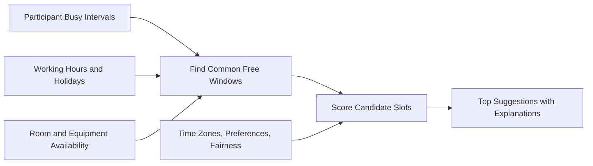

Score inconvenience fairly across time zones rather than always optimizing for the organizer. Repeated team scheduling can rotate burdensome times.

Suggestions are not reservations. Revalidate calendars and resources at commit time because availability may change after results are shown.

## Resource booking

Rooms and equipment are exclusive resources with booking policy, capacity, location, features, delegates, and maintenance windows.

Prevent double booking through a strongly consistent interval reservation service.

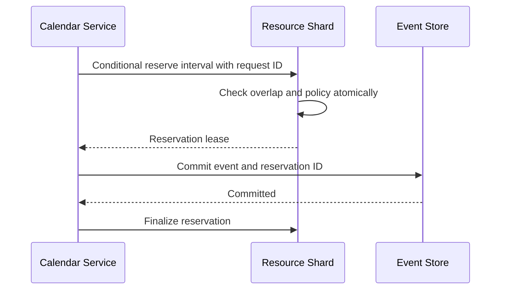

The resource shard owns interval serialization. Requests spanning several exclusive resources use ordered locking or a short distributed transaction to avoid deadlock and partial booking.

Approval-required resources create tentative holds with expiry until a delegate accepts.

## Reminders

Each event can produce several reminders relative to start time or through custom schedules.

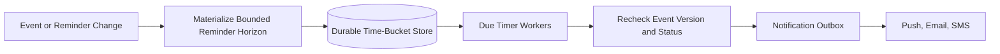

Use a timer ID derived from event, occurrence, attendee, reminder rule, and event sequence. If a meeting moves, old timer versions become invalid and are ignored at execution.

Reminder workers always recheck cancellation, attendee response, and current start time before sending. Notification retries use the same idempotency key.

## Calendar sharing

Permissions can allow:

- See only free/busy
- See limited details
- See full event details
- Create or edit events
- Manage sharing and resources

Sharing grants target users, groups, domains, or public links. Group membership changes are versioned and cached for short periods.

Public calendar links use revocable opaque tokens and show only explicitly public fields. They must not inherit private attachments, attendees, or conferencing secrets.

## Incremental synchronization

Clients need offline access and efficient refresh.

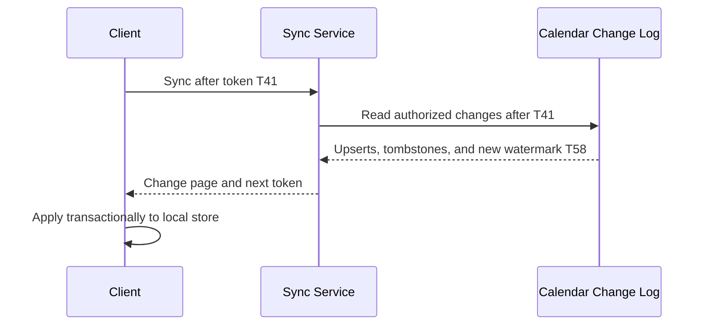

Sync tokens encode tenant, principal, permission version, shard epoch, and log position. They expire after the retained change window, after which the client performs a full resync.

Tombstones remain in the change log long enough for offline clients to learn deletions.

## Offline edits and conflicts

Offline clients send mutations with the base event sequence and a unique operation ID.

Non-conflicting fields can merge, such as an attendee changing a personal reminder while the organizer edits the title. Conflicting organizer edits return the current version for user resolution.

Do not use last-write-wins for resource reservations, attendee removal, or event cancellation. Those operations require explicit sequence validation and domain rules.

## External calendar synchronization

Connectors ingest and publish changes to external providers through APIs, webhooks, or standard calendar protocols.

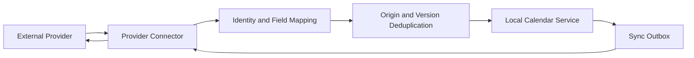

Every synchronized event stores provider ID, provider version, local version, origin, and mapping version. Changes are tagged with origin so the connector does not echo them back indefinitely.

Provider rate limits, webhook loss, and restatements require periodic cursor reconciliation. Deleted remote events produce tombstones rather than disappearing silently.

Conflict policy may be local-wins, remote-wins, field merge, or user review. It must be explicit per connector and field.

## Search

Index authorized event titles, descriptions, attendees, locations, attachments, and time ranges in a tenant-partitioned search service.

Search is derived and eventually consistent. Results return event IDs that the calendar service reauthorizes and hydrates before display.

Private events can be indexed with tokens that allow owner search without exposing content to shared-calendar viewers. Sensitive conferencing credentials should not enter the general search index.

## Conferencing integration

Creating an event may provision a video meeting through an external service. Use a transactional outbox and stable request ID so retries return the same conference rather than creating duplicates.

Conference creation can complete asynchronously after the event is visible. Store credentials separately from ordinary location text and expose them only to authorized participants.

Deleting or moving an event triggers provider updates, but failure to delete a conference should not erase the calendar event's audit history.

## Large meetings

Events with millions of attendees cannot materialize every projection synchronously.

Use audience groups, announcement events, or subscription-based views. Store one canonical event and a group reference, then evaluate membership at read and notification time under versioned policy.

For finite expanded rosters, process fan-out through partitioned workers with checkpoints, rate limits, and per-attendee idempotency. Show invitation progress and partial failures to the organizer.

## Multi-region architecture

Assign each tenant or consumer account a home region. Calendar events, invitation state, permissions, reminder timers, and encryption keys remain in that region unless policy allows replication.

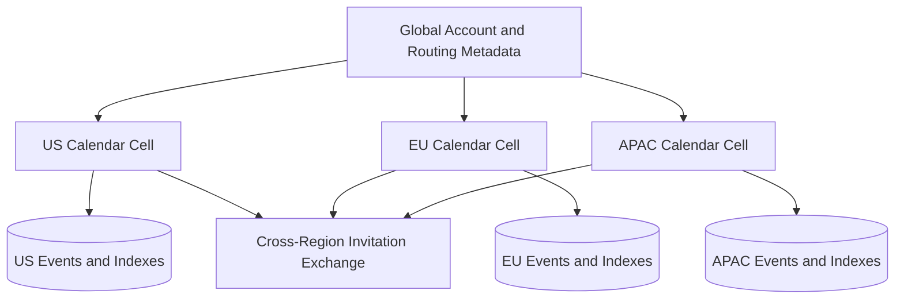

Cross-region invitations exchange minimal signed event projections rather than granting remote regions direct database access. Each attendee region stores its local response and sends a versioned response event to the organizer region.

Regional failover promotes a replica under a higher routing epoch. Reminder execution and resource reservations require fencing so two regions cannot act as primary simultaneously.

## Privacy and security

- Derive account and tenant scope from authenticated credentials
- Authorize each calendar, event, field, and free/busy request
- Encrypt event bodies, attachments, indexes, and sync logs
- Separate conferencing secrets from ordinary event metadata
- Use opaque external invitation and public-calendar tokens
- Rate-limit availability probing and participant enumeration
- Audit sharing, export, delegation, impersonation, and resource overrides
- Apply retention and deletion to source and derived stores
- Prevent untrusted invitation content from executing active HTML
- Hide private-event details while preserving busy intervals

Attendee email addresses and meeting subjects can reveal sensitive relationships. Treat calendar metadata as confidential data, not harmless scheduling information.

## Reliability and failure handling

| Failure | Safe behavior |
| --- | --- |
| Client retries event creation | Idempotency key returns the original event |
| Invitation worker crashes | Resume from outbox; attendee projection deduplicates by sequence |
| Old invitation arrives late | Higher event sequence wins |
| Reminder worker retries | Stable timer ID suppresses duplicate notification |
| Search index fails | Calendar reads and writes continue from source store |
| Resource finalize fails | Reconcile reservation token with committed event |
| External provider times out | Retry with provider request ID or mark outcome unknown |
| Sync token is too old | Require a bounded full resynchronization |
| Time-zone rules update | Recompute affected future instances from stored local intent |
| Region fails | Promote fenced replica; replay timers and outboxes idempotently |

Every derived processor consumes a durable log and advances its checkpoint only after durable output.

## Observability and SLOs

Track:

- Event mutation latency, conflicts, and idempotent retries
- Invitation fan-out lag and projection failures
- Recurrence expansion time and occurrence counts
- Free/busy freshness, query range, and participant fan-out
- Resource reservation conflicts and lease reconciliation
- Reminder scheduler lag, invalidated timers, and duplicate suppression
- Incremental sync lag, token expiry, and full-resync rate
- External connector cursor age, throttling, and conflict rate
- Search indexing lag and authorization rejections
- Cross-region invitation and response lag

Useful SLOs include 99.99% event mutation availability, 99.9% of internal invitations visible within five seconds, and 99.99% of due reminders placed into the notification outbox before their target time.

## Key trade-offs

| Decision | Benefit | Cost |
| --- | --- | --- |
| Compact recurrence rules | Small storage and future flexibility | Read-time expansion complexity |
| Organizer-owned canonical event | Clear authority and sequencing | Attendee views are eventually consistent |
| Derived free-busy index | Fast privacy-preserving scheduling | Index freshness and reconciliation |
| Strong resource reservation | Prevents double booking | Coordination and availability cost |
| Versioned time-zone rules | Reproducible behavior | Metadata and migration complexity |
| Incremental sync log | Efficient offline clients | Tombstone retention and token lifecycle |
| Home-region ownership | Residency and clear consistency | Cross-region invitations are more complex |

## Evolution path

1. Build personal calendars, one-time events, and day/week queries.
2. Add invitations, responses, reminders, and sharing.
3. Introduce recurrence, exceptions, and rigorous time-zone semantics.
4. Add free/busy, scheduling suggestions, and resource booking.
5. Support offline sync and external provider connectors.
6. Deploy regional cells, large-event fan-out, and cross-region invitations.

Start by defining time semantics precisely. Incorrect daylight-saving or all-day behavior is a data-model defect, not a display bug.

## Final design

Partition authoritative calendars by tenant and calendar ID, storing compact event series, stable occurrence exceptions, attendee state, and preserved time-zone intent. Commit organizer events and invitation outboxes atomically, then fan out versioned projections to attendee regions. Expand recurrence only within bounded windows, maintain derived free/busy and near-term occurrence indexes, and serialize exclusive resource reservations through strongly consistent interval shards. Drive reminders, notifications, search, analytics, and external sync from durable change logs with stable idempotency keys.

The central principle is to preserve intent separately from presentation. Local wall time, named zone, recurrence rule, organizer sequence, and attendee response each represent different facts; keeping them explicit lets the platform remain correct as clocks shift, regions fail, invitations race, and calendar rules evolve.
