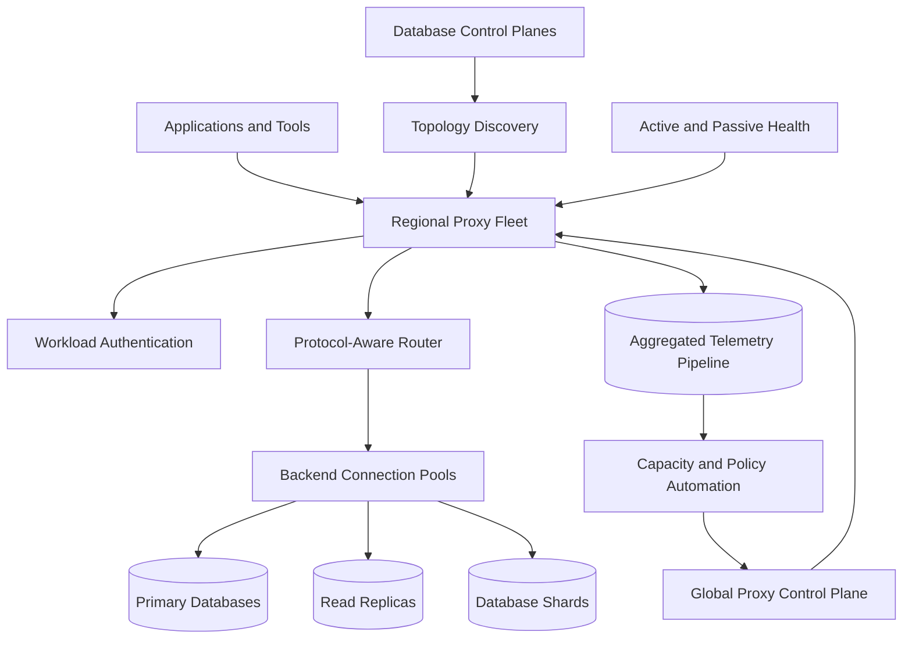
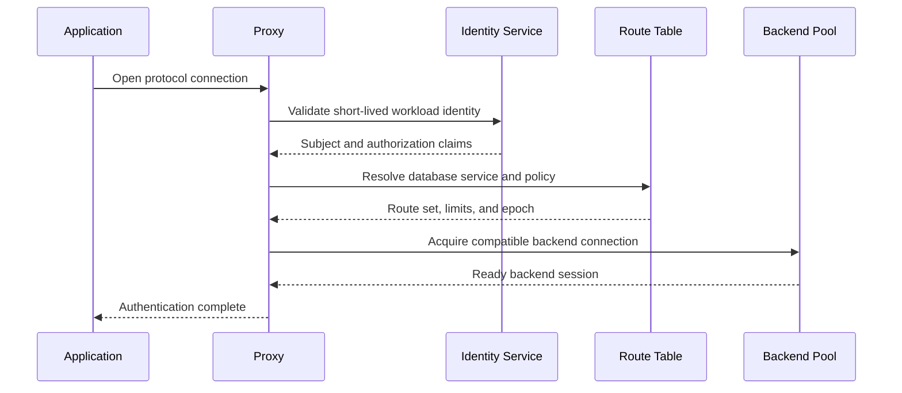
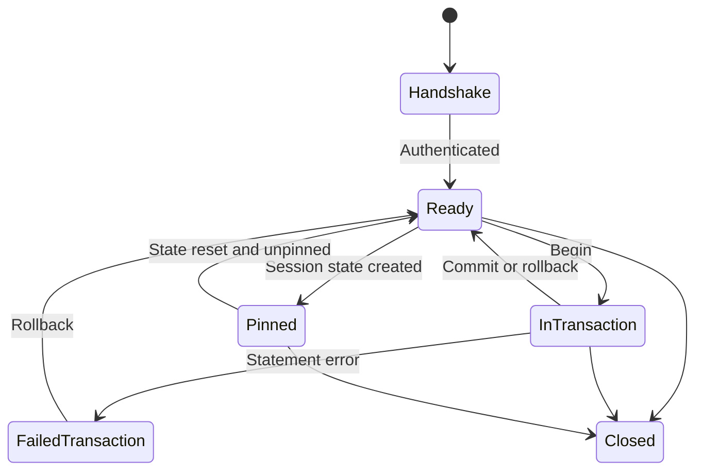
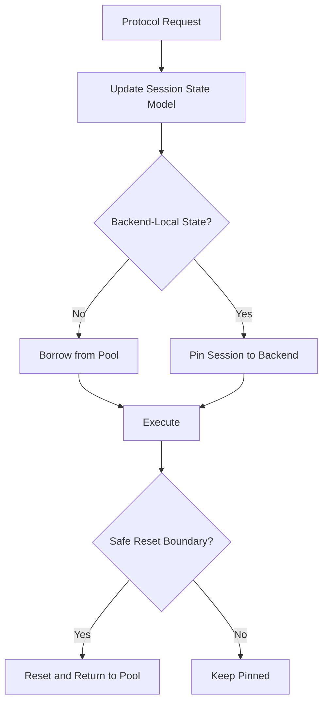
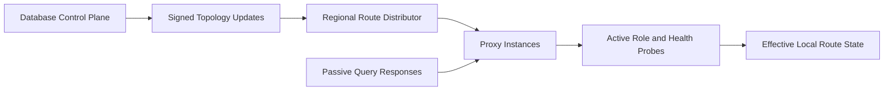
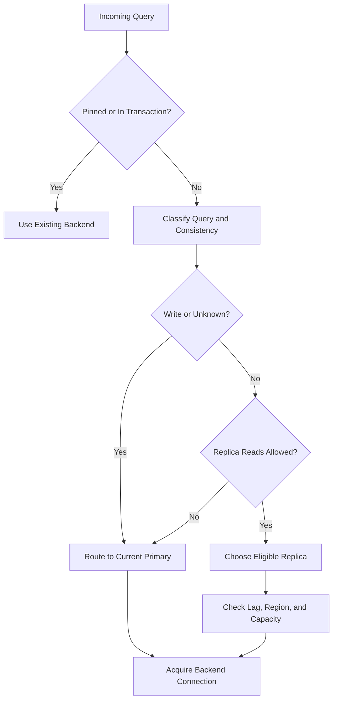
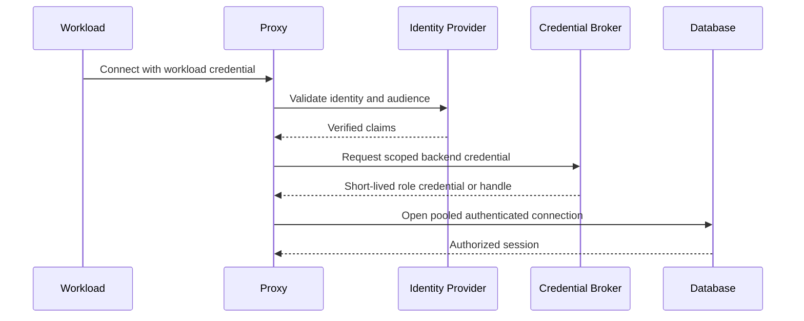
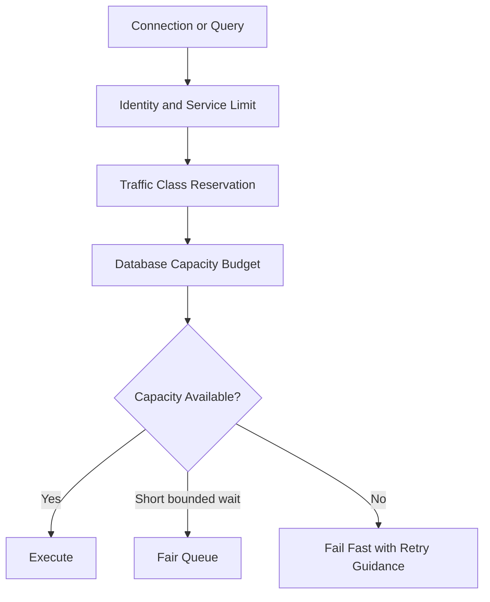
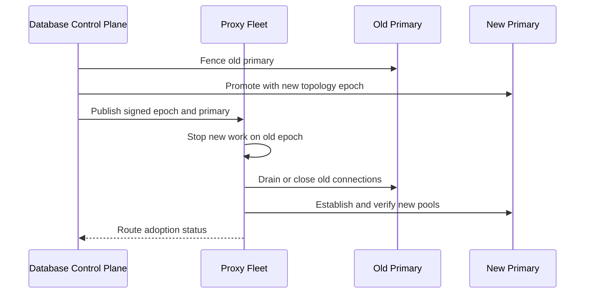
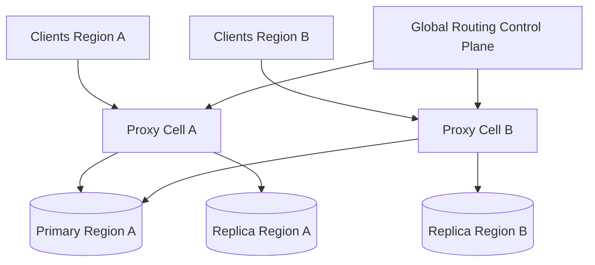

## Problem and requirements

A database proxy sits between applications and database servers. It absorbs large numbers of short-lived client connections, reuses a smaller set of expensive backend sessions, authenticates workloads, discovers topology, routes queries, enforces limits, and keeps database failover details away from application code.

The difficult part is preserving database semantics. Sessions can contain transactions, prepared statements, temporary tables, advisory locks, variables, cursors, and authentication state. A proxy that moves such work between backend connections incorrectly can return wrong results even while appearing highly available.

### Functional requirements

- Accept native database protocols from applications and tools
- Authenticate workload identity and map it to database authorization
- Pool frontend connections onto bounded backend connections
- Support session, transaction, and statement pooling modes
- Discover primary, replica, shard, and region topology
- Route reads and writes according to explicit consistency policy
- Preserve transaction and session semantics through pinning
- Queue, reject, or shed work before databases overload
- Drain connections during maintenance and failover
- Expose query, pool, route, and health telemetry without leaking sensitive values

### Non-functional requirements

- Support ten million concurrent clients and one hundred million queries per second
- Add less than one millisecond p99 proxy latency within a region for common queries
- Keep new connection acceptance above 99.99% availability
- Prevent cross-tenant connection, credential, and cache leakage
- Never replay ambiguous writes automatically
- Continue serving safe traffic during control-plane failure
- Bound memory, queues, and backend connection use
- Make routing and failover decisions explainable

## Capacity estimates

Assume ten million frontend connections, one hundred million queries per second, and one million distinct database endpoints. Most clients are idle or bursty, while backend connections consume meaningful memory and process resources.

| Resource | Estimate |
| --- | ---: |
| Concurrent frontend connections | 10M |
| Active backend connections | 500K–2M |
| Peak query rate | 100M/second |
| Topology and health updates | Millions/second globally |
| Connection state | Hundreds of bytes to several KB per session |
| Telemetry events | Billions/minute before aggregation |

The proxy must keep hot-path state local. A remote control-plane lookup for every query would dominate latency and turn configuration failure into a database outage.

## Proxy boundaries

The proxy should be explicit about what it is and is not responsible for.

| Responsibility | Proxy role |
| --- | --- |
| Connections | Authenticate, terminate, pool, and limit |
| Topology | Discover endpoints and maintain route state |
| Transactions | Preserve affinity and failure semantics |
| Consistency | Enforce configured routing guarantees |
| Query policy | Apply bounded rules and observability |
| Storage correctness | Remains the database's responsibility |
| Cross-shard transactions | Remains an explicit database or application capability |

The proxy cannot make an eventually consistent replica strongly consistent, and it cannot safely infer business idempotency from SQL text.

## Core data model

```text
DatabaseService {
  serviceId, tenantId, protocol, topologyType,
  regions, authPolicy, routingPolicyVersion
}

BackendEndpoint {
  endpointId, serviceId, role, shard,
  region, epoch, health, replayPosition
}

FrontendSession {
  sessionId, workloadIdentity, serviceId,
  stateClass, pinnedBackend, transactionState
}

Pool {
  poolId, endpointId, authContext,
  protocolOptions, minSize, maxSize, state
}
```

Topology epochs fence stale primaries and route updates. Pool keys include every property that changes backend authorization or session behavior.

## High-level architecture



The control plane defines services, identity policy, routing rules, and limits. Regional proxy fleets make connection and query decisions from signed local state.

## Connection lifecycle



The proxy performs protocol negotiation, TLS, authentication, authorization, quota checks, and service resolution before accepting work. It must bound handshake time and pre-authentication memory to resist connection floods.

Idle frontend sessions do not always hold a backend connection. Whether a backend can be released depends on the pooling mode and observed session state.

## Pooling modes

### Session pooling

One frontend session holds one backend connection until disconnect. This preserves nearly all session semantics and reduces only connection setup overhead. It is safest for unknown clients and administrative tools.

### Transaction pooling

A backend connection is assigned for the duration of a transaction and returned after commit or rollback plus state cleanup. It provides much higher reuse but requires careful detection of session-scoped features.

### Statement pooling

Each statement may use a different backend connection. It maximizes reuse and is safe only for explicitly stateless workloads without multi-statement transactions, session variables, cursors, temporary objects, or connection-local prepared statements.

| Mode | Backend reuse | Compatibility | Typical use |
| --- | --- | --- | --- |
| Session | Low | Highest | Tools and stateful applications |
| Transaction | High | Moderate | Stateless request services |
| Statement | Highest | Lowest | Simple, explicitly constrained queries |

Pooling mode is a service contract, not an optimization that the proxy changes silently.

## Protocol state machine

The proxy parses enough of the native protocol to track authentication, transaction boundaries, prepared statements, copy or bulk modes, errors, and connection termination.



Parsing must follow the negotiated protocol version and encoding. Unknown extensions or ambiguous state cause conservative session pinning rather than optimistic reuse.

The backend response is authoritative for transaction state. SQL-text heuristics alone miss stored procedures, implicit transactions, and protocol-level commands.

## Session state and pinning

Features that may require a dedicated backend include:

- Open transactions and savepoints
- Temporary tables and session-local objects
- Session variables and changed search paths
- Advisory locks
- Open cursors and portals
- Connection-local prepared statements
- Listen or notification subscriptions
- Bulk copy modes
- Session-scoped authentication changes



Pinning reduces pool efficiency, so the platform reports why sessions are pinned. It must never unpin merely to improve utilization.

## Backend connection pools

Pools are partitioned by endpoint, database, authorization context, protocol options, and session baseline. Sharing across incompatible users or settings can leak permissions or state.

Each pool maintains:

- Minimum warm connections for latency-sensitive services
- Maximum connections derived from database capacity
- Creation and retirement rates
- Idle and maximum lifetimes with jitter
- Wait queue length and timeout
- Health and reset success rates
- Reserved capacity for critical traffic

Connections pass a protocol-specific reset before reuse. Reset may include rollback, deallocation, variable restoration, temporary-object cleanup, and authorization reset. If cleanup is uncertain or fails, close the connection.

Pool sizing is coordinated globally per database. Ten proxy instances each honoring the database's full connection limit would overload it.

## Hierarchical connection budgets

Connection allocation uses hierarchical budgets:

```text
database capacity
  └── region budget
       └── proxy cell budget
            └── tenant or service budget
                 └── traffic class reservation
```

The control plane assigns coarse leases to regional cells. A cell subdivides its lease locally, so it can accept connections without a global round trip.

Leases have epochs and expiry. During partition, a cell may keep a bounded portion of its last allocation but cannot grow indefinitely. Databases retain an emergency reserve for administration, replication, and recovery.

## Topology discovery

The proxy learns topology from authoritative database control planes, consensus metadata, service discovery, or database-native role checks.



Each update includes service, endpoints, roles, shards, regions, topology epoch, validity, and signature. Proxies reject older epochs.

Active probes confirm reachability and role; passive signals reveal real query failures. Neither alone grants primary authority. A reachable server claiming to be writable cannot override a newer fenced topology epoch.

## Query routing

Routing considers protocol state, query class, transaction status, shard key, consistency requirement, workload identity, endpoint health, region, and capacity.



Unknown statements route conservatively to the primary. Query classification must account for stored functions, locking reads, volatile expressions, and database-specific syntax.

Clients can declare intent through separate endpoints, connection parameters, or transaction characteristics. Explicit intent is safer than inferring everything from SQL.

## Read consistency

Replica routing requires a declared consistency model:

- Eventual: any healthy replica within a lag bound
- Bounded staleness: replica replay position or time lag must meet a threshold
- Read-your-writes: replica must have applied at least the client's write position
- Primary-consistent: route reads to the current primary

After a committed write, the proxy can return or internally track a causal position. Later reads presenting that token use a replica only after it reaches the position; otherwise they wait briefly or route to the primary.

Time-based lag alone is insufficient during clock skew or stalled replication. Prefer database-native log or replay positions when available.

## Shard routing

For sharded databases, the proxy needs a versioned map from shard key ranges or hashes to endpoint groups. The application supplies the shard key through a connection option, query parameter metadata, or constrained protocol extension.

Parsing arbitrary SQL to infer shard keys is fragile. If the key is missing, route to an explicit coordinator or reject according to service policy rather than broadcasting silently.

Shard-map updates carry epochs. Transactions remain pinned to the shard and map epoch chosen at their start. Resharding workflows keep old routes valid until in-flight work drains or provide database-native forwarding.

## Prepared statements

Prepared statements create backend-local state. Options include:

- Pin the frontend session after preparation
- Re-prepare lazily on each borrowed backend using a stable statement identity
- Use unnamed or protocol-level stateless preparation when supported
- Disable connection-local preparation in transaction-pooling mode

The proxy maintains no global cache of raw parameter values. Prepared-statement metadata is bounded per client and invalidated when schema or server state makes it unsafe.

If execution fails because a backend lacks the prepared statement, retrying is safe only before any execution began and only under documented protocol semantics.

## Authentication and authorization

Applications authenticate with workload identity, short-lived certificates, or short-lived database tokens. The proxy maps identity to a database role through versioned policy.



Long-lived database passwords do not belong in application configuration or proxy disks. Backend credentials are short-lived or generated through a broker and scoped to service, role, region, and proxy identity.

For end-user authorization that the database must enforce independently, the proxy propagates a signed identity context or uses per-principal pools. Merely setting an unprotected session variable is not a secure identity boundary.

## TLS and network security

Terminate client TLS at the proxy with mutual authentication where appropriate, then establish independently authenticated TLS to the database. Do not treat an encrypted client connection as permission to use an unencrypted backend link.

The proxy validates database certificates, expected identities, revocation, and permitted trust roots. Certificate rotation overlaps old and new trust to avoid fleet-wide disconnects.

Network policy limits which proxy cells can reach each database. Control-plane compromise should not grant direct data-plane access to every tenant database.

## Admission control and overload protection

Without protection, a proxy can convert an application connection storm into a database failure.

Apply hierarchical limits to:

- New connections per second
- Concurrent frontend sessions
- Active backend connections
- In-flight queries
- Waiting requests and queue age
- Transaction duration
- Query or result byte volume
- Tenant and traffic-class budgets



Queues are bounded by count, memory, and time. Rejecting quickly is safer than allowing unbounded waiting that exhausts proxy memory and delivers stale work after recovery.

Reserve capacity for health checks, migrations, administrative recovery, and critical transactional traffic. Fair scheduling prevents one tenant or noisy service from monopolizing a database.

## Query timeouts and cancellation

The proxy enforces deadlines from the client, service policy, and database maximum. The smallest valid deadline wins.

When a client disconnects or its deadline expires, send a protocol-specific cancellation if execution is still active. Cancellation uses a separate control path so it does not wait behind the query it is trying to stop.

A timeout response does not prove that a write failed. If the database may have committed, the result is ambiguous and must be reported as such. The proxy never retries that write automatically unless the database protocol supplies an idempotent transaction identity with a definitive result.

## Failover

Primary failover is a correctness event, not just load balancing.



The database control plane must fence the old primary before the proxy sends writes to the new one. Network failure alone does not prove the old primary cannot still accept traffic.

Open transactions on the old primary usually fail. The proxy returns a clear retryable or ambiguous error based on whether execution started and whether commit outcome is known. It does not replay the transaction.

Read-only traffic may continue on eligible replicas while write routing pauses, if consistency policy allows.

## Draining and maintenance

Maintenance changes an endpoint state from active to draining. New sessions avoid it while existing pinned transactions receive a grace period.

Unpinned connections return to the pool and close. Long-running transactions are surfaced to owners before the deadline. At forced shutdown, the proxy closes remaining sessions with a maintenance-specific error.

Proxy instances also drain before deployment. Load balancers stop new frontend connections, watch streams and listeners transfer, idle clients close gradually, and pinned sessions finish within policy.

## Multi-region routing

Clients connect to a nearby proxy cell. The route policy determines whether that cell may access a regional replica, a remote primary, or both.



Write latency from remote regions remains bounded by database placement; the proxy cannot remove the speed of light. A local proxy still helps with connection reuse, authentication, and replica reads.

Residency policy may forbid query text, result data, or credentials from crossing regions. Route compilation excludes illegal paths before health and latency scoring.

## Control-plane design

The control plane stores service definitions, topology sources, routing policies, pool budgets, identity mappings, and rollout state. Configuration is validated, compiled into signed regional snapshots, and rolled out gradually.

Proxy instances use the last verified snapshot during control-plane outages. Snapshots include issue time, expiry, topology epoch, compatibility range, and emergency constraints.

High-risk changes—such as enabling replica reads, changing identity mappings, or raising database connection limits—use staged rollout, health gates, and automatic rollback.

## Observability

Collect metrics at proxy, tenant, service, database, endpoint, route, and traffic-class levels:

- Frontend connections, handshakes, authentication failures, and churn
- Pool size, utilization, waiters, acquisition latency, and reset failures
- Queries, transactions, errors, timeouts, cancellations, and ambiguous results
- Session pinning rate and reason
- Primary and replica route share
- Replica lag and causal-wait latency
- Queue depth, rejection rate, and fairness
- Topology epoch and control-plane freshness
- Failover detection, fencing, route adoption, and recovery time

Do not log raw query parameters or full result data. Normalize query shapes, redact literals, bound statement samples, and give tenants control over collection.

Distributed traces should separate proxy wait, backend connection acquisition, database execution, result transfer, and client backpressure.

## Reliability and degradation

| Failure | Safe behavior |
| --- | --- |
| Control plane unavailable | Use the last signed route and policy snapshot |
| Identity provider unavailable | Accept only valid cached or offline-verifiable credentials within policy |
| Topology update delayed | Reject newer-epoch requirements; never guess a primary |
| Replica becomes unhealthy | Stop new reads and drain its pool |
| Primary unreachable | Pause writes until authoritative failover or recovery |
| Proxy instance crashes | Clients reconnect; backend sessions roll back on disconnect |
| Telemetry pipeline unavailable | Buffer bounded aggregates; keep query path independent |
| Credential broker unavailable | Use valid pooled sessions until lease policy requires closure |

The proxy must not turn observability or configuration dependencies into query-path dependencies. Conversely, it must not continue indefinitely with expired authority to route writes.

## Service objectives

Suggested objectives include:

- 99.99% monthly connection-accept availability
- Less than one millisecond p99 in-region proxy overhead for the common path
- 99% of backend acquisitions below five milliseconds when the database has capacity
- Current topology epoch on 99.99% of healthy proxies within five seconds
- Zero cross-tenant backend session reuse
- Zero automatic replay of ambiguous writes
- Bounded queues with no proxy out-of-memory events from client demand

Database availability and proxy availability are reported separately. A healthy proxy correctly refusing writes to an unfenced topology is not a proxy outage.

## Key tradeoffs

### Pool efficiency versus compatibility

Statement and transaction pooling dramatically reduce backend connections but break session assumptions. Default unknown workloads to safer modes and expose pinning clearly.

### SQL parsing versus explicit intent

Parsing enables transparent routing but is database-specific and imperfect. Explicit read, write, shard, and consistency endpoints are safer; parsing remains a conservative fallback.

### Availability versus write safety

Routing to a suspected primary may reduce downtime and create split-brain writes. Require authoritative topology epochs and fencing, even if writes pause briefly.

### Central budgets versus local autonomy

Global connection allocation protects databases but can become unavailable. Lease coarse capacity to cells and subdivide locally with expiry and epochs.

### Multiplexing versus observability

Pooling hides one-to-one client-to-backend relationships. Preserve per-request identity, timing, and route metadata without leaking query values or exploding cardinality.

## Evolution path

1. Start with regional TLS termination, session pooling, static endpoints, and connection limits.
2. Add transaction pooling, protocol state tracking, identity-based backend credentials, and topology discovery.
3. Introduce replica routing, consistency tokens, hierarchical budgets, and health-aware pools.
4. Add sharded routing, global regional cells, authoritative failover epochs, and admission automation.
5. Mature with query-shape controls, adaptive pool sizing, causal replica selection, and verified maintenance orchestration.

## Final design

The platform separates a global control plane from regional protocol-aware proxy fleets. Workloads authenticate with short-lived identity, local proxies enforce limits and routing policy, and hierarchical pools reuse a bounded number of authenticated database connections. A precise session state machine pins transactions and connection-local state rather than sacrificing correctness for utilization.

Signed topology epochs, authoritative fencing, conservative query classification, and explicit consistency modes keep routing safe during replica lag and primary failover. Bounded queues and leased connection budgets protect databases from connection storms, while last-known-good policy keeps the data plane operational during control-plane failure. The result is a proxy that improves database efficiency and operability without pretending it can replace the database's own consistency guarantees.
