## Problem and requirements

The Domain Name System maps human-readable names to records used by applications and networks. A global DNS service lets customers manage zones and serves authoritative answers from locations close to users.

DNS is small in payload but enormous in reach. It uses caching, delegation, UDP, and distributed administration. A bad change can disconnect a service globally, while an outage in the control plane must not prevent data-plane servers from answering existing records.

This design focuses on a managed authoritative DNS platform. Recursive resolver behavior is included where it affects end-to-end semantics, but public recursive resolution can be operated as a separate product.

### Functional requirements

- Create and manage hosted zones and record sets
- Serve authoritative DNS queries over UDP and TCP
- Support common record types and wildcard records
- Route responses by weight, latency, geography, or health
- Sign zones with DNSSEC
- Import, export, and validate zone files
- Roll back unsafe changes
- Emit query logs, audit events, and health status
- Delegate subdomains and support secondary zone transfer

### Non-functional requirements

- Host 100 million zones
- Serve 50 million queries per second globally
- Respond within tens of milliseconds from nearby edges
- Remain available through region and control-plane failures
- Propagate ordinary changes globally within seconds
- Prevent partial zone versions from being served
- Resist volumetric and protocol-level denial of service
- Protect signing keys and tenant data

DNS answers are cached outside the platform. Even instant authoritative updates cannot force every recursive resolver to discard an unexpired old answer.

## Capacity estimates

Assume 100 million zones, one billion record sets, and 50 million peak queries per second.

| Resource | Estimate |
| --- | ---: |
| Hosted zones | 100M |
| Record sets | 1B |
| Peak authoritative queries | 50M/second |
| Edge locations | Hundreds |
| Configuration changes | Hundreds of thousands/second during automation bursts |
| Typical response | Hundreds of bytes |

Traffic is heavily skewed. A small number of names receive most queries, while many zones are nearly idle. Negative queries and random-subdomain attacks can defeat ordinary caches.

## DNS resolution model

A client usually asks a recursive resolver, which follows referrals from root to top-level domain to authoritative server.

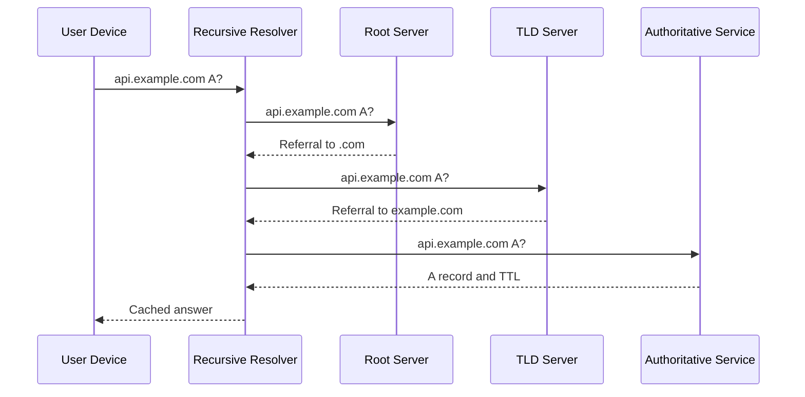

The authoritative service answers only for zones it hosts. It does not recursively look up unrelated names.

Delegation records at the parent point to the platform's authoritative names. Glue records provide addresses when the nameserver's name is inside the delegated namespace.

## API and record model

Updates operate on complete record sets, not individual wire-format records.

```http
PATCH /v1/zones/example.com/recordsets
Authorization: Bearer <token>
If-Match: "zone-version-184"
Content-Type: application/json

{
  "changes": [
    {
      "action": "upsert",
      "name": "api.example.com.",
      "type": "A",
      "ttl": 60,
      "values": ["192.0.2.10", "192.0.2.11"]
    }
  ],
  "reason": "Add second API endpoint"
}
```

The API normalizes names to absolute canonical form, validates record syntax, applies policy, and creates an immutable zone version.

Optimistic concurrency prevents two automation systems from silently overwriting each other's zone state.

## High-level architecture

Separate the strongly controlled configuration path from the extremely available query path.

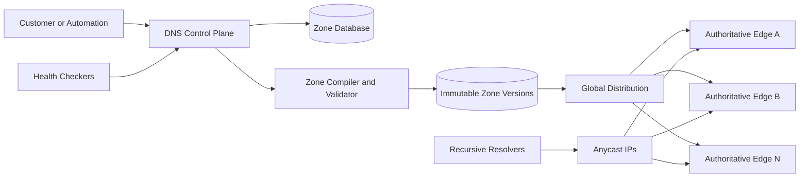

Edge servers answer from local memory or optimized on-disk structures. They never query the central zone database on the request path.

## Zone storage and partitioning

The source of truth stores zone metadata, record sets, policies, ownership, and version history.

Partition by stable zone ID rather than name. Large zones may use subpartitions for editing and compilation, but publication produces one logically consistent version.

Each mutation creates an append-only change record and advances the current version through compare-and-swap. Rollback points the active alias to a previously validated version by creating a new publication event.

Record IDs survive name normalization and reordering. Audit history captures before and after values without storing secrets such as key material.

## Zone validation and compilation

Before publication, validate:

- Name, type, class, and value syntax
- Apex requirements such as authority records
- Alias and canonical-name conflicts
- Delegation boundaries
- Wildcard placement
- Routing-policy references
- DNSSEC signing readiness
- Record, response-size, and TTL limits


The compiler converts human-friendly records and policies into a compact trie or sorted structure optimized for exact, wildcard, and delegation lookup.

Failed compilation never replaces the active version.

## Global configuration distribution

Distribution uses a versioned change stream plus immutable snapshots.

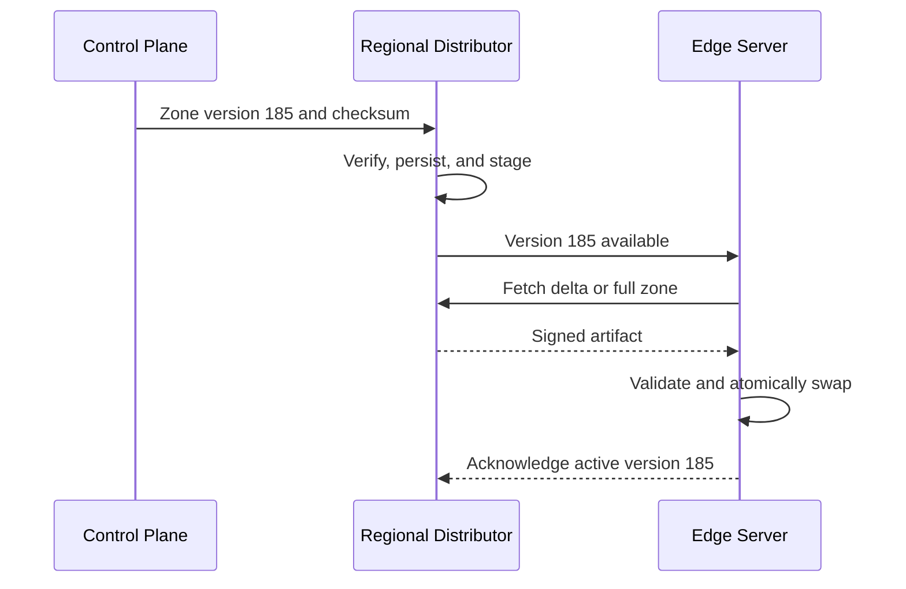

Edges build a complete new zone view and swap one pointer after verification. Queries never observe half of a multi-record change.

If an edge misses deltas, it fetches a full snapshot. The last valid version remains active through distribution or control-plane outages.

Emergency removals use a prioritized signed override channel while preserving the same validation and audit model.

## Anycast routing

The service advertises the same nameserver IP prefixes from many edge locations. Internet routing sends a resolver toward a nearby reachable advertisement.

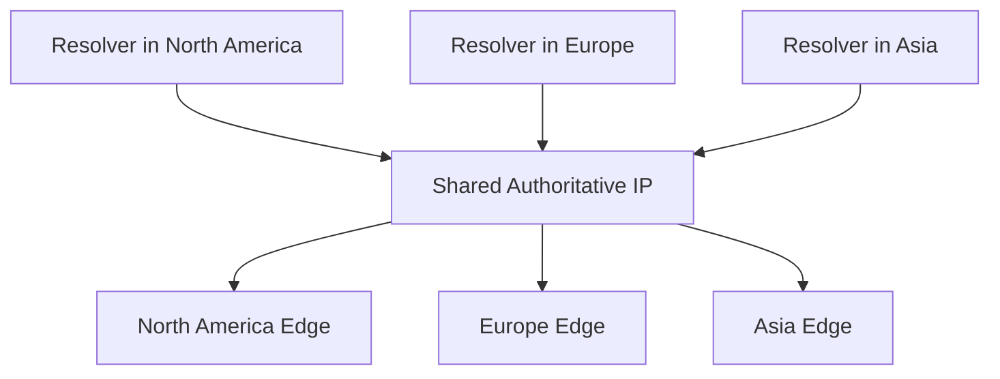

Anycast improves latency and absorbs attacks across the fleet, but network “nearest” is based on routing policy, not geography.

Withdraw an unhealthy site's route so traffic converges elsewhere. Keep at least two nameserver addresses on independent routing and infrastructure paths.

A resolver may switch edges between queries, so all healthy edges must serve compatible zone versions.

## Authoritative query path

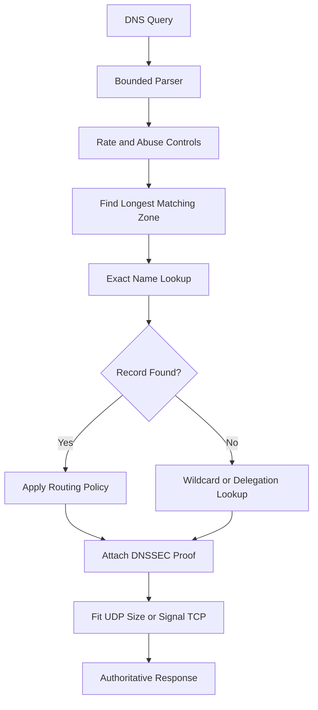

The parser enforces limits before allocating large buffers. Malformed queries receive minimal responses or are dropped according to abuse policy.

The server returns authoritative data, a referral, or an authenticated negative answer. It never performs recursion.

## Record lookup semantics

Look up the exact queried name first. If absent, evaluate wildcard rules at the closest eligible ancestor. Delegation points stop authoritative traversal and return referrals.

A canonical-name record redirects lookup and cannot coexist with most other data at the same owner name. Alias-like provider extensions are resolved during serving or compilation but appear on the wire as standard records.

The zone apex requires authority records and cannot use an ordinary canonical-name record. Provider aliases at the apex must preserve correct authority responses.

Case is preserved for presentation where desired but comparisons are case-insensitive.

## UDP, TCP, and encrypted transports

Traditional DNS uses UDP for low overhead. If a response exceeds the negotiated size, set the truncation flag and let the resolver retry over TCP.

Extension mechanisms advertise larger UDP payloads, but fragmentation is unreliable and exploitable. Apply a conservative response limit.

Authoritative servers support TCP with connection and query limits. Encrypted DNS is most common between clients and recursive resolvers; authoritative encryption can be supported where ecosystem requirements justify it.

All transports share the same query engine and response semantics.

## TTL and recursive caching

The time to live tells recursive resolvers how long they may cache an answer.

```mermaid
timeline
  title DNS change with caching
  10:00 : Resolver caches old answer with TTL 300s
  10:01 : Authoritative zone publishes new answer
  10:02 : New resolver receives new answer
  10:05 : Original cache expires and refreshes
```

Lower TTLs speed eventual change but increase query volume and dependency on authoritative availability. Higher TTLs improve resilience and cost but slow planned failover.

Before a migration, lower the TTL at least one previous-TTL interval in advance. Raising it again can happen after the new target is stable.

Resolvers sometimes cap or floor TTLs, so the platform cannot guarantee universal propagation at an exact second.

## Negative caching

Resolvers cache authoritative “name does not exist” and “type does not exist” answers using zone policy.

Negative caching protects against repeated misses but delays visibility when a previously absent name is created.

Random-subdomain attacks intentionally avoid positive caches. Edge servers maintain efficient authenticated denial structures and per-zone rate controls without allocating permanent state for every nonexistent name.

Differentiate nonexistent name from an existing name lacking the requested record type; resolvers and DNSSEC proofs treat them differently.

## DNSSEC

DNSSEC signs record sets so resolvers can verify authenticity and authenticated denial of existence.

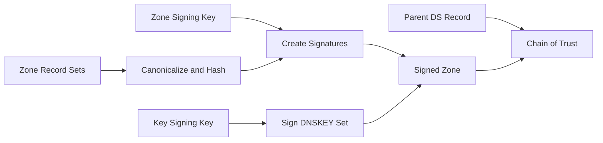

Private signing keys remain in a protected signing service or hardware security module. Edge servers receive signed data and public proofs, not private keys.

Use separate key roles so routine zone-signing rotation does not require changing the parent delegation every time.

Signature inception and expiration overlap distribution and cache windows. Re-sign well before expiry and monitor every edge for fresh signatures.

## Key rotation

Publish a new public key before using it, wait for caches, begin signing with it, update the parent trust record when required, then retire the old key only after every dependent cache can expire.

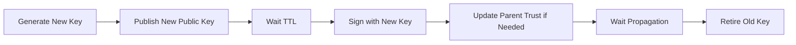

Automate rotation as a durable state machine. Losing track of an intermediate phase can make a correctly signed zone appear bogus to validating resolvers.

Emergency compromise rotation follows a faster, explicitly risky procedure with prominent alerts.

## Routing policies

Record sets can select answers by:

- Weighted allocation
- Resolver or client-subnet geography
- Measured regional latency
- Primary and failover role
- Endpoint health
- Multi-value healthy answer sets

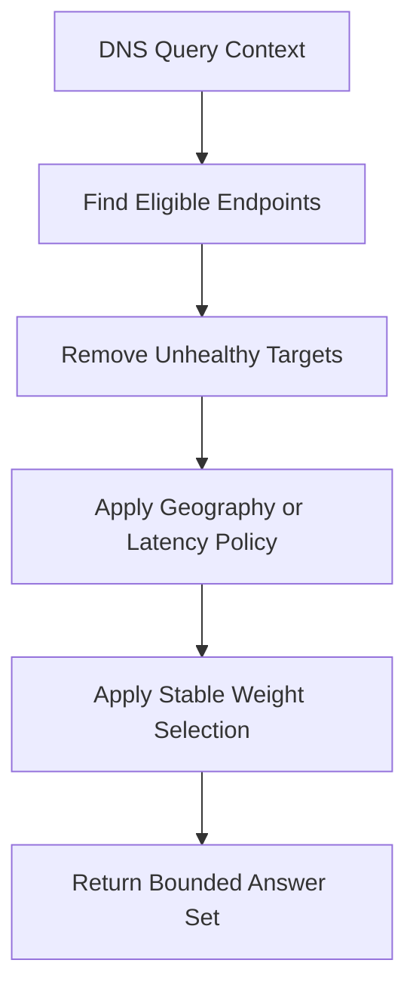

Use a stable hash of permitted query context to reduce rapid answer flapping. Do not assume the recursive resolver's location equals the end user's location.

Routing decisions are policy versions attached to query logs and audit history.

## Health checks and failover

Distributed health checkers probe endpoints from several regions. One failed probe does not mark a target unhealthy.

Aggregate consecutive successes and failures with quorum, hysteresis, and minimum state duration. Distinguish endpoint failure from a checker's network problem.

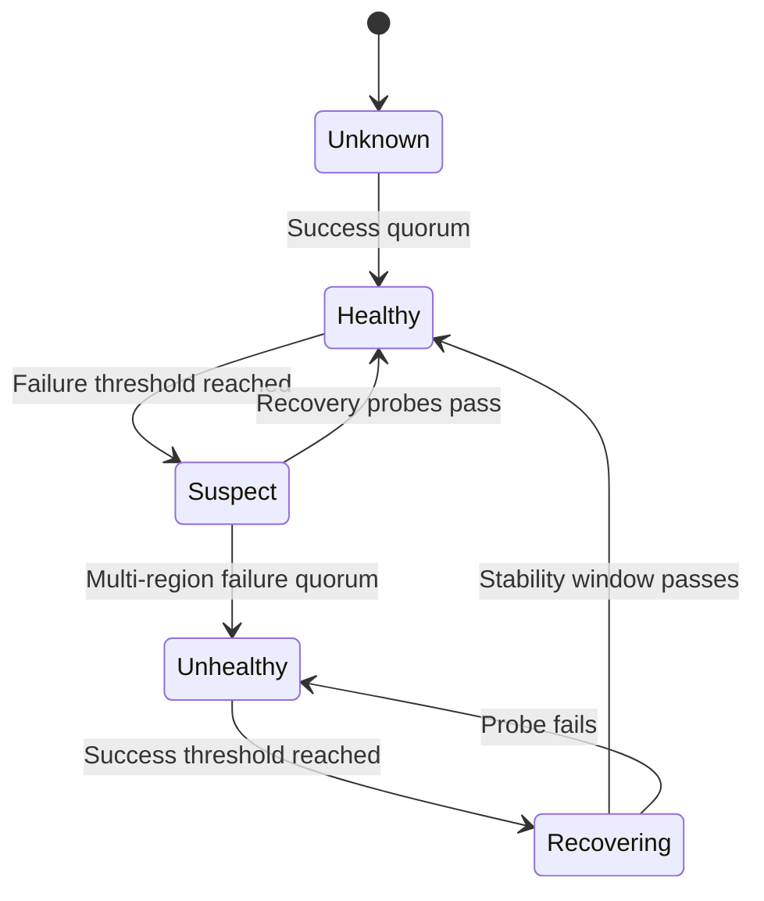

Health state changes the answers served but cannot revoke already cached records. TTL defines the practical failover delay.

For critical services, pair DNS failover with application-level retries, load balancers, or anycast so recovery does not depend entirely on cache expiration.

## Weighted traffic and canaries

Weighted DNS can send a fraction of resolver queries to a candidate endpoint. It does not precisely control end-user requests because resolvers cache answers and represent unequal populations.

Use it for coarse regional shifts, not exact experiment assignment. Application or edge-layer routing is better for stable per-user canaries.

Ramp weights gradually, observe endpoint health and business signals, and keep the previous target available through at least the cache window.

Returning several addresses delegates additional balancing behavior to clients, which may choose, race, or cache them differently.

## Delegation and glue

Parent zones publish nameserver records that delegate authority. If a nameserver name lies within the delegated child zone, the parent also includes glue addresses to avoid a lookup cycle.

The control plane validates that new zones have an assigned independent nameserver set. Delegation at the registrar remains an external step unless integrated.

For subdomain delegation, the parent zone returns referral records and stops answering below the cut except for required glue.

Monitor public delegation continuously. A healthy hosted zone is unreachable if the parent points to the wrong nameservers.

## Secondary DNS and zone transfer

Support full and incremental zone transfers over authenticated TCP for customers using secondary providers.

Transfers operate from a consistent zone serial and include signatures where appropriate. Incremental transfer supplies the ordered difference between known serials; if history expired, the secondary requests a full transfer.

Restrict transfer by mutually authenticated identity, access list, and zone policy. Publicly allowing full zone transfer can expose internal naming and create abuse load.

Secondary diversity improves resilience only when providers do not share the same network, control plane, or hidden dependency.

## Recursive resolver design notes

A recursive service caches validated answers and iteratively queries authoritative servers. It requires a different trust and abuse model from authoritative DNS.

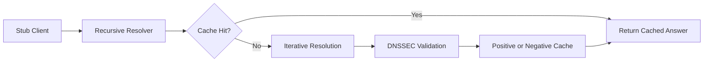

Resolvers use request coalescing so thousands of misses for one name create one upstream lookup. Serve-stale can return an expired validated answer briefly when authoritative servers are unavailable.

Open recursion invites abuse. Authenticate private users or apply strict public resolver controls.

## DDoS resilience

DNS is exposed to spoofed UDP traffic and amplification attacks. Defense is layered:

- Anycast distributes traffic across edges
- Network scrubbing filters volumetric attacks
- Source and response-rate limits reduce amplification
- Minimal responses omit unnecessary additional data
- UDP response sizes remain conservative
- Per-zone and per-name fairness prevents one target from consuming all workers
- Stateless parsing avoids allocation attacks
- TCP connection limits protect stateful resources

Response-rate limiting groups similar answers rather than blocking every query from a shared resolver. Legitimate recursive resolvers generate high concentrated traffic.

Cache hot signed answers at packet-processing or edge layers where safe. Random-name attacks require fast negative lookup rather than ordinary answer caching.

## Security and tenant isolation

Controls include:

- Strong identity and least-privilege zone roles
- Approval workflows for apex, delegation, and DNSSEC changes
- Optimistic concurrency and signed change artifacts
- Encryption in transit and at rest for control-plane data
- Hardware-protected DNSSEC keys
- Audited reads, changes, transfers, and key operations
- Per-tenant API, zone, record, and query quotas
- Domain-ownership validation where service policy requires it

Prevent dangling DNS references to deleted cloud resources. Inventory integrations can warn or block deletion while public names still target reclaimable resources.

Query logs may contain user-related names and source information. Apply minimization, access controls, sampling, and retention policy.

## Multi-region control plane

Assign each zone an authoritative write home or use a globally consistent metadata partition. All regions receive signed immutable versions.

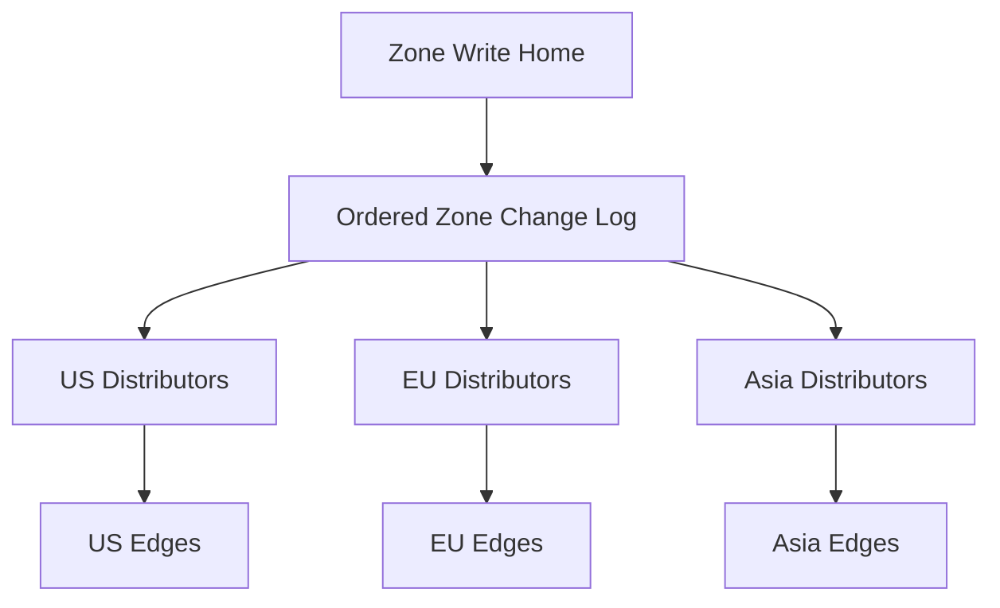

During control-plane partition, one side retains write authority. Data-plane edges everywhere continue serving the last valid zone version.

Failover fences the old writer before promotion. Client request IDs make retried changes idempotent.

Propagation status reports active versions by region and edge cohort rather than merely saying “change saved.”

## Failure handling

### Control plane unavailable

Edges continue serving local snapshots. Zone edits pause or route to a consistent surviving write region.

### Distribution delay

Keep the prior complete version active, retry with jitter, and report version lag. Never apply a partial delta sequence.

### Edge site failure

Withdraw its anycast route. Internet routing shifts resolvers to other sites.

### Zone compiler bug

Canary a new compiler, compare known-answer outputs, and retain compiled prior versions for atomic rollback.

### Signing service unavailable

Existing signatures remain valid. New DNSSEC changes pause while operators monitor time until signature expiration.

### Health checker partition

Use multi-region quorum and retain prior state briefly. Avoid marking every target unhealthy from one isolated checker fleet.

### Metadata corruption

Restore an immutable known-good version and verify signatures and record counts. Edge copies provide an additional recovery source but not the only backup.

## Observability

Track:

- Query rate, latency, response codes, and transport
- Answer size, truncation, and TCP retry rate
- Cacheability and TTL distribution
- Zone version and propagation lag by edge
- Record lookup misses and random-subdomain patterns
- Anycast traffic shifts and site saturation
- Health-check state changes and probe disagreement
- DNSSEC signature age, validation failures, and key phase
- Control-plane errors, conflicts, and rollback frequency
- Rate limiting, dropped traffic, and amplification factor
- Delegation correctness and nameserver reachability

Synthetic probes from diverse networks query known positive, negative, wildcard, delegation, DNSSEC, and failover records.

Compare authoritative query logs with control-plane versions to diagnose whether a stale response came from the edge or an external recursive cache.

## Key tradeoffs

### Low TTL vs resilience

Low TTLs speed changes but increase authoritative load and make outages visible sooner. High TTLs improve caching and availability while slowing migration and failover.

### Strong consistency vs global propagation speed

Atomic zone versions prevent mixed records at an edge. Edges may briefly serve adjacent versions during rollout; external caches already make universal simultaneity impossible.

### Dynamic health routing vs stable answers

Health-aware DNS removes failed targets but can flap and remains constrained by caches. Hysteresis and conservative state changes favor stable, explainable behavior.

### Rich policies vs cache effectiveness

Highly personalized answers reduce shared-cache value and increase query volume. Use only context that materially improves routing.

### Anycast simplicity vs routing control

Anycast gives one global address and rapid failover, but path choice belongs to internet routing. Capacity planning assumes traffic can shift unexpectedly between neighboring sites.

The central principle is to keep the authoritative query path local, immutable, and independent of control-plane health while treating TTL and external caches as part of every change and failover design.
