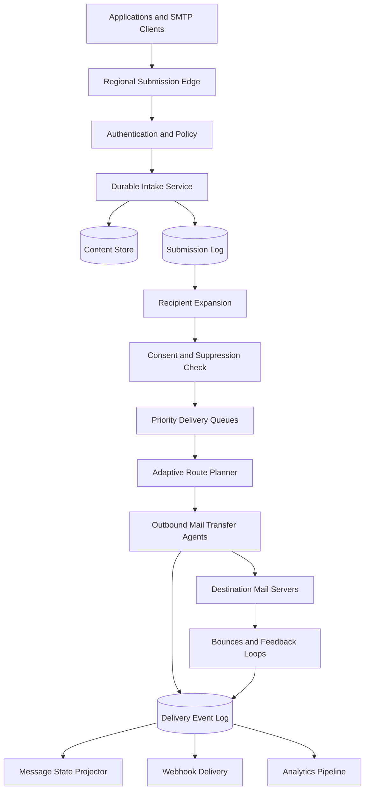
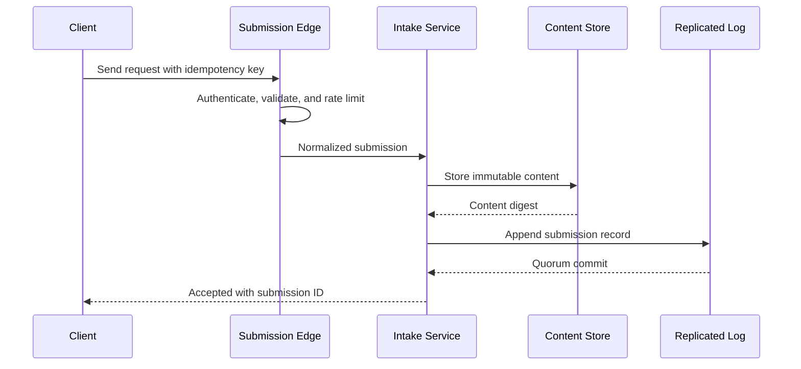
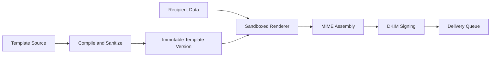
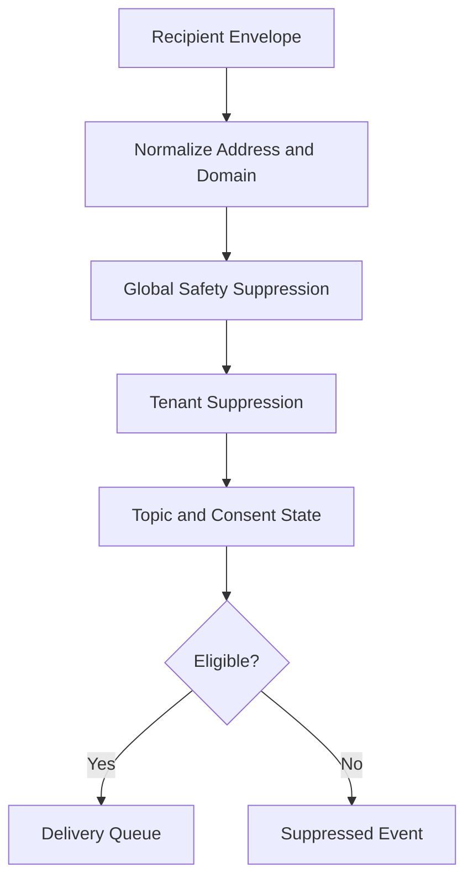
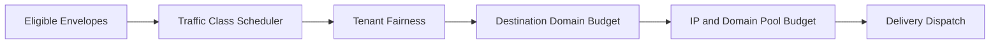
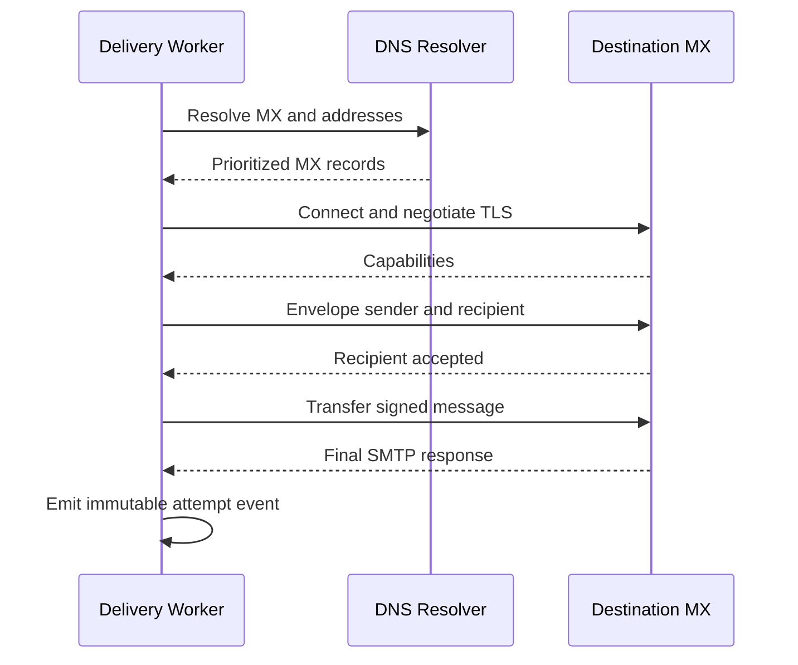
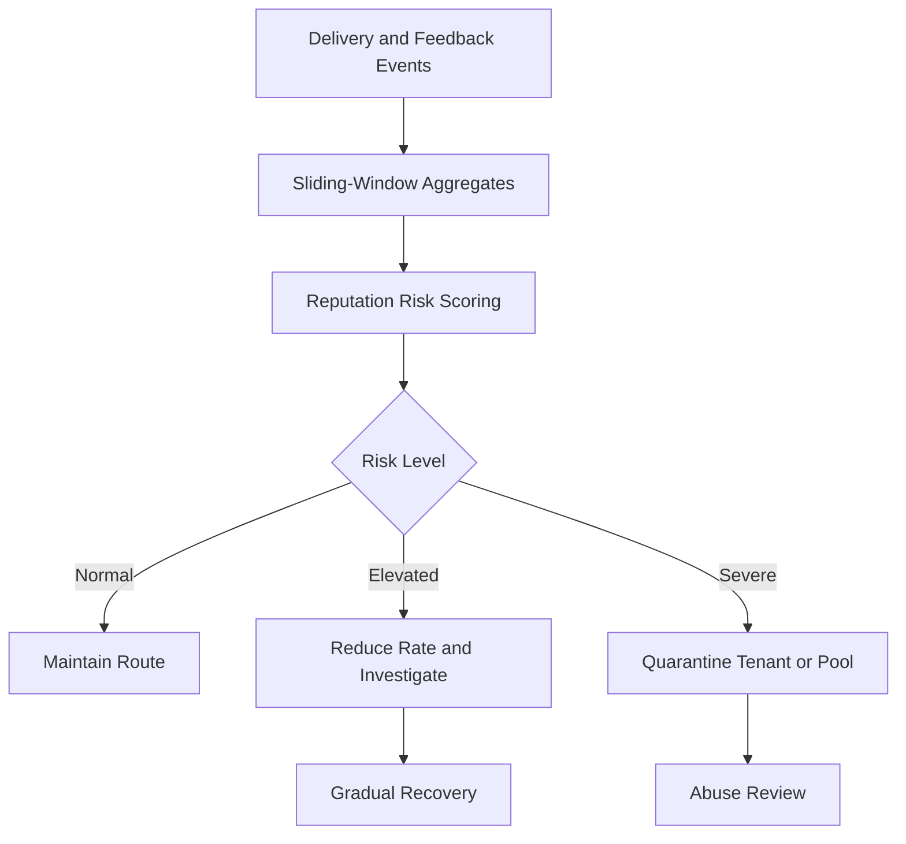
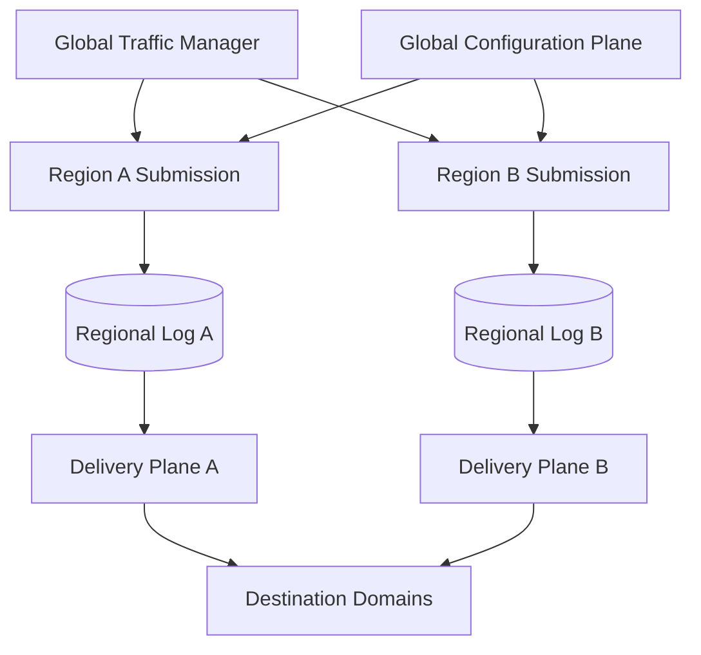

## Problem and requirements

An email delivery platform accepts messages from applications, turns templates and recipient data into standards-compliant email, delivers through destination mail servers, and reports what happened. It serves latency-sensitive password resets and receipts as well as newsletters sent to millions of recipients.

The hard part is not opening an SMTP connection. Delivery depends on destination-specific throttling, sender identity, IP and domain reputation, bounce interpretation, recipient consent, retries that may last for days, and standards that evolved across decades. The system must maximize legitimate delivery without behaving like an abusive sender.

### Functional requirements

- Accept mail through a REST API and authenticated SMTP submission
- Support transactional, scheduled, and bulk campaigns
- Render versioned templates with recipient-specific data
- Validate sender domains and signing configuration
- Enforce suppression lists, consent, and tenant quotas
- Route messages through healthy regional delivery pools
- Retry transient failures without duplicating deliveries unnecessarily
- Process bounces, complaints, unsubscribes, and provider feedback
- Expose message state, aggregate analytics, and webhook events
- Support dedicated domains and IP pools for large senders

### Non-functional requirements

- Accept 100 billion messages per day with bursts above five million per second
- Acknowledge durable API submissions in under 200 milliseconds at p99
- Begin delivery of priority transactional mail within seconds
- Preserve messages and state across regional or worker failures
- Isolate each tenant's traffic, data, quotas, and reputation impact
- Never send to a known suppressed recipient
- Keep submission highly available without sacrificing durable acceptance
- Protect message bodies, recipient data, credentials, and signing keys

## Capacity estimates

At 100 billion messages per day, the average rate is about 1.16 million messages per second. Campaign launches and scheduled sends can produce far larger bursts.

Assume an average encoded message size of 75 KB, including HTML, text, headers, and attachment references. Storing every rendered copy would create several exabytes of daily writes, so the platform stores shared immutable content once and keeps compact per-recipient envelopes separately.

| Resource | Estimate |
| --- | ---: |
| Average submissions | 1.16M messages/second |
| Peak accepted recipients | 5M/second |
| Outbound SMTP attempts | 2–3M/second including retries |
| Envelope metadata | Tens of TB/day compressed |
| Shared content and attachments | Petabytes/day before retention |
| Delivery and engagement events | Hundreds of billions/day |

Capacity plans must account for destination concentration. A single large mailbox provider can receive a substantial share of global traffic and impose rapidly changing per-sender limits.

## Message model

```text
Submission {
  submissionId, tenantId, idempotencyKey,
  senderIdentity, contentRef, recipients,
  trafficClass, scheduleAt, createdAt
}

Envelope {
  messageId, submissionId, recipient,
  destinationDomain, personalizationRef,
  routePolicy, state, nextAttemptAt
}

Attempt {
  attemptId, messageId, routeId,
  startedAt, smtpReply, outcome, latency
}
```

A submission may create millions of recipient envelopes, but each envelope has an independent lifecycle. Content and attachments are immutable and content-addressed. Personalization data is stored separately with a shorter retention period.

The public message ID is stable across retries. Every delivery attempt receives a distinct attempt ID so operational history remains auditable.

## High-level architecture



The submission plane accepts and durably records intent. The delivery plane asynchronously expands recipients, applies policy, schedules attempts, and communicates with destination servers. Event consumers build queryable state without blocking delivery.

## Submission and durable acceptance



The platform acknowledges only after both the content reference and submission record are durable. A request retried with the same tenant and idempotency key returns the original result. Reusing the key with different content is rejected.

Validate syntax, message size, sender authorization, template existence, and quota before acceptance. Recipient existence is usually unknowable until delivery and should not delay submission.

Large campaigns should reference an uploaded audience snapshot rather than sending millions of recipients in one API call. The snapshot is immutable, encrypted, and expanded incrementally so a campaign cannot overload the control plane.

## Sender identity and authentication

Before sending, a tenant verifies control of its domain through DNS. The platform provisions or validates:

- SPF authorization for the chosen return path
- DKIM public keys and selector records
- DMARC alignment between visible sender, signing domain, and return path
- Custom tracking and bounce domains when requested

Private DKIM keys live in a hardware-backed key service. Delivery workers request signing operations or short-lived key handles; they never store long-lived private keys on local disks.

Rotate selectors without interrupting mail by publishing the new key, signing with both configurations during propagation, switching the active selector, and retiring the old key after delayed messages have expired.

## Templates and rendering

Templates are immutable versions containing subject, HTML, plain text, headers, localization rules, and a declared variable schema. Publishing a template compiles and validates it before it can serve traffic.



Rendering runs in a sandbox with bounded time and memory. Templates cannot make network requests or execute tenant code. Escape variables by context, sanitize unsafe markup, and reject header injection.

For large campaigns, cache common rendered fragments and group recipients that share language and content. Never let this optimization expose one recipient's personalization to another.

## Recipient expansion and fan-out

Expansion converts a campaign or multi-recipient submission into independently schedulable envelopes. It proceeds in bounded partitions and checkpoints progress so retries do not create duplicate envelopes.

Partition first by destination domain, then by tenant and traffic class. Domain-aware partitioning gives the scheduler a clear view of pressure against each destination. Use a deterministic message ID derived from submission, audience snapshot version, and recipient position to make expansion idempotent.

A campaign pause stops creating new eligible delivery work but does not erase its audit history. Cancellation marks unsent envelopes terminal; attempts already handed to remote servers cannot be recalled.

## Consent and suppression

Suppression is a strongly consistent safety boundary in the logical send path. Sources include:

- Recipient unsubscribes
- Permanent bounces and invalid addresses
- Spam complaints
- Tenant-managed blocks
- Platform-wide abuse and legal restrictions
- Temporary holds after repeated transient failures



Normalize addresses conservatively. Domain parts are case-insensitive, but local-part equivalence rules vary and should not be guessed globally.

Maintain a low-latency regional cache backed by a durable source of truth. Suppression changes publish invalidations immediately. At dequeue time, workers recheck the suppression version so messages waiting in a queue cannot bypass a recent unsubscribe.

## Queueing and traffic classes

Separate queues for transactional, lifecycle, and bulk traffic. A newsletter surge must not delay a password reset. Each class receives explicit latency objectives, quotas, concurrency reservations, and retry policies.

Within a class, schedule by earliest eligible time while applying weighted fairness across tenants. Hierarchical token buckets enforce platform, region, IP pool, tenant, campaign, and destination-domain limits.



Queues store compact envelope references, not full message bodies. Workers fetch content only after acquiring every required budget, preventing expensive rendering for work that cannot yet be sent.

## Adaptive routing

The route planner chooses a region, outbound IP pool, signing domain, and delivery cluster. Inputs include tenant configuration, traffic class, destination domain, IP warm-up state, recent SMTP replies, connection health, and regulatory boundaries.

Dedicated IPs provide reputation isolation for large, well-operated senders but require sufficient steady volume and careful warm-up. Shared pools improve utilization for smaller senders but must segment transactional and promotional traffic and rapidly isolate abusive tenants.

Routing changes should be gradual. Moving a sudden volume spike to a cold IP can damage reputation and worsen delivery. Use bounded step changes, control groups, and automatic rollback when deferrals or complaints rise.

## SMTP delivery

Delivery workers group compatible messages by destination, reuse TLS connections, and pipeline commands only when the remote server advertises support. They enforce strict limits on connection age, messages per connection, and in-flight commands.



Cache DNS responses according to TTL while protecting against poisoned or stale data. Prefer modern TLS, validate certificates where policy requires it, and support mandatory transport policies for configured domains.

A successful final SMTP response means the destination accepted responsibility; it does not guarantee inbox placement or that a person read the message.

## Failure classification and retries

SMTP response classes are a starting point, not a complete policy. Destination providers use enhanced status codes and free-form text inconsistently. A versioned response classifier maps replies into outcomes such as success, permanent recipient failure, content rejection, rate limit, reputation deferral, mailbox full, or infrastructure failure.

| Outcome | Action |
| --- | --- |
| Accepted | Mark delivered-to-server and stop retries |
| Permanent recipient failure | Bounce and suppress when appropriate |
| Content or policy rejection | Stop or route to controlled remediation |
| Destination rate limit | Reduce domain concurrency and retry later |
| Temporary mailbox issue | Retry with exponential backoff |
| Network or DNS failure | Try alternate MX, then schedule retry |

Use exponential backoff with jitter and destination-aware hints. Transactional mail may retry quickly at first; bulk mail should back off more aggressively. Stop after the configured expiry window and emit a terminal expiration event.

Exactly-once external email delivery is impossible. A worker can lose its connection after the destination accepts a message but before receiving the reply. Retrying risks a duplicate; not retrying risks loss. Preserve a stable `Message-ID`, record the ambiguous result, and apply bounded retry rules based on traffic class and destination behavior.

## Reputation management

Reputation exists across sending domains, DKIM domains, IPs, tenants, traffic classes, and destination providers. The platform continuously evaluates:

- Hard-bounce and complaint rates
- Unknown-user responses
- Deferrals and content rejections
- Spam-trap and blocklist signals
- Volume shape and sudden changes
- Authentication alignment
- Engagement trends as a weak, privacy-sensitive signal



Automated controls should reduce blast radius without silently punishing unrelated tenants. Quarantine suspicious traffic into an isolated pool or stop it before it contaminates shared reputation.

## Bounces and feedback loops

Some failures arrive asynchronously as delivery status notifications. Return-path addresses contain an opaque, signed token mapping the bounce to tenant, message, and recipient without exposing raw identifiers.

Inbound processors parse untrusted MIME in sandboxes, verify the token, classify the response, and append an event. Unknown or forged bounces cannot modify suppression state.

Mailbox-provider complaint feedback follows a similar pipeline. A verified complaint immediately suppresses the relevant recipient for that sender and updates reputation. Deduplicate repeated reports by provider and message.

Unsubscribe endpoints must remain fast and available even during incidents. Use signed, expiring identifiers that allow the requested opt-out without requiring account login, then propagate the change before acknowledging success.

## Event state and customer webhooks

Every transition appends an immutable event: accepted, rendered, queued, attempted, deferred, delivered-to-server, bounced, complained, suppressed, expired, or canceled.

State projectors build the current message view from this log. Events can arrive late or out of order, so projectors compare attempt sequence and state precedence rather than relying on arrival time.

Customer webhooks use a separate reliable-delivery system with signatures, retries, backoff, and per-endpoint circuit breakers. Webhook failure must never block email delivery. Customers receive event IDs and can deduplicate at-least-once notifications.

## Scheduling

Scheduled messages are stored in time-partitioned buckets. A regional timer service promotes near-term work into delivery queues, using leases and idempotent promotion records. Campaigns scheduled for a recipient's local time resolve time zones before bucketing and record the timezone database version used.

Quiet hours and rate smoothing shift eligible times without changing the original campaign schedule. If a large campaign falls behind, the platform should finish within its delivery window rather than creating a catch-up spike.

## Multi-region design

The submission edge routes clients to a nearby healthy region. Tenant residency policy determines where message bodies and recipient data may be stored and processed.



Messages have one active home region at a time to avoid concurrent delivery. Cross-region failover transfers ownership through an epoch or fenced lease. A stale region may finish an already accepted SMTP transaction, but cannot dequeue new work after losing the epoch.

Replicate configuration globally, but keep high-volume delivery logs regional and export aggregated metrics. For disaster recovery, replicate encrypted content and unsent envelope state only to permitted regions.

## Security and abuse prevention

The platform is attractive to credential thieves and spam operators. Protect it with scoped API keys, short-lived SMTP credentials, optional source-network restrictions, anomaly detection, and rapid key revocation.

New tenants receive conservative quotas and shared-pool isolation until identity and sending behavior are established. Detect list bombing, address enumeration, compromised templates, sudden volume changes, and repeated policy evasion.

Encrypt content and recipient data in transit and at rest. Restrict production access, tokenize addresses in analytics, and redact message bodies from routine logs. Attachments are malware-scanned in isolated workers before delivery.

Administrative actions—quota changes, suppression overrides, domain verification, IP assignment, and content inspection—require audited, least-privilege workflows. High-risk overrides need dual approval.

## Reliability and degradation

| Failure | Safe behavior |
| --- | --- |
| Submission region unavailable | Route new traffic to an allowed healthy region |
| Template renderer overloaded | Preserve accepted work and shed bulk rendering first |
| Suppression store unavailable | Do not send unless a sufficiently fresh safe cache is available |
| Destination provider throttles | Reduce that domain's rate without slowing others |
| Delivery worker crashes | Lease expires and another worker resumes the envelope |
| Event projector lags | Delivery continues; customer status is marked delayed |
| Webhook endpoint fails | Retry independently without affecting mail |
| Signing service unavailable | Queue mail; never send unsigned when signing is required |

Apply backpressure before durable queues exceed retention or recovery limits. Admission control should preserve priority transactional capacity and reject or delay new bulk campaigns explicitly.

## Observability and service objectives

Track the system at platform, region, tenant, traffic class, route, IP pool, and destination-domain levels.

Key operational metrics include:

- Submission availability and durable-accept latency
- Queue age and time to first attempt by traffic class
- SMTP connection, TLS, and command latency
- Acceptance, deferral, bounce, complaint, and expiration rates
- Suppression freshness and blocked-send counts
- Retry amplification and ambiguous outcomes
- Sender pool utilization and reputation changes
- Event projection and webhook lag

Suggested objectives are 99.99% monthly submission availability, p99 durable acceptance below 200 milliseconds, 99% of priority transactional messages attempted within five seconds, and suppression propagation below ten seconds globally.

Inbox placement is not directly observable from SMTP success. Treat sampled seed tests, provider dashboards, and aggregate engagement as diagnostic signals rather than guaranteed delivery truth.

## Key tradeoffs

### Shared versus dedicated IPs

Shared pools simplify warm-up and use capacity efficiently, but tenants influence one another's reputation. Dedicated pools isolate reputation but require meaningful volume and operational discipline.

### Pre-render versus render at delivery

Pre-rendering reduces send latency but multiplies storage and can become stale. Late rendering saves storage and reflects recent data, but creates a large compute dependency in the delivery path. Use shared compiled templates and render shortly before eligibility.

### Global queues versus regional ownership

A global queue simplifies scheduling but creates latency, residency, and failure-domain problems. Regional ownership with a global configuration plane provides clearer isolation at the cost of explicit failover coordination.

### Aggressive retry versus reputation

Fast retries can help transient failures but may worsen throttling and look abusive. Retry policies must adapt to the destination response and traffic class.

## Evolution path

1. Begin with one region, durable submission, transactional queues, basic SMTP delivery, bounces, and suppression.
2. Add templates, customer webhooks, bulk fan-out, traffic classes, and tenant quotas.
3. Introduce domain-aware adaptive throttling, shared reputation pools, complaints, and analytics.
4. Expand to multiple regions with fenced ownership, residency policy, and dedicated IP pools.
5. Add automated reputation controls, progressive IP warm-up, sophisticated abuse detection, and controlled routing experiments.

## Final design

The platform separates durable submission from asynchronous delivery. It stores shared immutable content once, expands independent recipient envelopes, checks consent immediately before sending, and schedules work through tenant-, class-, domain-, and route-aware limits. Adaptive routing and reputation controls prevent one destination or sender from damaging the rest of the system.

Every attempt produces an immutable event, allowing state views, analytics, bounces, feedback, and customer webhooks to evolve independently. Region-fenced ownership prevents split-brain delivery, while idempotency contains duplicates wherever the protocol permits. The resulting system delivers urgent and bulk mail at global scale without compromising recipient choice, sender isolation, security, or operational clarity.
