## Problem and requirements

A forms and survey platform lets creators design questionnaires, registration forms, applications, quizzes, and data-collection workflows. Respondents open a public or authenticated link, navigate conditional questions, upload files, save drafts, and submit reliable responses.

The difficult part is preserving meaning while forms evolve. Responses must stay tied to the exact schema and logic shown, popular forms can receive millions of submissions in minutes, public endpoints attract bots and abuse, and analytics must not expose sensitive individual answers.

### Functional requirements

- Build forms with typed questions, sections, validation, and themes
- Collaborate on drafts with roles and version history
- Publish immutable form versions
- Support branching, skip logic, randomization, and calculated fields
- Accept public, authenticated, invited, or single-use responses
- Autosave drafts and resume across devices when allowed
- Upload files securely
- Enforce deadlines, response limits, quotas, and eligibility
- Prevent accidental duplicate submissions
- Send confirmation and workflow notifications
- Search, filter, analyze, and export responses
- Apply retention, deletion, redaction, and regional policy

### Non-functional requirements

- Store 100 million forms and ingest ten billion responses per day
- Absorb five million submissions per second during major events
- Return published forms within 200 milliseconds at p99
- Never grade or interpret a response against the wrong form version
- Keep submission acceptance independent from analytics availability
- Isolate creators, organizations, forms, and response data
- Protect public collection endpoints from automated abuse
- Make every submission outcome idempotent and auditable

## Capacity estimates

Assume 100 million forms, 100 questions per form, ten billion daily responses, and one kilobyte of compressed structured answers per response before files.

| Resource | Estimate |
| --- | ---: |
| Published forms | 100M |
| Responses | 10B/day |
| Peak submission rate | 5M/second |
| Structured response storage | 10+ TB/day compressed |
| File uploads | Petabytes/day for file-heavy workflows |
| Analytics updates | Trillions of answer-level aggregates/day |

Published form delivery is cacheable and globally distributed. Submission admission and durable storage are the critical write path.

## Core data model

```text
Form {
  formId, tenantId, ownerId, currentDraftVersion,
  activePublishedVersion, state, homeRegion
}

FormVersion {
  formId, version, schema, logicGraph,
  policy, contentHash, publishedAt
}

Response {
  responseId, formId, formVersion,
  respondentRef, state, startedAt, submittedAt,
  answerManifestHash
}

Answer {
  responseId, questionId, questionVersion,
  valueType, valueRef, updatedAt
}
```

Question IDs remain stable across compatible edits, while question versions record semantic changes. A response always pins one published form version.

## Form lifecycle

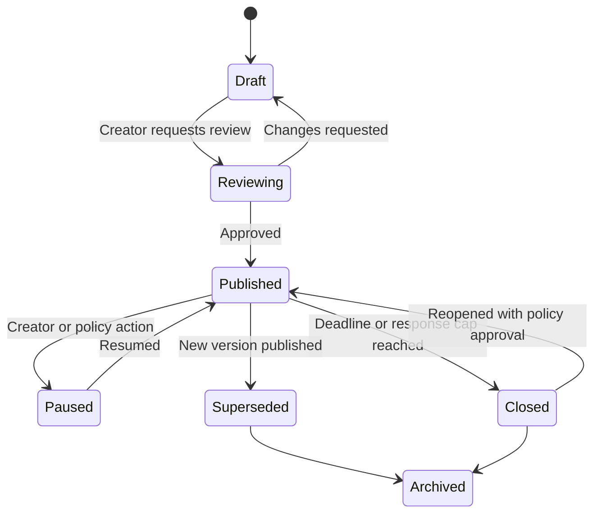

Publishing creates an immutable version. New edits return to a draft branch and do not affect respondents already using the previous version unless a defined migration policy applies.

## High-level architecture

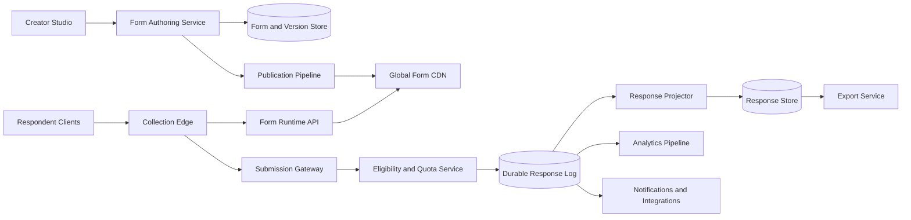

The submission gateway acknowledges only after durable acceptance. Response projection, analytics, notifications, and external integrations can recover asynchronously.

## Authoring model

The form schema contains sections, questions, display content, validation, localization, calculation definitions, accessibility metadata, and response policy.

```yaml
questionId: q_contact_email
version: 3
type: email
required: true
validation:
  maxLength: 254
visibility:
  when:
    question: q_contact_method
    equals: email
```

Question types include text, number, date, choice, multi-select, rating, matrix, ranking, address, signature acknowledgement, file, and approved custom widgets.

Custom widgets run in isolated frames with a narrow message contract. They cannot read unrelated answers or tenant credentials.

## Collaborative editing

Creators edit structured blocks through operations rather than replacing one large document.

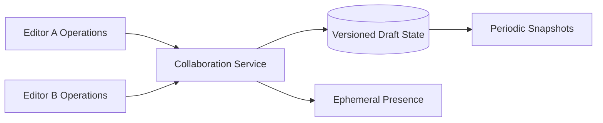

Operational transformation or CRDT-style merging can handle independent text and block edits. Semantic conflicts—such as two people changing the same answer option meaning—still require explicit review.

Draft history records actor, operation, timestamp, and resulting version. Restore creates a new draft version instead of deleting later history.

## Publication validation

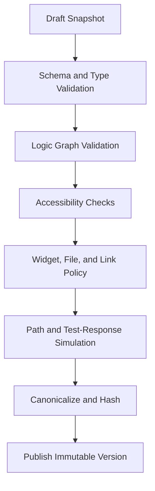

Reject unreachable required questions, cycles in navigation logic, references to deleted options, contradictory quotas, and calculations that depend on hidden unavailable values.

Run generated test responses through every reachable branch. Publication stores validator and compiler versions for reproducibility.

## Branching logic

Compile human-authored conditions into a deterministic directed graph.

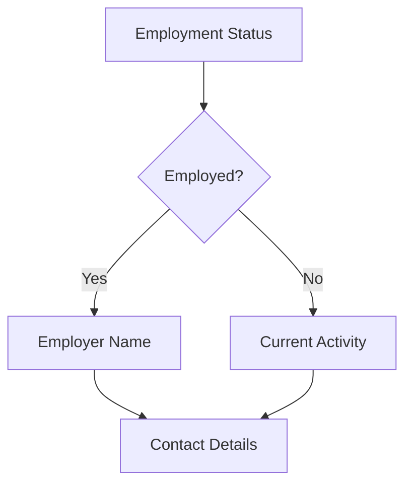

The server and client use the same versioned logic bytecode or canonical evaluator contract. The server re-evaluates the submitted path and rejects answers to inaccessible questions when policy requires strictness.

Changing an earlier answer can invalidate downstream answers. The client marks them inactive rather than immediately destroying them; submission includes only answers reachable in the final path unless policy explicitly retains hidden values.

## Form delivery

Published manifests and static assets are immutable and cacheable by form-version hash.

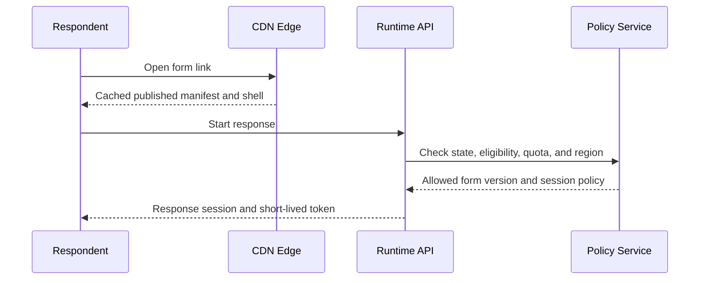

Public preview can render without a response session, but saving or submitting requires one. Tokens bind form, version, response, policy, and expiry.

If the active version changes while a respondent is filling the form, keep the response pinned to its original version unless the creator configured a safe forced migration.

## Respondent modes

- Anonymous: no durable identity is required
- Authenticated: response binds to an account or organization principal
- Invited: a recipient-specific token controls eligibility
- Single-use: one invitation can produce one final response
- Editable after submission: authorized respondent can create response revisions

Anonymous does not mean unprotected. Store only the minimum network and device metadata necessary for abuse prevention under the declared policy.

Invitation tokens are random, revocable, scoped, and stored hashed. They must not reveal recipient identity in the URL.

## Autosave

Autosave writes answer patches with response version, client operation ID, and per-device sequence.

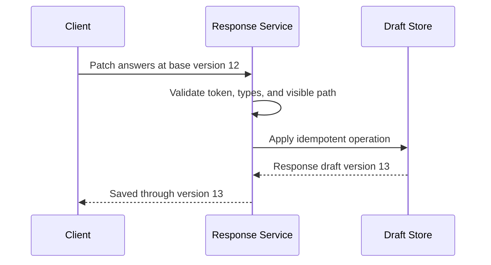

Independent question edits can merge. Conflicting edits to the same answer return the current value for resolution unless last-device-wins is an explicit low-risk policy.

Sensitive forms can disable server drafts or encrypt them with response-scoped keys. The UI must make save behavior clear.

## Submission path

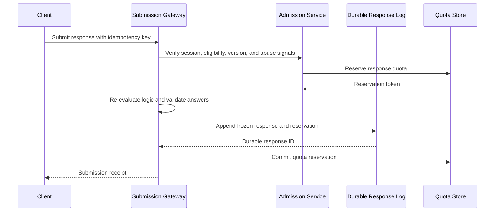

The idempotency key maps to one submission result. A network timeout followed by retry returns the existing response ID.

Freeze answer values, visible path, form hash, logic version, policy, respondent mode, and authoritative receipt time. Later edits create response revisions rather than mutating the submitted record.

## Quotas and response limits

Forms can limit total responses, responses per invitation, per account, per organization, or per option.

Use strongly consistent counters or reservations for strict limits such as “first 1,000 registrations.” Approximate counters are acceptable only when slight overage is declared.

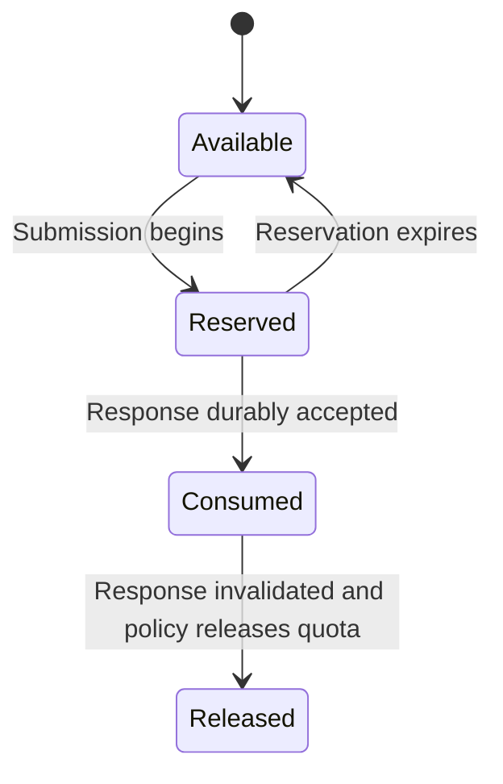

Reservations have short expiries and stable request IDs. A retry finds the original reservation.

## Validation

Validate in layers:

- Type, encoding, size, and required fields
- Question-specific constraints and option membership
- Cross-answer constraints
- Branch reachability and hidden-answer policy
- File readiness and scan result
- Calculation and scoring invariants
- Form-level quota and eligibility

Client validation improves usability; server validation is authoritative.

Do not execute creator-supplied arbitrary code. Calculations use a bounded expression language with deterministic functions, instruction limits, and no network access.

## Randomization

Forms can randomize question or option order to reduce ordering bias. Derive the permutation from a secure response-specific seed and the published randomization policy.

Store the seed or final permutation with the response so analytics and review reconstruct exactly what was shown.

Balanced randomization may use allocation buckets rather than independent shuffles. The admission service assigns the bucket atomically and tracks exposure counts.

## File uploads

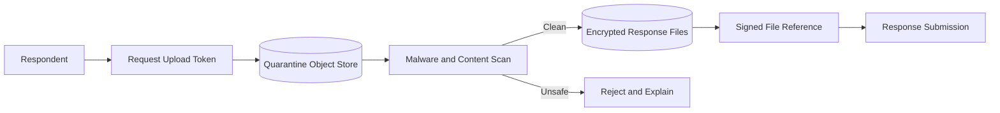

Upload tokens bind response, question, content limits, and expiry. The response can reference only files owned by its session and marked clean.

Detect content type from bytes, remove unsafe metadata where appropriate, limit decompression, and render downloads with safe headers. File access always rechecks response authorization.

## Public endpoint abuse controls

Forms can be used for spam, phishing, file hosting, credential collection, or denial of service.

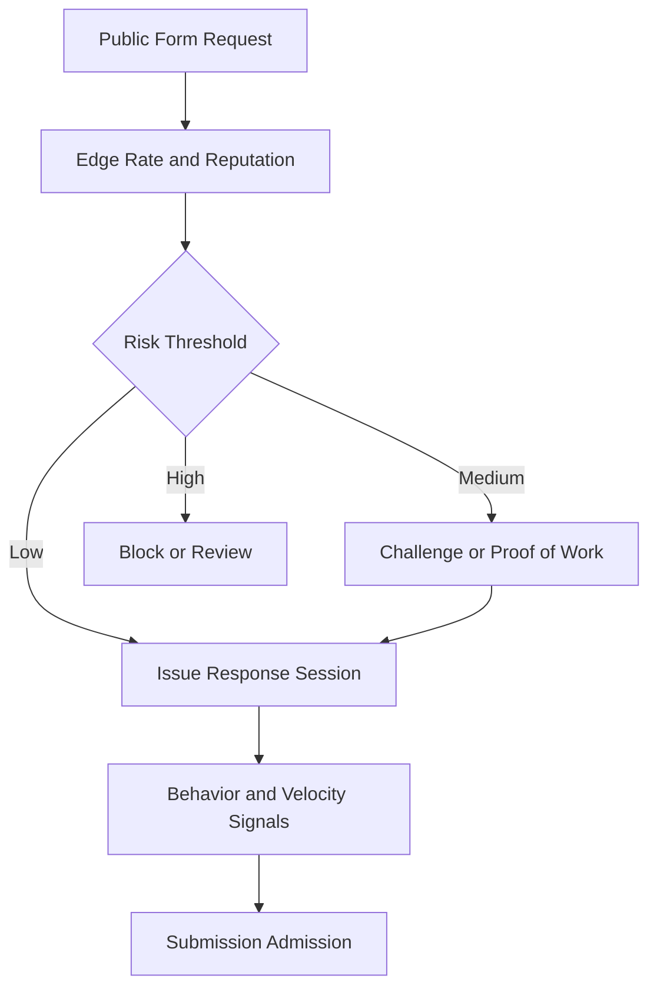

Apply quotas by form, tenant, invitation, account, device signal, network prefix, and region. Challenges are risk based so ordinary respondents are not universally penalized.

Scan form titles, descriptions, outbound links, custom domains, and requested data for abuse. High-risk forms may require creator verification before public distribution.

## Duplicate detection

Idempotency prevents accidental client retries. Policy-based duplicate detection can additionally use invitation, authenticated respondent, creator-defined unique key, or privacy-preserving fingerprints.

Do not secretly equate shared IP addresses with one person. Schools, offices, and households commonly share networks.

When a probable duplicate is found, the policy may reject, allow but flag, or let the respondent update an existing response. Record the reason and confidence.

## Notifications and workflows

Submission events can trigger respondent receipts, creator notifications, approvals, webhooks, or downstream integrations.

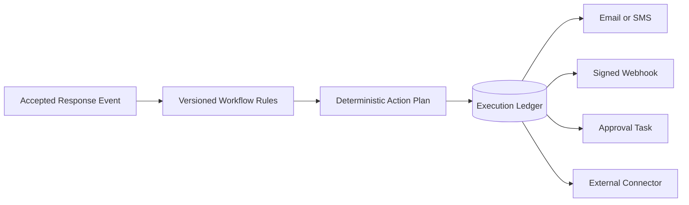

Each action key combines response ID, response revision, workflow version, and action index. Retries cannot repeat completed side effects.

Bound recursion and prevent a connector callback from resubmitting the same workflow indefinitely.

## Approval workflows

Some forms create applications that require one or more reviewers.

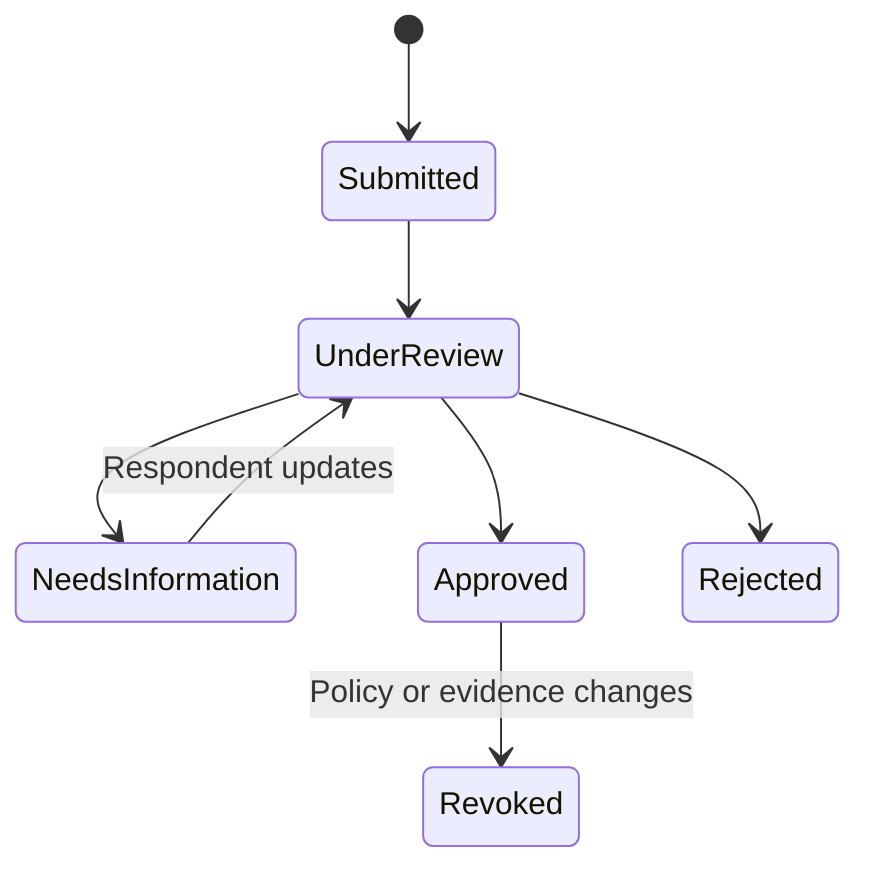

Reviewer assignments, decisions, notes, and deadlines are separate from respondent-visible answers. Every decision is versioned and audited.

Blind review can hide respondent identity. Conflict-of-interest policy removes ineligible reviewers before assignment.

## Quizzes and scoring

Quiz forms store answer keys and rubrics separately from the public form manifest. Starting a graded response pins scoring version and randomized order.

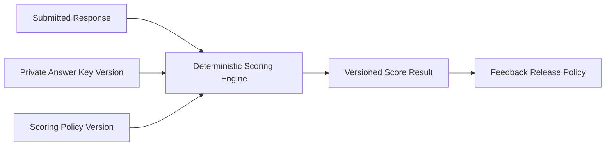

Never send correct answers or hidden explanations before the allowed release time. Regrading creates a new score version without deleting the original.

High-stakes exams need stronger identity, timer, and integrity controls than ordinary surveys; they should use an explicit assessment policy rather than generic form settings.

## Response storage

Store submitted response envelopes append-only in a durable log and immutable object blocks. Project normalized answers into query-friendly row or column stores.

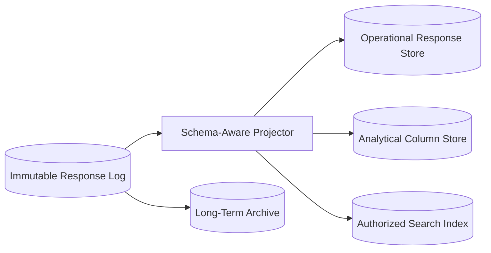

The immutable envelope is the replay boundary. If projection logic changes, rebuild derived stores using the pinned form version.

Partition by tenant, form, and response time while avoiding a single hot partition for viral forms. Add a deterministic response shard between form and time.

## Analytics

Creators can view response counts, completion rate, drop-off, answer distributions, cross-tabs, scores, and time trends.

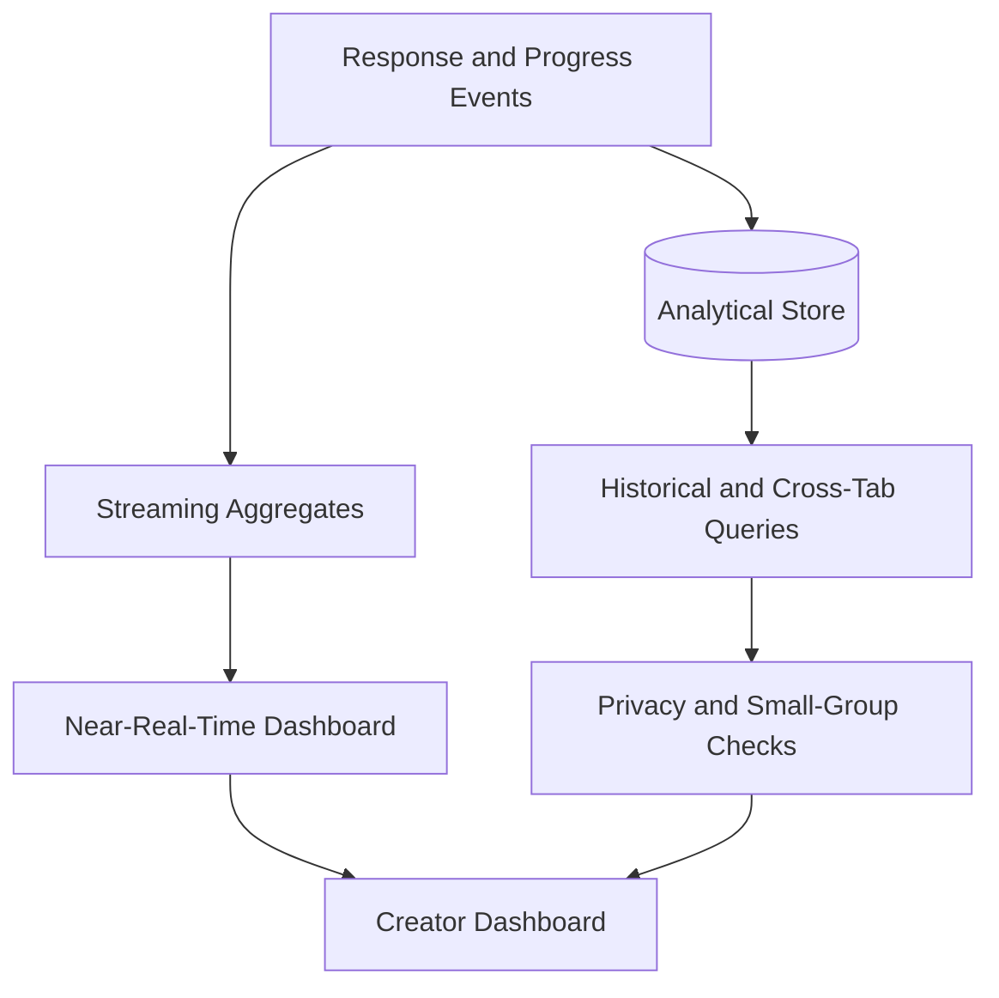

Analytics pins form and question versions. If option meaning changes, do not merge distributions merely because question IDs match.

Apply minimum cohort thresholds, field permissions, and suppression for sensitive forms. Approximate sketches can provide distinct counts and quantiles at lower cost.

## Exports

Large exports run asynchronously against a fixed response watermark and schema selection.

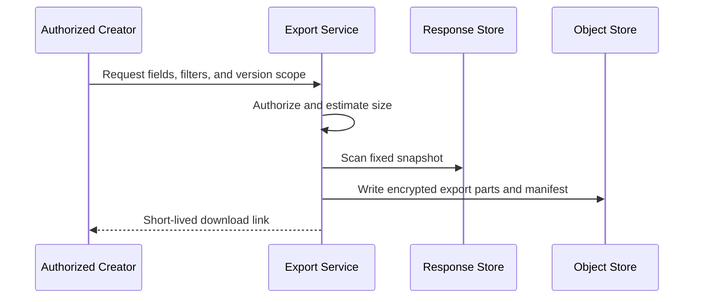

CSV exports defend against spreadsheet formula injection. File answers export as scoped references, not public URLs.

Audit requester, criteria, fields, row count, destination, and expiration. Export artifacts expire quickly and follow regional policy.

## Search and operational review

Index only fields approved for operational search. Exact-match identifiers can use deterministic tokens; free text requires stronger access and retention controls.

Search returns response IDs that the authoritative service reauthorizes before showing answer content. A stale index cannot bypass deletion or role changes.

Creators can define saved views, but view filters are server validated and cannot reference hidden answer keys or restricted fields.

## Custom domains and branding

Custom domains use ownership verification, managed certificates, and tenant routing. Theme configuration is declarative and sanitized.

Do not allow arbitrary creator JavaScript on public forms. It can steal answers, break accessibility, fingerprint respondents, and bypass consent controls.

External links receive clear warnings and policy checks. The browser's origin remains isolated from authoring and administration origins.

## Multi-region design

Each form has a home region for drafts, responses, files, analytics, keys, and workflows. Published non-sensitive manifests can replicate globally.

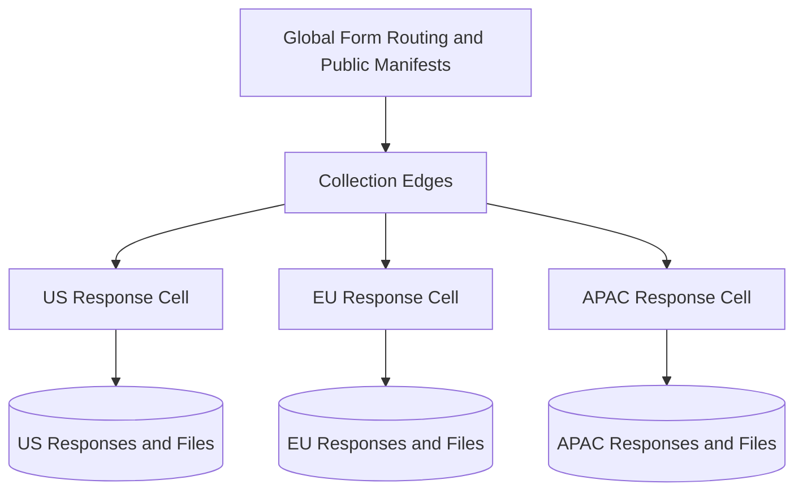

Collection edges validate lightweight signed session claims, then route answer data only to the approved home region.

Failover promotes a prepared replica under a higher form ownership epoch. Strict response quotas use the active regional authority so two regions cannot each accept the last slot.

## Privacy and security

- Derive tenant and creator scope from authenticated credentials
- Allow creators to collect only declared field types under policy
- Encrypt responses, drafts, files, exports, and analytics stores
- Separate respondent identity from answer data where possible
- Restrict question, answer, and file access by role and purpose
- Audit form publication, response views, exports, workflow decisions, and deletion
- Detect secrets, payment credentials, and highly sensitive data in misconfigured forms
- Use short-lived tokens for sessions, invitations, files, and exports
- Apply retention and deletion to source and derived stores
- Protect answer keys and reviewer notes from respondent clients

Anonymous forms should state what metadata is collected. “Anonymous” must not be used when the platform or creator can directly identify respondents.

## Reliability and failure handling

| Failure | Safe behavior |
| --- | --- |
| Client repeats autosave | Operation ID returns the existing draft version |
| Client repeats submission | Idempotency key returns the same response ID |
| Quota reserved but submission fails | Lease expires and returns capacity |
| File scanner is unavailable | Keep file quarantined; do not accept it as ready |
| Response projector crashes | Resume from durable log checkpoint |
| Analytics is unavailable | Submission acceptance and receipts continue |
| Workflow action times out | Reconcile or retry with the same action key |
| Form version changes mid-session | Continue pinned version or run explicit migration |
| Region fails | Promote fenced replica and replay stable event IDs |

Every derived subsystem is recoverable from the immutable form versions and response log.

## Observability and SLOs

Track:

- Form publication failures and logic-validation errors
- Form-load latency, CDN hit rate, and runtime errors
- Response-session starts, abandonment, and path distribution
- Autosave latency, conflicts, and stale-device operations
- Submission acceptance, validation rejection, and idempotent retry rate
- Quota reservation conflicts and expiry lag
- File scan age and quarantine volume
- Abuse challenges, block rate, and false-positive feedback
- Response projection, analytics, notification, and webhook lag
- Export queue age and deletion backlog
- Regional replication and ownership epoch

Useful SLOs include 99.99% public-form availability, 99.99% durable submission acceptance for valid eligible responses, and zero responses interpreted against a form version other than the one recorded at submission.

## Key trade-offs

| Decision | Benefit | Cost |
| --- | --- | --- |
| Immutable published versions | Reproducible responses and analytics | More versions and migration work |
| Client plus server logic evaluation | Responsive UI and authoritative validation | Evaluator compatibility requirements |
| Durable log before projection | Burst absorption and recovery | Eventual dashboard consistency |
| Strong strict quotas | Exact capacity enforcement | Coordination and regional authority |
| Autosaved drafts | Better completion and recovery | Privacy and conflict complexity |
| Derived analytical store | Fast aggregates and exports | Projection lag and rebuilds |
| No arbitrary form scripts | Stronger safety and privacy | Less creator customization |

## Evolution path

1. Build versioned forms, basic question types, and idempotent submission.
2. Add branching, validation, autosave, and response dashboards.
3. Introduce files, invitations, quotas, and workflow notifications.
4. Add collaboration, approvals, quizzes, exports, and integrations.
5. Deploy regional response cells and high-volume abuse protection.
6. Add privacy-safe advanced analytics and controlled custom widgets.

Start with immutable publication and durable idempotent submission. Everything else depends on knowing exactly which questions a respondent saw and whether their answer was accepted once.

## Final design

Author forms as structured collaborative drafts, compile their branching logic into a deterministic graph, and publish immutable hashed versions to a global CDN. Start each respondent with a session pinned to one version, autosave answer operations idempotently, and re-evaluate final visibility and validation on the server. Reserve strict quotas before appending a frozen response envelope to a durable regional log, then project operational views, analytics, notifications, search, and exports asynchronously.

The central principle is schema-bound evidence. A response has meaning only alongside the exact questions, options, logic path, randomization, validation, and policy shown to that respondent; keeping those versions inseparable makes the platform reliable under edits, retries, bursts, and long-term analysis.
