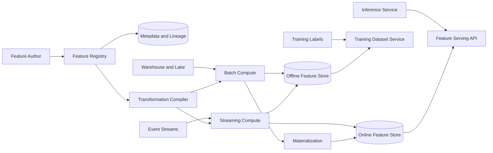
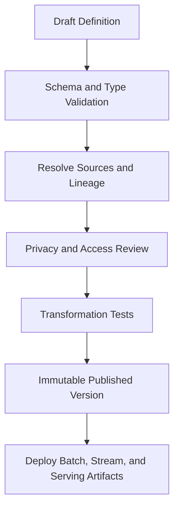
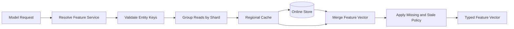
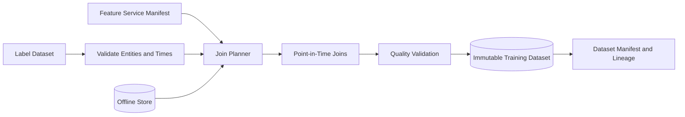
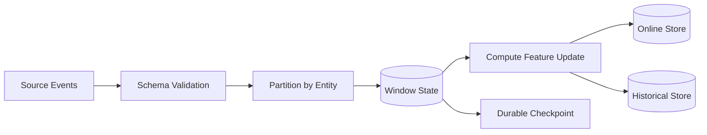
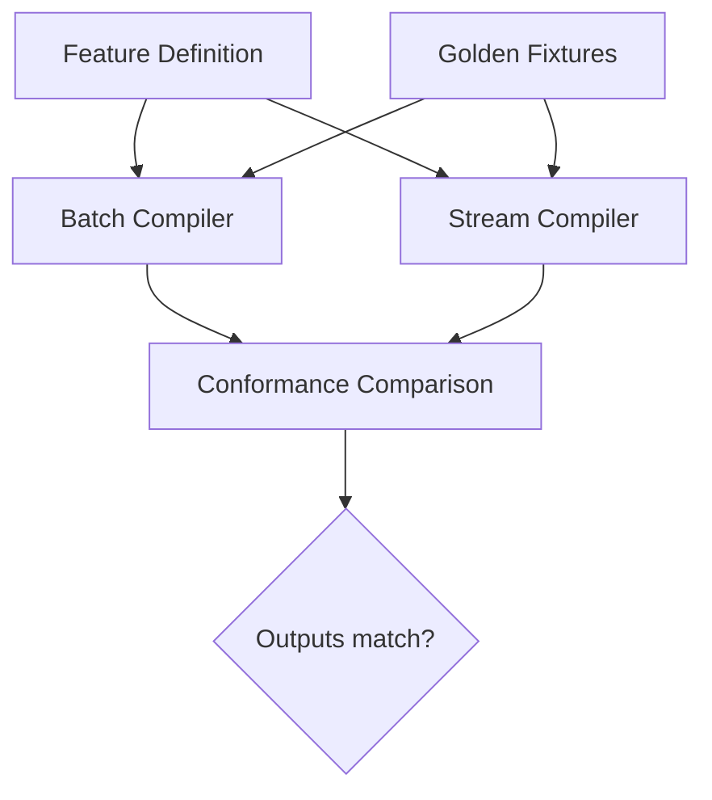
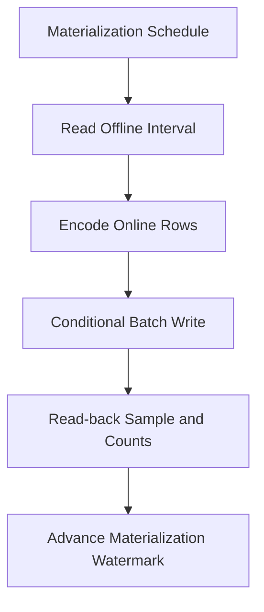
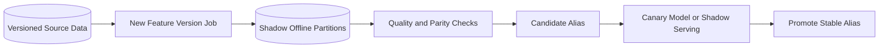
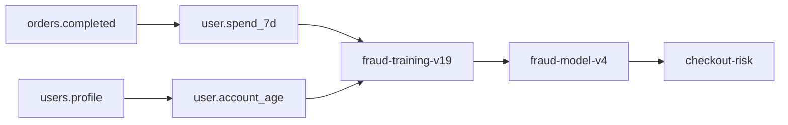
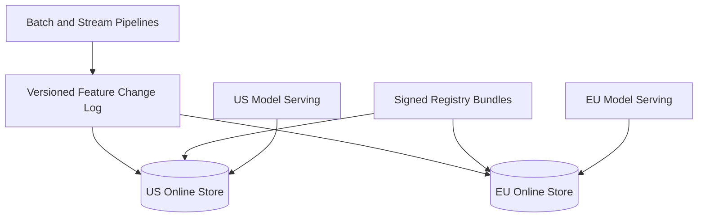

## Problem and requirements

A machine learning feature store manages the signals used to train models and make predictions. Examples include a user's seven-day purchase count, a merchant's dispute rate, a video's topic embedding, or the time since a device last authenticated.

Without a shared platform, every team rebuilds pipelines, computes subtly different definitions, leaks future information into training data, and implements online features differently from offline ones. A feature store makes feature semantics, lineage, freshness, and serving behavior explicit.

### Functional requirements

- Register discoverable, versioned feature definitions
- Compute batch and streaming features from approved sources
- Store historical feature values for training
- Serve current feature values at low latency for inference
- Build point-in-time correct training datasets
- Support entity and batch lookups
- Materialize offline results into online storage
- Track lineage, ownership, quality, and freshness
- Backfill corrected feature versions safely
- Control access to sensitive features

### Non-functional requirements

- Support 100,000 feature definitions
- Serve five million online feature reads per second
- Return common feature vectors within ten milliseconds at the 99th percentile
- Keep training and serving transformations consistent
- Prevent future-data leakage in training sets
- Continue serving during pipeline or control-plane outages
- Isolate tenants, teams, and workload classes
- Make every training value reproducible and explainable

The feature store is not a general data warehouse or model-serving platform. It provides governed inputs to training and inference systems.

## Capacity estimates

Assume 100,000 registered features, one billion entities, and five million peak online requests per second.

| Resource | Estimate |
| --- | ---: |
| Online reads | 5M/second |
| Features per request | 50–500 |
| Streaming updates | Millions/second |
| Historical values | Trillions |
| Training dataset output | Petabytes/month |
| Feature definitions | 100K versions plus lineage |

Online reads are small but latency sensitive. Historical joins are throughput heavy. Treat them as separate systems connected by shared definitions and versioned materialization.

## Core concepts

- **Entity:** the subject of a feature, such as user, item, merchant, or user-item pair
- **Entity key:** typed identifiers used for lookup and joins
- **Feature:** a named, typed value with transformation semantics
- **Feature view:** a related group sharing entities, source, and freshness
- **Event timestamp:** when the underlying fact was true
- **Creation timestamp:** when the platform learned or computed it
- **Materialization:** copying feature values into a serving store
- **Training dataset:** labels joined with historical features as of prediction time

Names are stable, but definitions are versioned. A change in meaning, type, window, source, or null behavior produces a new version rather than silently rewriting an existing feature.

## Feature definition

```yaml
name: user_purchase_stats
owner: fraud-ml
entities: [user_id]
source: orders_stream
timestampField: completed_at
ttl: 30m
features:
  - name: purchases_7d
    type: int64
    aggregation: count
    window: 7d
  - name: spend_7d_cents
    type: int64
    aggregation: sum
    field: amount_cents
    window: 7d
online: true
```

The registry validates types, entity keys, source schema, timestamp semantics, ownership, privacy classification, and compute limits before publication.

Definitions include default and missing-value behavior. Zero, unknown, stale, and not applicable are distinct states and should not be collapsed accidentally.

## High-level architecture

The control plane governs definitions. Offline pipelines build historical values, streaming pipelines update fresh values, and the serving plane returns current vectors.



The offline and online paths share schemas, transformation specifications, feature IDs, and conformance tests even when their execution engines differ.

## Registry and governance

The feature registry is the catalog and control plane. It stores:

- Feature name, type, description, and owner
- Entity definitions and join keys
- Source datasets and timestamp fields
- Transformation code and runtime version
- Offline and online storage configuration
- Freshness objective and time-to-live
- Privacy classification and access policy
- Lineage to upstream columns and downstream models
- Quality checks and deprecation status



Published definitions are immutable. Aliases such as `stable` or `candidate` may move between versions through an audited promotion.

Search supports entity, owner, source, type, freshness, and business meaning. Reuse is valuable only when users can understand and trust a feature.

## Offline feature store

The offline store retains historical values with entity keys, event time, creation time, feature version, and values.

Columnar object storage is suitable for large-scale scans and joins. Partition by feature view and event date, then cluster by entity key where practical.

```text
user_id | event_time | created_time | purchases_7d | spend_7d_cents | version
```

Event time answers when the feature was valid. Creation time supports audit and correction logic: a value computed tomorrow must not appear in a training example constructed as if it were known yesterday.

Files are immutable. Corrections create new versions or replacement partitions published through metadata, preserving reproducibility of older datasets.

## Online feature store

The online store maps a feature-view version and entity key to the latest serving value.

```text
(project, feature_view_version, entity_key) → values, event_time, written_time
```

Use a distributed key-value store with predictable single- and batch-key latency. Co-locate features commonly read together in one row to reduce network fan-out.

Partition by a stable entity hash. Very hot entities may need request coalescing, caches, or replicated reads. Avoid placing every feature for one global tenant in a single oversized partition.

Writes use event-time conditional updates. A late event with an older timestamp must not overwrite a newer online value unless the definition explicitly supports correction semantics.

TTL removes values too old to be safe. The serving response returns freshness metadata so callers can distinguish missing and stale data.

## Online serving API

```http
POST /v1/features:read
Authorization: Bearer <model-service-token>
Content-Type: application/json

{
  "featureService": "fraud-score-v4",
  "entities": {
    "user_id": "user_82",
    "merchant_id": "merchant_14"
  }
}
```

```json
{
  "values": {
    "user.purchases_7d": 4,
    "user.spend_7d_cents": 21842,
    "merchant.dispute_rate_30d": 0.012
  },
  "metadata": {
    "featureServiceVersion": 19,
    "oldestEventTime": "2026-10-11T14:20:00Z"
  }
}
```

A feature service is a versioned manifest of features expected by one model. It fixes ordering, types, defaults, and compatible feature versions.

The serving gateway authenticates the model workload, authorizes each feature group, batches reads by shard, applies documented defaults, and returns within one deadline.

## Serving path



Use one batch request instead of hundreds of per-feature calls. Parallelize shard reads under a shared deadline.

Cache only values whose freshness policy allows it. Cache keys include feature-service version and entity key; policy changes cannot reuse incompatible entries.

Security and eligibility features may fail closed. Recommendation-quality features can often use defaults or a baseline model. Fallback is configured per feature, not globally.

## Point-in-time correct joins

For a training example labeled at time `T`, each feature must use the newest value that was available at or before `T`.

```mermaid
timeline
  title Point-in-time feature selection
  10:00 : Feature value A becomes valid
  10:07 : Feature value B becomes valid
  10:10 : Label prediction time — select B
  10:15 : Feature value C becomes valid — must not be used
```

A naive join by entity uses today's value for every historical row and leaks the future. This produces unrealistically strong offline accuracy and weak production performance.

The join condition is conceptually:

```text
feature.entity = label.entity
AND feature.event_time <= label.prediction_time
ORDER BY feature.event_time DESC
LIMIT 1
```

The engine implements this as a partitioned as-of join rather than a per-row query.

## Creation time and delayed knowledge

Event time alone is insufficient when facts arrive or are corrected later. Suppose a chargeback occurred on Monday but the platform learned about it on Friday. A model prediction made Tuesday could not have used it.

Strict historical reconstruction includes:

```text
feature.event_time <= prediction_time
AND feature.creation_time <= dataset_cutoff
```

The dataset cutoff represents when the training snapshot is built or the simulated knowledge boundary. Record it in the dataset manifest.

This bitemporal model prevents corrected or backfilled data from leaking into historical predictions while still allowing new training datasets to benefit from improved records when appropriate.

## Training dataset generation

The user supplies label rows containing entity keys, prediction timestamps, outcomes, and optional split identifiers.



The output manifest records label snapshot, feature versions, source partitions, transformation versions, cutoff time, row counts, checksums, and join statistics.

Training datasets are immutable and content-addressed. A model registry links every model version to the exact dataset manifest used to train it.

## Batch feature computation

Batch pipelines compute large windows and historical features from warehouse or lake data. The registry compiler generates a job plan from the feature definition.

Jobs read versioned source snapshots and write immutable partitions. Idempotency keys include feature version, source snapshot, and output interval.

Incremental jobs recompute affected intervals instead of full history. Corrections with wide impact trigger a backfill into a shadow version.

Partition pruning, preaggregation, and shared intermediate results reduce cost when many features use the same source and window.

The scheduler applies separate resource pools for daily production materialization, interactive development, and backfills.

## Streaming feature computation

Streaming pipelines update features that need seconds-level freshness.



Stateful operators maintain windows such as counts over one hour or seven days. Watermarks and allowed lateness govern when state can expire.

Write updates to both online and historical sinks from a durable output stream or transactional checkpoint boundary. A crash must not advance source offsets while losing one sink.

Online results can be provisional when late events are expected. Metadata exposes event time and completeness for models sensitive to freshness.

## Batch and stream consistency

Batch and streaming engines often implement the same feature differently, causing training-serving skew.

Prefer one declarative transformation specification compiled for both runtimes. When separate implementations are unavoidable, require:

- Shared schemas and type semantics
- Golden input-output fixtures
- Identical null, window, and time-zone behavior
- Shadow comparisons on production traffic
- Continuous batch-versus-stream reconciliation



Materializing batch values over a period can repair stream drift, but it should not hide a semantic mismatch.

## On-demand features

Some features depend on request context unavailable before inference, such as distance between the current location and a store.

Compute lightweight on-demand transformations in the serving layer after retrieving stored inputs. Definitions must be deterministic, bounded, and compiled into the same code used for offline training joins.

Do not allow arbitrary user scripts on the serving path. Approved functions have strict CPU and memory limits and no network access.

Record the on-demand transformation version with prediction logs so training reconstruction uses the same logic.

## Embeddings and large features

Dense embeddings can be kilobytes each and overwhelm ordinary key-value rows. Store them in a specialized vector or blob serving tier with references in the feature registry.

Batch multi-entity requests and use compact numeric encodings. Track dimension, model version, normalization, and vector-space compatibility.

An embedding generated by model version A cannot be compared safely with a query vector from version B unless the contract explicitly supports it.

Large sparse features may use compressed maps with strict key limits. Never allow one entity's unbounded feature payload to exceed serving deadlines.

## Freshness and materialization

Every online feature declares a freshness objective and maximum serving age.

Materialization reads new offline partitions and writes online values conditionally by event time.



Do not advance the watermark until writes and verification complete. Retries use the same materialization run ID.

Freshness monitoring compares source event time, offline partition availability, materialization watermark, and online row timestamp. This identifies whether delay comes from source, compute, copying, or serving.

## Feature quality

Validate features at definition, computation, and serving time.

Quality checks include:

- Type, range, null rate, and finite-number checks
- Distribution and cardinality drift
- Update rate and freshness
- Entity coverage
- Batch-versus-stream differences
- Default-value frequency
- Training-versus-serving skew

Not every statistical change is an error. Seasonal behavior and product launches legitimately shift distributions. Alert policies use expected ranges, comparison cohorts, and owner-defined severity.

Block publication on structural failures. For distribution anomalies, quarantine or warn according to feature criticality.

## Backfills and corrections

A fixed definition or corrected source requires recomputing history.



Write to a new feature version or shadow partitions. Never overwrite the only trusted history in place.

After validation, training jobs can opt into the new version. Online promotion occurs only after its values are sufficiently materialized and compatible models are deployed.

Old versions remain available for model reproducibility until every dependent model and retained dataset expires.

## Lineage and impact analysis

Build a graph from source datasets through transformations and features to training datasets, models, and endpoints.



Before changing or deleting a source field, owners can see affected features and production models. Incident response can trace a bad prediction signal back to source and transformation versions.

Automatically populate lineage from compiled plans. Manually maintained lineage becomes stale quickly.

## Access control and privacy

Feature values can reveal sensitive behavior even when names appear harmless. Classify every feature and inherit restrictions from source fields.

Authorization considers principal, feature, entity scope, purpose, environment, and operation. Training access does not automatically grant online serving access or raw-value export.

Controls include:

- Workload identity and least-privilege feature services
- Tenant and environment isolation
- Column- and row-level policy
- Encryption in transit and at rest
- Audited feature reads and dataset generation
- Tokenization of sensitive entity keys
- Retention and deletion propagation
- Minimum cohort requirements for exported aggregates

Online responses never reveal feature values unrelated to the requesting model manifest. Prevent ad hoc wildcard reads in production.

When an entity must be deleted, removal propagates through offline partitions, online rows, caches, derived datasets, and eligible backups while preserving required non-personal audit evidence.

## Multi-tenancy and quotas

Apply quotas to definitions, batch compute, streaming state, online storage, read throughput, training joins, and backfills.

Separate resource pools prevent a large historical join from affecting inference latency. Large tenants or critical models may receive dedicated online shards.

Namespace feature names by organization and project while allowing intentionally published shared features. Cross-project reuse requires explicit data-owner approval.

Cost attribution includes source scanning, transformation compute, historical storage, online storage, read traffic, and training extraction.

## Multi-region serving

Replicate feature-service manifests and online values to inference regions. Route requests to the local store.



Residency policy filters which entities and features may replicate. Region-local features can combine with globally approved aggregates through separate views.

During replication lag, responses expose value age. Models either tolerate stale data, use defaults, or fail closed according to their feature-service contract.

Avoid multi-region last-write-wins without event-time conditions. Network arrival order is not feature recency.

## Failure handling

### Registry unavailable

Serving continues from the last signed feature-service bundle. New definitions and promotions pause.

### Online store unavailable

Use a bounded regional cache, documented defaults, or a baseline model. Security-critical features may require rejection rather than silent fallback.

### Streaming job falls behind

Expose stale timestamps, scale processors, and let models follow their freshness policy. Batch materialization can repair state after recovery.

### Bad feature release

Stop the candidate version, keep the stable alias, and rebuild shadow data. Do not mutate already published datasets.

### Hot entity

Coalesce identical reads, cache safely, replicate the row, or split entity-pair features by a secondary key.

### Offline partition corruption

Quarantine the partition, restore or recompute from versioned sources, and invalidate dependent dataset builds.

### Materialization partial failure

Retry with the same run ID and conditional event-time writes. Advance the watermark only after validation.

## Observability

Track:

- Online latency, error rate, and batch size
- Cache hit rate and shard hot spots
- Missing, defaulted, and stale feature rates
- Source, compute, materialization, and replication lag
- Stream checkpoint health and state size
- Batch job duration, cost, and partition failures
- Point-in-time join coverage and leakage checks
- Batch-versus-stream parity
- Feature distribution and schema drift
- Dataset generation volume and reproducibility
- Feature ownership, adoption, and deprecation progress

Prediction logs record feature-service version, value timestamps, missing indicators, and optionally privacy-safe feature snapshots. These logs help detect training-serving skew without leaking sensitive values broadly.

Synthetic entities with known values verify every serving region and point-in-time join path end to end.

## Key tradeoffs

### One store vs offline and online stores

One database simplifies consistency but rarely supports petabyte historical joins and millisecond key reads equally well. Separate stores with shared definitions and audited materialization fit both workloads.

### Precomputed vs on-demand features

Precomputation minimizes serving latency but spends storage and may be stale. On-demand computation uses current context but must remain cheap, deterministic, and reproducible offline.

### Batch vs streaming computation

Batch is simpler and cost-effective for slow-changing features. Streaming improves freshness but adds state, watermark, and recovery complexity. Freshness requirements should justify the mode.

### Mutable correction vs versioned features

Overwriting history is convenient but breaks model reproducibility. Immutable versions and shadow backfills preserve lineage at the cost of additional storage.

### Strict freshness vs availability

Rejecting stale values protects model assumptions but can turn a data delay into a product outage. Per-feature fallback policies and baseline models make this risk explicit.

The central principle is that a feature is not merely a value: it is a versioned contract covering meaning, time, lineage, freshness, privacy, and behavior when data is missing.
