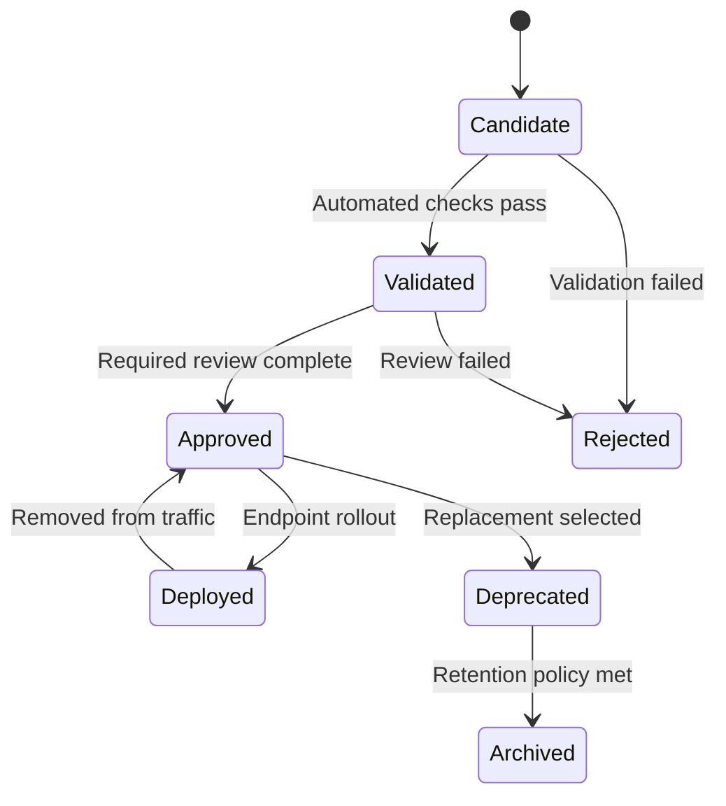
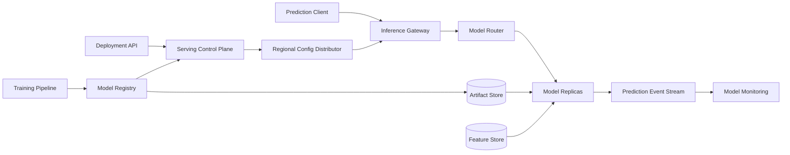
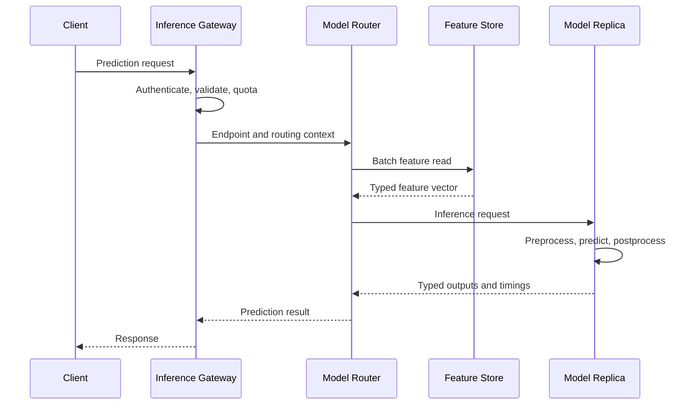
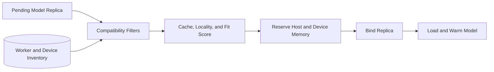
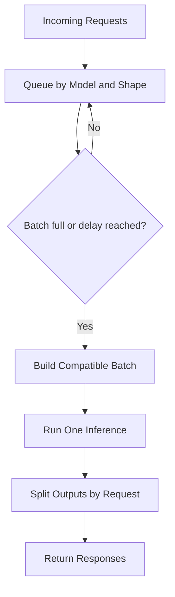
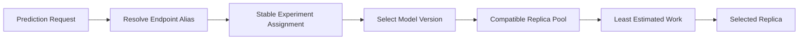
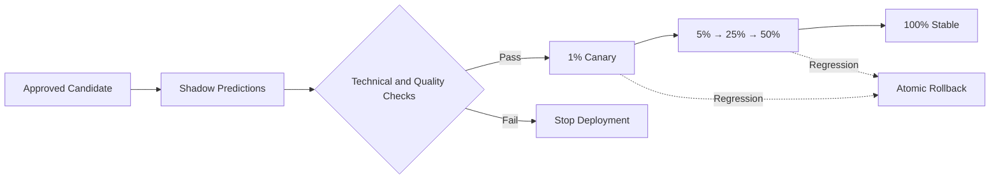
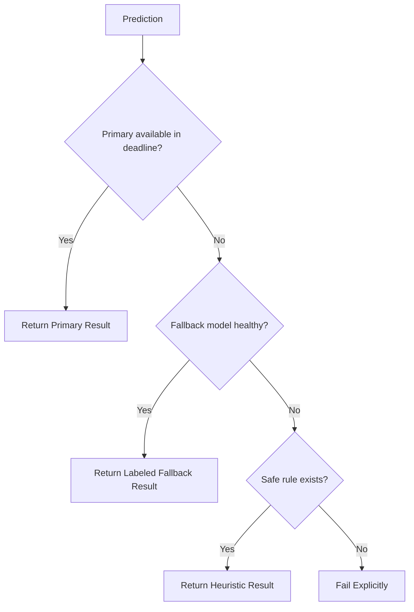
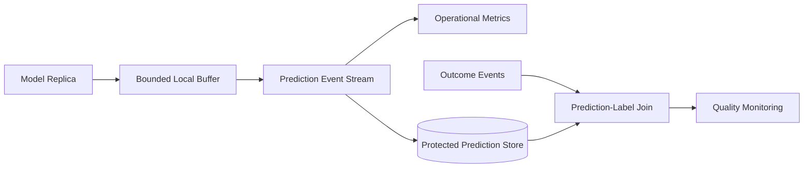
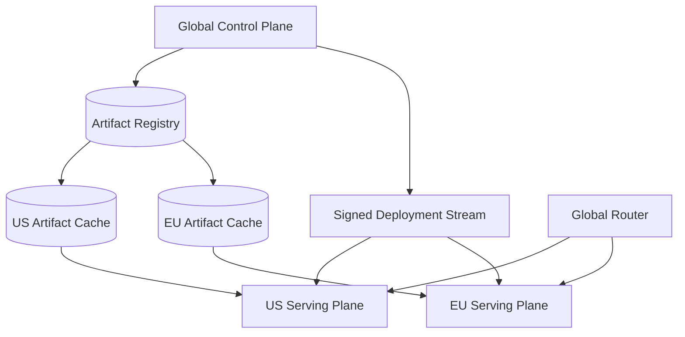

## Problem and requirements

A model serving platform turns trained models into reliable prediction APIs. It loads versioned artifacts, retrieves features, schedules inference on CPUs or accelerators, scales with demand, and records enough context to monitor quality and reproduce decisions.

Model serving differs from ordinary application hosting. Artifacts can be tens or hundreds of gigabytes, accelerators are scarce, batching changes latency and throughput, and a technically healthy model can still produce harmful results because inputs or real-world behavior drifted.

### Functional requirements

- Register immutable model versions and their metadata
- Deploy models to online and asynchronous endpoints
- Validate request and response schemas
- Retrieve features and run preprocessing consistently
- Route traffic among model versions
- Batch compatible inference requests
- Autoscale CPU and accelerator workers
- Support shadow, canary, rollback, and fallback models
- Capture prediction logs and delayed outcomes
- Monitor performance, drift, bias, and business quality

### Non-functional requirements

- Serve up to two million predictions per second
- Meet endpoint-specific latency objectives as low as 50 milliseconds
- Continue serving through worker, zone, and control-plane failures
- Isolate tenants and model workloads
- Keep model artifacts and sensitive features protected
- Bound overload instead of allowing unbounded queues
- Make every prediction traceable to model, features, and code versions
- Avoid partially deployed or incompatible model states

The platform makes model execution reliable. It does not guarantee that a model is correct, fair, or suitable for a product; those remain shared responsibilities of model owners and governance processes.

## Capacity estimates

Assume 100,000 registered model versions, 10,000 active endpoints, and two million peak online requests per second.

| Resource | Estimate |
| --- | ---: |
| Online predictions | 2M/second |
| Active model replicas | Hundreds of thousands |
| Model artifacts | Petabyte scale |
| Prediction logs | Tens of billions/day |
| Accelerator fleet | Thousands to tens of thousands |
| Batch predictions | Billions/day |

The platform must serve tiny tree models alongside multi-gigabyte neural networks. One scheduling and scaling policy cannot fit every model class.

## Model package

A deployable model version includes:

- Immutable model artifact digest
- Framework, runtime, and hardware requirements
- Input and output schemas
- Preprocessing and postprocessing versions
- Feature-service manifest
- Training dataset and code lineage
- Resource and latency profile
- Quality, safety, and approval metadata
- Example requests and expected outputs

The package references content-addressed objects rather than mutable locations. A signature binds the manifest to its files.

Model versions are immutable. An endpoint alias points to one or more approved versions and can change atomically.

## Registry and lifecycle

The model registry tracks candidate, validated, approved, deployed, deprecated, and archived versions.



Promotion records actor, reason, evaluation results, dataset lineage, and policy decisions. Approval does not mutate the artifact; it adds an auditable lifecycle event.

Separate permissions for registering, approving, deploying, and overriding safeguards. High-risk models may require independent review.

## High-level architecture

The control plane manages artifacts and deployment intent. Regional data planes execute predictions without a synchronous dependency on the global control plane.



Deployment snapshots are signed, versioned, and atomically applied. Existing endpoints continue operating from the last valid snapshot if the control plane is unavailable.

## Deployment API

```http
POST /v1/endpoints/fraud-risk/deployments
Authorization: Bearer <deployment-token>
Content-Type: application/json

{
  "modelVersion": "fraud-model:42",
  "traffic": { "candidate": 5, "stable": 95 },
  "resources": {
    "accelerator": "none",
    "memoryGb": 4,
    "minReplicas": 20,
    "maxReplicas": 500
  },
  "rolloutPolicy": "standard-canary-v3"
}
```

The control plane validates approval status, artifact integrity, schema compatibility, quota, regional policy, and capacity before publishing deployment intent.

Creating a deployment is asynchronous. Status exposes artifact distribution, replica readiness, warm capacity, traffic activation, and health-gate decisions.

## Online prediction API

```http
POST /v1/endpoints/fraud-risk:predict
Authorization: Bearer <service-token>
Idempotency-Key: payment_981_risk
Content-Type: application/json

{
  "entities": { "user_id": "user_82", "merchant_id": "merchant_14" },
  "requestFeatures": { "amount_cents": 4999, "country": "US" }
}
```

```json
{
  "predictionId": "pred_01K6T82A",
  "modelVersion": "fraud-model:42",
  "outputs": { "riskScore": 0.071 },
  "decisionMetadata": { "thresholdVersion": 8 }
}
```

The prediction ID links request context, feature timestamps, model version, preprocessing version, experiment assignment, and outcome events.

Scores are not automatically business decisions. A separate policy layer can apply thresholds, rules, and explanations.

## Request path



Every hop receives a deadline shorter than the caller's remaining time. Feature retrieval and inference can run partially in parallel when request-only and stored features are independent.

Prediction logging occurs asynchronously. The request path never waits for analytics delivery after a durable bounded buffer accepts the event.

## Input validation and transformation

The gateway validates required fields, types, ranges, tensor shapes, batch sizes, and payload limits before expensive work begins.

Preprocessing is versioned with the model package. Examples include tokenization, normalization, categorical encoding, image resizing, and feature ordering.

Use the same transformation library or compiled graph during training and serving. Separate implementations create training-serving skew through small differences in null handling, numeric precision, or vocabulary versions.

Postprocessing maps raw tensors to typed outputs and may calibrate scores. Business rules and authorization should remain outside arbitrary model code.

## Model loading

Workers load artifacts into host memory and, when required, accelerator memory.


Cache immutable artifact layers on local disks and regional mirrors. Verify every digest; a cache hit is not a trust decision.

Warm-up catches incompatible runtimes, corrupt weights, missing operators, and unexpected device memory use before traffic arrives.

Readiness requires a successful known-input prediction. Liveness should test the serving process without invoking an expensive full model on every probe.

## Worker and runtime isolation

Models may include custom code and parsers. Run them in sandboxed processes or containers with restricted system calls, read-only artifacts, bounded CPU and memory, controlled network access, and workload identity.

Do not give model code direct access to control-plane credentials or unrestricted object storage. An artifact loader fetches only the assigned digest.

Tenant isolation policy determines whether models share a runtime process, host, or accelerator. Stronger boundaries reduce utilization but contain buggy or malicious code.

Workers report runtime, driver, accelerator, and library versions. The scheduler places a model only on a compatible image verified during registration.

## Scheduling CPU and accelerators

The scheduler filters workers by architecture, runtime, memory, accelerator type, device memory, topology, tenant policy, and regional constraints.



Score for cached artifacts, low fragmentation, balanced load, failure-domain spread, and expected traffic locality.

Accelerator memory is often the binding resource. Account for weights, runtime workspace, key-value cache, and peak batch tensors, not only artifact size.

Small compatible models may share a device through time slicing or spatial partitioning. Dedicated devices offer stronger performance isolation for strict endpoints.

## Dynamic batching

Accelerators achieve much better throughput with batches, but waiting to fill a batch adds latency.



Group only requests with compatible model version, tensor shapes, execution parameters, and deadlines. Use padding or shape buckets where supported.

Each endpoint sets maximum batch size and maximum queue delay. A low-latency endpoint might wait one millisecond; asynchronous inference can wait longer for efficiency.

Deadline-aware batching dispatches early when the oldest request cannot wait. Requests close to expiry should not be trapped behind large throughput-oriented batches.

## Continuous batching for generative models

Autoregressive models spend many iterations generating tokens. Static batches waste capacity when sequences finish at different times.

Continuous batching inserts new requests as slots become free and removes completed sequences between decoding steps. The scheduler manages per-request key-value cache and output limits.

Admission control estimates memory from prompt length, requested output length, model shape, and active cache. Reject or queue work before the device runs out of memory.

Separate prompt processing and token generation metrics. They have different compute patterns and user-visible latency: time to first token versus time per output token.

Cancellation must free cache promptly when a client disconnects or reaches its limit.

## Routing and load balancing

The router resolves endpoint alias, experiment assignment, model version, and compatible replica pool.

Choose replicas using outstanding work, estimated completion time, model residency, device memory pressure, and zone locality—not simple round robin.



Use a stable subject or request hash for experiment consistency. The chosen version is attached to logs and responses.

Retries avoid the failed replica and preserve the selected model version unless fallback policy explicitly permits a different one.

## Autoscaling

CPU utilization alone is insufficient. Useful signals include request rate, active requests, queue delay, batch fullness, device utilization, and predicted compute per request.

```text
required replicas = ceil(arrival rate × service time / target concurrency)
```

Scale-up considers model load time. Large models may take minutes to become ready, so predictive scaling and warm spare capacity are necessary for known traffic patterns.

Scale-down uses stabilization windows and drains replicas without dropping active inference. Keep minimum replicas for endpoints that cannot tolerate cold starts.

Global capacity planning reserves accelerators for critical endpoints. Admission control throttles lower-priority traffic before all devices saturate.

## Cold starts and model caching

A cold start includes scheduling, artifact download, runtime startup, weight loading, device transfer, compilation, and warm-up.

Reduce it through:

- Regional artifact replication
- Local content-addressed caches
- Shared read-only weight pages where isolation permits
- Precompiled execution plans
- Warm runtime pools
- Predictive preloading
- Minimum or provisioned replicas

Track each phase separately. A fast download does not help when device compilation dominates.

Evict models using a cost-aware policy that considers recent use, reload time, artifact size, minimum capacity, and next predicted demand—not least-recently-used alone.

## Canary deployment

A rollout moves from shadow evaluation to small canary traffic and then gradual promotion.



Shadow traffic executes the candidate without affecting users. Compare output distributions, disagreements, latency, errors, and resource use.

Canary gates include technical health and business quality. Business labels may arrive hours or weeks later, so some promotion requires a longer observation window or trusted proxy metrics.

Rollback atomically changes traffic weights. Keep the prior model warm until the rollback window closes.

## Feature retrieval

The model package references a versioned feature-service manifest. The serving layer requests all online features in one batch and receives values plus freshness metadata.

Request-time features are merged in a typed order. Missing and stale behavior comes from the manifest:

- Use a documented default
- Use a baseline model
- Skip optional personalization
- Reject the prediction for correctness-critical signals

Log feature-service version, event timestamps, and missing indicators. Avoid logging sensitive raw feature values unless policy permits a protected prediction log.

Feature store latency consumes part of the endpoint budget. Cache only when the feature freshness contract allows it.

## Fallback and graceful degradation

An endpoint can define a fallback chain:

1. Primary model on preferred hardware
2. Smaller distilled model
3. Cached recent prediction where semantically valid
4. Deterministic heuristic or rules
5. Explicit unavailable response



Fallback outputs include provenance so downstream policy and monitoring do not treat them as primary predictions.

Never silently use a model with incompatible output meaning. A stale fraud score and a stale recommendation have very different risk.

## Asynchronous and batch inference

Large inputs and high-throughput offline scoring use asynchronous jobs. Clients submit object references and receive a job ID.

The scheduler shards input, dispatches tasks, checkpoints progress, and writes versioned output partitions. Task IDs make retries idempotent.

Batch workers maximize throughput with larger batches and lower-priority accelerator pools. Online endpoints use reserved capacity and strict deadlines.

Outputs include source snapshot, model version, transformation versions, code version, and row-level failure details. Partial results remain in a staging location until the manifest is committed atomically.

## Prediction logging

Emit one immutable record per prediction with:

- Prediction and request IDs
- Endpoint, model, preprocessing, and feature-service versions
- Event and prediction times
- Input schema and privacy-safe feature references
- Output values or summaries
- Latency breakdown and fallback status
- Experiment assignment
- Later outcome or label reference



Logging must not delay predictions. When buffers fill, preserve required audit records and sample lower-value diagnostics according to policy.

Stable prediction IDs join delayed outcomes without copying sensitive inputs into every downstream system.

## Model monitoring

Monitor four layers:

- **System:** latency, errors, saturation, batch size, cold starts
- **Data:** schema, missingness, range, distribution, and drift
- **Prediction:** score distribution, confidence, calibration, and disagreement
- **Outcome:** accuracy, precision, recall, ranking metrics, business value, and fairness

Input drift means production data changed. Concept drift means the relationship between inputs and outcomes changed. Neither automatically proves the model is bad, but both require investigation.

Compare by relevant slices such as region, device, product, and approved demographic group. Global averages can hide severe degradation in a small cohort.

Delayed labels require time-aware evaluation. Do not compare today's incomplete outcome window with last month's fully matured labels.

## Explanations and auditability

Some use cases require an explanation of important factors or applied decision rules. Generate explanations with a versioned method compatible with the model.

Expensive explanation algorithms can run asynchronously unless the product requires synchronous disclosure. Cache only when the input and model identity match exactly.

Record model version, policy threshold, feature timestamps, and explanation version. An explanation should describe the actual deployed decision path, including fallback or rule overrides.

Explanations can leak model or user information. Authorize and redact them independently from ordinary predictions.

## Security and privacy

Controls include:

- Signed model artifacts and verified runtime images
- Workload identity and least-privilege access
- Tenant-isolated endpoints and worker pools where required
- Encryption in transit and at rest
- Protected feature and prediction logs
- Egress restrictions for model code
- Input-size and decompression limits
- Dependency and custom-code scanning
- Audited deployment, access, and override actions

Treat model files as untrusted input. Unsafe deserialization formats can execute code during loading; use restricted formats or sandboxed loaders.

Defend public endpoints against extraction, probing, adversarial payloads, and denial of wallet with authentication, quotas, anomaly detection, output controls, and request normalization.

## Multi-tenancy and quotas

Apply hierarchical quotas to requests, concurrency, queue depth, model memory, accelerators, artifacts, logs, and batch jobs.

Separate online, batch, development, and shadow workloads into resource pools. Shadow experiments should never consume the last capacity needed by production.

Charge or attribute cost by model residency, reserved capacity, accelerator time, prediction count, and data movement. Teams can then choose between latency, throughput, and cost intentionally.

Large or regulated tenants may use dedicated worker pools and encryption domains. Shared serving remains efficient for smaller models with compatible trust levels.

## Multi-region design

Replicate approved artifacts and signed deployment snapshots before enabling traffic in a region.



The global router considers latency, health, capacity, residency, and endpoint availability. Sticky experiment assignments preserve model version when traffic moves between allowed regions.

Feature availability must match model deployment. A region is ready only when artifact, runtime, feature-service version, policy, and minimum warm replicas are all present.

Existing deployments continue during a global control-plane outage. New deployments and policy changes pause.

## Failure handling

### Model replica crashes

Remove it from routing, retry safe requests on another replica within deadline, and replace capacity. Repeated crashes quarantine the model-runtime combination.

### Accelerator fails

Drain the worker and reschedule replicas. Use a compatible CPU fallback only when its latency and numerical behavior are approved.

### Feature store is slow

Use deadline-aware defaults, baseline model, or explicit failure according to the feature contract. Do not let feature calls consume the entire inference budget.

### Artifact store is unavailable

Warm replicas and regional caches continue. New uncached replicas wait rather than loading unverified or partial artifacts.

### Region loses capacity

Preserve reserved critical endpoints, throttle lower priorities, reduce shadow traffic, and shift allowed traffic to healthy regions.

### Bad model rollout

Freeze promotion, atomically restore traffic to the previous version, and keep candidate logs for diagnosis.

### Prediction log pipeline is behind

Buffer durably, preserve required audit events, sample optional detail, and alert before observability loss becomes silent.

## Observability and operations

Track:

- End-to-end and per-stage latency
- Request rate, errors, timeouts, throttles, and cancellations
- Queue delay, dynamic batch size, and batch wait
- CPU, accelerator, device memory, and cache utilization
- Model load, compilation, warm-up, and eviction time
- Replica readiness and cold-start rate
- Feature latency, missingness, and staleness
- Traffic split and canary health
- Fallback and shadow execution rate
- Input, prediction, and outcome drift
- Prediction-log lag and label coverage

Synthetic requests with known outputs validate each endpoint, model version, region, runtime, and fallback path.

Operational actions—rollback, disable endpoint, cap traffic, pin replicas, or activate fallback—require authorization, reason, and audit evidence.

## Key tradeoffs

### Dedicated vs shared replicas

Dedicated replicas provide predictable latency and isolation but waste capacity for low-volume models. Shared runtimes improve utilization at the cost of interference and more complex scheduling.

### Batching throughput vs latency

Larger batches improve accelerator efficiency but delay individual requests. Deadline-aware dynamic batching spends only the latency budget available to each endpoint.

### Scale to zero vs warm capacity

Scale to zero saves idle cost but makes large-model cold starts unacceptable. Minimum replicas, predictive loading, and provisioned capacity trade money for responsiveness.

### Central preprocessing vs model packaging

Central transforms encourage reuse but introduce dependency and version coupling. Packaging transforms with the model improves reproducibility; shared compiled definitions can provide both reuse and consistency.

### Rapid rollout vs delayed quality labels

Technical health is visible immediately, while real model quality may take days to measure. Shadowing, staged traffic, proxy metrics, and retained rollback capacity reduce this uncertainty.

The central principle is to treat model, data contract, transformations, runtime, and routing policy as one versioned deployment unit, then make every prediction attributable to that exact unit.
