## Problem and requirements

A multi-tenant SaaS control plane manages the lifecycle of customer environments. It creates tenants, places their workloads, publishes configuration, coordinates upgrades, enforces entitlements, and gives operators a consistent view across regional data planes.

The difficult part is balancing shared infrastructure with strong isolation. One tenant's traffic, deployment, or malformed configuration must not affect another tenant. The global control plane must also survive regional failures without becoming a synchronous dependency for every product request.

### Functional requirements

- Create, suspend, restore, migrate, and delete tenants
- Select a home region and isolation tier for each tenant
- Provision regional resources through idempotent workflows
- Store and distribute versioned tenant configuration
- Manage plans, features, quotas, and usage entitlements
- Roll out schema, service, and configuration upgrades safely
- Route requests to the correct regional tenant cell
- Expose tenant health, capacity, and operation history
- Support regional evacuation and tenant migration
- Provide auditable administrative and support access

### Non-functional requirements

- Support 100,000 tenants across 50 regions
- Process ten million configuration changes per day
- Keep tenant routing lookups under five milliseconds at p99
- Preserve data-plane availability during control-plane outages
- Prevent noisy neighbors from exhausting shared resources
- Guarantee tenant-scoped authorization at every boundary
- Keep customer data within its selected residency boundary
- Make all mutations idempotent, observable, and recoverable

## Capacity estimates

Assume 100,000 tenants, 50 regional data planes, and an average of 100 configuration changes per tenant per day.

| Resource | Estimate |
| --- | ---: |
| Tenant records | 100K active, millions historical |
| Configuration writes | 10M/day, 116/second average |
| Routing lookups | Millions/second globally |
| Provisioning operations | 10K/day with bursty onboarding |
| Audit events | Hundreds of millions/day |
| Regional cells | Hundreds to thousands |

Configuration writes are modest compared with product traffic. Keep tenant routing and enforcement local so the global control plane never sits in the hot request path.

## Tenant model

```text
Tenant {
  id, displayName, lifecycleState, homeRegion,
  isolationTier, plan, configVersion, routingVersion
}

Placement  { tenantId, region, cellId, state, epoch }
Entitlement { tenantId, feature, limit, effectiveWindow }
Operation  { id, tenantId, type, desiredState, status, step }
Config     { tenantId, version, schemaVersion, payloadHash }
```

Use an opaque, immutable tenant ID as the partition key. Names, domains, and billing accounts can change and must never define storage isolation.

Tenant state and placement changes are versioned. An increasing placement epoch prevents a delayed router or workflow from sending traffic to an old location after migration.

## High-level architecture

The global control plane stores intent. Regional controllers reconcile that intent into isolated data-plane cells.

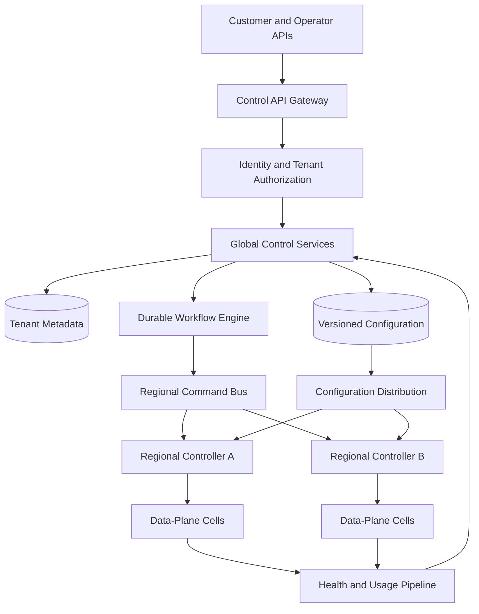

Commands express desired outcomes, not imperative shell steps. Regional controllers continuously compare desired state with observed state and repair drift.

## Tenant lifecycle

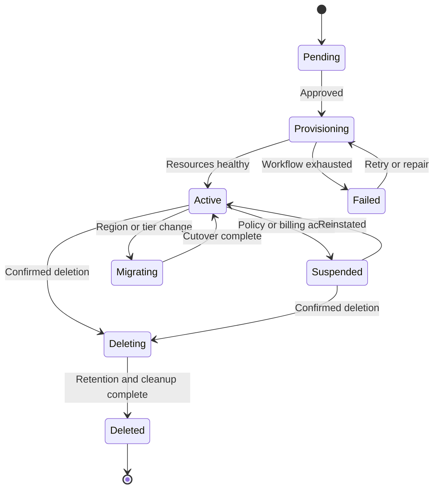

Lifecycle transitions are compare-and-swap mutations against the current version. Every transition records actor, reason, policy decision, workflow ID, and timestamp.

Deletion first blocks new traffic, then drains workloads, applies retention rules, removes data, and finally releases infrastructure. The tenant ID remains tombstoned to prevent delayed events from recreating it.

## Provisioning workflow

Provisioning spans several systems and cannot use a single database transaction. Use a durable, resumable saga.

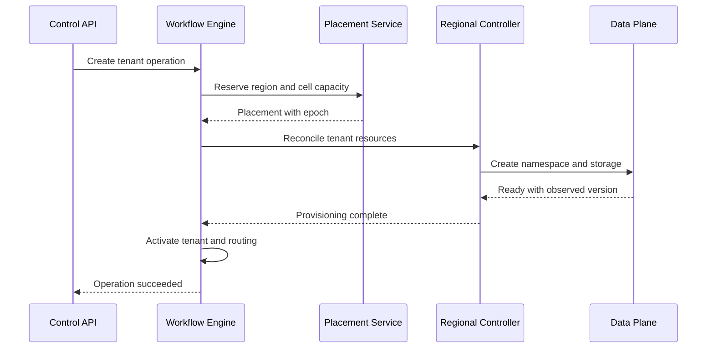

Each step accepts an idempotency key and stores its result. Retrying `create namespace` returns the existing namespace if its ownership metadata matches, rather than creating a duplicate.

Compensating actions release capacity and partial resources when provisioning fails before activation. After activation, use an explicit deletion workflow instead of attempting an unsafe rollback.

## Placement and cells

A cell is a bounded group of compute, storage, queues, caches, and supporting services. Each tenant belongs to one active cell per service unless its plan explicitly supports multi-region operation.

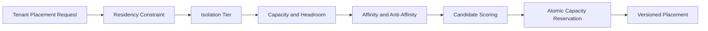

The scheduler considers data residency, required features, dedicated versus shared tiers, current load, failure domains, and evacuation headroom. Keep cells small enough to limit blast radius but large enough to use infrastructure efficiently.

Reserve capacity before provisioning. Periodically reconcile reservations with actual usage and expire abandoned reservations.

## Isolation tiers

Offer isolation deliberately rather than treating all tenants identically.

| Tier | Compute | Storage | Typical use |
| --- | --- | --- | --- |
| Shared | Shared pools with tenant quotas | Shared tables partitioned by tenant ID | Small and medium tenants |
| Isolated namespace | Dedicated workload namespace | Dedicated schema or database | Regulated or large tenants |
| Dedicated cell | Dedicated service cell | Dedicated storage cluster and keys | Highest isolation requirements |

All tiers require logical tenant checks. Physical isolation reduces blast radius but does not replace authorization.

## Tenant-aware request routing

Resolve the authenticated tenant before routing. Never trust an arbitrary tenant ID supplied by the client.

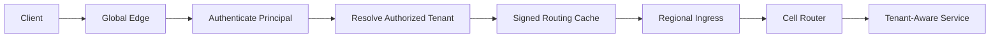

The routing record contains tenant ID, active region, cell, placement epoch, and expiry. Edge and regional caches receive signed incremental updates plus periodic full snapshots.

During migration, the router accepts only the highest epoch. A stale route receives a redirect containing a signed newer epoch or fails safely; it must not write to the old cell.

## Configuration management

Configuration is immutable, schema-validated, and versioned per tenant.

```http
PUT /v1/tenants/tn_7F2/config
If-Match: "41"
Idempotency-Key: 01K8W6M4
Content-Type: application/json

{
  "expectedVersion": 41,
  "changes": {
    "retentionDays": 90,
    "webhooks.enabled": true
  }
}
```

The control plane validates syntax, cross-field rules, plan entitlements, and regional policy before committing version 42. It then publishes a signed delta.

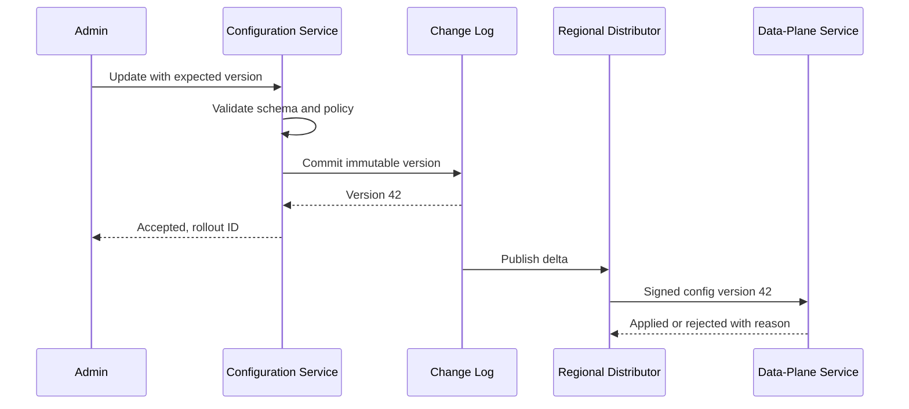

Services retain the last-known-good configuration. A bad version is rejected locally and reported without erasing the previous one. Sensitive changes can require two-person approval or a staged rollout.

## Entitlements, quotas, and metering

Entitlements answer what a tenant may use; quotas limit how much it may use; metering records what it did use.

Compile plan and contract rules into a compact regional entitlement snapshot. Product services enforce hard limits locally and emit usage events asynchronously.

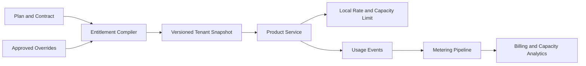

Use hierarchical quotas at tenant, workspace, user, and API-key levels. Reserve capacity for high-priority operations so batch imports cannot block login or administration.

Billing should consume durable usage events, not enforcement counters that may be approximate. Reconcile both paths and alert on material divergence.

## Noisy-neighbor protection

Apply isolation at every constrained resource:

- Token-bucket limits at ingress and service boundaries
- Per-tenant concurrency limits and bounded work queues
- Fair or weighted-fair scheduling for shared workers
- Database connection, query-time, and storage quotas
- Cache admission and memory budgets
- Stream partition and consumer throughput limits
- Circuit breakers scoped to tenant and dependency

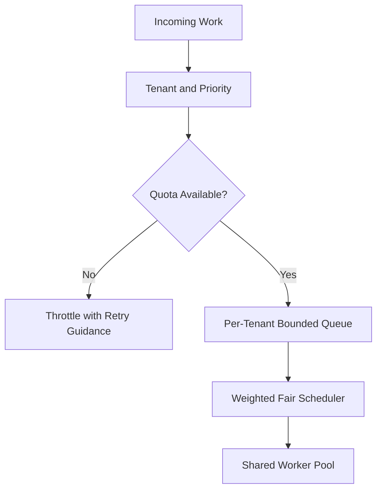

Tenant-level saturation should degrade that tenant before the whole cell. When a tenant repeatedly exceeds shared-tier limits, recommend or automate movement to an isolated tier.

## Safe upgrades

Separate control-plane software upgrades, data-plane software upgrades, schema migrations, and tenant configuration changes. Each has its own compatibility contract and rollback strategy.

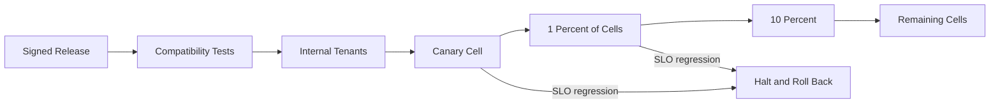

Use expand-and-contract schema changes: deploy readers that understand both versions, add the new schema, migrate incrementally, switch writers, and remove the old schema only after every tenant is compatible.

Track the desired and observed version of each resource. Upgrade waves advance only when health gates and soak times pass.

## Tenant migration

Migration is required for rebalancing, residency changes, tier upgrades, and regional evacuation.

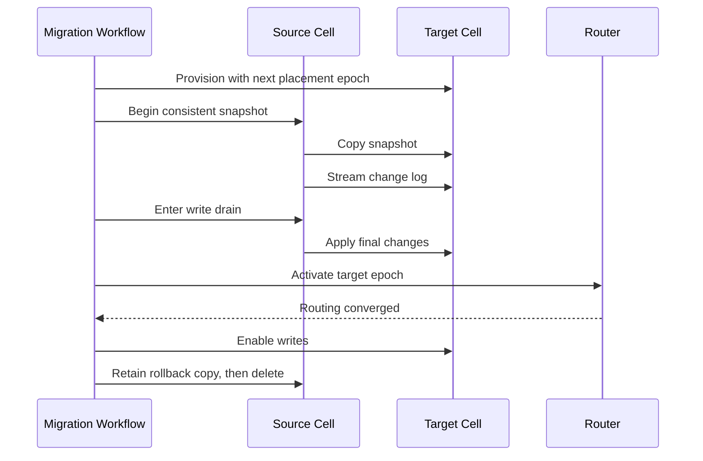

Validate counts, checksums, authorization state, and application invariants before cutover. Keep the source read-only for a bounded rollback window. Never allow concurrent writes in both locations unless the application was designed for multi-writer conflict resolution.

## Regional failure and evacuation

The response depends on the tenant's recovery tier:

- Regional-only tenants wait for regional recovery while other regions continue.
- Backup-enabled tenants restore into an approved secondary region within their RTO.
- Active-passive tenants promote a continuously replicated standby.
- Active-active tenants route around failure using application-specific conflict handling.

Evacuation changes placement epochs through a tightly controlled workflow. Capacity planning must retain enough regional headroom for the promised failover tier.

The global control plane should be replicated across failure domains, but regional data planes continue serving cached routing, configuration, and entitlements when disconnected.

## Security and authorization

Every request carries both workload identity and tenant context. Authorization checks the principal, action, resource, tenant, environment, and support-access state.

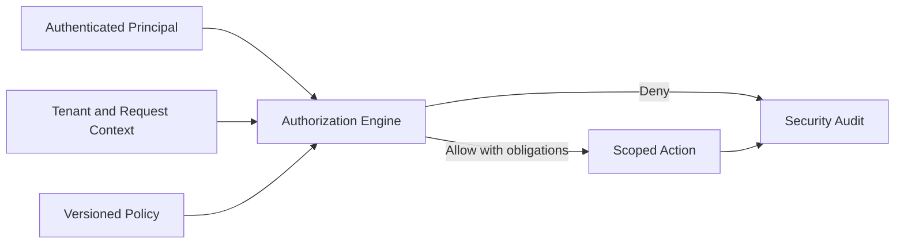

Use separate encryption keys for dedicated tiers and optionally per tenant. Support access is just-in-time, time-limited, reason-bound, and visible to the customer where appropriate. Break-glass access creates high-priority alerts and cannot disable auditing.

Prevent tenant-context confusion by using typed tenant-scoped data access libraries, mandatory database predicates, and negative isolation tests in CI. Raw database access should be exceptional.

## Reliability and failure handling

| Failure | Behavior |
| --- | --- |
| Global control plane unavailable | Data planes serve last-known-good state; queue administrative writes |
| Regional controller unavailable | Existing workloads continue; reconciliation resumes from durable state |
| Configuration update is invalid | Reject before commit or retain last-known-good at the consumer |
| Command delivered twice | Idempotency key returns the original result |
| Cell is overloaded | Throttle tenants, shed low-priority work, stop new placement |
| Placement update is delayed | Highest epoch wins; stale writers are fenced |
| Workflow worker crashes | Lease expires and another worker resumes the persisted step |
| Metering pipeline lags | Enforcement continues locally; billing waits for durable events |

Do not report an operation as successful when the control record is committed but the regional resource is not ready. Expose asynchronous operation IDs and honest intermediate states.

## Observability and SLOs

Track the platform from both global and per-tenant perspectives:

- Provisioning duration and failure rate by region and tier
- Desired-versus-observed configuration lag
- Routing cache age and placement-epoch mismatch
- Cell saturation, headroom, and noisy-neighbor events
- Tenant request latency, errors, and throttling
- Workflow age, retry count, and stuck steps
- Upgrade progress and rollback rate
- Migration replication lag and cutover duration
- Authorization denials and privileged access
- Usage event completeness and billing reconciliation

Avoid tenant IDs in unbounded metric labels. Store detailed tenant diagnostics in indexed logs or a dedicated operational store, with access controls and retention.

Useful SLOs include 99.99% routing availability, 99.9% configuration propagation within 60 seconds, and 99% standard tenant provisioning within 15 minutes.

## Key trade-offs

| Decision | Benefit | Cost |
| --- | --- | --- |
| Cell-based architecture | Bounded blast radius and easier scaling | More deployment and placement complexity |
| Async reconciliation | Survives failures and supports retries | Eventual consistency and harder UX |
| Shared infrastructure | High utilization and lower cost | Strong quota and isolation requirements |
| Dedicated tenant cells | Maximum isolation | Higher cost and operational overhead |
| Local configuration cache | Data plane survives control outages | Staleness and invalidation complexity |
| Single home region | Simple consistency and residency | Migration and regional recovery work |
| Versioned desired state | Auditable and reproducible | More metadata and compatibility management |

## Evolution path

1. Start with one region, a tenant registry, and strict tenant-scoped data access.
2. Add durable provisioning workflows and versioned configuration.
3. Introduce cells, placement, capacity reservations, and per-tenant quotas.
4. Add multi-region routing, residency rules, and signed regional snapshots.
5. Automate upgrade waves, migration, and regional evacuation.
6. Offer dedicated tiers and advanced recovery objectives where justified.

Build tenant isolation into the first schema and authorization boundary. Retrofitting it after data and identifiers have mixed is expensive and risky.

## Final design

Use a globally replicated control plane to store versioned tenant intent and durable workflows, while regional controllers reconcile resources inside bounded data-plane cells. Keep routing, policy, configuration, and entitlement snapshots close to product traffic so control-plane failure does not interrupt existing tenants. Fence every placement with an epoch, scope every access by authenticated tenant identity, and protect shared resources with per-tenant quotas and fair scheduling. Roll out upgrades in health-gated waves and perform migrations through snapshot, change capture, write drain, and atomic route cutover.

The central principle is separation of intent from execution. The control plane decides what each tenant should have; regional data planes continue operating and converging safely even when components fail, messages repeat, or the global plane is temporarily unreachable.
