## Problem and requirements

A package registry stores versioned software artifacts and metadata so developers and build systems can publish, discover, resolve, and download dependencies. It may serve public open-source packages, private organizational packages, container layers, language modules, or operating-system bundles.

The difficult part is maintaining a trustworthy global namespace. A published version may be downloaded for years. Mutable artifacts, compromised publishers, ambiguous dependency rules, or a malicious package can affect millions of builds.

### Functional requirements

- Create organizations, namespaces, and packages
- Publish immutable package versions
- Search packages and inspect metadata
- Resolve version constraints deterministically
- Download complete packages and byte ranges
- Deprecate, yank, quarantine, or delete versions under policy
- Manage publisher roles and automation credentials
- Verify signatures, attestations, and provenance
- Scan artifacts for malware, secrets, and vulnerabilities
- Mirror upstream registries and replicate globally
- Emit download, publication, security, and audit events

### Non-functional requirements

- Store one billion package versions
- Serve ten million downloads per second
- Keep popular downloads available during control-plane outages
- Prevent overwriting an existing name and version
- Make metadata updates globally visible within seconds
- Preserve deterministic resolution for lockfile-based builds
- Isolate private tenants and prevent namespace confusion
- Detect corruption at every storage and transport boundary

Published package bytes are immutable. Corrections require a new version; removal is an exceptional policy operation with explicit consequences.

## Capacity estimates

Assume one billion versions, a median archive size of five megabytes, a heavy tail of multi-gigabyte artifacts, and ten million peak downloads per second.

| Resource | Estimate |
| --- | ---: |
| Package versions | 1B |
| Artifact storage | Petabytes to exabytes |
| Peak downloads | 10M/second |
| Metadata reads | Tens of millions/second |
| Publications | Thousands/second |
| Search documents | Hundreds of millions of active packages |

Download bandwidth dominates data-plane cost. Metadata correctness, signing, and abuse review dominate control-plane complexity.

## Package model

The hierarchy is registry, tenant or organization, package name, and immutable version.

A version contains:

- Canonical package identity and version
- Artifact digest, size, and content type
- Dependency constraints
- Supported platforms and runtime requirements
- Publisher identity and timestamp
- Signature and provenance references
- Licenses and source repository metadata
- Scan and policy status
- Deprecation, yanking, or quarantine state

The package manifest is canonicalized and signed or hashed with the artifact. Metadata that affects installation cannot change after publication.

Descriptive fields such as documentation links may update separately through versioned metadata records.

## Version semantics

The registry supports an ecosystem-specific version scheme, commonly semantic versions with prerelease identifiers.

Version parsing and ordering live in one tested library shared by publication, resolution, API responses, and clients. Seemingly minor differences around prereleases or build metadata can make builds non-deterministic.

Mutable tags such as `latest` point to immutable versions. Clients should pin a resolved version and digest in lockfiles rather than depend on a tag at build time.

The registry never lets a publisher reuse a deleted version number with different bytes.

## API design

Publishing uses a two-phase upload and commit.

```http
POST /v1/packages/@acme/checkout/versions
Authorization: Bearer <publisher-token>
Idempotency-Key: checkout_4.2.0_publish
Content-Type: application/json

{
  "version": "4.2.0",
  "manifestDigest": "sha256:...",
  "artifactDigest": "sha256:...",
  "artifactSize": 1842000,
  "provenanceDigest": "sha256:..."
}
```

The server returns missing blobs and scoped upload URLs. A later finalize request validates and atomically reserves the name-version pair.

Downloads identify the immutable version or digest:

```http
GET /v1/packages/@acme/checkout/versions/4.2.0/artifact
```

Responses include strong checksums and immutable cache headers.

## High-level architecture

The control plane manages namespaces and publication. The data plane serves immutable blobs through regional caches and a CDN.

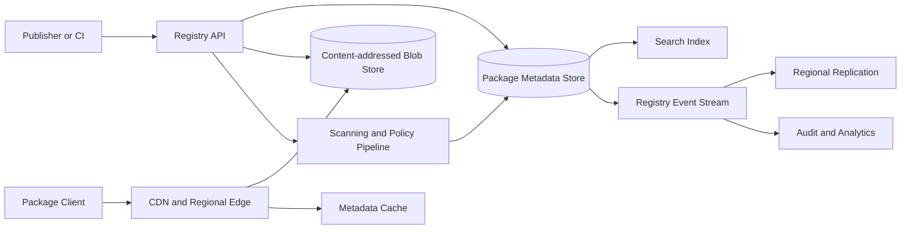

Blob serving remains available from immutable caches even if publication and administrative APIs are unavailable.

## Namespace ownership

Package names are scarce security boundaries. Registration validates tenant ownership and applies reserved-name, trademark, and impersonation policies.

Scoped names such as `@organization/package` reduce global contention and dependency confusion. Private repositories must never silently fall back to a public package with the same unscoped name.

Roles separate package owner, publisher, maintainer, security responder, and read-only consumer.

Ownership transfer requires recent strong authentication, confirmation from both sides, cooling-off time for high-impact packages, and notification to existing maintainers.

Orphaned or abandoned names follow a documented dispute process rather than automatic reassignment.

## Publication flow

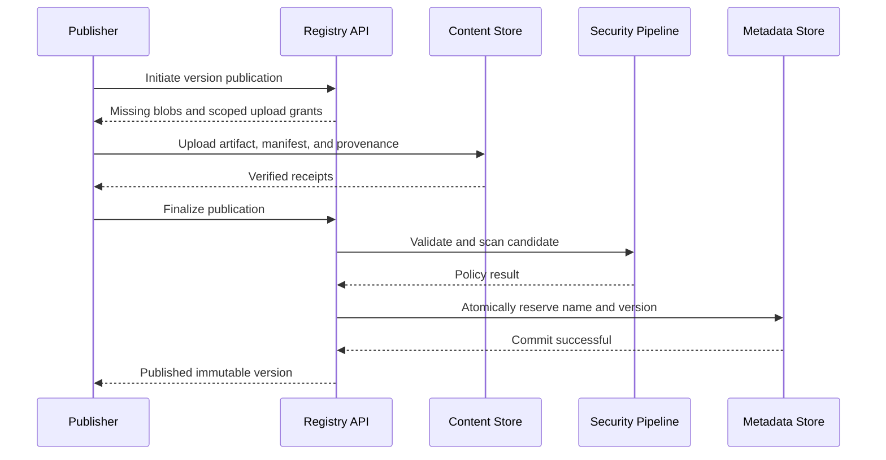

The final metadata transaction uses create-if-absent. Concurrent attempts to publish the same version cannot both succeed.

Idempotency keys let a publisher recover after an ambiguous response. The original artifact and manifest digests must match.

## Content-addressed storage

Artifacts, manifests, attestations, source bundles, and documentation assets are stored by cryptographic digest.

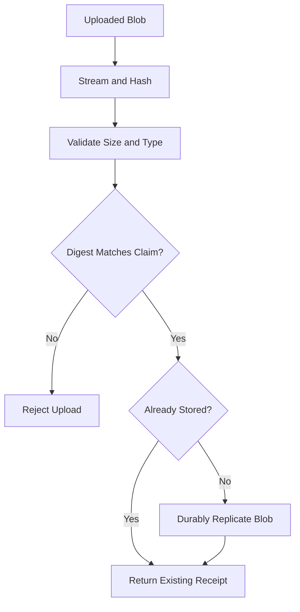

Physical deduplication can reuse identical bytes across packages while authorization prevents digest probing from revealing private content.

Large artifacts use multipart or resumable uploads. Completion verifies the whole-object digest, not only individual parts.

Blobs are immutable. Metadata references make them reachable; unreferenced uploads are garbage-collected after a safety period.

## Manifest validation

Before publication, validate:

- Canonical package name and version
- Manifest schema and size
- Dependency names and constraint syntax
- Duplicate, cyclic, or forbidden metadata where relevant
- Archive paths and permissions
- Platform and runtime identifiers
- License declarations and policy
- Artifact and provenance digests

Reject path traversal, absolute paths, device files, unsafe links, decompression bombs, and case-collision archives.

Extract metadata in a sandbox with strict CPU, memory, file-count, nesting, and decompressed-size limits.

## Dependency resolution

The client or a hosted resolver selects versions satisfying the root requirements and transitive constraints.

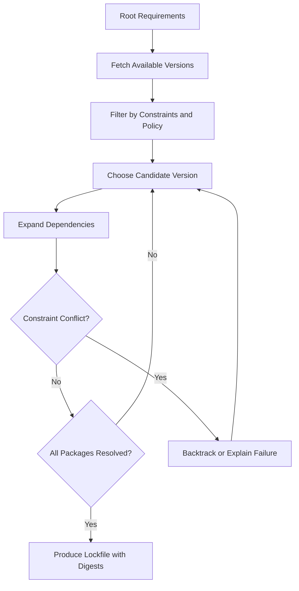

Resolution rules differ by ecosystem: one global version, multiple side-by-side versions, peer dependencies, optional dependencies, and platform markers all change the algorithm.

Deterministic tie-breaking is mandatory. Sort canonical versions and package identities identically across clients.

Return a conflict explanation with the constraint chain rather than only “no solution.”

## Lockfiles

A lockfile records the complete resolved graph:

- Registry and canonical package identity
- Exact version
- Artifact and manifest digests
- Selected platform variants and features
- Dependency edges
- Signature or provenance requirements

Installation from a lockfile verifies digests and does not reinterpret floating constraints.

Lockfiles are portable only when platform-specific choices are represented explicitly. A lock generated on one operating system must not silently resolve different bytes elsewhere.

Tools can refresh one dependency while preserving the rest of the graph, but the resulting lockfile is a new reviewed artifact.

## Metadata serving

Resolution reads package version indexes far more often than publishers modify them.

Store authoritative package metadata in strongly consistent partitions and publish immutable metadata snapshots or signed deltas to regional caches.

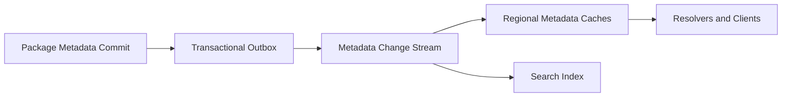

Each package has a monotonically increasing metadata sequence. Clients can conditionally refresh using sequence or ETag.

Cached stale metadata may omit a newly published version but must not invent one or return an artifact under the wrong digest.

Security quarantine events use a prioritized invalidation path.

## Download path

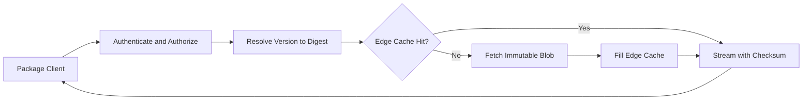

Public immutable artifacts can use long cache lifetimes. Private cache entries include tenant and authorization scope or use signed, short-lived origin grants.

Range requests support resumable downloads. The client verifies the complete digest after assembly.

Hedged origin requests can reduce tail latency, but cancel the loser promptly to avoid doubling global bandwidth.

## Signatures and publisher identity

A package signature binds artifact digest, manifest digest, package identity, and version.

Publisher-managed keys provide strong continuity but create key-distribution and rotation burdens. Registry-managed signing attests that the registry accepted the publication, not necessarily who authored the source.

Use short-lived identity-based signing where a trusted CI workload receives a certificate tied to repository and workflow identity. This avoids long-lived publisher secrets.

Store signatures separately from immutable package bytes so additional attestations can be added without changing the artifact digest.

Clients enforce trust policy by organization, package, environment, and provenance—not merely “some signature exists.”

## Build provenance

Provenance describes how an artifact was produced:

- Source repository and revision
- Build definition and builder identity
- Input and output digests
- Toolchain and environment
- Invocation parameters
- Timestamp and policy level

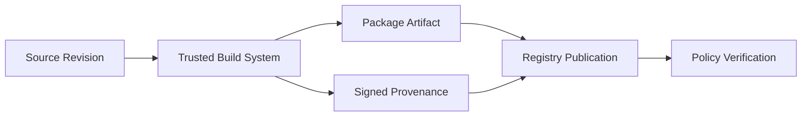

The registry verifies signatures and expected identity claims before marking provenance valid. It does not blindly trust self-declared metadata.

Release policy can require a protected repository branch, reviewed workflow, hermetic builder, and matching artifact digest.

## Malware and secret scanning

Scan archive structure, executable content, install scripts, known malware signatures, suspicious behavior, embedded secrets, and vulnerable dependencies.

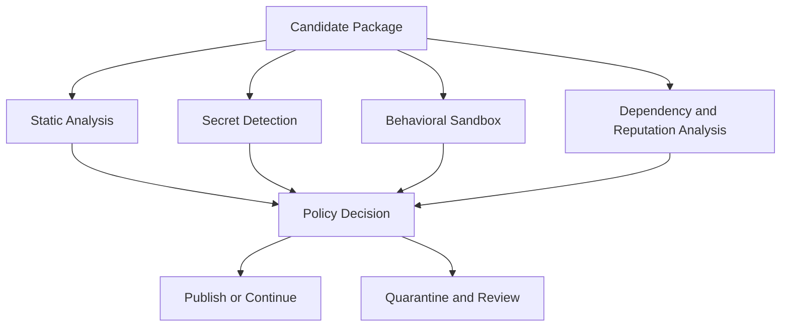

Fast checks can gate publication. Deeper asynchronous analysis may later quarantine a version as new evidence appears.

Scanning is probabilistic and must not be marketed as proof of safety. Record scanner versions and reasons for reproducibility and appeal.

Never expose detected secrets in ordinary logs. Revoke confirmed credentials and notify authorized owners through a protected channel.

## Vulnerability intelligence

Map package versions to vulnerability advisories with affected ranges, severity, references, and fix versions.

Advisories are versioned and signed where sourced externally. Range evaluation uses the same ecosystem version library as resolution.

Expose vulnerability metadata separately from immutable package manifests so intelligence can update over time.

Clients and policy engines can warn, block, or require approval according to environment. A development warning and production release gate may differ.

Avoid declaring a package safe merely because no advisory currently exists.

## Install scripts and execution risk

Package installation may execute arbitrary scripts. The registry cannot fully protect clients from this behavior.

Mark packages that include lifecycle scripts, native binaries, network requirements, or privileged operations. Organizations can block or require review for these capabilities.

Package clients should install in a sandbox, disable network by default, and require explicit approval for script execution.

Do not execute publisher scripts in the registry's metadata or scanning infrastructure outside a tightly constrained behavioral sandbox.

## Yanking, deprecation, quarantine, and deletion

These states have different meanings:

- **Deprecation:** version remains resolvable and downloadable with a warning
- **Yanking:** new floating resolution avoids it, while lockfiles still work
- **Quarantine:** downloads are blocked or restricted due to security risk
- **Deletion:** metadata and bytes become unavailable under exceptional policy

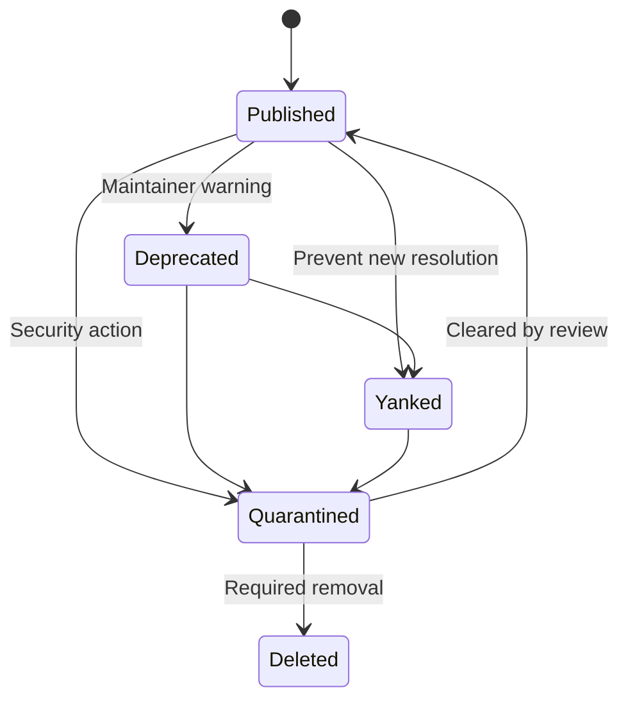

State changes are versioned, audited, and rapidly distributed. Do not reuse a deleted version number.

Emergency quarantine prioritizes safety over cache availability. Edge authorization checks or revocation lists prevent immutable CDN caches from bypassing the block.

## Two-factor and publishing security

Publishing is a high-risk operation. Require phishing-resistant multi-factor authentication for human publishers and short-lived workload identity for automation.

Fine-grained tokens specify package, operation, environment, source network, and expiration. A token allowed to download private packages cannot publish.

For high-impact packages, require two-person approval, release provenance, or a delayed promotion window.

Detect unusual publication time, geography, new automation identity, dependency spike, or abrupt maintainer changes. Risk can require step-up review without disclosing exact abuse thresholds.

## Mirrors and upstream proxies

An organizational registry can proxy an external ecosystem and cache verified upstream packages.

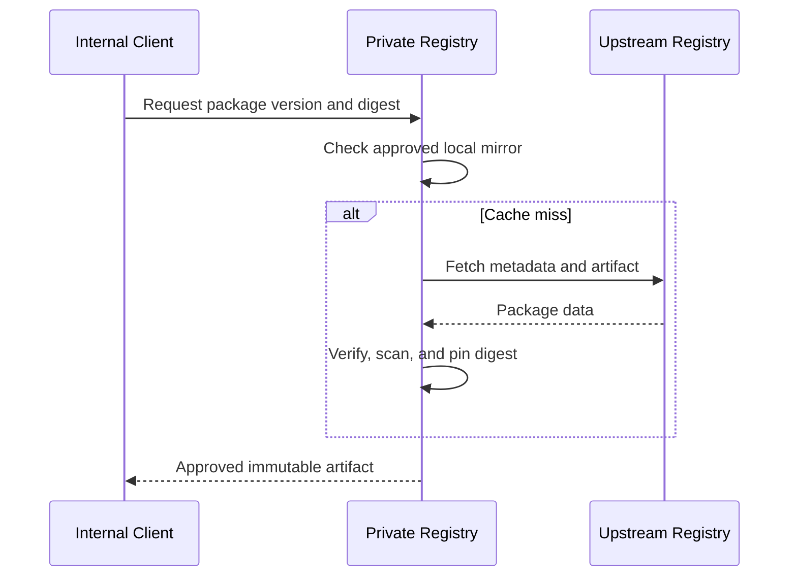

Mirror by exact upstream identity and digest. If upstream serves different bytes for an existing version, quarantine the conflict rather than replacing cached content.

Resolution policy must define whether private, mirrored, and public namespaces can overlap. Prevent dependency confusion by preferring an explicitly configured source, not the numerically highest version across registries.

## Search and discovery

Search indexes package name, description, documentation, keywords, platform, license, quality, popularity, and security state.

Search is eventually consistent and never authoritative for installation. Selecting a result resolves through the metadata service.

Rank with relevance and quality signals while resisting download-count manipulation and typosquatting. New packages need fair discovery without inheriting trust from a similar name.

Moderate package text and documentation separately from executable artifacts. Search filtering does not delete or rewrite package bytes.

## Multi-tenancy and authorization

Every private package, blob reference, cache entry, search document, and audit event belongs to a tenant scope.

Authorization applies at namespace, package, version, and operation. Team membership and automation identity come from trusted account systems.

Large tenants may use dedicated metadata partitions, storage encryption keys, or network-isolated download endpoints.

Apply quotas to packages, versions, stored bytes, publish rate, bandwidth, search, mirrors, and scanning resources.

Digest knowledge alone never grants access to a private blob.

## Global replication

Replicate immutable blobs and ordered metadata changes to regional stores.

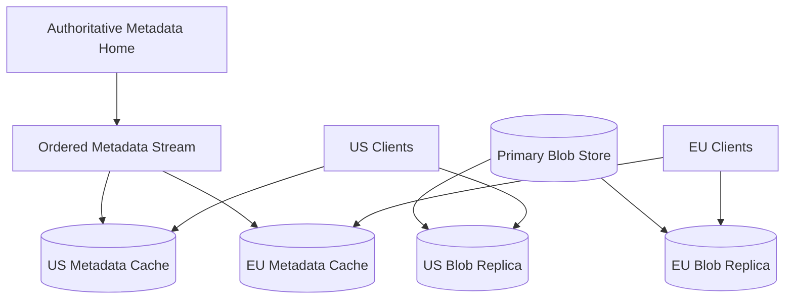

A region advertises a version only after its artifact is locally available or reliably fetchable from origin. Metadata must not create broken downloads.

Publication uses one authoritative name-version transaction. Regional caches are read-only followers.

Emergency quarantine propagates ahead of ordinary metadata and is checked even when serving a cached blob.

## Garbage collection

CAS blobs may be shared by many package versions and uploads. Delete only when no retained manifest, provenance record, mirror pin, active upload, or legal hold references the blob.

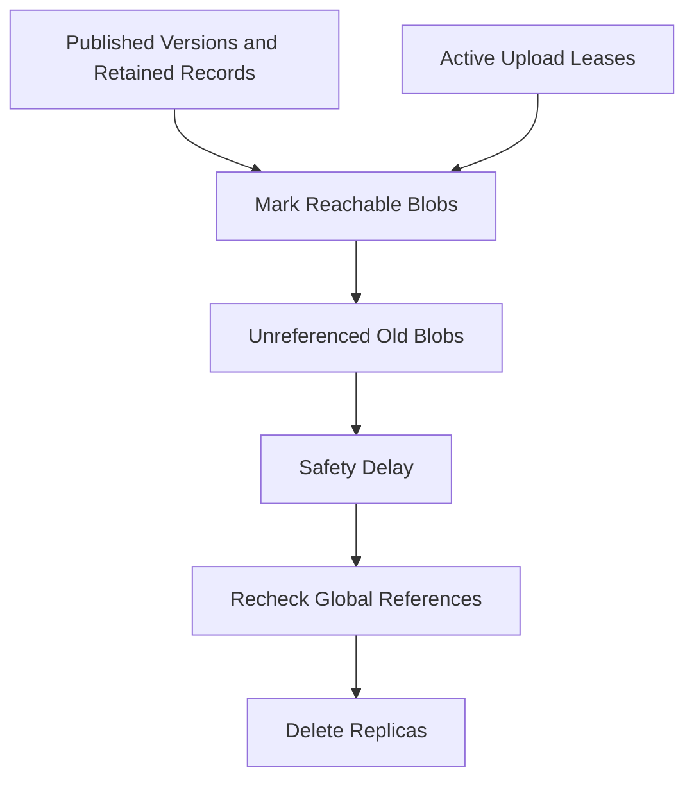

Public packages may have indefinite artifact retention even after yanking. Private retention follows contract and organization policy.

Deletion produces a durable manifest and waits for regional replicas and caches to confirm removal.

## Disaster recovery

Back up authoritative metadata, namespace ownership, policy, audit checkpoints, search source documents, and blob manifests.

Immutable artifacts can be restored from regional replicas if the mapping from package versions to digests remains intact.

Restore into an isolated registry, verify metadata sequence, signatures, counts, and sampled downloads, then promote through an atomic service switch.

Regularly test the case where metadata survives but a regional blob replica does not, and the reverse. Either alone is insufficient for a working registry.

## Failure handling

### Publication API unavailable

Existing metadata and immutable downloads continue. New publications pause rather than accepting uncoordinated versions.

### Upload interrupted

Resume by upload ID and verified parts. Expire abandoned uploads after a grace period.

### Scanner unavailable

Queue candidate versions or publish into a non-downloadable pending state according to policy. Do not silently skip required checks.

### Metadata replication lag

Serve the prior sequence and expose freshness. Never synthesize a version from an artifact discovered in blob storage.

### Regional blob missing

Fetch by digest from another healthy replica, verify it, fill the cache, and return. If no verified copy exists, fail explicitly.

### Corrupt artifact

Checksum validation rejects the copy. Quarantine the storage replica, restore from another copy, and investigate if the authoritative digest no longer has healthy bytes.

### Compromised publisher

Revoke credentials, freeze package publication, quarantine affected releases, notify users, preserve evidence, and transfer ownership through reviewed recovery.

### Hot package release

Prewarm edges, coalesce origin fetches, apply fair bandwidth limits, and scale immutable CDN delivery independently of metadata services.

## Observability

Track:

- Publication attempts, failures, and finalization latency
- Upload bytes, resumptions, and checksum failures
- Metadata sequence and regional propagation lag
- Cache hit rate, origin traffic, and download latency
- Missing, corrupt, and repaired blobs
- Resolution latency and constraint conflicts
- Scan backlog, quarantine events, and appeal status
- Signature and provenance verification rates
- Authentication risk, token use, and ownership changes
- Mirror freshness and upstream digest conflicts
- Storage reachability and garbage-collection progress
- Per-tenant quota and bandwidth use

Synthetic packages continuously test publication, resolution, download, signature verification, yanking, quarantine, mirroring, and regional failover.

Provide a resolution explanation showing selected versions, rejected candidates, policy decisions, and registry sources without exposing private package names across tenants.

## Key tradeoffs

### Immutable versions vs easy correction

Immutability makes builds reproducible and caches safe. Mistakes require a new version or explicit yanking rather than quietly replacing bytes.

### Fast publication vs security analysis

Deep scanning improves detection but delays releases and still cannot prove safety. Fast mandatory checks plus asynchronous deeper analysis and emergency quarantine balance both.

### Global cacheability vs revocation

Immutable blobs cache efficiently for long periods. A separate, rapidly checked security state is needed to block compromised versions without mutating bytes.

### Shared CAS vs tenant isolation

Physical deduplication saves storage, but unauthorized digest probing can leak information. Access-controlled references and tenant-scoped lookup preserve logical isolation.

### Flexible resolution vs reproducibility

Version ranges ease upgrades but can change results over time. Lockfiles with exact versions, sources, and digests turn a flexible choice into a reproducible build input.

The central principle is that once a name and version point to an artifact digest, that mapping never changes; trust evolves through signed metadata, policy state, and new versions rather than mutable bytes.
