## Problem and requirements

A privacy-preserving data platform lets product teams use data while consistently enforcing how that data may be collected, processed, shared, retained, and deleted. It provides common controls across transactional databases, event streams, object storage, analytics warehouses, search indexes, caches, and machine learning systems.

The difficult part is not encrypting one database. The same person's data can be copied into hundreds of derived datasets, encoded under several identifiers, embedded in model features, and retained in backups. Privacy therefore requires end-to-end metadata, enforceable policy, reliable identity resolution, and evidence that controls actually ran.

### Functional requirements

- Register data assets, owners, schemas, regions, and processing purposes
- Discover and classify sensitive fields automatically
- Record consent and legal-basis changes with effective time
- Enforce collection, access, export, and processing policies
- Tokenize or redact identifiers before broad distribution
- Track field-level lineage through pipelines and derived datasets
- Fulfill access, correction, portability, and deletion requests
- Apply retention policies to primary and derived copies
- Provide privacy-safe analytics and data sharing
- Produce immutable evidence for audits and investigations

### Non-functional requirements

- Process 100 billion new records per day across 10,000 stores
- Represent one billion data subjects and multiple identifiers per subject
- Evaluate online policy in under ten milliseconds at p99
- Propagate consent revocation to online paths within seconds
- Complete ordinary deletion requests within the policy deadline
- Keep regional data inside its permitted boundary
- Fail closed for high-risk writes and degrade safely for low-risk reads
- Make every policy decision explainable and reproducible

This platform implements organizational policy. Legal teams define applicable obligations, while product and data owners remain accountable for why processing occurs.

## Capacity estimates

Assume 100 billion events arrive daily, 100 petabytes of governed data are stored, and each record contains ten classified fields on average.

| Resource | Estimate |
| --- | ---: |
| New records | 100B/day, 1.16M/second average |
| Policy evaluations | 5M/second at peak |
| Classified fields | Trillions |
| Data assets | 10K stores, millions of tables and topics |
| Data subjects | 1B |
| Privacy requests | 1M/day at campaign peak |
| Audit events | Tens of billions/day |

Keep the synchronous enforcement path small. Discovery, lineage, request fulfillment, and evidence compaction can run asynchronously, but their progress must be measurable.

## Data and policy model

The central catalog describes assets and fields rather than copying customer data into the control plane.

```text
Asset       { id, type, owner, region, schemaVersion, retentionPolicy }
Field       { assetId, path, classifications[], purposes[], transform }
Subject     { internalSubjectId, identifierRefs[], region }
Consent     { subjectId, purpose, status, source, effectiveAt, expiresAt }
Policy      { id, version, effect, subjects, resources, purposes, conditions }
LineageEdge { sourceField, destinationField, jobVersion, transform }
Request     { id, subjectId, type, jurisdiction, deadline, state }
Decision    { policyVersion, inputsHash, result, reasonCodes, timestamp }
```

Published policies and classifications are immutable versions. Corrections create a new version so historical decisions can be reconstructed.

## High-level architecture

The control plane manages metadata and policy. Enforcement points remain close to applications and data systems.

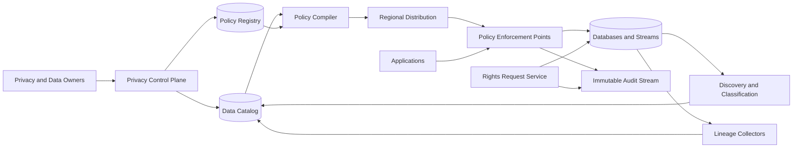

The control plane can be temporarily unavailable without stopping already configured enforcement. Agents use last-known-good, signed policy bundles with explicit expiry times.

## Data lifecycle

Privacy controls begin before collection and continue after logical deletion.

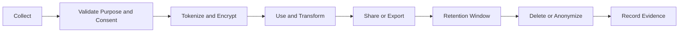

Every transition carries classifications, subject scope, purpose, region, and retention metadata. A derived dataset receives the strictest applicable constraints unless an approved transformation proves the output anonymous.

## Collection and purpose enforcement

Applications declare the intended purpose when writing or reading protected data. A gateway or embedded library evaluates that request against consent, legal basis, region, and product policy.

```http
POST /v1/policy:check
Content-Type: application/json

{
  "principal": "service:recommendations",
  "action": "read",
  "resource": "profile.purchase_history",
  "subject": "sub_8f31",
  "purpose": "personalization",
  "region": "eu-west"
}
```

```json
{
  "decision": "allow",
  "policyVersion": "pv_1842",
  "obligations": ["mask:merchant_id", "ttl:24h"],
  "reasonCodes": ["CONSENT_ACTIVE", "REGION_ALLOWED"]
}
```

Obligations are executable instructions, not advisory labels. The enforcement point must apply masking, logging, locality, rate, or retention conditions before returning data.

## Consent service

Consent is time-dependent and purpose-specific. Store it as an append-only history instead of a mutable boolean.

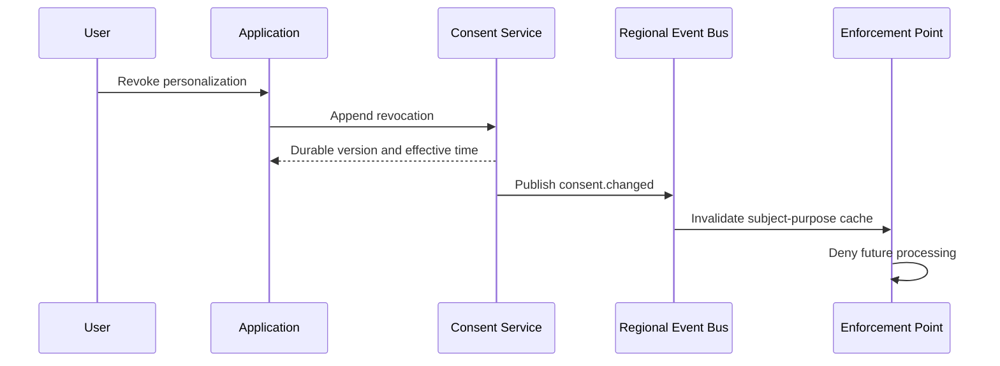

Use monotonic per-subject versions so delayed events cannot restore stale consent. Read paths cache only short-lived decisions and invalidate them from the regional stream. High-risk processing checks the authoritative regional replica.

Consent alone does not make all processing valid, and withdrawal does not necessarily delete data retained under another approved basis. The policy engine resolves those rules explicitly.

## Discovery and classification

Agents inspect schemas, samples, query logs, and metadata without exporting full datasets. Detection combines deterministic patterns, dictionaries, statistical detectors, and reviewed machine learning predictions.

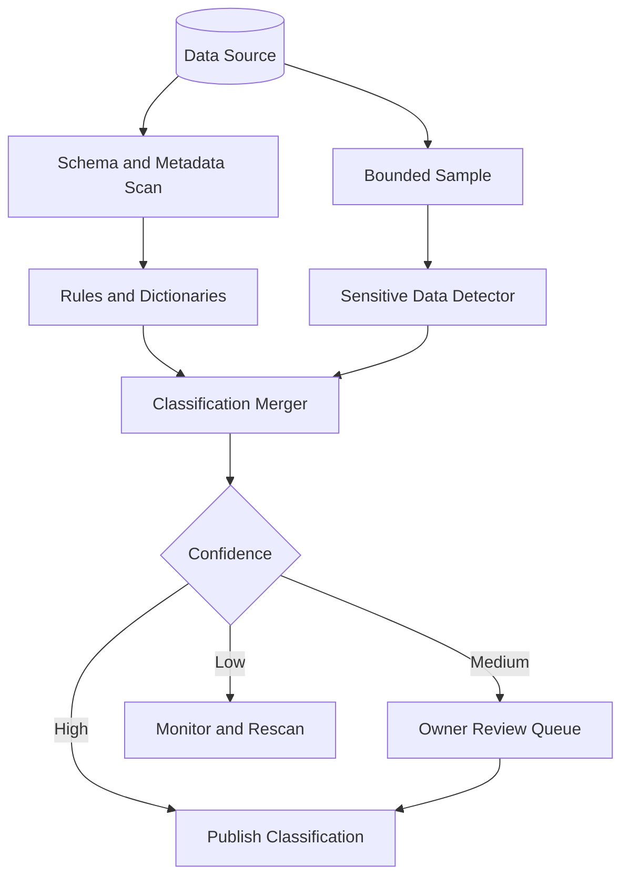

Classifications include direct identifiers, quasi-identifiers, credentials, financial data, health data, precise location, and organization-specific sensitive types. A confidence score never weakens a manually confirmed label.

Schema registry hooks classify new fields before deployment. Runtime scans detect unmanaged stores and schema drift after deployment.

## Tokenization and identity isolation

Replace broadly used identifiers with scoped tokens. Keep the mapping inside a hardened regional vault.

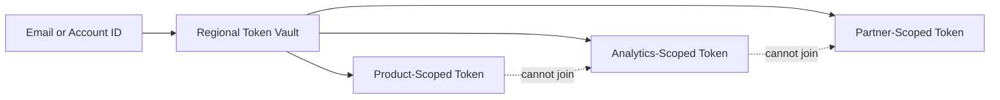

Tokens should be deterministic only within the scope that needs joins. Include tenant, region, purpose, and key version in the tokenization context. Unauthorized cross-purpose joins then become technically difficult rather than merely prohibited.

Encrypt vault mappings with envelope encryption backed by hardware-protected keys. Separate tokenization operators from data consumers and audit every detokenization.

## Policy compilation and enforcement

Human-readable rules are validated, tested, compiled, signed, and distributed to enforcement points.

```mermaid
flowchart LR
  Draft[Policy Draft] --> Validate[Schema and Conflict Checks]
  Validate --> Tests[Policy Test Suite]
  Tests --> Review[Privacy and Owner Approval]
  Review --> Compile[Compile Decision Bundle]
  Compile --> Sign[Sign and Version]
  Sign --> Canary[Canary Distribution]
  Canary --> Global[Regional Rollout]
  Global --> Monitor[Decision Monitoring]
  Monitor -->|Regression| Rollback[Last Known Good]
```

Compile common rules into indexed decision trees so an online check does not scan every policy. Cache results by policy version, principal, action, resource class, purpose, and coarse context—never omit a dimension that can change the decision.

Run proposed policies against sampled historical requests in shadow mode. Report new allows, new denies, latency, and affected owners before activation.

## Data lineage

Lineage connects source fields to downstream fields through versioned transformations. Collect it from query engines, stream processors, orchestration systems, schema registries, and application annotations.

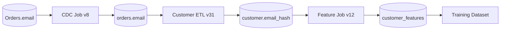

Store lineage as a temporal graph. Each edge records code version, execution window, field mapping, and transformation type. When classification or consent changes, traverse the graph to find impacted descendants.

Lineage is often incomplete. Display coverage and freshness, and treat missing edges as risk—not proof that no copy exists.

## Rights request workflow

A request may ask for access, correction, portability, restriction, or deletion. Identity verification is intentionally separate from fulfillment to limit impersonation risk.

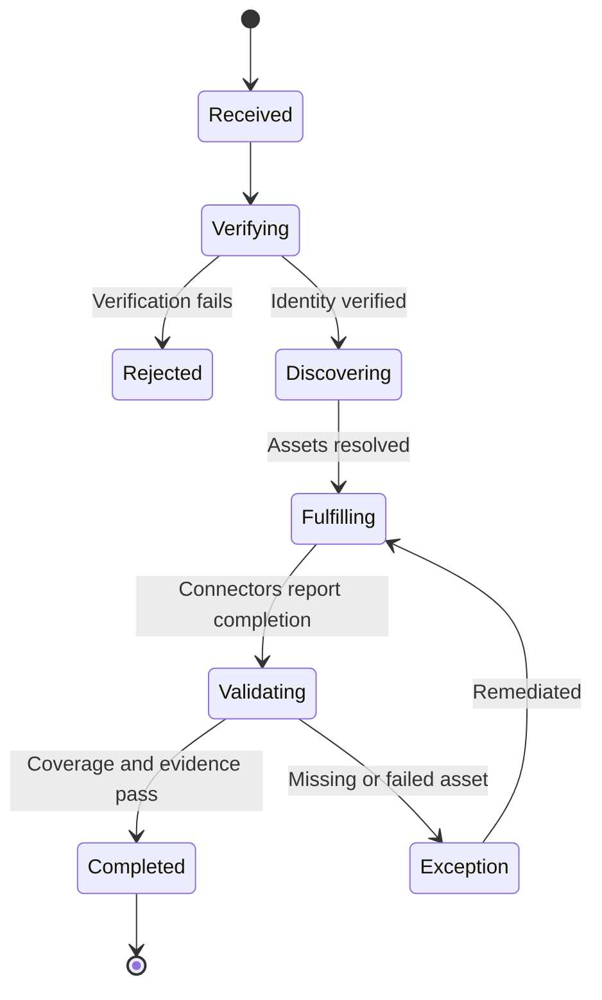

The discovery step resolves identifiers, queries the catalog and lineage graph, and creates one idempotent task per asset. The coordinator retries transient failures, escalates stale tasks, and preserves connector evidence.

For access exports, stage encrypted artifacts with a short expiry and deliver the decryption secret through a separate authenticated channel.

## Deletion semantics

Deletion is a distributed workflow, not a single database statement.

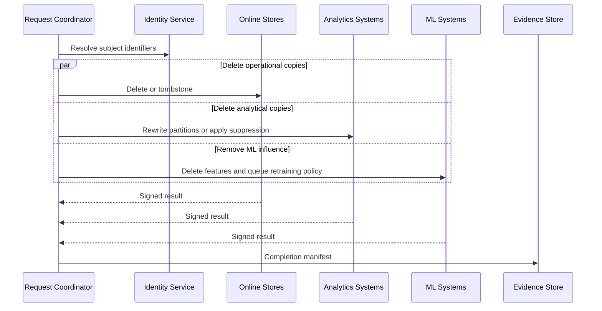

Use tombstones to prevent delayed events, CDC replays, or retries from resurrecting deleted subjects. Tombstones contain opaque subject tokens, not the deleted personal data, and expire only after the longest replay window.

Immutable backups are handled by crypto-erasure where possible or by suppression on restore. A restored system must replay deletion manifests before serving traffic.

For trained models, exact unlearning may be impractical. Classify models by risk and document whether deletion requires immediate retraining, scheduled retraining, output suppression, or an approved exception.

## Retention enforcement

Retention begins from a defined event: collection, account closure, transaction completion, or contract end. Store the trigger and policy version with the record.

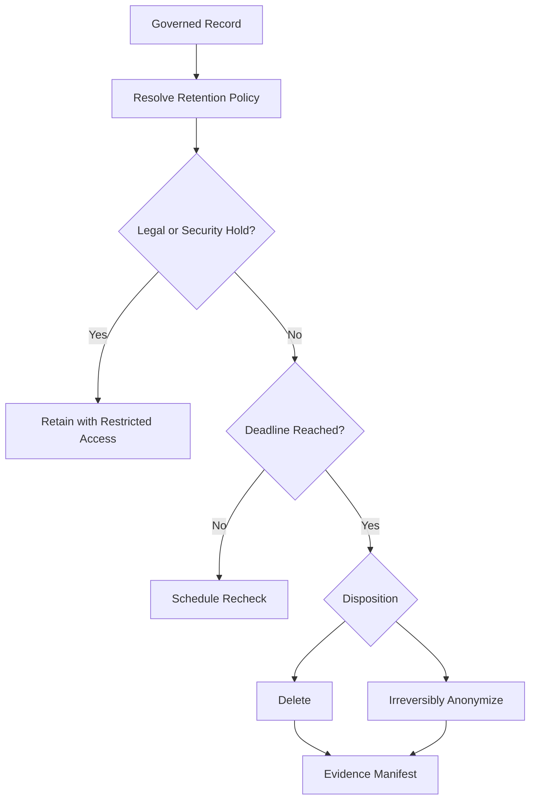

Partition large datasets by retention-aligned time windows where possible. Dropping a partition is cheaper and more reliable than deleting billions of individual rows.

## Privacy-safe analytics

Analysts should access governed interfaces rather than raw identifiers. Layer controls by use case:

- Row- and column-level authorization for approved purposes
- Default aggregation and minimum cohort thresholds
- Query-time masking and scoped pseudonyms
- Differential privacy budgets for repeated sensitive statistics
- Isolated clean rooms for partner joins
- Watermarked exports and short-lived credentials

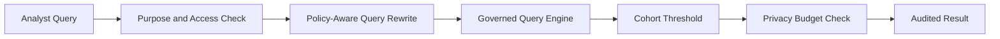

Differential privacy is not a universal switch. Define the protected population, contribution bounds, epsilon allocation, composition window, and acceptable utility for each metric family.

## Regional isolation

Deploy subject data, consent state, token vaults, policy caches, and audit streams within approved regions. The global plane contains only non-sensitive configuration and aggregate health.

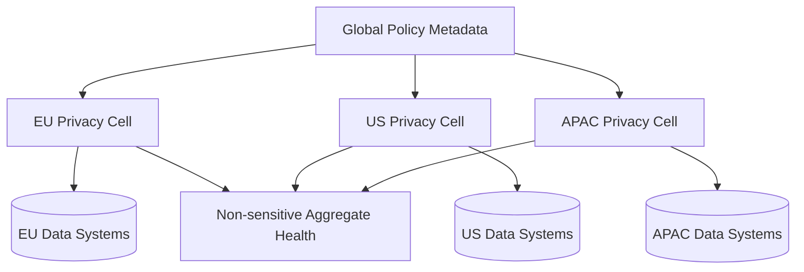

Cross-region transfers use explicit transfer policies, approved destinations, encrypted channels, and transfer manifests. A regional outage should not silently redirect protected data to a prohibited region.

## Audit and evidence

Record policy changes, classifications, consent mutations, privileged access, exports, deletion tasks, retention actions, and enforcement decisions in an append-only log.

Hash-chain records within a partition and periodically anchor signed roots in a separate trust domain. Compact high-volume decisions into verifiable summaries while preserving sampled details and all high-risk events.

Audit data is itself sensitive. Restrict queries, redact unnecessary payloads, apply retention, and alert on unusual access to the evidence system.

## Reliability and failure handling

Define behavior per risk class:

| Failure | Safe behavior |
| --- | --- |
| Policy service unavailable | Use unexpired signed bundle; deny after expiry for sensitive actions |
| Consent event delayed | Authoritative check for high-risk use; conservative deny on ambiguity |
| Classifier unavailable | Quarantine new unknown fields from broad access |
| Lineage collector delayed | Mark coverage stale and block risky publication |
| Deletion connector fails | Retry idempotently, alert owner, keep request open |
| Audit sink unavailable | Buffer durably; stop privileged operations if buffer is exhausted |
| Token vault unavailable | Do not fall back to raw identifiers |

Each connector exposes scan freshness, task lag, error rate, and last successful policy version. Dead-letter queues require ownership and replay tooling; they are not a final destination.

## Security controls

- Authenticate workloads with short-lived identities
- Authorize every control-plane and data-plane action
- Separate policy authors, approvers, platform operators, and auditors
- Encrypt data in transit and at rest with regional keys
- Rotate tokenization and encryption keys with versioned migration
- Require just-in-time approval for break-glass access
- Scan exports for sensitive fields before release
- Rate-limit subject discovery to prevent enumeration
- Sign policy bundles, connector results, and deletion manifests
- Red-team inference, linkage, and membership attacks

Never place raw personal data in metric labels, logs, traces, error messages, or queue names.

## Observability and privacy SLOs

Track outcomes rather than only service uptime:

- Policy evaluation latency, errors, and stale-bundle age
- Consent propagation lag by region and purpose
- Catalog coverage and classification freshness
- Lineage coverage for critical data products
- Retention backlog and overdue records
- Rights requests by state, age, and deadline risk
- Deletion verification failures and resurrection detections
- Cross-region transfer volume and policy denials
- Privileged access and export anomalies

Useful SLOs include 99.99% policy-check availability, 99.9% consent propagation within 30 seconds, and 99.9% of ordinary requests completed before their internal deadline.

## Key trade-offs

| Decision | Benefit | Cost |
| --- | --- | --- |
| Central metadata, distributed enforcement | Consistency without a global data proxy | More agent and bundle complexity |
| Scoped tokens | Limits linkage and breach impact | Harder legitimate cross-domain joins |
| Field-level lineage | Precise impact and deletion discovery | Collection and graph scale |
| Fail closed | Stronger privacy guarantees | Product availability risk |
| Crypto-erasure | Fast deletion for encrypted stores | Demands excellent key isolation |
| Differential privacy | Protects aggregate releases | Reduced accuracy and budget complexity |
| Immutable policy versions | Reproducible decisions | Larger metadata and migration burden |

## Evolution path

1. Inventory critical stores, assign owners, and centralize consent history.
2. Add schema-time classification and basic purpose-based access controls.
3. Deploy scoped tokenization and regional policy enforcement.
4. Collect field-level lineage from the highest-risk pipelines.
5. Automate rights requests, deletion verification, and retention.
6. Add privacy-safe analytics, clean rooms, and formal privacy budgets.
7. Continuously test resurrection, policy bypass, linkage, and restore scenarios.

Start with accurate ownership and a few enforceable policies. A catalog containing thousands of unenforced labels creates confidence without protection.

## Final design

Use a centralized privacy control plane for versioned metadata, policies, consent definitions, and workflows, paired with distributed regional enforcement points. Discover and classify sensitive fields continuously, isolate identities behind scoped tokens, and propagate constraints through a temporal lineage graph. Coordinate rights requests as durable, idempotent workflows across every derived copy, with tombstones and restore-time suppression preventing resurrection. Enforce retention near storage, provide governed analytics interfaces, and preserve tamper-evident evidence for every important decision.

The core principle is that privacy must travel with the data. A policy document is useful; a versioned rule that follows a field through collection, transformation, access, retention, and deletion is a system control.
