## Problem and requirements

A real-time analytics platform ingests events and makes fresh metrics available within seconds. Product teams use it for operational dashboards, live business metrics, anomaly detection, customer-facing analytics, and rapid experimentation.

The difficult part is combining freshness with correctness. Events arrive late, duplicated, and out of order. Schemas change. A popular dashboard can scan huge datasets repeatedly. Processing failures must be recoverable without silently changing historical results.

### Functional requirements

- Ingest structured events from many producers
- Validate and evolve schemas safely
- Compute filters, joins, windows, and aggregations continuously
- Handle late and out-of-order events
- Serve low-latency time-series and multidimensional queries
- Retain raw events for replay and historical analysis
- Backfill corrected logic without disrupting live processing
- Support dashboards, alerts, exports, and customer-facing analytics
- Enforce tenant quotas, access policy, and data retention

### Non-functional requirements

- Sustain ten million events per second
- Make ordinary aggregates queryable within five seconds
- Serve one million analytical queries per minute
- Never silently lose acknowledged events
- Produce deterministic, explainable results
- Bound duplicate effects through idempotent processing
- Isolate expensive tenants and queries
- Continue ingestion during serving or processing failures

The platform targets near-real-time analytics, not transactional reads. It favors append-only events, asynchronous materialization, and explicit correction over cross-system transactions.

## Capacity estimates

Assume ten million peak events per second, 500 encoded bytes per event, and a ten-times compression ratio in columnar storage.

| Resource | Estimate |
| --- | ---: |
| Peak ingress | 10M events/second |
| Peak raw bandwidth | 5 GB/second |
| Raw daily volume | Hundreds of TB/day |
| Hot aggregate retention | Days to weeks |
| Cold event retention | Months to years |
| Query volume | 1M/minute |

Raw events dominate storage. Stateful aggregations dominate stream-processor memory, while high-cardinality group-bys dominate serving cost.

## Event model

Every event uses a common envelope:

```json
{
  "eventId": "evt_01K6R4M2",
  "eventType": "order.completed",
  "schemaVersion": 3,
  "eventTime": "2026-10-10T14:21:08.142Z",
  "producer": "checkout",
  "tenantId": "tenant_82",
  "dimensions": {
    "region": "us-central",
    "channel": "mobile"
  },
  "measures": {
    "orderValueCents": 4999
  }
}
```

The gateway adds trusted ingestion time, source identity, partition, and offset. Tenant identity comes from producer credentials rather than the payload.

Event time describes when the business event occurred. Ingestion time describes when the platform received it. Both are necessary for late-data handling and pipeline diagnostics.

## Ingestion API

Producers batch and compress events:

```http
POST /v1/events:batch
Authorization: Bearer <producer-token>
Content-Encoding: gzip
Content-Type: application/x-ndjson

{"eventId":"evt_1","eventType":"order.completed","schemaVersion":3,"eventTime":"2026-10-10T14:21:08Z","dimensions":{"region":"us-central"},"measures":{"orderValueCents":4999}}
{"eventId":"evt_2","eventType":"order.completed","schemaVersion":3,"eventTime":"2026-10-10T14:21:09Z","dimensions":{"region":"us-east"},"measures":{"orderValueCents":2599}}
```

The response confirms durable acceptance, not completed aggregation.

```json
{
  "batchId": "batch_01K6R4Q9",
  "accepted": 2,
  "rejected": 0
}
```

Return record-level validation errors with bounded detail. One malformed event should not force a retry of every valid event in a large batch.

## High-level architecture

The write path durably buffers events before independent live-processing, archival, and serving paths.

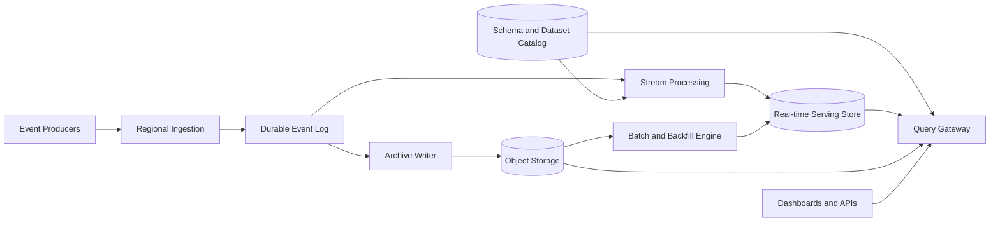

The event log decouples producers from downstream computation. Object storage preserves a replayable source. The serving store contains query-optimized aggregates and recent detail.

## Partitioning and ordering

Partition events by tenant, dataset, and a stable business key. The choice determines both parallelism and ordering.

Events for one order or user can remain ordered when their key maps to one partition. Global order is unnecessary and would limit throughput.

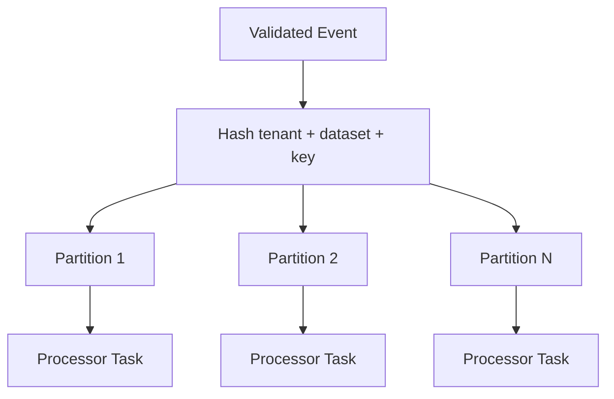

High-volume keys can create hot partitions. Salt additive workloads across subkeys and combine partial results. Operations requiring per-key sequence must instead isolate or specially shard the hot key.

Offsets provide order within a partition and a durable checkpoint position. They do not represent business time.

## Delivery semantics and deduplication

Producers retry after ambiguous failures, and processors replay after crashes. The platform therefore accepts at-least-once delivery.

Stable event IDs allow deduplication within a configured window. Stream jobs can keep a compact ID state or use idempotent upserts keyed by event and aggregation target.

For long-term correctness, batch recomputation deduplicates the complete source interval from immutable events. Online deduplication protects freshness; authoritative recomputation protects history.

Exactly-once internal state updates are possible when consumed offsets and state changes commit together. This still cannot make an external side effect exactly once unless that destination supports idempotency or transactional participation.

## Schema registry and evolution

Producers register schemas before publishing. The registry assigns a version and compatibility mode.

Safe changes include adding optional fields with defaults and expanding documented enum sets. Removing fields, changing types, or redefining meaning requires a new version or dataset.

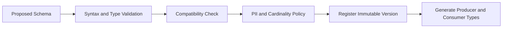

Events carry the schema identifier. Stream processors can decode older versions and normalize them into an internal canonical model.

The registry also classifies fields for privacy, indexing, dimensional use, and retention. A field becoming technically available does not automatically make it safe as a query dimension.

## Event-time windows

Analytics typically group events into tumbling, sliding, or session windows.

- Tumbling windows divide time into non-overlapping buckets
- Sliding windows overlap and update frequently
- Session windows group activity separated by an inactivity gap

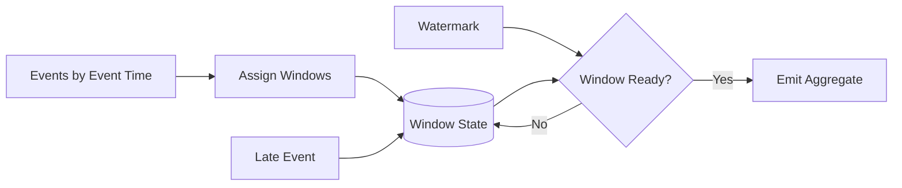

A watermark estimates that events earlier than a time are mostly complete. It advances from per-partition progress while accounting for idle partitions.

Results before the allowed-lateness deadline are provisional. Late events within the policy update the result; events beyond it go to a correction or dead-letter path.

## Watermarks and late data

Using ingestion time produces fast, stable windows but places delayed events in the wrong business interval. Event-time processing preserves meaning at the cost of waiting and revisions.

Choose allowed lateness per dataset. Mobile telemetry may arrive hours late; data-center service events usually arrive within seconds.

Never let one silent partition freeze the global watermark forever. Mark it idle after a threshold, while recording that later resumption may produce corrections.

Expose result freshness and completeness. A dashboard should be able to say that the latest minute is 97% complete rather than implying final accuracy.

## Stateful stream processing

Operators maintain keyed state for counts, sums, joins, distinct sketches, and window contents.

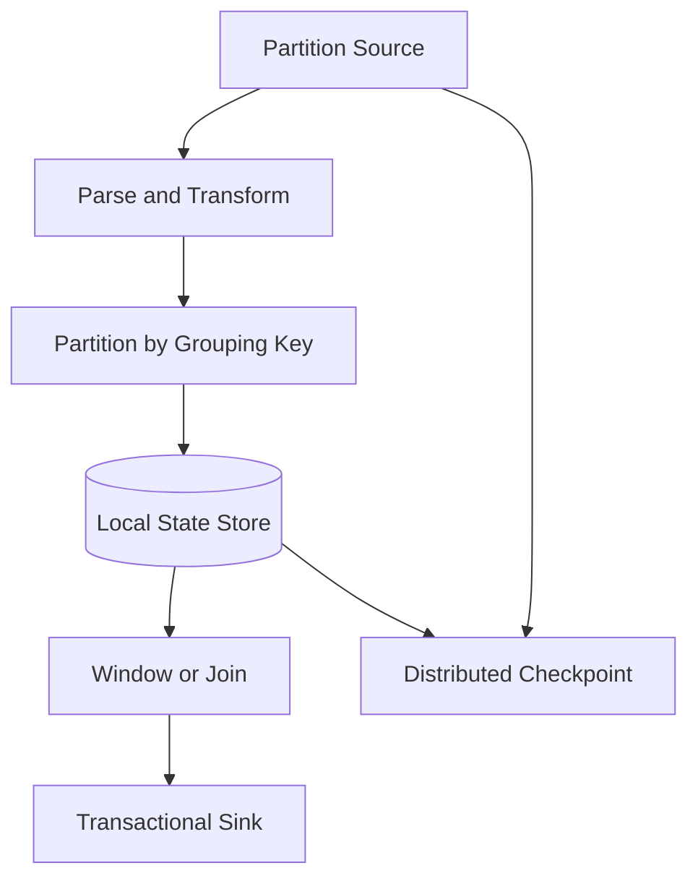

Keep hot state in memory with local disk spill. Periodic distributed checkpoints capture operator state and source offsets at a consistent boundary.

After failure, tasks restore the latest checkpoint and replay later events. Sink writes use checkpoint IDs or deterministic aggregate keys so replay does not double count.

State time-to-live removes keys after their relevant windows and lateness periods expire. Without TTL, cardinality grows forever.

## Checkpointing and recovery

A coordinator injects checkpoint barriers into source partitions. Operators snapshot state after receiving the barrier on every input, then forward it downstream.

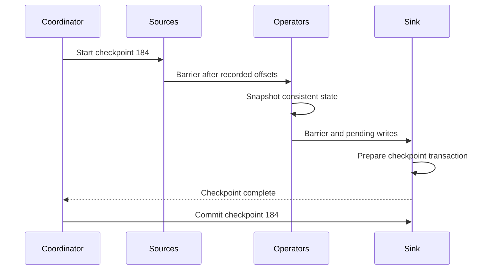

Asynchronous snapshots let processing continue while state is uploaded. Incremental checkpoints store changed blocks only.

Checkpoint intervals trade recovery work against steady overhead. Large jobs may need unaligned checkpoints during backpressure so barriers are not trapped behind full buffers.

## Stream joins

Joining two unbounded streams requires a time bound. For example, match a payment to an order within seven days.

Partition both inputs by the join key and retain unmatched records until the window and allowed lateness expire. Without a bound, join state grows indefinitely.

For stream-to-table joins, broadcast small reference data or query a versioned local cache. The lookup must use an event-time-compatible version when historical correctness matters.

Record which reference-data version produced each result. Otherwise replaying old events against today's customer or product attributes changes history unexpectedly.

## Aggregation types

Additive metrics such as revenue and request count combine easily across shards and time buckets.

Distinct counts and quantiles need mergeable sketches for fast approximate queries. Store algorithm version and error bounds. Exact distinct computation may be reserved for batch jobs or small cardinalities.

Ratios should store numerator and denominator separately. Averaging already-averaged values produces incorrect results.

For mutable business facts, use upsert or retraction events rather than counting every update as new. A correction references the original fact or stable entity version.

## Real-time serving store

The serving store is optimized for filters, group-bys, time ranges, and aggregations rather than row-level transactions.

Partition data by tenant, time, and hash of high-cardinality dimensions. Within partitions, use columnar segments, bitmap or inverted indexes, and preaggregated rollups.

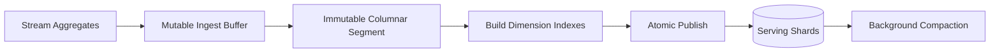

Recent data may live in mutable in-memory buffers for freshness. Queries merge it with immutable segments without double counting.

Compaction combines small segments, removes superseded rows, and improves compression. It runs under separate resource limits so ingestion remains stable.

## Rollups and materialized views

Precompute common groupings and time grains such as minute-level revenue by region and product. Queries over months can scan hourly or daily rollups instead of raw events.

Rollups form a hierarchy:

```text
raw events → 1-minute aggregates → 1-hour aggregates → 1-day aggregates
```

The query planner selects the coarsest rollup that preserves requested dimensions, filters, and accuracy.

High-dimensional cubes grow exponentially. Materialize only observed and frequently queried combinations. Query telemetry guides which views to add or retire.

Each materialized view records its source offsets, transformation version, and completeness so live and backfill writers can coordinate safely.

## Query path

The query API accepts dataset, measures, dimensions, filters, time range, granularity, order, and limit.

```http
POST /v1/analytics/query
Content-Type: application/json

{
  "dataset": "orders",
  "measures": ["order_count", "revenue"],
  "dimensions": ["region"],
  "from": "2026-10-10T14:00:00Z",
  "to": "2026-10-10T15:00:00Z",
  "granularity": "5m"
}
```

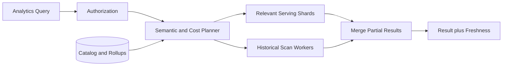

The planner resolves business measures through a semantic layer, selects rollups, prunes partitions, estimates cost, and pushes filters close to storage.

Results include data-through time, watermark, approximation metadata, and query version.

## Semantic layer

A semantic layer defines trusted measures such as revenue, active user, or conversion rate once rather than letting each dashboard reimplement them.

Definitions include source fields, filters, aggregation behavior, currency rules, join relationships, ownership, and effective versions.

The compiler rejects invalid operations such as summing a ratio or joining through an ambiguous many-to-many relationship.

Version semantic changes. Historical dashboards may pin a definition, while new queries use the current version. A definition change should not silently rewrite a financial metric.

## Query isolation and caching

Before execution, estimate partitions, rows, bytes, group cardinality, and memory. Reject or queue queries above tenant limits.

Separate interactive dashboards, scheduled reports, alerts, and exports into resource pools. One large export should not delay the operational dashboard.

Cache results by normalized query, tenant, authorization scope, time buckets, semantic version, and source data version. Recent mutable intervals use short TTLs; closed historical buckets cache longer.

Limit high-cardinality results and require top-k or pagination. Unbounded group-bys can exhaust coordinator memory even when storage scans are fast.

## Backfills and logic changes

When transformation logic changes or a bug is fixed, run a backfill from immutable raw events into a shadow output version.

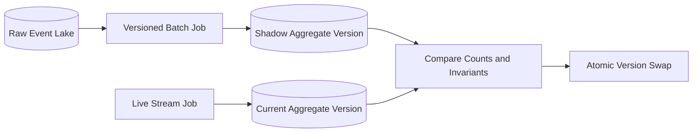

Backfill jobs use the same transformation library and schema contracts as streaming jobs. They write idempotently by dataset, interval, and transformation version.

Coordinate a handoff offset: batch rebuilds through that boundary, and the live job owns later events. Atomic metadata switching prevents queries from mixing partial versions.

Never overwrite the only known-good aggregate during recomputation.

## Lambda and unified processing tradeoff

Separate streaming and batch code paths can provide fast approximate results plus authoritative historical recomputation, but duplicated business logic drifts.

A unified engine runs the same transformations in bounded and unbounded modes. This improves consistency but may not optimize each path equally.

A practical design shares schemas, deterministic transformation libraries, and output contracts even when execution engines differ. Reconciliation continuously compares streaming output with batch truth.

## Backpressure and overload

When a downstream operator slows, bounded queues propagate backpressure upstream. The durable event log absorbs temporary imbalance.

Track backlog age rather than only record count. A five-minute lag means the platform is no longer real time even if no data is lost.

Responses include:

- Scale the constrained operator
- Split hot partitions
- Pause nonessential derived jobs
- Reduce expensive enrichments
- Apply source quotas
- Spill state or shuffle data to disk

Never discard acknowledged events silently. If product policy permits sampled ingestion, make the sampling decision explicit at the gateway and record its rate.

## Multi-tenancy

Every event and query carries a trusted tenant scope. Isolation exists at ingestion, processing, storage, query, and export layers.

Large tenants may receive dedicated partitions or compute pools. Smaller tenants share capacity with hierarchical quotas on bytes, events, state, storage, queries, and concurrency.

Fair schedulers allocate processing slots among tenants during backlog recovery. Otherwise the largest tenant consumes all recovery capacity and extends everyone else's lag.

Tenant-specific encryption keys, regional placement, and retention rules support stronger security and residency boundaries.

## Data quality and reconciliation

Analytics can be available and still be wrong. Enforce invariants at every stage:

- Producer sequence gaps and event counts
- Schema rejection and unknown enum rates
- Source versus archive partition checksums
- Stream versus batch aggregate differences
- Dimension cardinality changes
- Null, range, and uniqueness constraints
- Serving-store row counts and rollup totals

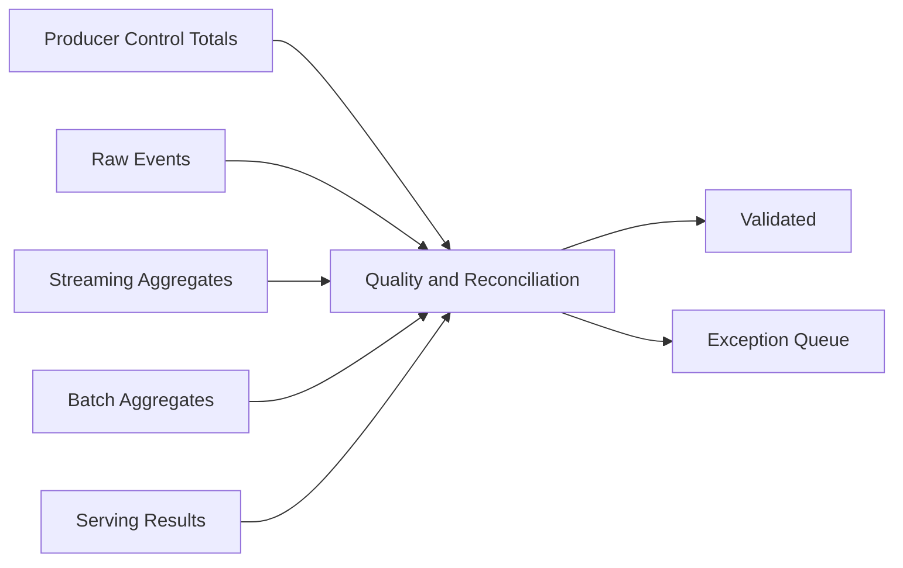

Quarantine invalid data with its reason and schema version. Corrections use append-only repair events or versioned rebuilds rather than direct aggregate edits.

## Security and privacy

Collect only fields required for approved analysis. Classify fields in the schema registry before ingestion.

Controls include:

- Service-authenticated producers
- Field-level redaction or tokenization
- Tenant and dataset authorization
- Row and column policy in the query layer
- Encryption in transit and at rest
- Audited query and export access
- Retention and verified deletion
- Minimum-group thresholds for sensitive dimensions

Do not place secrets or unrestricted personal data in arbitrary dimensions. Hashing identifiers may still leave linkable personal data.

Deletion in immutable datasets is handled through deletion manifests, compaction, index removal, and backup expiry. Track completion across every derived view.

## Multi-region design

Ingest in the nearest permitted region. Keep regional streams and processing local, then replicate approved raw partitions or aggregates for global views.

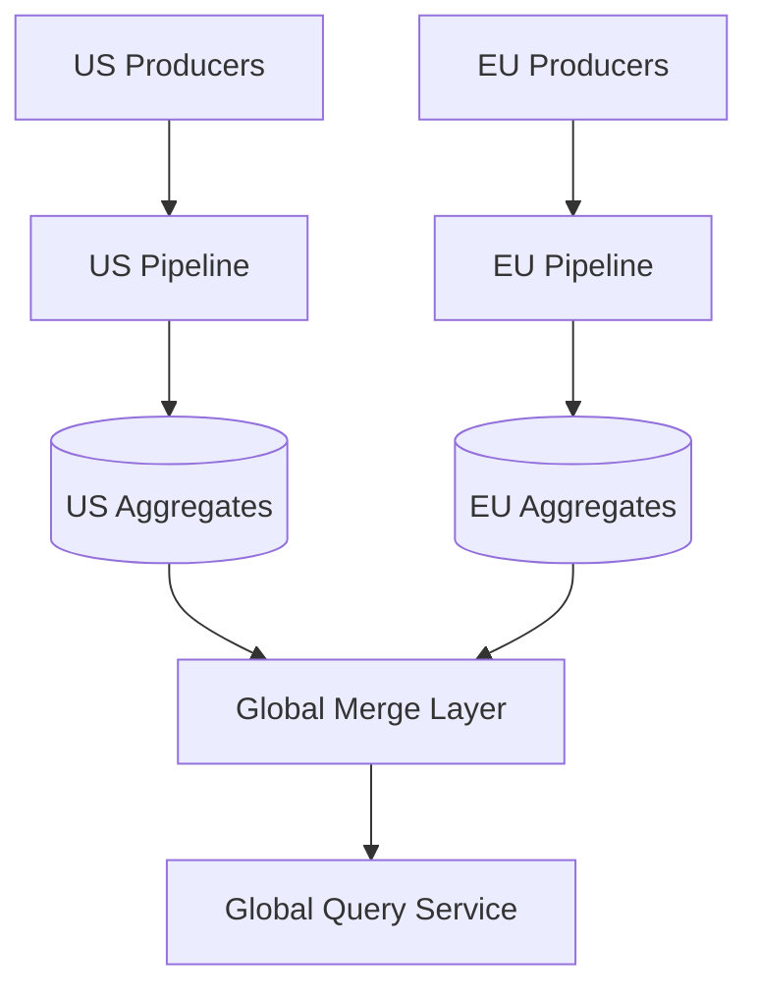

Additive aggregates merge safely across regions. Distinct counts require mergeable sketches or globally coordinated identity logic. Latest-value metrics need deterministic conflict rules.

During a regional outage, producers buffer or fail over according to residency policy. Global results expose which regions are missing rather than presenting incomplete numbers as final.

## Failure handling

### Ingestion region unavailable

Producers use bounded local buffers or an approved alternate region with stable event IDs. They never invent new IDs on retry.

### Stream processor crash

Restore the latest checkpoint, reset source offsets, and replay. Idempotent sinks prevent duplicate aggregates.

### Serving store unavailable

Continue durable ingestion and processing into a replayable output log. Queries can fall back to slower historical storage where practical.

### Poison event

Bound parsing and transformation resources, quarantine the event after deterministic failure, and allow its partition to advance.

### Bad transformation release

Stop the new version, retain raw events, restore the prior output version, and rebuild affected intervals in shadow storage.

### Hot dimension

Salt additive aggregation, dedicate partitions, cap cardinality, or change the data model. Do not let one global key serialize the entire job.

### Checkpoint failure

Continue briefly from the last valid checkpoint while retrying. If checkpoint age exceeds the recovery objective, slow or pause input rather than create an unbounded replay window.

## Observability

Track:

- Accepted, rejected, duplicated, and late events
- Ingestion-to-queryable latency by dataset
- Consumer lag and backlog age by partition
- Watermark progress and idle partitions
- Operator throughput, backpressure, and state size
- Checkpoint duration, size, and failure rate
- Serving ingestion lag and compaction pressure
- Query latency, scanned bytes, cache hit rate, and cancellation
- Stream versus batch reconciliation differences
- Schema compatibility and cardinality alerts
- Backfill progress and version-swap status

Synthetic producers emit known event patterns in every region. Automated queries verify windowing, late corrections, rollups, and end-to-end freshness.

## Key tradeoffs

### Freshness vs completeness

Waiting longer captures more late data but makes dashboards stale. Publish provisional results quickly, expose completeness, and revise within a documented lateness window.

### Raw flexibility vs materialized speed

Raw events support arbitrary future questions but are expensive to scan. Materialized views answer known questions quickly but require versioning and rebuild workflows.

### Exact vs approximate aggregation

Exact distinct counts and quantiles can be prohibitively expensive. Mergeable sketches provide bounded error and scale, as long as the UI and contracts disclose approximation.

### One processing engine vs specialized paths

A unified engine reduces semantic drift. Specialized streaming and batch engines may be more efficient. Shared schemas, transformation code, and reconciliation matter more than the label.

### Regional independence vs global accuracy

Regional processing improves latency and residency compliance. Global results must merge compatible aggregates and explicitly represent missing regions or delayed replication.

The central principle is to preserve immutable inputs, make time and completeness explicit, and treat every derived result as a reproducible version rather than an unquestionable mutable total.
