## Problem and requirements

A fraud detection platform decides whether an activity should be allowed, challenged, delayed, or blocked. It protects payments, account access, marketplace transactions, promotions, and content systems from adversaries who continuously adapt.

The system must respond in milliseconds while combining recent behavior, long-term history, identity, devices, relationships, policy, and machine learning. False positives harm legitimate users; false negatives create financial and safety loss. Every decision needs an explanation and a path for correction.

### Functional requirements

- Ingest transaction, identity, device, account, and outcome events
- Compute low-latency behavioral and velocity features
- Evaluate deterministic rules and machine-learning models
- Return allow, challenge, review, delay, or block decisions
- Link related accounts, devices, instruments, and merchants
- Run experiments and shadow policies safely
- Create investigator cases and evidence timelines
- Capture disputes, chargebacks, appeals, and confirmed labels
- Explain decisions to authorized users and systems
- Retrain, validate, deploy, and monitor models

### Non-functional requirements

- Serve one million synchronous decisions per second
- Respond within 100 milliseconds at the 99th percentile
- Continue with safe fallback policy during dependency failures
- Prevent duplicate events and repeated side effects
- Protect sensitive identity and financial data
- Preserve policy, feature, and model versions for audit
- Detect drift and adversarial adaptation quickly
- Isolate tenants and regional data boundaries

The platform produces risk decisions and recommended actions. Product services remain responsible for enforcing business invariants and making irreversible financial changes idempotently.

## Capacity estimates

Assume one million peak decisions per second, 100 billion behavioral events per day, and hundreds of features per request.

| Resource | Estimate |
| --- | ---: |
| Decision requests | 1M/second |
| Behavioral events | 100B/day |
| Online feature reads | Hundreds of millions/second internally |
| Streaming counter updates | Tens of millions/second |
| Graph entities and edges | Billions to trillions |
| Investigator cases | Millions/year |

Feature retrieval and updates dominate online infrastructure. Historical training data and graph computation dominate offline storage and compute.

## Decision contract

```http
POST /v1/risk/decisions
Authorization: Bearer <product-service-token>
Idempotency-Key: payment_981_attempt_1
Content-Type: application/json

{
  "eventType": "payment.authorization",
  "eventId": "evt_01K7A82M",
  "accountId": "acct_82",
  "amount": { "currency": "USD", "minorUnits": 4999 },
  "instrumentToken": "card_tok_1842",
  "deviceId": "device_91",
  "context": { "country": "US", "channel": "mobile" }
}
```

```json
{
  "decisionId": "risk_01K7A83P",
  "action": "challenge",
  "riskScore": 0.82,
  "reasons": ["unusual_device", "high_velocity"],
  "policyVersion": 184,
  "expiresAt": "2026-10-28T14:22:08Z"
}
```

The idempotency key returns the same decision for a retried attempt. A new business attempt receives a new key and may use fresher state.

Scores are internal signals. The versioned policy maps them, rules, and context to an action.

## High-level architecture

The online path is bounded and local. Event streams update features, training data, graphs, cases, and analytics asynchronously.

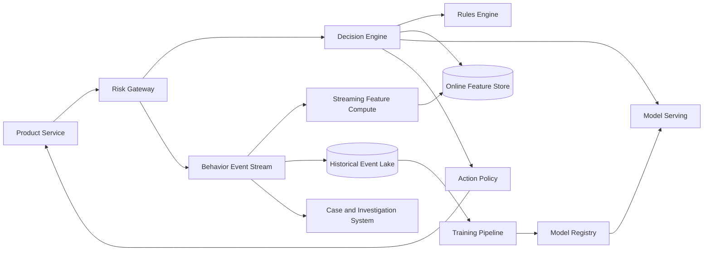

Model and policy artifacts are immutable and preloaded. A request never waits for offline storage, training, or case creation.

## Event ingestion

Events include attempts, decisions, impressions, authentications, instrument changes, shipment actions, disputes, chargebacks, user reports, and investigator outcomes.

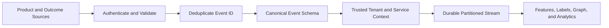

Stable event IDs support retries. The source service assigns event time, while the gateway adds trusted ingestion time.

Never trust the client to assert that a payment succeeded, a challenge passed, or a chargeback occurred. Only authoritative services emit those outcomes.

Partition by tenant and stable entity key while preserving event IDs for cross-partition deduplication.

## Feature classes

Features describe several scopes:

- **Transaction:** amount, merchant, product, channel, destination
- **Account:** age, prior outcomes, trust level, recent changes
- **Device:** tenure, integrity, reuse, emulator signals
- **Instrument:** token history, issuer, prior disputes, sharing
- **Network:** coarse location, reputation, proxy or automation signals
- **Behavior:** velocity, sequence, deviation from baseline
- **Relationship:** shared entities, graph communities, risky neighbors

Every feature has owner, type, definition, time window, freshness objective, privacy class, default, and version.

Missingness is itself a signal but must not be confused with zero.

## Streaming velocity features

Velocity features count or aggregate activity over windows such as one minute, one hour, and seven days.

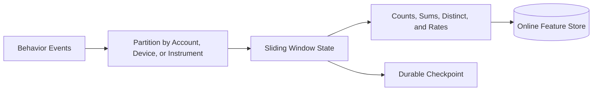

Examples include payment attempts per device in ten minutes, distinct accounts per instrument in one day, and declined amount per merchant in one hour.

Use event time and watermarks for historical accuracy, but publish low-latency provisional updates immediately. Late corrections update durable history and online state when safe.

Hot keys such as large merchants use sharded partial aggregates and mergeable sketches.

## Online feature serving

Co-locate features commonly read for one decision into batchable groups. Partition by entity hash and replicate across zones.

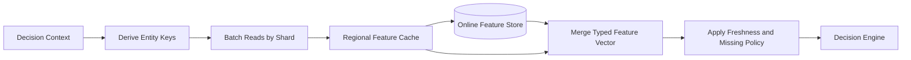

Each value includes event time and feature version. The decision engine enforces maximum age per feature.

Optional quality signals can use defaults. Compliance, authentication, or account-state signals may fail closed.

Request-time features merge with stored features through versioned transformations shared with training.

## Rules engine

Rules express hard policy, known attack signatures, legal constraints, and rapid incident response.

```text
IF instrument_country != account_country
AND amount_usd > 1000
AND account_age_days < 2
THEN require_strong_challenge
```

Rules are typed, bounded, versioned, and evaluated deterministically. Arbitrary scripts are not allowed on the critical path.

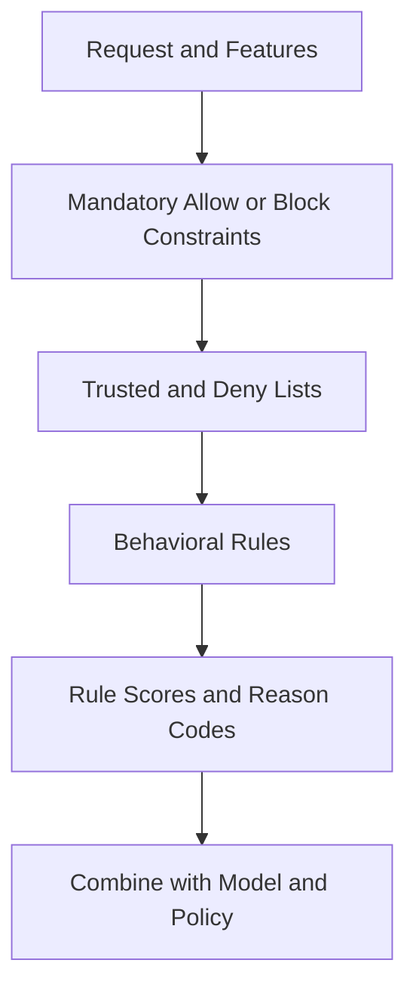

Rules can block, allow, add score, require a signal, or select a downstream policy. Conflicts have explicit precedence.

Simulate a rule against historical and shadow traffic before activation.

## Model inference

Models estimate risk, expected loss, likelihood of abuse, or probability that a challenge will succeed.

Use a versioned feature-service manifest to fix feature ordering, types, defaults, and transformations.

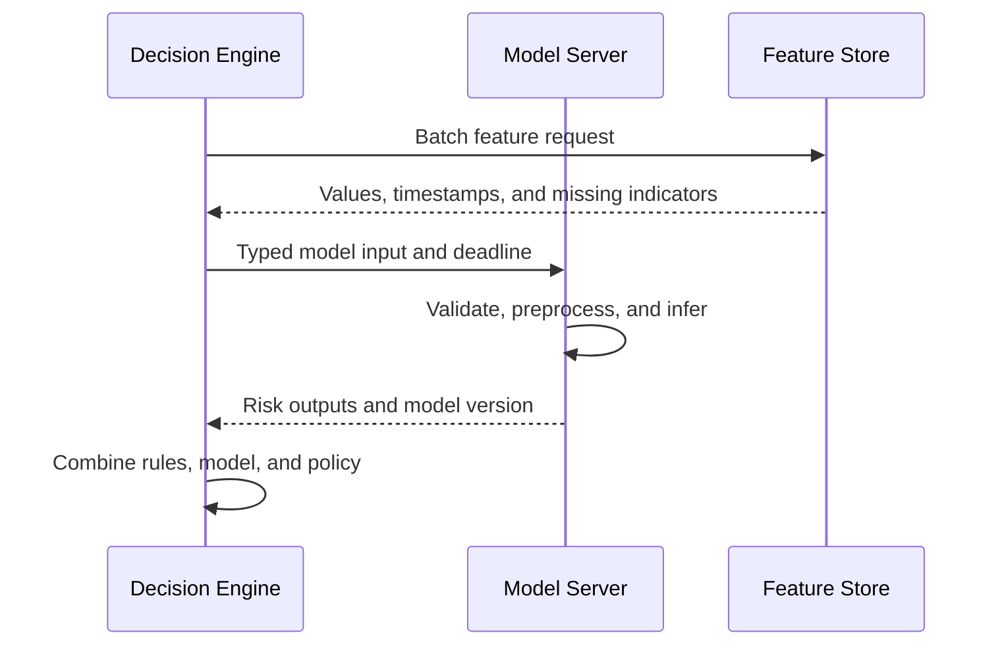

Model inference has a strict sub-deadline. A timeout uses an approved fallback, never an unbounded wait.

Shadow models receive mirrored inputs and log outputs without affecting user decisions.

## Decision policy

The policy layer converts signals into an action.

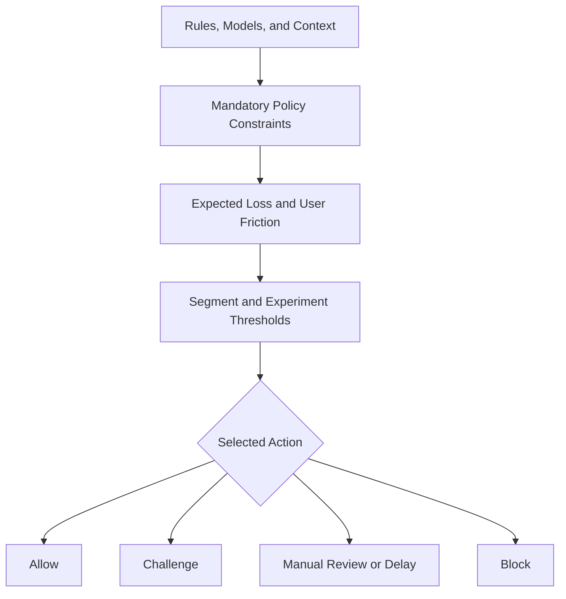

Different products and regions use different costs and allowed actions. A $5 purchase and a payout-account change should not share one threshold.

Policy records reason codes, contributing rules, model versions, feature timestamps, experiment, and fallback status.

Only approved experiments may change actions; shadow analysis cannot accidentally enforce.

## Latency budget

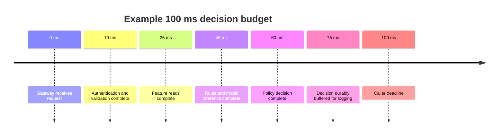

Every dependency receives a deadline shorter than the caller's remaining budget. Feature reads and independent models run in parallel.

Cancel work after deadline. Late results can inform monitoring but must not change an already returned decision.

Keep enough response budget for the product service to apply the action safely.

## Idempotency and state updates

The decision store maps tenant, product, and attempt key to the original result. Retries with identical input receive that result; conflicting payloads return an error.

Feature counters should usually update from authoritative product events, not the decision request alone. Otherwise client retries inflate velocity.

For events such as “attempt observed,” use the stable business event ID. Streaming processors apply idempotent updates or deduplicate within a bounded window.

Decision logging and response use a durable local outbox or replicated buffer so an accepted decision is not silently absent from later audit and training.

## Graph risk

Fraud often appears through relationships among accounts, devices, instruments, addresses, merchants, and network identifiers.

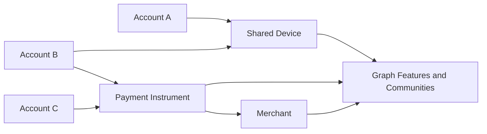

Store typed, timestamped, confidence-scored edges. Sensitive relationships have strict access and retention.

Offline graph jobs compute communities, centrality, risky-neighbor counts, and propagation signals. Stream processors update simpler local features quickly.

Online traversals are bounded by depth, fan-out, and deadline. Precompute expensive signals rather than exploring an unbounded graph per decision.

## Identity resolution

The same real-world entity may appear through several identifiers; unrelated people may share devices or addresses.

Entity resolution produces confidence-weighted links, not absolute identity claims. Separate deterministic verified links from probabilistic similarities.

Models and investigators need the evidence and age behind a link. A stale shipping address should not permanently merge two accounts.

Avoid automatically taking severe action from one weak inferred relationship. Combine independent signals and provide appeal paths.

## Lists and intelligence

Trusted, deny, watch, and compromised lists provide fast known-entity controls.

List entries contain scope, entity type, reason, source, confidence, effective time, expiry, owner, and review policy.

Exact high-confidence matches can enforce. Fuzzy matches should contribute risk or require review because names, addresses, and devices collide.

Lists are signed, versioned, and distributed to regional decision engines. Expired entries disappear automatically.

Emergency additions propagate through a prioritized channel and remain fully audited.

## Challenges and step-up actions

Instead of a binary allow or block, the platform can request stronger proof: passkey authentication, payment confirmation, document verification, additional review, or delayed settlement.

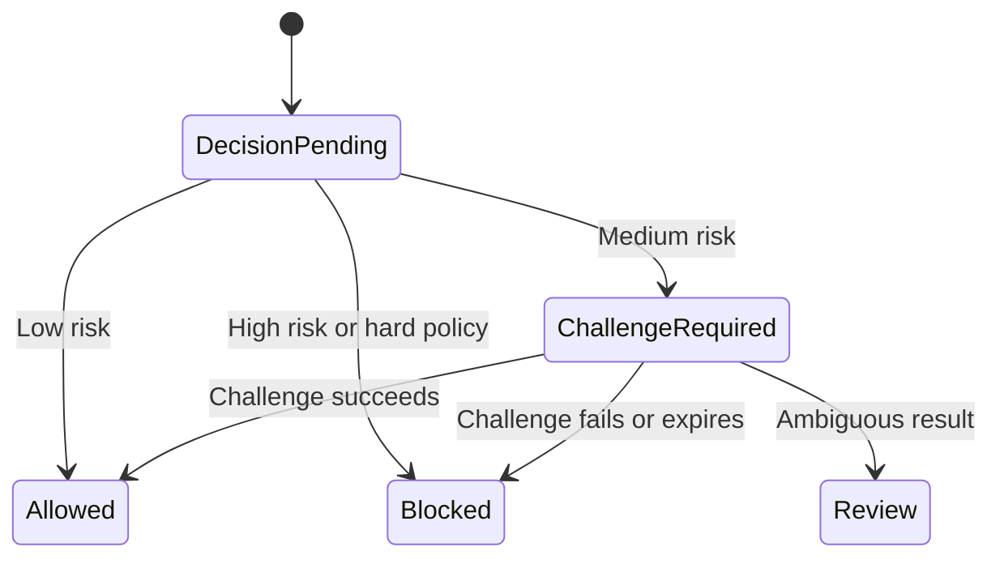

Challenge results become authoritative events and future features. Attackers may learn policy through challenges, so avoid deterministic thresholds that are easy to probe.

The decision ID binds the challenge to the original transaction and prevents replay on another action.

## Manual review

High-value ambiguous decisions enter a priority queue with service-level deadlines.

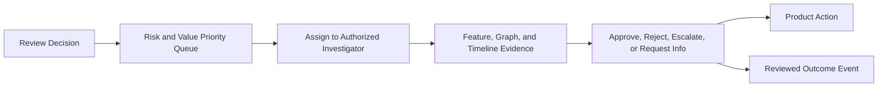

Queue priority includes expected loss, customer impact, age, and evidence expiry. Fairness prevents one large tenant from starving others.

Investigators see necessary evidence with field-level authorization. Views avoid revealing sensitive model internals beyond their role.

Every access and action is audited.

## Case management

Related decisions and entities can form a case for deeper investigation.

Cases contain subjects, evidence, timeline, notes, tasks, linked incidents, actions, and disposition.

Evidence is immutable or versioned. Notes can be corrected through superseding entries without erasing audit history.

Case actions such as freezing accounts or holding payouts go through authorized workflows with idempotency, approval, and reversible state where possible.

Separate fraud cases from ordinary customer-service tickets while allowing controlled cross-reference.

## Labels and delayed outcomes

Reliable labels arrive from chargebacks, confirmed account takeover, returns, appeals, investigator review, or long-term clean behavior.

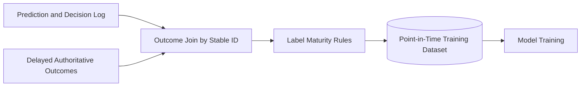

An absence of fraud today is not immediately a negative label; the observation window may not have matured.

Record label source, confidence, event time, creation time, and correction history. Investigator decisions may be biased by the existing model and should not be treated as perfect ground truth.

## Training data correctness

For each historical decision, join features as they existed at decision time. Using later chargebacks, updated profiles, or investigation outcomes as input leaks the future.

Training examples include decision policy and selection context so analysts can correct for review and challenge bias.

Only some transactions receive manual review, creating selective labels. Use exploration, propensity logging, and careful evaluation rather than comparing raw reviewed outcomes.

Immutable dataset manifests record source snapshots, feature versions, cutoff times, transformations, and label maturity.

## Model lifecycle

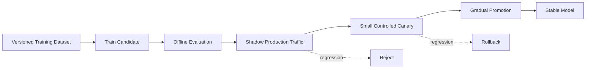

Evaluation covers fraud loss, false positives, challenge rate, calibration, latency, stability, and approved fairness slices.

Keep the prior model warm during rollout. Atomic routing rollback restores it quickly.

Model approval and deployment roles are separated for high-risk products.

## Experimentation

Experiments need stable assignment and guardrails. Randomly allowing risky activity solely for measurement may be unacceptable.

Safe approaches include shadow models, threshold changes within bounded risk, alternative challenges, and small exploration among low-risk ambiguous cases.

Log assignment probability, policy version, and action so outcomes can be analyzed without hidden selection bias.

Guardrails stop experiments on loss, false-positive, complaint, latency, or operational thresholds.

Never place hard legal or sanctions constraints inside an experiment.

## Explainability

Internal explanations support investigators, model owners, customer operations, and audits.

Provide stable reason categories such as unusual device, recent account change, inconsistent geography, known compromised instrument, or elevated velocity.

Do not expose precise thresholds or sensitive network intelligence to untrusted callers; that helps attackers probe the system.

Explanations identify rule, model, feature, graph, and policy versions. A post hoc explanation must describe the actual deployed decision, including fallback behavior.

Customer-facing adverse-action explanations may follow separate legal and policy requirements.

## Feedback loops and adversarial adaptation

Blocking an event prevents observing what would have happened, creating censored labels. Attackers also shift tactics when rules change.

Monitor score, feature, entity, and outcome distributions by cohort. Compare decision rates and mature losses over consistent windows.

Use small controlled exploration where safe, external labels, honeypots, and investigator sampling to learn beyond enforced policy.

Avoid training directly on model decisions as truth. That reinforces existing mistakes.

Separate rapid emergency rules from durable model learning; remove incident-specific rules after review.

## Privacy, fairness, and governance

Risk data can include identity, financial, device, network, and behavioral information. Collect only approved signals and document their purpose.

Controls include:

- Workload identity and least privilege
- Field-level encryption and tokenization
- Regional storage and processing constraints
- Purpose-based access to features and cases
- Retention and deletion workflows
- Audited investigator access
- Dataset and model approval records
- Fairness evaluation on legally and ethically approved cohorts

Proxy variables can recreate sensitive attributes even when those fields are removed. Governance reviews sources, feature meaning, and measured impact—not only column names.

An appeal process feeds verified corrections back into cases and labels.

## Multi-tenancy and regional policy

Tenant identity scopes events, features, models, rules, lists, cases, and audit data.

Large tenants may use dedicated feature shards, model pools, encryption keys, and investigator queues.

Regional decision planes keep latency low and satisfy residency. Globally approved intelligence distributes as signed, minimized artifacts.

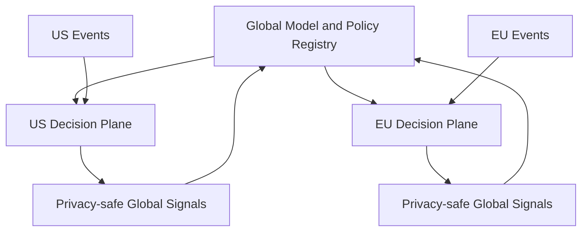

Region-specific laws, payment methods, loss costs, and fraud patterns require policy overlays without forking the whole platform.

## Fallback hierarchy

Dependencies fail, but silently allowing everything is unsafe.

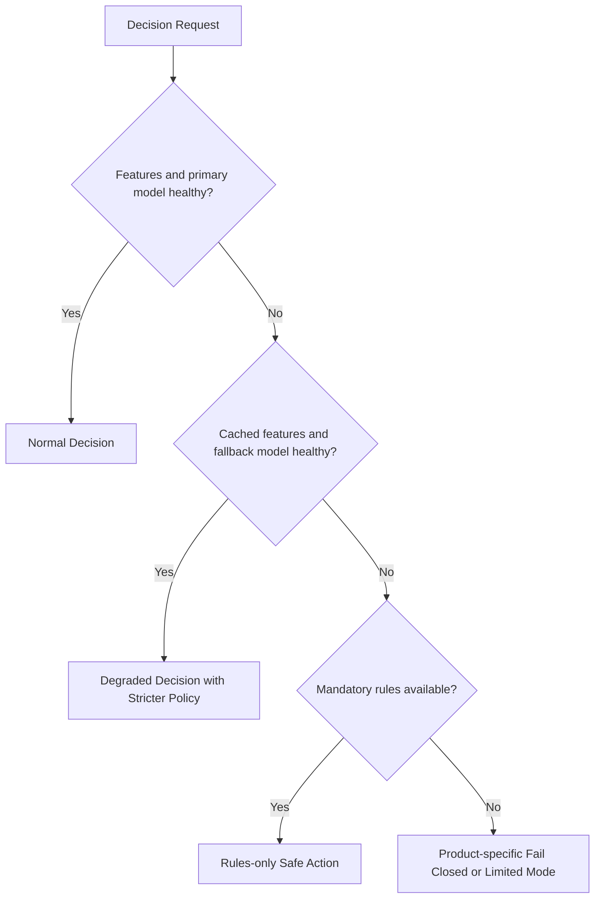

Fallback varies by product risk. A low-value recommendation can default; a large payout may require delay or review.

Responses expose degraded mode so product services and monitoring behave appropriately.

Fallback artifacts are tested continuously, not only during outages.

## Failure handling

### Feature store timeout

Use freshness-bounded cache, defaults, fallback model, or stricter action according to feature criticality.

### Model server unavailable

Route to another replica or approved fallback. Rules and mandatory policy continue locally.

### Event pipeline lag

Decision serving continues, but velocity uncertainty grows. Tighten high-risk policy and expose feature freshness.

### Rules release is invalid

Reject it before activation, retain the last signed version, and support atomic rollback.

### Region unavailable

Route only to an allowed region with compatible feature, policy, model, and data. Otherwise enter documented limited mode.

### Case system unavailable

Decisions and durable review tasks continue. Investigator UI and evidence enrichment recover asynchronously.

### Graph service unavailable

Use recently materialized graph features and mark live traversal unavailable. Do not block the entire request.

### Alert storm from attack

Aggregate operational alerts, isolate tenant queues, and preserve decision throughput before optional telemetry.

## Observability

Track:

- Decision latency by gateway, features, rules, model, and policy
- Allow, challenge, review, delay, and block rates
- Feature freshness, missingness, drift, and hot keys
- Rule match and conflict rates
- Model score distribution, calibration, and fallback use
- Mature fraud loss and false-positive outcomes
- Challenge success, abandonment, and replay attempts
- Review queue age, throughput, and disagreement
- Graph update lag and traversal time
- Event ingestion and label maturity lag
- Experiment guardrails and rollback
- Regional and tenant-specific anomalies

Synthetic accounts exercise known rule, model, challenge, fallback, and case paths in every region.

Operational dashboards separate technical availability from decision quality. A fast model returning badly drifted scores is not healthy.

## Key tradeoffs

### Rules vs models

Rules are fast, explainable, and responsive to known attacks but brittle. Models generalize across signals but require data, monitoring, and controlled deployment. Mature systems combine both.

### Fraud loss vs user friction

Lower thresholds reduce fraud but block or challenge more legitimate users. Optimize expected long-term cost and trust, not one isolated metric.

### Freshness vs availability

Current velocity signals improve detection but depend on streaming health. Bounded caches, fallbacks, and explicit stale policy preserve safe operation.

### Global intelligence vs regional privacy

Cross-region patterns detect coordinated attacks, while data residency limits raw sharing. Minimized global signals and region-local sensitive features balance both.

### Rapid response vs policy stability

Emergency rules stop active attacks quickly but can create false positives and technical debt. Expiration, simulation, ownership, and retrospective review keep them controlled.

The central principle is to make every decision a reproducible combination of trusted events, point-in-time features, versioned rules, model outputs, and explicit action policy—then learn from outcomes without treating past decisions as truth.
