## Problem and requirements

A real-time multiplayer backend connects players, forms fair matches, allocates game servers, runs authoritative simulation, distributes state, and records durable outcomes. The architecture supports session-based action games where tens or hundreds of players exchange latency-sensitive inputs.

The difficult part is that gameplay needs millisecond responsiveness while the internet provides variable latency, packet loss, reordering, and disconnects. The server must remain authoritative enough to prevent cheating without making every action feel delayed.

### Functional requirements

- Authenticate players and validate game-version compatibility
- Form parties and matchmaking tickets
- Match by skill, latency, region, mode, and platform policy
- Allocate ready game-server capacity
- Establish secure session connections
- Run an authoritative deterministic or server-owned simulation
- Replicate relevant state to each client
- Support prediction, reconciliation, and lag compensation
- Handle disconnects, reconnects, spectators, and backfill
- Persist match results, progression, and rewards exactly once
- Detect cheating and abusive behavior
- Roll out server builds without breaking active sessions

### Non-functional requirements

- Support 50 million concurrent players and five million sessions
- Run game simulation at up to 60 ticks per second
- Keep regional game-server latency below the title's target
- Preserve fairness during packet loss and latency variation
- Prevent one session or tenant from exhausting shared fleets
- Survive control-plane and availability-zone failures
- Keep active matches isolated from deployment failures
- Make game outcomes and reward grants auditable

## Capacity estimates

Assume 50 million concurrent players, ten players per session on average, 30 client input messages per player per second, and 20 state updates per player per second.

| Resource | Estimate |
| --- | ---: |
| Concurrent players | 50M |
| Active sessions | 5M |
| Client input messages | 1.5B/second |
| State update deliveries | 1B/second |
| Match results | Tens of millions/hour |
| Replay data | Petabytes/day if retained broadly |

Gameplay traffic stays between clients and regional game servers. Routing each input through a global application backend would add latency and create an unnecessary bottleneck.

## High-level architecture

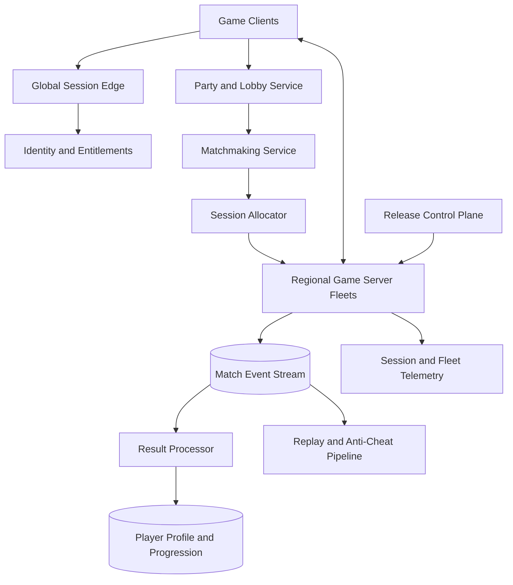

Control services create matches and allocate compute, but they are not in the per-tick data path. Once a session begins, it can continue through a temporary matchmaking or profile-service outage.

## Player and session model

```text
PlayerSession {
  playerId, accountSessionId, platform,
  gameVersion, regionCandidates, connectionClaims
}

MatchTicket {
  ticketId, partyId, mode, skillVector,
  latencyByRegion, constraints, createdAt
}

GameSession {
  sessionId, buildId, region, serverId,
  rosterVersion, state, startTime, resultEpoch
}
```

Game session IDs, player IDs, and result IDs are immutable. Display names and platform handles can change and must not define identity.

## Authentication and admission

Clients first authenticate through ordinary HTTPS, prove game ownership or entitlement, and receive a short-lived connection ticket.

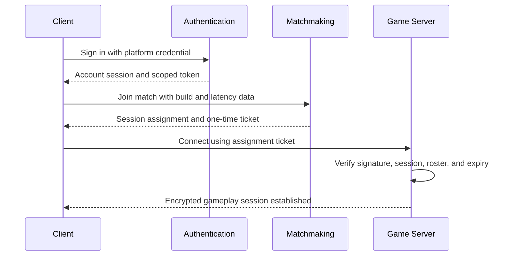

The ticket binds player, game session, server identity, build, role, issue time, and expiry. It is single-use or replay protected and cannot be transferred to another server.

Game servers do not call a central authentication service for every packet. They validate signed session claims locally and receive revocation updates asynchronously.

## Party and lobby service

Parties are small strongly consistent groups that enter matchmaking together. One member is the leader for ordinary settings, while membership changes use versioned compare-and-swap updates.

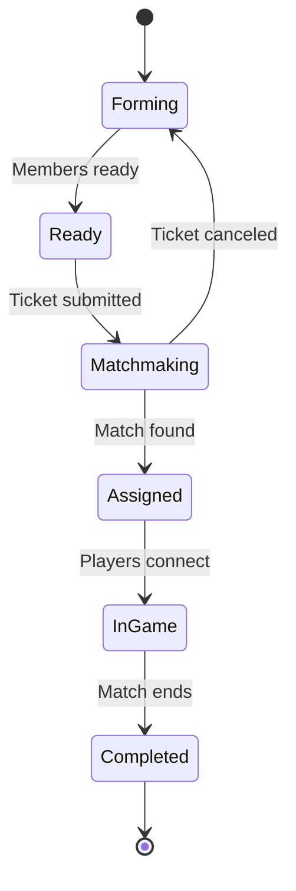

Invite tokens are short lived and scoped to one party. Block lists, parental controls, platform cross-play policies, and regional restrictions are evaluated before a ticket is created.

## Matchmaking

Matchmaking balances wait time, skill, latency, party size, role composition, platform policy, and game mode.

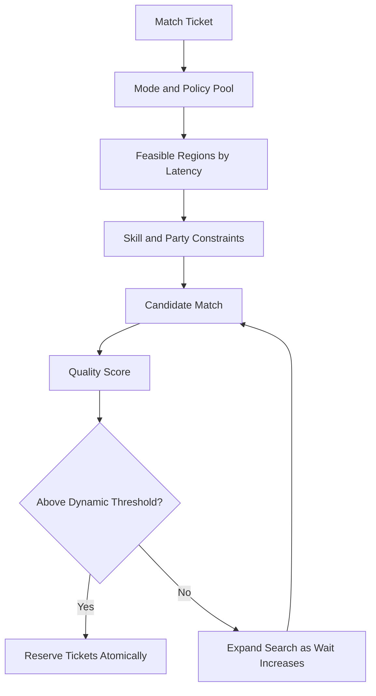

Partition tickets first by hard constraints that cannot be relaxed: incompatible builds, platform isolation, region policy, mode, and team size. Within a pool, search skill and latency bands.

Quality thresholds relax with wait time according to policy. Do not silently relax safety or platform restrictions.

Ticket reservation is atomic so one party cannot enter two matches. A lease expires if server allocation fails, returning tickets to the pool without duplication.

## Latency measurement and region choice

Clients periodically probe signed regional endpoints and report round-trip time, jitter, and packet loss. The service treats client reports as hints and compares them with edge-observed network data.

Choose a region that minimizes the worst or high-percentile player latency rather than only the average. A region with eight players at 20 milliseconds and two at 250 milliseconds may be less fair than one with everyone near 70 milliseconds.

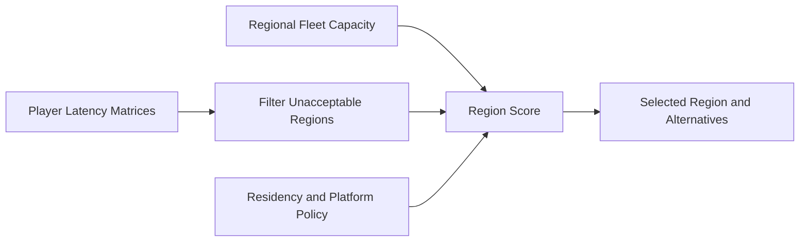

Account for allocator capacity and queue time. A theoretically ideal region is not useful if no server can start before the match times out.

## Game-server allocation

Maintain warm capacity pools by region, build, mode, hardware class, and trust tier.

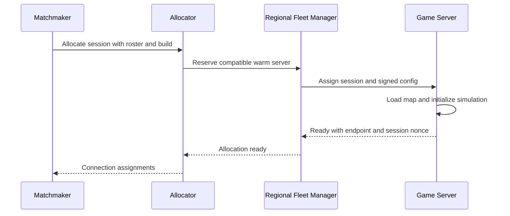

Use leases throughout allocation. If a server does not become ready before the deadline, revoke its lease and try another instance.

Autoscaling predicts demand from time of day, live player counts, matchmaking queues, events, and release schedules. Keep enough warm headroom for bursts because starting a new virtual machine after matching can add unacceptable delay.

## Authoritative simulation

Clients send inputs; the server decides state.

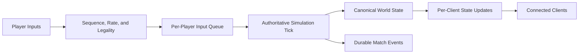

The server owns positions, collisions, health, inventory, scores, and win conditions. Clients may predict presentation but cannot declare authoritative outcomes.

Use a fixed tick interval for predictable physics and replay. When overloaded, degrade nonessential work or reduce replication frequency before slowing simulation time. A session that cannot maintain its required tick rate should be marked unhealthy.

## Client inputs

An input packet includes session, player, monotonically increasing sequence, client simulation tick, control values, and acknowledgement of the latest server snapshot.

UDP or a UDP-based secure transport is common for latency-sensitive inputs. Reliability is selective:

- Movement input can supersede older unprocessed input
- Inventory and match-control actions require reliable ordered delivery
- Voice and cosmetic events use separate channels and policies

The server rejects impossible sequence jumps, excessive rates, expired actions, and inputs inconsistent with the player's state.

## State replication

Sending the complete world every tick is too expensive. Replicate deltas from a baseline acknowledged by each client.

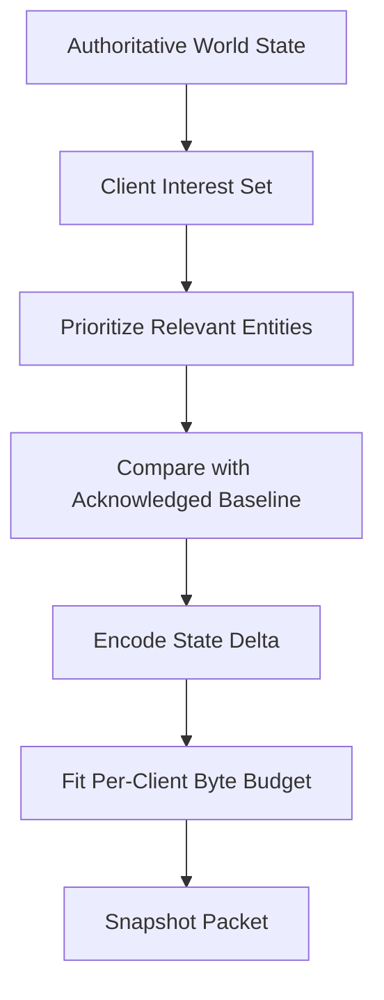

Interest management uses distance, visibility, team, game mode, and gameplay importance. Nearby opponents may update at high frequency while distant static objects update rarely.

Periodically send a keyframe or allow baseline repair so packet loss does not permanently corrupt client state. Compress entity IDs, quantize positions where acceptable, and bit-pack common fields.

## Client prediction and reconciliation

Waiting for a server round trip before moving the local character feels unresponsive. The client predicts its own movement immediately.

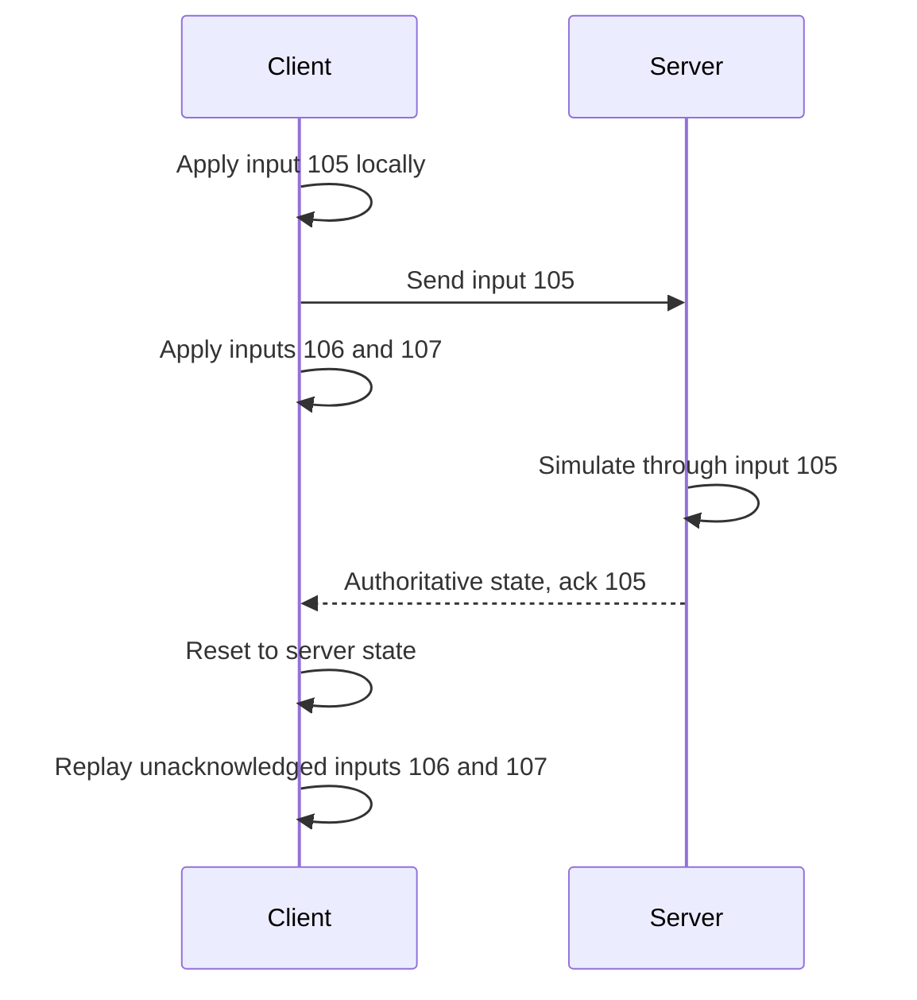

Smooth small visual corrections over several frames. Snap large differences to prevent the client from presenting a materially false state.

Deterministic movement code shared between client and server reduces corrections, but the server remains authoritative.

## Interpolation and remote players

Clients render remote entities slightly behind real time using a buffered sequence of server snapshots. Interpolation hides jitter and produces smooth motion.

If a snapshot is late, short bounded extrapolation can continue motion. Long extrapolation creates visible false state, so freeze or degrade gracefully after a limit.

Adjust the interpolation buffer based on measured jitter, not only average latency. A stable 80-millisecond connection can feel better than one alternating between 20 and 120 milliseconds.

## Lag compensation

For latency-sensitive actions such as hitscan weapons, the server can evaluate against a recent historical world state corresponding to when the player saw the target.

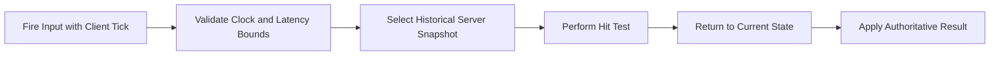

Keep a bounded ring buffer of collision-relevant state. Clamp rewind time to prevent high-latency players from gaining unlimited advantage.

Lag compensation is a game-design choice. It improves perceived fairness for attackers but can make defenders appear hit after reaching cover. Expose tunable limits by mode.

## Reconnect and session recovery

Temporary disconnects should not immediately eliminate a player.

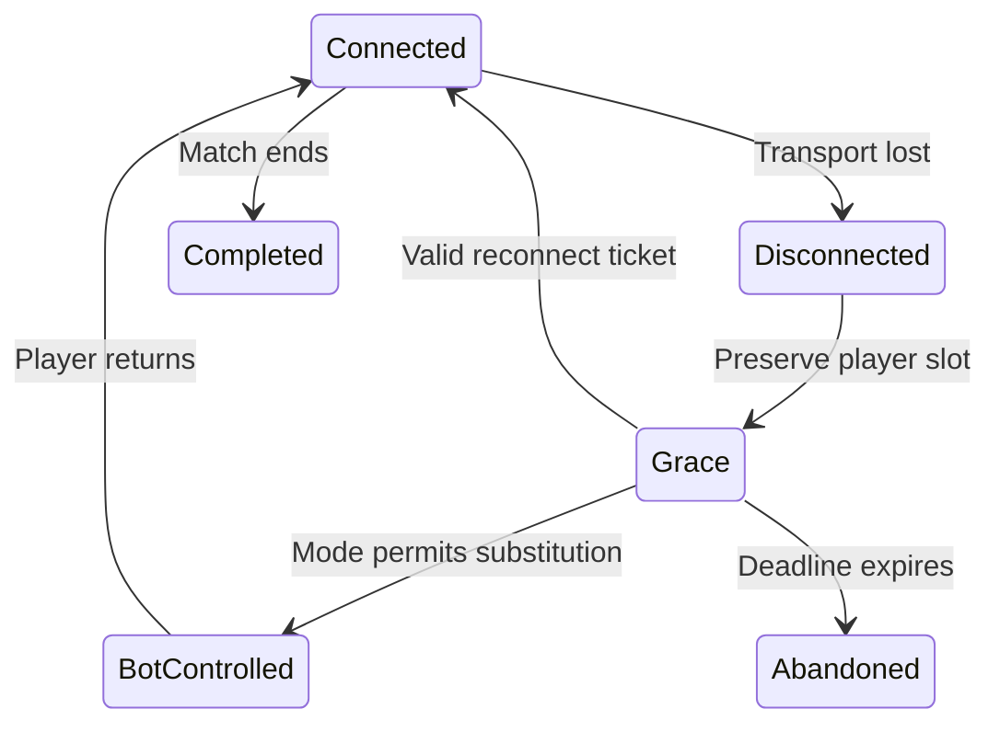

The game server preserves player state for a bounded grace period. A reconnect token binds account, session, slot, server, and a new nonce.

On return, send a full current-state keyframe followed by deltas. Do not replay the entire packet history.

Server-process recovery mid-match is much harder. Competitive titles may terminate and invalidate the match; longer sessions can periodically checkpoint deterministic state and input logs to a standby, accepting the performance cost.

## Backfill and spectators

Some modes allow a new player to replace a leaver. The matchmaker receives a backfill ticket containing current roster, skill need, region, score, remaining duration, and join policy.

Backfill players must explicitly opt into in-progress matches where required. Rewards and rating policy account for time played and starting disadvantage.

Spectators receive delayed or filtered state to reduce competitive information leakage. Large broadcasts should feed a relay tree or streaming pipeline rather than consume game-server bandwidth per viewer.

## Durable outcomes

The game server emits an immutable match-completed record signed with its workload identity.

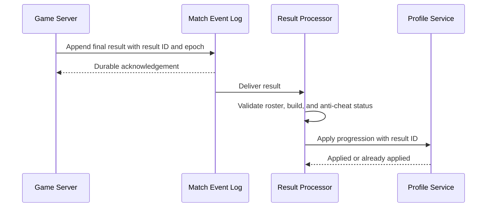

Profiles and rewards use the result ID as an idempotency key. Never grant currency directly from an unauthenticated client result.

If the server crashes before finalization, a recovery service classifies the session using durable checkpoints and policy: resume, void, partial reward, or infer a result only when authoritative evidence is sufficient.

## Replay and event sourcing

Record validated inputs, important simulation events, random seeds, build ID, map version, and periodic state hashes. This supports replays, dispute investigation, anti-cheat, and deterministic debugging.

Full state snapshots are expensive. Use an initial state plus ordered inputs when the simulation is deterministic, with periodic checkpoints to bound replay time.

Replay files are versioned by game build and schema. Keep the exact simulation binary or a compatible playback runtime for the retention window.

## Anti-cheat

Layer prevention and detection:

- Server-authoritative movement, combat, inventory, and rewards
- Signed game builds and integrity attestation where supported
- Input rate, acceleration, visibility, and action-validity checks
- Statistical detection across matches
- Device and account risk signals
- Replay review and player reports
- Delayed enforcement to avoid teaching attackers exact detectors

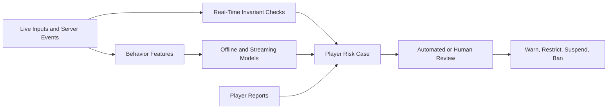

Do not let client-side anti-cheat become the only control. It can raise confidence but operates on hardware the attacker controls.

Ban and restriction actions require evidence, reason codes, appeal support, and careful handling of shared devices or networks.

## Denial-of-service protection

Game endpoints are publicly reachable and use latency-sensitive protocols.

- Place anycast or regional scrubbing edges before fleets
- Require a valid short-lived connection cookie before allocating session state
- Rate-limit handshakes by account, IP prefix, device, and session
- Drop malformed and unauthenticated packets in kernel or edge layers
- Hide game-server addresses behind relays where threat warrants it
- Separate control APIs from gameplay network paths
- Reserve capacity for established sessions during attack

Stateless retry cookies prevent spoofed-source floods from consuming game-server memory.

## Regional fleet management

Game servers are immutable processes assigned one or a bounded number of sessions. Fleet managers track build, mode, capacity, health, and drain state.

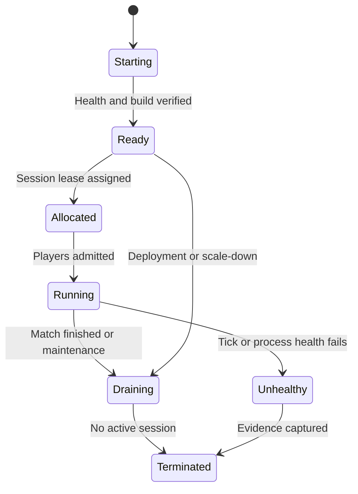

Do not move an active low-latency session between hosts during ordinary deployment. Let it finish on the old build while new sessions use the new build.

## Safe releases

Server and client compatibility is explicit. A protocol manifest declares which client builds can join which server builds.

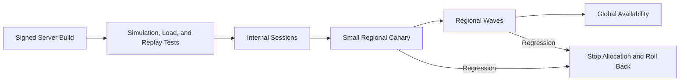

Health gates include crash rate, tick overruns, packet loss, match completion, disconnects, result validity, and gameplay-specific metrics.

Rollback removes a build from new allocation. Existing matches continue unless the defect is security-critical or corrupts outcomes.

## Multi-region design

Global services manage identity, parties, matchmaking metadata, and release policy. Regional cells contain allocation, game-server fleets, gameplay edges, and event buffers.

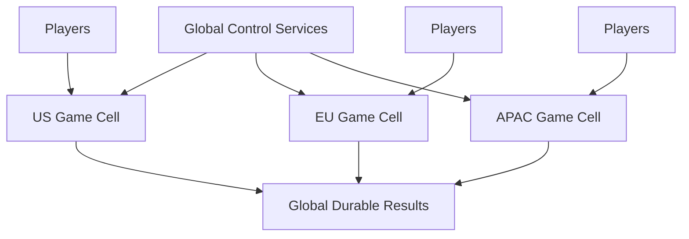

A regional control-plane outage stops new allocation but should not terminate active matches. Servers buffer critical results locally and through regional durable logs until global services recover.

Cross-region failover is appropriate for lobbies and profiles, but moving an active real-time match usually causes unacceptable latency or state loss. Prefer completing or gracefully voiding it according to game policy.

## Reliability and failure handling

| Failure | Safe behavior |
| --- | --- |
| Matchmaker worker crashes | Ticket leases expire and return to the pool |
| Allocation times out | Revoke server lease and try another warm instance |
| Client input repeats | Per-player sequence deduplicates it |
| Snapshot packet is lost | Later delta or keyframe repairs client state |
| Client disconnects | Preserve slot for a bounded reconnect grace period |
| Game server crashes | Apply mode-specific resume, void, or partial-result policy |
| Result is delivered twice | Profile service deduplicates by result ID |
| Regional allocator fails | Active matches continue; new matches wait or use another feasible region |
| Release has a regression | Stop new allocation to the build; drain existing sessions |

Every control-plane transition uses leases, epochs, and idempotency keys. Every gameplay protocol assumes loss, duplication, and reordering.

## Security and privacy

- Authenticate accounts and bind session tickets to one roster slot
- Encrypt gameplay and control traffic
- Separate game-server workload identities by environment and build
- Scope access to player profile and progression data
- Keep voice, chat, and gameplay telemetry under explicit retention policies
- Redact personal identifiers from replays and operational logs
- Audit moderation, bans, reward corrections, and privileged match access
- Protect signing keys for builds, tickets, and authoritative results
- Restrict debug commands in production builds

Players should not be able to enumerate private matches, inspect hidden roster data, or connect as spectators without an authorized ticket.

## Observability and SLOs

Track:

- Matchmaking wait time and quality by mode, skill, and region
- Ticket cancellation and reservation conflicts
- Warm capacity, allocation latency, and failed allocations
- Game-server tick duration, overruns, CPU, and memory
- Player round-trip time, jitter, packet loss, and disconnects
- Input rejection, reconciliation magnitude, and snapshot bytes
- Reconnect success and abandonment rate
- Match completion, invalid results, and reward-processing lag
- Build crash and gameplay-health metrics by rollout wave
- Anti-cheat signals, review outcomes, and false-positive appeals

Useful SLOs include 99.99% active-session network availability, 99.9% of simulation ticks within their deadline, and 99.99% of valid match results applied exactly once within five minutes.

## Key trade-offs

| Decision | Benefit | Cost |
| --- | --- | --- |
| Authoritative servers | Fair outcomes and stronger anti-cheat | Compute cost and latency |
| Warm fleet capacity | Fast match start | Idle infrastructure cost |
| Client prediction | Responsive local control | Reconciliation complexity |
| Lag compensation | Fairer attacker experience | Defender-side visual inconsistency |
| Delta replication | Lower bandwidth | Baseline repair and per-client state |
| Session isolation | Bounded blast radius | More fleet overhead |
| Drain releases | Protects active matches | Slower full rollout and rollback |

## Evolution path

1. Build one-region authoritative sessions with fixed allocation and durable results.
2. Add parties, matchmaking, warm fleet autoscaling, and regional latency choice.
3. Introduce prediction, reconciliation, interest management, and reconnects.
4. Add replay pipelines, server-side anti-cheat, and staged build releases.
5. Deploy regional cells, attack protection, spectators, and backfill.
6. Add checkpoint recovery only for game modes whose session value justifies it.

Start with authoritative outcomes and clear protocol semantics. Sophisticated matchmaking cannot rescue a game whose clients and servers disagree about state.

## Final design

Use global identity, party, and matchmaking services to form compatible player groups, then allocate warm authoritative servers in the fairest feasible region. Keep per-tick traffic inside the regional gameplay plane: clients send sequenced inputs, servers run fixed-tick simulation, and interest-aware delta snapshots replicate authoritative state. Hide latency with local prediction, reconciliation, interpolation, and bounded lag compensation. Preserve active sessions through control-plane outages, drain rather than migrate them during releases, and apply signed durable results to profiles with idempotent result IDs.

The central principle is to separate responsiveness from authority. Clients predict what should happen immediately, while the server decides what did happen and records the outcome in a form that remains fair, durable, and auditable despite packet loss, reconnects, failures, and hostile clients.
