## Problem and requirements

A webhook platform turns internal product events into authenticated HTTP requests to customer-controlled endpoints. Customers use those callbacks to update records, trigger workflows, reconcile payments, and react to changes without polling.

The difficult part is delivering reliably to infrastructure outside our control. Endpoints can be slow, unavailable, misconfigured, rate limited, or malicious. Events may arrive out of order, retries can create duplicates, secrets need rotation, and one broken endpoint must not consume the capacity of healthy tenants.

### Functional requirements

- Register endpoints and event subscriptions
- Validate endpoint ownership before activation
- Accept product events through a durable interface
- Fan out one event to all matching subscriptions
- Sign each delivery so customers can verify authenticity
- Retry transient failures with bounded exponential backoff
- Preserve ordering where the product contract requires it
- Pause unhealthy endpoints and recover them safely
- Expose delivery logs, payload previews, and failure reasons
- Support manual and bulk replay without duplicating live work
- Rotate secrets without interrupting delivery
- Provide test events and local development support

### Non-functional requirements

- Sustain ten billion deliveries per day and one million per second at peak
- Accept an event durably within 100 milliseconds at p99
- Isolate tenants, endpoints, and event types from one another
- Provide at-least-once delivery with stable event identifiers
- Prevent webhook workers from reaching private infrastructure
- Retain delivery evidence without leaking sensitive payloads
- Continue ingesting events during downstream endpoint failures
- Make retries, pauses, and replays observable and auditable

Webhooks cannot guarantee exactly-once processing across the public internet. The platform guarantees at-least-once delivery; consumers must process event IDs idempotently.

## Capacity estimates

Assume two billion source events per day, five matching endpoints per event, and a two-kilobyte average payload.

| Resource | Estimate |
| --- | ---: |
| Source events | 2B/day |
| Delivery attempts before retries | 10B/day, 116K/second average |
| Peak delivery rate | 1M/second |
| Active endpoints | 1M |
| Payload data | 20 TB/day before compression |
| Attempt metadata | Tens of billions of rows/day |

Retry traffic is correlated: a major customer network or cloud region can fail many endpoints simultaneously. Capacity planning must include retry storms rather than only average success rates.

## API and data model

```http
POST /v1/webhook-endpoints
Idempotency-Key: 01K93M6Q
Content-Type: application/json

{
  "url": "https://example.com/hooks/orders",
  "eventTypes": ["order.created", "order.refunded"],
  "description": "Production order integration"
}
```

```text
Endpoint     { id, tenantId, url, state, secretSet, ratePolicy, version }
Subscription { endpointId, eventType, filter, schemaVersion }
Event        { id, tenantId, type, subject, occurredAt, payloadRef }
Delivery     { id, eventId, endpointId, orderingKey, state, nextAttemptAt }
Attempt      { deliveryId, attemptNo, startedAt, latency, outcome, status }
Replay       { id, tenantId, selector, destination, state, progress }
```

Event IDs and delivery IDs are stable across retries. An attempt receives a distinct number so operators can distinguish a duplicate delivery from a repeated observation of the same attempt.

## High-level architecture

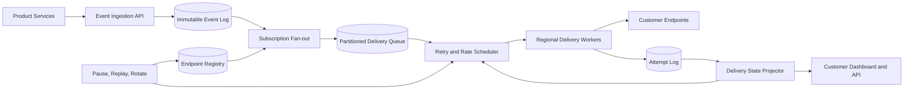

Event ingestion is separated from HTTP delivery. Endpoint failures increase queue depth but do not block product transactions or lose accepted events.

## Event ingestion

Product services publish a canonical event after their business transaction commits. The transactional outbox pattern prevents a database update from succeeding without its event.

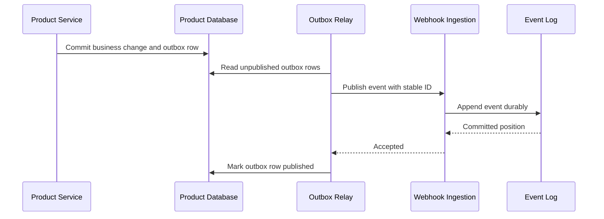

The ingestion API validates tenant, event type, payload size, schema version, and timestamp. It deduplicates by tenant and event ID within the retention window.

Store the immutable payload once and reference it from deliveries. Encrypt payloads with tenant-scoped keys and apply event-specific retention policies.

## Subscription matching and fan-out

Subscriptions select event types and may include simple, precompiled filters over approved fields.

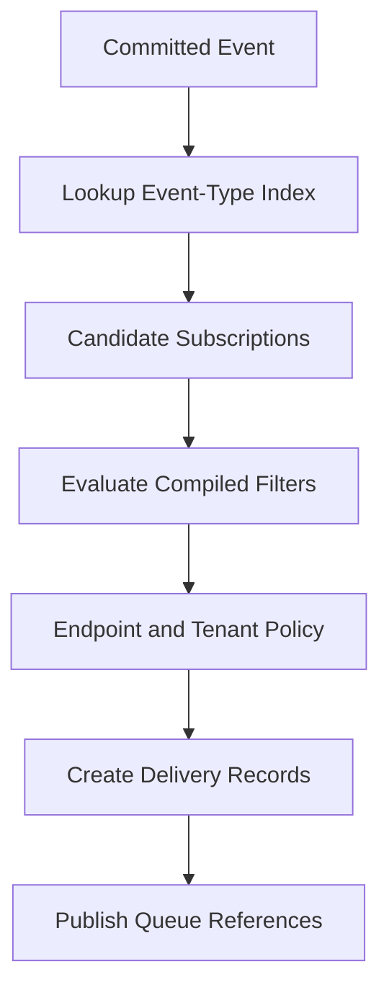

Index subscriptions by tenant and event type so fan-out does not scan the full registry. Restrict filter language to deterministic comparisons; do not run customer code in the fan-out path.

Creating delivery records and advancing the fan-out checkpoint must be atomic or idempotent. A crash can repeat a partition, but a uniqueness constraint on event and endpoint prevents duplicate logical deliveries.

## Delivery protocol

Use a stable envelope so customers can evolve integrations independently of product schemas.

```json
{
  "id": "evt_01K93N1A",
  "type": "order.created",
  "createdAt": "2026-11-03T18:42:10Z",
  "apiVersion": "2026-10-01",
  "attempt": 1,
  "data": {
    "object": {}
  }
}
```

Useful headers include:

```text
Webhook-Id: evt_01K93N1A
Webhook-Timestamp: 1793731330
Webhook-Signature: v1,<base64-signature>
Webhook-Delivery: dlv_01K93N2B
```

Return semantics:

| Response | Platform behavior |
| --- | --- |
| 2xx | Mark delivery successful |
| 408, 425, 429, 5xx | Retry according to policy |
| Other 4xx | Usually terminal; expose reason to customer |
| Timeout or connection error | Retry |
| Redirect | Reject by default or revalidate destination before following |

Response bodies are truncated and redacted before storage. A customer can explicitly classify selected 4xx codes as retryable within safe limits.

## Cryptographic signatures

Sign the exact raw request bytes together with a timestamp.

```text
signed_payload = timestamp + "." + raw_request_body
signature = HMAC-SHA256(endpoint_secret, signed_payload)
```

The consumer verifies the signature using constant-time comparison and rejects timestamps outside a short tolerance. Timestamp binding prevents captured requests from being replayed indefinitely.

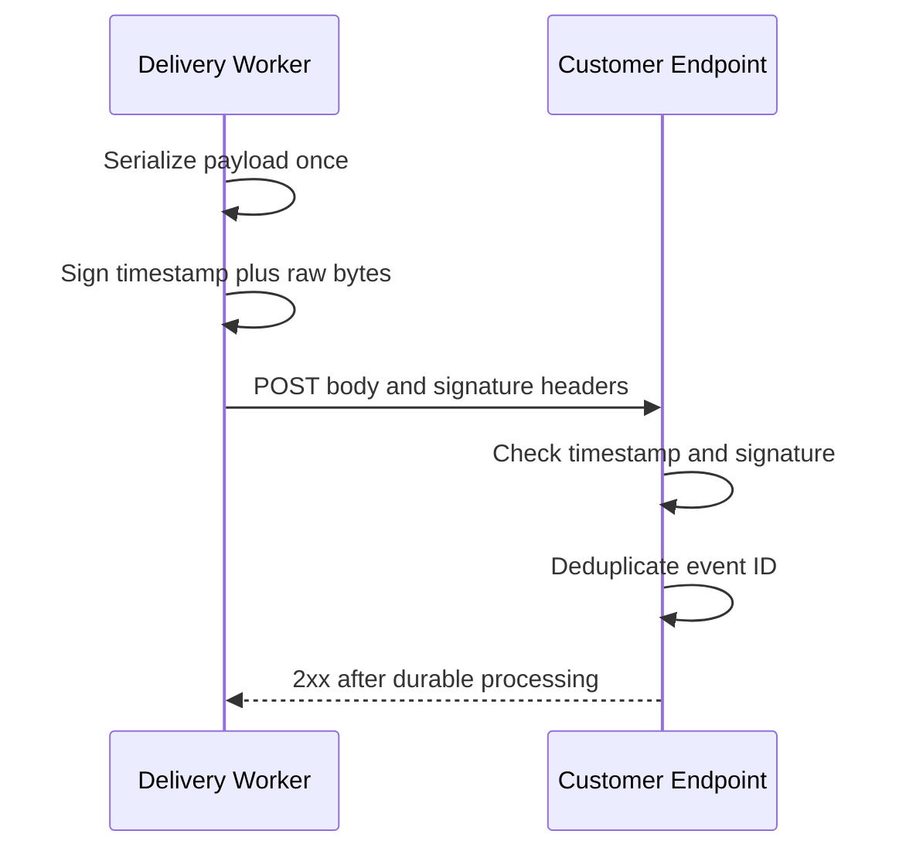

Do not sign parsed JSON because whitespace and number normalization differ across languages.

## Secret rotation

Each endpoint can have a current and next secret with explicit validity windows.

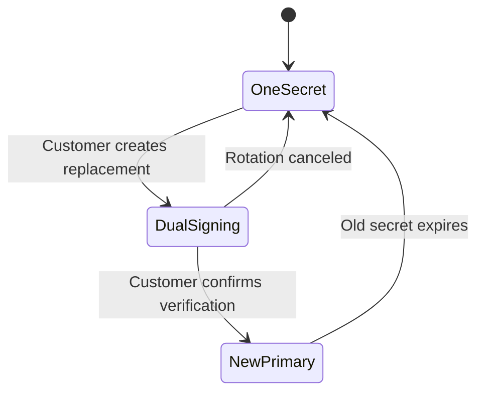

During rotation, include signatures for both active secrets in a single header. The customer deploys the new secret, verifies deliveries, then retires the old secret. Never return secret material after creation; show only identifiers and last-used timestamps.

## Scheduling and retries

Retries use exponential backoff with jitter and a maximum delivery age.

```text
delay = min(maxDelay, baseDelay * 2^(attempt - 1))
next = now + random(delay / 2, delay)
```

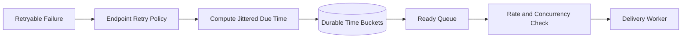

Use a durable timer store partitioned into time buckets. A scheduler leases due records and moves them to ready queues. Lease expiry makes scheduler crashes recoverable.

Honor a bounded `Retry-After` value for 429 and 503 responses. Jitter spreads load when thousands of endpoints recover at once.

After the maximum attempt count or age, move the delivery to a terminal failed state. It remains replayable while the event payload is retained.

## Fairness and noisy-neighbor control

Apply limits hierarchically:

- Global and regional capacity
- Tenant delivery rate and concurrent requests
- Endpoint rate and concurrent requests
- Destination host and IP connection budgets
- Event-type priority

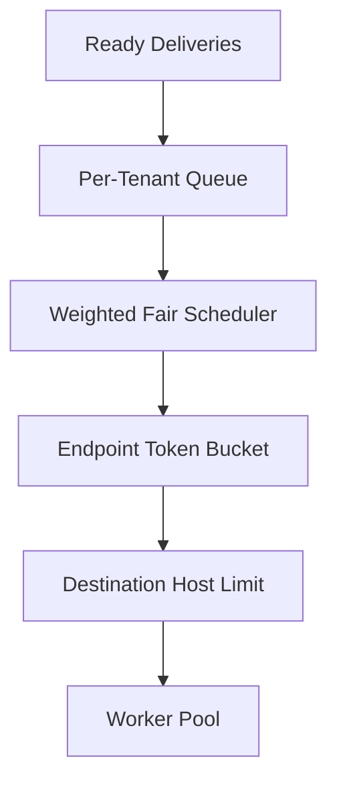

Fresh deliveries and retries use separate capacity pools so a widespread outage cannot starve new healthy traffic. Reserve a small pool for test events and operator verification.

## Ordering

Global ordering is expensive and usually unnecessary. Offer scoped ordering by an explicit key such as account ID or order ID.

Partition deliveries by endpoint and ordering key. Only one in-flight delivery per key is allowed. A failed event blocks later events for that key until it succeeds, expires, or an operator skips it.

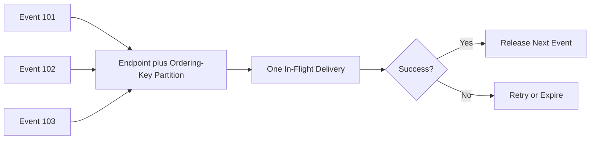

Document whether ordering follows event occurrence, ingestion, or source sequence. For unrelated keys, process concurrently.

## Endpoint health and circuit breaking

Track recent success rate, latency, timeout rate, and retry backlog per endpoint. Open a circuit when repeated failures show that sending more traffic is harmful.

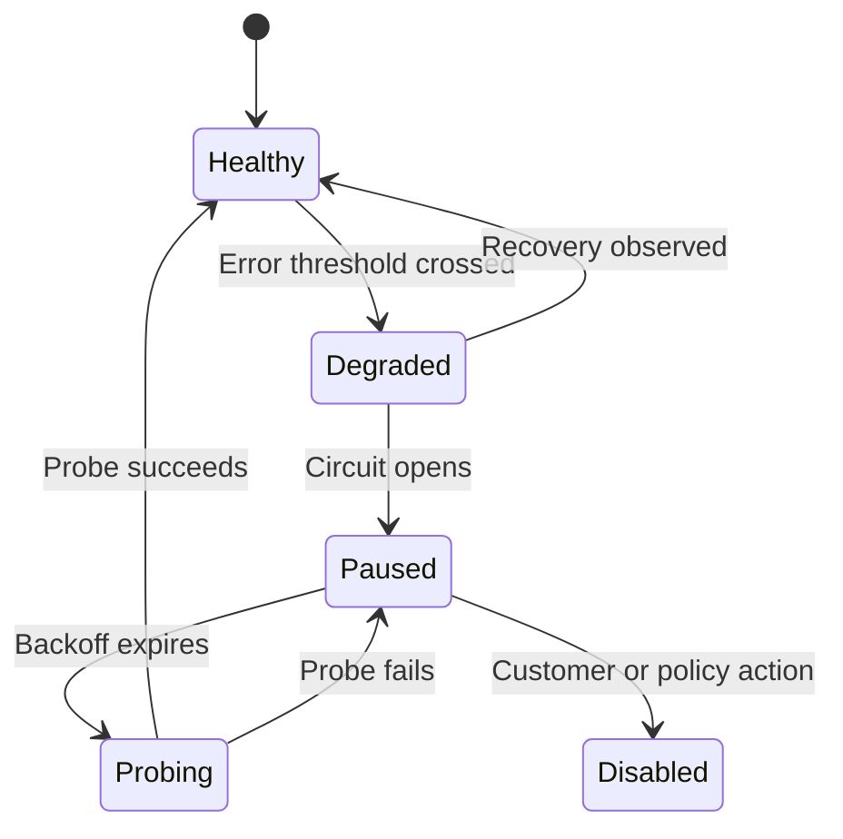

Pausing stops attempts but retains queued deliveries within their retention window. Recovery probes use a dedicated low-rate path. Customers can pause an endpoint manually during maintenance.

## Replay

A replay selects historical events by time, event type, outcome, or event ID and creates new delivery attempts under a replay ID.

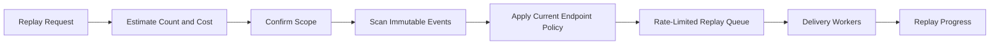

Keep replay traffic separate and lower priority than live delivery. Add replay metadata to headers while preserving the original event ID so customer deduplication remains effective.

Never reinterpret old events using an unannounced new schema. Replay the stored payload and API version unless the customer explicitly requests a supported transformation.

## Endpoint validation and SSRF defense

Webhook URLs are untrusted network destinations. Validate them at registration and again when DNS changes.

- Require HTTPS in production
- Reject URLs with embedded credentials
- Resolve every DNS answer and block private, loopback, link-local, multicast, and metadata ranges
- Pin the validated IP for the connection to prevent DNS rebinding
- Revalidate every redirect and restrict redirect count
- Use isolated egress proxies without internal network routes
- Limit request and response size, time, and connection reuse
- Block non-HTTP protocols and unusual ports by policy

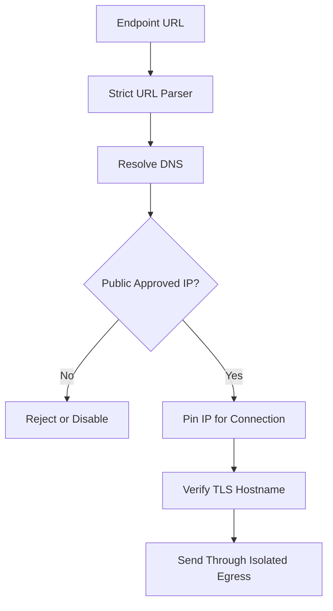

Optionally verify ownership by sending a challenge token that the endpoint must echo or by requiring a DNS record.

## Multi-region delivery

Ingest events into a tenant's home region and route deliveries through regional worker pools. Keep endpoint configuration and secrets in approved regions.

Assign each delivery to one active region at a time using a lease epoch. During regional failover, a new region acquires a higher epoch before taking work. Duplicate attempts can still occur around lease expiry, so consumer idempotency remains required.

Choose delivery region based on data residency, endpoint geography, and health. Do not move sensitive payloads across regions merely to improve latency unless policy permits it.

## Observability and customer experience

For every attempt, expose:

- Event and delivery identifiers
- Endpoint and event type
- Attempt number and timestamps
- HTTP status or normalized network error
- Latency and next retry time
- Request schema version and signature-key identifier
- Truncated, redacted response body
- Final outcome and replay membership

Offer searchable logs, aggregate success rate, latency percentiles, endpoint health, retry backlog, and event age. Let customers copy a safe command that reproduces the request against a local endpoint without exposing the signing secret.

Platform metrics include ingestion lag, fan-out lag, ready and delayed queue depth, oldest event age, attempts per outcome, worker saturation, circuit state, and replay progress.

Avoid endpoint URLs, tenant IDs, and event IDs as unbounded metric labels; place those dimensions in indexed logs.

## Reliability and failure handling

| Failure | Safe behavior |
| --- | --- |
| Product publishes twice | Stable event ID deduplicates ingestion |
| Fan-out worker crashes | Resume from durable log; unique delivery key prevents duplication |
| Delivery worker crashes after sending | Lease expires and request may repeat |
| Customer endpoint times out | Retry with backoff and the same event ID |
| Timer scheduler restarts | Reacquire due buckets from durable state |
| DNS changes to a private IP | Revalidation blocks the request |
| Secret service is unavailable | Use cached encrypted key briefly or delay delivery; never send unsigned |
| Attempt log is delayed | Delivery continues from durable queue; reconcile asynchronously |
| Region fails | Acquire work in an allowed region with a higher lease epoch |

The worker writes an attempt-start record before network I/O and an outcome afterward. A missing outcome means unknown, not failed; retries still follow at-least-once semantics.

## Security and privacy

- Encrypt payloads, secrets, and response samples at rest
- Use short-lived workload identities between services
- Scope every control-plane action by tenant and role
- Store signing secrets in a hardware-backed secrets service
- Redact configured sensitive fields in the dashboard
- Apply event-specific payload retention and deletion
- Audit endpoint changes, secret rotation, replay, pause, and export
- Rate-limit registration and test delivery to prevent abuse
- Scan egress behavior for port scanning and exfiltration patterns

Allow customers to choose metadata-only logging for highly sensitive event types. The delivery engine still needs the encrypted payload until success or expiry, but operational tools need not display it.

## Key trade-offs

| Decision | Benefit | Cost |
| --- | --- | --- |
| At-least-once delivery | Survives ambiguous network failures | Consumers must deduplicate |
| Store payload once | Lower storage and consistent replay | Payload lookup on delivery |
| Per-key ordering | Useful correctness without global serialization | Failed events block that key |
| Exponential backoff | Protects unhealthy endpoints | Slower recovery for brief failures |
| Circuit breaking | Prevents retry storms | Additional recovery state |
| Separate replay capacity | Protects live traffic | Replays complete more slowly |
| Regional workers | Lower latency and residency control | Lease and secret replication complexity |

## Evolution path

1. Build durable ingestion, endpoint registry, signing, and bounded retries.
2. Add delivery logs, test events, secret rotation, and manual replay.
3. Introduce per-tenant fairness, endpoint circuits, and SSRF-hardened egress.
4. Add scoped ordering and bulk replay with independent capacity.
5. Deploy regional workers with residency-aware placement and failover epochs.
6. Add schema tooling, advanced filters, and customer-configurable policies.

Start with a small, explicit contract: at-least-once delivery, stable IDs, deterministic signatures, and clear retry behavior. Reliability comes from predictable semantics more than from an ever-growing list of options.

## Final design

Accept canonical product events into an immutable log, match versioned subscriptions, and create one durable delivery per event-endpoint pair. Schedule attempts through hierarchical fair queues, sign exact payload bytes with rotatable endpoint secrets, and send through SSRF-hardened regional egress workers. Treat ambiguous network outcomes as retryable, preserve stable event IDs for consumer deduplication, and use exponential backoff, circuits, and separate retry capacity to contain failures. Offer scoped ordering where required, rate-limited replay from immutable events, and detailed redacted attempt evidence.

The central principle is to design for uncertainty at the network boundary. The platform cannot know whether a timed-out endpoint committed an event, so it must preserve durable intent, retry safely, and give consumers the identifiers and signatures needed to make repeated delivery harmless.
