## Problem and requirements

A service mesh provides a common networking layer for communication between services. It moves connection security, identity, routing, retries, load balancing, policy, and telemetry out of each application library and into a managed data plane.

The value is consistency: every workload receives the same security and traffic controls regardless of language. The risk is equally large: a faulty proxy or configuration can affect every request. The mesh must remain useful when its control plane is unavailable and must never hide application failures behind unsafe retries.

### Functional requirements

- Discover healthy service endpoints
- Authenticate workloads and encrypt service traffic with mutual TLS
- Authorize calls by service identity and request context
- Load-balance connections and requests
- Configure timeouts, retries, circuit breakers, and rate limits
- Shift traffic among versions, clusters, and regions
- Capture metrics, traces, access logs, and policy decisions
- Support ingress, egress, and service-to-service traffic
- Roll out and roll back configuration safely
- Rotate identities and trust bundles automatically

### Non-functional requirements

- Support one million workloads and 100 million requests per second
- Add only a few milliseconds of latency at the 99th percentile
- Continue forwarding traffic during control-plane outages
- Prevent one tenant or service from exhausting shared proxies
- Converge configuration within seconds
- Avoid mixed or partially applied dependency configuration
- Isolate trust domains, tenants, and environments
- Support rolling proxy upgrades without application downtime

The mesh controls network communication. It does not replace application authorization, database transactions, queues, or correct timeout and idempotency design.

## Capacity estimates

Assume one million workloads, 100 million peak requests per second, and 500,000 concurrent configuration streams.

| Resource | Estimate |
| --- | ---: |
| Workload instances | 1M |
| Peak requests | 100M/second |
| Control-plane streams | 500K+ |
| Endpoint changes | Millions/minute during failures or deployments |
| Certificates | Millions active, frequently rotated |
| Telemetry events | Billions/minute before aggregation and sampling |

The data plane scales with application traffic. The control plane scales with workloads, services, endpoints, and configuration churn—not with every request.

## Architecture choices

### Sidecar data plane

Each workload instance has a dedicated proxy. The application connects locally, and traffic passes through the sidecar.

Sidecars provide strong per-workload policy and isolation but consume CPU and memory per instance and complicate coordinated lifecycle management.

### Node or ambient data plane

Shared node-level components capture traffic, with optional higher-layer proxies for application-aware routing.

This reduces per-workload overhead and injection complexity but requires careful tenant isolation and may add an extra hop for rich layer-seven policy.

This design supports both through a common identity, configuration, and policy model.

## High-level architecture

The control plane compiles intent into signed data-plane snapshots. Proxies handle requests locally without calling the control plane.

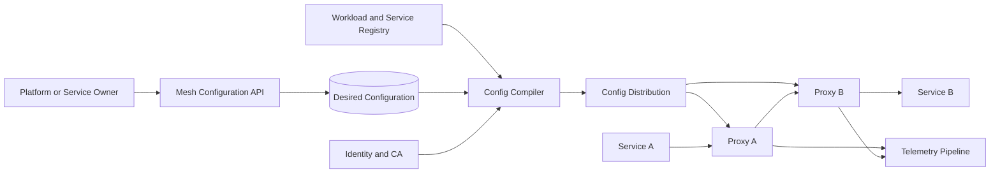

The proxy uses the last valid configuration if the control plane is unreachable. Identity rotation and configuration have independent delivery paths so one failure does not unnecessarily block the other.

## Traffic interception

Applications should not need to know proxy addresses. The platform redirects outbound and inbound connections through the data plane using network namespaces, virtual interfaces, or node routing.

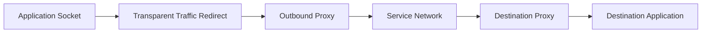

Exclude health, control-plane, metadata, and proxy administration traffic explicitly to prevent loops.

The proxy receives trusted workload metadata from the platform rather than inferring identity from mutable IP addresses.

Applications can also use explicit proxy protocols when transparent interception is unavailable or undesirable.

## Workload identity

Each workload receives a cryptographic identity derived from trusted runtime evidence.

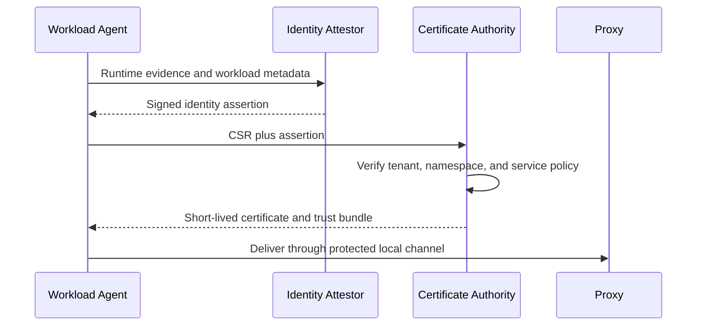

Identity names the trust domain, environment, namespace, and service account. It does not depend on the host IP.

Certificates are short-lived and automatically renewed. Private keys are generated locally or in protected hardware and are never sent to the control plane.

Development and production use separate trust domains or constrained intermediates.

## Mutual TLS connection

The client and server proxies authenticate one another before forwarding application bytes.

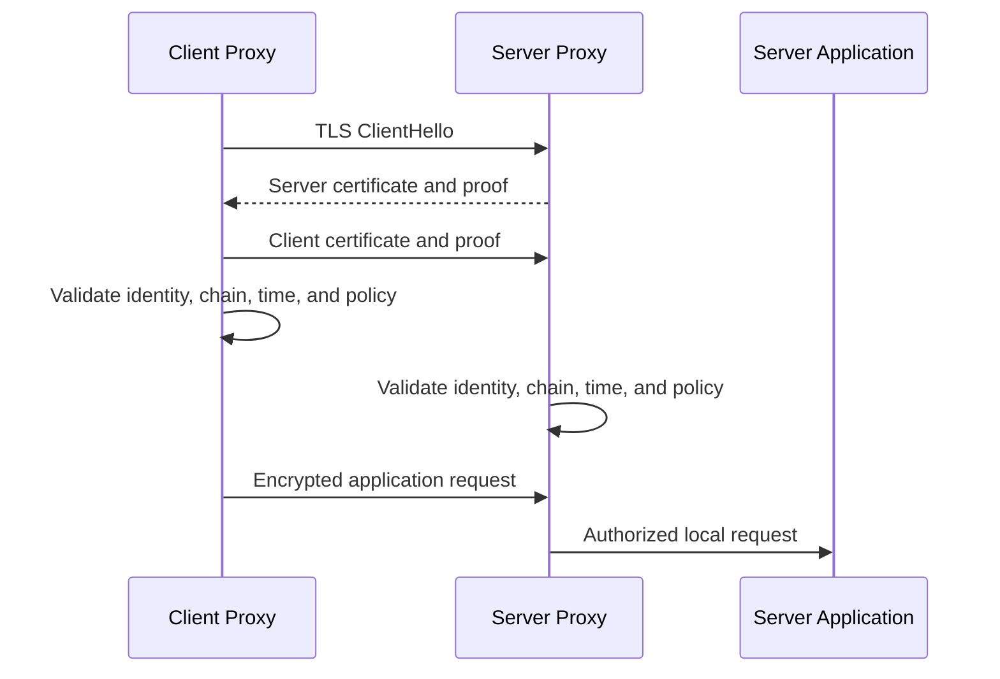

Validation includes trust bundle, service identity, certificate use, validity, and current policy. A valid certificate proves identity, not authorization.

Session resumption reduces handshake cost but remains bound to certificate and policy lifetime. Proxies drain or renegotiate connections when security policy requires it.

## Certificate rotation

Agents renew well before expiry with jitter. The proxy atomically loads the new certificate and keeps the old one only for existing handshakes or a short overlap.

Trust-bundle rotation publishes the new trust anchor before issuing chains from it. Both old and new anchors overlap until every valid old certificate can expire.


Report certificate and trust-bundle versions per workload. A rotation is not complete merely because the CA changed its default.

If renewal fails, existing credentials work until expiry. After expiry, fail closed rather than silently switching to plaintext.

## Service discovery

The mesh consumes workload registrations from orchestrators, virtual machines, and external-service catalogs.

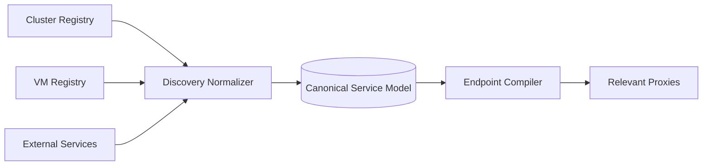

The canonical model records service identity, network, address, port, protocol, locality, health, version, and policy labels.

Endpoint readiness comes from the owning platform. Mesh passive health can supplement it but should not fight orchestration state.

Only distribute endpoints relevant to a proxy's reachable services and policies. Sending every endpoint to every workload does not scale.

## Configuration model

Users declare service-level intent:

- Routes and traffic weights
- Timeouts and retry policy
- Load-balancing strategy
- Circuit-breaking limits
- Authorization and egress rules
- Telemetry and sampling policy

The compiler resolves references, validates conflicts, expands service selectors, and produces proxy-specific resources.

Configuration resources have explicit dependencies. A listener is activated only after its referenced routes, clusters, endpoints, secrets, and policies are present and valid.

## Configuration distribution

Proxies maintain long-lived authenticated streams to regional distributors.

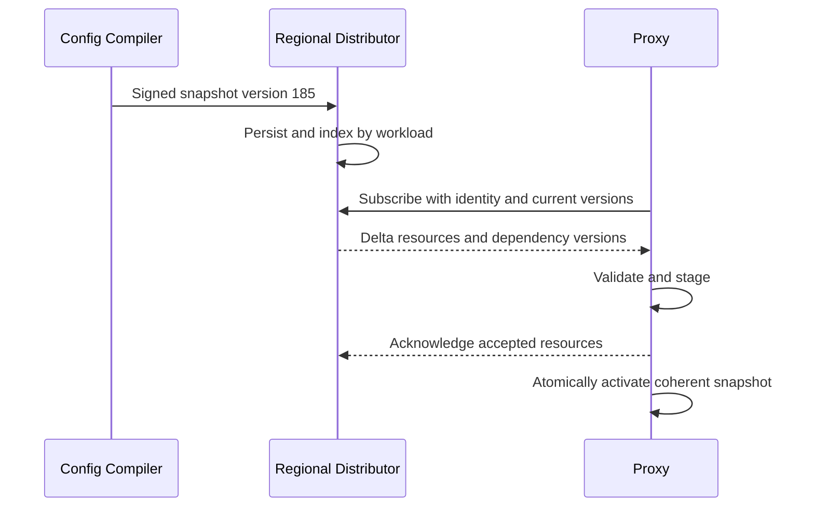

Use delta updates for endpoint churn and full snapshots for gap recovery. Proxies reject invalid signatures, wrong tenant scope, and decreasing epochs.

The distributor tracks acknowledgements and rejection reasons but does not block global progress on one broken proxy.

Canary new compiler and proxy versions with shadow validation before broad rollout.

## Request routing

For an outbound request, the proxy identifies the destination service, matches a route, applies policy, chooses a healthy endpoint, and forwards under a deadline.

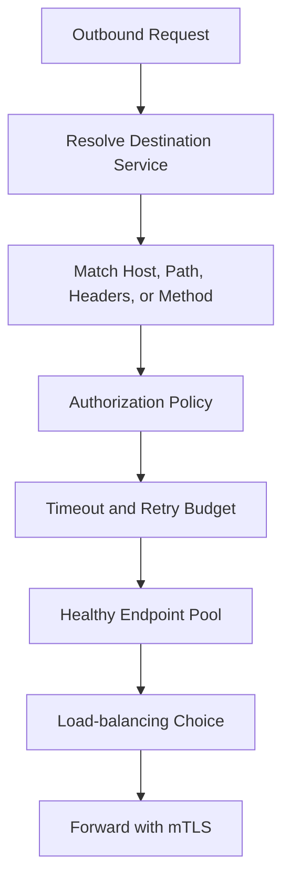

Route matching uses bounded rules and normalized inputs. Reject ambiguous host or path parsing that can differ between proxy and application.

Attach selected route, cluster, endpoint, and policy versions to telemetry for debugging.

## Load balancing

Strategies include round robin, least outstanding requests, consistent hashing, and locality-aware weighted selection.

Least-request works well when service times vary. Consistent hashing supports affinity but can overload a hot key and complicates endpoint changes.

Locality-aware routing prefers the same zone or region while reserving capacity for failover. Weights incorporate endpoint health, zone cost, and overprovisioning.

Use slow start for new or recovered endpoints so caches warm before receiving a full share.

Connection pooling reduces handshakes but needs per-destination and per-tenant limits. One high-cardinality caller must not open unbounded connections.

## Timeouts and deadlines

Every call needs a bounded deadline. The proxy honors an existing trusted deadline or applies route defaults.

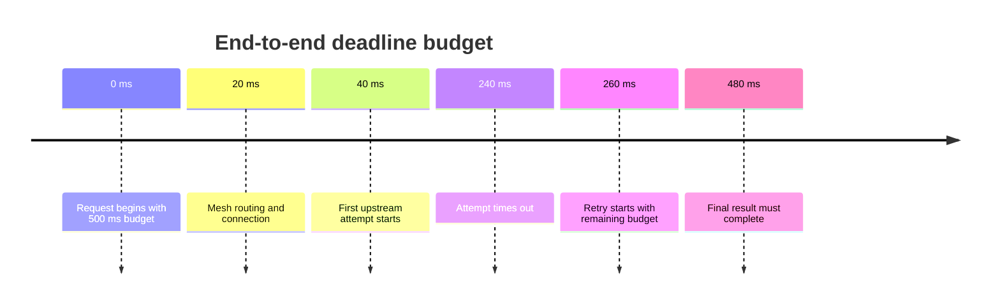

Propagate remaining deadline rather than restarting a full timeout at every hop. Otherwise deep call chains multiply user latency.

Connect, request, idle, and stream-lifetime timeouts solve different problems. Defaults depend on protocol and workload behavior.

The proxy cancels upstream work when the downstream deadline or client connection ends where the protocol supports it.

## Retries

Retries can mask transient network or endpoint failures, but they multiply traffic and can repeat side effects.

Retry only known safe operations or requests with application idempotency keys. Do not infer safety solely from an HTTP method if the application's semantics differ.

Use exponential backoff with jitter and a total retry budget. A service may allow retries to consume only a small fraction of baseline traffic.

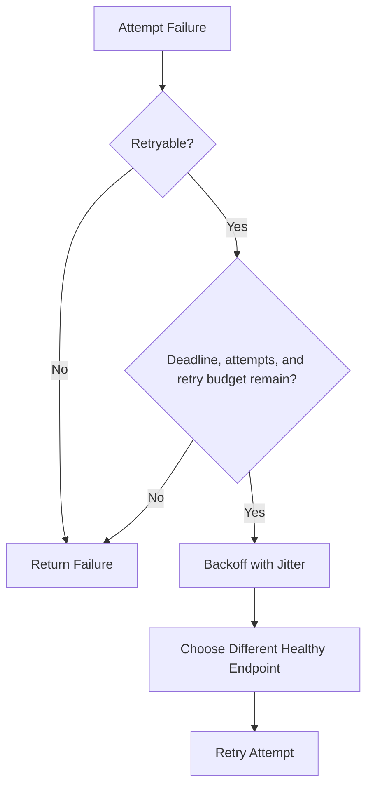

Never retry after the caller deadline. Prefer another endpoint or zone when the failure suggests a local instance problem.

## Circuit breaking and outlier detection

Circuit breakers cap concurrent requests, queued requests, connections, and retries per destination.

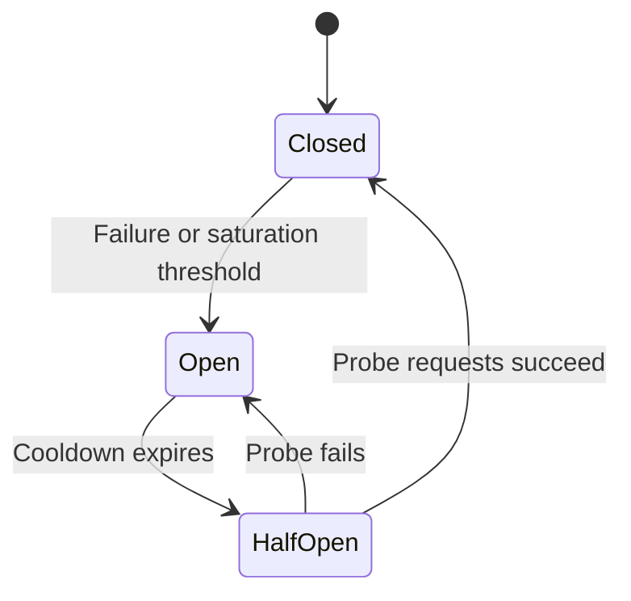

Opening a circuit fails fast and protects both caller and destination from unbounded queues.

Outlier detection ejects individual endpoints with statistically abnormal failures or latency. Ejection is bounded so a widespread application bug does not remove the entire fleet.

Active health, passive results, and orchestration readiness are separate signals with explicit precedence.

## Rate limiting

Local token buckets enforce immediate per-proxy limits without network calls. Global limits use a central quota service or leased token allocation.

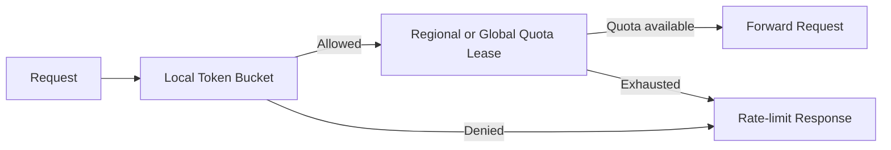

Scope keys by caller identity, destination, route, tenant, and approved request attributes. Do not trust a caller-supplied identity header.

Quota-service failure follows policy: security and cost limits may fail closed, while defensive overload limits can use remaining local leases.

Rate-limit responses include retry guidance but avoid revealing sensitive policy details.

## Authorization policy

Authorization evaluates authenticated source identity, destination identity, method, route, port, and selected trusted claims.

```text
source + destination + action + context → allow or deny
```

Default deny for protected namespaces. Separate layer-four connection policy from layer-seven request policy.

The proxy enforces coarse service access, while applications still verify end-user and resource permissions. A workload identity allowed to call `orders` is not automatically allowed to read every order.

Compile policy into proxy-local structures for fast decisions. Emergency deny rules have a prioritized distribution path and override cached allows.

## Ingress and egress

Ingress gateways terminate external connections, authenticate clients, enforce edge policy, and route to internal services. They are part of the mesh trust boundary but have different scaling and exposure from sidecars.

Egress gateways provide a controlled path to external destinations for auditing, network policy, stable source addresses, and credential isolation.

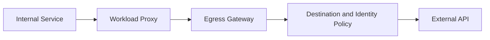

Prevent direct bypass with network policy where the threat model requires it. DNS names alone are not strong egress identity; validate destination certificates and resolved addresses.

Do not route control-plane or identity-service traffic through dependencies that themselves require the mesh to initialize.

## Traffic shifting and canaries

Route a stable percentage of traffic to a candidate version using a request, user, or session hash.

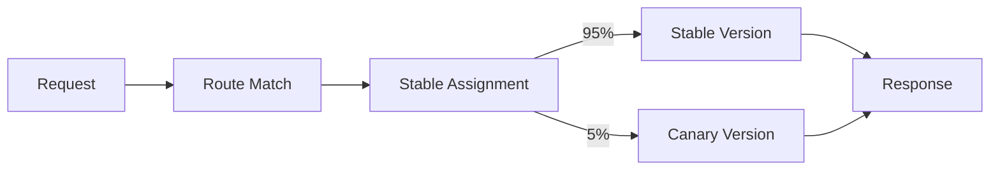

Weights apply after filtering healthy endpoints. If the canary has no healthy capacity, fallback behavior is explicit rather than silently redistributing.

Mirroring sends a copy to a shadow version without using its response. Strip sensitive data when shadow policy requires it and never duplicate non-idempotent downstream effects.

Rollout controllers combine mesh traffic weights with deployment readiness and business health gates.

## Locality and failover

Prefer local-zone endpoints for latency and cost. Spill to other zones when local capacity, health, or error budgets require it.

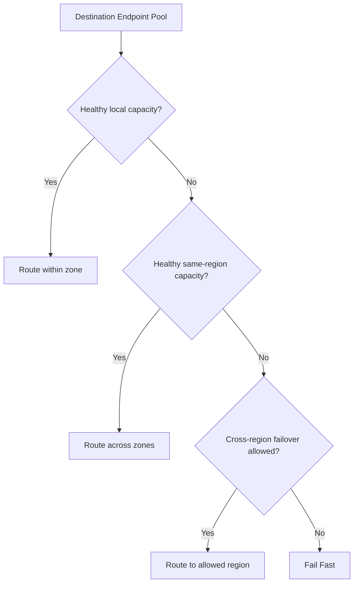

Cross-region failover considers data residency, service state, database ownership, and downstream dependencies. Network reachability alone does not make a remote region safe.

Reserve remote capacity and test failover regularly. A failover plan that has never carried traffic is a theory.

## Multi-cluster service discovery

A global service can have endpoints across clusters. Regional registries feed a federated model while preserving cluster and network identity.

Gateways connect networks that lack direct workload routing. The source proxy chooses a remote gateway, and the gateway preserves authenticated workload identity through the hop.


Endpoint configuration includes network reachability and gateway path. Never advertise an address to a proxy that cannot route to it.

Prevent loops with path metadata, hop limits, and deterministic gateway selection.

## Telemetry

Proxies emit standardized metrics such as request rate, error rate, duration, active connections, retries, ejections, and policy denials.

Distributed traces propagate context and add client/server spans. Access logs capture selected request metadata and identities.

Telemetry is asynchronous and bounded. A monitoring outage must not stop application traffic.

Apply sampling and cardinality controls before export. Raw paths, user IDs, request headers, and certificate subjects can create privacy and cost problems.

Use service, route template, response class, and workload version as controlled dimensions. Detailed investigations use protected sampled logs.

## Data-plane overload

The proxy shares resources with application traffic. Enforce limits on connections, pending requests, buffer bytes, header size, decompression, telemetry queues, and configuration size.

Prioritize existing connection handling over accepting unlimited new work. Shed low-priority requests before memory exhaustion.

Large streaming requests require flow control across both downstream and upstream connections. Never buffer an unbounded body to apply a policy that could stream incrementally.

Node-level data planes need per-workload accounting so one noisy tenant cannot consume every shared connection or buffer.

## Proxy upgrades

Roll out new proxies by version cohort and failure domain.

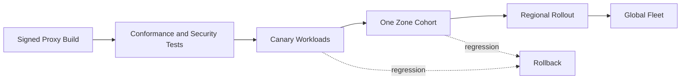

Sidecars drain connections before restart where protocols allow it. Node-level proxies need redundant handoff so workloads do not lose connectivity during upgrade.

Test compatibility with both old and new control-plane resource versions. Control and data planes cannot require lockstep fleet upgrades.

Maintain an emergency bypass only for narrowly defined recovery paths, with strong authorization and audit—not a blanket plaintext mode.

## Multi-tenancy

Tenant identity scopes configuration, discovery, certificates, policy, telemetry, and quotas.

Use separate trust domains or constrained intermediate authorities for stronger isolation. Shared proxies maintain independent connection pools, rate limits, and memory accounting per tenant.

Control-plane authorization prevents one tenant from selecting another tenant's workloads through labels or route references.

Large or regulated tenants may receive dedicated gateways, distributor pools, or data-plane nodes.

## Failure handling

### Control plane unavailable

Proxies continue using the last valid configuration. Existing traffic and service discovery remain functional until local data expires by policy.

### Configuration rejected

Keep the previous resource version active, report the exact dependency and reason, and isolate the bad change from unrelated services.

### Certificate authority unavailable

Current certificates remain valid. Agents retry renewal with jitter and alert based on time to expiry.

### Proxy crashes

The orchestrator restarts the sidecar or reroutes through another node-level proxy. Application readiness remains false until the data plane is usable where interception requires it.

### Endpoint update storm

Coalesce changes, send deltas, shard distribution, and apply backpressure. Prioritize removals of unsafe endpoints over low-priority additions.

### Retry storm

Enforce retry budgets, circuit breakers, and concurrency limits. Disable unsafe route policy through an emergency configuration rollback.

### Regional network partition

Use local endpoints, fail over only when allowed, and avoid routing to a region that cannot reach required stateful dependencies.

### Telemetry backend failure

Drop or sample bounded optional telemetry after local buffers fill. Preserve security audit signals through a separate durable path where required.

## Observability for the mesh

Track:

- Proxy request latency, error rate, and resource overhead
- Active and pending connections by destination
- Endpoint discovery and configuration age
- Configuration acknowledgement and rejection rate
- mTLS handshake, certificate age, and trust-bundle version
- Authorization denials and policy versions
- Retry, timeout, circuit-open, and ejection rates
- Locality routing and cross-region spill
- Rate-limit consumption and quota-service health
- Telemetry drops and cardinality
- Proxy version adoption and crash loops

Synthetic services continuously verify discovery, mTLS, authorization, retries, traffic shifting, egress, and cross-cluster routing.

Provide a request debugger that explains route match, policy result, chosen endpoint, timeout budget, and active configuration versions without exposing secret key material.

## Key tradeoffs

### Sidecar vs shared data plane

Sidecars provide strong per-workload isolation and layer-seven control but add per-instance cost. Shared node components reduce overhead while increasing shared-fate and isolation complexity.

### Rich layer-seven policy vs transparent transport

Application-aware routing and authorization are powerful but require protocol parsing and upgrades. Layer-four forwarding is simpler, faster, and safer for unknown protocols.

### Local autonomy vs immediate control

Proxy-local configuration keeps traffic running during control-plane outages but accepts bounded staleness. Short-lived identity, emergency denies, and version visibility limit the risk.

### Retries vs overload

Retries improve success during brief faults but amplify traffic and can repeat effects. Idempotency, budgets, and deadlines are mandatory.

### Locality vs resilience

Staying in one zone minimizes latency and cost. Spreading and reserved failover capacity increase resilience but consume more infrastructure.

The central principle is to keep forwarding decisions local and resilient while making identity, policy, configuration, and retry behavior explicit, versioned, and observable.
