## Problem and requirements

A software supply chain security platform determines whether software can be trusted from source commit through build, packaging, distribution, and deployment. It protects against compromised dependencies, tampered artifacts, stolen signing credentials, malicious build workers, vulnerable components, and unauthorized releases.

The platform cannot make software safe merely by scanning it. It must preserve an evidence chain: who requested the build, which source and dependencies were used, where the build ran, what it produced, which checks passed, who approved release, and exactly what reached production.

### Functional requirements

- Establish workload identity for source systems, build workers, registries, and deployment agents
- Resolve source and dependencies to immutable digests
- Generate signed build provenance and software bills of materials
- Sign artifacts without exposing long-lived private keys
- Store artifacts, attestations, and signatures immutably
- Scan source, dependencies, artifacts, and runtime inventories
- Evaluate versioned policy at build, promotion, and deployment time
- Maintain an append-only transparency log for release evidence
- Quarantine, revoke, and replace affected artifacts
- Trace a vulnerability or compromise to every dependent build and workload

### Non-functional requirements

- Support one hundred million builds per day and billions of artifacts
- Keep common admission decisions under 100 milliseconds at p99
- Prevent one tenant from accessing another tenant's source, evidence, or keys
- Survive registry, policy, scanner, and regional failures safely
- Make every allow or deny decision reproducible
- Preserve critical provenance for the required audit lifetime
- Minimize trust in individual CI providers and build workers
- Support disconnected and restricted deployment environments

## Capacity estimates

At one hundred million builds per day, the average rate is roughly 1,160 builds per second, with large bursts after repository events and scheduled dependency updates. A build can produce many packages, images, manifests, attestations, and scan results.

| Resource | Estimate |
| --- | ---: |
| Peak build completions | 10K/second |
| Artifact and evidence writes | 100K/second |
| Policy evaluations | Millions/second |
| Stored artifact versions | 10B+ |
| Dependency edges | Trillions |
| Vulnerability updates | Millions/day |
| Deployment admissions | Tens of millions/second globally |

Store large artifact blobs once by content digest. Metadata, signatures, attestations, dependency edges, and decisions remain compact and independently queryable.

## Trust model

The platform assumes repositories, developer machines, dependency sources, CI control planes, workers, registries, and deployment systems can each be compromised. Trust comes from independent, verifiable evidence rather than network location or a mutable tag.

Key principles:

- Identify content by cryptographic digest, never only by name or tag
- Use short-lived workload identity instead of stored signing secrets
- Generate attestations inside the system that observed the operation
- Bind every attestation to inputs, outputs, builder identity, and policy
- Separate artifact creation, promotion approval, and production admission
- Make revocation and evidence freshness part of verification

## Core data model

```text
Artifact {
  digest, mediaType, size, repository,
  tenantId, createdAt, retentionClass
}

Attestation {
  attestationId, subjectDigests, predicateType,
  predicate, issuerIdentity, signature, issuedAt
}

BuildRecord {
  buildId, sourceDigest, builderIdentity,
  inputDigests, outputDigests, environmentDigest
}

PolicyDecision {
  decisionId, subjectDigest, policyDigest,
  evidenceSetDigest, outcome, reasonCodes, decidedAt
}
```

Artifacts and attestations are immutable. Tags, channels, and environments are mutable references whose history is recorded as append-only events.

## High-level architecture

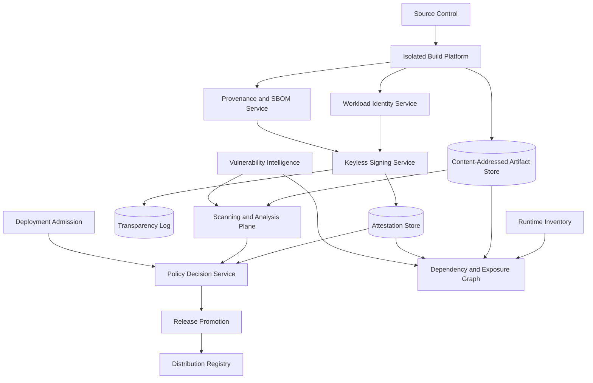

The evidence plane records what happened. The policy plane decides whether that evidence satisfies a particular environment's requirements. Keeping them separate allows policies to evolve without rewriting history.

## Source identity and immutable inputs

A build request references a repository, commit digest, immutable workflow version, and authenticated triggering identity. The platform resolves submodules, build tools, base images, packages, and remote resources before execution.

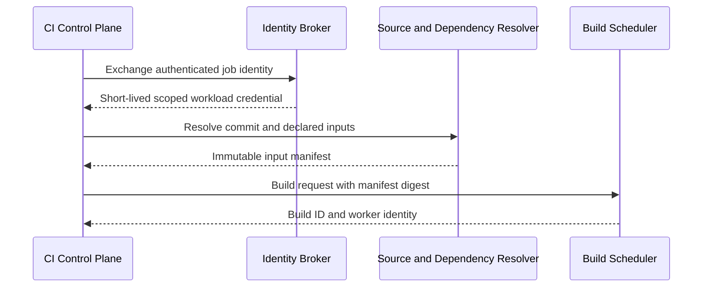

Mutable references such as branches, tags, package ranges, and container tags are resolved to digests and recorded. Hermetic builds prohibit undeclared network access; when full hermeticity is impossible, provenance lists observed external inputs and marks the limitation explicitly.

## Isolated build execution

Build workers handle untrusted code and high-value credentials. Run each job in an ephemeral virtual machine or similarly strong sandbox with a clean filesystem, restricted devices, bounded resources, and deny-by-default network policy.

Workers receive only:

- Read access to the resolved input snapshot
- Write access to a temporary output namespace
- A short-lived identity bound to one build
- Explicit network grants for approved dependency proxies
- No long-lived registry, signing, or cloud credentials

The scheduler records the worker image digest, host pool, isolation level, start time, and platform measurements. After the build, the worker uploads outputs by digest, submits evidence, destroys secrets, and is recycled.

High-assurance builds can require dedicated pools, reproducible-build comparison, or independent rebuilds on separate infrastructure.

## Provenance generation

Provenance states how an artifact was produced. It includes source digest, builder identity, build definition, resolved dependencies, parameters, environment, output digests, and timestamps.

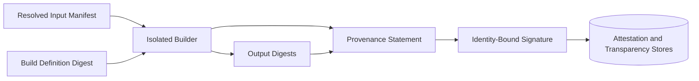

The builder creates the statement from observations, not from untrusted project-supplied metadata. A project may contribute declared fields, but they remain distinguishable from platform-verified fields.

Provenance is signed only after output upload and digest verification. Replaying the same statement against different bytes fails because the subject digest changes.

## Software bill of materials

An SBOM inventories components contained in an artifact: packages, versions, hashes, licenses, suppliers, and dependency relationships. Generate it using multiple sources:

- Package-manager lockfiles and resolved dependency graphs
- Build-system dependency metadata
- Filesystem and binary analysis
- Base-image and operating-system package manifests
- Language-specific package inspection
- Producer-provided component attestations

Record the generator, version, scope, completeness, and relationship to the artifact digest. Merging SBOMs should preserve provenance and conflicts rather than silently selecting one version.

An SBOM is evidence, not proof that every component is safe or even fully represented. Policy may require a minimum generation method and freshness for particular artifact classes.

## Keyless signing

Static signing keys stored in CI secrets are difficult to rotate and easy to steal. Instead, the signing service exchanges a short-lived authenticated workload identity for an ephemeral certificate or signing authorization.

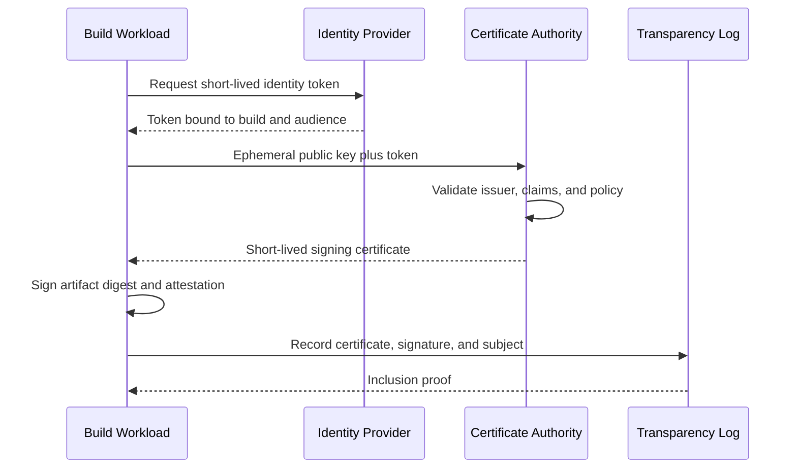

The verifier checks the signature, certificate chain, issuer, workload claims, subject digest, validity period, transparency inclusion, and revocation state. Identity policy should match stable structured claims, not a display name.

Hardware-backed tenant keys remain useful for offline, regulated, or long-lived signatures. Centralize those operations behind audited signing APIs and never export private material.

## Transparency log

The transparency log is append-only and cryptographically verifiable. It records signed release events, certificates, artifact signatures, and revocations without storing artifact contents.

Entries become leaves in a Merkle tree. Periodic signed tree heads allow clients and independent monitors to verify inclusion and detect inconsistent views.

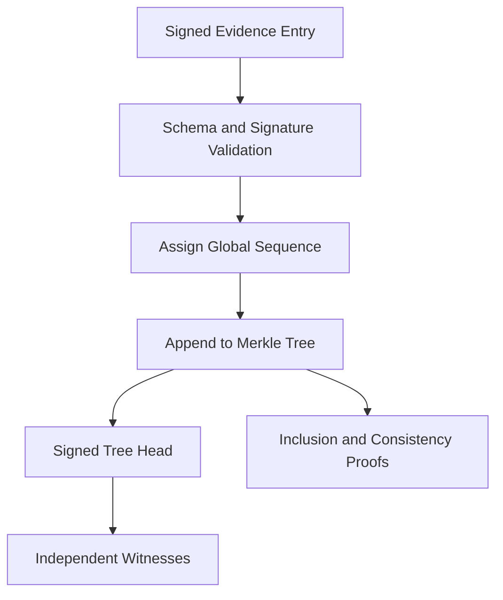

Submission success is not final until the entry has an inclusion promise or proof according to policy. Witnesses compare tree heads so a compromised log cannot easily present different histories to different clients.

## Artifact storage and promotion

The artifact store is content-addressed: uploads enter a temporary namespace, their digest is recomputed, then immutable blobs are committed. Repository names and tags point to digests through versioned manifests.

Promotion does not copy or rebuild bytes. It creates a signed release record binding an existing digest to a channel or environment after policy approval.

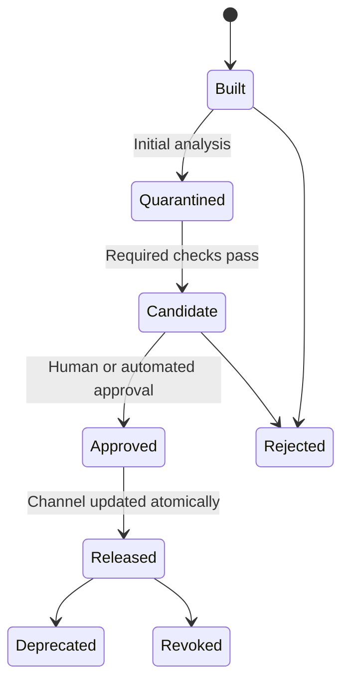

Never promote by mutable tag alone. Resolve the candidate digest, evaluate it, and update the release pointer with a compare-and-swap precondition.

## Scanning and analysis

The analysis plane runs complementary checks:

- Known-vulnerability matching against SBOM components
- Malware and suspicious-behavior analysis
- Secret and credential detection
- License and policy compliance
- Configuration and infrastructure checks
- Binary hardening and signing validation
- Source and dependency risk signals

Scanners produce immutable attestations with tool version, database version, subject digest, findings, scope, and completion status. A scanner timeout is not a clean result.

Scan expensive content once per digest and reuse results across tags, while evaluating tenant-specific policy separately. Rescan artifacts when intelligence or scanner capability changes, without changing the artifact itself.

## Vulnerability intelligence

Ingest advisories from multiple sources, normalize package ecosystems and identifiers, preserve source provenance, and model affected version ranges. Conflicting advisories coexist until resolution rather than overwriting one another.

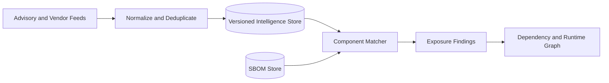

Reachability, exploitability, environment, and compensating controls help prioritize, but they do not erase the underlying match. Store both the base finding and contextual risk assessment.

## Dependency and exposure graph

The graph links source commits, dependencies, builds, artifacts, attestations, release channels, deployments, services, owners, and vulnerabilities.

Queries include:

- Which production workloads contain component X?
- Which artifacts were built by a compromised worker image?
- What depends on a revoked base image?
- Which releases lack required provenance?
- Who owns the services that must be rebuilt first?

Partition by tenant and use stable digest-based nodes. Graph updates are derived from append-only facts so indexes can be rebuilt after corruption or schema changes.

## Policy engine

Policy evaluates a subject, target environment, requesting identity, and evidence set. Example requirements may include:

- Artifact digest is immutable and present in an approved registry
- Provenance issuer and builder meet the environment's trust level
- Source repository and branch satisfy release rules
- SBOM exists and meets completeness requirements
- Required scans succeeded with approved database freshness
- No prohibited license, secret, malware, or vulnerability finding exists
- Promotion approval is valid and separation of duties is preserved
- Artifact and signer are not revoked

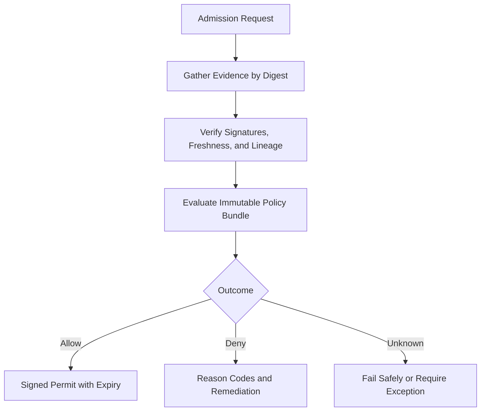

Policies are compiled, signed, versioned, tested against historical deployments, run in audit mode, then rolled out gradually. Decisions record the exact evidence-set digest and policy digest.

## Deployment admission

Admission controllers sit near deployment systems. They resolve every image, package, chart, and configuration reference to an immutable digest before evaluation.

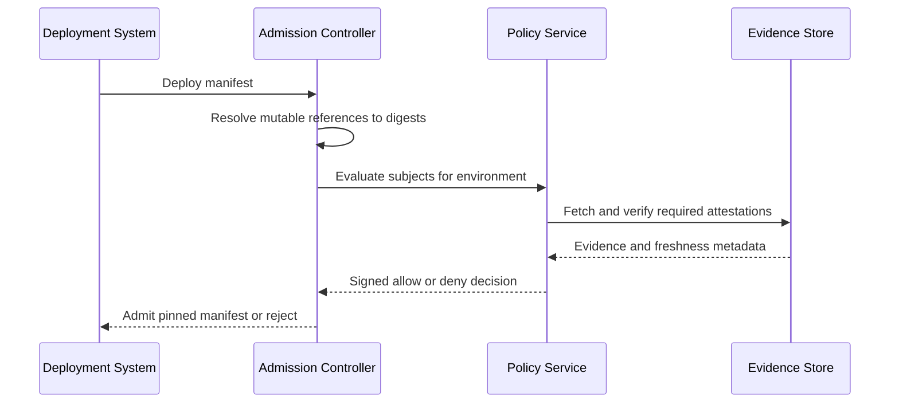

The admitted manifest is pinned to evaluated digests so a tag cannot change between decision and pull. Node-level verification can recheck the permit and digest before execution, protecting against a compromised deployment control plane.

Short-lived signed permits let restricted clusters operate during brief policy-service outages. Their scope includes tenant, environment, subject digests, policy version, and expiry.

## Exceptions

An exception is a signed, time-bounded policy object containing subject digest, target environment, violated rule, business reason, approvers, compensating controls, and expiry.

Exceptions never apply to all future versions of a package by default. If an artifact changes, its digest changes and the exception no longer matches.

High-risk exceptions require separation of duties and may restrict rollout size or environment. Expiry triggers reevaluation and cannot be extended silently.

## Revocation and incident response

A signing identity, builder, dependency, artifact, or release can become untrusted after deployment. Revocation must propagate faster than normal metadata expiration.

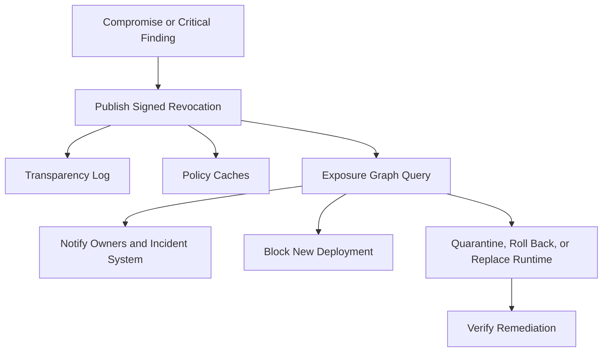

Revocation records state scope, reason category, authority, effective time, and replacement when available. They never delete the original artifact or signature; verifiers learn that the evidence is no longer acceptable.

Runtime response should be policy-controlled. Automatically stopping every workload can cause more harm than a bounded rollout of a replacement. Prioritize internet-facing and reachable exposure, preserve evidence, and verify completion.

## Reproducible and independent builds

For high-value releases, build the same resolved inputs independently on separate workers or infrastructure. Matching output digests provide strong evidence that no hidden input or worker-specific mutation affected the result.

Many builds contain timestamps, nondeterministic ordering, or environment-dependent metadata. Reproducibility requires canonical archives, pinned toolchains, deterministic paths, stable locale and time inputs, and controlled dependency resolution.

A mismatch blocks high-assurance promotion and produces a structured diff workflow. Do not simply retry until two outputs happen to match.

## Multi-region design

Regional cells store artifact replicas, attestations, scan queues, and policy caches close to builders and deployments. Globally consistent namespaces use content digests, while mutable release pointers have a single writer or fenced ownership.

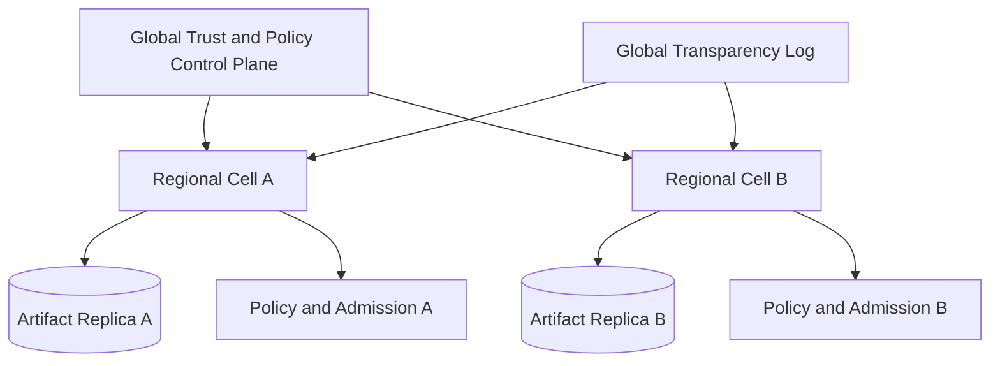

Artifacts replicate by digest and are verified after transfer. Evidence residency rules may restrict source metadata or findings, so global services receive the minimum signed claims needed for verification.

Transparency sequencing can use one primary log with independent witnesses, or multiple logs accepted by explicit policy. Clients must know which trust roots and logs are valid for each tenant and environment.

## Tenant isolation and security

Namespace repositories, evidence, policies, graph nodes, and cache entries by tenant. Use tenant-scoped encryption keys and prevent shared scanners from leaking whether another tenant contains a particular component.

Critical controls include:

- Hardware-backed roots for certificate authorities and long-lived keys
- Short-lived workload identities with narrow audiences
- Mutual authentication among builders, registries, policy services, and clusters
- No general network access from build workers
- Tamper-evident administrative and policy events
- Dual approval for trust-root, policy-bypass, and revocation changes
- Regular disaster recovery and key-compromise exercises

Treat attestations as untrusted input until schema, signature, issuer, subject, and semantic policy checks pass. A valid signature only proves that a particular identity signed a statement.

## Reliability and degradation

| Failure | Safe behavior |
| --- | --- |
| Build worker crashes | Discard ephemeral state and retry from immutable inputs |
| Artifact store unavailable | Do not claim build completion until outputs are durable |
| Scanner backlog grows | Preserve artifacts; block environments requiring fresh scans |
| Policy service unavailable | Use scoped, unexpired permits where policy allows |
| Transparency log delayed | Hold high-assurance promotion until inclusion is proven |
| Intelligence feed fails | Expose stale-data age and enforce freshness requirements |
| Regional registry fails | Read verified replicas; fence mutable promotion writes |
| Signing service unavailable | Queue releases rather than exporting signing keys |

Build availability and release trust are different objectives. It can be acceptable to continue producing quarantined artifacts while promotion is paused.

## Observability and service objectives

Track platform health and trust coverage:

- Builds with complete provenance and SBOMs
- Artifact uploads, digest mismatches, and replication lag
- Signing latency, certificate issuance, and transparency inclusion
- Scan backlog, database freshness, and analysis failures
- Policy latency, cache age, allow, deny, and unknown rates
- Mutable references resolved or rejected at admission
- Exceptions by scope, age, owner, and expiry
- Revocation propagation and remediation completion
- Runtime artifacts not represented in the evidence graph

Suggested objectives include p99 admission below 100 milliseconds, 99.99% admission availability, 99.9% of release evidence logged within one minute, critical revocations visible to connected admission points within five minutes, and zero production releases that bypass required evidence without an audited exception.

## Key tradeoffs

### Central signing versus keyless identity

Central keys simplify compatibility but create concentrated secrets and rotation burden. Keyless signing reduces stored credentials but depends on strong identity claims, certificate infrastructure, and transparency verification.

### Build speed versus isolation

Persistent workers and broad caches are fast but retain attacker state. Ephemeral workers and verified, read-only caches cost more and create a stronger boundary.

### Admission availability versus freshness

Long-lived cached permits tolerate outages but accept stale trust. Short permits improve response to revocation and increase dependency on control-plane availability. Set validity by environment risk.

### Comprehensive scanning versus release latency

Every scanner adds time and possible failure. Run fast mandatory checks before promotion, parallelize deep analysis, and define which later findings trigger revocation.

### Global evidence versus residency

A central graph simplifies incident response but may expose sensitive repository and vulnerability metadata. Share signed claims and digest relationships globally while retaining restricted evidence regionally.

## Evolution path

1. Begin with immutable artifact digests, isolated builds, SBOM generation, and registry scanning.
2. Add workload identity, signed provenance, a policy engine, and deployment admission.
3. Introduce keyless signing, transparency logging, promotion records, and audited exceptions.
4. Build the dependency and runtime graph with vulnerability-triggered rescans and revocation.
5. Expand to independent reproducible builds, regional trust cells, witness infrastructure, and automated remediation verification.

## Final design

The platform establishes trust through an immutable evidence chain rather than through mutable tags or network location. Ephemeral builders resolve inputs to digests, produce content-addressed artifacts, and issue signed provenance and SBOM attestations using short-lived workload identity. Scanners add versioned findings, and a transparency log makes release evidence publicly or organizationally auditable.

At promotion and deployment, the policy engine verifies signatures, lineage, freshness, approvals, vulnerabilities, and revocation against the exact artifact digest. Runtime inventory closes the loop by showing where every artifact runs and enabling targeted response when trust changes. The result is a software delivery system that can prove how production code was built, constrain what may run, and replace compromised software quickly without relying on any single system to be infallible.
