## Problem and requirements

An audit log platform records who did what, to which resource, from where, and with what result. Security teams use it to investigate incidents, customers use it to review administrative activity, and compliance teams use it to demonstrate that sensitive operations were controlled.

The difficult part is preserving trustworthy evidence when producers fail, clocks disagree, schemas evolve, and privileged insiders may be part of the threat model. An audit system must detect deletion and modification, restrict access to sensitive records, and remain useful across years of retention.

### Functional requirements

- Accept audit events from applications, infrastructure, and control planes
- Validate identity, tenant, schema, and event provenance
- Assign stable event IDs and authoritative ingestion timestamps
- Preserve immutable canonical records and original producer payloads
- Detect missing, reordered, modified, or deleted records
- Search by actor, resource, action, time, and outcome
- Build timelines across services and regions
- Export signed evidence packages for customers and auditors
- Apply tenant, event-type, and jurisdiction retention policies
- Place records under legal or investigation holds
- Redact or tokenize sensitive fields without weakening integrity
- Monitor producer coverage and event-delivery health

### Non-functional requirements

- Ingest 100 billion events per day with large regional bursts
- Acknowledge durable events within 100 milliseconds at p99
- Retain selected evidence for ten years or longer
- Isolate every tenant and regional data boundary
- Continue ingesting when search and analytics are unavailable
- Make tampering independently detectable
- Prevent audit administrators from silently rewriting history
- Return recent search results within seconds

Audit logs show recorded activity. They cannot prove that an uninstrumented action never happened, so producer coverage is itself a monitored control.

## Capacity estimates

Assume 100 billion events per day, one kilobyte compressed per canonical event including indexes, and hot search for 90 days.

| Resource | Estimate |
| --- | ---: |
| Event ingestion | 1.16M/second average, 5M/second peak |
| Daily compressed storage | About 100 TB |
| Annual immutable storage | Tens of petabytes |
| Hot searchable events | Trillions |
| Integrity checkpoints | Millions/day |
| Export jobs | Tens of thousands/day |

Long-term object storage dominates capacity. Search only the required hot window and use bounded asynchronous scans for cold history.

## Event model

```json
{
  "eventId": "aud_01K97W4Y",
  "tenantId": "tn_82F1",
  "eventType": "project.member.role_changed",
  "occurredAt": "2026-11-05T17:42:11.419Z",
  "ingestedAt": "2026-11-05T17:42:11.882Z",
  "actor": {
    "type": "user",
    "id": "usr_31A",
    "sessionId": "ses_19C"
  },
  "action": "role.update",
  "resource": {
    "type": "project_member",
    "id": "pm_77D"
  },
  "result": "success",
  "reason": "administrator_request",
  "requestId": "req_01K97W3P",
  "source": {
    "service": "access-control",
    "region": "us-central",
    "version": "2026.11.4"
  },
  "changes": {
    "role": { "from": "viewer", "to": "editor" }
  },
  "schemaVersion": 7
}
```

Use explicit actor, action, resource, and result fields rather than burying important facts in a free-form message. Human-readable descriptions are derived at query time and can be localized without changing evidence.

Producer time and ingestion time serve different purposes. Preserve both and record clock-skew estimates; never silently replace one with the other.

## High-level architecture

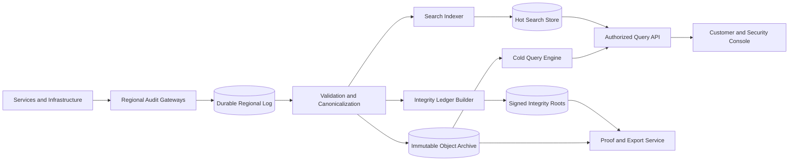

The ingestion, archive, search, and proof paths are separated. Search can be rebuilt from immutable records, and a search outage never blocks durable evidence capture.

## Producer contract

Audit events are part of the product transaction, not best-effort application logs.

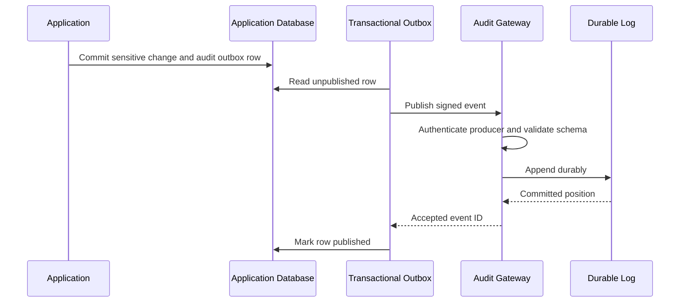

The transactional outbox ensures the application does not commit a sensitive state change while losing its audit event. Infrastructure that lacks a database uses a durable local spool or synchronous gateway call according to its risk tier.

Each producer registers allowed tenant scopes, event types, schema versions, and expected volume. A service cannot impersonate another source or emit arbitrary event families.

## Ingestion and canonicalization

Regional gateways authenticate workloads with short-lived identities, enforce quotas, validate the envelope, and append to a replicated log.

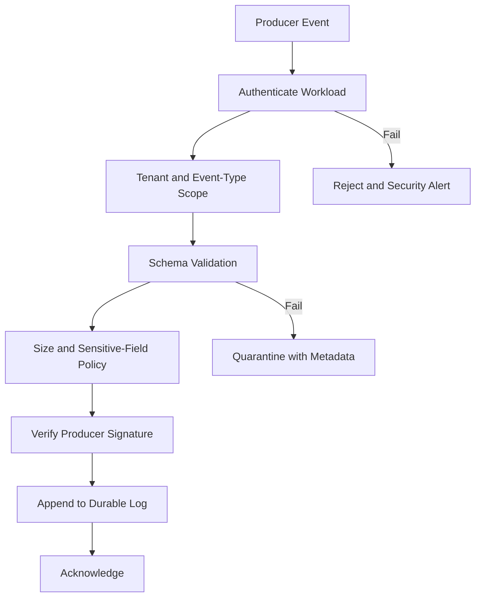

Canonicalization normalizes identifiers, IP formats, timestamps, result codes, and versioned field names. Preserve the original signed envelope alongside the canonical record so future parsers can reproduce the transformation.

Deduplicate by producer identity and event ID. A repeated event returns its original ingestion result; the platform never creates a second logical event merely because delivery retried.

## Integrity ledger

Immutable storage prevents ordinary writes, but integrity proofs make unauthorized changes detectable.

Hash each canonical record, then construct a Merkle tree over a bounded partition such as tenant, region, and hour.

```text
leaf_hash = H(canonical_event_bytes)
node_hash = H(left_child || right_child)
partition_root = H(partition_metadata || merkle_root)
```

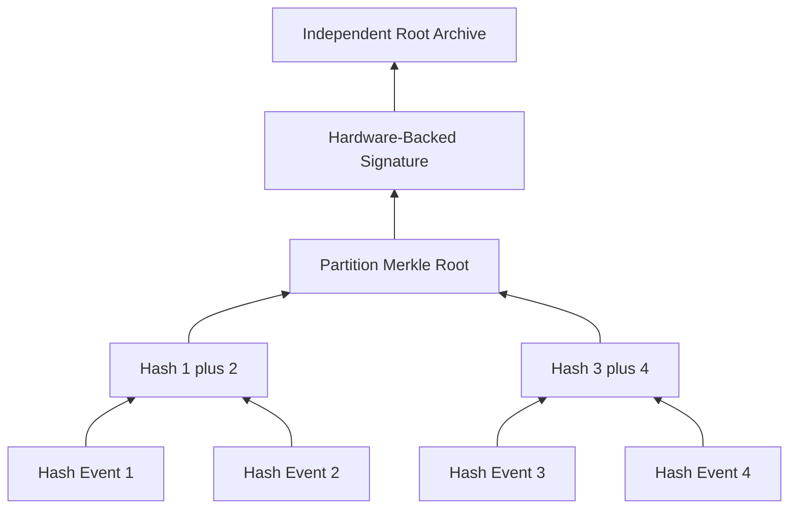

Sign roots with a hardware-protected key and publish them to a separate administrative trust domain. Optionally chain partition roots so removing an entire partition is also evident.

Merkle proofs let an auditor verify one event without receiving every other tenant event in the partition. Proofs establish inclusion and integrity, not whether the producer told the truth.

## Sequence and gap detection

Each producer stream includes a monotonic sequence number within a declared epoch.

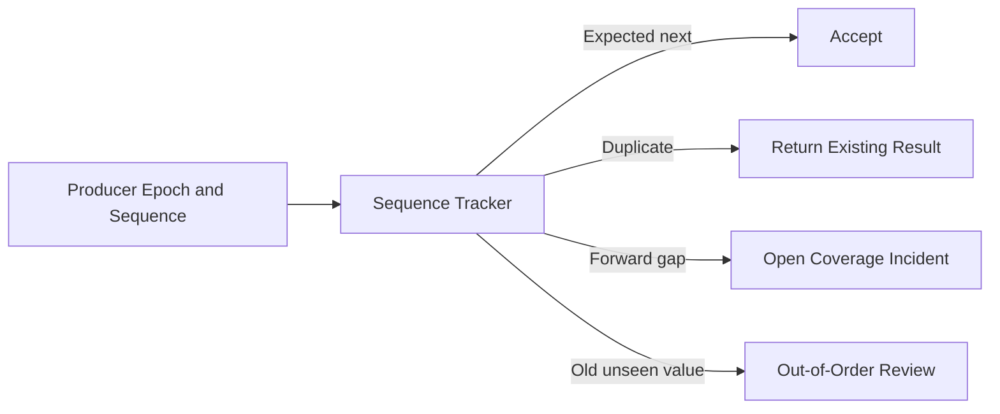

A restarted producer creates a new signed epoch rather than resetting its counter silently. The platform tolerates bounded reordering but records unresolved gaps.

Heartbeat events prove that an otherwise quiet producer is still connected. Alert on missing heartbeat, excessive outbox age, or an unexpected volume drop.

## Immutable archive

Write canonical records into encrypted columnar objects partitioned by tenant, region, event date, and shard. Seal each object with its checksum, record count, minimum and maximum timestamps, schema versions, and Merkle root reference.

Object storage uses retention locks that prevent overwrite or deletion until policy expiry. Separate credentials can write new objects, extend retention, and read objects; no routine role can shorten retention or replace sealed objects.

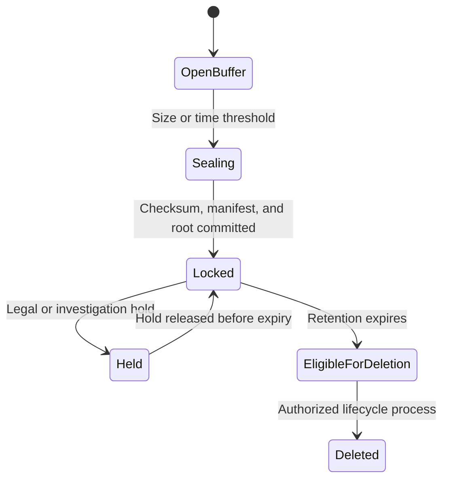

Deletion produces a signed disposition record containing object identity, policy version, expiry time, and authorization. The disposition ledger is retained longer than the data it describes.

## Search indexing

The search store contains selected fields and encrypted pointers to canonical records. It is a derived cache, never the evidence source of truth.

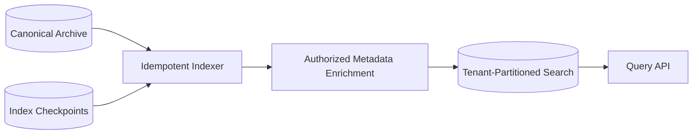

Partition by tenant and time, then route queries only to authorized shards. Index actor, action, resource, result, source, request ID, and bounded change keys. Avoid indexing arbitrary payload values that create uncontrolled cardinality or expose secrets.

Indexers checkpoint immutable archive positions. If mappings change or an index is corrupted, rebuild it from sealed objects and compare counts and checksums.

## Query API

```http
GET /v1/audit-events?from=2026-11-01T00:00:00Z&to=2026-11-06T00:00:00Z&actor.id=usr_31A&action=role.update
Authorization: Bearer <scoped-token>
```

Use cursor pagination tied to a stable sort of ingestion time and event ID. Offset pagination becomes inconsistent and expensive as new events arrive.

Query authorization considers tenant, requester role, time range, event sensitivity, region, and permitted fields. The response includes applied redactions and the data freshness watermark.

Broad or cold queries become asynchronous jobs with cost estimates and explicit expiration. Never allow an interactive search to scan a decade of global archives.

## Authorization and separation of duties

Audit records frequently contain security-sensitive data. Access to the audit system is itself audited.

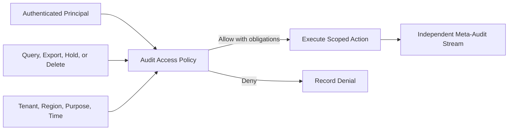

Separate roles for producers, viewers, export approvers, retention administrators, key custodians, and platform operators. A platform administrator should not automatically gain access to customer event contents.

High-risk exports require just-in-time authorization, purpose, ticket, approver, and short expiration. Break-glass access raises an independent security alert.

## Sensitive data handling

Audit events should reference resources rather than copy full customer data. Apply event schemas that prohibit secrets, credentials, payment data, and unnecessary content.

For necessary identifiers:

- Tokenize values used for exact search
- Encrypt high-sensitivity fields with separate keys
- Store coarse network location when precise IP retention is unnecessary
- Render before and after values only for approved field classes
- Apply region-specific field retention

Redaction after ingestion creates a new cryptographically linked representation while preserving the original under stricter access when policy permits. If the original must be erased, retain its hash and a signed redaction disposition so the integrity history remains explainable.

## Retention and legal holds

Resolve retention from tenant contract, event class, region, investigation status, and regulatory policy.

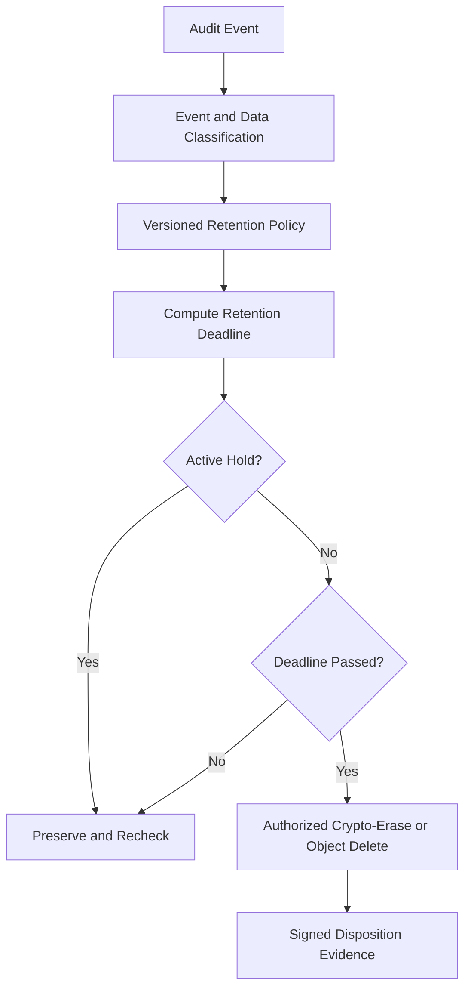

Holds are scoped to explicit tenants, actors, resources, time windows, or cases. Overbroad holds increase cost and privacy risk. Releasing a hold never deletes records before their normal retention deadline.

## Evidence exports

An evidence package contains selected canonical events, manifests, schema definitions, Merkle inclusion proofs, signed partition roots, query criteria, policy decisions, and export metadata.

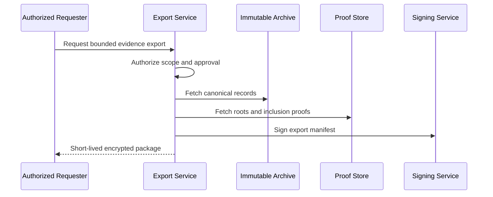

Encrypt each package with a one-time key, deliver that key through a separate authenticated channel, and expire the download quickly. A standalone verifier checks hashes and signatures without access to the production platform.

## Multi-region design

Each region ingests and archives events locally. A global catalog contains non-sensitive tenant routing, schema metadata, and signed integrity-root references.

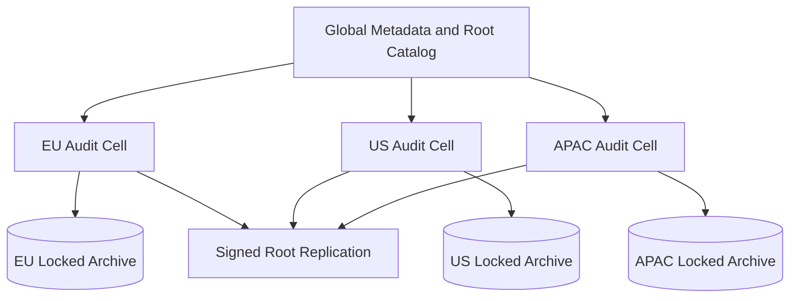

Cross-region queries fan out only to regions authorized for the requester. Search results can aggregate centrally, but canonical sensitive events remain in their home region.

During a regional isolation event, gateways continue writing to regional logs and archives. Root replication and global search catch up after connectivity returns.

## Reliability and failure handling

| Failure | Safe behavior |
| --- | --- |
| Producer sends duplicate event | Return original acknowledgement using stable event ID |
| Producer sequence has a gap | Accept later evidence but open a coverage incident |
| Regional gateway fails | Client retries another gateway in the same approved region |
| Canonicalizer rejects an event | Quarantine immutable envelope and alert producer owner |
| Search index is unavailable | Ingestion and archive continue; recent search is marked stale |
| Index is corrupted | Rebuild from immutable archive and verified checkpoints |
| Signing service is unavailable | Seal data locally but delay root finalization and exports |
| Archive write fails | Do not advance durable archive checkpoint; retry from log |
| Key is unavailable | Buffer encrypted input or fail closed; never write plaintext |
| Control plane is unavailable | Use unexpired schemas and policies; buffer administrative changes |

Every stage consumes from a durable predecessor and commits an idempotent checkpoint only after its output is durable.

## Observability and audit SLOs

Track both platform health and evidence completeness:

- Gateway acceptance, rejection, and p99 latency
- Producer sequence gaps, heartbeat age, and outbox lag
- Durable-log replication and oldest unarchived event
- Canonicalization quarantine volume by producer and schema
- Archive object count, checksum verification, and lock status
- Merkle-root finalization and independent-anchor lag
- Search indexing lag and shard health
- Query and export authorization denials
- Legal-hold coverage and retention deletion backlog
- Evidence-export verification success

Useful SLOs include 99.99% ingestion availability, 99.9% of accepted events archived and integrity-rooted within five minutes, and zero silent sequence gaps for critical producers.

Regularly run end-to-end canaries that perform a controlled action and verify its event, archive object, search result, and integrity proof.

## Threat model

Design against:

- A compromised producer attempting to forge another service's events
- A malicious tenant trying to query another tenant's records
- A privileged operator attempting to alter or delete evidence
- An attacker deleting an entire archive partition
- A replayed or reordered producer stream
- Sensitive values leaking through event attributes or exports
- A stolen signing key used to create fraudulent roots

Use workload identity, tenant-scoped authorization, append-only storage, independent root anchoring, hardware-backed signing keys, dual control, and immutable meta-auditing. Key rotation retains old public verification keys and records their validity intervals.

## Key trade-offs

| Decision | Benefit | Cost |
| --- | --- | --- |
| Transactional producer outbox | Links state change and evidence reliably | Producer implementation complexity |
| Immutable raw and canonical forms | Reproducibility across schema changes | Additional storage |
| Per-partition Merkle trees | Efficient integrity proofs | Root-building and proof metadata |
| Separate search index | Fast queries without mutating evidence | Eventual consistency and rebuild work |
| Tenant-time partitioning | Isolation and bounded scans | Cross-tenant investigation complexity |
| Long retention | Strong historical evidence | Cost and privacy exposure |
| Independent meta-audit stream | Detects abuse of the audit platform | Another protected system to operate |

## Evolution path

1. Standardize event schemas, producer identity, and transactional publication.
2. Build a durable regional log and locked immutable archive.
3. Add tenant-scoped search with strict authorization and meta-auditing.
4. Introduce sequence tracking, heartbeats, and producer coverage dashboards.
5. Build Merkle proofs, hardware-backed signatures, and independent root anchoring.
6. Add signed evidence exports, legal holds, and cold-history queries.
7. Continuously exercise insider, deletion, key-compromise, and regional-failure scenarios.

Begin with complete capture for a small set of critical actions. A sophisticated integrity ledger cannot compensate for an authorization change that was never instrumented.

## Final design

Use authenticated regional gateways to append schema-validated events to a replicated durable log, with transactional producer outboxes preventing gaps between business changes and evidence. Preserve signed producer envelopes and canonical records in retention-locked object storage. Hash records into partitioned Merkle trees, sign roots with hardware-protected keys, and anchor them in an independent trust domain. Build tenant-partitioned search as a disposable derived index, authorize every query and export, and record audit-platform access in a separate meta-audit stream. Track producer sequences and heartbeats so missing evidence becomes a visible incident rather than an assumption.

The central principle is verifiability. Audit data is valuable only when operators and customers can prove what was recorded, detect what changed or disappeared, and understand where instrumentation coverage was incomplete.
