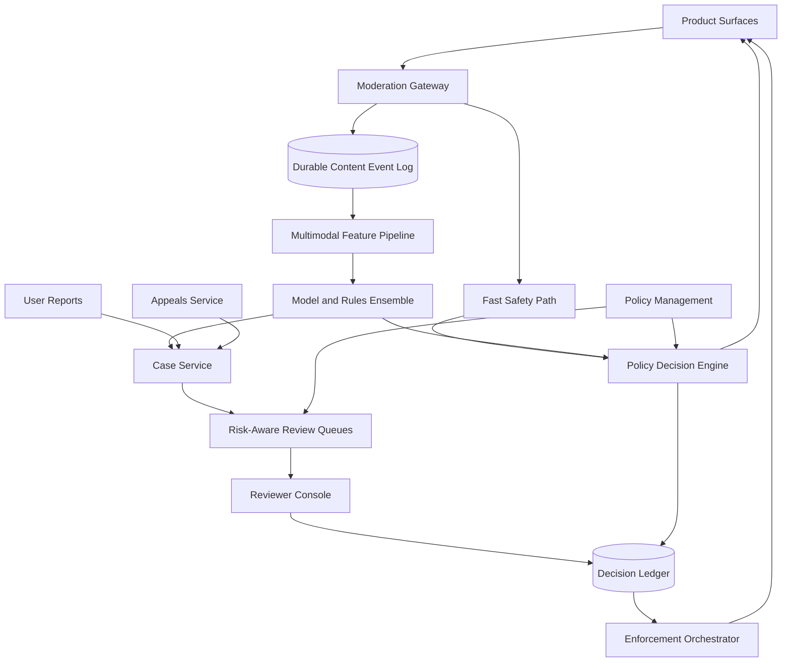
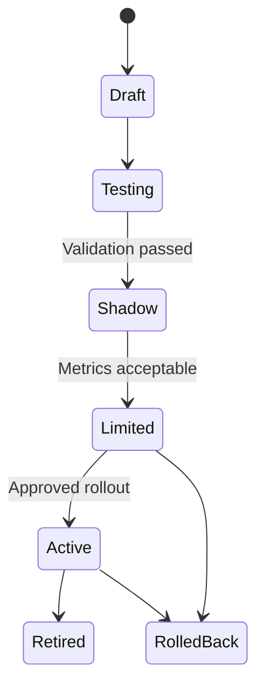
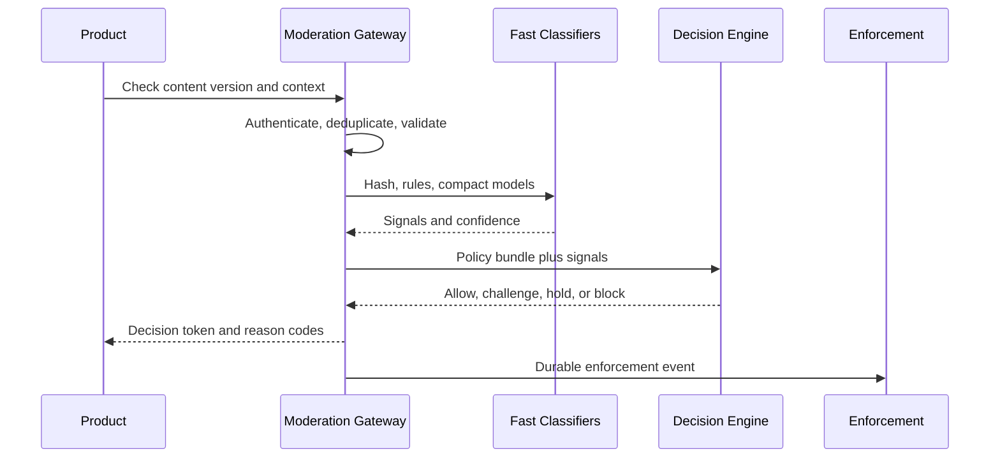
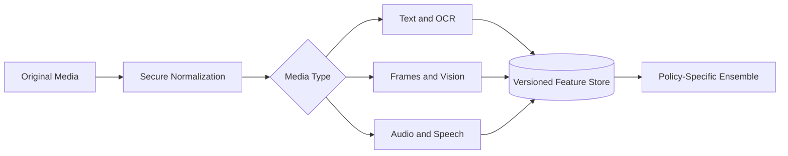
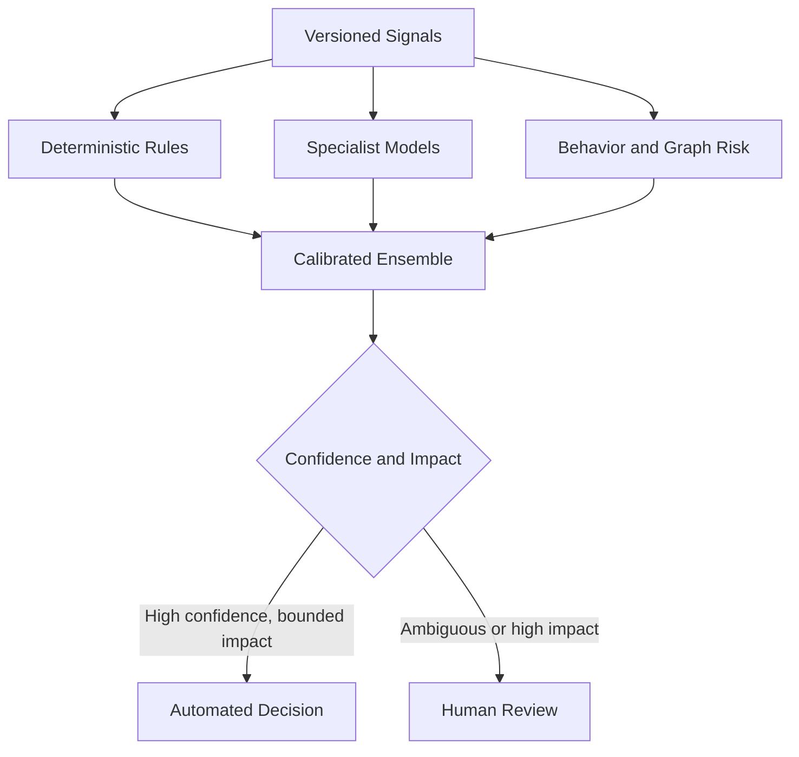
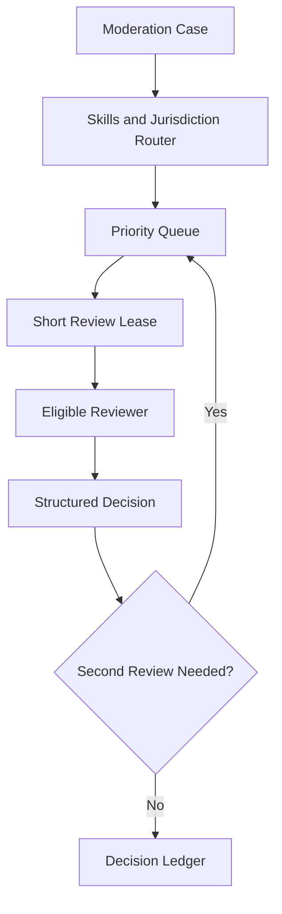
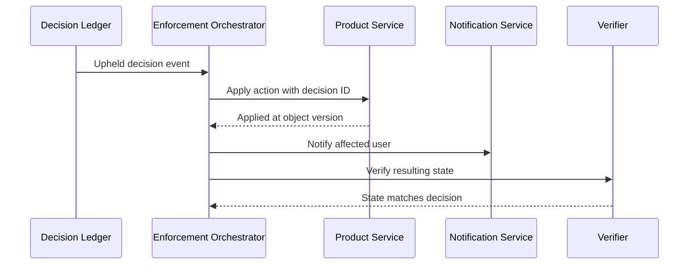
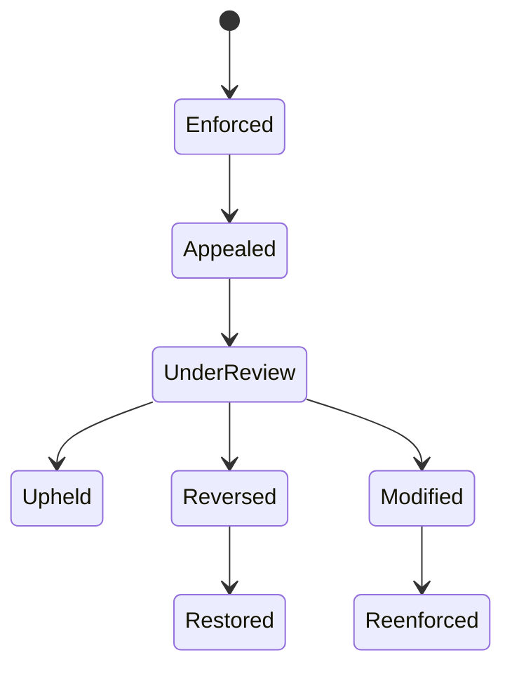

## Problem and requirements

A trust and safety platform decides whether user-generated content and behavior may be created, distributed, recommended, monetized, or retained. It must interpret changing policy across languages, regions, media types, and product surfaces while handling adversaries who deliberately try to evade detection.

The central design problem is not simply classification. A production system must combine fast automated signals, product context, human judgment, proportional enforcement, appeals, and evidence preservation. Every decision should be explainable under the policy that was active when it was made.

### Functional requirements

- Moderate text, images, audio, video, live streams, profiles, and links
- Evaluate content at upload time and continuously after publication
- Detect exact and perceptually similar known harmful material
- Combine rules, machine-learning models, behavioral signals, and user reports
- Apply surface-specific actions such as block, label, reduce distribution, or remove
- Route ambiguous and high-impact cases to trained reviewers
- Support policy versions, regional overlays, and emergency rules
- Notify users, accept appeals, and reverse incorrect enforcement
- Preserve evidence, decision lineage, and reviewer actions for audits
- Measure policy prevalence, detection quality, and enforcement consistency

### Non-functional requirements

- Handle one hundred billion content items per day and ten million decisions per second
- Return synchronous upload decisions in under 200 milliseconds at p99
- Keep live-stream intervention latency below a few seconds
- Degrade safely when models, vendors, or review queues are unavailable
- Prevent one tenant, region, or content surge from starving other workloads
- Protect sensitive content and reviewer identities
- Make decisions reproducible from immutable inputs and policy versions
- Limit exposure of disturbing material to people who need to review it

## Capacity estimates

Assume a large platform receives 100 billion new or updated objects per day. Most objects are small text or metadata records, while video dominates storage and compute.

| Resource | Estimate |
| --- | ---: |
| Average ingest rate | 1.16M items/second |
| Peak ingest rate | 5M items/second |
| Feature and policy evaluations | 10M+/second |
| Media analyzed | Hundreds of PB/day |
| User reports | 1B/day |
| Human review tasks | 100M/day |
| Active reviewers | 100K globally |

Run inexpensive checks on every item, reserve expensive models for risky items, and reuse features across policies. Video analysis should sample frames adaptively instead of processing every frame at maximum resolution.

## Core data model

```text
Content {
  contentId, actorId, tenantId, mediaType,
  objectVersion, createdAt, region, surface
}

PolicyVersion {
  policyId, version, effectiveAt, jurisdiction,
  rules, modelRequirements, actionMatrix, status
}

ModerationCase {
  caseId, contentRef, policySnapshot,
  signals, decisions, reviewState, priority
}

Decision {
  decisionId, caseId, policyClause, action,
  confidence, source, reasonCodes, decidedAt
}
```

Content is mutable, but a moderation decision points to an immutable content version, feature snapshot, model version, and policy version. This lineage makes appeals and audits reproducible.

## High-level architecture



The synchronous path makes the smallest safe decision necessary for publication. The asynchronous path performs deeper analysis, reacts to new context, and can change distribution or enforcement later.

## Policy lifecycle

Policy authors express rules in a controlled schema rather than application code. A rule includes scope, predicates, evidence requirements, confidence thresholds, applicable actions, exception handling, and escalation rules.



Before activation, replay a candidate policy against a representative historical corpus. Shadow mode records hypothetical decisions without enforcement. Limited rollout exposes unexpected regional, language, or product effects before global activation.

Policy bundles are immutable and signed. A decision records the bundle digest, not merely a policy name. Emergency rules can roll out quickly, but still require ownership, expiry, audit logging, and rollback.

## Submission and synchronous gating



The gateway accepts an idempotency key and content version. It returns a signed decision token so the product can prove which check authorized publication. If the request is retried, the same inputs return the same result.

Use four initial outcomes:

| Outcome | Product behavior |
| --- | --- |
| Allow | Publish and continue asynchronous analysis |
| Challenge | Require friction, confirmation, or an account check |
| Hold | Keep private while deeper analysis or review completes |
| Block | Reject the operation and provide an appropriate notice |

Failures should follow risk-based defaults. A low-risk comment may publish with reduced reach when a secondary model is down; a high-risk live broadcast may remain held if required safety checks are unavailable.

## Multimodal processing

Normalize each media type into reusable features:

- Text: language, script, entities, embeddings, links, and conversation context
- Images: perceptual hashes, OCR, objects, visual embeddings, and metadata
- Audio: speech transcript, acoustic events, speaker changes, and fingerprints
- Video: keyframes, scene boundaries, motion, audio, transcript, and overlays
- Links: redirects, reputation, landing-page snapshots, and domain relationships



Run parsers and decoders in isolated sandboxes because uploaded files are untrusted. Strip active content from reviewer previews and preserve the original separately under strict access control.

## Known-content matching

Exact cryptographic hashes catch byte-identical content. Perceptual hashes and embeddings identify transformed images, audio, and video. Maintain separate hash sets by legal basis and policy purpose; membership must never leak through public APIs.

Matching is multi-stage: local prefix lookup, candidate retrieval, then a stricter similarity check. This limits expensive comparisons and reduces false matches. Sensitive partner-provided hash sets stay encrypted, access logged, and available only in authorized regions.

A hash match is a signal, not universally a final decision. The policy engine considers confidence, provenance, exceptions, jurisdiction, and whether the content is documentary, educational, or otherwise contextualized.

## Model and rule ensemble

No single classifier covers every policy. The ensemble combines:

- Deterministic rules for explicit, stable conditions
- Compact models for low-latency screening
- Large specialist models for difficult media or language cases
- Behavioral models for coordinated or repeated abuse
- Graph signals connecting accounts, devices, domains, and campaigns
- External intelligence with provenance and expiry

Calibrate scores per policy, language, region, and surface. A score of 0.9 from two models is not comparable unless their calibration and evaluation populations are known.



Keep model inference separate from policy. Models produce evidence and calibrated likelihoods; policy determines what action those signals justify.

## Context and conversation analysis

Content can change meaning with surrounding messages, quoted material, audience, author relationship, or current events. Build a bounded context package containing only the information permitted for the policy and reviewer.

Context assembly must be deterministic and privacy-aware. Record which message versions were included. Avoid giving every model an unrestricted account history; request the minimum features needed and apply retention limits.

For rapidly evolving conversations, asynchronous reevaluation triggers when replies, reports, reach, or behavioral signals cross thresholds. This avoids treating the first isolated post as the final state of the case.

## Decision and action ladder

The decision engine maps evidence to the least restrictive effective action.

| Action | Typical use |
| --- | --- |
| Allow | No policy violation or an applicable exception |
| Add context | Helpful warning, provenance, or information panel |
| Apply friction | Confirmation, sharing limits, or age gate |
| Reduce distribution | Content may remain but should not be recommended broadly |
| Disable feature | Remove monetization, messaging, or live capability |
| Remove content | A content-level violation is established |
| Restrict account | Repeated or severe actor-level violations |
| Preserve and escalate | A specialized legal or safety workflow is required |

Separate content decisions from account penalties. An account penalty should use a versioned policy over prior upheld decisions, severity, recency, and exceptions—not an opaque sum that cannot be explained.

## Human review queues

The case service converts uncertain or high-impact decisions into review tasks. Queue priority considers expected harm, reach velocity, confidence uncertainty, legal deadlines, appeal age, and user impact.



Assignments enforce language, policy certification, jurisdiction, conflict-of-interest, and wellness constraints. Leases expire so abandoned work returns to the queue. Randomized quality-control tasks and blinded second reviews measure consistency without exposing reviewers to unnecessary repetition.

The console presents policy-relevant context, highlighted evidence, prior decisions when appropriate, and structured reason codes. It should minimize graphic exposure with blur, audio muting, frame sampling, and explicit reveal controls. Reviewer access is least-privilege and resistant to bulk extraction.

## Reports and prioritization

User reports are valuable but adversarial. Deduplicate reports by content and policy, weight reporter reliability carefully, and detect coordinated reporting campaigns without silencing new reporters.

A report updates an existing case rather than creating an independent decision universe. Reporters receive status appropriate to privacy constraints, while the reported user receives the policy basis for enforcement when disclosure is safe.

Virality is a risk multiplier. Reach velocity, recommendation exposure, and reshare branching can raise review priority or temporarily limit distribution while a case is resolved. Such containment must expire automatically if no decision arrives.

## Enforcement orchestration

Enforcement touches many product systems and must survive partial failure.



Each target service accepts the decision ID and desired object version idempotently. The orchestrator records per-target progress and retries incomplete steps. A newer decision supersedes an older one through explicit ordering, preventing a delayed removal from overriding a successful appeal.

## Appeals and correction

An appeal creates a linked case with the original evidence, decision lineage, user statement, and any new context. Route it away from the original reviewer when possible and prioritize severe or time-sensitive penalties.



Reversal is a first-class workflow: restore content when allowed, remove account strikes, restore distribution eligibility, correct aggregate metrics, and notify dependent systems. Preserve the original decision rather than rewriting history.

Appeal outcomes feed evaluation datasets only after quality controls. Blindly training on every reviewer decision would reproduce inconsistency and policy mistakes.

## Audit and evidence

Store decisions in an append-only ledger containing:

- Immutable content and context references
- Policy bundle and clause identifiers
- Model, rule, hash-set, and feature versions
- Automated scores and structured reason codes
- Reviewer assignments and actions
- Enforcement acknowledgements
- Appeal and reversal relationships

Encrypt evidence with per-tenant or per-region keys. Use retention schedules by evidence type and legal basis. Deletion workflows should remove content when required while retaining only the minimal non-content audit record permitted by policy and law.

## Adversarial resilience

Attackers probe thresholds, mutate media, flood reports, compromise accounts, and target reviewers. Defenses include rate limits, feature randomization where appropriate, ensemble diversity, canary rules, model-drift monitoring, trusted uploader tiers, and rapid revocation of compromised credentials.

Do not expose raw confidence scores or detection details in user-facing messages. Provide meaningful policy explanations without revealing a recipe for evasion. Separate public reason codes from internal evidence.

All changes to policy, thresholds, hash sets, reviewer permissions, and enforcement overrides require authenticated ownership and tamper-evident logs. High-risk changes use dual approval and short-lived credentials.

## Regionalization and tenant isolation

Keep raw content, reviewer access, and restricted hash data in authorized regions. A global control plane distributes signed policy and model metadata, while regional data planes perform inference, review, and enforcement.

Enterprise tenants may define narrower policies but cannot weaken platform-wide safety requirements. Namespace every case, feature, and decision by tenant. Encrypt tenant data independently and prevent shared caches from revealing whether another tenant has submitted matching content.

## Reliability and degradation

| Failure | Safe behavior |
| --- | --- |
| Compact classifier unavailable | Use cached model or hold high-risk submissions |
| Deep analysis delayed | Apply the synchronous result and cap risky distribution |
| Review queue overloaded | Prioritize imminent harm and high-reach content |
| Policy service unavailable | Use the last verified, unexpired policy bundle |
| Enforcement target unavailable | Persist intent and retry with idempotency |
| Feature store unavailable | Recompute essential signals or avoid irreversible action |
| Region unavailable | Fail over only where residency and policy permit |

Backpressure should reduce expensive enrichment before it drops core safety checks. Maintain reserved capacity for appeals, imminent-risk escalation, and emergency policy evaluation.

## Observability and quality

Operational latency alone does not show whether moderation works. Track:

- Violating-content prevalence and exposure, not just removal count
- Precision, recall, calibration, and time to action by policy and language
- Appeal rate, reversal rate, and restoration latency
- Reviewer agreement, queue age, and workload health
- Enforcement completion and stale-decision rates
- Disparate error rates across supported populations and surfaces
- Model and policy drift after launches or major events

Suggested service objectives include p99 synchronous decisions below 200 milliseconds, 99.99% gateway availability, 99.9% of enforcement actions started within one minute, and urgent appeals resolved within their policy deadline.

Use privacy-safe, stratified samples for quality measurement. Removal rate is an unsafe optimization target: a system can raise it by over-enforcing while making the platform worse.

## Key tradeoffs

### Automation versus human judgment

Automation supplies scale and speed; reviewers supply context and accountability. Route based on uncertainty and consequence rather than treating either as universally superior.

### Immediate blocking versus post-publication review

Pre-publication holds reduce exposure but add latency and suppress legitimate expression. Reserve them for high-risk policies and use rapid asynchronous review elsewhere.

### One global policy versus regional variation

A shared policy core improves consistency. Regional overlays handle law, language, and culture, but increase testing and audit complexity. Make precedence explicit.

### Rich context versus privacy

More context can improve accuracy but expands access to sensitive data. Assemble bounded, policy-specific context and measure whether each added feature materially improves decisions.

## Evolution path

1. Start with a moderation gateway, rules, a small classifier set, review queues, and idempotent enforcement.
2. Add immutable policy bundles, decision lineage, appeals, and quality sampling.
3. Introduce multimodal features, perceptual matching, and risk-based routing.
4. Add behavioral graphs, virality-aware containment, and regional review planes.
5. Optimize with calibrated ensembles, active learning, automated policy replay, and capacity isolation.

## Final design

The platform uses a low-latency gateway for immediate safety decisions and a durable event pipeline for deeper multimodal analysis. Versioned models produce signals; an independently versioned policy engine turns those signals into proportional actions. Uncertain and consequential cases flow through skill-aware human review, while an idempotent orchestrator applies decisions across product services.

Immutable lineage connects every action to the exact content, context, signals, policy, and reviewer decision that produced it. Appeals can reverse enforcement cleanly, and quality metrics measure real-world prevalence and error rather than raw activity. The result is a moderation system that can move quickly at internet scale without giving up consistency, privacy, resilience, or accountability.
