## Problem and requirements

A two-sided marketplace lets independent sellers list goods or services and lets buyers discover, purchase, receive, and review them. The platform coordinates catalog quality, price negotiation, inventory, payments, fulfillment, payouts, trust, disputes, and policy enforcement.

The difficult part is that the platform does not control either side. Listings can be inaccurate, inventory may exist in only one unit, buyers and sellers may behave fraudulently, payment can succeed while fulfillment fails, and marketplace policy varies by item category and region.

### Functional requirements

- Onboard and verify buyers and sellers
- Create, review, publish, pause, and remove listings
- Upload images and structured listing attributes
- Search, browse, filter, rank, and recommend listings
- Save favorites and follow sellers or searches
- Support offers, counteroffers, and price acceptance
- Reserve scarce inventory during checkout
- Authorize payment and create an order exactly once
- Coordinate shipping, delivery, pickup, or service fulfillment
- Calculate fees, taxes, refunds, and seller payouts
- Support cancellations, returns, disputes, and appeals
- Collect trusted reviews after completed transactions
- Detect fraud, prohibited content, and policy abuse

### Non-functional requirements

- Store one billion active and historical listings
- Support 500 million users and ten million orders per day
- Return common search results within 300 milliseconds at p99
- Prevent overselling unique or quantity-limited inventory
- Keep checkout idempotent across retries and provider timeouts
- Isolate users, sellers, regions, and financial records
- Preserve complete order and money movement history
- Degrade discovery without compromising transaction correctness

## Capacity estimates

Assume one billion listings, ten images per listing, one hundred million daily active users, and ten million daily orders.

| Resource | Estimate |
| --- | ---: |
| Listings | 1B active and historical |
| Listing images | 10B objects |
| Search queries | Millions/second at peak |
| Inventory reservations | Hundreds of thousands/second |
| Orders | 10M/day |
| Payment and ledger entries | Hundreds of millions/day |
| Messages and offers | Billions/day |

Discovery is read-heavy and eventually consistent. Inventory, orders, payments, and payouts require stronger correctness guarantees.

## Core data model

```text
Listing {
  listingId, sellerId, categoryId, title,
  attributes, price, currency, quantity,
  state, policyVersion, version
}

Offer {
  offerId, listingId, buyerId, amount,
  state, expiresAt, version
}

Order {
  orderId, buyerId, sellerId, listingId,
  quantity, amount, state, fulfillment,
  reservationId, paymentIntentId, version
}

LedgerEntry {
  entryId, accountId, orderId,
  amount, currency, type, effectiveAt
}
```

Listings describe seller intent; orders freeze the purchased title, price, attributes, policy, and item snapshot. Editing a listing after sale must not rewrite the order contract.

## High-level architecture

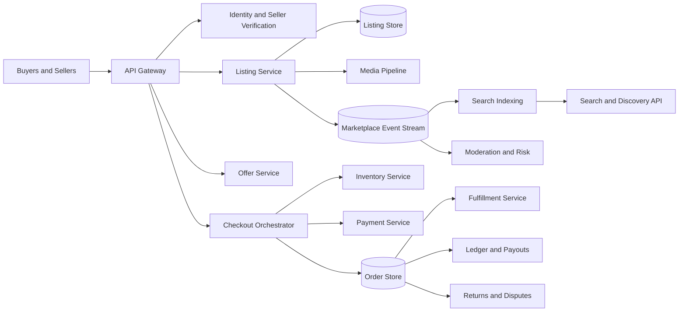

Search and recommendations consume marketplace events asynchronously. Checkout uses authoritative listing, inventory, risk, payment, and policy services directly.

## Seller onboarding

Seller onboarding collects account identity, contact verification, payout destination, tax information, region, business type, and category-specific licenses.

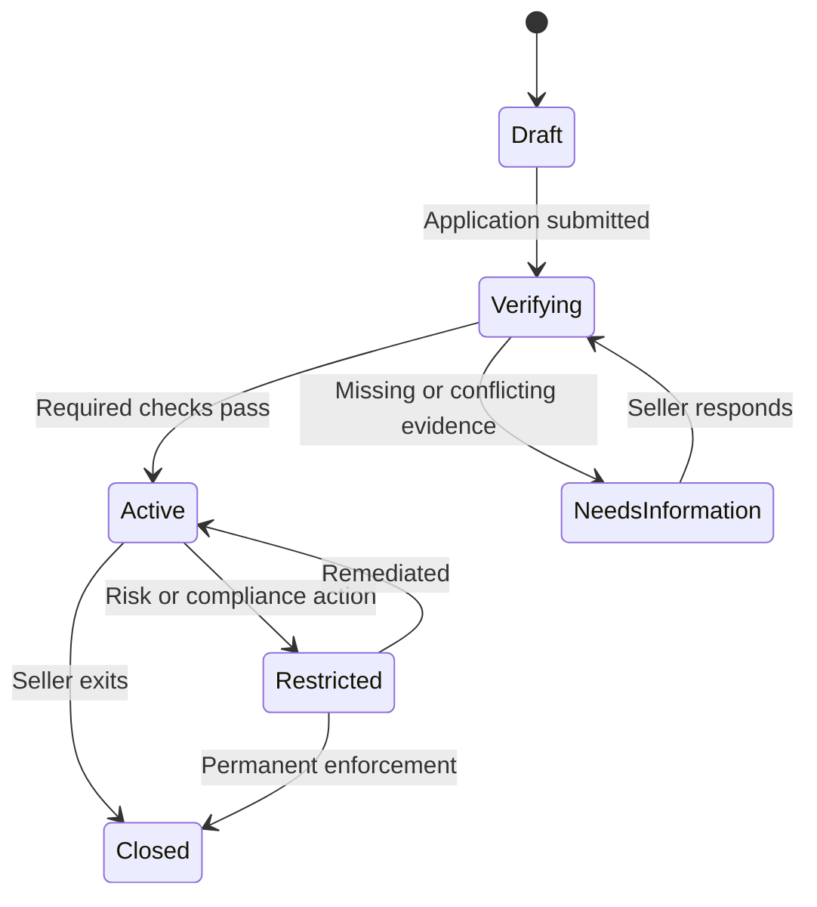

Verification results are versioned and time bounded. A seller can be permitted for one category or payout level while restricted from another.

Do not expose raw identity documents broadly. Store them in a dedicated encrypted vault and provide downstream services only approved verification claims.

## Listing lifecycle

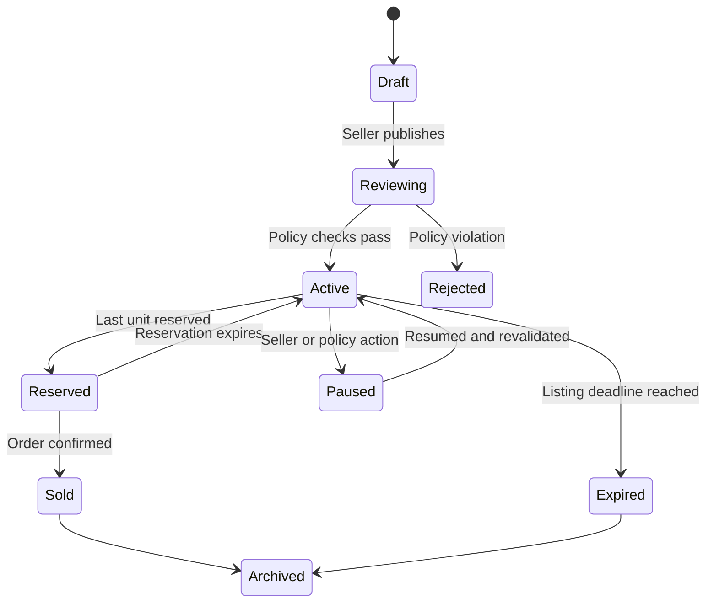

Quantity listings remain active while sellable quantity is positive. Unique-item listings leave discovery when reserved, reducing the chance of a buyer reaching an unavailable checkout.

Every transition records actor, reason, policy result, and listing version.

## Listing creation

Listing schemas vary by category. Electronics need model and condition; vehicles need mileage and title information; services need location, duration, and availability.

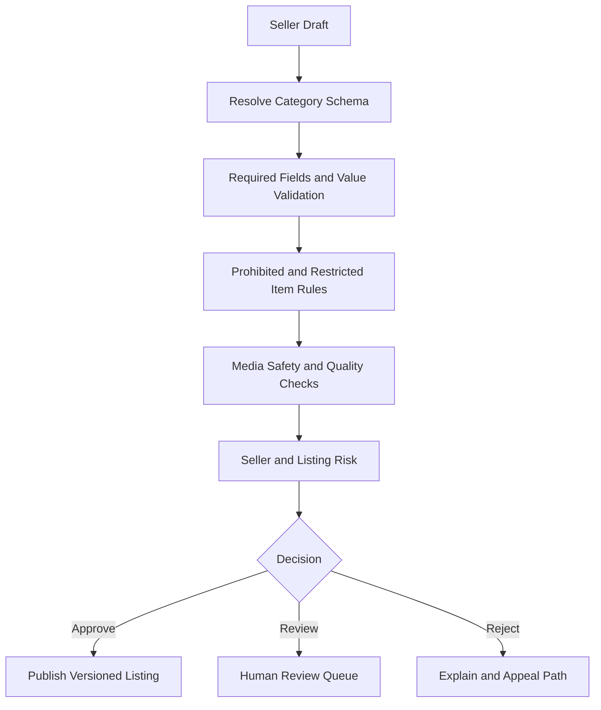

Category schemas and policy versions are stored with each listing. Editing a material field such as item identity or category can require renewed review.

## Media pipeline

Clients upload directly to quarantine storage using short-lived scoped URLs.

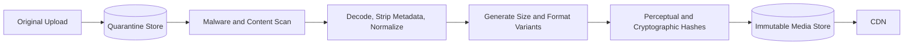

Re-encode images to remove hidden payloads and sensitive metadata. Use perceptual hashes to detect duplicate scams and previously prohibited content.

Listings reference immutable media versions. Removing unsafe media invalidates CDN access immediately while preserving restricted evidence for authorized review.

## Search indexing

Listing events update a denormalized search document containing searchable text, normalized attributes, price, location, availability, seller quality, policy status, and freshness.

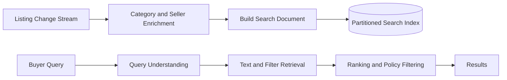

Partition by marketplace and broad category or region, then route queries only to relevant shards. Indexers are idempotent by listing version; delayed old events cannot overwrite newer documents.

Search is eventually consistent. Checkout always revalidates the authoritative listing and inventory.

## Ranking

Ranking combines relevance, price, item quality, distance, freshness, seller reliability, delivery promise, buyer preference, and marketplace policy.

Separate eligibility from ranking. Prohibited, unavailable, region-blocked, or incompatible listings should be filtered before scoring rather than merely ranked lower.

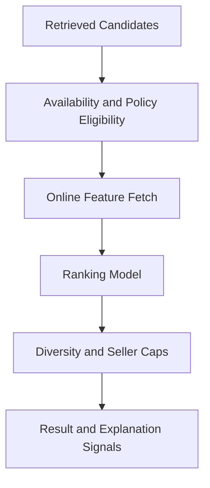

Cap repeated listings from one seller and diversify attributes so the first page remains useful. Paid promotion is clearly labeled and passes the same safety eligibility rules.

## Favorites and saved searches

Favorites are idempotent edges between buyer and listing. Saved searches store normalized query structure, filters, region, notification policy, and last-evaluated watermark.

New and changed listings flow through a reverse matcher that finds eligible saved searches. Notifications are deduplicated by search, listing, and material listing version.

Never notify on a listing that is already unavailable or fails current policy. Revalidate before delivery.

## Offers and negotiation

An offer is a versioned state machine with a fixed expiry.

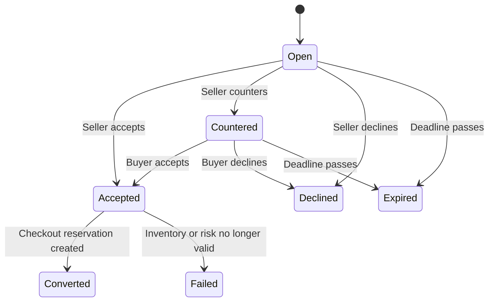

Acceptance is conditional on current inventory and listing state. For unique items, accepting an offer can create a short exclusive reservation; otherwise several accepted offers could race to purchase one item.

Every counteroffer creates a new immutable version. Notifications use the offer version to suppress stale messages.

## Inventory model

Inventory tracks on-hand, reserved, sold, and unavailable quantities.

```text
available = on_hand - reserved - sold - unavailable
```

Use one strongly consistent inventory partition per listing or stock-keeping unit.

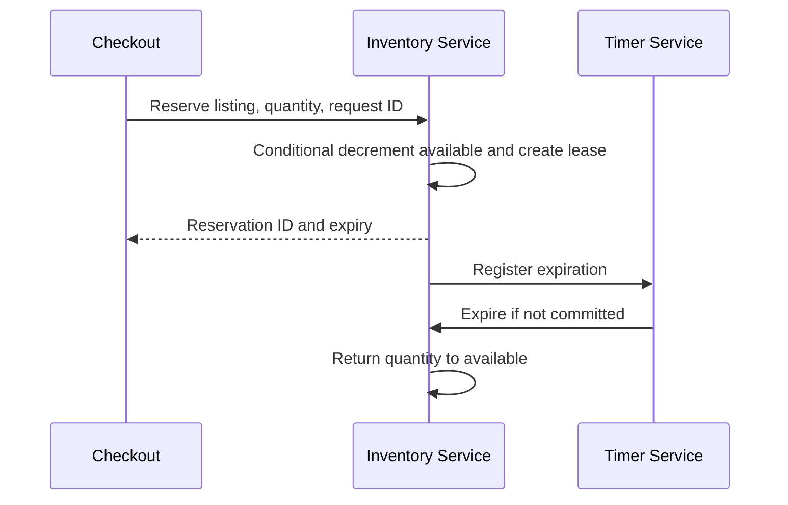

Reservation, commit, and release are idempotent. A reservation can transition to sold only once.

For externally managed inventory, use short freshness windows and accept that final availability may fail at checkout. Do not present eventual feeds as a guarantee.

## Checkout saga

Checkout spans inventory, pricing, risk, tax, payment, order creation, and messaging.

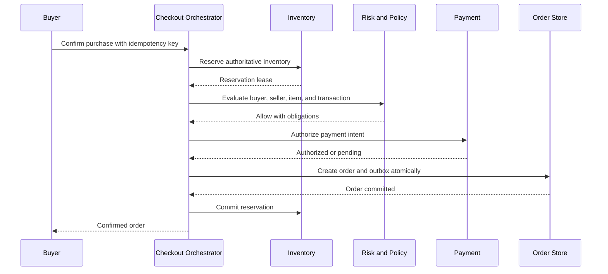

The checkout idempotency key maps to one durable saga. Retrying returns its current state rather than creating another order or payment.

If payment authorizes but order commit fails, the saga retries order creation or voids the authorization. Compensation is recorded, never inferred from a missing response.

## Pricing snapshot

At checkout, compute and freeze:

- Item price or accepted offer
- Quantity
- Shipping or service fee
- Marketplace fee
- Taxes and duties
- Discounts and credits
- Buyer total
- Seller net proceeds

Store input versions, policy versions, currency, and rounding rules. The sum of ledger components must reconcile exactly with the buyer charge and seller payable.

## Order lifecycle

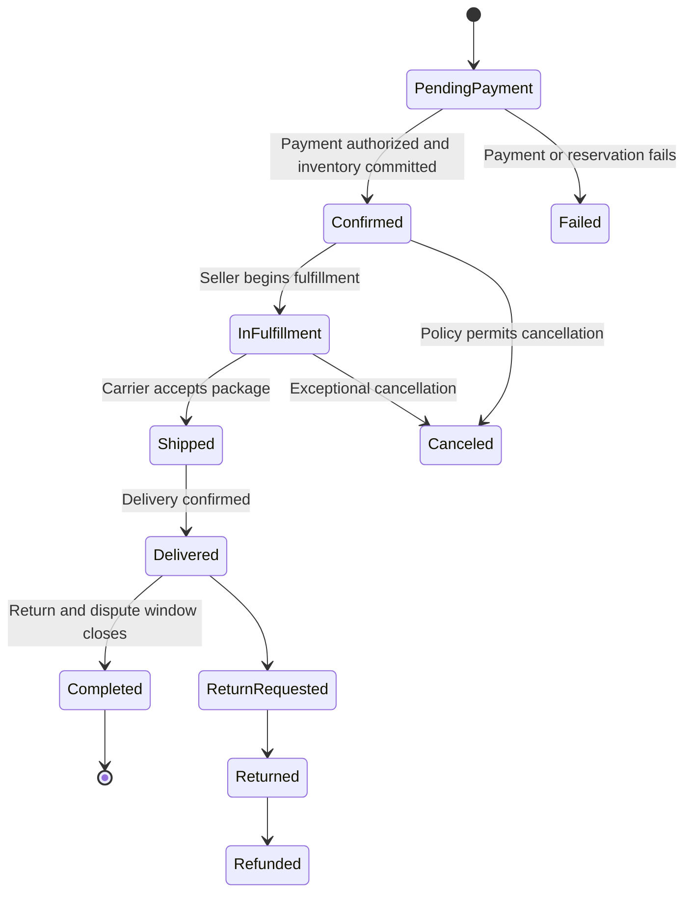

State transitions use optimistic concurrency and domain-specific commands. A raw `setStatus` API would allow invalid jumps and hide required side effects.

## Fulfillment

Fulfillment differs by category:

- Shipped goods use labels, carrier tracking, delivery confirmation, and returns
- Local pickup uses time-bound handoff codes or mutual confirmation
- Digital goods use controlled delivery and access revocation
- Services use scheduling, check-in, completion, and cancellation policy

Carrier and provider events are untrusted asynchronous inputs. Deduplicate provider event IDs and prevent older tracking states from overwriting newer ones.

Store the raw provider event and the normalized fulfillment transition for investigation.

## Money movement and ledger

Use an immutable double-entry ledger for buyer charges, fees, taxes, seller payables, refunds, reserves, and payouts.

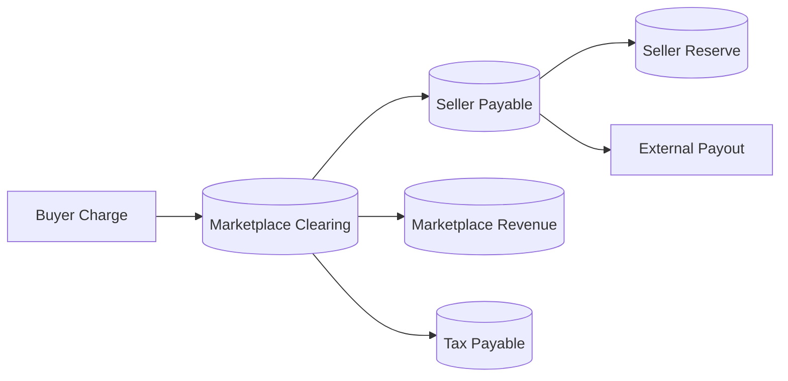

Every business operation has a stable reference ID and balanced entries. Never update balances directly.

Keep funds unavailable to the seller until fulfillment and risk policies allow release. Reserve or delay payouts for high-risk transactions while showing clear reasons and expected timing.

## Seller payouts

The payout service groups eligible ledger entries by seller, currency, region, schedule, and payout destination.

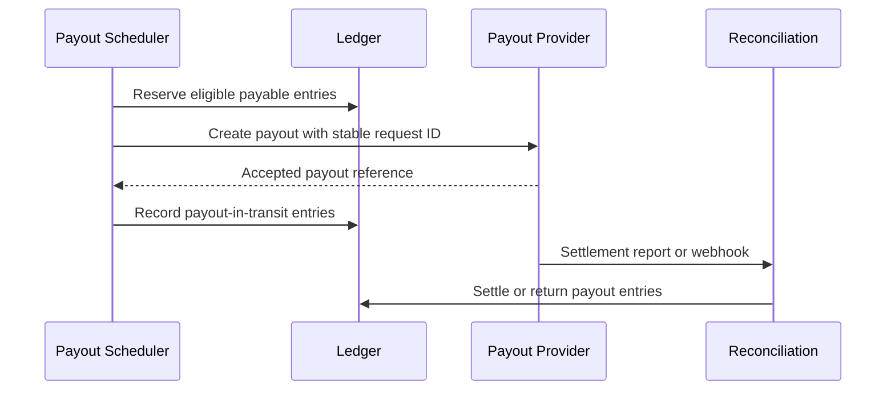

Provider timeouts create unknown outcomes. Reconcile by provider request ID before retrying to avoid duplicate payouts.

## Cancellations and refunds

Cancellation policy depends on order state, category, seller action, and fulfillment status. Evaluate a versioned policy and produce an explicit financial plan.

A refund is a new ledger transaction referencing the original charge; it does not erase the sale. Partial refunds allocate fees and taxes using documented rules.

Inventory returns only when the physical or digital item is truly sellable again. A payment refund alone must not automatically increment stock.

## Returns and disputes

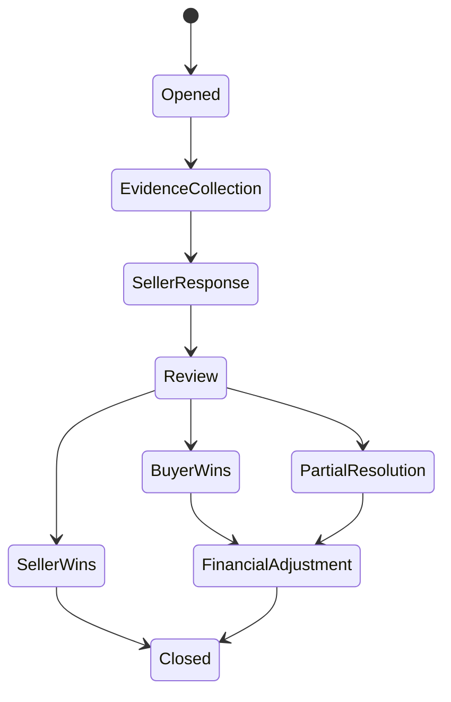

Evidence is append-only, access controlled, and scanned for unsafe content. Deadlines use the case's versioned policy and business calendar.

Automated resolution can handle deterministic cases, such as a carrier-confirmed loss under a threshold. Ambiguous cases go to trained reviewers with conflict-of-interest controls.

Financial adjustments use idempotent dispute IDs and balanced ledger entries. A case reopening creates a new decision version.

## Messaging

Buyer-seller messaging is scoped to a listing, offer, or order. Hide direct contact details where platform policy requires on-platform communication.

Messages are durably stored before delivery, scanned for scams, phishing, prohibited content, and attempts to move payment off-platform. Automated moderation can warn, mask, delay, or escalate according to confidence and severity.

Preserve original restricted content for authorized investigations while showing a redacted version to ordinary users.

## Reviews and reputation

Only parties to an eligible completed transaction can review. A review key combines order, reviewer, reviewee, and review type, preventing duplicate submissions.

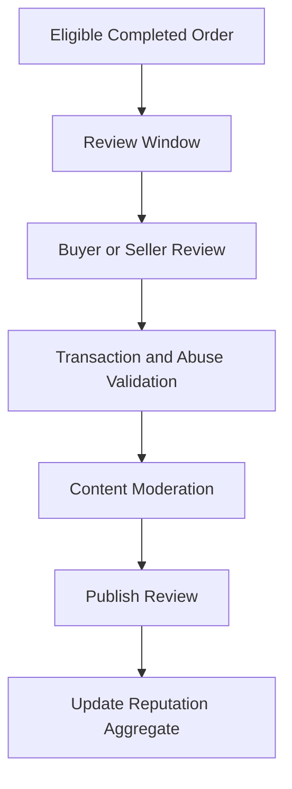

Reputation aggregates weigh recency, transaction validity, category, and confidence. Never let one removed review rewrite historical aggregate displays without a versioned recomputation.

Detect reciprocal review rings, account farms, extortion, and sudden distribution shifts. Appeals preserve the original review and moderation evidence.

## Trust and safety

Evaluate risk across seller, buyer, listing, device, payment, message, order, fulfillment, and network relationships.

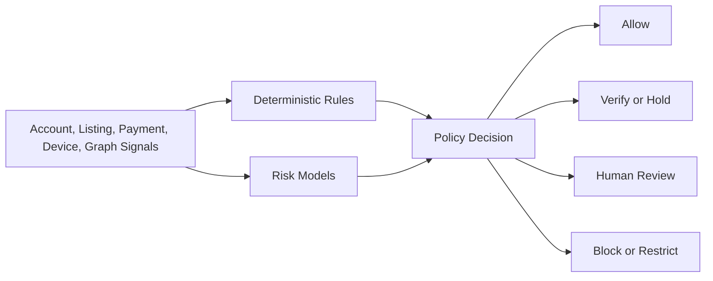

Actions should be proportional and explainable: require verification, limit quantity, delay payout, hide listing, restrict messaging, or suspend an account.

Keep safety eligibility in the synchronous transaction path, but perform deeper relationship analysis asynchronously. High-confidence new intelligence can freeze fulfillment or payout through an audited workflow.

## Moderation

Moderation combines category rules, prohibited-item classifiers, text and image analysis, seller history, jurisdiction, and human review.

Policy versions define what was evaluated when a listing was published. A policy change can trigger targeted re-review using indexed category and attribute data.

Do not use a single global threshold for every harm. Counterfeit risk, weapons, medical claims, and ordinary quality violations require different signals, reviewers, and appeals.

## Notifications

Marketplace events feed a notification service for offers, messages, price changes, sales, shipping, delivery, disputes, and payouts.

Use one notification intent ID per event, recipient, template version, and channel. Preferences and legally required transactional notices are evaluated separately.

Before sending delayed notifications, recheck current state. An “item available” message should not send after the item sells.

## Analytics and marketplace health

Stream immutable events into operational aggregates and a historical warehouse.

Track supply, demand, search conversion, listing quality, sell-through, time to sale, cancellation, return, dispute, fraud loss, payout delay, and seller concentration.

Preserve event-time semantics and policy versions. Restatements from late fraud decisions or refunds should update financial metrics without changing the original order history.

## Multi-region design

Listings and discovery can replicate broadly, while account identity, orders, financial ledgers, and disputes remain in approved home regions.

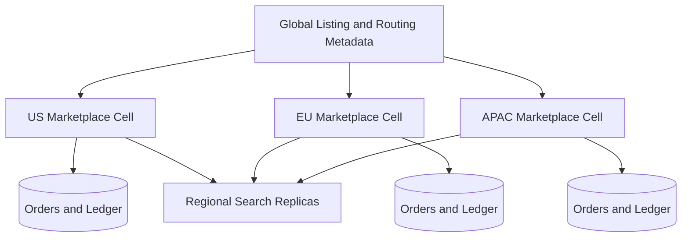

Assign each listing one authoritative inventory region. Cross-region buyers route checkout to that authority so two regions cannot sell the last unit independently.

Regional failure may reduce discovery freshness, but confirmed inventory and money movement fail closed or use a fenced promoted replica.

## Privacy and security

- Authenticate users and bind every request to an account and region
- Separate public seller profiles from private verification data
- Encrypt identity, messages, orders, attachments, and financial records
- Tokenize payment instruments and payout destinations
- Limit address visibility to the fulfillment stage and authorized parties
- Audit listing changes, moderation, refunds, payouts, and support access
- Use short-lived signed media and attachment URLs
- Rate-limit account enumeration, scraping, messaging, and offer spam
- Apply deletion and retention across source and derived stores
- Require stronger approval for manual money movement

Marketplace operators should not see raw payment credentials, full identity documents, or unrestricted customer conversations by default.

## Reliability and failure handling

| Failure | Safe behavior |
| --- | --- |
| Listing event is delivered twice | Search index applies only the newest listing version |
| Search is unavailable | Direct listing and order access continue; checkout uses source data |
| Reservation request retries | Inventory returns the original lease by request ID |
| Payment times out | Reconcile the payment intent before retrying |
| Order creation retries | Checkout saga returns the same order |
| Carrier event arrives late | Fulfillment version prevents state regression |
| Payout provider is ambiguous | Hold and reconcile; never create a second payout blindly |
| Moderation model is unavailable | Use rules and risk-tiered fail behavior |
| Region fails | Fence old authority and promote an approved replica |

Every cross-service workflow persists its current step and side-effect identifiers before making progress.

## Observability and SLOs

Track:

- Listing publication, review, rejection, and search-index lag
- Search latency, empty-result rate, and ranking feature freshness
- Inventory availability, reservation conflicts, and expiry lag
- Checkout conversion, saga age, payment unknown outcomes, and duplicate suppression
- Order transition failures and fulfillment event lag
- Ledger imbalance checks, payout age, and reconciliation differences
- Return and dispute age by policy deadline
- Fraud loss, moderation precision proxies, and appeal reversals
- Message delivery, scam detection, and rate-limit events
- Regional replication and authoritative ownership epochs

Useful SLOs include 99.99% checkout-saga availability, zero confirmed oversells for unique listings, and all balanced ledger batches verified before seller funds become payable.

## Key trade-offs

| Decision | Benefit | Cost |
| --- | --- | --- |
| Eventual search indexing | Fast scalable discovery | Briefly stale availability |
| Strong inventory authority | Prevents overselling | Cross-region checkout latency |
| Reservation before payment | Protects scarce stock | Temporary inventory unavailability |
| Immutable financial ledger | Auditable money movement | Reversals instead of simple updates |
| Delayed seller payouts | Reduces fraud and return loss | Seller cash-flow friction |
| Human review for ambiguity | Better high-impact decisions | Cost and slower resolution |
| Frozen order snapshots | Stable transaction contract | Duplicated listing data |

## Evolution path

1. Build seller onboarding, fixed-price listings, search, and one-unit checkout.
2. Add quantity inventory, shipping, ledger-based fees, and payouts.
3. Introduce offers, messaging, reviews, returns, and disputes.
4. Add risk scoring, moderation workflows, and payout reserves.
5. Deploy regional marketplace cells and authoritative inventory routing.
6. Add advanced ranking, saved-search matching, and category-specific fulfillment.

Start with correct inventory and money movement. A marketplace can improve discovery gradually, but overselling scarce items or paying the wrong seller destroys trust quickly.

## Final design

Store authoritative versioned listings and publish their changes into eventually consistent search and recommendation indexes. Keep inventory behind a strongly consistent per-listing authority, then coordinate reservation, policy checks, payment authorization, order creation, and inventory commit through an idempotent checkout saga. Freeze listing, price, fee, tax, and policy snapshots into each order. Represent every charge, fee, refund, reserve, and payout in a balanced immutable ledger, and move orders through explicit fulfillment, return, and dispute state machines.

The central principle is to separate discovery from commitment. Search may be approximate and slightly stale, but the moment a buyer commits, inventory, policy, payment, order state, and seller proceeds must become explicit, versioned, and recoverable from every partial failure.
