## Problem and requirements

A vector database stores high-dimensional numeric embeddings and retrieves the items most similar to a query vector. It powers semantic search, recommendations, retrieval-augmented generation, image matching, anomaly detection, and duplicate discovery.

The naive solution compares a query with every stored vector. At billions of items, exact search is too expensive. The system must trade a controlled amount of recall for much lower latency while still supporting metadata filters, frequent updates, tenant isolation, and durable storage.

### Functional requirements

- Create collections with vector and metadata schemas
- Insert, update, fetch, and delete vectors
- Find the top-k nearest vectors using a selected distance metric
- Combine vector similarity with metadata filters
- Support namespaces and tenant isolation
- Build, rebuild, and tune indexes online
- Return stable pagination or continuation where meaningful
- Expose index quality, freshness, and resource usage
- Back up and restore collections

### Non-functional requirements

- Store 100 billion vectors
- Serve one million searches per second
- Return common top-k queries within 50 milliseconds at the 99th percentile
- Achieve a documented recall target such as 95% at k=10
- Make acknowledged writes durable
- Keep newly written vectors searchable within seconds
- Continue reads through node and zone failures
- Bound noisy-neighbor effects and query cost

Vector search is probabilistic infrastructure. APIs must expose the index and consistency contract rather than imply that approximate results are exact or globally stable.

## Capacity estimates

Assume 100 billion vectors, 768 dimensions, and 32-bit floating-point storage before compression.

```text
raw vector bytes = 100B × 768 × 4 ≈ 307 TB
```

Replicas, metadata, graph edges, quantization tables, write logs, and temporary compaction increase that footprint.

| Resource | Estimate |
| --- | ---: |
| Stored vectors | 100B |
| Peak queries | 1M/second |
| Peak writes | 5M vectors/second during ingestion |
| Raw vector payload | 307 TB |
| Indexed footprint | Hundreds of TB to PB |
| Typical top-k | 10–100 results |

Keeping every full-precision vector and graph in memory is expensive. The design uses memory for routing and hot index structures while placing compressed vectors and colder segments on local SSD or object storage.

## Data model

A collection defines:

- Vector dimension and numeric type
- Distance function
- Primary key type
- Metadata schema and indexed fields
- Consistency and durability policy
- Partition and replication settings
- Index type and tuning parameters

Each record contains a stable ID, vector, metadata, version, creation time, and optional expiration.

```json
{
  "id": "doc_1842",
  "vector": [0.014, -0.082, 0.117],
  "metadata": {
    "language": "en",
    "category": "engineering",
    "publishedAt": "2026-10-13T14:00:00Z"
  }
}
```

The real vector would contain every declared dimension. Metadata is typed; arbitrary unbounded objects do not automatically become indexed.

## Distance metrics

Common metrics include:

- **Cosine similarity:** compares direction and usually uses normalized vectors
- **Dot product:** useful when vector magnitude carries meaning
- **Euclidean distance:** measures geometric distance

The metric is immutable for an index because it affects preprocessing and graph construction.

Normalize vectors at ingestion when the contract requires unit length. Store that decision in collection metadata. Query and item vectors produced by incompatible embedding models must not share one vector space.

Scores are not directly comparable across models, metrics, or index versions unless explicitly calibrated.

## API design

Batch upserts reduce per-record overhead.

```http
POST /v1/collections/articles/vectors:upsert
Authorization: Bearer <token>
Idempotency-Key: ingest_partition_8_offset_1842
Content-Type: application/json

{
  "vectors": [
    {
      "id": "doc_1842",
      "values": [0.014, -0.082, 0.117],
      "metadata": { "language": "en", "category": "engineering" }
    }
  ]
}
```

Search accepts the query vector, result count, filter, and search-quality controls.

```http
POST /v1/collections/articles:search
Content-Type: application/json

{
  "vector": [0.021, -0.074, 0.109],
  "topK": 20,
  "filter": "language = 'en' AND category = 'engineering'",
  "search": { "quality": "balanced" },
  "include": ["metadata"]
}
```

The response includes IDs, distances, metadata, index version, and freshness watermark. Returning full vectors is optional because it consumes substantial bandwidth.

## High-level architecture

The control plane manages collections and placement. The data plane separates write ingestion from distributed query execution.

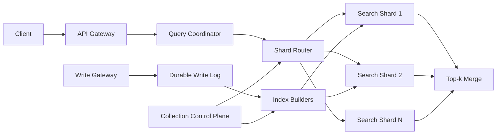

Search shards serve immutable index segments plus a small mutable recent-write layer. Background builders compact both into new immutable segments.

## Exact and approximate search

Exact nearest-neighbor search computes distance to every vector in scope. It provides perfect recall but cost grows linearly with collection size.

Approximate nearest-neighbor search inspects a small, promising subset. It exposes a tunable tradeoff:

- More probes or graph expansion improves recall
- Fewer probes reduces latency and compute
- More index memory can improve both
- Strong filtering can change effective recall

Exact search remains useful for small collections, offline evaluation, reranking a candidate set, and measuring approximation quality.

The platform continuously compares sampled ANN results with exact ground truth to report recall.

## Graph-based indexing

A navigable small-world graph connects each vector to nearby neighbors at several levels. Search starts at a sparse upper layer and descends while exploring increasingly local candidates.

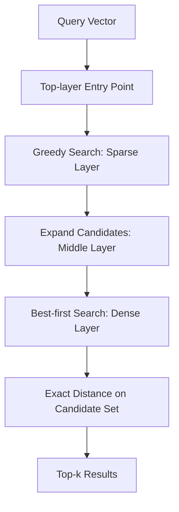

Graph indexes offer strong recall and low latency but use significant memory for edges. Insertion updates neighboring links and can be expensive under high write volume.

The query parameter controlling candidate expansion trades latency for recall. Construction parameters control edge count and build quality.

Deleted nodes remain as tombstones until graph rebuilding or compaction removes them.

## Inverted-file and quantized indexing

An inverted-file index trains centroids that partition vector space. Each vector is assigned to one or more nearby lists.

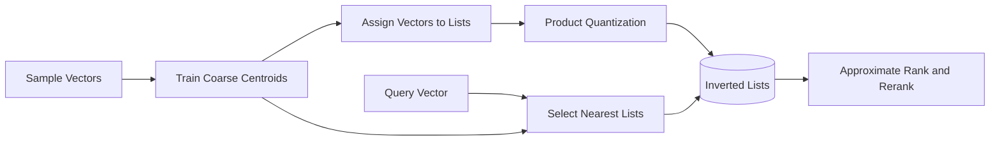

At query time, probe a configurable number of nearby lists. More probes increase recall and work.

Product quantization compresses vector subspaces into codebook entries. It greatly reduces memory and distance-computation cost at the price of approximation error.

Store full-precision or higher-precision vectors on SSD for reranking the strongest candidates when latency permits.

## Index selection

Graph indexes suit latency-sensitive, high-recall search when memory is available. Inverted and quantized indexes suit very large, mostly stable collections with stronger compression needs.

Disk-oriented graph or cluster indexes trade additional I/O for lower memory cost. Exact indexes suit small or heavily filtered datasets.

The platform can select defaults from collection size, dimensions, update rate, filter patterns, recall target, and cost tier. Users may tune advanced parameters, but safe presets prevent accidental resource explosions.

Record the index algorithm and build parameters with every segment version. Reproducible quality evaluation depends on them.

## Sharding

Partition the collection across shards to scale storage and queries.

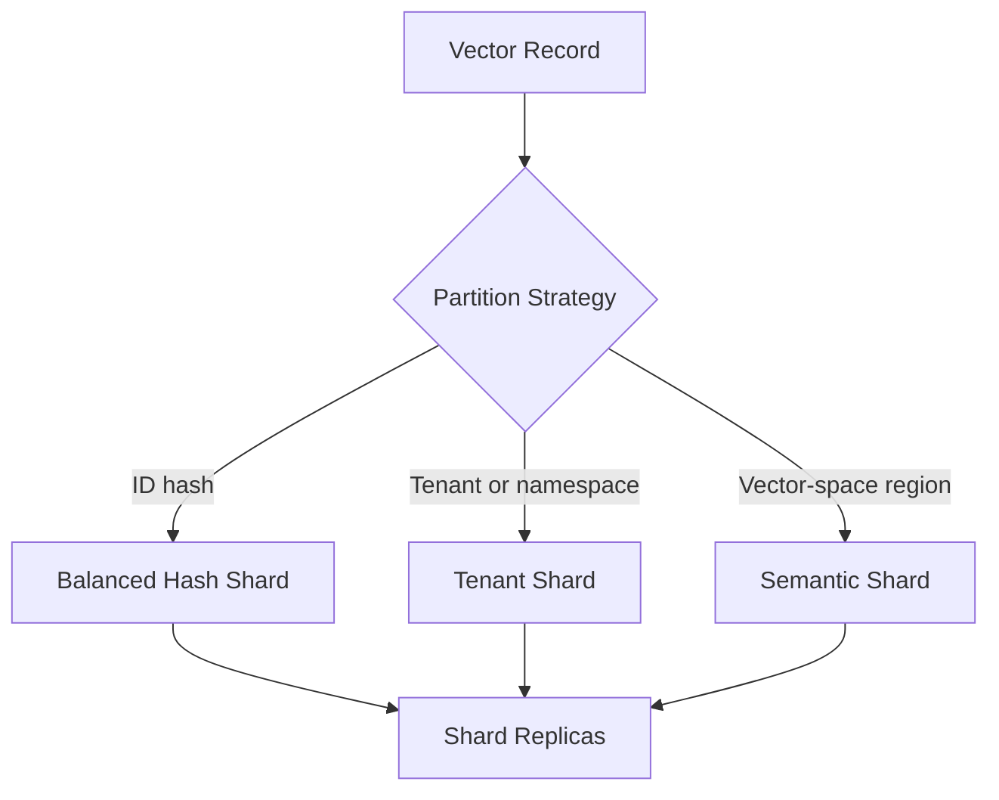

Hash sharding balances writes and storage but requires fan-out to every shard for global nearest neighbors. Tenant or namespace partitioning prunes queries naturally when scope is known.

Semantic partitioning routes a query to likely vector-space regions and reduces fan-out, but distribution changes as embeddings evolve and approximate routing can reduce recall.

A practical hierarchy routes first by hard tenant or namespace boundaries, then hashes within them. Large global collections may add learned or centroid-based shard routing.

## Distributed top-k search

The coordinator sends the query to relevant shards. Each shard returns local top-k candidates. The coordinator merges them using the common distance metric.

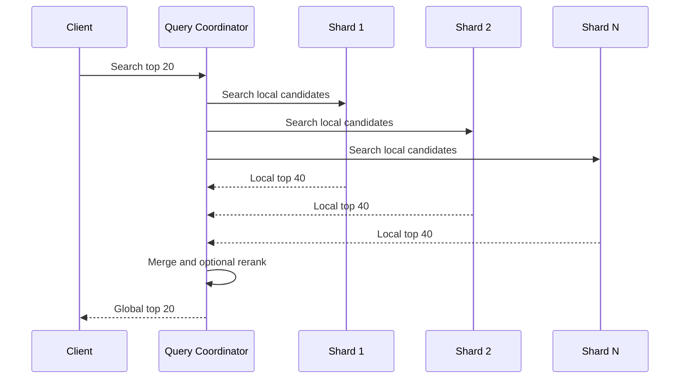

Ask shards for more than k results when filtering, approximate scores, or reranking can change order. Bound fan-out with deadlines and cancellation.

If a shard misses the deadline, the API either returns an explicit partial result with coverage metadata or fails according to the collection contract. Silent partial search is dangerous.

## Metadata filtering

Filters include equality, set membership, numeric ranges, timestamps, and Boolean combinations over registered fields.

Filtering can occur:

- Before ANN search by selecting a filtered index or allowed-ID bitmap
- During graph traversal by rejecting ineligible nodes
- After ANN retrieval by over-fetching and filtering candidates

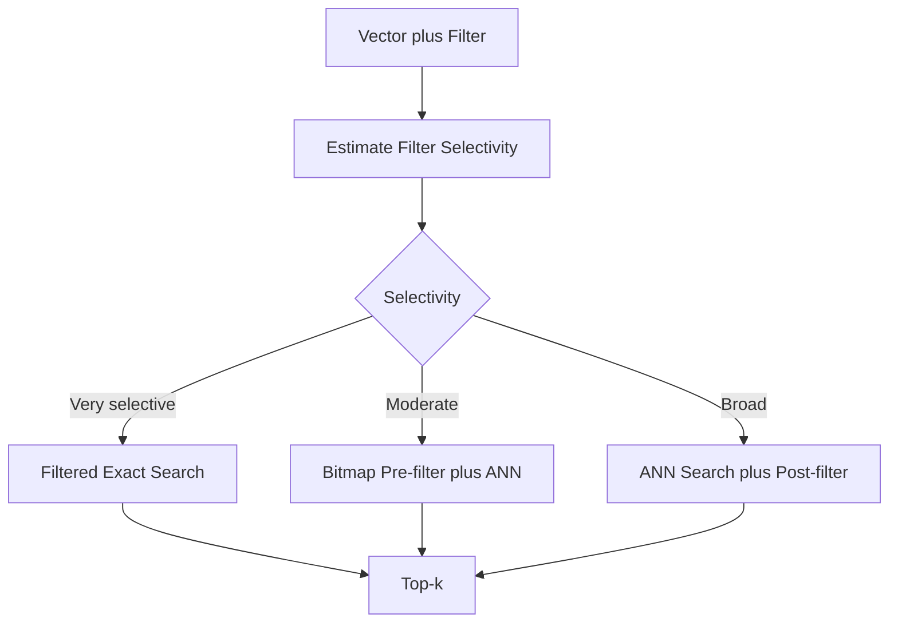

Post-filtering fails when most neighbors are ineligible; it may return fewer than k results. Pre-filtering can fragment graph traversal.

The planner estimates selectivity from metadata statistics and chooses a strategy. Frequently used categorical filters may receive separate subindexes.

## Write path

The write gateway validates dimensions, finite numeric values, metadata schema, authorization, and payload size before appending to a replicated write log.

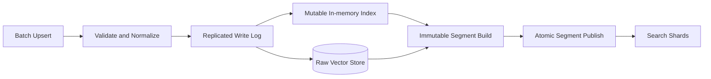

Acknowledgement semantics are explicit: durable means replicated in the write log, while searchable means applied to the mutable index or a published segment.

Stable idempotency keys prevent batch retries from creating conflicting versions. Per-record versions or conditional writes control concurrent updates.

## Freshness and mutable indexes

Large immutable indexes are efficient to search but slow to rebuild. A small mutable layer makes recent writes visible quickly.

Queries search both the immutable segments and mutable layer, then merge results. Deletes and updates add tombstones that suppress older segment records.

The mutable layer is replicated and rebuilt from the write log after failure. When it reaches a size threshold, an indexer flushes it into an immutable segment.

Too many small segments increase query fan-out. Background compaction merges segments and physically removes stale versions and tombstones.

Expose a searchable-through timestamp or log offset so clients know the freshness boundary.

## Updates and deletes

Changing a vector is a new record version plus a tombstone for the previous version. In-place graph mutation is difficult to coordinate safely across replicas and backups.

Delete requests become tombstones immediately visible to query filtering, then propagate through compaction and backups according to retention policy.

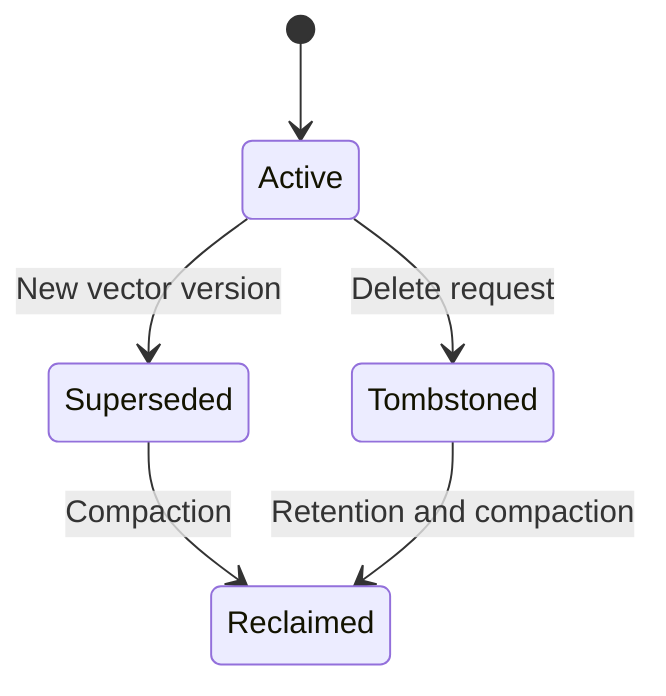

Maintain a version map by primary key so queries retain only the newest visible record. Compact maps and segments together to avoid resurrecting old versions.

Deletion from model-derived embeddings may also require removing source content and caches. Track lineage from vector to source object.

## Segment construction and compaction

Index building is compute intensive. Run builders in a separate pool so ingestion and search remain stable.

Builders read a fixed input snapshot, train or reuse codebooks, construct the index, validate recall on a held-out sample, and publish a signed manifest.

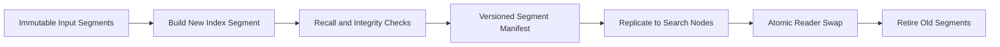

Readers keep old files until in-flight queries finish. Failed builds never replace active segments.

Compaction policy balances tombstone ratio, segment count, size, age, and available compute. Constant rebuilding can cost more than the searches it improves.

## Replication and consistency

Each shard has replicas across failure domains. One leader or sequenced log orders writes; followers apply them and build equivalent mutable state.

Reads may choose:

- Eventual consistency from any healthy replica
- Session consistency using a minimum write offset
- Stronger read-after-write from the leader or caught-up replica

Include the acknowledged write offset in upsert responses. A later search can require at least that offset when immediate visibility matters.

Immutable segment manifests simplify replica convergence. Nodes fetch verified files, load them, and atomically advance their active version.

## Query quality and evaluation

Recall at k compares approximate results with exact top-k ground truth.

```text
recall@k = relevant exact neighbors found / k
```

Evaluate across representative queries, filters, tenants, and data age. An aggregate score can hide poor recall for rare categories or highly selective filters.

Track latency, recall, scanned candidates, probes, cache hits, and segment versions together. A faster configuration is not an improvement if relevance falls below the contract.

Run shadow queries against candidate indexes before promotion. Use production query samples with protected or synthetic vectors according to privacy policy.

## Hybrid lexical and vector search

Semantic similarity and lexical matching capture different signals. Hybrid search combines candidates or scores from both.

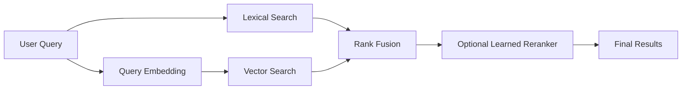

Score magnitudes from different systems are not directly comparable. Use calibrated normalization or rank-based fusion.

The vector database may expose hybrid primitives or integrate with a text-search service. Preserve candidate-source attribution for relevance debugging.

## Multi-tenancy

Tenant isolation can use separate collections, namespaces within a collection, or dedicated clusters.

Namespaces share infrastructure efficiently but require tenant scope in every storage key, routing decision, cache entry, and authorization check.

Apply quotas to vector count, bytes, write rate, query rate, candidate expansion, filters, and concurrent index builds. A tenant requesting maximum-recall searches must not exhaust shared CPU.

Large or regulated tenants may receive dedicated shards and encryption keys. Placement policy keeps their replicas within approved regions.

## Security and privacy

Embeddings can reveal source information and are not automatically anonymous. Protect them like derived sensitive data.

Controls include:

- Workload identity and tenant-scoped authorization
- Encryption in transit and at rest
- Tenant- or collection-scoped encryption keys
- Restricted metadata fields and query filters
- Audited reads, exports, and administrative changes
- Retention and verified deletion
- Network isolation for private collections
- Payload and decompression limits

Do not expose raw vectors by default. Search APIs can return IDs, distances, and approved metadata while reserving vector export for privileged workflows.

Validate floating-point inputs, dimensions, and batch sizes to prevent malformed payloads from exhausting indexers or native libraries.

## Backup and restore

Back up raw vectors, metadata, write-log positions, collection schemas, and segment manifests. Immutable index segments can be backed up or rebuilt from raw records.

A consistent snapshot records the highest included write offset for every shard. Later log records provide incremental recovery.

Restore into a shadow collection, validate counts, checksums, index recall, and sample queries, then switch the collection alias atomically.

Regularly test large restores. Rebuilding a hundred-billion-vector index may take days, making prebuilt segment backup worthwhile despite extra storage.

## Multi-region design

Place collection replicas near query traffic while respecting residency.

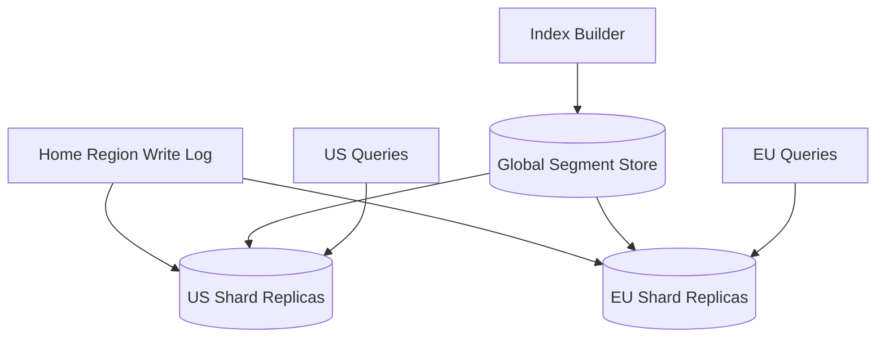

Use a home region or globally sequenced partition for authoritative writes. Replicate log records asynchronously to read regions.

Regional search responses expose replication freshness. Clients needing read-after-write route to a sufficiently caught-up region or the write home.

During failover, fence the previous writer before promoting a replica. Stable versions and idempotency keys reconcile retried writes.

## Failure handling

### Search node failure

Route to a replica. Replace capacity and fetch immutable segments from the segment store.

### Shard timeout

Retry within deadline on another replica. Return explicit partial coverage only when the API contract permits it.

### Index builder failure

Discard the unpublished output and retry from the immutable input snapshot. Active readers remain unchanged.

### Write-log backlog

Scale indexers, expose freshness lag, and keep accepting writes within durable-log capacity. Apply quotas before disk exhaustion.

### Corrupt segment

Checksum validation prevents loading it. Fetch another replica or rebuild; never serve silently from corrupted data.

### Hot tenant or namespace

Split shards, add replicas, cache safe queries, and enforce tenant limits. Rebalancing uses immutable segment copies plus a log catch-up phase.

### Bad index release

Stop promotion and atomically restore the previous segment manifest. Preserve query samples and quality results for diagnosis.

## Observability

Track:

- Query latency, rate, errors, timeouts, and partial responses
- Recall estimates and exact-search comparison
- Candidates visited, graph expansion, and list probes
- Filter selectivity and strategy choice
- Cache hit rate and SSD read volume
- Write acknowledgement and searchable lag
- Mutable-index size and write-log backlog
- Segment count, tombstone ratio, and compaction debt
- Shard size, hot keys, and replica lag
- Artifact build time, quality, and failure rate
- Per-tenant resource and quota use

Synthetic collections with known neighbors test every region and index type. Canary query sets catch quality changes before segment promotion.

## Key tradeoffs

### Recall vs latency

Exploring more candidates improves nearest-neighbor recall but costs CPU, memory bandwidth, and time. Offer tested quality tiers rather than exposing only raw algorithm knobs.

### Memory vs compression

Full-precision in-memory indexes are fast and accurate but expensive. Quantization and SSD-backed structures reduce cost while adding approximation and I/O.

### Write freshness vs search efficiency

Mutable indexes make new vectors visible quickly but are less efficient than optimized immutable segments. A layered design provides both.

### Hash vs semantic sharding

Hash sharding balances data but requires broad fan-out. Semantic routing prunes shards but introduces distribution drift and another approximation stage.

### Flexible metadata vs predictable performance

Arbitrary indexed metadata enables expressive filters but creates cardinality and memory risk. Typed, explicitly indexed fields let the planner make reliable choices.

The central principle is to keep durable vector records separate from replaceable search structures, making approximation quality, freshness, and query coverage measurable parts of the API contract.
