## Problem and requirements

An API developer platform gives developers one place to discover APIs, read accurate documentation, register applications, obtain credentials, test against sandboxes, monitor usage, request higher limits, and migrate across versions. API owners use it to publish specifications, approve access, announce changes, and understand adoption.

The difficult part is connecting documentation to runtime truth. A portal can display stale schemas, issue credentials broader than intended, expose private APIs through search, or claim a sandbox behavior that production does not share. The platform must govern the full API lifecycle without sitting in the latency-sensitive request path.

### Functional requirements

- Register API products, services, owners, and environments
- Publish versioned API specifications and documentation
- Discover APIs by domain, capability, protocol, and access level
- Create developer organizations and applications
- Issue API keys, OAuth clients, certificates, or workload identities
- Request and approve API scopes and product plans
- Provide interactive documentation and safe request consoles
- Offer realistic isolated sandbox environments
- Show quotas, usage, errors, latency, and webhook health
- Publish changelogs, deprecations, and migration guides
- Generate SDKs and code examples from approved specifications
- Support support tickets, incidents, and status communication

### Non-functional requirements

- Support ten million developers and one million registered APIs
- Govern clients producing 100 billion requests per day
- Keep portal reads available during API gateway outages
- Keep production API traffic independent from portal availability
- Make credential issuance and rotation strongly auditable
- Enforce tenant, organization, API, environment, and scope boundaries
- Prevent secrets from appearing in logs, code samples, or browser storage
- Make documentation and runtime versions traceable

## Capacity estimates

Assume one million API versions, ten million developers, fifty million registered applications, and hourly usage aggregates.

| Resource | Estimate |
| --- | ---: |
| API products and versions | 1M+ |
| Developer identities | 10M |
| Applications | 50M |
| Active credentials | Hundreds of millions |
| Runtime requests | 100B/day |
| Usage aggregates | Billions/day |
| Documentation and SDK artifacts | Petabyte scale |

Runtime metering is high volume, but developer-facing views use aggregates. Never query raw gateway logs synchronously for a dashboard page.

## Core data model

```text
ApiProduct {
  productId, ownerId, visibility, environments,
  lifecycleState, policyVersion
}

ApiVersion {
  productId, version, specificationHash,
  compatibility, state, publishedAt, sunsetAt
}

Application {
  applicationId, organizationId, ownerIds,
  environment, status, riskTier
}

Grant {
  applicationId, productId, scopes,
  planId, conditions, state, version
}

Credential {
  credentialId, applicationId, type,
  publicMetadata, secretVersion, state, expiresAt
}
```

An application is the unit of runtime identity, authorization, quotas, and analytics. Developer accounts own and manage applications but should not use personal credentials in production.

## High-level architecture

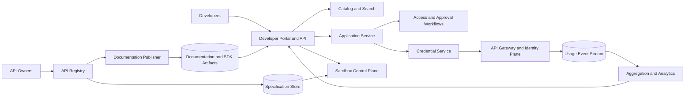

The developer platform publishes configuration to runtime gateways and identity systems. Production request authorization uses local runtime state, not a synchronous portal call.

## API registration

API owners register metadata through a repository manifest or control API.

```yaml
productId: payments
displayName: Payments API
owner: team-payments
visibility: partner
protocol: https-json
specification: openapi/payments-v3.yaml
environments:
  - sandbox
  - production
support:
  channel: payments-api-support
```

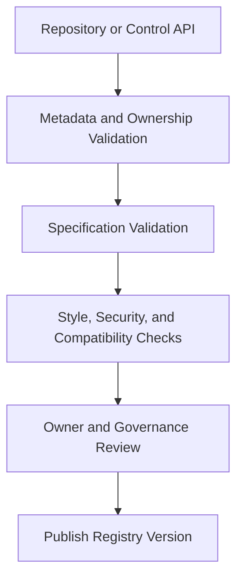

Ownership is verified against organization identity and code ownership. Orphaned APIs cannot progress to production publication.

## Specification governance

Treat API specifications as versioned build inputs.

Checks include:

- Syntax and reference resolution
- Stable operation and schema identifiers
- Authentication and authorization declaration
- Error envelope consistency
- Pagination, idempotency, and retry semantics
- Sensitive-field classification
- Compatibility against the prior published version
- Example validity against schemas
- Policy-specific naming and lifecycle requirements

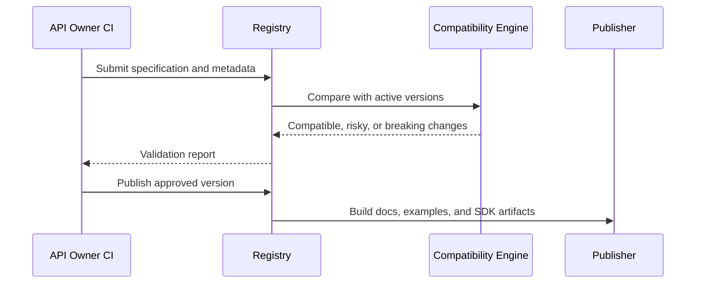

The published specification is immutable and content addressed. A correction creates a new publication revision, preserving what consumers previously saw.

## API lifecycle

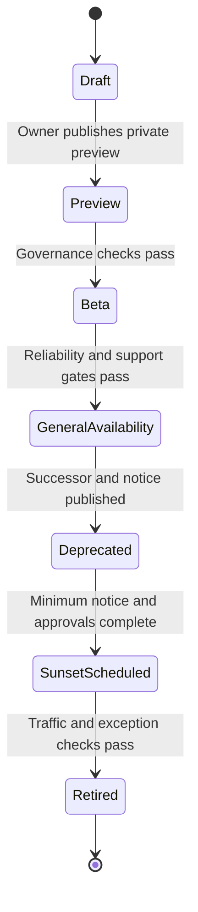

Each state controls discoverability, access approval, support commitments, change policy, and runtime availability.

Retirement is not merely hiding documentation. It requires traffic analysis, active-client inventory, exception management, communication, and a runtime enforcement plan.

## Catalog and discovery

The catalog indexes API products, operations, schemas, events, owners, domains, tags, lifecycle, environments, access model, and quality signals.

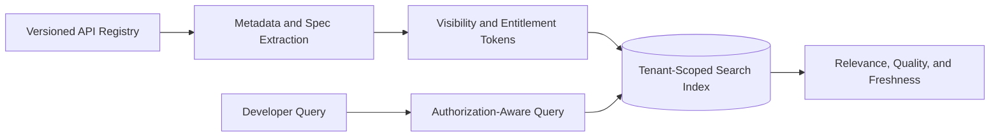

Private API names and descriptions must not leak through search suggestions, result counts, or related-item recommendations.

Ranking considers text relevance, domain ownership, lifecycle, documentation completeness, uptime, adoption, freshness, and the developer's organization context.

## Documentation publishing

Compile specifications and authored guides into immutable documentation artifacts.

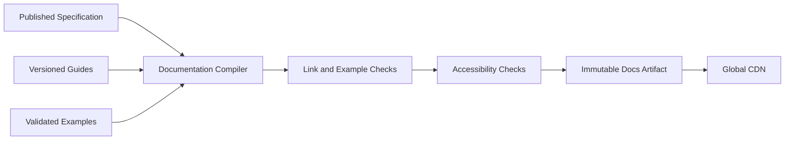

Documentation pages clearly display API version, environment, lifecycle, last validation, and owner. Deep links include version so a future update does not silently change referenced behavior.

Examples are generated or tested from schemas and sanitized. Never place a real credential, customer identifier, or production payload in published examples.

## Application registration

Developer organizations create applications with purpose, owners, environments, redirect URIs, webhook endpoints, expected volume, and data-use declarations.

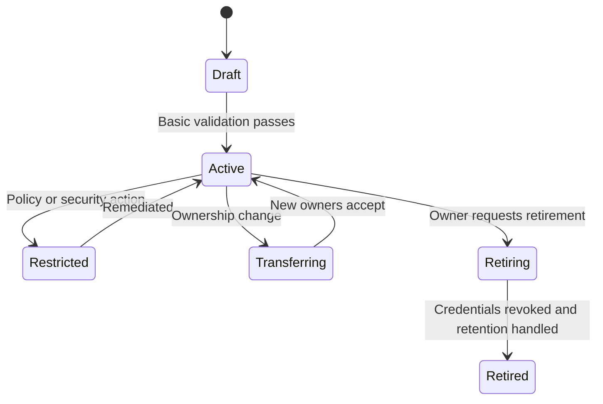

Require at least two owners for production applications where policy demands resilience. Ownership derives from organization identities, not shared personal accounts.

Redirect URIs and callback endpoints use strict parsing and ownership verification. Wildcards are rejected or narrowly constrained.

## Access requests

An application requests one or more API products, scopes, plans, and environments.

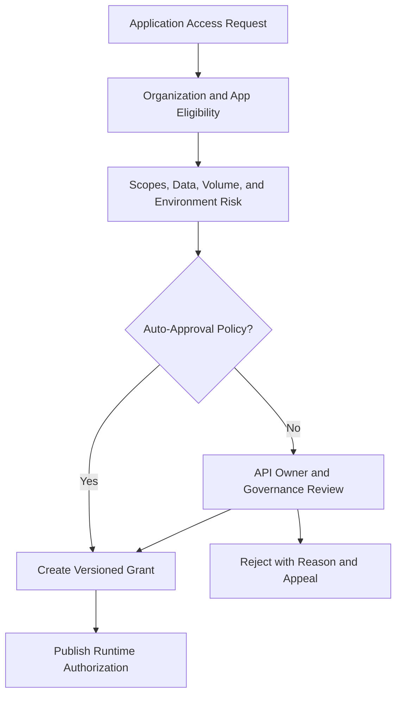

The grant records policy version, approved purpose, scopes, plan, quota, environments, conditions, approvers, and expiry.

High-risk scopes can require security review, contractual approval, user-consent design, or proof of compliance. Scope expansion is a new request, not an invisible credential update.

## Credential types

Support credentials appropriate to the client:

- API keys for low-risk server calls with limited scopes
- OAuth clients for delegated user access
- Mutual TLS certificates for strong workload identity
- Signed assertions for trusted service federation
- Short-lived workload tokens for internal environments

Avoid long-lived bearer secrets where a short-lived or asymmetric mechanism is possible.

The portal displays a secret only at creation or rotation. Store only an encrypted secret or slow verification hash according to credential type.

## Credential issuance

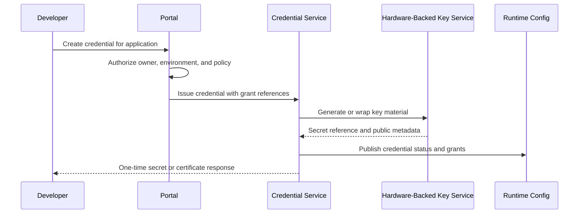

Credential creation, display receipt, runtime publication, and audit event form one durable workflow. If the client misses the one-time secret, create a new version rather than revealing it again.

## Rotation

Allow overlapping active credentials so applications can rotate without downtime.

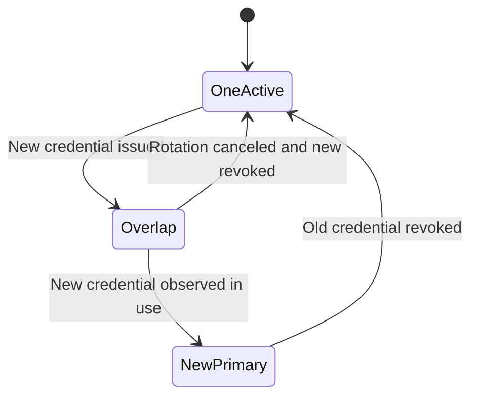

Show last-used time, environment, and coarse source context for each credential without exposing sensitive request data.

Rotation policies set maximum age and overlap window. Expiration reminders escalate to all application owners.

## OAuth client management

OAuth applications register exact redirect URIs, allowed grant types, consent metadata, client type, token lifetimes, and approved scopes.

Public clients use proof-key flows and never receive a client secret. Confidential clients authenticate with rotated secrets or asymmetric keys.

Consent screens derive product name, publisher, verified domains, scopes, purpose, privacy links, and risk explanations from reviewed application metadata.

Changes to redirect URIs, publisher identity, or sensitive scopes require renewed review and can invalidate prior consent according to policy.

## Runtime configuration distribution

Compile grants, credentials, quotas, routes, and policy into small signed bundles for gateways and authorization servers.

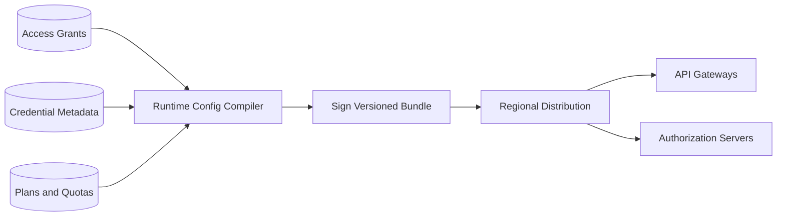

Runtime systems continue using an unexpired last-known-good bundle during portal outages. Revocations travel through a high-priority invalidation path.

Bundle versions and decision reason codes make runtime authorization reproducible.

## Interactive API console

The console lets a developer construct requests from the published specification and send them to sandbox or approved environments.

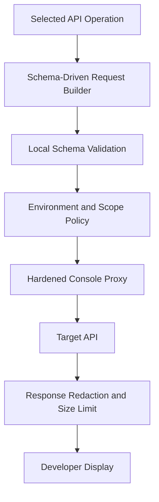

Do not expose production credentials to browser JavaScript. A hardened backend proxy uses a short-lived session bound to developer, application, API, environment, and operation.

Block arbitrary destinations, headers, methods, redirects, and payload sizes. Redact tokens and sensitive response fields from console history.

## Sandbox environments

Sandboxes should model production contracts without sharing production data or side effects.

Options include:

- Deterministic mocks generated from examples and schemas
- Stateful simulators with isolated application namespaces
- Synthetic-data staging services running production-compatible code
- Recorded behavior sets with privacy-safe payloads

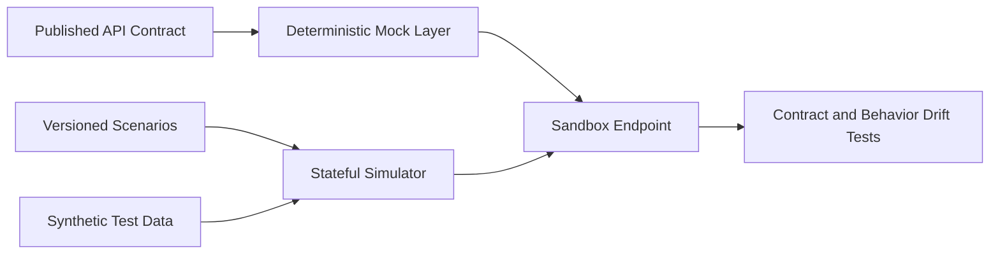

Display sandbox limitations clearly. A mock that always returns success teaches integrations nothing about retries, idempotency, errors, and asynchronous state.

Regular contract tests compare sandbox and production behavior for safe invariant cases.

## SDK generation

Generate SDKs only from approved immutable specifications and a versioned generator toolchain.

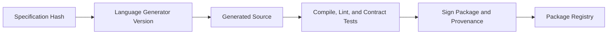

Generated packages include provenance linking source spec, generator image, dependencies, tests, and artifact digest.

Semantic versions reflect API and SDK compatibility. A generator bug fix can publish a new SDK patch without changing the API version.

## Code samples

Samples use placeholders, safe sandbox endpoints, deterministic fixtures, and current SDK versions. Execute them in isolated CI environments to detect drift.

Language tabs map to one canonical operation example so behavior remains consistent. Hand-authored samples include ownership and review deadlines.

Copy buttons never include real credentials. The portal can substitute a short-lived sandbox token only into an isolated console session, not rendered source text.

## Plans and quotas

Plans define products, scopes, request rates, concurrency, monthly allocation, burst, support tier, and environment.

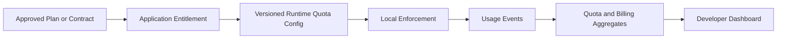

Gateways enforce short-window limits locally. Durable metering computes longer-window usage and billing.

Quota increases use a workflow considering historical usage, error rate, expected pattern, API capacity, and owner approval. A granted quota does not promise unlimited backend capacity.

## Usage ingestion

Runtime gateways emit privacy-minimized usage events with application, API product, operation, environment, timestamp, status class, latency bucket, bytes, quota decision, and config version.

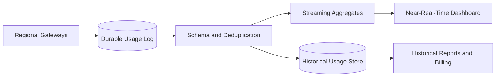

Do not include raw authorization headers, query secrets, or sensitive payloads. High-cardinality request IDs belong in restricted diagnostic logs, not the usage warehouse.

## Developer analytics

Show request volume, success rate, latency, throttling, quota consumption, top operations, credential usage, webhook delivery, and version distribution.

Mark freshness and sampling. Aggregates can lag and should not be presented as authoritative billing until reconciliation completes.

API owners receive adoption, active applications, error trends, version migration, deprecated traffic, and capacity forecasts.

## Changelogs and deprecation

Every published change records affected products and operations, compatibility classification, release time, owner, migration action, and documentation links.

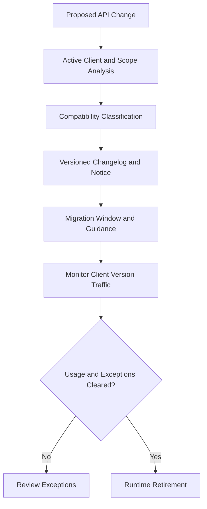

Notify application owners based on actual product and version usage, not every portal user. Deduplicate notices and provide acknowledgement tracking for high-impact migrations.

## Active client inventory

Join grants, credential usage, gateway telemetry, SDK headers, and declared application ownership to identify active clients.

Because headers can be missing or spoofed, mark confidence. Credential identity and runtime grants are stronger signals than user-agent strings.

Version retirement gates use recent successful traffic, critical-client exceptions, contractual obligations, and owner approval.

## Webhooks for platform events

Developers can subscribe to application, credential, quota, access-request, incident, and deprecation events.

Deliver signed events with stable IDs, retries, and replay support. The webhook contains metadata and resource references, not credential secrets.

Changing a webhook endpoint requires ownership verification and invalidates old delivery tokens.

## Support and status

Route support requests with application, API, operation, environment, request ID, time range, and redacted diagnostic context.

Status incidents map to affected API products and regions, then notify only relevant application owners. Keep the public status view separate from sensitive internal incident details.

Never ask developers to paste full secrets into support tickets. Provide secure diagnostic grants or one-way credential fingerprints.

## Multi-tenant and organization model

Developers belong to organizations with owner, administrator, developer, security reviewer, billing, and viewer roles.

Applications, grants, credentials, usage, support cases, and audit records belong to the organization. A departing developer does not orphan production applications.

Organization transfer requires approval from current and receiving owners, renewed access review, credential rotation policy, and immutable audit evidence.

## Multi-region design

The portal and catalog can serve globally, while credentials, applications, usage, and private documentation remain in approved regions.

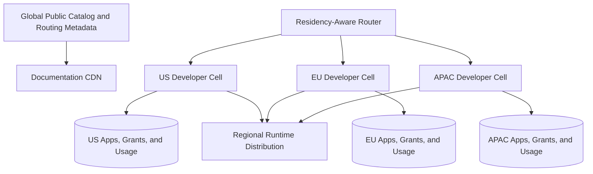

Credential secret material never crosses regions unless policy explicitly permits it. Public API documentation can replicate globally after sanitization.

Regional failover promotes a replica under a higher ownership epoch. Runtime gateways continue using signed bundles during portal recovery.

## Security and privacy

- Authenticate developers with strong organization identity controls
- Require MFA or equivalent assurance for production credentials
- Separate application ownership, access approval, and credential administration
- Encrypt secrets using hardware-backed key services
- Use short-lived portal sessions and step-up authentication for sensitive actions
- Redact credentials from logs, traces, console history, and support data
- Prevent browser-side access to production client secrets
- Audit app changes, grants, secret views, rotations, exports, and impersonation
- Rate-limit key creation, access requests, console calls, and catalog scraping
- Apply data retention and deletion to usage, support, and developer identity records

Show credential fingerprints, not full values, in audit and user interfaces. Secret detection scans published docs, examples, and repository submissions.

## Reliability and failure handling

| Failure | Safe behavior |
| --- | --- |
| Registry publication repeats | Specification hash and version make it idempotent |
| Documentation build fails | Keep prior published artifact active |
| Portal is unavailable | Production API traffic uses cached runtime configuration |
| Runtime distribution is delayed | Show pending state; do not claim access is active |
| Secret display response is lost | Issue a new credential version; never reveal again |
| Usage pipeline lags | Gateway enforcement continues; dashboard shows freshness |
| Sandbox fails | Documentation remains available and marks console unavailable |
| Deprecation notification retries | Stable intent suppresses duplicate notices |
| Region fails | Promote fenced control replica; gateways use last-known-good bundle |

Credential and grant workflows expose honest intermediate states such as pending publication, active, revoking, and revoked.

## Observability and SLOs

Track:

- Registry validation, compatibility failures, and orphaned ownership
- Documentation build latency, broken examples, and CDN freshness
- Search authorization denials and zero-result rate
- Application creation, access-request age, and approval outcomes
- Credential issuance, rotation age, last use, and revocation propagation
- Runtime bundle publication and gateway adoption lag
- Sandbox availability, drift tests, and scenario failures
- Usage aggregation lag, reconciliation difference, and dashboard latency
- Deprecated-version traffic and unowned active clients
- Support volume and incident notification delivery

Useful SLOs include 99.99% catalog and credential-management availability, emergency credential revocation reaching 99.9% of regional gateways within 30 seconds, and every published code sample passing automated validation against its declared sandbox version.

## Key trade-offs

| Decision | Benefit | Cost |
| --- | --- | --- |
| Portal outside request path | Runtime resilience and low latency | Eventual control-plane propagation |
| Immutable published specs | Reproducible docs and SDKs | More version management |
| Application-level identity | Stable ownership and analytics | Registration and governance overhead |
| Overlapping secret rotation | Zero-downtime migration | Temporary multiple credentials |
| Stateful sandbox | Realistic integration testing | Isolation and maintenance cost |
| Aggregated usage views | Fast privacy-minimized dashboards | Delayed detail and reconciliation |
| Home-region credentials | Residency and smaller blast radius | More regional control infrastructure |

## Evolution path

1. Build API registry, versioned documentation, search, and ownership.
2. Add organizations, applications, basic credentials, and access grants.
3. Introduce interactive consoles, sandbox environments, and usage dashboards.
4. Add approval workflows, SDK generation, quotas, and rotation policy.
5. Implement deprecation automation, active-client inventory, and regional cells.
6. Continuously test secret leakage, access revocation, sandbox drift, and failover.

Start by making specifications, owners, and runtime identity explicit. A beautiful portal cannot compensate for credentials with unclear scope or documentation that does not match production.

## Final design

Maintain a governed API registry containing immutable specifications, ownership, lifecycle, visibility, and policy. Compile those versions into documentation, tested examples, SDKs, sandbox scenarios, and signed runtime configuration. Represent every integration as an organization-owned application with explicit grants, scopes, plans, and rotatable credentials. Keep portal services outside the production request path, distributing short-lived or signed authorization state to regional gateways while ingesting privacy-minimized usage events asynchronously.

The central principle is traceability from intent to runtime. A developer should be able to connect a documentation page, SDK version, application grant, credential, quota decision, request metric, and deprecation notice back to the exact API contract and policy that governed it.
