## Problem and requirements

An electronic signature platform lets senders upload documents, place fields, define recipients and signing order, collect intent and signatures, and produce verifiable completed agreements. It must preserve exactly what each recipient saw and did throughout the workflow.

The difficult part is evidence. Documents cannot change after sending, recipient authentication varies by risk, links are forwarded, concurrent actions race, and a completed package may need verification years after the signing service or cryptographic keys have changed.

### Functional requirements

- Upload and normalize common document formats
- Create reusable templates and field definitions
- Define recipients, roles, routing order, and deadlines
- Authenticate recipients using configurable methods
- Render accessible signing sessions across devices
- Capture field values, consent, intent, and signature actions
- Support sequential, parallel, and conditional routing
- Send reminders and expiration notifications
- Allow decline, void, correction, delegation, and resend workflows
- Seal completed documents and generate evidence packages
- Verify document integrity independently
- Search, export, retain, and delete agreements under policy

### Non-functional requirements

- Process one billion envelopes per year
- Store ten billion source and completed documents
- Support 100 million concurrent signers during major events
- Never mutate a sent document version silently
- Make every external effect idempotent
- Detect document or audit-record tampering
- Isolate tenants, regions, documents, and signing credentials
- Preserve verification capability for long retention periods

The platform provides technical evidence. Legal enforceability depends on jurisdiction, agreement type, identity policy, consent, and organizational process.

## Capacity estimates

Assume one billion annual envelopes, three documents and five recipients per envelope, and ten megabytes of original plus derived assets per envelope.

| Resource | Estimate |
| --- | ---: |
| Envelopes | 1B/year |
| Recipient workflows | 5B/year |
| Stored documents and renditions | 10B+ objects |
| Peak signing sessions | 100M concurrent |
| Audit events | Tens of billions/year |
| Reminder timers | Billions active |

Object storage dominates capacity. Workflow state is smaller but requires stronger transactional guarantees.

## Core data model

```text
Envelope {
  envelopeId, tenantId, senderId,
  documentManifestHash, state, version,
  routingPolicy, expiresAt, region
}

Recipient {
  recipientId, envelopeId, role, routingOrder,
  identityPolicy, state, accessTokenVersion
}

Field {
  fieldId, documentId, recipientId, type,
  page, geometry, validation, required
}

EvidenceEvent {
  eventId, envelopeId, actor, action,
  occurredAt, ingestedAt, context, previousHash
}
```

Envelope IDs, document IDs, recipient IDs, and field IDs are immutable. Email addresses and display names can be corrected through explicit workflow versions.

## Envelope lifecycle

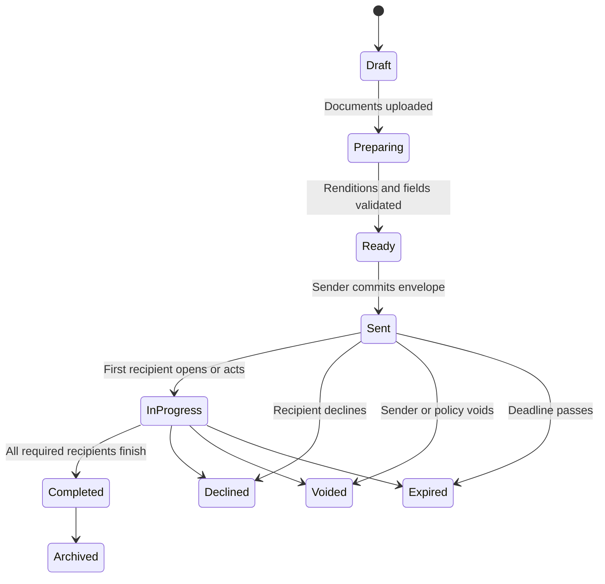

Sending freezes the document manifest, fields, recipient workflow, and evidence policy. Material changes require voiding or correcting through a new envelope version with explicit links to the prior one.

## High-level architecture

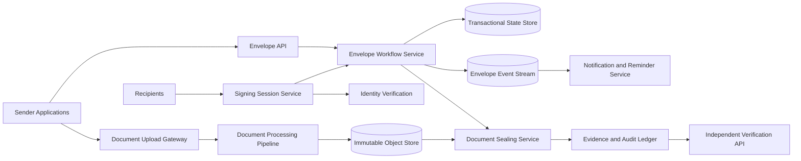

Document bytes live in immutable object storage. The workflow store contains envelope state, routing, fields, and references. Search and analytics are derived from committed envelope events.

## Document ingestion

Clients upload directly to quarantine storage using short-lived, envelope-scoped URLs.

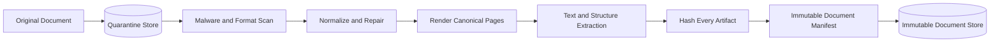

Retain original bytes plus canonical renditions. The original proves what the sender submitted; the canonical rendition defines what signing clients display and what fields reference.

Reject password-protected, malformed, or unsupported files unless a dedicated secure flow handles them. Rendering occurs in isolated sandboxes because document parsers process hostile input.

## Canonical document manifest

The manifest lists every document, page rendition, dimensions, text layer, accessibility structure, checksum, processor version, and ordering.

```text
envelope_manifest_hash = H(
  envelope_id || ordered_document_hashes ||
  field_definition_hash || recipient_workflow_hash || policy_version
)
```

The manifest is immutable after send. Signing actions reference its hash, preventing a field value or signature from being associated with a different document later.

## Templates

Templates contain versioned documents, recipient roles, fields, routing rules, messages, expiration, and identity policy.

Instantiating a template creates an independent draft pinned to one template version. Later template edits do not change existing envelopes.

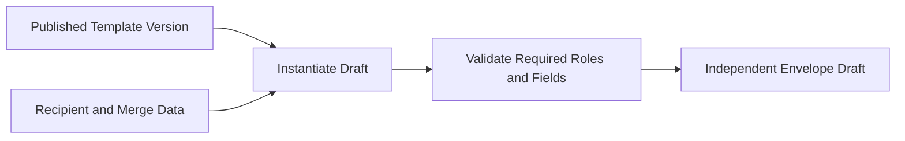

Merge fields are escaped and type checked. User-supplied values cannot alter document structure or field ownership.

## Field placement

Fields reference a canonical page and normalized geometry rather than browser pixels. Types include signature, initials, date, name, text, checkbox, radio, attachment, and approved custom controls.

Fields define owner, required status, validation, formatting, conditional visibility, and read-only source. Validation is enforced on both client and server.

Anchor-based placement can find known text and place fields relative to it, but the generated coordinates are resolved and frozen before sending. A later rendering difference cannot move the signature.

## Routing model

Recipients can act in sequential groups, parallel groups, or conditional branches.

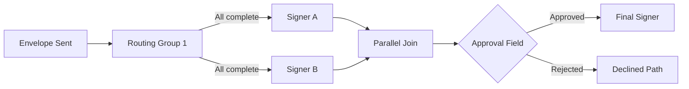

Model routing as a versioned directed acyclic graph. Publication validates that required paths terminate and conditions reference fields available before the branch.

The workflow engine activates recipient tasks idempotently when predecessor conditions are satisfied.

## Sending an envelope

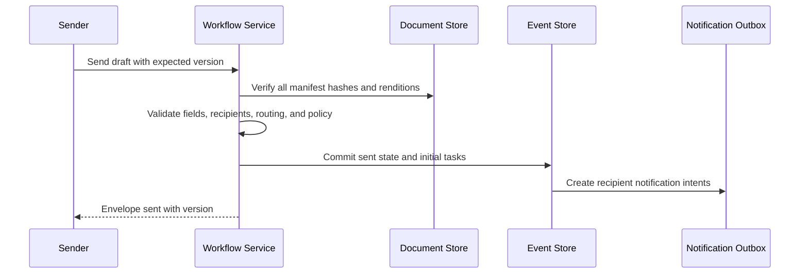

The send request uses an idempotency key and optimistic concurrency. A retry returns the same sent envelope rather than sending invitations twice.

## Recipient access

Invitation links contain a random opaque token or signed reference with short expiry and narrow scope. The platform exchanges it for a signing session after required authentication.

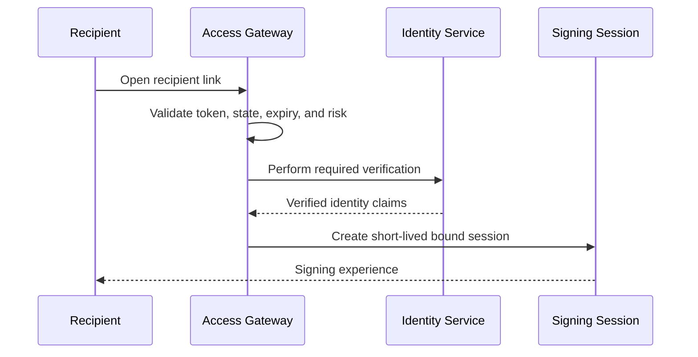

Do not treat email-link possession as universally sufficient identity. Policies can require authenticated account, one-time code, knowledge challenge, government identity verification, certificate, or organization login.

Every method records provider, result, assurance level, timestamp, and non-sensitive evidence reference.

## Signing session

The server returns a signed session manifest containing document-manifest hash, recipient, allowed fields, active routing task, consent text, expiry, and session nonce.

The client renders only canonical page assets and fields authorized for that recipient. Hidden or future-recipient fields never become editable.

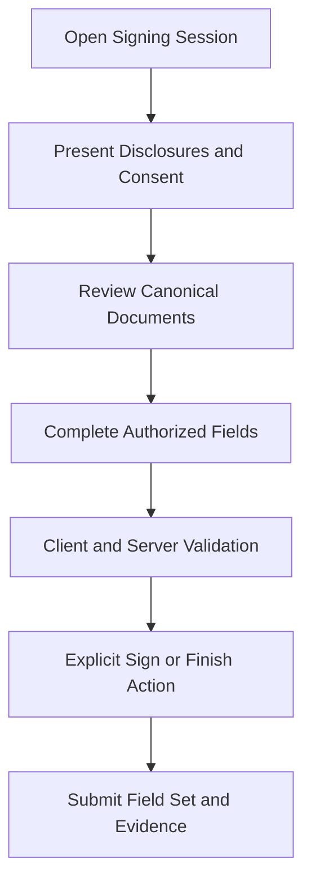

Auto-navigation improves usability but cannot replace an explicit completion action. The final action records intent under the applicable policy.

## Autosave and concurrency

Field drafts autosave with recipient task version and idempotency key. The server rejects writes to fields owned by another recipient or a completed task.

Only one active editing lease may exist per recipient unless policy permits multiple devices. A second device can take over through a clear flow that invalidates the prior session nonce.

Draft values are not signatures and can expire. Completion atomically freezes the final field values and marks the recipient task complete.

## Signature representation

A visual signature can be typed, drawn, uploaded, or created from a managed identity. The image is presentation; the evidence is the authenticated recipient's explicit action over a known document manifest.

Store:

- Signature appearance artifact and hash
- Recipient identity claims and assurance policy
- Document and field manifest hash
- Consent and disclosure version
- Timestamp and trusted server receipt time
- Session, device, and network context under privacy policy
- Explicit intent action and result

Cryptographic digital signatures backed by personal certificates can be supported as a stronger mode, but they are distinct from ordinary electronic signature appearance.

## Completing a recipient task

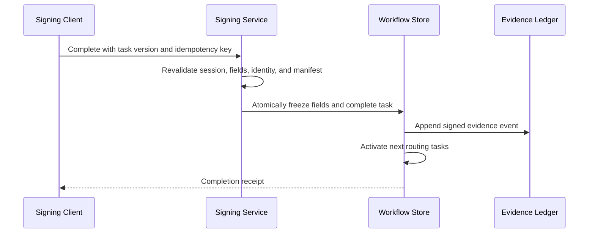

The evidence event is committed through a transactional outbox so workflow completion cannot occur without durable evidence intent.

## Audit evidence ledger

Capture envelope creation, document processing, send, view, authentication, consent, field changes, completion, delegation, decline, reminder, correction, void, sealing, download, and verification.

Hash-chain events within an envelope:

```text
event_hash_n = H(
  canonical_event_n || event_hash_n-1 || envelope_manifest_hash
)
```

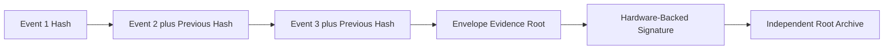

Periodically anchor envelope roots into larger Merkle trees stored in a separate administrative trust domain. This makes modification or deletion detectable without exposing document content.

## Envelope completion and sealing

When all required paths complete, the sealing service builds the final package.

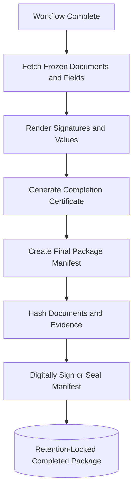

The original documents remain preserved. The completed rendition is a new immutable artifact linked to the original manifest, field data, evidence ledger, and processor version.

The package includes completed documents, certificate of completion, audit trail, verification metadata, and signatures as policy allows.

## Independent verification

A verifier should be able to check a downloaded package without trusting a mutable database record.

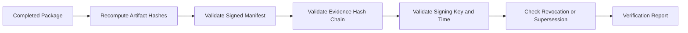

Publish historical public verification keys, validity windows, certificate chains, and signed revocation data. Long-term verification may require trusted timestamp evidence before signing certificates expire.

Verification reports distinguish integrity, platform signature validity, envelope status, identity assurance, and policy facts rather than reducing everything to one green check.

## Notifications and reminders

Envelope events create notification intents for invitations, reminders, completion, decline, expiration, and correction.

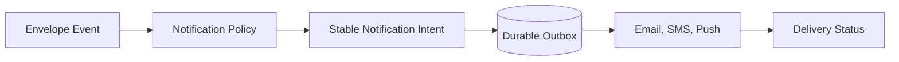

An intent ID combines envelope, recipient, event, template version, and channel. Retries cannot create duplicates.

Reminder timers recheck current task state and envelope expiry before sending. A recipient who completed moments earlier should not receive a stale reminder.

## Decline, void, and expiry

A recipient can decline with an optional reason. Decline atomically closes eligible active tasks and transitions the envelope according to policy.

The sender can void an incomplete envelope with an explicit reason. Voiding invalidates all access tokens and sessions but preserves documents and evidence under retention policy.

Expiry is driven by a durable timer. A completion racing with expiry uses a transactional version check so only one terminal transition wins.

## Corrections

Minor recipient contact corrections may preserve the document manifest while issuing a new recipient-task version and invalidating old access tokens.

Material changes to document bytes, fields, amounts, recipients' legal roles, or routing generally require a corrected envelope version or a new envelope. The system links old and new versions and records why the prior version stopped.

Never replace a sent document object under the same identifier.

## Delegation and reassignment

Delegation policies specify whether recipients may assign their role to another person, whether sender approval is required, and what identity evidence transfers.

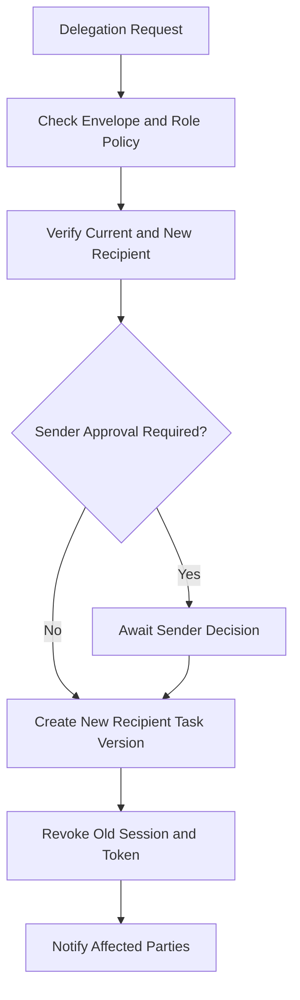

The evidence trail retains both identities, reason, approval, timestamps, and task versions.

## Templates and bulk send

Bulk send creates many independent envelopes from one template and a validated recipient dataset.

Use a frozen target file, dry-run validation, per-row idempotency key, rate limits, and a durable job ledger. One bad row does not roll back successful envelopes.

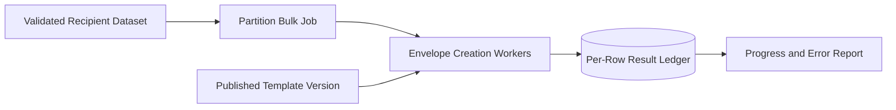

Prevent bulk jobs from starving ordinary interactive sends through separate quotas and queues.

## Search

Index envelope metadata such as title, sender, recipient, state, timestamps, template, and approved extracted fields. Full document text is indexed only under explicit tenant policy.

Search indexes are tenant and region scoped. Results contain envelope IDs that the authoritative service reauthorizes and hydrates before display.

Completed document search must not expose fields hidden from the requesting role. Apply field-level policies during indexing and result rendering.

## Webhooks and integrations

Customers subscribe to envelope and recipient events. Deliver signed, versioned webhooks with stable event IDs and retry semantics.

The platform's event log is authoritative; integrations are derived consumers. A webhook outage does not roll back an envelope action.

API-created envelopes, embedded signing, external storage connectors, and customer relationship systems use scoped service identities. Integration credentials cannot impersonate arbitrary recipients.

## Retention, holds, and deletion

Retention depends on tenant, document class, region, envelope state, and legal or investigation holds.

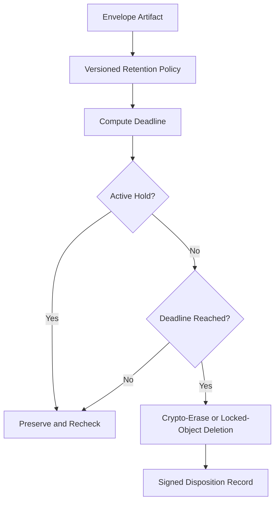

Deletion removes or anonymizes personal data from primary and derived stores according to applicable policy while retaining non-personal integrity evidence where permitted.

A hold cannot shorten retention, and releasing a hold does not delete data before its ordinary deadline.

## Multi-region design

Each tenant has a home region for envelope state, documents, signing sessions, evidence, search, and keys.

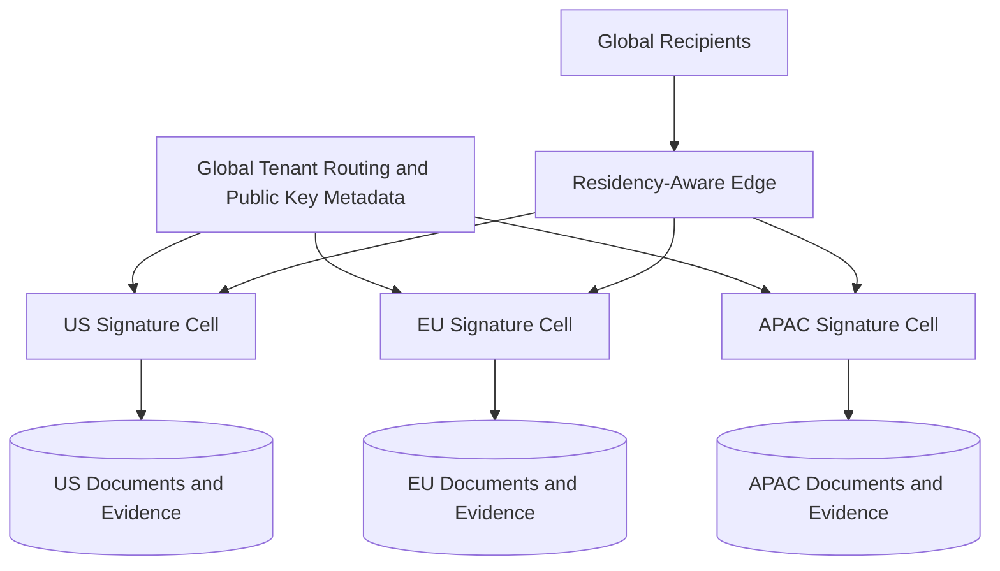

Recipient traffic can enter through a nearby edge, but sensitive data and mutations route to the tenant's home region. CDN-cached canonical pages remain encrypted and token protected.

Failover promotes a prepared replica under a higher tenant epoch. The old region is fenced from accepting completions or sealing packages.

## Security model

- Authenticate senders and administrators with strong account controls
- Authorize every envelope, document, field, and recipient action
- Encrypt original, canonical, and completed documents with scoped keys
- Store signing and sealing keys in hardware-backed key services
- Use short-lived recipient, upload, download, and signing tokens
- Scan documents and attachments in isolated sandboxes
- Separate send, template administration, identity policy, and audit roles
- Audit views, downloads, corrections, delegation, voids, and exports
- Rate-limit recipient-link guessing and identity challenges
- Prevent sensitive field values from entering logs and analytics

Assume links can be forwarded and devices shared. Bind sensitive signing sessions to completed authentication and invalidate them on recipient correction, delegation, or suspicious context change.

## Reliability and failure handling

| Failure | Safe behavior |
| --- | --- |
| Sender retries send | Idempotency key returns the same envelope |
| Document processor crashes | Retry immutable source; unpublished renditions remain invisible |
| Invitation delivery repeats | Stable notification intent suppresses duplicates |
| Recipient opens two devices | Editing lease and task version prevent conflicting completion |
| Completion request retries | Same idempotency key returns the prior receipt |
| Workflow worker crashes | Resume from durable envelope state and outbox |
| Reminder worker is delayed | Recheck active task before sending |
| Sealing job fails | Envelope stays completed-but-unsealed and retries idempotently |
| Search is unavailable | Sending and signing continue from authoritative stores |
| Region fails | Promote fenced replica and replay outboxes with stable IDs |

Every workflow mutation commits state and an outbox event atomically. Every external side effect has a stable idempotency key.

## Observability and SLOs

Track:

- Upload, malware scan, rendering, and document-readiness time
- Draft validation and send failures
- Recipient notification delivery and bounce rate
- Access-token failures and identity-verification outcomes
- Signing-session latency, autosave conflicts, and completion retries
- Active routing tasks and envelope age by state
- Reminder scheduler lag and stale-reminder suppression
- Completion-to-sealed-package latency
- Evidence-chain and manifest verification failures
- Search indexing lag, export age, and retention backlog
- Regional replication and tenant ownership epoch

Useful SLOs include 99.99% envelope mutation availability, 99.9% recipient completions durably recorded within two seconds, and every completed package passing automated integrity verification before release.

## Key trade-offs

| Decision | Benefit | Cost |
| --- | --- | --- |
| Immutable sent manifests | Strong evidence of what was signed | Corrections require explicit versions |
| Canonical rendering | Stable cross-device presentation | Processing cost and format complexity |
| Async recipient routing | Scales large workflows | Briefly eventual task activation |
| Hash-chained evidence | Detectable tampering | Additional metadata and key operations |
| Strong recipient verification | Higher identity assurance | More signer friction and drop-off |
| Retention-locked packages | Durable evidence | Cost and deletion complexity |
| Home-region ownership | Residency and clear authority | Global signing can add latency |

## Evolution path

1. Build document upload, canonical rendering, basic fields, and sequential signing.
2. Add parallel routing, reminders, templates, and immutable evidence logs.
3. Introduce configurable identity verification and completed-package sealing.
4. Add bulk send, embedded signing, webhooks, and independent verification.
5. Deploy regional signature cells, hardware-backed roots, and legal holds.
6. Continuously test parser attacks, token forwarding, evidence tampering, and failover races.

Start with immutable document manifests and idempotent recipient completion. Rich templates cannot compensate for uncertainty about which bytes a person actually approved.

## Final design

Normalize uploaded files into immutable canonical page renditions, hash every artifact, and freeze an envelope manifest when the sender commits. Execute recipients through a versioned routing graph, authenticate each recipient according to policy, and bind every signing session to the recipient task and manifest hash. Atomically freeze field values and intent evidence on completion, append actions to a hash-chained audit ledger, and seal completed documents, certificate, and proofs into a retention-locked package with hardware-backed signatures.

The central principle is evidence continuity. From source upload through rendering, recipient access, intent, field completion, routing, and final sealing, every state transition must remain linked to immutable bytes and verifiable identities so later reviewers can reconstruct exactly what happened.
