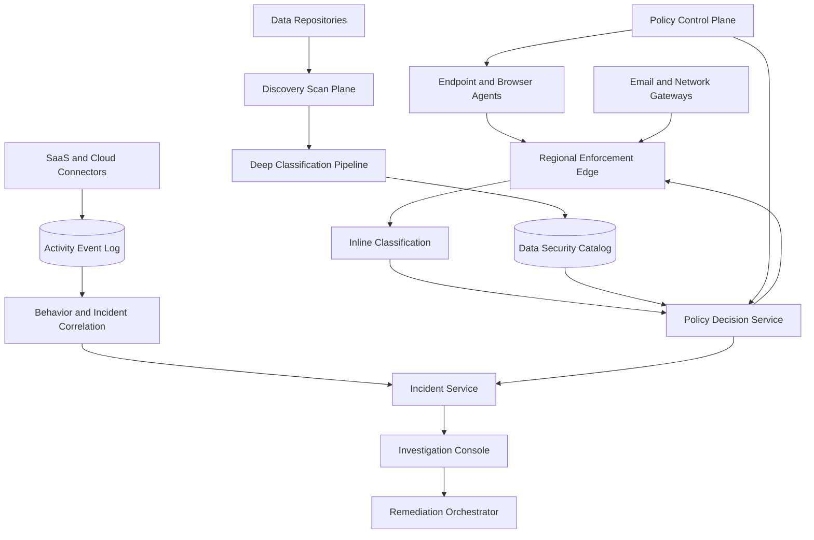
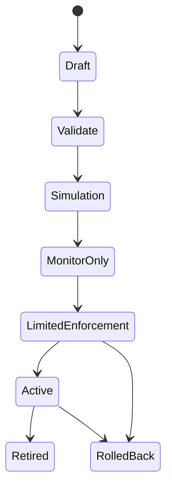
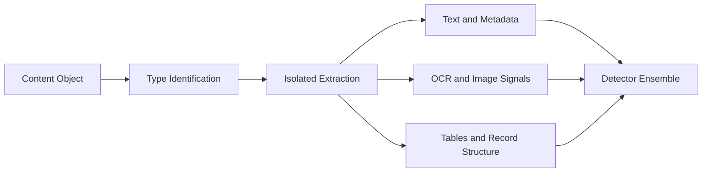
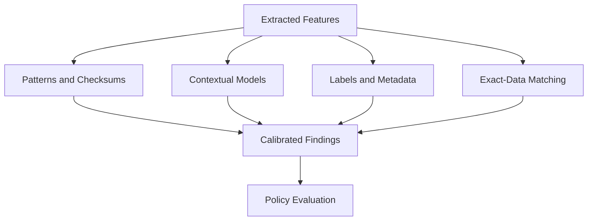
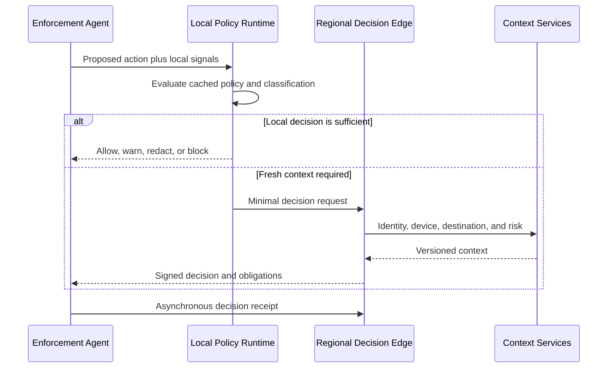
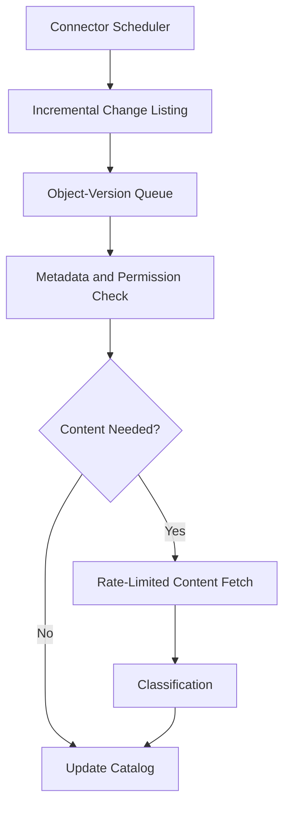
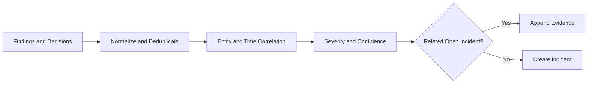
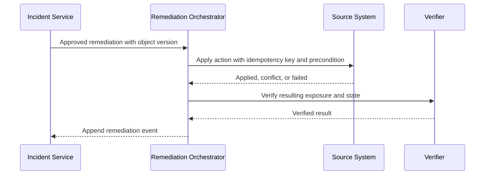
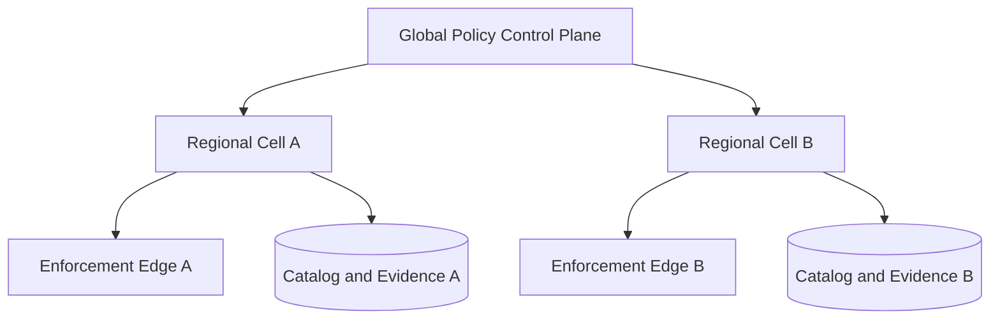

## Problem and requirements

An enterprise data loss prevention platform identifies sensitive information and controls how it moves through endpoints, browsers, email, SaaS applications, networks, and cloud storage. It must stop genuine leaks without interrupting normal work every time an employee copies a customer number or shares an internal document.

The system operates across two very different paths. Inline controls must decide within milliseconds whether to allow an action. Asynchronous discovery scans enormous repositories, correlates behavior over time, and opens incidents for investigation. Both paths must evaluate the same versioned policy and produce explainable evidence.

### Functional requirements

- Discover sensitive data in files, messages, databases, SaaS records, and object stores
- Inspect uploads, downloads, email, clipboard, printing, removable media, and sharing changes
- Classify data through patterns, fingerprints, labels, machine learning, and business metadata
- Combine content findings with user, device, destination, and behavioral context
- Allow, warn, justify, redact, quarantine, encrypt, or block an action
- Support exact-data matching without distributing plaintext source datasets
- Create deduplicated incidents with evidence and policy lineage
- Route cases to security, privacy, legal, or data-owner reviewers
- Support exceptions, appeals, remediation, and time-bounded overrides
- Measure coverage, false positives, policy effectiveness, and agent health

### Non-functional requirements

- Process one hundred billion telemetry and inspection events per day
- Make common inline decisions in under 100 milliseconds at p99
- Continue safely during regional, policy, or classifier failures
- Keep tenant data, fingerprints, incidents, and keys isolated
- Prevent DLP administrators from browsing sensitive content unnecessarily
- Support data residency and region-specific policy
- Make every action reproducible from immutable inputs and policy versions
- Avoid turning endpoint agents into a new exfiltration or privilege-escalation path

## Capacity estimates

Assume ten million protected users, hundreds of millions of governed data objects, and one hundred billion daily events. Most events contain metadata only; a smaller fraction require content extraction or inline inspection.

| Resource | Estimate |
| --- | ---: |
| Average incoming events | 1.16M/second |
| Peak inline decisions | 5M/second |
| Repository objects scanned | Billions/day |
| Content processed | Petabytes/day |
| Classification findings | Tens of billions/day |
| Actionable incidents | Millions/day before deduplication |

Do not send every byte to a central service. Inspect near the action, cache safe policy artifacts locally, and upload only the evidence required for policy and investigation.

## Core concepts

Separate four layers that are often incorrectly combined:

| Layer | Question |
| --- | --- |
| Classification | What sensitive data appears in this object? |
| Context | Who is acting, from which device, toward what destination? |
| Policy | Is this action permitted for this data and context? |
| Response | What is the least disruptive effective control? |

A document can remain classified as confidential while different actions are allowed for its owner, an approved partner, and an unknown personal account.

## Data model

```text
DataAsset {
  assetId, tenantId, source, objectVersion,
  owner, labels, region, classificationVersion
}

Finding {
  findingId, assetRef, detectorId, detectorVersion,
  category, confidence, locationToken, evidenceRef
}

Activity {
  activityId, actorId, deviceId, assetRef,
  action, destination, occurredAt, context
}

Decision {
  decisionId, activityId, policyDigest,
  outcome, reasonCodes, obligations, expiresAt
}
```

Evidence references are immutable and access-controlled. The current incident view is a projection over append-only activity, finding, decision, and remediation events.

## High-level architecture



The control plane compiles human-readable policy into signed artifacts. Enforcement points use those artifacts locally when possible and call regional decision services for context that changes quickly.

## Policy model and lifecycle

A policy includes protected data classes, covered actions, actors, destinations, device posture, exceptions, response actions, severity, and evidence requirements.

```text
IF data.category IN [customer_pii, payment_data]
AND action = upload
AND destination.trust != managed
THEN require_justification OR block
```

Policies are immutable versions. The compiler resolves groups, labels, detector dependencies, precedence, and regional overlays into a deterministic decision bundle.



Replay new policy against historical activity and a labeled test corpus. Monitor-only mode records hypothetical actions without disrupting users. Limited enforcement starts with a small population and reversible responses before broad blocking.

## Content extraction

Documents, archives, images, email, source code, and structured exports require different parsers. Uploaded content is untrusted, so extraction runs in isolated sandboxes with strict CPU, memory, nesting, and decompression limits.



Detect actual file type rather than trusting extensions. Bound archive recursion and decompressed size to resist archive bombs. Password-protected or unsupported content becomes an explicit policy signal, not an automatic safe result.

Store extracted text only when required. Prefer short-lived processing buffers and persist minimal, tokenized evidence around findings.

## Detection techniques

The classifier combines techniques with different precision and cost:

- Regular expressions and checksum validation for structured identifiers
- Dictionaries and tenant-specific keywords
- Named-entity and document-context models
- File labels and trusted application metadata
- Exact-data matching against protected source records
- Document fingerprints for known sensitive files and derivatives
- Image, OCR, and source-code classifiers
- Statistical checks for high-density structured exports



A pattern match alone is rarely sufficient. A 16-digit number near payment terms and a valid checksum is stronger evidence than the same digits in a random test fixture. Detectors emit category, confidence, location, and version; policy determines the action.

## Exact-data matching and fingerprints

Organizations may protect known customer records or sensitive documents. Normalize approved fields, tokenize values with tenant-specific keyed functions, and build protected indexes. Enforcement points submit compatible tokens or privacy-bounded candidates instead of receiving the plaintext source dataset.

For documents, compute multiple fingerprints over normalized text, sections, and structural features. This detects copied excerpts and format conversions while tolerating benign edits.

Fingerprint stores are isolated by tenant and purpose. Queries must not reveal whether arbitrary guessed values exist. Rotate keys and rebuild indexes through versioned migrations without disabling protection.

## Inline enforcement path

Endpoint, browser, email, and network controls need predictable latency.



The agent sends hashes, labels, counts, and bounded snippets only when policy requires them. It should not upload an entire document merely to ask whether a destination is managed.

Decisions include obligations such as show warning, collect justification, apply encryption, watermark, or quarantine. The enforcement point acknowledges which obligations it successfully applied.

## Endpoint agent design

The endpoint agent observes covered operations through supported operating-system interfaces. It separates a small privileged enforcement component from parsers, UI, telemetry, and update logic.

Security requirements include:

- Signed binaries, configuration, and policy bundles
- Mutual authentication with device-bound credentials
- Protected local storage and tamper events
- Least-privilege components and sandboxed content parsing
- Atomic updates with health checks and rollback
- Bounded CPU, memory, disk, and network use
- Offline policy with explicit freshness and failure semantics

Agents publish health, policy version, feature coverage, and enforcement acknowledgements. A silent or outdated agent is a coverage gap, not a healthy device with zero incidents.

## SaaS and cloud discovery

Connectors inventory files, records, permissions, sharing links, labels, and activity through provider APIs. Each connector maintains a durable cursor and uses idempotent object-version processing.



Honor provider rate limits and use change feeds where available. Periodic reconciliation catches missed events and deleted objects. Store external object IDs, versions, and cursors per tenant and connector.

Discovery findings can trigger remediation such as removing a public link, applying a label, changing permissions, or quarantining an object. Every mutation uses preconditions so stale remediation cannot overwrite a user's newer change.

## Data security catalog

The catalog provides a current inventory of assets, classifications, owners, locations, access posture, and lineage. It is not the source of truth for content; it stores references and derived security metadata.

Partition catalog data by tenant, region, and source. Index common filters such as sensitivity, public exposure, stale ownership, and high-risk location. Changes append to an event log so policy and analytics can react without repeatedly scanning the full catalog.

Classification has a freshness timestamp and detector version. A stale “no sensitive data” result must not be treated as permanent proof that an actively edited file remains safe.

## Behavioral context

Content alone cannot distinguish routine work from suspicious movement. Context signals include identity risk, device management, destination trust, unusual volume, first-seen application, role changes, termination status, and historical baselines.

Behavior models produce bounded signals rather than autonomous employee verdicts. Shared accounts, new projects, travel, backups, and accessibility tooling can all look anomalous.

Use transparent features where possible, require corroboration for high-impact actions, and restrict workforce analytics to legitimate security purposes. Regional employment and privacy rules may prohibit particular signals or automated actions.

## Decision actions

Use the least disruptive response that adequately reduces risk.

| Action | Example |
| --- | --- |
| Allow and log | Low-risk internal movement |
| Warn | Sensitive content sent to an unusual but permitted destination |
| Require justification | Legitimate exceptions need a recorded business reason |
| Transform | Redact fields, watermark, or apply encryption |
| Quarantine | Hold email or file for review |
| Block | Clear high-confidence violation with no safe exception |
| Revoke | Remove an exposed share or access grant |
| Escalate | Create a high-priority incident and preserve evidence |

Warnings should be specific enough to help users correct mistakes but must not reveal detector internals. Justifications are structured, time-bounded, and auditable; they are not a universal bypass.

## Offline and failure behavior

Each policy declares failure semantics by action and data class. A managed internal copy may continue under a recently verified local bundle, while uploading highly sensitive data to an unknown destination may fail closed.

Policy bundles include issue time, expiry, compatibility range, and signature. Agents reject invalid bundles and retain the last verified version until its safe expiry. Emergency revocations can shorten validity or disable a compromised detector.

Do not make all operations fail closed. A broad endpoint or network outage that blocks every user action can become an enterprise-wide incident and encourages users to evade controls.

## Incident correlation

One user action may create many detector findings and telemetry events. Correlation groups them by actor, asset, destination, session, policy, and time window.



Severity considers data sensitivity, record count, destination, action success, actor risk, and prior related events. A blocked action may be lower urgency than a successful public exposure, even if both matched the same policy.

Incidents reference immutable evidence and decisions. Later classification changes add superseding findings instead of rewriting history.

## Investigation and review

Route incidents by data owner, jurisdiction, policy, severity, and required expertise. Reviewers receive a minimum-necessary view with sensitive fields masked until explicitly revealed.

The console presents timeline, asset lineage, actor and device context, destination, policy explanation, enforcement outcome, related events, and available remediation. Every reveal, export, comment, assignment, and status change is audited.

Reviewers can mark benign activity, confirm a violation, request more information, invoke remediation, or grant a scoped exception. High-impact actions require approval separation.

## Exceptions and appeals

Exceptions specify subject, data category, destination, action, purpose, approver, start, expiry, and compensating controls. They are evaluated as policy objects, not hidden allow-list entries.

Short-lived just-in-time exceptions are safer than permanent exclusions. Notify owners before expiry and automatically remove stale exceptions.

Users need a channel to challenge an incorrect block or classification. A reversal preserves the original decision, publishes a superseding result, and feeds a quality-review queue rather than silently modifying audit history.

## Remediation orchestration

Remediation spans systems that may fail independently.



The orchestrator retries safe operations, pauses on conflicts, and verifies final state. It never deletes or revokes access based on stale object versions without explicit policy authorization.

## Multi-region and tenant isolation

Regional cells handle content inspection, evidence, incidents, and catalog data. A global control plane distributes signed policy metadata and aggregates privacy-safe health metrics.



Tenant IDs scope every object, key, queue, cache, and index. Large or regulated tenants can receive dedicated cells and encryption roots. Evidence does not cross regions unless policy, residency, and incident workflow all permit it.

## Security and privacy

A DLP platform sees an organization's most valuable information. Protect it with:

- Envelope encryption using tenant- and region-scoped keys
- Purpose-based service identities and short-lived credentials
- Separate evidence, catalog, analytics, and control-plane stores
- Tokenized identifiers in telemetry and aggregate analytics
- Strict evidence access with field-level reveal auditing
- No sensitive content in general logs or traces
- Tamper-evident policy, decision, and administrative events
- Retention and deletion workflows per evidence class

Never use captured content for unrelated model training by default. Evaluation corpora require explicit governance, minimization, access boundaries, and retention.

## Reliability and degradation

| Failure | Safe behavior |
| --- | --- |
| Regional decision edge unavailable | Evaluate fresh signed policy locally where supported |
| Deep classifier delayed | Preserve work and use only approved high-confidence local signals |
| Identity context unavailable | Apply policy-specific cached context or cautious fallback |
| SaaS connector throttled | Back off, preserve cursor, and expose growing coverage lag |
| Catalog unavailable | Inline enforcement continues from local findings and policy |
| Incident pipeline delayed | Enforcement continues and events remain durably buffered |
| Agent update fails | Roll back atomically and report unhealthy coverage |
| Key service unavailable | Pause sensitive inspection rather than write plaintext evidence |

Reserve decision capacity for interactive controls. Discovery and rescans should yield during an inline traffic surge.

## Observability and quality

Track both operational health and policy outcomes:

- Inline decision latency and availability by enforcement point
- Agent coverage, policy freshness, and tamper status
- Connector cursor lag and repository scan coverage
- Extraction and detector errors by content type
- Finding precision, recall, and calibration by data class
- Warning override, justification, block, and appeal rates
- Incident deduplication, queue age, and remediation completion
- Policy simulation deltas and rollout regressions
- Evidence access, retention, and deletion compliance

Removal or block counts are not success metrics. A useful program reduces confirmed unsafe exposure while keeping false blocks, investigation burden, and user disruption within explicit budgets.

Suggested service objectives include p99 local inline decisions below 100 milliseconds, 99.99% decision-path availability, 99% of healthy agents on a current policy bundle within 15 minutes, and critical public exposures surfaced within five minutes.

## Key tradeoffs

### Endpoint inspection versus centralized inspection

Endpoint inspection sees user intent and avoids moving full content, but agents are difficult to secure and maintain. Central inspection simplifies updates but adds latency, bandwidth, and privacy risk. Use a hybrid design.

### Precision versus coverage

Broad detectors find more possible leaks and create more false positives. Combine detector confidence with destination and behavior context, then stage enforcement gradually.

### Blocking versus coaching

Blocking stops an action but can disrupt legitimate work. Warnings and guided remediation teach safer behavior, yet determined attackers can ignore them. Match response strength to confidence and consequence.

### Rich evidence versus privacy

More captured content helps investigators but increases breach and insider risk. Store structured findings and minimal excerpts, revealing source content only when necessary.

### Unified policy versus regional autonomy

A shared policy language improves consistency. Regional overlays handle law and business practice but increase testing and precedence complexity. Compile the final effective policy explicitly.

## Evolution path

1. Start with SaaS discovery, a small detector library, a data catalog, and monitor-only policy.
2. Add email and browser enforcement, warnings, incident correlation, and structured exceptions.
3. Introduce endpoint controls, exact-data matching, document fingerprints, and automated remediation.
4. Expand to regional cells, behavior context, privacy-preserving analytics, and dedicated tenant isolation.
5. Mature with continuous policy simulation, adaptive response, coverage verification, and measurable false-positive budgets.

## Final design

The platform combines local, low-latency enforcement with asynchronous repository discovery and behavioral correlation. Sandboxed extractors produce versioned findings, while a separate policy engine evaluates content, actor, device, destination, and action context. Signed policy bundles allow safe local decisions, and regional services supply rapidly changing context without centralizing every byte.

All findings, decisions, exceptions, and remediation steps form an immutable evidence trail. Incidents are deduplicated and reviewed through minimum-necessary access, while staged policy rollout prevents a detector mistake from disrupting the enterprise. The result is a DLP system that protects valuable data at scale without treating every legitimate data movement as a breach.
