## Problem and requirements

An enterprise knowledge platform gives teams a durable place to create, organize, discover, review, and govern documentation. It supports personal notes, team spaces, policies, runbooks, product documentation, meeting records, and public help centers.

The difficult part is combining open collaboration with strict information boundaries. Pages change while people read them, permissions can be inherited through complex hierarchies, search must never leak restricted text, and old but highly ranked content can be more dangerous than missing content.

### Functional requirements

- Create pages from blank documents and templates
- Edit collaboratively with comments, mentions, and suggestions
- Preserve complete version history and support restoration
- Organize pages into spaces, trees, collections, and labels
- Link pages, resolve backlinks, and detect broken references
- Share with users, groups, guests, domains, or public viewers
- Search titles, content, attachments, people, and metadata
- Publish approved documentation and public help centers
- Review, verify, archive, and expire stale knowledge
- Import and export common document formats
- Subscribe to page, space, and search updates
- Expose secure APIs and webhook events

### Non-functional requirements

- Support 100 million users and ten billion pages
- Process one million edit operations per second
- Return ordinary page loads within 200 milliseconds at p99
- Keep permission changes effective within seconds
- Prevent restricted content from leaking through search, caches, previews, or analytics
- Preserve immutable history for governed content
- Continue reading cached authorized pages during partial outages
- Respect tenant, regional, retention, and deletion policy

## Capacity estimates

Assume ten billion pages, 100 versions per active page on average, two megabytes of attachments per page, and 100 million daily active users.

| Resource | Estimate |
| --- | ---: |
| Pages | 10B |
| Page versions and edit operations | Trillions |
| Attachments | Exabyte scale over long retention |
| Search queries | Millions/second |
| Edit operations | 1M/second peak |
| Permission relationships | Hundreds of billions |
| Link graph edges | Trillions |

Immutable versions and attachments belong in object storage; current page state, hierarchy, permissions, and indexes use purpose-built transactional and derived stores.

## Core data model

```text
Space {
  spaceId, tenantId, type, ownerId,
  parentSpaceId, policyVersion, homeRegion
}

Page {
  pageId, spaceId, parentPageId, title,
  currentVersion, state, ownerId, updatedAt
}

PageVersion {
  pageId, version, contentManifestHash,
  authorId, baseVersion, createdAt, changeSummary
}

Grant {
  resourceId, principalId, role,
  effect, inheritedFrom, version
}
```

Page IDs remain stable across title changes and moves. Slugs and paths are aliases that redirect to the stable ID.

## High-level architecture

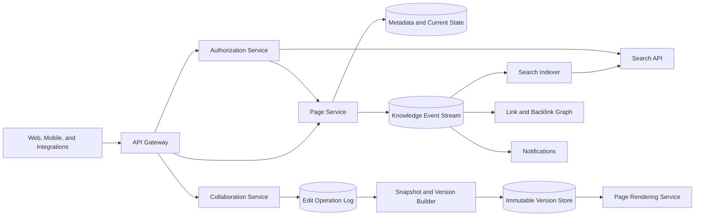

The metadata store owns current page pointers and hierarchy. Immutable snapshots and operation logs preserve history. Search, backlinks, analytics, and notifications are derived consumers.

## Page content model

Represent documents as structured blocks rather than raw HTML.

```text
Document
  Heading
  Paragraph
    Text marks and links
  TaskList
  Table
  CodeBlock
  MediaEmbed
  ChildPageList
```

Structured content supports semantic editing, accessible rendering, safe transformation, fine-grained collaboration, and reliable exports.

Unknown block types remain preserved but render through a safe fallback. Clients declare schema support before editing to avoid deleting content they do not understand.

## Creating and updating pages

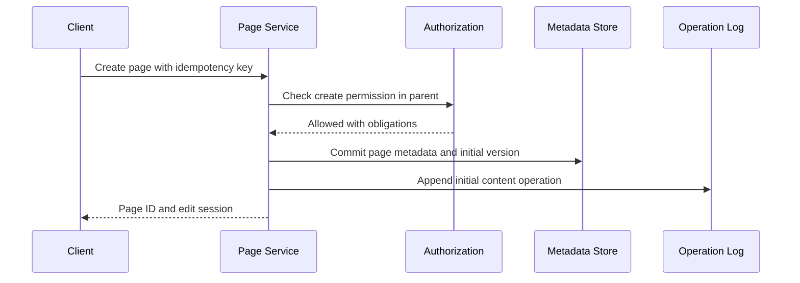

Page creation, initial version, and event outbox commit atomically. Retries return the same page ID.

Ordinary metadata edits use optimistic concurrency. Structural moves and permission changes validate current hierarchy versions to avoid lost updates.

## Realtime collaboration

Editors send operations over persistent regional connections. A collaboration room is scoped to one page and active draft branch.

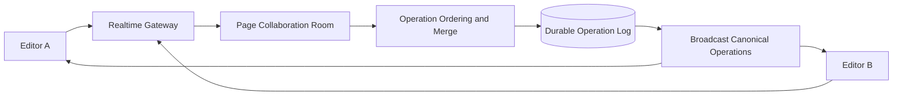

Use operational transformation or a CRDT with stable node identities. Every operation carries page, branch, actor, client sequence, base clock, and idempotency key.

Presence, cursor positions, and typing indicators are ephemeral. Content operations are acknowledged only after durable append.

If a client misses operations, it requests the gap; if the gap has compacted, it loads the latest snapshot and resumes from its watermark.

## Snapshots and version history

The operation log is compacted into immutable snapshots based on time, operation count, manual publish, or workflow transition.

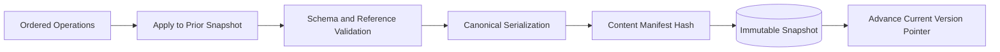

Version history records author set, time range, base version, change summary, approval state, and content hash.

Restoring a prior version creates a new head version referencing the restored snapshot. It does not delete later history.

## Offline editing

Offline clients retain a snapshot, operation watermark, and local operations. On reconnect, the server merges operations against intervening changes.

Text and independent block edits often merge automatically. Destructive structural conflicts—such as two users deleting and moving the same subtree—surface a conflict view rather than silently discarding work.

The server remains authoritative for permissions. If edit access was revoked while offline, the client can export its local draft but cannot publish it to the page.

## Spaces and hierarchy

Spaces define ownership, default permissions, region, retention, templates, and publishing policy. Pages form a tree for navigation but can also appear in collections and labels.

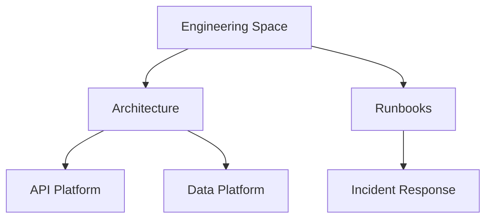

Store parent pointers plus a materialized ancestry path or closure index. Parent pointers simplify moves; the derived ancestry index accelerates subtree reads and permission inheritance.

Moving a large subtree updates one authoritative parent link, then asynchronously refreshes derived paths and navigation indexes under a hierarchy epoch.

## Authorization model

Permissions combine tenant role, space policy, inherited page grants, direct grants, group membership, guest scope, classification, and link-sharing policy.

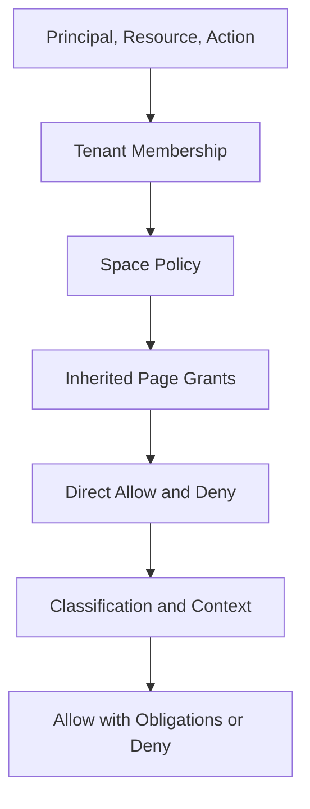

Roles can include viewer, commenter, editor, publisher, owner, and permission manager. Explicit deny can override inherited allow for sensitive subtrees.

Authorization responses carry a policy version and obligations such as watermarking, download restriction, field redaction, or no external sharing.

## Permission caching and revocation

Cache decisions by principal, resource, action, group version, hierarchy epoch, and policy version. Omitting any changing input risks stale access.

Permission and group changes publish high-priority invalidations to page gateways, search, CDN, preview, and export services.

Sensitive actions perform an authoritative check rather than relying only on cache. Cached allows have short TTLs; explicit denials can be cached longer.

## Page rendering

Render structured documents into a safe intermediate representation. Sanitize links, code, embeds, styles, and user-generated HTML.

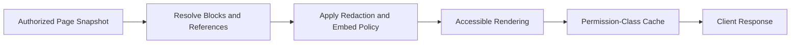

Cache only by safe permission class when content is identical for all members of that class. Highly personalized redaction should bypass shared caches.

Embeds use isolated frames, allowlisted providers, signed resource tokens, and explicit data-sharing boundaries.

## Links and backlinks

Links reference stable page IDs, while display text and current paths are presentation details.

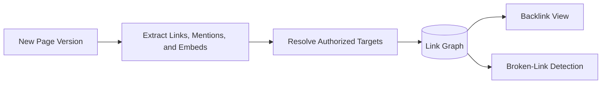

Backlinks are filtered through viewer authorization. The existence of a restricted source page must not leak through counts or titles.

Deleting or moving a page preserves a tombstone and redirect history. Link repair tools can propose updates without rewriting old page versions.

## Search indexing

The index document contains tenant, space, page ID, title, headings, body text, labels, owners, update time, language, classification, and authorization metadata.

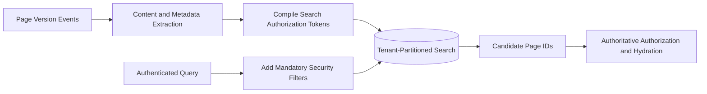

Index only published or current versions according to space policy. Draft branches and comments require separate authorization dimensions.

Reauthorize top results before returning snippets. This protects against index lag after access revocation.

## Search ranking

Rank by text relevance, title and heading matches, page quality, freshness, verification status, link authority, team affinity, and user context.

Do not let popularity permanently elevate obsolete pages. Apply freshness and verification signals, and demote content past its review deadline.

Diversify results across spaces and page types. Explain important ranking factors such as “verified by Security” or “updated last week.”

## Semantic retrieval

Generate embeddings from authorized published page chunks, storing tenant, page, chunk, version, region, and security tokens alongside vectors.

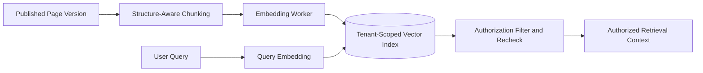

Permission filtering must happen during candidate retrieval and again before content return. Post-filtering alone can leak through timing, scores, or insufficient candidates.

When a page changes or access is revoked, invalidate old vectors by page version and policy version. Retrieved answers should cite source page and version so users can inspect the evidence.

## Comments, mentions, and suggestions

Comments anchor to stable document nodes and version ranges. If text changes, an anchoring algorithm attempts to relocate the comment and marks uncertain anchors as detached.

Suggestions are proposed operations that an authorized editor can accept or reject. Acceptance records both proposer and accepter in version history.

Mentions create notification intents only after verifying the mentioned principal can access the page. Never notify someone with a title or snippet from a restricted page.

## Templates

Templates are versioned page or space blueprints containing content blocks, metadata requirements, child-page structure, permissions, and review policy.

Instantiating a template creates independent pages pinned to one template version. Later template changes do not rewrite existing content.

Organization templates can require fields such as owner, system, data classification, review date, and approver before publication.

## Draft, review, and publication

Governed spaces separate mutable drafts from published versions.

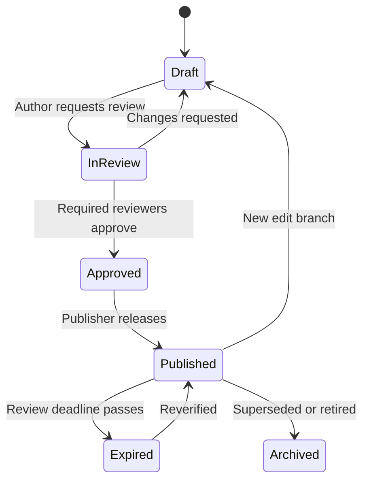

Approvals bind reviewer identity to a content hash. Any content change after approval invalidates approvals unless policy classifies it as non-material.

Published pages retain author, reviewers, policy, source version, and validity window.

## Knowledge freshness

Each governed page has an owner, review cadence, verification state, and next review date.

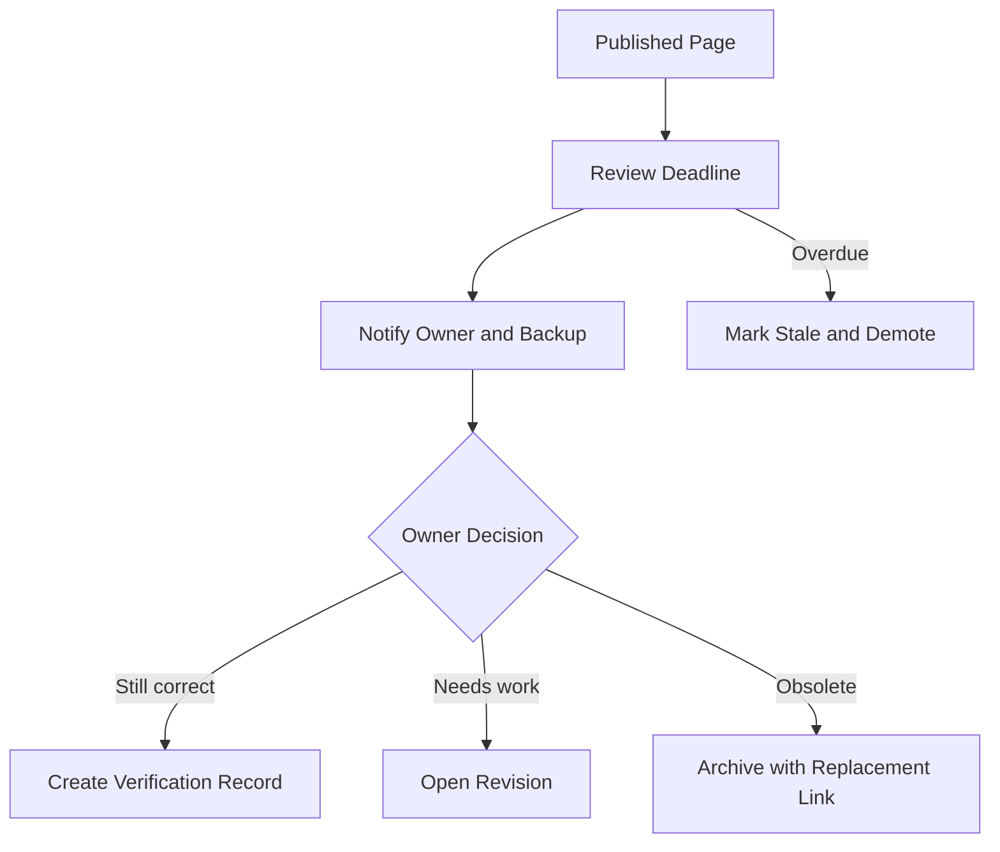

Verification is a signed metadata event referencing the page version; it does not create a content version unless content changes.

Stale pages remain discoverable with warnings where policy permits, but high-risk operational content may expire from default search until reviewed.

## Attachments

Clients upload attachments directly to quarantine storage with short-lived page-scoped tokens.

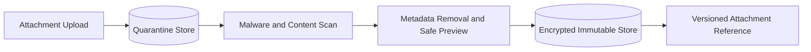

An attachment version is immutable. Replacing a file creates a new object and page version.

Downloads recheck page and attachment permissions and use short-lived signed URLs. Preview services run in isolated sandboxes.

## Imports

Imports from document systems, file archives, or other wikis run as durable jobs.

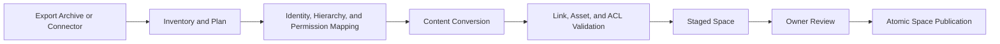

Use stable source IDs and idempotency keys so retries do not duplicate pages. Preserve original files and conversion warnings.

Permission mappings that cannot be represented fail closed and enter review rather than broadening access.

## Exports

Exports run asynchronously against a fixed space or page version snapshot. The export manifest lists included pages, versions, attachments, permission handling, checksums, and omissions.

Encrypt export packages, expire download links, and audit requester, reason, scope, row count, and destination.

Public publishing generates a separate sanitized artifact rather than exposing the internal page store directly.

## Public help centers

Public spaces compile approved pages into cacheable static or server-rendered artifacts with navigation, search, localization, and custom domains.

Only explicitly published fields and attachments cross into the public artifact store. Internal comments, history, drafts, backlinks, permissions, and analytics metadata remain private.

Public search uses its own index. This prevents an authorization mistake in enterprise search from exposing internal content externally.

## Notifications and subscriptions

Users can watch pages, subtrees, spaces, labels, or saved searches. Events create notification intents for edits, comments, mentions, publication, verification, and stale status.

Deduplicate by event, recipient, subscription, and channel. Batch high-volume changes into digests.

Before delivery, recheck access. A user removed from a space must not receive a delayed email containing restricted snippets.

## Change feeds and webhooks

Expose ordered tenant-scoped change feeds with page version, action, actor, source, and event ID. Webhooks are signed and delivered at least once.

Consumers maintain checkpoints and deduplicate event IDs. They fetch content through the authorized API rather than receiving sensitive full page bodies by default.

## Multi-region design

Assign each tenant or regulated space a home region for page state, operations, attachments, search, and encryption keys.

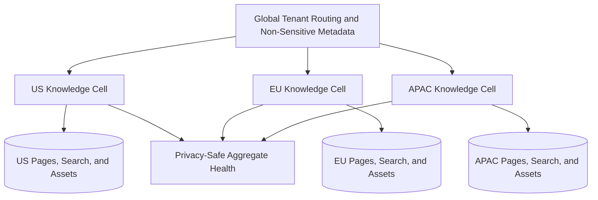

Nearby edges can cache authorized immutable assets, but mutations route to the home region. Cross-region collaboration may add latency to preserve a single ordered operation stream.

Failover promotes a replica under a higher tenant epoch. Realtime rooms reconnect, reload the latest snapshot, and replay unacknowledged idempotent operations.

## Retention and deletion

Retention can differ for drafts, published policies, comments, attachments, audit events, and deleted pages.

Deleting a page creates a tombstone immediately, removes it from ordinary navigation and search, and starts an asynchronous purge across versions and derived stores when policy allows.

Legal or investigation holds prevent purge but restrict ordinary access. Final deletion emits a signed disposition record without retaining the removed content.

Backups replay deletion manifests before serving restored data.

## Security and privacy

- Derive tenant and principal scope from authenticated identity
- Authorize every page, attachment, comment, search, and export
- Encrypt page versions, operation logs, attachments, and indexes
- Apply field and block redaction for classified content
- Use short-lived guest, public-share, download, and embed tokens
- Audit views of sensitive pages, exports, sharing, and impersonation
- Prevent arbitrary scripts, unsafe HTML, and unrestricted embeds
- Rate-limit scraping, enumeration, and bulk export
- Detect secrets and credentials before publication where policy requires
- Keep analytics and AI retrieval tenant scoped and permission aware

Page titles, URLs, link graphs, and search suggestions can be sensitive even when body text is protected. Apply the same authorization discipline to metadata.

## Reliability and failure handling

| Failure | Safe behavior |
| --- | --- |
| Edit operation repeats | Client operation ID deduplicates it |
| Collaboration node fails | Client reconnects and resumes from durable watermark |
| Snapshot worker crashes | Replay operations from prior immutable snapshot |
| Search indexing lags | Page reads work; reauthorization protects stale results |
| Permission invalidation is delayed | Sensitive reads perform authoritative checks |
| Attachment scanner fails | Keep upload quarantined and unavailable |
| Link graph is unavailable | Page editing continues; backlinks become stale |
| Notification retries | Stable intent suppresses duplicate delivery |
| Region fails | Promote fenced replica and replay operations idempotently |

Every derived subsystem can rebuild from metadata, immutable page versions, and the ordered event stream.

## Observability and SLOs

Track:

- Page load, create, edit, and snapshot latency
- Realtime connection count, operation lag, conflicts, and reconnects
- Permission-decision latency, cache hit rate, and invalidation age
- Search indexing lag, zero-result rate, and reauthorization denials
- Link extraction and broken-link backlog
- Attachment scan age and preview failures
- Review deadlines, stale pages, and ownerless content
- Import conversion errors and export queue age
- Notification delivery and stale-access suppression
- Regional replication and ownership epoch

Useful SLOs include 99.99% authorized page-read availability, 99.9% of acknowledged edits visible to collaborators within one second, and permission revocations enforced on sensitive reads within five seconds.

## Key trade-offs

| Decision | Benefit | Cost |
| --- | --- | --- |
| Structured documents | Safe rendering and semantic tooling | Schema evolution complexity |
| Durable operation log | Realtime merge and full history | Compaction and storage overhead |
| Immutable versions | Auditability and restoration | More storage |
| Inherited permissions | Manageable large spaces | Complex caching and invalidation |
| Derived search index | Fast discovery | Eventual consistency and ACL indexing |
| Stable page IDs | Links survive moves and renames | Alias and redirect management |
| Home-region ownership | Residency and clear write order | Cross-region editing latency |

## Evolution path

1. Build pages, spaces, immutable versions, and basic permissions.
2. Add realtime collaboration, comments, mentions, and attachments.
3. Introduce permission-aware search, backlinks, and notifications.
4. Add review workflows, verification, stale-content governance, and templates.
5. Deploy imports, public help centers, APIs, and regional cells.
6. Add permission-aware semantic retrieval with page-version citations.

Start with stable page identity, immutable versions, and authorization beneath every read path. Search and AI features amplify both useful knowledge and permission mistakes.

## Final design

Store knowledge as structured pages with stable IDs, ordered collaborative operation logs, and immutable content snapshots. Organize pages in spaces with versioned inherited permissions, then enforce those permissions in page reads, search retrieval, snippets, attachments, backlinks, caches, exports, and semantic indexes. Drive search, link graphs, notifications, analytics, and freshness workflows from a durable page event stream. Bind approvals and verification to content hashes, preserve restoration as a new version, and mark stale knowledge explicitly rather than letting popularity hide age.

The central principle is that discovery must inherit the same trust boundary as storage. A knowledge platform succeeds only when users can find the right current answer quickly without learning that a restricted page exists, seeing stale advice presented as truth, or losing the history behind a published decision.
