## Problem and requirements

An incident management platform receives alerts from monitoring systems, determines who is responsible, reliably notifies responders, coordinates active incidents, communicates impact, and preserves a timeline for learning afterward.

The system must work when everything else is failing. Alert storms, regional outages, broken identity providers, unavailable chat tools, and sleeping responders are normal operating conditions. The design prioritizes durable ingestion, independent delivery channels, deterministic escalation, and simple degraded operation.

### Functional requirements

- Ingest alerts from monitoring, security, and application systems
- Normalize, deduplicate, group, suppress, and correlate alerts
- Resolve schedules, overrides, and escalation policies
- Notify responders through push, SMS, voice, email, and chat
- Track acknowledgements, handoffs, escalations, and resolution
- Create incident rooms, roles, tasks, notes, and timelines
- Publish internal and public status updates
- Attach services, dependencies, runbooks, dashboards, and changes
- Generate post-incident reviews and action items
- Report response performance and operational health

### Non-functional requirements

- Accept ten million alerts per minute during a large outage
- Persist alerts before acknowledging ingestion
- Begin critical paging within seconds
- Continue escalation during control-plane and regional failures
- Avoid paging thousands of people for one underlying failure
- Preserve a complete, ordered audit timeline
- Isolate tenants and sensitive incident details
- Support offline and low-bandwidth responder workflows

The platform coordinates response. It does not decide whether an alert is meaningful without input from service owners and monitoring policy.

## Capacity estimates

Assume one million responders, one million services, and ten million peak alerts per minute during correlated infrastructure failure.

| Resource | Average | Peak assumption |
| --- | ---: | ---: |
| Alert ingestion | 100K/minute | 10M/minute |
| Notification attempts | Tens of thousands/minute | Millions/minute |
| Active incidents | Thousands | Hundreds of thousands |
| Schedule lookups | Millions/day | Bursty during alert storms |
| Timeline events | Billions retained | Long audit retention |

The steady state is inexpensive. Correlated failure creates the real capacity requirement and may simultaneously degrade dependencies such as messaging providers.

## Core domain model

- **Service:** an owned production capability with dependencies and runbooks
- **Team:** responders and policy for one or more services
- **Schedule:** time-based assignment of responders
- **Escalation policy:** ordered notification targets and delays
- **Alert:** normalized signal from one source event
- **Alert group:** related alerts sharing response state
- **Incident:** coordinated response to user or business impact
- **Notification:** one delivery attempt through one channel
- **Timeline event:** immutable record of response activity
- **Action item:** tracked follow-up after the incident

Alerts can open incidents automatically or remain grouped signals awaiting human promotion. One incident can contain several alert groups.

## High-level architecture

The critical paging path is intentionally small and independent from collaboration features.

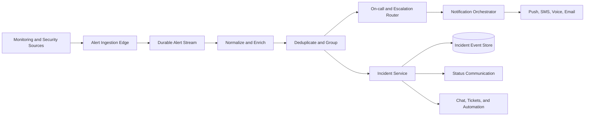

Chat rooms, dashboards, analytics, and ticket synchronization can fail without stopping page delivery and escalation.

## Alert ingestion API

```http
POST /v1/integrations/monitoring/alerts
Authorization: Bearer <integration-token>
Idempotency-Key: alert-source-82-event-1842
Content-Type: application/json

{
  "sourceEventId": "evt_1842",
  "service": "checkout-api",
  "severity": "critical",
  "state": "firing",
  "summary": "Checkout error rate above 20%",
  "dedupKey": "checkout:high-error-rate",
  "occurredAt": "2026-10-27T14:21:08Z",
  "links": [{ "label": "Dashboard", "url": "https://monitoring.example/..." }]
}
```

The gateway authenticates the integration, derives tenant scope, applies size and rate limits, validates timestamps, and durably appends the event before returning success.

Stable source IDs make retries idempotent. Invalid payloads enter bounded diagnostics, never an unbounded retry loop.

## Alert normalization

Connectors translate vendor-specific events into a canonical schema.

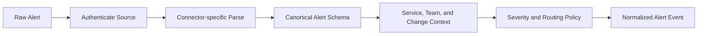

Preserve the original payload in protected storage for debugging, subject to retention and sensitive-data policy.

Enrichment uses versioned service catalog data. A missing catalog entry must not discard a critical alert; route it to a tenant default or operations team with an explicit reason.

Never let a source supply trusted tenant, responder, or policy identity freely.

## Deduplication

Repeated firing events for the same condition should update one alert group rather than create repeated pages.

The primary key combines tenant, integration, and source deduplication key. If the source cannot provide one, derive a bounded fingerprint from service, alert type, dimensions, and normalized summary.

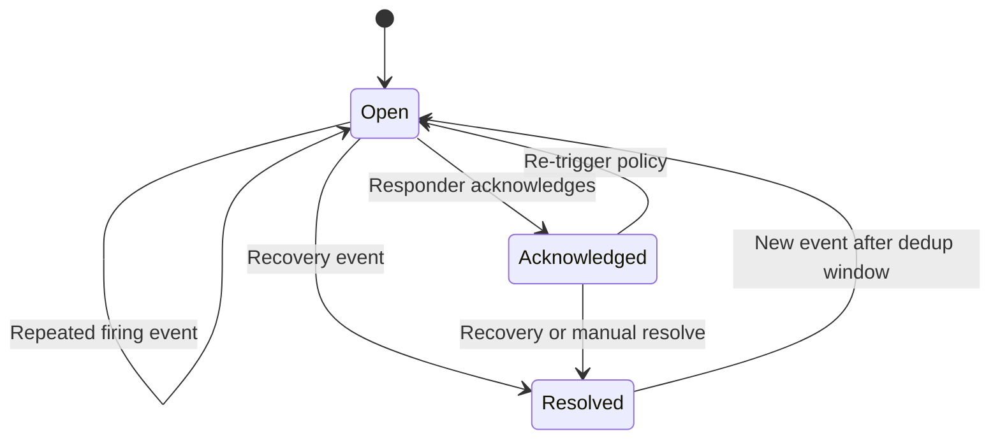

Deduplication windows are policy-driven. A recurrence after resolution may reopen the group or create a new occurrence while retaining the shared fingerprint.

## Grouping and correlation

Grouping combines alerts likely to share one response. Correlation links different alert groups to one underlying incident.

Useful signals include service dependencies, shared region, deployment, error fingerprint, topology, and timing.

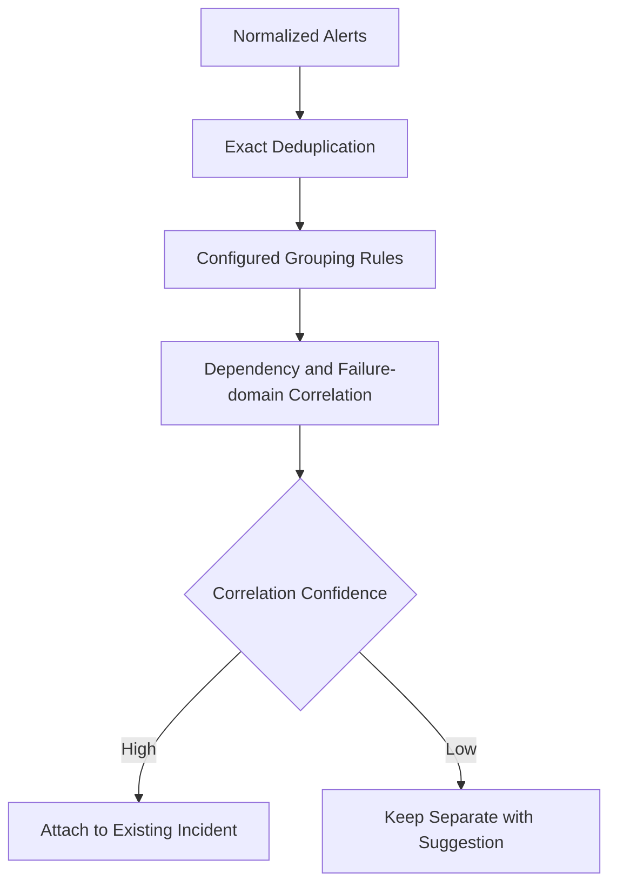

Automatic correlation must be reversible and explainable. Incorrectly merging unrelated failures can hide important pages.

Use rules for deterministic safety and models only as advisory unless confidence and rollback behavior are well tested.

## Noise suppression

Maintenance windows, dependency suppression, rate controls, and flapping detection reduce noise.

If a database incident is already open, dependent API symptoms can be attached without paging every downstream team—unless their service has distinct customer impact requiring action.

Suppression never deletes events. It records the reason, controlling incident or window, policy version, and expiry.

Critical security and life-safety policies may prohibit suppression. Emergency overrides are time-bound and audited.

During an alert storm, apply fair per-tenant processing and aggregate repeated updates while preserving new critical fingerprints.

## On-call schedules

Schedules consist of rotations, layers, time zones, restrictions, and overrides.

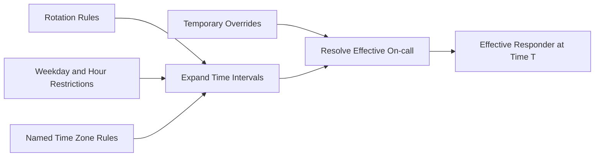

Store named time zones, not fixed UTC offsets, so daylight-saving changes follow the intended local schedule.

Precompute future intervals for fast paging, but retain source rules and compiler version. Overrides have explicit start, end, author, and reason.

Validate schedules for coverage gaps and overlapping ambiguity before activation.

## Escalation policies

An escalation policy contains ordered steps such as current primary, secondary, team manager, or broader operations group.

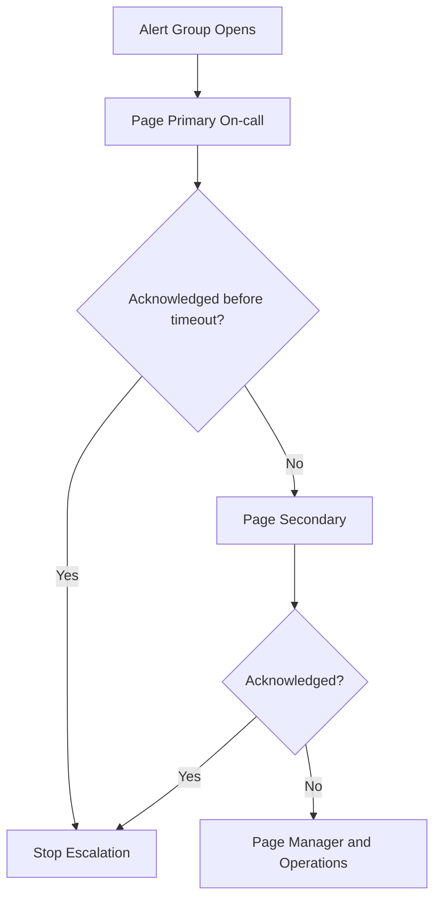

Resolve schedule targets at the time each step executes, not only when the alert begins; long incidents may cross a shift change.

The policy engine persists the next deadline and step before delivery. Failover resumes timers without restarting the entire escalation.

Acknowledgement stops future steps but does not erase already queued provider deliveries.

## Durable timers

Escalations, reminders, handoffs, and status-update deadlines depend on timers that survive process failure.

Partition timers by due time and tenant. Keep near-term buckets in memory and long-term deadlines in durable storage.

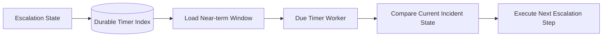

The worker uses expected escalation version, so a stale timer cannot page after acknowledgement or resolution.

Scan overlapping windows after failover. Duplicate timer firing is safe because notification commands are idempotent.

## Notification orchestration

The orchestrator chooses channels based on user preferences, severity, policy, quiet hours, and channel health.

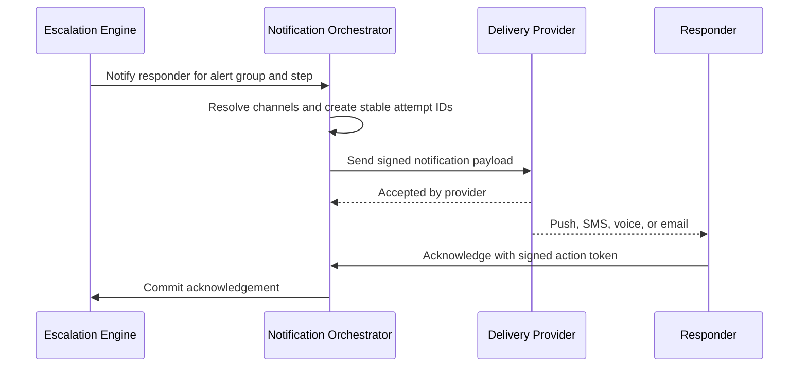

Provider acceptance is not responder acknowledgement. Track queued, provider-accepted, delivered where known, failed, and acknowledged separately.

Retry transient provider failures with jitter and fail over to another channel or provider under policy.

## Channel design

### Push

Fast and rich, but depends on device connectivity and notification permissions.

### SMS

Broad reach, limited content, and susceptible to delay and spoofing. Use signed short links or response codes without sensitive incident detail.

### Voice

Useful for critical escalation. Interactive prompts collect acknowledgement and escalation response.

### Email

Good for context and lower urgency, but weak for guaranteed wake-up.

No single channel is reliable enough for every critical event. Severity policy defines channel order and parallelism.

## Acknowledgement security

Acknowledging a page changes operational state. Authenticate the responder and bind the action to tenant, alert group, notification, and expiry.

One-time SMS or email links are high-entropy, short-lived, and reveal minimal data before login. Voice and SMS replies use correlation tokens resistant to guessing and replay.

An acknowledgement records responder, channel, time, policy step, device or session, and request ID.

Users can decline or request escalation rather than falsely acknowledge an incident they cannot handle.

## Incident state machine

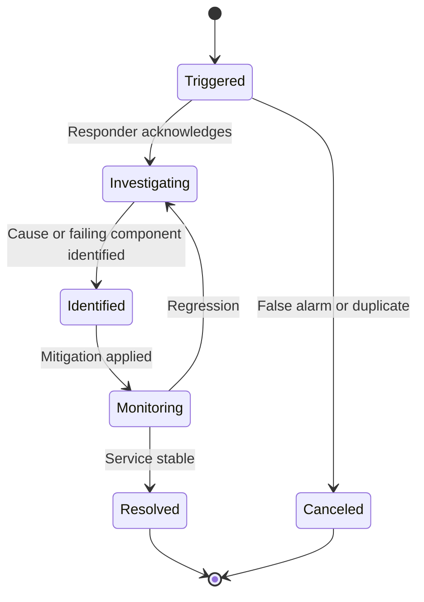

State names are customizable, but transitions remain versioned events. Resolution requires a summary, and high-severity incidents may require impact and follow-up owners.

An incident can remain open after pages resolve if coordination or customer impact continues.

## Incident roles and command

Explicit roles reduce confusion:

- Incident commander coordinates decisions and priorities
- Operations lead drives technical mitigation
- Communications lead manages stakeholder updates
- Scribe maintains timeline and decisions
- Subject-matter experts investigate assigned areas

Role assignment is versioned and supports handoff. One person can temporarily hold several roles for small incidents.

The platform prompts for missing critical roles at high severity but does not block urgent mitigation.

## Incident timeline

Every meaningful action becomes an append-only timeline event:

- Alerts fired, grouped, acknowledged, and resolved
- Notifications and escalation transitions
- Incident state, severity, and role changes
- Deployments, feature flags, and infrastructure changes
- Notes, decisions, commands, and links
- Status updates and stakeholder messages
- Automated remediation and validation results

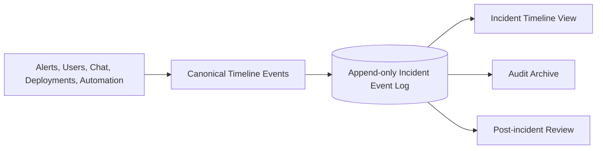

Edits create superseding events rather than rewriting history. Sensitive notes can have narrower access while retaining audit evidence.

## Collaboration integrations

The platform can create a chat room, video bridge, ticket, and document from an incident template.

Integration failures do not block paging or incident creation. Durable tasks retry and show which resources failed to provision.

Commands from chat are authenticated through the integration and reauthorized by the incident platform. A chat-room membership alone does not grant production action rights.

Mirror key events between systems using stable IDs to prevent echo loops.

The canonical incident timeline remains in the incident platform even if chat history expires.

## Runbooks and automation

Services attach versioned runbooks containing diagnosis steps, safe mitigations, owners, and dependencies.

Automated actions—restart a service, disable a feature, fail over traffic—use a separate workflow engine with least-privilege identity, approval policy, idempotency, and rollback.

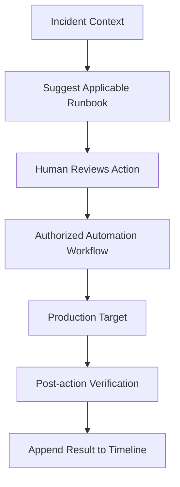

Do not execute arbitrary commands pasted into incident chat with platform credentials.

Automation should reduce repetitive work without hiding which action ran, who approved it, or what it changed.

## Status communication

Internal and public status updates are separate views of one incident. Public communication reveals approved impact and progress without exposing internal systems or hypotheses.

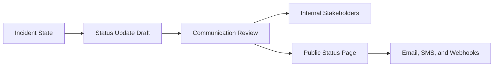

Status components map to customer-facing products, not internal service names. Component health can be operational, degraded, partial outage, or major outage.

Updates are immutable versions with author and publish time. Corrections append a new update.

Subscriber delivery is asynchronous and at least once.

## Service catalog and dependency graph

The service catalog stores owner, on-call policy, tier, runbooks, dashboards, repositories, deployments, dependencies, and customer-facing components.

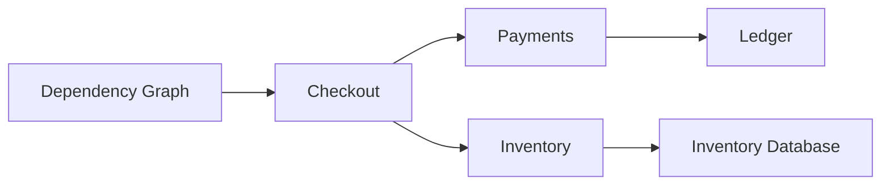

Alert enrichment uses the graph to suggest blast radius, owners, and correlated incidents. During a dependency failure, downstream symptoms can be grouped with the parent incident.

Catalog data is versioned and continuously checked for ownerless or uncovered services.

Inferred runtime dependencies supplement declared ones but do not silently overwrite ownership policy.

## Change correlation

Ingest deployment, configuration, feature flag, infrastructure, and access events. Show recent changes near the incident start and affected services.

Correlation is evidence, not proof. Rank changes by service relationship, time, scope, and failure-domain overlap.

An incident responder can mark a change as suspected, ruled out, causal, or mitigating. These labels improve later analysis.

Rollback actions reference the exact change and append results to the timeline.

## Post-incident review

After resolution, generate a review draft from structured timeline events.

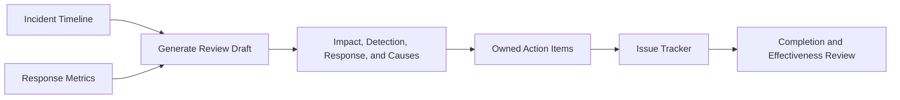

The review focuses on system conditions and decision context rather than individual blame.

Action items have owner, due date, priority, linked risk, and verification method. Closing a ticket is not evidence that recurrence risk decreased; follow-up checks measure effectiveness.

Sensitive security incidents may use restricted templates and retention.

## Reliability metrics

Useful metrics include:

- Time to detect
- Time to acknowledge
- Time to engage the correct owner
- Time to mitigate
- Time to resolve
- Time between status updates
- Escalation depth
- Alert-to-incident ratio
- Repeated incident rate
- Action-item completion and effectiveness

Metrics need context. A longer resolution may reflect careful recovery rather than poor response, and aggressive paging can improve acknowledgement while causing burnout.

Measure alert quality, ownership coverage, and automation outcomes alongside responder speed.

## On-call health and fairness

Track page volume, overnight interruptions, escalation frequency, and consecutive high-severity shifts. Use this data to improve systems and staffing, not punish responders.

Schedule validators identify gaps, excessive consecutive hours, and stale contacts. Teams can define follow-the-sun rotations and handoff windows.

The platform should support quiet hours for ordinary notifications, but critical on-call pages follow explicit duty policy.

Responders can declare temporary unavailability, causing a bounded override and audit event rather than silent missed pages.

## Multi-tenancy and privacy

Every service, alert, schedule, notification, incident, and timeline event belongs to a tenant.

Roles separate integration management, schedule administration, incident response, status publishing, analytics, and audit export.

Incident details may include customer data, security findings, phone numbers, and internal topology. Apply field-level access, encryption, redaction, retention, and export policy.

Do not expose private incident summaries in push or SMS previews when device privacy cannot be trusted.

Tenant quotas cover ingestion, notification attempts, integrations, responders, incidents, status subscribers, and retained data.

## Multi-region architecture

Alert ingestion occurs in the nearest healthy region. Each alert group and incident has one home partition for ordered state transitions.

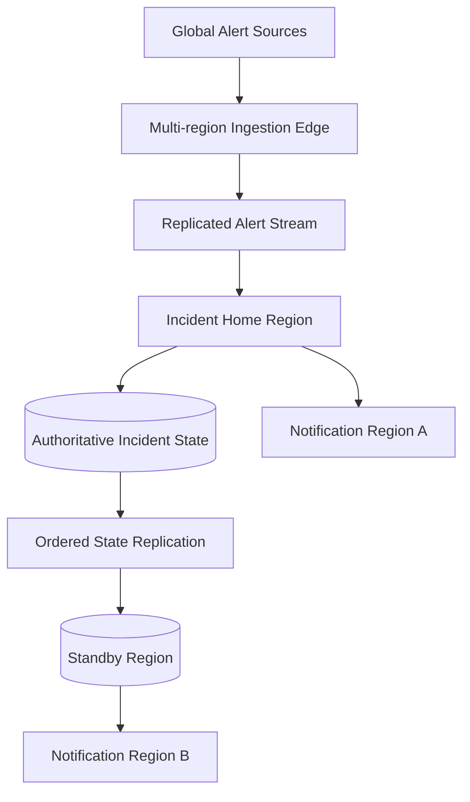

Notification attempt IDs and escalation epochs prevent both regions from paging independently after failover.

Provider connections are diversified by region and vendor. Control-plane writes may pause briefly while paging continues from durable escalation state.

Read-only incident views can use regional replicas with visible freshness.

## Failure handling

### Alert source retries

Deduplicate stable event IDs and update one alert occurrence.

### Alert storm

Prioritize new critical fingerprints, aggregate repeats, enforce fair tenant queues, and shed optional enrichment before durable ingestion.

### Schedule service unavailable

Use precomputed effective intervals and last known valid policy. Alert on schedules nearing the end of cached coverage.

### Notification provider fails

Retry with jitter, switch provider or channel, and continue escalation. Record provider acceptance separately from acknowledgement.

### Primary region fails

Promote standby at a known state sequence, fence old epochs, resume durable timers, and suppress duplicate attempts by stable IDs.

### Chat integration fails

Core paging and incident timeline continue. Retry room creation and event mirroring asynchronously.

### Identity provider unavailable

Existing responder sessions and signed acknowledgement tokens continue briefly under policy. High-risk administrative changes pause.

### Bad routing configuration

Retain versioned prior policy, canary changes, provide simulation, and support atomic rollback. Tenant default escalation remains a last-resort route.

## Observability for the incident platform

Track:

- Ingestion rate, errors, duplicates, and durable lag
- Normalization and enrichment failures
- Deduplication and correlation ratios
- Open alert groups and incident creation delay
- Schedule coverage and lookup freshness
- Escalation timer lag and overdue steps
- Notification attempts by channel, provider, and outcome
- Acknowledgement latency and escalation depth
- Timeline and integration backlog
- Status publication and subscriber delivery
- Regional replication and failover epochs
- Tenant quotas and alert-storm suppression

Synthetic alerts continuously test ingestion, routing, paging, acknowledgement, escalation, incident creation, status publication, and regional failover.

The platform should page its own operators through an independently tested path, avoiding complete self-dependency.

## Key tradeoffs

### Aggressive grouping vs missed distinction

Grouping reduces noise but can hide unrelated failures. Exact deduplication is automatic; broader correlation should be explainable and reversible.

### Fast paging vs enrichment

Waiting for every catalog and topology lookup adds context but delays response. Page with minimum trustworthy routing data, then enrich asynchronously.

### One provider vs diversified channels

One notification vendor simplifies operations but creates correlated failure risk. Multiple providers and channels improve resilience while complicating delivery state and cost.

### Automation vs human control

Automated remediation shortens incidents but can amplify a bad diagnosis. Scoped workflows, approvals, idempotency, and verification bound the risk.

### Rich timelines vs sensitive-data exposure

Detailed evidence improves response and learning but can contain secrets and customer data. Structured events, redaction, access policy, and retention are mandatory.

The central principle is to keep the critical path—durable alert, owner resolution, notification, acknowledgement, and escalation—small, deterministic, and independent from optional collaboration systems.
