## Problem and requirements

An IoT device management platform operates physical fleets throughout their lifecycle. It establishes device identity, connects constrained hardware securely, collects telemetry, maintains desired configuration, delivers commands, rolls out firmware, and retires compromised or obsolete devices.

The difficult part is that devices are not reliable servers. They lose power, stay offline for months, run old software, connect through unstable networks, have limited CPU and storage, and may be physically accessible to attackers. The platform must make progress without assuming continuous connectivity or synchronized clocks.

### Functional requirements

- Register manufactured devices and ownership claims
- Provision unique cryptographic identities
- Authenticate devices and authorize per-device operations
- Maintain device inventory, health, and lifecycle state
- Ingest telemetry and route it to product systems
- Store desired and reported device configuration
- Deliver commands with expiry and acknowledgement
- Deploy firmware and application updates in controlled waves
- Detect unhealthy, compromised, or noncompliant devices
- Rotate keys and revoke device access
- Transfer device ownership safely
- Decommission devices and erase retained data

### Non-functional requirements

- Manage one billion devices and 100 million concurrent connections
- Process ten million messages per second globally
- Absorb reconnect storms after network or power restoration
- Preserve per-device message ordering where required
- Continue device operation during cloud control-plane outages
- Isolate tenants, fleets, regions, and device models
- Keep compromised devices from attacking healthy fleet capacity
- Respect regional data residency and retention policies

## Capacity estimates

Assume one billion registered devices, ten percent concurrently connected, and an average connected-device message every ten seconds.

| Resource | Estimate |
| --- | ---: |
| Registered devices | 1B |
| Concurrent connections | 100M |
| Messages | 10M/second average |
| Device state | Several TB before indexes and replicas |
| Telemetry | Petabytes/day depending on payload size |
| Firmware binaries | Millions of model and version artifacts |
| Fleet operations | Billions of per-device tasks |

Connection gateways and telemetry dominate throughput. Registry and fleet operations are lower-volume but require stronger consistency and auditability.

## Device model

```text
Device {
  tenantId, deviceId, model, hardwareRevision,
  lifecycleState, owner, homeRegion,
  identityVersion, firmwareVersion, lastSeenAt
}

Twin {
  deviceId, desiredState, desiredVersion,
  reportedState, reportedVersion, metadata
}

Operation {
  operationId, deviceId, type, payloadRef,
  createdAt, expiresAt, state, attempt
}
```

Use an immutable internal device ID independent of serial number, network address, user account, or certificate subject. Those values can change or be recycled.

## Device lifecycle

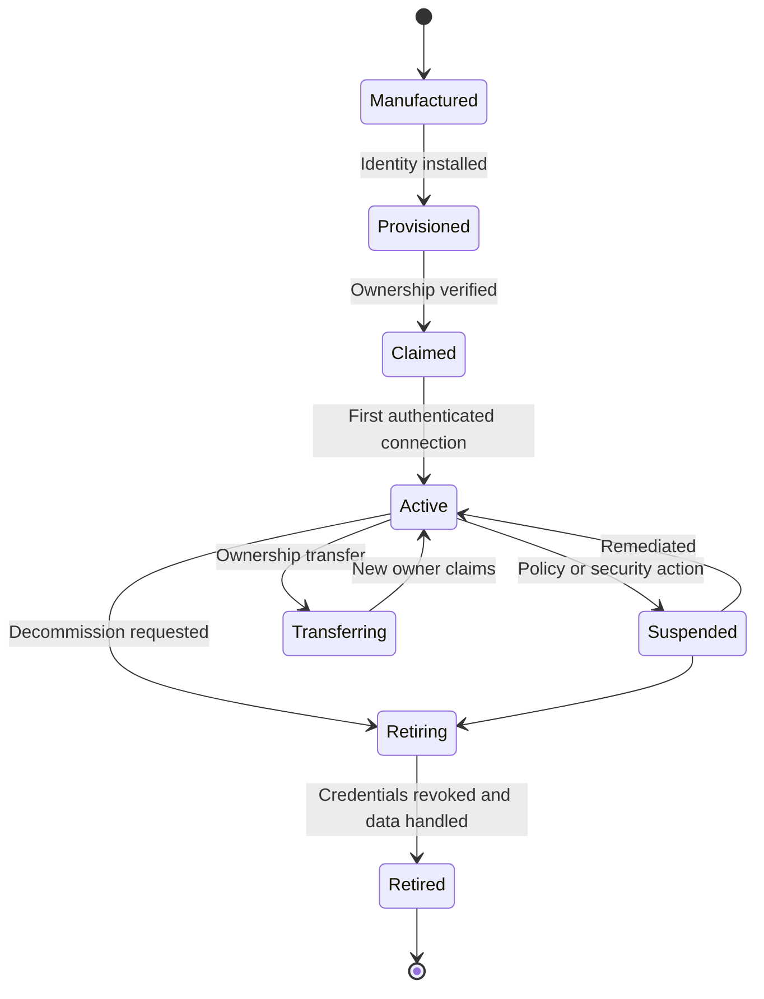

Every transition is versioned and audited. A retired device ID is tombstoned so delayed messages or factory resets cannot silently reactivate it.

## High-level architecture

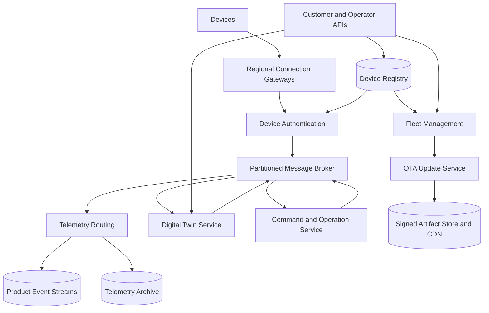

The global control plane stores fleet intent and metadata. Regional data planes terminate connections and process messages so ordinary device traffic does not depend on a single global service.

## Manufacturing and provisioning

Provision a unique identity before or during first activation.

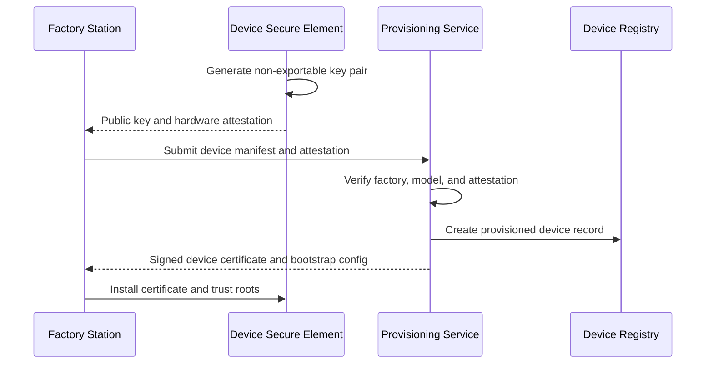

Prefer keys generated inside a secure element so private material never leaves the device. If factory injection is necessary, use isolated stations, encrypted transfer, dual control, and per-device secrets rather than a shared fleet key.

Manufacturing manifests are signed and contain serial number, model, hardware revision, public key, batch, and factory identity. Duplicate serials or keys are quarantined.

## Ownership claiming

A device should not become attached to an account merely because someone knows a serial number.

Claiming combines a short-lived physical proof—QR code, one-time code, local pairing, or possession challenge—with an authenticated user and an unclaimed registry record.

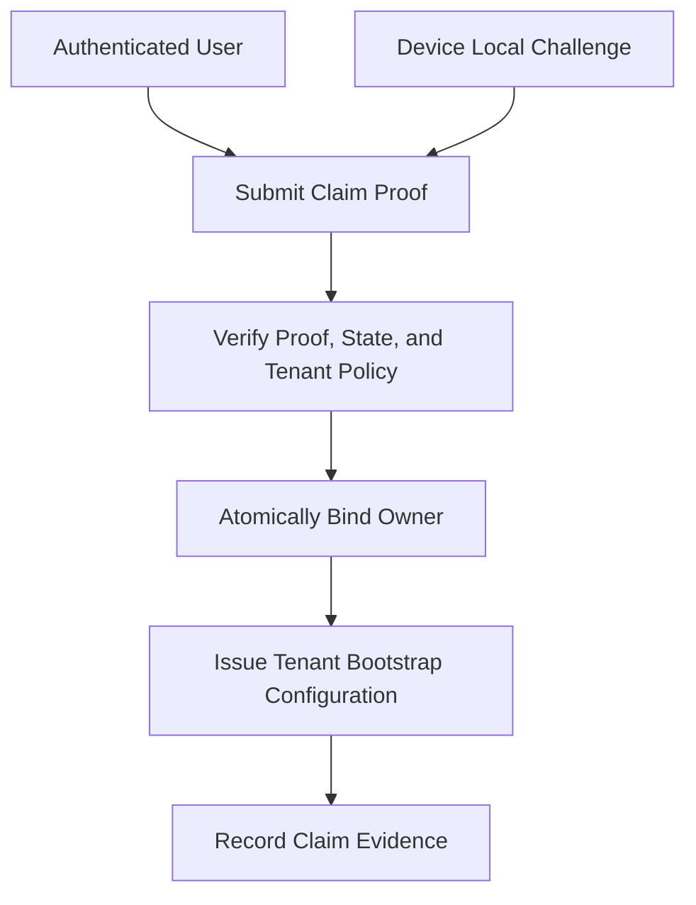

Rate-limit claim attempts and avoid revealing whether a serial number exists. Ownership transfer revokes previous user access, rotates tenant-scoped secrets, clears private state according to policy, and requires confirmation from the physical device or existing owner.

## Connectivity protocols

Support lightweight persistent protocols such as MQTT and, where needed, HTTPS or constrained-device transports.

Connection gateways perform:

- Mutual authentication
- Tenant and device authorization
- Protocol framing and topic validation
- Connection and message rate limiting
- Session resumption
- Payload size and schema checks
- Keepalive and last-will handling

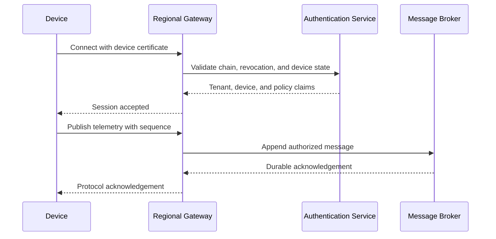

Bind the authenticated device ID to the session. Never trust a device ID or tenant ID embedded only in a topic or payload.

## Connection routing

Consistent hashing maps a device to a gateway pool and broker partition. Edge load balancers use a token derived from device ID for connection affinity.

Gateways keep minimal durable state. Session subscriptions, pending quality-of-service messages, and sequence checkpoints live in a replicated session store or broker log so another gateway can resume after failure.

Connections are long-lived, so deployments drain rather than terminate gateways abruptly. Stop accepting new sessions, wait for existing devices to reconnect elsewhere, and enforce a maximum drain window.

## Reconnect storms

A regional network recovery can cause millions of devices to reconnect simultaneously.

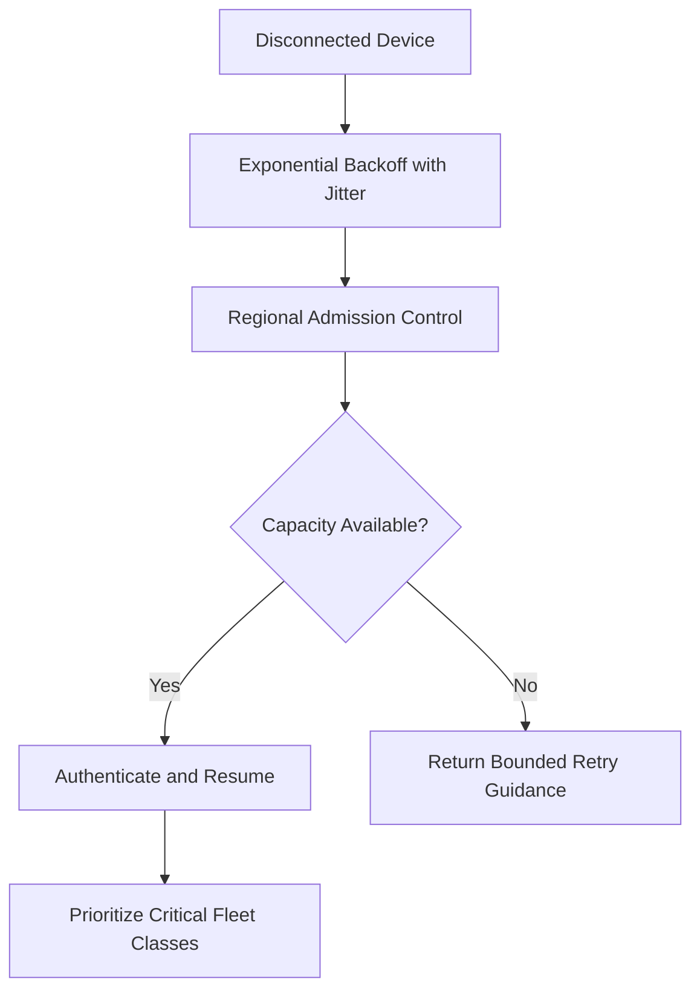

Device SDKs must implement exponential backoff, full jitter, and server-directed retry delays. Persist the backoff state across short reboots where practical.

Gateways reserve capacity for emergency and safety-critical devices. Authentication caches and revocation structures are prewarmed, while expensive fleet reconciliation runs asynchronously after connection acceptance.

## Telemetry ingestion

Telemetry messages carry device ID from the authenticated session, event type, schema version, device sequence, observation time, and payload.

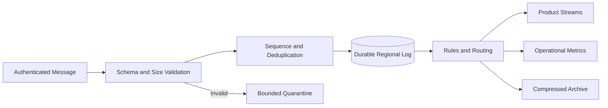

Device clocks are untrusted. Preserve device observation time, gateway receipt time, and clock-quality metadata.

Offer delivery classes:

- Best effort for high-volume disposable measurements
- At least once for ordinary product telemetry
- Persisted-until-acknowledged for critical events

Exactly-once end-to-end semantics are impractical across intermittent devices. Stable message IDs and device sequences allow downstream idempotency.

## Digital twins

A digital twin separates desired state from reported state.

```json
{
  "desired": {
    "samplingIntervalSeconds": 30,
    "mode": "eco"
  },
  "reported": {
    "samplingIntervalSeconds": 60,
    "mode": "normal"
  },
  "desiredVersion": 42,
  "reportedDesiredVersion": 41
}
```

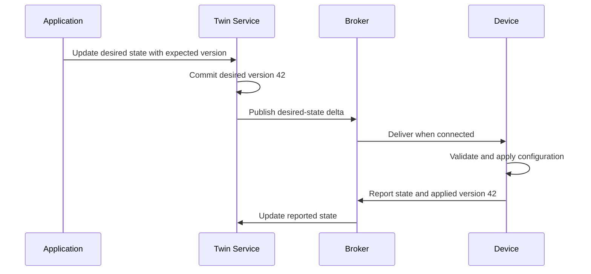

Desired updates use optimistic concurrency. Devices ignore lower versions and report rejection reasons when a configuration is unsupported.

The twin is not a command queue. Desired state represents a convergent condition, while commands represent discrete actions.

## Command delivery

Commands include a unique operation ID, target device, payload, priority, created time, expiry, and execution policy.

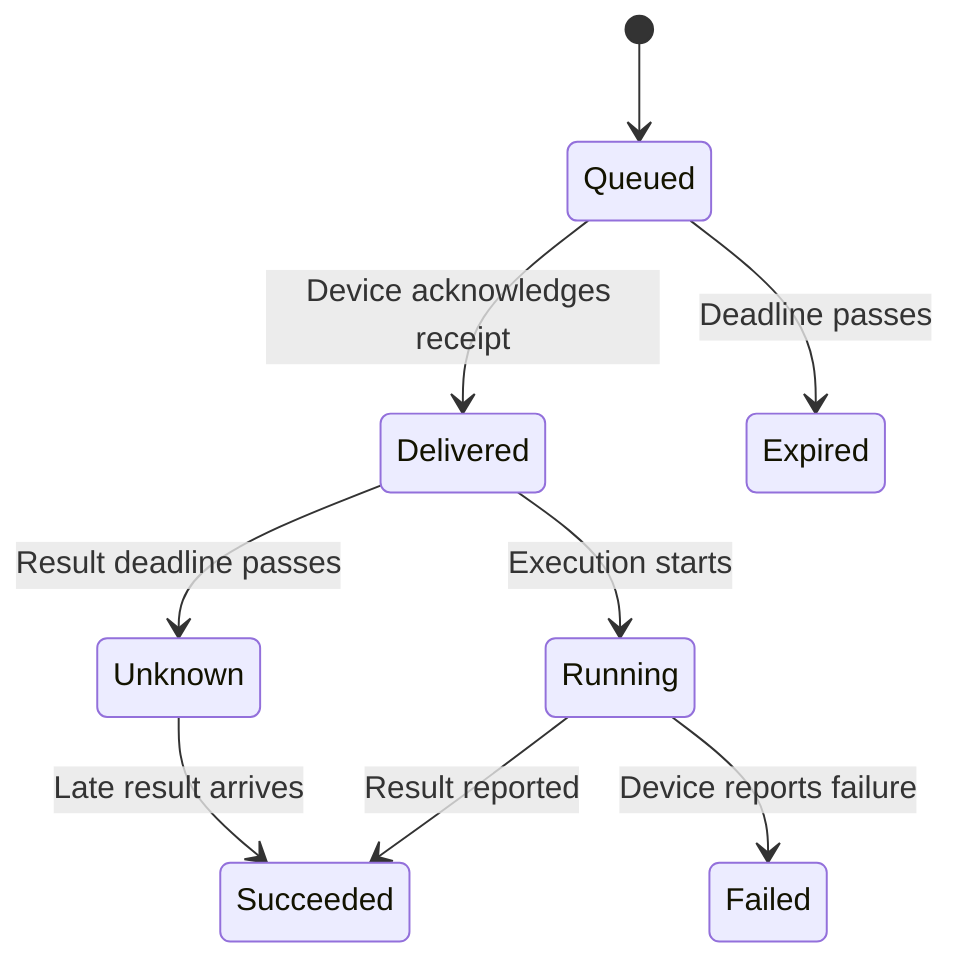

Queue commands durably for offline devices, but never deliver after expiry. A device stores recently executed operation IDs and returns the prior result on duplicate delivery.

Safety-sensitive commands require stronger authorization, explicit device capability, short expiry, and sometimes local physical confirmation. The platform should not treat an acknowledged message as proof that a physical action completed.

## Fleet targeting

Fleets select devices through indexed attributes such as model, hardware revision, region, owner group, tags, and current firmware.

Resolve dynamic selectors into a versioned target snapshot before a large operation. Otherwise membership changes during execution make progress and audit results ambiguous.


Large snapshots live in object storage with checksums and partition manifests. Operation coordinators checkpoint each shard and resume safely after failure.

## Over-the-air updates

An update package contains signed firmware, a manifest, supported models and hardware revisions, minimum bootloader, dependencies, size, hash, rollback policy, and release notes.

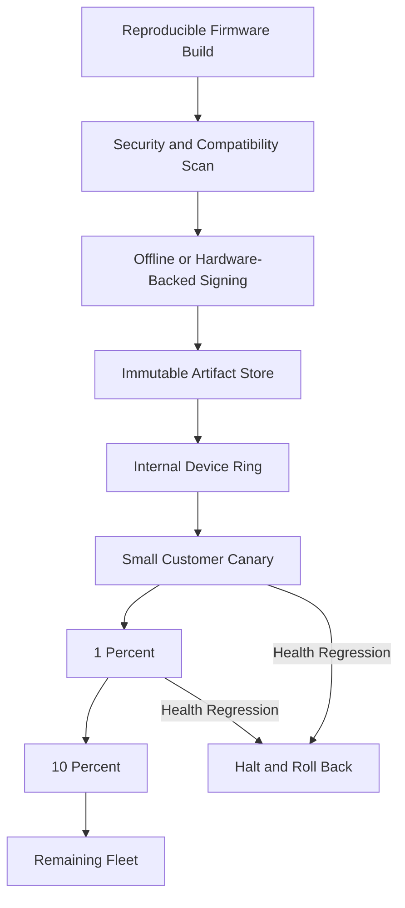

Devices download artifacts from a CDN using short-lived scoped URLs, verify the manifest signature and artifact hash locally, check power and storage, then install through an A/B partition or equivalent rollback-safe mechanism.

The control plane advances waves only after success rate, crash rate, connectivity, battery, and domain-specific health gates pass for a soak period.

## Update protocol

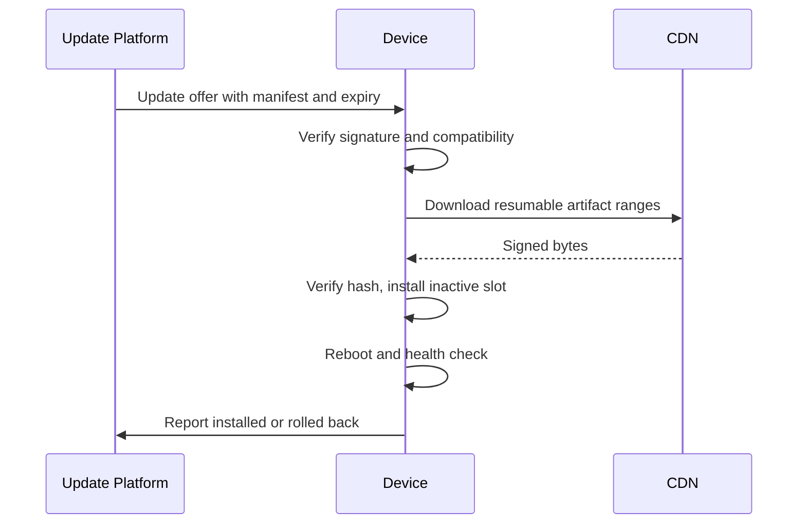

Downloads resume by verified chunks. Devices reject older release counters unless an authorized emergency rollback manifest explicitly permits downgrade.

Never use a fleet-wide shared signing secret. Devices embed trusted public roots, and signing private keys remain offline or hardware protected.

## Rollback and bricking prevention

Firmware updates must survive power loss at every stage. Use atomic boot metadata, verified partitions, watchdog health checks, and a known-good recovery image.

If a new version fails health checks, the bootloader selects the prior slot and reports rollback. The platform halts later waves automatically.

For devices without enough storage for A/B partitions, use smaller delta updates only when the base version is verified, or require local service for high-risk upgrades. Cheap updates are not worth permanently disabling the fleet.

## Device health and compliance

Derive fleet health from connectivity, crash reports, battery, sensor diagnostics, firmware, certificate age, configuration convergence, and message error rates.

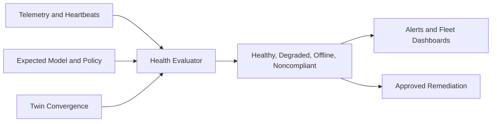

Offline does not always mean unhealthy: low-power sensors may wake weekly. Health policy is model- and fleet-specific.

Automated remediation can retry configuration, rotate credentials, pause an update, or quarantine network access. Destructive actions require explicit policy and audit evidence.

## Credential rotation and revocation

Issue short-lived or bounded-lifetime device certificates where hardware permits. Rotate before expiry through an authenticated session:

1. Device generates a new key pair.
2. Platform validates current identity and device health.
3. Platform issues an overlapping new certificate.
4. Device proves connectivity with the new key.
5. Platform retires the old certificate after a grace period.

Publish compressed revocation data to gateways. For immediate isolation, device state in the regional authorization cache overrides certificate validity.

If a model-wide key or trust anchor is compromised, use a predesigned trust-root rotation path with dual signatures and staged rollout.

## Edge and offline behavior

Devices must continue essential local operation when cloud services are unreachable. Persist configuration, queued critical telemetry, operation deduplication IDs, and update state within device capacity.

Bound offline queues by priority and retention. When storage fills, drop the oldest low-priority data rather than corrupting critical events. Upload buffered data with rate limits after reconnect so recovery does not overload the platform.

Edge gateways can aggregate local devices, translate protocols, run rules, and buffer data. Treat them as managed devices with their own identity and explicitly delegated child-device scope.

## Multi-region architecture

Each device has a home region chosen by tenant policy, manufacturing market, or deployment location. Connections route only to approved regions.

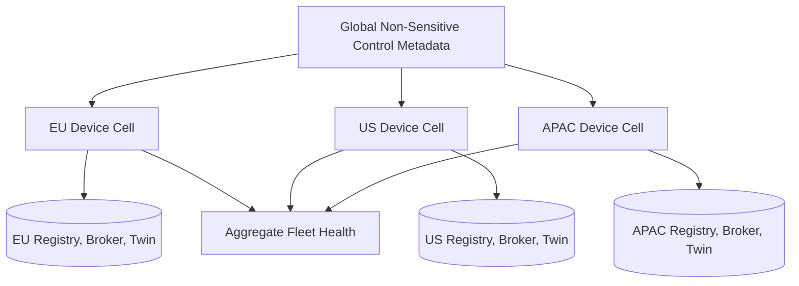

Regional cells contain gateways, broker partitions, registry replicas, twin state, and operation queues. Global services receive only permitted aggregate health and coordinate artifact metadata.

Failover uses a higher regional ownership epoch. Devices discover alternate endpoints from signed bootstrap configuration and reconnect with jitter. The former region is fenced from issuing commands after promotion.

## Consistency model

Registry identity, ownership, revocation, and update-policy changes require strong consistency. Telemetry is append-only and at least once. Twin state is versioned and convergent. Command state is a durable workflow with potentially unknown physical outcome.

Per-device broker partitions preserve ordering for messages routed with the same key. Ordering is not promised across devices or independent topics.

Be explicit about unknown states. A timeout after command delivery cannot prove whether the device executed the action.

## Security model

- Give every device a unique cryptographic identity
- Keep private keys inside secure hardware where possible
- Authorize topic and API access per device and tenant
- Sign firmware and configuration manifests
- Encrypt transport, telemetry archives, twins, and operation payloads
- Apply anti-rollback counters and secure boot
- Rate-limit devices independently to contain compromise
- Separate firmware signers, release approvers, and fleet operators
- Audit claims, transfers, commands, key actions, and rollouts
- Red-team physical extraction, cloned identity, and malicious firmware scenarios

Assume some devices will be compromised. Design blast-radius limits so one extracted credential cannot impersonate a model, tenant, or fleet.

## Reliability and failure handling

| Failure | Safe behavior |
| --- | --- |
| Device retries telemetry | Stable message ID or sequence enables deduplication |
| Gateway crashes | Device reconnects with jitter; durable broker state survives |
| Device is offline | Desired state and unexpired commands wait durably |
| Stale update arrives | Epoch and sequence comparison rejects it |
| Twin delivery repeats | Device ignores an already applied desired version |
| Firmware download stops | Resume verified chunks; do not install partial artifact |
| Device loses power during install | Bootloader selects a verified complete partition |
| Update health regresses | Halt later waves and initiate approved rollback |
| Regional control plane fails | Existing sessions use cached policy; sensitive changes pause |
| Region fails | Devices reconnect to an approved promoted region with backoff |

All cloud workflows are idempotent and checkpointed. Device protocols assume duplicate delivery and delayed acknowledgement.

## Observability and SLOs

Track:

- Registered, active, online, and newly claimed devices
- Connection attempts, authentication failures, and reconnect rate
- Gateway connections, memory, and drain progress
- Message acceptance, broker lag, duplicate rate, and quarantine volume
- Twin desired-to-reported convergence time
- Command delivery, expiry, unknown outcome, and execution latency
- Firmware download, install, rollback, and health by wave
- Certificate expiry, rotation, and revocation propagation
- Offline buffer age and recovery upload volume
- Regional ownership and replication lag

Useful SLOs include 99.99% regional connection acceptance, 99.9% of accepted critical telemetry durably routed within five seconds, and zero rollout advancement after a failed mandatory health gate.

## Key trade-offs

| Decision | Benefit | Cost |
| --- | --- | --- |
| Persistent connections | Low-latency bidirectional messaging | Gateway state and reconnect storms |
| Per-device certificates | Small compromise radius | Manufacturing and rotation complexity |
| Digital twins | Simple offline configuration convergence | Eventual consistency and version handling |
| Durable command queues | Commands survive disconnection | Expiry and unknown outcomes |
| Staged OTA rollout | Limits fleet-wide failures | Slower release completion |
| A/B firmware partitions | Safe power loss and rollback | Additional flash storage |
| Regional cells | Residency and bounded blast radius | More infrastructure and failover logic |

## Evolution path

1. Build registry, unique device identity, authenticated telemetry, and basic health.
2. Add persistent connections, digital twins, and durable commands.
3. Introduce signed OTA artifacts with small staged rollouts.
4. Add fleet snapshots, policy-driven health gates, and automated halt.
5. Deploy regional cells, credential rotation, and ownership transfer.
6. Add edge gateways, advanced compliance, and tested regional failover.

Start with unique identity and secure update foundations. Retrofitting them after millions of devices leave the factory may require physical replacement.

## Final design

Provision every device with a unique hardware-backed identity and register it through signed manufacturing evidence. Terminate authenticated persistent connections at regional gateways, route messages through partitioned durable brokers, and preserve per-device order with epochs and sequences. Keep desired and reported configuration in versioned digital twins, while modeling commands as expiring idempotent workflows with explicit unknown outcomes. Build firmware through a trusted signing pipeline, distribute it through a CDN, and advance immutable fleet snapshots through health-gated waves with device-side verification and rollback-safe boot partitions.

The central principle is to assume intermittent connectivity and partial compromise. Devices, gateways, and cloud workflows must all tolerate delay and duplication, while unique identity, signed software, scoped authorization, and staged operations keep a single failure from becoming a fleet-wide incident.
