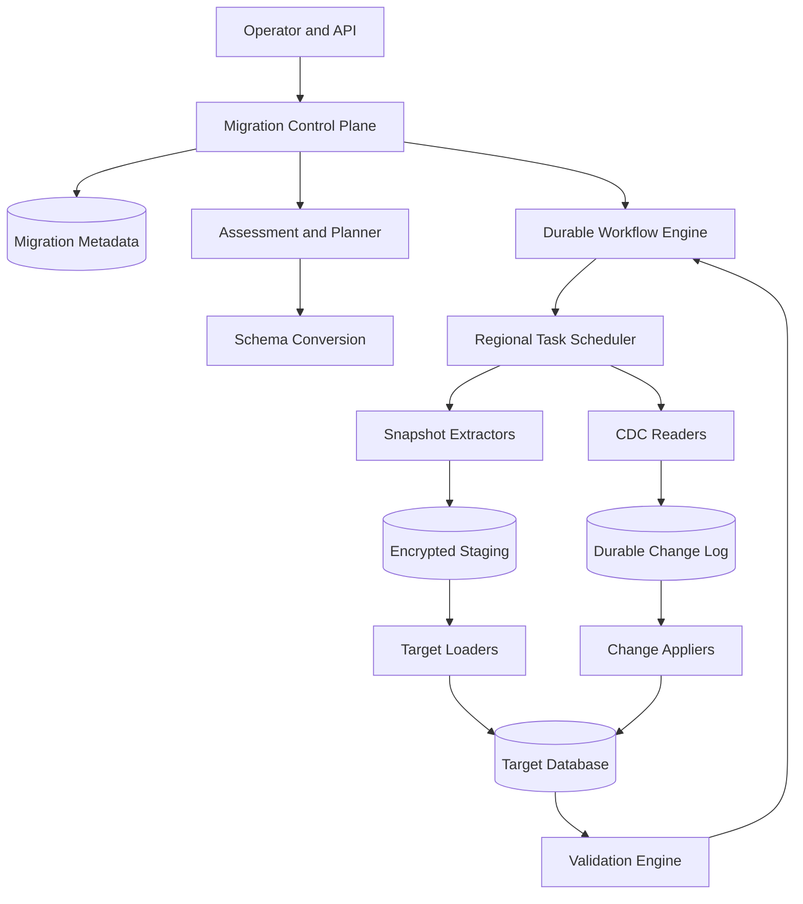
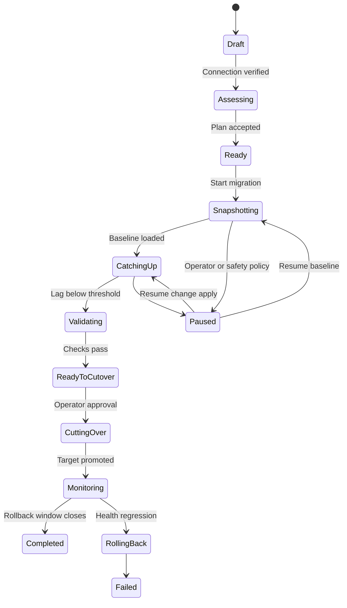
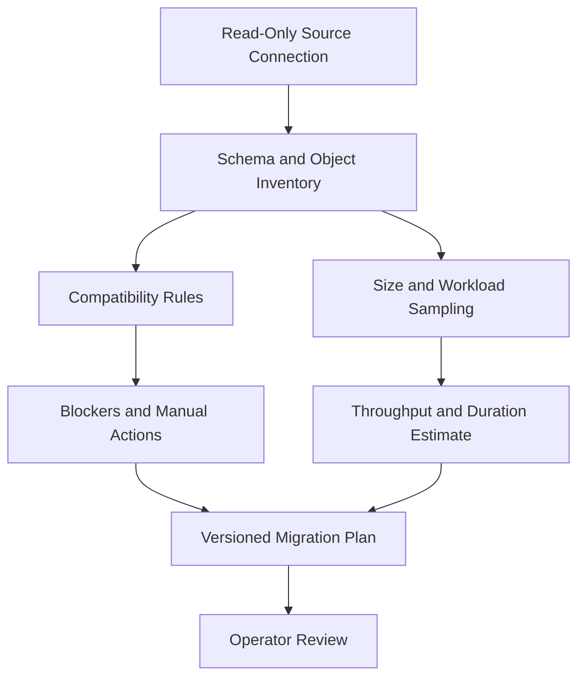
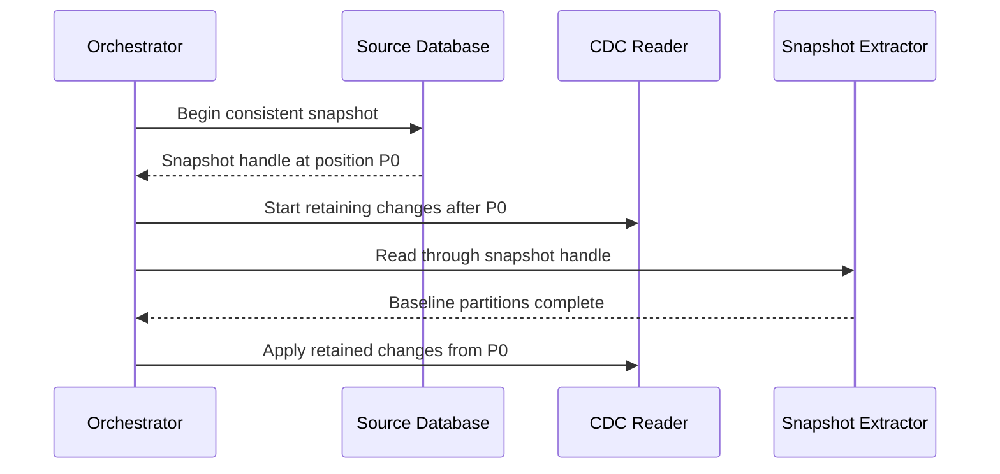
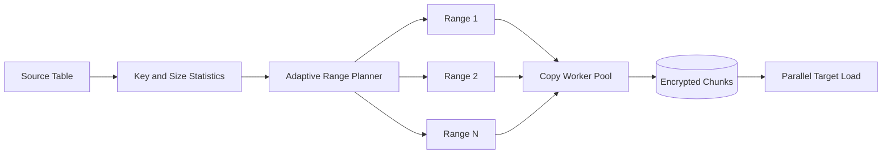
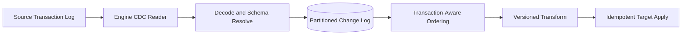
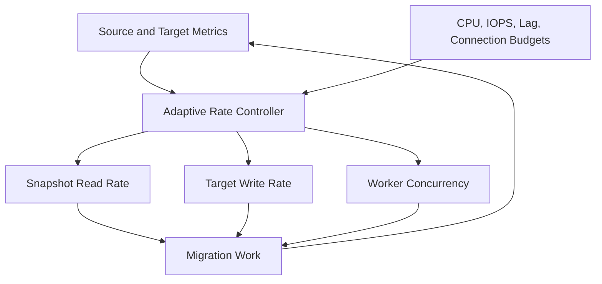
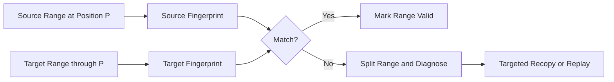
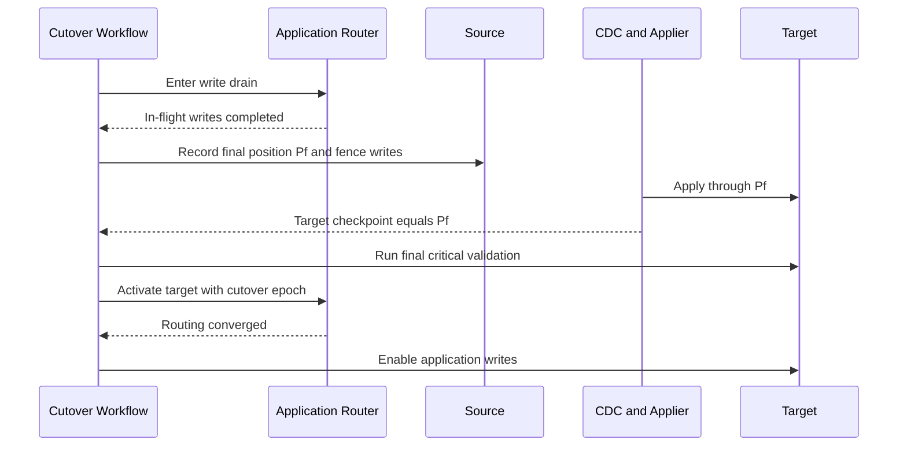
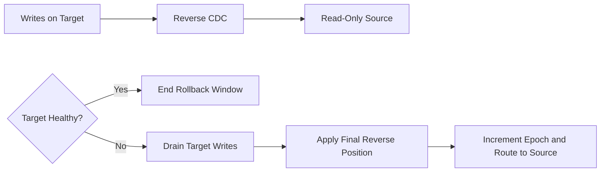

## Problem and requirements

An online database migration service moves production data from a source database to a target while applications continue serving traffic. It supports infrastructure refreshes, cloud adoption, regional moves, sharding changes, engine upgrades, and cross-engine migrations.

The difficult part is not copying a snapshot. Writes continue during the copy, schemas evolve, records can be transformed, large tables must be parallelized without overwhelming production, and cutover must guarantee that no acknowledged write is lost or applied twice.

### Functional requirements

- Discover source schemas, size, load, and migration blockers
- Convert compatible schemas and surface manual changes
- Copy a transactionally consistent baseline snapshot
- Capture and apply changes that occur during the copy
- Preserve transaction ordering where correctness requires it
- Transform types, identifiers, and table layouts
- Validate row counts, checksums, constraints, and sample queries
- Estimate replication lag and cutover readiness
- Coordinate traffic drain, final sync, and target promotion
- Roll back safely within a defined window
- Resume after worker, network, or regional failures
- Retain complete operation and validation evidence

### Non-functional requirements

- Migrate ten petabytes per day across 100,000 concurrent jobs
- Keep source performance impact within an operator-defined budget
- Support seconds of write downtime for ordinary cutovers
- Provide at-least-once transport with effectively-once application
- Never expose database credentials outside the assigned trust boundary
- Make every workflow step idempotent and resumable
- Detect silent corruption before target promotion
- Keep tenant migrations isolated from one another

## Capacity estimates

Assume 100,000 concurrent migrations, ten petabytes copied per day, and an average change rate equal to five percent of baseline data per day.

| Resource | Estimate |
| --- | ---: |
| Baseline copy | 10 PB/day, 116 GB/second aggregate |
| Change stream | 500 TB/day average |
| Concurrent migrations | 100K |
| Copy tasks | Millions |
| Validation hashes | Billions/day |
| Workflow events | Hundreds of millions/day |

Bandwidth is only one constraint. Source CPU, transaction-log retention, connection count, target write amplification, and lock duration usually determine safe throughput.

## Migration model

```text
Migration {
  id, tenantId, source, target, mode,
  desiredState, observedState, planVersion,
  snapshotPosition, appliedPosition, cutoverEpoch
}

TablePlan {
  sourceTable, targetTable, schemaMapping,
  partitionStrategy, transformVersion, validationPolicy
}

Task {
  id, migrationId, phase, partition,
  inputCheckpoint, outputCheckpoint, attempt, state
}
```

The migration plan is immutable after execution begins. Changing a mapping or transform creates a new plan version and requires explicit impact analysis or restart.

Positions are engine-specific log sequence numbers, transaction IDs, timestamps, or binlog coordinates. Store their type and comparison semantics rather than treating every position as an integer.

## High-level architecture

The control plane manages intent and workflow. Data movement occurs through regional workers close to the databases.



The control plane never proxies row data. It stores metadata and signed task assignments; regional workers move encrypted data directly between approved endpoints.

## Migration lifecycle



Every transition records actor, reason, source and target positions, validation summary, and plan version.

## Assessment and planning

Before moving data, inspect schemas, database settings, size, transaction rate, log retention, large objects, unsupported types, triggers, extensions, constraints, and workload patterns.



The plan estimates copy duration, required transaction-log retention, target capacity, expected cutover downtime, and cost. It also lists anything not migrated automatically, such as users, stored procedures, extensions, scheduled jobs, or engine-specific semantics.

Run a short benchmark against source and target using bounded traffic. Do not extrapolate only from network bandwidth.

## Schema conversion

Same-engine migrations can usually recreate schema objects directly. Cross-engine migrations require an explicit compatibility layer.

| Source concept | Possible target mapping | Risk |
| --- | --- | --- |
| Integer sequence | Identity or sequence | Sequence value and cache semantics |
| Timestamp with zone | Normalized UTC timestamp | Display and daylight-saving behavior |
| JSON type | Native JSON or text | Index and comparison differences |
| Enum | Enum, lookup table, or constraint | Future value deployment |
| Generated column | Generated expression or application logic | Expression compatibility |
| Stored procedure | Rewritten procedure or service code | Transaction semantics |

Create target tables without secondary indexes and foreign keys when bulk-load speed matters, then build and validate them before cutover. Keep required uniqueness constraints when duplicate introduction would be unsafe.

## Consistent snapshot and CDC boundary

The baseline and change stream must share an exact boundary.



If the engine cannot expose a snapshot and log position atomically, use an engine-specific locking protocol that briefly blocks writes while the boundary is established.

Start CDC before the long copy and monitor retained-log growth. If the source can discard changes before they are durably captured, the migration must pause or restart rather than continue with a gap.

## Parallel snapshot copy

Partition large tables into independently retriable ranges.



Prefer stable indexed keys. When no suitable key exists, use engine-native physical partitions, snapshots exported to object storage, or a slower table scan with carefully bounded parallelism.

Chunks include plan version, source snapshot, range boundaries, row count, uncompressed checksum, transform version, and encryption metadata. The target loader commits a chunk and its idempotency marker in the same transaction where possible.

Adapt chunk size based on source latency, target load, retry cost, and skew. A few giant ranges make recovery slow; millions of tiny ranges create scheduling overhead.

## Change data capture

CDC reads the source transaction log and converts engine events into a canonical envelope.

```text
ChangeEvent {
  migrationId, sourcePosition, transactionId,
  tableId, operation, primaryKey,
  before, after, schemaVersion, commitTime
}
```



Partition by table and primary key for scale, but preserve transaction boundaries where the target must observe atomic multi-row changes. Very large transactions can spill to encrypted storage before apply.

Schema-change events stop affected tables until the new source schema is compatible with the pinned migration plan. Silently guessing a mapping risks corruption.

## Effectively-once apply

Transport is at least once because workers can crash after writing the target but before acknowledging progress. Make replay harmless.

For engines with transactions, atomically apply a source transaction and update a migration checkpoint table. On retry, a transaction at or below the committed position is skipped.

```mermaid
sequenceDiagram
  participant A as Applier
  participant T as Target Database
  A->>T: Begin transaction
  A->>T: Lock migration checkpoint
  T-->>A: Last applied position P41
  A->>T: Apply source transaction P42
  A->>T: Update checkpoint to P42
  A->>T: Commit
  Note over A,T: Crash after commit is safe; retry observes P42
```

When the target lacks transactional checkpointing, use deterministic operation IDs, conditional writes, or an idempotency ledger. Document weaker guarantees explicitly.

## Transformation

Transformations handle type conversion, column renames, key remapping, denormalization, and data filtering.

Transforms must be deterministic for the same input and version. They cannot depend on wall-clock time or mutable external state unless those inputs are captured in the plan.

Key-changing transforms require a durable mapping store used identically by snapshot and CDC paths. Otherwise updates after the snapshot may address a different target key.

Reject records that violate the declared mapping into a bounded error queue with encrypted payloads. An operator can fix the rule and replay, but changing the transform version may require rebuilding affected target data.

## Backpressure and source protection

The migration must yield to production traffic.



Use token buckets per migration, source, target, tenant, and region. Reduce throughput when source query latency, replica lag, lock waits, target compaction, or error rates breach limits.

Reserve capacity for CDC so a baseline copy cannot starve the change stream and cause unbounded replication lag.

## Validation

Validation is continuous, not a single check after copying.

### Structural validation

- Tables, columns, types, defaults, and nullability
- Indexes, constraints, sequences, views, and permissions
- Expected schema-conversion exceptions

### Data validation

- Row counts per stable key range
- Commutative checksums for large partitions
- Exact hashes for small or high-risk tables
- Null counts, minimums, maximums, and distinct-count sketches
- Referential-integrity and uniqueness checks



Compare equivalent logical values after transformation, not raw bytes across different engines. Pin validation to a common source position so ongoing writes do not create false mismatches.

### Application validation

Replay representative read queries against both databases and compare normalized results. Shadow a small percentage of production reads where policy permits, but never let shadow writes create side effects.

## Cutover readiness

A migration becomes ready only when all gates pass:

- Baseline tasks are complete and reconciled
- CDC has no detected gap
- Apply lag stays below the threshold for a soak window
- Required validation checks pass
- Target indexes, constraints, users, and jobs are ready
- Application versions can connect to the target
- Rollback capacity and procedure are verified
- Owners approve the cutover window

The service computes readiness, but an authorized operator makes the business decision.

## Cutover



Fencing is essential. A client with stale routing must be unable to write to the source after the final position is chosen. Use database permissions, a write proxy epoch, or application-level leases.

Keep the cutover workflow small and precompute everything possible. If a gate times out, restore source writes before accepting any target writes.

## Rollback

Rollback after target writes begin requires reverse replication or accepting data loss. For high-value migrations, configure reverse CDC from target to source before promotion.



Test reverse replication and source compatibility before cutover. Schema changes on the target are restricted during the rollback window.

Without reverse CDC, rollback means restoring from a checkpoint and reconciling target-only writes manually. State that limitation prominently in the plan.

## Security and isolation

- Store database credentials in a regional secrets manager
- Issue short-lived credentials to migration workers
- Restrict source roles to required snapshot and log access
- Restrict target roles to assigned schemas and checkpoint tables
- Encrypt staging chunks and CDC logs with migration-scoped keys
- Bind every task to tenant, migration, region, and plan version
- Redact row values from ordinary logs and metrics
- Audit connection tests, exports, overrides, cutover, and rollback
- Delete staging data and credentials after the retention window

Workers run in isolated pools for high-risk tenants and cannot select arbitrary endpoints. Network policies allow only control services, assigned databases, and approved staging storage.

## Reliability and failure handling

| Failure | Safe behavior |
| --- | --- |
| Snapshot worker crashes | Lease expires; another worker resumes the uncommitted range |
| Chunk is delivered twice | Target idempotency marker prevents duplicate load |
| CDC reader disconnects | Resume from durable acknowledged position |
| Source log gap is detected | Stop migration and require a new snapshot or engine recovery |
| Target rejects a record | Quarantine, stop affected ordering domain, and alert |
| Schema changes mid-migration | Pause affected tables until compatibility is resolved |
| Validator times out | Keep target unpromoted and retry from checkpoint |
| Control plane is unavailable | Workers finish leased tasks but do not start cutover |
| Cutover fails before target writes | Unfence source and restore routing |
| Target fails after promotion | Execute tested rollback policy; never improvise dual writes |

Workflow history and task checkpoints live in replicated durable storage. A replacement orchestrator reconstructs progress from state rather than worker memory.

## Observability and SLOs

Track metrics per tenant, migration, table, source, and target without using sensitive values as labels:

- Snapshot bytes, rows, throughput, and estimated completion
- Source CPU, IOPS, query latency, and log-retention headroom
- CDC capture position, apply position, and time lag
- Target throughput, lock waits, compaction, and rejected writes
- Task retries, lease expiry, and quarantine volume
- Validation coverage, mismatch count, and repair progress
- Schema drift and unsupported-event count
- Cutover gate status and routing convergence
- Credential age and staging-data retention

Useful SLOs include no undetected CDC gaps, 99.9% of healthy tasks making checkpoint progress within five minutes, and cutover never proceeding with a failed critical validation gate.

## Key trade-offs

| Decision | Benefit | Cost |
| --- | --- | --- |
| Snapshot plus CDC | Minimal downtime | Log retention and ordering complexity |
| Immutable staging chunks | Replayable and auditable | Storage cost and cleanup requirements |
| Smaller copy ranges | Fast retries and parallelism | Scheduling and metadata overhead |
| At-least-once transport | Reliable recovery | Idempotent target apply required |
| Deep validation | Higher confidence | Extra source load and migration time |
| Reverse CDC | Safe rollback after promotion | More setup and dual-engine compatibility |
| Regional data plane | Residency and lower latency | More operational infrastructure |

## Evolution path

1. Support offline, same-engine snapshot migrations with checksums.
2. Add resumable partitioned copy and adaptive source throttling.
3. Introduce engine-native CDC and transactional checkpoints.
4. Add online cutover, fencing, and automated validation gates.
5. Support cross-engine schemas and deterministic transforms.
6. Add reverse replication, fleet scheduling, and regional evacuation.
7. Continuously test failure recovery with production-shaped datasets.

Begin with one source-target pair and make its guarantees explicit. A broad connector catalog is less valuable than one path that can prove it did not lose or duplicate data.

## Final design

Use a durable control plane to assess databases, freeze a versioned migration plan, and orchestrate regional data movers. Establish an atomic snapshot and CDC boundary, copy stable key ranges through encrypted immutable chunks, and apply changes with transactional checkpoints for effectively-once behavior. Protect production through hierarchical rate limits and adaptive backpressure. Validate structure, range fingerprints, constraints, and representative queries continuously. At cutover, drain application writes, fence the source, apply through a final position, validate, and activate the target under a new routing epoch. Keep reverse CDC during the rollback window when the recovery objective requires it.

The central principle is that progress must be provable. Every copied range, applied transaction, validation result, and routing change needs a durable checkpoint so failures cause retries—not ambiguity about which database contains the authoritative data.
