## Problem and requirements

An online experimentation platform helps teams measure whether a product change causes an improvement. It assigns eligible subjects to variants, records actual exposure, joins outcomes, computes governed metrics, and reports uncertainty and safety signals.

The difficult part is not dividing traffic. Trustworthy experiments require stable assignment, correct units of analysis, unbiased exposure data, point-in-time configuration, metric consistency, and statistical methods that match how results are monitored. A fast dashboard with flawed data can confidently recommend the wrong product decision.

### Functional requirements

- Define experiments, variants, targeting, allocation, and duration
- Assign users, accounts, devices, or requests deterministically
- Integrate with feature flags and service configuration
- Record exposures only when behavior can differ
- Ingest outcome and guardrail events
- Define reusable, versioned metrics
- Compute experiment results and confidence intervals
- Detect sample-ratio mismatch and data-quality problems
- Support ramps, pauses, rollbacks, and mutually exclusive layers
- Preserve audit history and decision records

### Non-functional requirements

- Support ten billion assignments per day
- Run 100,000 concurrent experiments
- Evaluate assignment locally within one millisecond
- Keep experimentation unavailable from breaking product requests
- Make results reproducible from immutable data and configuration
- Protect user privacy and regional data boundaries
- Prevent conflicting experiments from contaminating one another
- Surface uncertainty rather than presenting estimates as facts

The platform provides evidence. It does not replace product judgment, ethical review, or domain-specific safety policy.

## Capacity estimates

Assume one billion daily active subjects, ten assignments per subject per day, and hundreds of outcome events per subject.

| Resource | Estimate |
| --- | ---: |
| Assignment evaluations | 10B/day |
| Exposure events | Billions/day |
| Outcome events | Tens to hundreds of billions/day |
| Concurrent experiments | 100K |
| Metric definitions | Millions of versioned expressions |
| Analysis datasets | Petabyte scale |

Assignment is read-heavy and latency sensitive. Analysis is throughput heavy and delayed. Separate them while sharing immutable configuration versions.

## Experiment model

An experiment contains:

- Stable experiment ID and owner
- Hypothesis and decision criterion
- Randomization unit
- Eligibility and exclusion rules
- Variants and allocation weights
- Namespace or layer allocation
- Start, stop, ramp, and observation windows
- Primary, secondary, diagnostic, and guardrail metrics
- Statistical analysis policy
- Configuration and code versions

Published versions are immutable. Changing targeting, weights, variants, or metrics creates a new configuration version and an audit event.

## API and assignment contract

```http
POST /v1/assignments:evaluate
Authorization: Bearer <service-token>
Content-Type: application/json

{
  "experiment": "checkout-layout-v3",
  "subject": { "type": "user", "key": "user_82" },
  "context": { "country": "US", "device": "mobile" }
}
```

```json
{
  "eligible": true,
  "variant": "treatment",
  "experimentVersion": 19,
  "assignmentId": "assign_01K7C82A",
  "exposureToken": "signed-opaque-token"
}
```

Most production applications evaluate locally from a signed configuration snapshot rather than make this remote call. The contract remains identical across SDKs.

## High-level architecture

The control plane publishes experiment configuration. SDKs assign locally, while an independent data plane processes exposure and outcomes.

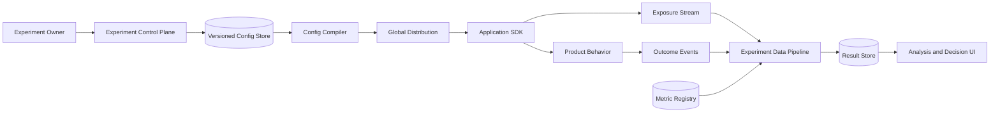

Assignment does not depend on analytics availability. Event delivery is asynchronous and bounded.

## Experiment lifecycle

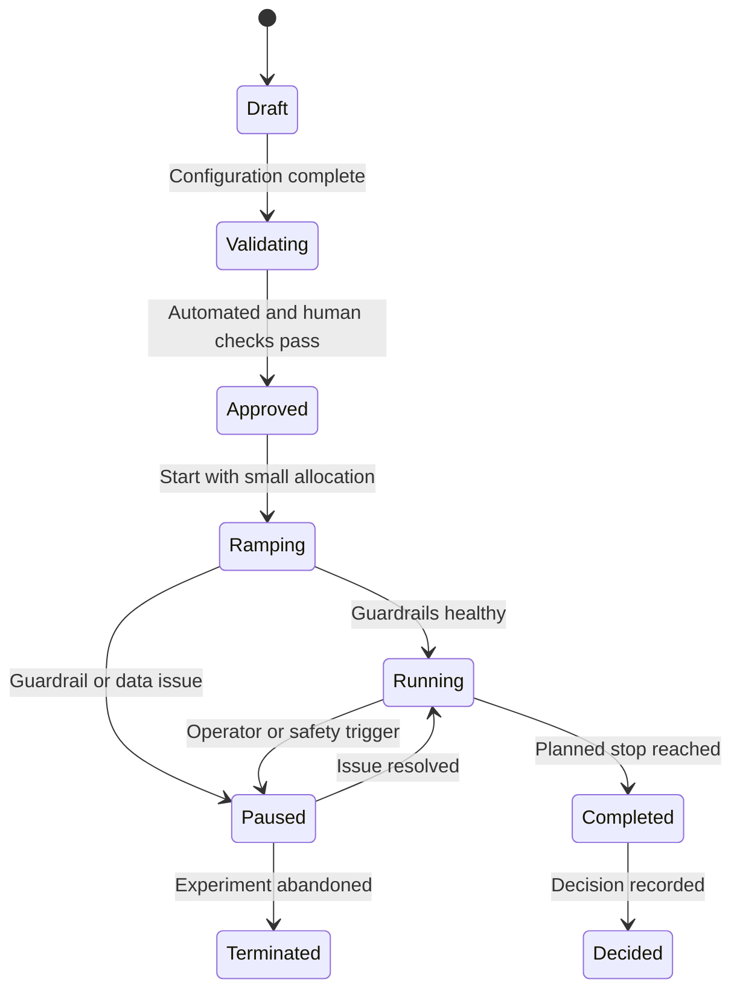

Every transition records actor, reason, configuration, traffic allocation, and policy result. Completing an experiment freezes its analysis window but does not erase late outcome maturation.

## Deterministic assignment

Assignment must remain stable across requests, devices where identity permits, regions, and SDK languages.

```text
bucket = hash(namespace salt + experiment ID + assignment seed + subject key)
         mod 1,000,000
```

Map the bucket into allocated intervals. Use a specified hash algorithm, byte encoding, unsigned conversion, and range mapping with cross-language conformance tests.

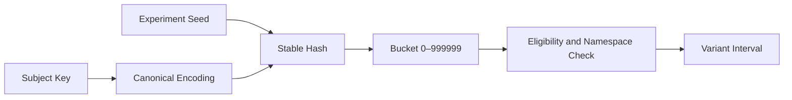

Do not use language-native hash functions or random number generators. Changing the seed reshuffles subjects and should be an explicit new experiment phase.

## Randomization unit

The randomization unit is the independent subject assigned to a variant: user, account, household, device, session, request, merchant, or region.

Choose the unit that matches interference and treatment. If an account shares one subscription, randomizing individual users may expose both variants within the same decision unit.

Analysis must use the randomization unit or a statistically valid clustered estimator. Treating thousands of events from one user as independent produces falsely narrow intervals.

Identity availability also matters. Anonymous session assignment may change after login; define deterministic merge or exclusion behavior before launch.

## Eligibility and targeting

Eligibility checks product, geography, platform, account state, consent, prior enrollment, and experiment-specific prerequisites.

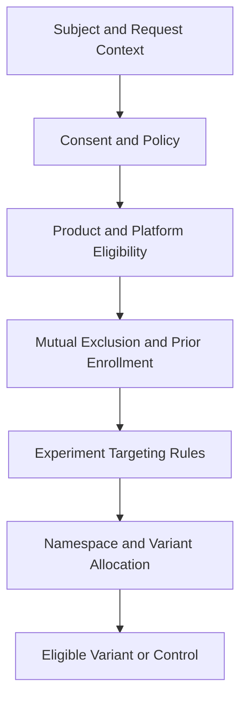

Use only attributes available before treatment. Targeting on a value changed by the treatment creates post-treatment bias.

Record eligibility reason and configuration version for diagnostics without logging unnecessary sensitive attributes.

## Layers and mutual exclusion

Several experiments can run simultaneously when they affect independent product surfaces. Conflicting experiments share a layer or namespace.

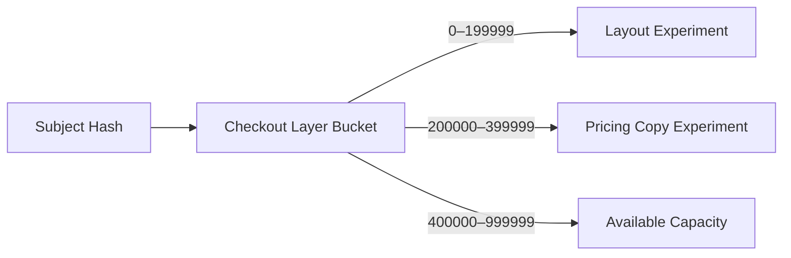

An experiment owns a stable portion of the layer, then independently assigns variants inside it. This prevents one subject from entering two mutually exclusive treatments.

Moving allocation boundaries can change eligibility. Ramps should extend intervals predictably so existing subjects remain assigned.

Cross-layer interaction is possible. The platform records co-enrollment and supports planned factorial designs where required.

## Configuration distribution

Compile approved experiments into small signed bundles scoped to product, region, and environment.

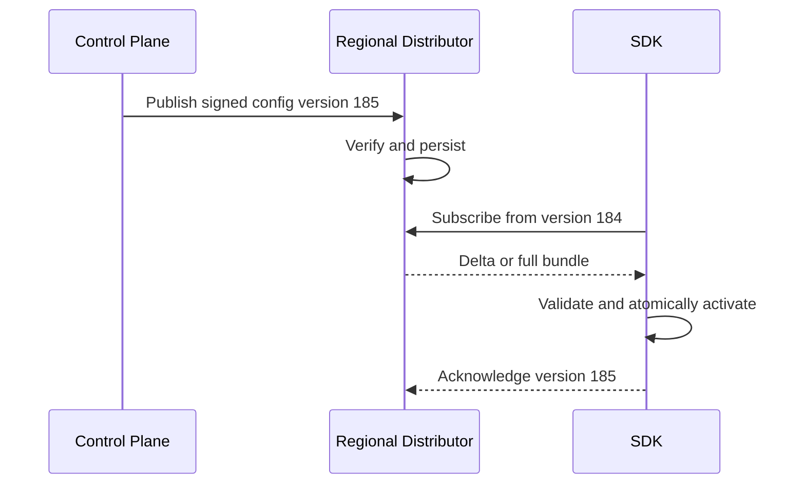

SDKs retain the last valid bundle during outages. Invalid or partial updates never replace active configuration.

Emergency stop overrides take priority and select control or safe behavior. They remain signed, versioned, and audited.

## Exposure logging

Assignment is not exposure. Record exposure only when the product actually evaluates and uses a variant in a way that could change behavior.

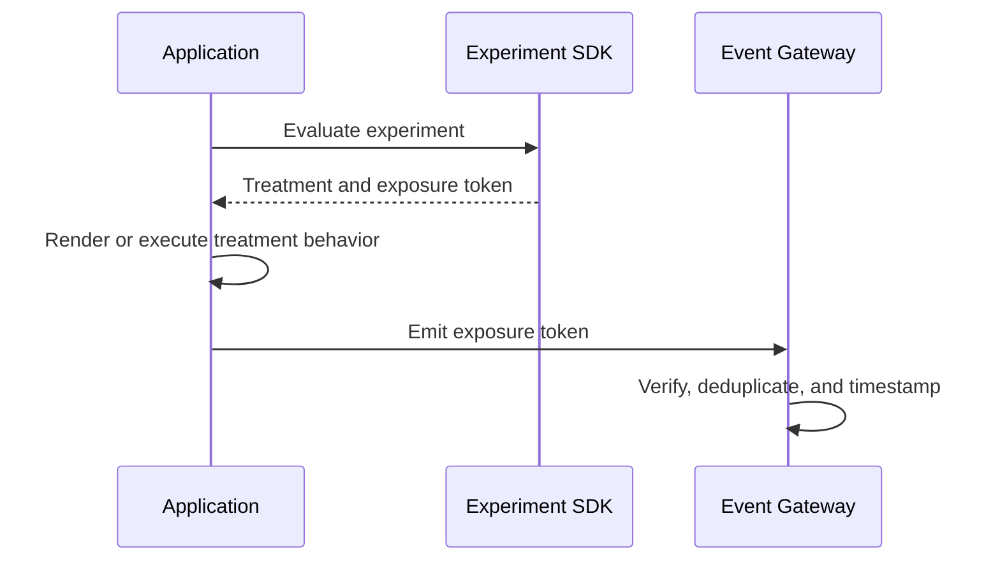

If a page assigns a variant but the treated component never renders, logging exposure at assignment biases results.

The event contains experiment, version, variant, subject pseudonym, randomization unit, timestamp, and assignment probability.

Stable exposure IDs deduplicate client retries. First exposure often defines enrollment time; repeated exposures support diagnostics.

## Outcome events

Outcome events capture actions such as purchase, retention, latency, error, cancellation, or support contact.

The event schema includes trusted subject or unit key, event time, value, context, source, and stable ID.

Events are not labeled with experiment variants by product code. The analysis pipeline joins them to enrollment, preventing stale client configuration from asserting treatment.

Validate event contracts, deduplicate retries, and monitor source coverage. A broken purchase event can make every treatment appear harmful or ineffective.

## Metric registry

Metric definitions are reusable, typed, versioned analytical contracts.

```yaml
name: completed_orders_per_user
unit: user
numerator:
  event: order.completed
  aggregation: count
window: 7d
missingValue: 0
owner: checkout-analytics
```

Definitions include population, event filters, aggregation, attribution window, capping, currency handling, missingness, variance method, and privacy classification.

Primary metrics determine success. Guardrails prevent unacceptable harm. Diagnostic metrics help explain movement without encouraging selective decision-making.

Changing a metric creates a new version and does not rewrite a completed experiment silently.

## Analysis pipeline

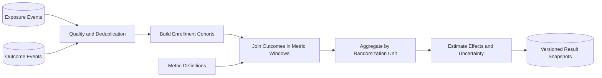

Aggregate events to the randomization unit before inference. Preserve immutable intermediate datasets so analysts can reproduce results.

Result snapshots record configuration, metric, code, source partitions, cutoffs, late-data state, and statistical method.

## Effect estimation

For a mean metric, estimate treatment effect as:

```text
absolute effect = mean(treatment) - mean(control)
relative effect = absolute effect / mean(control)
```

Report sample sizes, baseline, treatment value, absolute effect, relative effect, standard error, confidence interval, and analysis method.

A confidence interval describes uncertainty under the model; it is not the probability that the true effect lies in that realized interval.

Use methods appropriate for proportions, heavy-tailed revenue, ratios, clustered units, repeated measures, and rare outcomes.

## Variance reduction

Pre-experiment covariates can reduce variance. A common technique adjusts the outcome using a correlated pre-period metric.

The covariate must be measured before treatment and defined consistently. Using a post-treatment value biases the estimate.

Stratified randomization can balance known high-variance groups such as country or account tier. Assignment incorporates the stratum in a documented way.

Record the adjustment plan before reading results. Trying many adjustments and selecting the most favorable one increases false discoveries.

## Sample-ratio mismatch

If a 50/50 experiment receives 55/45 exposure, the randomization or logging pipeline may be broken.

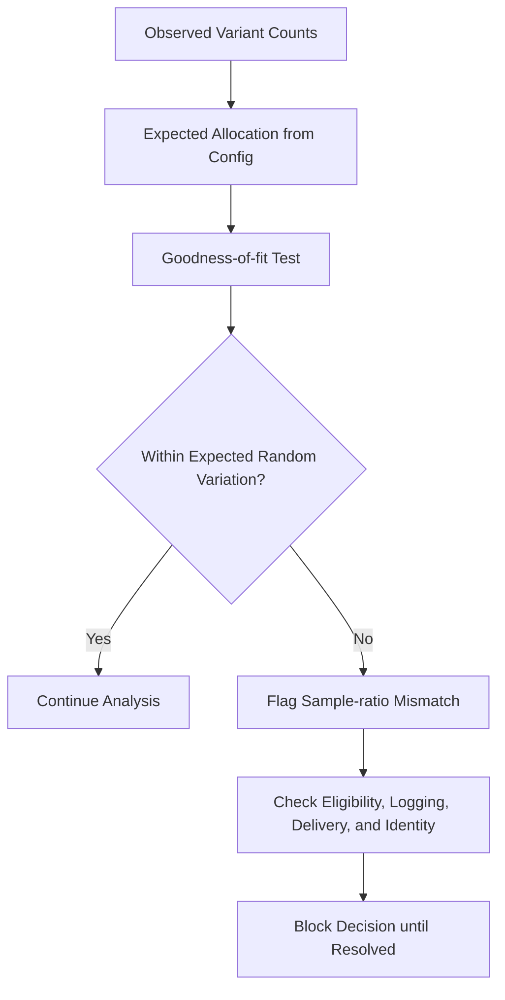

Check overall and important slices. A balanced global total can hide opposite imbalances by platform.

Sample-ratio mismatch is a data-integrity alarm, not a metric to explain away. Do not trust causal results until resolved.

## Monitoring results over time

Repeatedly checking ordinary fixed-horizon significance and stopping when favorable inflates false positives.

Choose one approach before launch:

- Fixed sample size and analysis date
- Sequential testing with valid stopping boundaries
- Bayesian decision policy with declared priors and losses

The dashboard follows the chosen method and prevents unsupported “significance” claims from casual peeking.

Safety guardrails may stop anytime under separate conservative policy because protecting users has different cost than declaring success.

## Multiple comparisons

Running many variants, metrics, and segments increases the chance of a false positive.

Pre-register one or a small number of primary metrics. Treat exploratory slice findings as hypotheses for confirmation.

Apply family-wise or false-discovery controls where a decision depends on many simultaneous tests.

Do not hide non-significant metrics or unfavorable guardrails. The result report is generated from the frozen analysis plan.

## Novelty and carryover

Users may react differently when a feature is new. Report effect by time since exposure and define a minimum observation duration.

Cross-over or switchback designs need washout periods when treatment effects persist. A user moved from treatment to control may remain influenced.

Ramps usually keep existing subjects in their original variant. Restarting assignment creates contamination and complicates interpretation.

Long-term holdouts measure cumulative effects that short experiments miss.

## Network and marketplace effects

Standard user-level randomization assumes one subject's treatment does not affect another. Social, marketplace, and supply-demand products violate this assumption.

Use cluster randomization, geographic experiments, switchbacks, or market-level designs where interference is material.

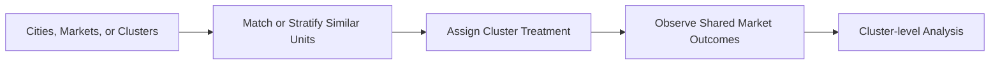

The number of independent clusters—not user events—determines effective sample size.

These experiments often need longer duration and stronger operational coordination.

## Guardrails and automatic stopping

Guardrails monitor errors, latency, crashes, fraud, complaints, revenue loss, and other harm.

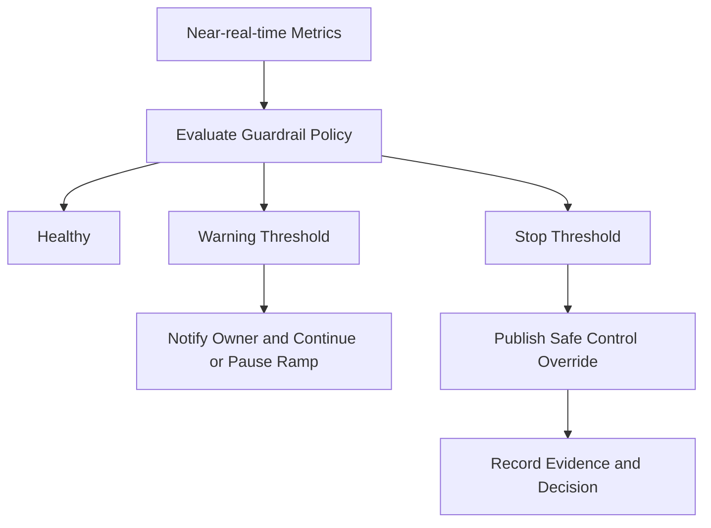

Automatic stop requires minimum volume, sustained breach, and protection against missing data. One delayed metric should not trigger global rollback unless policy says uncertainty itself is unsafe.

Stopping changes assignment but does not erase exposure data. Analysis records the actual active window.

## Ramp strategy

Start with internal users or a tiny eligible percentage, validate telemetry, then ramp through predefined stages.

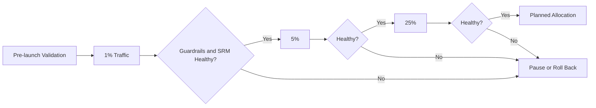

Each stage requires enough runtime and sample to detect catastrophic problems. The purpose of a ramp is safety, not early causal significance.

Allocation expansion preserves existing assignments by extending bucket intervals.

## Feature-flag integration

Experiments and feature flags share delivery and evaluation infrastructure but have different semantics.

A release flag answers what behavior is enabled. An experiment additionally fixes randomization, enrollment, exposure, metrics, and analysis.

The SDK evaluates an experiment through a flag variation but logs an exposure only when the application uses the returned behavior.

After a winning decision, migrate from experiment to ordinary rollout intentionally. Do not leave permanent product behavior dependent on an expired experiment configuration.

## Quality checks before launch

Run automated checks:

- Configuration and targeting validation
- Cross-SDK assignment fixtures
- Variant rendering and event smoke tests
- Exposure and outcome join coverage
- A/A test history for the product surface
- Metric sensitivity and expected sample size
- Layer conflict and capacity analysis
- Privacy and policy review
- Guardrail and rollback simulation

A/A tests assign identical behavior to variants and should produce null effects at the expected rate. They reveal assignment, logging, and statistical calibration problems.

## Power and duration planning

Before launch, estimate baseline rate, variance, minimum detectable effect, allocation, significance level, and desired power.

Low-traffic or noisy metrics may require weeks or be unsuitable for online experimentation. Increasing event count per user does not necessarily add independent information.

The planner reports expected sample and calendar duration using seasonality and eligibility estimates.

Do not select an unrealistically large minimum effect merely to make the experiment finish quickly.

## Decision workflow

At maturity, the owner records ship, iterate, stop, or inconclusive with rationale.

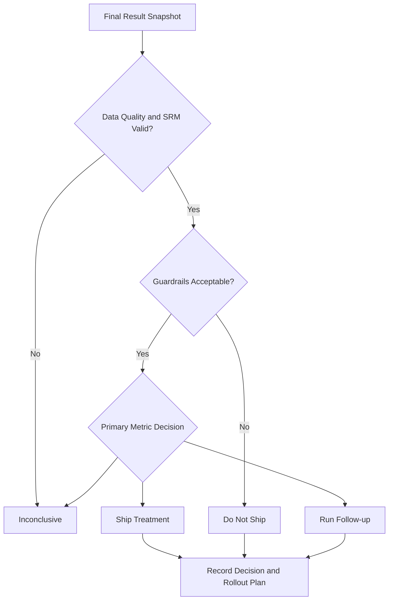

The platform preserves the final data snapshot, decision, owner, caveats, and rollout follow-up.

Shipping should use a controlled feature rollout rather than instantly enabling 100% because an analysis completed.

## Privacy and governance

Experiments can influence user experience and process behavioral data. Apply purpose limitation, consent, regional policy, and retention.

Use pseudonymous subject keys in event streams. Identity mapping remains in a restricted service.

Sensitive experiments may require ethical, legal, safety, or domain review before assignment. Some users or contexts must never be eligible.

Metric access does not grant raw event access. Enforce row, column, tenant, and minimum-cohort policy in analysis.

Deletion propagates to exposure, outcome, intermediate, and result datasets where required while preserving permitted aggregate evidence.

## Multi-tenancy and regional design

Tenant identity scopes configuration, subjects, events, metrics, and results.

Assignment bundles are regional and contain only experiments allowed in that jurisdiction. Sensitive raw events remain regional.

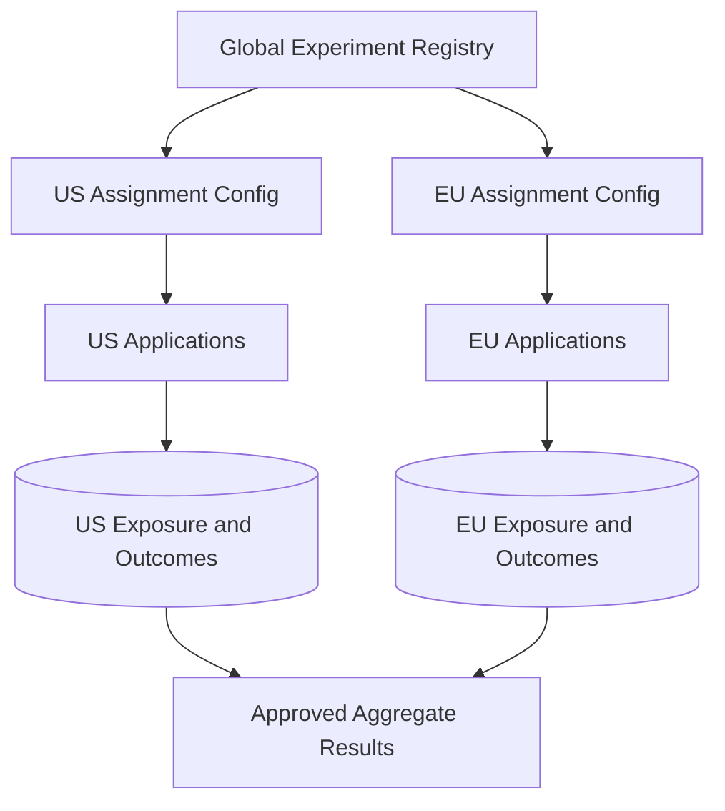

Globally combined analysis uses compatible definitions and privacy-approved aggregates. Configuration versions remain traceable across regions.

Large tenants receive separate analysis pools and quotas for experiments, assignments, events, metrics, and compute.

## Failure handling

### Control plane unavailable

SDKs continue from the last signed bundle. New experiments and ramps pause.

### Configuration distribution delayed

Expose active version by region, retain prior behavior, and avoid analyzing a window as fully ramped until propagation is measured.

### Exposure pipeline unavailable

Buffer within limits and alert. If exposure loss exceeds policy, pause the experiment rather than analyze biased data.

### Outcome event delayed

Mark results provisional and show data-through and maturity dates. Do not treat missing outcomes as zero prematurely.

### Metric job fails

Retain immutable inputs, retry idempotently, and keep the prior result snapshot clearly labeled with its cutoff.

### Bad guardrail release

Version and canary guardrail definitions. Restore the prior version without changing historical evaluation.

### Assignment SDK defect

Use conformance fixtures, phased SDK rollout, shadow comparison, and version-level SRM monitoring.

## Observability

Track:

- Assignment rate, eligibility, and variant distribution
- Active configuration version by SDK and region
- Exposure rate, deduplication, and assignment-to-exposure delay
- Outcome event freshness and join coverage
- Sample-ratio mismatch overall and by slice
- Metric pipeline latency, failures, and revisions
- Guardrail breaches and automatic stops
- Experiment ramp, pause, and rollback actions
- SDK errors and default fallbacks
- Layer capacity and conflicting experiment attempts
- Decision completion and stale experiment cleanup

Synthetic subjects continuously verify deterministic assignment, exposure logging, outcome joins, metrics, SRM detection, guardrails, and emergency stop.

## Key tradeoffs

### Local vs remote assignment

Local assignment is fast and resilient but accepts brief configuration skew. Remote assignment centralizes freshness and sensitive targeting but adds a dependency to product requests.

### Fast results vs mature outcomes

Early results speed iteration but can reflect novelty, incomplete labels, and random variation. Predeclared duration and sequential methods prevent opportunistic stopping.

### Broad metrics vs multiple-testing risk

Rich dashboards help diagnosis but make cherry-picking easy. Primary metrics and frozen analysis plans separate decisions from exploration.

### Aggressive ramps vs safety

Large initial samples shorten experiments but increase blast radius. Staged ramps and guardrails spend time to protect users.

### Stable isolation vs experimental capacity

Mutual exclusion reduces interaction bias but leaves traffic unused and limits concurrent learning. Layer only experiments likely to interfere and record cross-enrollment elsewhere.

The central principle is that trustworthy experimentation requires deterministic assignment, honest exposure, versioned metrics, and a predeclared decision process—not merely a difference between two dashboard numbers.
