## Problem and requirements

An online learning platform lets instructors publish structured courses and lets learners enroll, consume content, complete assessments, receive feedback, and earn credentials. It supports self-paced learning, scheduled cohorts, live instruction, enterprise training, and limited offline access.

The difficult part is preserving academic state while content evolves. A learner may start version 4 of a course while an instructor publishes version 5, quiz grading must be reproducible, live events can create huge synchronized traffic spikes, and completion must not be inferred from unreliable video-player signals alone.

### Functional requirements

- Author courses with sections, lessons, video, text, files, and activities
- Review, version, publish, archive, and localize content
- Enroll individual learners, cohorts, or organizations
- Stream adaptive video and support captions and transcripts
- Track progress across web, mobile, and offline clients
- Deliver quizzes, assignments, coding exercises, and exams
- Grade automatically or through instructor workflows
- Schedule live classes and record attendance
- Support discussions, announcements, and instructor messaging
- Apply prerequisites, deadlines, attempts, and accommodations
- Issue verifiable certificates and revoke them when required
- Expose learner, course, and organization analytics

### Non-functional requirements

- Support 500 million learners and ten million courses
- Serve 100 million concurrent video sessions at peak
- Keep progress updates idempotent and monotonic where appropriate
- Preserve the exact content and grading policy used for each attempt
- Isolate organizations, instructors, learners, and private submissions
- Continue playback when analytics and recommendations are unavailable
- Protect high-stakes assessments from common abuse
- Respect regional data residency, retention, and accessibility policy

## Capacity estimates

Assume 500 million learners, ten million courses, 100 lessons per course, and an average of one hundred progress events per active learner per day.

| Resource | Estimate |
| --- | ---: |
| Courses | 10M |
| Versioned lessons | Billions |
| Daily progress events | Tens of billions |
| Concurrent video sessions | 100M |
| Assessment attempts | Hundreds of millions/day |
| Submissions and media | Petabyte scale |

Video delivery dominates bandwidth, while assessments and credentials require the strongest integrity and auditability.

## Core data model

```text
CourseVersion {
  courseId, version, ownerId, structure,
  prerequisites, gradingPolicy, state, publishedAt
}

Enrollment {
  enrollmentId, learnerId, courseId, courseVersion,
  cohortId, status, enrolledAt, completionPolicy
}

ProgressEvent {
  eventId, enrollmentId, contentId, contentVersion,
  type, value, occurredAt, source
}

Attempt {
  attemptId, enrollmentId, assessmentVersion,
  startedAt, submittedAt, state, scoreVersion
}
```

An enrollment pins a published course version or an explicit upgrade policy. This prevents an instructor edit from changing requirements halfway through a learner's course without a recorded migration.

## High-level architecture

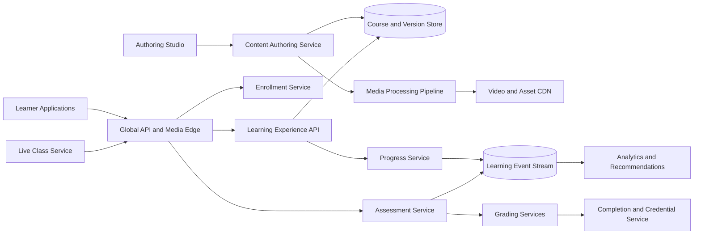

Course content and media are read-heavy and cacheable. Enrollment, attempts, grades, and credentials are transactional records.

## Course authoring

Authors edit private drafts composed of stable content nodes. Publishing creates an immutable course version.

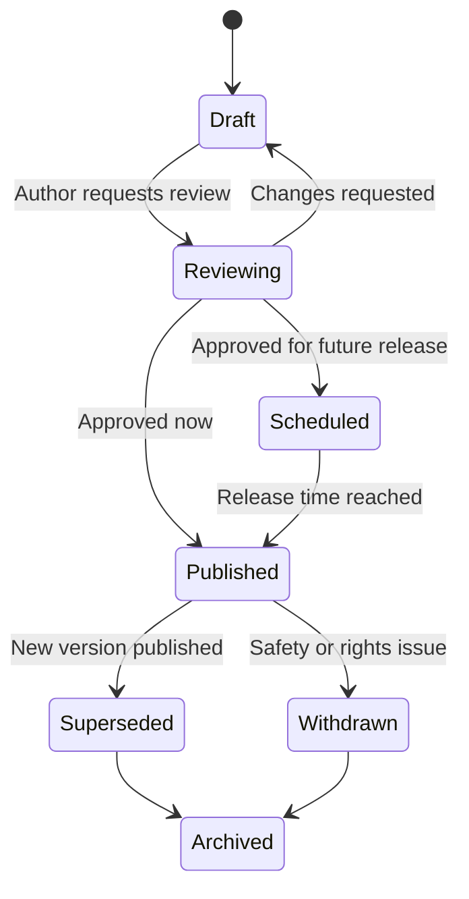

Draft autosaves can use optimistic concurrency and per-block operations. Publication validates structure, broken references, media readiness, captions, accessibility metadata, assessment integrity, and ownership rights.

The published manifest contains immutable references to lesson versions, assessment versions, assets, grading policy, and prerequisite rules.

## Content versioning

Classify changes:

- Cosmetic: typo or formatting correction that does not change meaning
- Compatible: additional example or optional lesson
- Material: changed required lesson, question, grading rule, or learning objective
- Safety removal: content must no longer be served

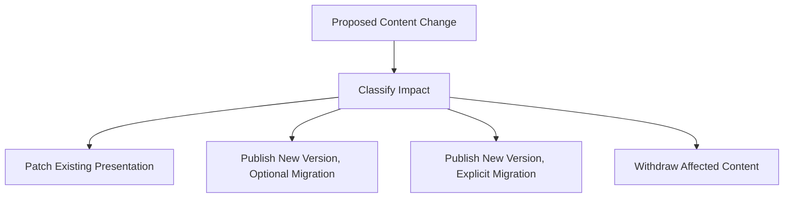

Material changes never silently rewrite active assessment attempts or earned grades. A migration plan maps old progress to new requirements and explains what learners must redo.

## Enrollment

Enrollment can come from purchase, subscription, invitation, organization assignment, or open self-enrollment.

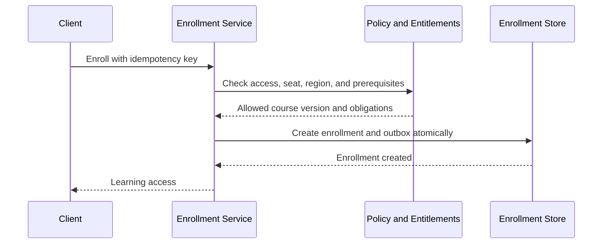

Organization seat allocation and enrollment creation must be coordinated so the same seat is not consumed twice. Use strongly consistent counters or reservation leases.

Enrollment status includes active, completed, expired, suspended, withdrawn, and revoked. Financial refunds and academic withdrawals are related but separate workflows.

## Learning experience API

The API builds a learner-specific course view from the pinned manifest, progress, deadlines, accommodations, prerequisites, content availability, and permissions.

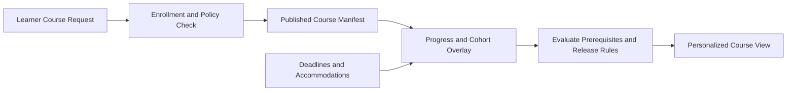

Cache immutable manifests globally. Cache the personalized overlay briefly using enrollment version and progress watermark.

Do not put authoritative unlock logic only in the client. Every protected content and assessment request rechecks eligibility server-side.

## Video ingestion

```mermaid
flowchart LR
  Upload[Source Video Upload] --> Quarantine[(Quarantine Store)]
  Quarantine --> Scan[Malware and Rights Checks]
  Scan --> Probe[Media Validation]
  Probe --> Transcode[Parallel Transcoding]
  Transcode --> Package[Adaptive Streaming Packages]
  Package --> Captions[Caption and Transcript Pipeline]
  Captions --> QC[Automated and Human Quality Checks]
  QC --> Publish[(Immutable Media Origin)]
  Publish --> CDN[Global CDN]
```

Generate several resolutions, bitrates, codecs, audio tracks, thumbnails, captions, and transcripts. Store a versioned media manifest with checksums and processing lineage.

Publishing a course waits for required media variants and accessibility artifacts. Optional variants can appear later without changing the academic content version.

## Video delivery

Clients request a short-lived signed playback token bound to learner, enrollment, media, region, device policy, and expiry.

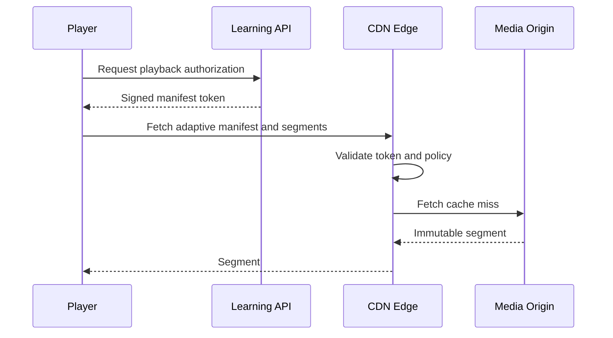

Adaptive bitrate selection runs mostly on the client using measured throughput and buffer health. CDN caching absorbs popular-course spikes.

Playback authorization is separate from progress. Fetching a segment does not prove the learner watched or understood it.

## Progress model

Record immutable learning events, then derive current progress.

```text
lesson.started
video.position_checkpoint
reading.completed
quiz.submitted
assignment.passed
course.completed
```

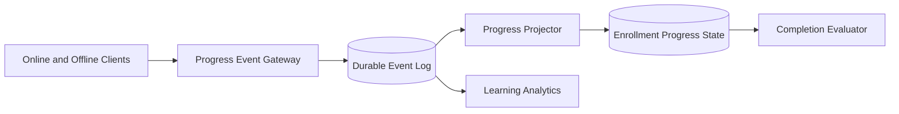

Events carry stable client IDs and per-device sequence numbers. Retries are deduplicated. The projector applies monotonic rules where suitable: completing a lesson should not revert because an older checkpoint arrives.

For video, combine playback checkpoints, server-issued session evidence, reasonable playback rate, foreground state, and required interactions. Even then, represent completion as product evidence, not proof of attention.

## Offline learning

Mobile clients can download encrypted course packages containing approved assets, manifest versions, expiry, and offline policy.

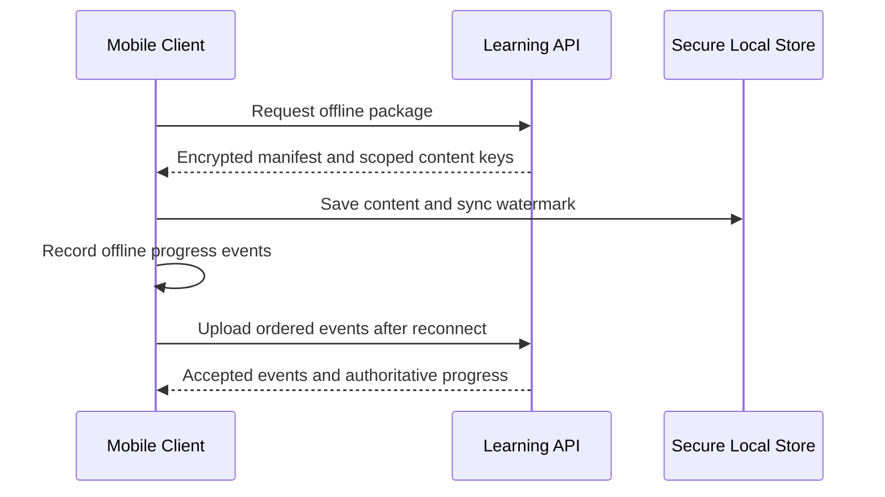

Content keys expire and require periodic entitlement renewal. Offline packages respect device limits, content rights, and remote revocation at next connection.

Conflicting progress merges by event semantics, not device clock. High-stakes exams may prohibit offline attempts entirely.

## Assessment model

An assessment version contains question pools, selection rules, ordering policy, time limit, attempt count, scoring rubric, feedback policy, and integrity requirements.

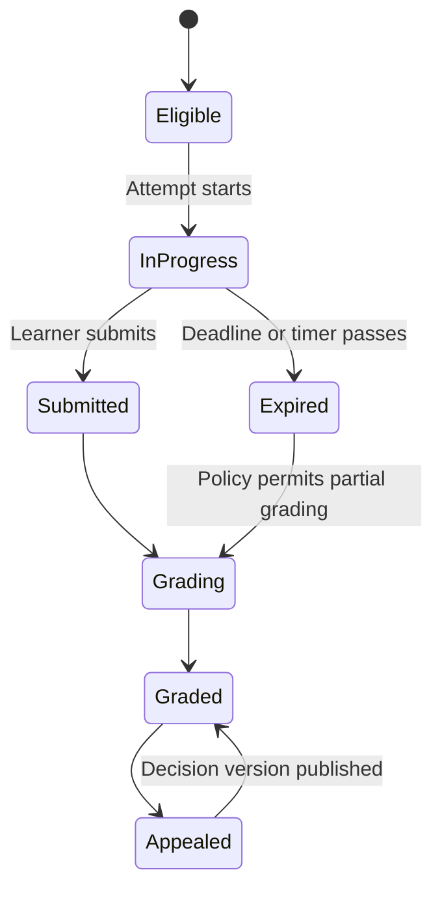

Starting an attempt freezes the assessment version, selected questions, accommodations, timer policy, and random seed. Later edits do not change the attempt.

## Question delivery

Generate the question set server-side from a versioned pool and deterministic attempt seed. Store the chosen question IDs before returning them.

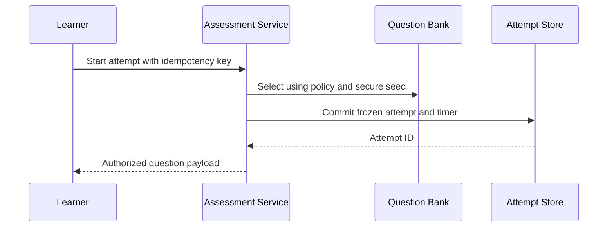

Do not send correct answers or hidden rubric fields to the browser. Question assets use attempt-scoped signed URLs.

Shuffle answer choices with a stored permutation so grading and appeals reproduce exactly what the learner saw.

## Timers and submission

The server stores authoritative start, pause allowances, accommodation, and due time. The client clock is display-only.

Autosave answers with attempt version and idempotency key. Each answer has a server sequence. A final submission atomically closes the attempt and snapshots the latest accepted answers.

If the learner disconnects, the timer continues unless policy explicitly allows pause. The UI can submit automatically at expiry, but a server timer guarantees closure if the client never returns.

## Grading

Objective items grade synchronously or through an idempotent worker. Essays, projects, and complex responses enter human or assisted grading workflows.

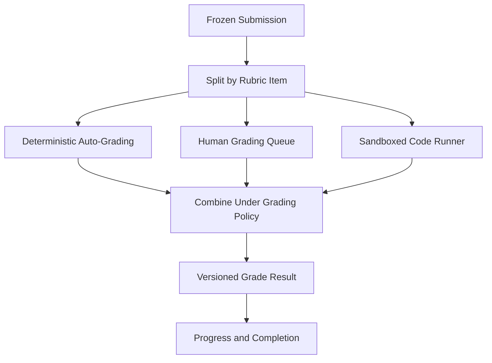

The grade record contains assessment version, submission version, grader or algorithm version, rubric version, scores, feedback, and decision time.

Regrading creates a new score version and preserves the original. Downstream completion and certificate state recompute through an auditable adjustment.

## Coding exercises

Run untrusted submissions in short-lived isolated sandboxes with CPU, memory, process, filesystem, network, and time limits.

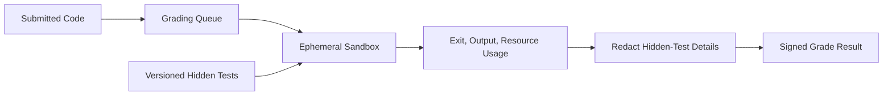

Use read-only base images, no default external network, randomized secrets, output limits, and aggressive cleanup. Treat compilers and runtimes as hostile-input parsers.

Cache results only by submission hash, environment version, test version, and policy—never by source alone.

## Human grading

Assignments enter queues by course, rubric, language, deadline, and grader qualification. A grading lease prevents two graders from unknowingly editing the same submission.

Blind grading can hide learner identity where policy requires. Moderation and calibration workflows compare graders on shared samples.

Draft feedback autosaves, but publishing a grade is a versioned transaction. Learners see only released feedback, not internal grader notes.

## Live classes

The live-class service schedules sessions, registers attendees, issues joining credentials, tracks bounded attendance evidence, and links recordings afterward.

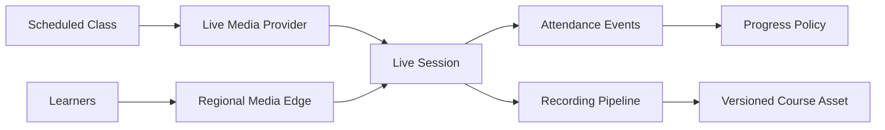

Large lectures use broadcast delivery with moderated interaction rather than a full mesh. Small classes can use bidirectional real-time media.

Attendance records join/leave intervals and provider evidence, but completion rules should tolerate reconnects and approved absence policy.

## Cohorts and deadlines

Cohorts define enrollment windows, content-release schedules, deadlines, instructors, discussion groups, live sessions, and grading periods.

Deadlines are stored as local time plus named time zone and rule version. Learner accommodations create explicit deadline overrides rather than mutating the cohort schedule.

Changes after release generate versioned schedule updates and notification intents. A delayed notification does not change the authoritative deadline.

## Discussions and moderation

Course discussions support threads, replies, mentions, reactions, instructor endorsements, and moderation.

Store posts durably before realtime fan-out. Apply rate limits, spam detection, abuse policy, content scanning, and role-based visibility.

Instructors can pin or close threads but cannot silently rewrite learner posts. Edits and moderation preserve version history for authorized review.

## Completion

Completion rules can require lessons, passing grades, live attendance, project approval, or minimum time windows.

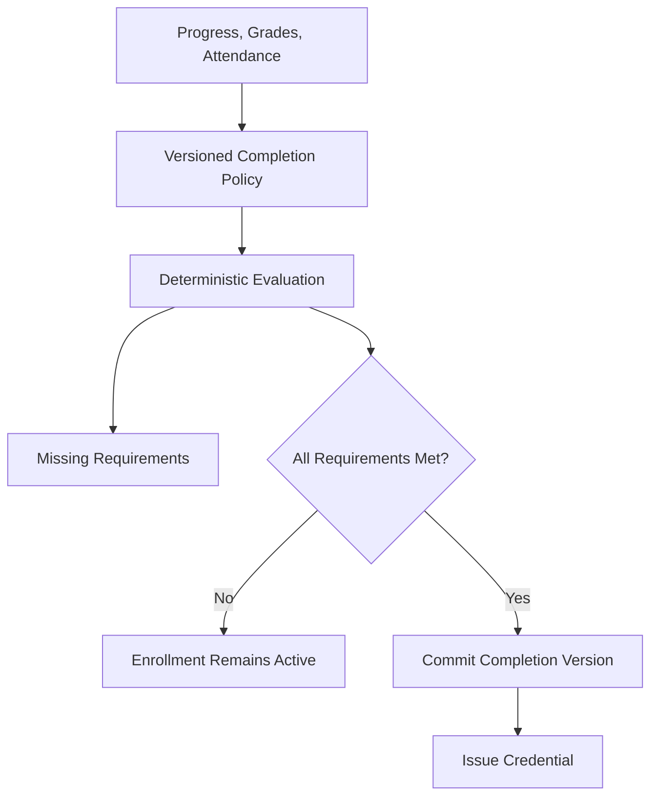

The completion record freezes evidence IDs and policy version. It can later be revoked or superseded, but never overwritten.

## Credentials and certificates

A certificate contains learner identity reference, course, course version, completion time, issuer, credential ID, and status.

Issue a signed verification document and public verification URL that reveals only approved fields. The verifier checks signature, issuer, expiry, and revocation state.

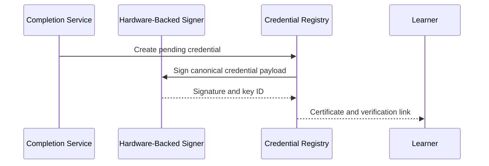

Revocation records reason category, actor, evidence, and effective time. A corrected certificate creates a new credential linked to the superseded one.

## Search and recommendations

Search indexes published course title, description, instructor, skills, level, language, captions, ratings, availability, and access policy.

Recommendations use learning history, goals, prerequisites, organization policy, and content quality. Eligibility filtering happens before ranking so unavailable or incompatible courses are not recommended.

Keep recommendations out of the critical learning path. A recommendation outage should not prevent an enrolled learner from opening a course.

## Learning analytics

Events feed operational dashboards and historical analysis:

- Enrollment, activation, and completion funnels
- Lesson engagement and content drop-off
- Assessment difficulty and discrimination
- Grading turnaround and consistency
- Live attendance and recording usage
- Cohort progress and deadline risk
- Accessibility feature usage

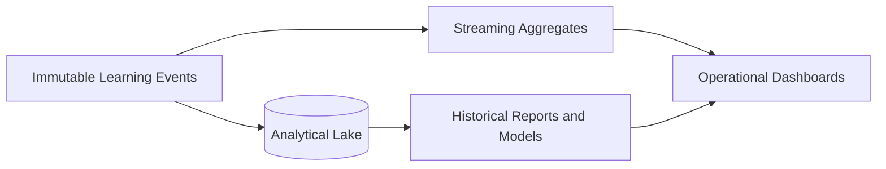

Analytics uses pseudonymous identifiers where possible. Do not expose small-group results that reveal an individual learner's performance.

## Academic integrity

Layer controls according to assessment stakes:

- Randomized question selection and answer ordering
- Attempt-specific content and short-lived asset URLs
- Server-authoritative timers and submission state
- Plagiarism and code-similarity analysis
- Browser or device signals with explicit consent and policy
- Identity re-verification for high-stakes exams
- Statistical anomaly detection across attempts
- Human review and appeal

No detector is perfect. High-impact enforcement requires explainable evidence and review, not a single opaque score.

## Multi-tenant organizations

Organizations can assign courses, manage seats, set deadlines, view authorized learner progress, and upload private content.

Tenant context comes from authenticated membership, not request parameters. Private catalogs, enrollments, analytics, content, keys, and search documents are tenant scoped.

Organization administrators see only progress fields allowed by contract, consent, and regional policy. Instructor access does not automatically grant organization-wide reporting.

## Multi-region design

Course media and public manifests replicate globally. Learner identity, enrollment, progress, submissions, and grades remain in an approved home region.

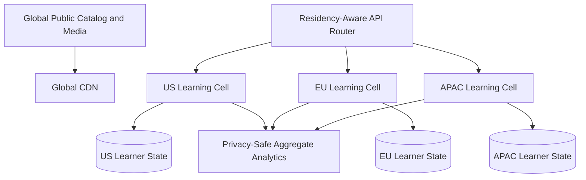

Cross-region instructors receive authorized views through regional APIs; raw submissions do not move merely for convenience.

Regional failover uses a higher ownership epoch. Offline progress uploads and assessment submissions are idempotent so replay after recovery is safe.

## Privacy, safety, and accessibility

- Encrypt learner records, submissions, grades, discussions, and private media
- Separate identity from analytical event identifiers
- Audit grade changes, exports, impersonation, and privileged access
- Apply age-appropriate controls and guardian policy where required
- Scan uploads and discussion content for malware and abuse
- Provide captions, transcripts, keyboard navigation, semantic structure, and alternatives
- Store accessibility accommodations with restricted access
- Apply deletion and retention across source and derived systems
- Never expose hidden answers, private rubrics, or instructor-only notes to clients

Accessibility is a publishing requirement, not a post-processing option. Content that lacks required alternatives remains unpublished or clearly incomplete according to policy.

## Reliability and failure handling

| Failure | Safe behavior |
| --- | --- |
| Progress event repeats | Stable event ID and device sequence deduplicate it |
| Old offline progress arrives | Semantic merge preserves newer or monotonic state |
| Video processor fails | Retry immutable source asset; do not publish incomplete media |
| Assessment worker crashes | Attempt remains frozen and grading resumes idempotently |
| Timer worker is delayed | Server due time remains authoritative |
| Grade is delivered twice | Score version and grading job ID suppress duplication |
| Live provider fails | Continue course access and apply session-specific recovery policy |
| Search is unavailable | Enrolled learning and direct catalog access continue |
| Region fails | Promote fenced replica and replay events with stable IDs |

Every asynchronous stage consumes durable input and commits versioned output before advancing its checkpoint.

## Observability and SLOs

Track:

- Course publication failures and media-processing age
- Enrollment latency, seat conflicts, and entitlement denials
- Video startup time, buffering ratio, CDN hit rate, and playback errors
- Progress ingestion lag, duplicate rate, and projector backlog
- Attempt starts, autosave latency, timer expiry, and submission failures
- Grading queue age, regrade rate, and rubric-version usage
- Live-session join success, reconnects, and attendance processing
- Completion evaluation and credential issuance lag
- Offline sync age and conflict outcomes
- Regional replication and ownership epoch

Useful SLOs include 99.99% enrolled-course access, 99.9% video start under two seconds on supported networks, and zero assessment attempts graded against a different version than the one delivered.

## Key trade-offs

| Decision | Benefit | Cost |
| --- | --- | --- |
| Immutable published versions | Reproducible learning and grading | Storage and migration complexity |
| Event-based progress | Offline sync and auditability | Projection and semantic merge work |
| CDN media delivery | Massive global scale | Token and rights-management complexity |
| Frozen assessment attempts | Fair, reproducible grading | Late content fixes need explicit action |
| Server-authoritative timers | Consistent exam policy | Offline high-stakes attempts are limited |
| Separate analytics pipeline | Protects learning availability | Eventual reporting consistency |
| Home-region learner state | Residency and isolation | Cross-region teaching is more complex |

## Evolution path

1. Build versioned courses, enrollment, video delivery, and basic progress.
2. Add quizzes, attempts, grading, completion, and certificates.
3. Introduce cohorts, deadlines, discussions, and live classes.
4. Add offline packages, incremental progress sync, and organization tenancy.
5. Deploy regional learning cells and privacy-safe analytics.
6. Add advanced recommendations and integrity tooling with human oversight.

Start with immutable course and assessment versions. Without them, every content edit risks changing what learners were expected to know and how completed work should be judged.

## Final design

Publish courses as immutable manifests that reference versioned lessons, media, assessments, and grading policies. Pin each enrollment and attempt to explicit versions, distribute video through adaptive CDN delivery, and record learning progress as idempotent events projected into current state. Freeze question selection, timing, accommodations, answers, and rubric versions for every assessment attempt, then grade through deterministic or leased human workflows. Evaluate completion from versioned evidence and issue signed, revocable credentials.

The central principle is reproducibility. A learner, instructor, or auditor should be able to determine exactly which content was assigned, what the learner submitted, which policy graded it, and why a credential was issued—even after the course has evolved.
